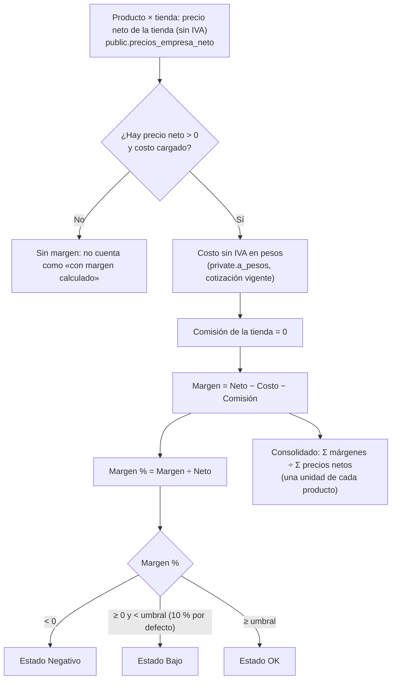
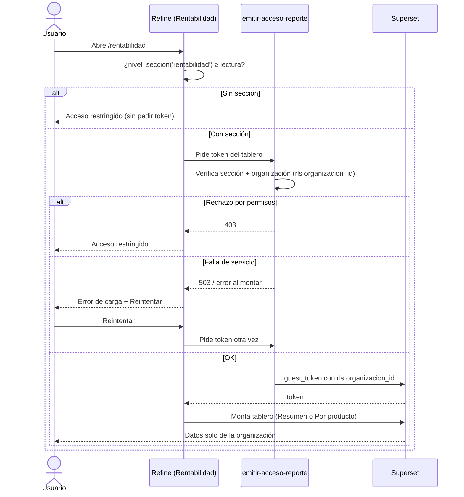
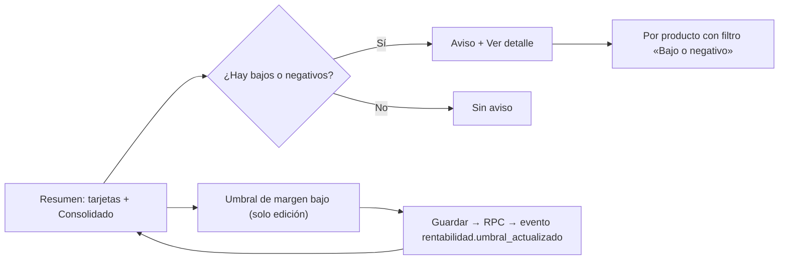

# Feature Specification: Inicio, rentabilidad y reportes · Rentabilidad margen

**Épica**: MSF-120 · **Spec**: `rentabilidad-margen` · **Hito**: 4 (30 de noviembre al 11 de diciembre de 2026) · **Prioridad**: P0 · **Alcance (Jira)**: etapa-2 · **Horas aprox.**: 23 (las tallas L+M+M suman 32 h: ver *Decisiones abiertas* 9)
**Alcance de entrega**: `refine`, `supabase`, `superset` (sin `kestra` ni `workers`: el cálculo es SQL y el tablero lo sirve Superset).
**Fuente**: especificación de Nicolás cargada en la épica (Jira), prototipo en `design/pantallas/Rentabilidad*.dc.html` y artefactos del producto (documento del componente, Roadmap, Funcionalidades, Relevamiento). Esta spec **traduce**; no agrega alcance.

> Nota de rama: la rama `design/prototipo` ya no existe; los prototipos viven en `design/pantallas/` y de ahí salen los inventarios (`pnpm prototipo:inventario`, `pnpm prototipo:check` al día).

## Objetivo

Al terminar, el administrador abre Rentabilidad y ve, para cada producto y cada tienda, cuánto gana sobre el precio sin IVA, con un resumen por empresa y consolidado y los productos de margen bajo o negativo a un clic.

## Modelo y supuestos

Todos los supuestos están **a confirmar con el cliente** (así lo declara la épica):

- El margen se calcula sobre el **precio neto (sin IVA)** y el costo se carga **sin IVA**.
- La tienda no cobra en línea: su **comisión es 0**.
- El **umbral de margen bajo es 10 %** y lo cambia **solo el administrador**.
- El **margen promedio consolidado** se pondera tomando **una unidad de cada producto**: suma de márgenes ÷ suma de precios netos.
- En el Hito 4 **no hay Mercado Libre**: la pestaña «Por publicación de ML» y la comisión de Mercado Libre **se ocultan** hasta que la organización tenga esa funcionalidad activa (épica de Mercado Libre, Etapa 2).
- Rentabilidad se resuelve con **tableros de Superset embebidos por organización** (spec 007 del template), alimentados por **vistas del esquema `analitica`**.
- **Ya existe** (no se recrea): `dominio.productos` (`moneda`, `precio_lista`), `dominio.producto_costos` (`costo`, sección `rentabilidad`), `public.precios_empresa_neto` (neto por producto y empresa, MSF-114), `private.a_pesos` (conversión con la cotización vigente; MSF-116 la hace «vigente» y con historial), `private.nivel_seccion`, `private.insertar_actividad`, `public.registro_actividad`, la matriz `permisos_rol` con la sección `rentabilidad`, y de la spec 007: `emitir-acceso-reporte`, `public.resolver_organizacion_reporte`, `ReporteEmbebido`, tablas `reportes*`, `infra/superset/importar-dashboards.mjs`.
- **No existe y lo construye esta épica** (la épica lo dice: «el template no trae dashboards versionados ni import automático en CI, ni vistas de ventas, stock o precios»): el esquema `analitica` y sus vistas, los datasets y tableros YAML versionados con su importación, el umbral configurable, la restricción por sección en el token y la pantalla Rentabilidad.
- **Bloqueo**: MSF-116 (cotización vigente e historial, F-PRE-02/F-PRE-04; trae a MSF-114 por transitividad). **Verificaciones previas**: que `rentabilidad` exista en `permisos_rol` y `private.nivel_seccion` esté disponible (ya están en el repo, componente Acceso/MSF-125) y que el token de invitado de Superset funcione con **dos organizaciones** (SC-003).

### Esquema de datos (Constitución, Principio VII)

| Objeto | Esquema | Historia | Justificación | RLS / acceso |
|--------|---------|----------|---------------|--------------|
| `rentabilidad_config` (**nueva**, `umbral_margen_bajo`) | `dominio` | F-REN-01 | Regla de negocio de la organización (cuándo un margen es «bajo»). | `organizacion_id = (select private.organizacion_id())`; select `rentabilidad`≥`lectura`; insert/update `rentabilidad`=`edicion`; sin delete; sin privilegios para `anon` |
| RPC `public.guardar_umbral_margen_bajo`, `public.leer_umbral_margen_bajo` | `public` | F-REN-01 | Superficie de ejecución; no almacena datos. | `security invoker`, `revoke … from public, anon`, `grant execute … to authenticated` |
| Esquema `analitica` + vista `analitica.margen_producto_canal` | `analitica` (esquema nuevo, **solo vistas**, sin tablas) | F-REN-01 | Contrato de lectura para Superset y otras épicas (MSF-156, 127, 128, 192, 265). No almacena datos; toda fila lleva `organizacion_id`. | Sin acceso para `anon` ni `authenticated`; `select` solo al rol de lectura de Superset; el aislamiento lo fuerza la cláusula `rls` del guest token (`organizacion_id = '<org>'`) |
| Vistas `analitica.rentabilidad_resumen_empresa`, `analitica.rentabilidad_consolidado` | `analitica` | F-REN-02 | Agregados del resumen. | Ídem |
| RPC `public.rentabilidad_conteo_margen` | `public` | F-REN-02 | Cuenta bajos/negativos para el aviso del resumen con RLS del usuario. | `security invoker`, grants como arriba |
| `reportes.seccion` (**columna nueva**, nullable) | `public` (plataforma: `reportes` es de la spec 007) | F-REN-01 | Marca el reporte que exige una sección de permisos para emitir el token. | RLS vigente de `reportes` |

La prueba pgTAP `rls_en_toda_tabla` recorre `public` + `dominio` y debe seguir verde (el esquema `analitica` no tiene tablas). Reversión de cada migración: ver `plan.md` (todas aditivas).

## User Scenarios & Testing *(mandatory)*

### User Story 1 - Margen por producto y canal (F-REN-01, P0, talla L)

Como administrador quiero que cada producto tenga su margen calculado por tienda sobre el precio sin IVA, con un umbral de margen bajo, y que solo yo (y quien tenga la sección) acceda a esos tableros, para confiar en los números que veo en Rentabilidad.

**Por qué**: es la base de las otras dos historias (fórmula, umbral, contrato `analitica.margen_producto_canal`, permisos y tableros versionados).

**Escenarios**:
1. **Dado** un producto con neto $ 10.000 en una tienda y costo $ 6.000, **cuando** consulto `analitica.margen_producto_canal`, **entonces** margen = 4.000, margen % = 40 %, comisión = 0 y estado «OK».
2. **Dado** un producto en USD con costo cargado y cotización vigente, **cuando** se calcula, **entonces** precio neto y costo se convierten a pesos con la misma cotización vigente (`private.a_pesos`); si no hay cotización, el producto **no tiene margen** (no se inventa un valor).
3. **Dado** un producto sin costo cargado, **cuando** se calcula, **entonces** no aparece con margen y no cuenta como «con margen calculado».
4. **Dado** margen % < 0, **entonces** estado «Negativo»; **dado** 0 ≤ margen % < umbral, «Bajo»; **dado** margen % ≥ umbral (incluido el valor exacto), «OK».
5. **Dado** el umbral por defecto (10 %), **cuando** el administrador lo cambia a 15 % y guarda, **entonces** los estados se recalculan con 15 % y queda el evento `rentabilidad.umbral_actualizado` (actor, antes/después) en Actividad; **dado** un usuario sin `edicion` en `rentabilidad`, **entonces** la RPC lo rechaza.
6. **Dado** un umbral fuera de rango (≤ 0 %, > 100 %, vacío o no numérico), **cuando** se guarda, **entonces** se rechaza con mensaje claro asociado al campo.
7. **Dado** dos organizaciones con productos y costos, **cuando** el usuario de la organización A abre un tablero, **entonces** el token lleva `organizacion_id = '<A>'` y ninguna fila de B aparece.
8. **Dado** un usuario cuyo rol tiene `rentabilidad` en «ninguno» (p. ej. Operador, Consulta, Mostrador, Depósito, Miembro), **cuando** pide el token de un tablero de Rentabilidad, **entonces** la función responde 403 y no se emite token; **dado** Administrador (edición) o Administración (lectura, matriz vigente), **entonces** se emite.
9. **Dado** el repo, **cuando** corre el CI, **entonces** los datasets y tableros de Rentabilidad están exportados a YAML versionado y se importan a Superset de forma automática (no quedan solo en la UI).

### User Story 2 - Resumen de rentabilidad (F-REN-02, P0, talla M)

Como administrador abro Rentabilidad → Resumen y veo el margen promedio por empresa y el consolidado, y cuántos productos tienen margen bajo o negativo, con un acceso directo a revisarlos.

**Escenarios**:
1. **Dado** una organización con tiendas con costos cargados, **cuando** abro Resumen, **entonces** veo una tarjeta por empresa (nombre, «N productos», margen promedio %, «Margen promedio · $ X por unidad», barra, chips «N margen bajo» y «N negativo») y el bloque **Consolidado** (Productos con margen calculado, Margen promedio ponderado, Con margen bajo (< umbral), Con margen negativo).
2. **Dado** el consolidado, **entonces** el margen promedio ponderado = suma de márgenes ÷ suma de precios netos (una unidad de cada producto), no el promedio simple de los porcentajes.
3. **Dado** al menos un producto bajo o negativo, **cuando** miro el resumen, **entonces** veo el aviso «Hay productos que se venden por debajo del costo o casi. Revisalos en Por producto.» con `Ver detalle`, que me lleva a «Por producto» con el filtro «Bajo o negativo» aplicado (un clic); **dado** cero, **entonces** no se muestra el aviso.
4. **Entonces** veo la tarjeta «Cómo se calcula» (Margen = Precio − Costo − Comisión; Margen % = Margen ÷ Precio; tabla Canal / Precio usado / Comisión-costo disponible por tienda) y la aclaración «Estimación con los datos disponibles: no incluye impuestos, envíos ni otros costos.»
5. **Dado** una organización sin ningún producto con margen calculado (sin costos o sin cotización), **entonces** veo el estado vacío del resumen (patrón compartido) en lugar de tarjetas en cero.
6. **Dado** que el tablero no carga (Superset caído o token rechazado por falla), **entonces** veo el estado de error del patrón compartido con `Reintentar`, que vuelve a pedir el token y montar el tablero; sin detalle técnico.
7. **Dado** un usuario sin sección `rentabilidad`, **cuando** entra por URL, **entonces** ve la pantalla de acceso restringido y no se pide token.
8. **Dado** el administrador, **cuando** abre el diálogo «Umbral de margen bajo» (control del encabezado del resumen), cambia el valor y guarda, **entonces** se llama a la RPC de F-REN-01, se recargan resumen y aviso con el umbral nuevo y se muestra confirmación; `Cancelar` descarta; **dado** Administración (solo lectura), el control no se ofrece.
9. **Dado** que la organización no tiene Mercado Libre activo, **entonces** no hay tarjeta, fila ni pestaña de Mercado Libre.

### User Story 3 - Rentabilidad por producto (F-REN-03, P0, talla M)

Como administrador veo la tabla de márgenes por producto y tienda, ordenable y filtrable, para encontrar rápido dónde se gana poco o se pierde.

**Escenarios**:
1. **Dado** la pestaña «Por producto», **entonces** veo la tabla con columnas `Producto` (nombre y SKU), `Canal`, `Precio`, `Costo`, `Comisión`, `Margen`, `Margen %` (con barra) y `Estado` (OK / Bajo / Negativo), una fila por producto y tienda, y el contador «N filas».
2. **Dado** el filtro de estado (`Todos`, `Bajo o negativo`, `Solo negativo`), **cuando** elijo una opción, **entonces** la tabla muestra solo esas filas y el contador se actualiza.
3. **Dado** el filtro de canal (`Todos los canales` + una opción por tienda de la organización), **entonces** filtra por tienda; no ofrece Mercado Libre.
4. **Dado** el orden, **entonces** alterna «Mayor margen primero» / «Menor margen primero».
5. **Dado** el buscador «Buscar producto o SKU», **entonces** filtra por nombre o SKU.
6. **Dado** filtros sin coincidencias, **entonces** veo «Sin resultados / Cambiá el filtro o la búsqueda.»
7. **Dado** que vengo del aviso del resumen (`Ver detalle`), **entonces** el filtro «Bajo o negativo» ya viene aplicado.
8. **Entonces** veo la nota «Margen = Precio − Costo − Comisión. Las tiendas propias no tienen comisión en esta versión.» y, igual que en el resumen, el error de carga con `Reintentar`, el acceso restringido y la ocultación de Mercado Libre.
9. **Dado** un producto con margen negativo, **entonces** su margen y su porcentaje se resaltan (color de error del sistema de diseño) y su estado dice «Negativo».

### Edge Cases

- Producto presente en dos tiendas con reglas de precio distintas → dos filas con neto y margen propios.
- Costo en USD y producto en ARS (o viceversa): la conversión de cada importe sigue su moneda (`private.a_pesos`).
- Neto = 0 o no positivo → sin margen (evita división por cero).
- Cambio de cotización (MSF-116) → los márgenes cambian solos: nada se guarda en pesos.
- Superset caído con el administrador logueado → estado de error con reintento, el resto de la app sigue.
- Dos organizaciones con el mismo producto/SKU → nunca se mezclan (cláusula `rls` por `organizacion_id`).
- Se agrega una empresa/tienda nueva → aparece sola en tarjetas, canal y tabla.

## Flujos

### F1 · Cálculo del margen (del precio y el costo al estado)

Dueños: neto y costo FR-001…FR-003; comisión y fórmula FR-002; estado FR-004; consolidado FR-012. Pasos sin dueño: ninguno. **Fuera de alcance**: comisión de Mercado Libre (Etapa 2), impuestos, envíos y otros costos (aclarado en pantalla, FR-014).

### F2 · Acceso al tablero y recuperación de errores

Dueños: restricción por sección y token FR-007, FR-008; pantalla, error y reintento FR-013, FR-016, FR-017; acceso restringido FR-016. Pasos sin dueño: ninguno.

### F3 · Del resumen al detalle y el umbral

Dueños: tarjetas y consolidado FR-011, FR-012; aviso y navegación FR-015; filtro destino FR-019; diálogo de umbral FR-018; RPC y evento FR-005, FR-006. Pasos sin dueño: ninguno.

## Requirements *(mandatory)*

### F-REN-01 · Margen por producto y canal

- **FR-001**: Existe el esquema `analitica` y la vista `analitica.margen_producto_canal` (una fila por producto × tienda con margen calculable) con columnas `organizacion_id`, `empresa_id`, `empresa_nombre`, `producto_id`, `producto_nombre`, `sku`, `precio_neto`, `costo`, `comision`, `margen`, `margen_pct` y `estado` (`ok`/`bajo`/`negativo`), tomando el neto de `public.precios_empresa_neto`. Es el **contrato** que consumen Superset y otras épicas (MSF-156, 127, 128, 192, 265); declarado en `contracts/analitica-margen.md`.
- **FR-002**: `margen = precio_neto − costo − comision` y `margen_pct = margen / precio_neto`, siempre sobre el neto sin IVA; `comision = 0` para tiendas; el costo sin IVA se convierte con `private.a_pesos` (misma cotización vigente que el precio, MSF-116).
- **FR-003**: Sin costo, sin precio neto positivo o sin cotización para un importe en USD, la fila **no existe** (no se inventa margen) y no cuenta como «con margen calculado».
- **FR-004**: `estado` = `negativo` si `margen_pct < 0`; `bajo` si `0 ≤ margen_pct < umbral`; `ok` si `margen_pct ≥ umbral`, con el umbral de la organización (10 % por defecto).
- **FR-005**: `dominio.rentabilidad_config` guarda `umbral_margen_bajo` por organización (0 < valor ≤ 1, por defecto 0,10, `updated_at`); `public.leer_umbral_margen_bajo()` lo devuelve y `public.guardar_umbral_margen_bajo(umbral, updated_at)` lo cambia **solo con `edicion` en `rentabilidad`**, con bloqueo optimista por `updated_at`, idempotente y validando el rango.
- **FR-006**: Guardar un umbral distinto registra `rentabilidad.umbral_actualizado` (actor, antes/después, organización) vía `private.insertar_actividad`; sin evento si no cambió.
- **FR-007**: `public.reportes` suma `seccion` (nullable) y `emitir-acceso-reporte` / `resolver_organizacion_reporte` exigen `private.nivel_seccion(seccion) in ('lectura','edicion')` para los reportes que la declaren, además de las reglas vigentes de la spec 007; el token sigue forzando `organizacion_id` en la cláusula `rls`. Los reportes de Rentabilidad se registran con `seccion = 'rentabilidad'`.
- **FR-008**: Existe un rol de **solo lectura** para Superset con `select` únicamente sobre el esquema `analitica` (`anon` y `authenticated` sin acceso a las vistas); su credencial va en `.env.example` sin valor real.
- **FR-009**: Los **datasets y tableros** de Rentabilidad («Resumen» y «Por producto») se exportan a YAML bajo `infra/superset/dashboards/rentabilidad/` y se importan de forma automática en CI/despliegue con `infra/superset/importar-dashboards.mjs`; el registro como `reportes` con `seccion = 'rentabilidad'` es idempotente.
- **FR-010**: Los tableros, datasets y la pestaña de Mercado Libre **no incluyen** Mercado Libre ni su comisión mientras la organización no lo tenga activo.
- **SC-001**: pgTAP: fórmula (neto, costo, margen, %), conversión USD/ARS, sin costo/sin cotización/sin neto → sin fila, estados en los bordes (`< 0`, `= 0`, `= umbral`), umbral por defecto y cambiado, rango inválido, evento de actividad, `anon`/`authenticated` sin acceso a `analitica`, `rls_en_toda_tabla` verde.
- **SC-002**: pgTAP de **permisos**: RPC de umbral solo con `edicion`; lectura del umbral con `lectura`; matriz por los 7 roles de la sección `rentabilidad`; bloqueo optimista.
- **SC-003**: pgTAP + prueba de la función: **aislamiento entre dos organizaciones** (la vista expone `organizacion_id` y el token de A solo lleva A; B nunca aparece) y token rechazado (403) para roles sin `rentabilidad`.

### F-REN-02 · Resumen de rentabilidad

- **FR-011**: La vista `analitica.rentabilidad_resumen_empresa` y el tablero «Resumen» muestran, por empresa, nombre, N productos, margen promedio %, margen promedio por unidad en pesos, barra y conteos «margen bajo» / «negativo».
- **FR-012**: La vista `analitica.rentabilidad_consolidado` y el tablero muestran Productos con margen calculado, **Margen promedio ponderado** = Σ márgenes ÷ Σ precios netos (una unidad de cada producto), Con margen bajo (< umbral, el rótulo muestra el umbral vigente) y Con margen negativo.
- **FR-013**: La pantalla `/rentabilidad` (menú «Análisis», ícono propio) con título «Rentabilidad», subtítulo «Margen estimado por canal, producto y publicación.», pestañas `Resumen` y `Por producto` (sin «Por publicación de ML», FR-010), embebe el tablero con `ReporteEmbebido` y usa los patrones compartidos de carga, vacío y error; funciona con teclado y lector de pantalla a 320/768/1440 px.
- **FR-014**: El resumen incluye la tarjeta «Cómo se calcula» (fórmulas, tabla Canal / Precio usado / Comisión-costo disponible con una fila por tienda y el texto «Sin comisión…») y la aclaración «Estimación con los datos disponibles: no incluye impuestos, envíos ni otros costos.».
- **FR-015**: El aviso «Hay productos que se venden por debajo del costo o casi. Revisalos en Por producto.» con `Ver detalle` aparece solo si hay bajos o negativos (cuenta por `public.rentabilidad_conteo_margen()`, RLS del usuario) y navega a «Por producto» con el filtro «Bajo o negativo».
- **FR-016**: Sin `lectura` en `rentabilidad` la ruta muestra `AccesoRestringido`, no se oculta solo en el menú y **no se pide token**; ante 403 del token muestra lo mismo.
- **FR-017**: Si el tablero no carga (503 o falla al montar) se muestra el estado de error con `Reintentar`, que repite la solicitud del token y el montaje; sin detalle técnico; el estado vacío (sin ningún margen calculado) usa el patrón compartido de vacío.
- **FR-018**: El diálogo «Umbral de margen bajo» (campo `Umbral de margen bajo` en %, valor por defecto 10, `Cancelar`, `Guardar`) se abre desde el resumen **solo con `edicion`**, valida el rango, llama a `guardar_umbral_margen_bajo`, recarga el tablero y el aviso, y confirma el guardado; no existe en el prototipo (ver matriz).
- **SC-004**: Vitest: tarjetas/consolidado, aviso con/sin bajos, navegación con filtro, vacío, error con reintento, acceso restringido, diálogo de umbral (rango, rol, cancelar) y ocultación de Mercado Libre; teclado/lector.
- **SC-005**: pgTAP del **consolidado**: ponderación Σ márgenes ÷ Σ netos (caso donde difiere del promedio simple), conteos, coherencia de los conteos de `rentabilidad_conteo_margen` con la vista.

### F-REN-03 · Rentabilidad por producto

- **FR-019**: El tablero «Por producto» muestra la tabla de FR-001 con columnas `Producto` (nombre + SKU), `Canal`, `Precio`, `Costo`, `Comisión`, `Margen`, `Margen %` (con barra) y `Estado` (OK / Bajo / Negativo), contador «N filas», y acepta el filtro de estado inicial «Bajo o negativo» desde el resumen.
- **FR-020**: El tablero ofrece filtro de estado (`Todos`, `Bajo o negativo`, `Solo negativo`), filtro de canal (`Todos los canales` + una opción por tienda; sin Mercado Libre), orden «Mayor margen primero» / «Menor margen primero» y buscador «Buscar producto o SKU».
- **FR-021**: Sin coincidencias muestra «Sin resultados» / «Cambiá el filtro o la búsqueda.»; los márgenes negativos se resaltan con el color de error del sistema de diseño.
- **FR-022**: La pestaña muestra la nota «Margen = Precio − Costo − Comisión. Las tiendas propias no tienen comisión en esta versión.» y comparte con el resumen error con `Reintentar`, acceso restringido y ocultación de Mercado Libre.
- **SC-006**: Vitest: columnas, filtros, orden, búsqueda, vacío, filtro inicial desde el resumen, error/reintento, acceso restringido, teclado/lector.
- **SC-007**: pgTAP/consulta del dataset: orden y filtros del tablero coinciden con la vista (un producto en dos tiendas = dos filas; un negativo se marca «Negativo»).

### Cierre (docs, seguridad, E2E, roadmap)

- **FR-023**: `docs/rentabilidad.md` (fórmula, umbral, ponderación, contrato `analitica.margen_producto_canal`, permisos, importación de tableros, reversión, preguntas abiertas), `docs/operar-superset.md` y `docs/roadmap-template.md` actualizados; `pnpm docs:check` verde.
- **FR-024**: Revisión de seguridad de la superficie nueva (RLS/grants de tabla y RPC, `anon` sin acceso, esquema `analitica` cerrado, rol de lectura de Superset, token por sección) y re-verificación de esquemas contra el Principio VII.
- **SC-008**: E2E de Rentabilidad con **los tres roles** (Administrador edita, Administración lee, Operador/Consulta restringido) y cambio de umbral reflejado.
- **SC-009**: `pnpm lint`, `pnpm build`, `pnpm infra:config`, `pnpm test`, `rls_en_toda_tabla`, `pnpm prototipo:check` y `pnpm matriz:check` verdes.

## Decisiones abiertas

1. **Cálculo en SQL, no worker.** Las vistas calculan al leer; sin `kestra` ni `workers`. Como MSF-114, no se guarda ningún importe en pesos.
2. **Quién ve Rentabilidad.** La épica dice «solo Administrador», pero la matriz vigente (`permisos_rol`) da `rentabilidad`: Administrador = edición, **Administración = lectura**, resto = ninguno. **Se respeta la matriz vigente** (no se contradice el código de Acceso); editar el umbral es solo del Administrador. Confirmar si Administración debe ver los tableros.
3. **¿El rol Consulta ve costos?** Pregunta abierta de la épica; hoy la matriz le da `ninguno` y el token **solo se emite** a quien tenga la sección. Se mantiene hasta que se resuelva.
4. **Ponderación del consolidado.** Se usa la del supuesto (una unidad de cada producto: Σ márgenes ÷ Σ netos). Se calcula sobre las filas producto × tienda y «Productos con margen calculado» cuenta productos distintos (como el prototipo: 7 + 9 + 7 filas → 20 productos). ¿Ponderar por stock o ventas reales? Pregunta abierta; fuera de esta épica (MSF-192 lo retoma).
5. **Superset en lugar de Refine.** La fuente original usaba Refine para las pantallas base; por indicación del proyecto Rentabilidad usa Superset embebido. Tarjetas, tabla, filtros y barras salen de los gráficos de Superset: fidelidad «lo más cercana» (regla de fuentes 5); las diferencias se anotan en el PR. Lo que no puede ser Superset (pestañas, aviso con navegación, diálogo del umbral, acceso restringido, error/reintento) es Refine.
6. **Texto «Precio central».** El prototipo rotula «Precio usado: Precio central» para las tiendas; como el margen se calcula sobre el **neto de cada tienda** (regla de precio de la empresa), el rótulo es «Precio neto de la tienda (sin IVA)». Diferencia a anotar en el PR.
7. **Registro de actividad (F-AUD-01).** Los eventos de Actividad dependen del registro de actividad, que en el template no es auditoría transversal y la historia F-AUD-01 no figura en Jira. Se construye contra el contrato existente (`private.insertar_actividad`), sin bloqueo; confirmar dónde vive.
8. **Roadmap.** El Roadmap a diciembre manda «Rentabilidad y reportes avanzados» a enero; el doc del componente y Funcionalidades la dejan P0 en el Hito 4. **Manda el roadmap**: Nicolás debe decidir y alinear (no cambia el alcance de esta spec).
9. **Horas.** 23 h (el embebido viene del template) vs. 28–32 h realistas si el import automático de tableros y la restricción por sección se suman acá, como hace esta spec (FR-007, FR-009). Decidir.
10. **Restricción por empresa.** El token filtra por **organización**; no por las empresas a las que un usuario tiene acceso (permisos por empresa). El Administrador ve todas; si Administración tuviera empresas acotadas, quedaría fuera de esta épica.
11. **Esquema `analitica`**: solo vistas; el Principio VII exige RLS en tablas expuestas de `public`/`dominio` y aquí no hay tablas. El aislamiento depende del filtro `rls` del token, por eso la prueba SC-003 es obligatoria.
12. **Filtro inicial desde el resumen** (`Ver detalle`): se pasa por parámetro del embebido al filtro nativo del tablero; si el SDK no lo soporta, se declara `Desvío:` y la pestaña abre en «Todos» ordenada por «Menor margen primero» (ver `plan.md`, riesgos).

## Matriz pantalla↔criterios

Inventario determinista con `pnpm prototipo:inventario` sobre `RentabilidadResumen.dc.html`, `RentabilidadProductos.dc.html` y `RentabilidadPublicaciones.dc.html` (`design/pantallas/*.inventory.json`; `pnpm prototipo:check` confirma que están al día). La épica pide **menos** que el prototipo: lo que no pide no es deuda.

### Rentabilidad · resumen (`RentabilidadResumen.dc.html`)

| Ítem del inventario | Destino | Criterio |
|---|---|---|
| Tabla «Cómo se calcula»: columnas `Canal`, `Precio usado`, `Comisión / costo disponible` (filas de tiendas) | En alcance | US2-4, FR-014 |
| Fila «Mercado Libre» de esa tabla («14,5 % estimada, editable») | Fuera de alcance: Mercado Libre se oculta hasta que la organización lo tenga (Etapa 2) | FR-010 |
| Pestañas `Resumen`, `Por producto` | En alcance | US2/US3, FR-013 |
| Pestaña / botón `Por publicación de ML` | Fuera de alcance: pertenece a la épica de Mercado Libre (Etapa 2); se oculta | FR-010 |
| Botón `Ver detalle` (aviso) | En alcance | US2-3, FR-015 |
| Tarjetas por empresa y bloque **Consolidado** (visibles aunque no estén en el inventario) | En alcance | US2-1/2, FR-011, FR-012 |
| Tarjeta de Mercado Libre | Fuera de alcance (ídem) | FR-010 |
| Diálogo «Comisión estimada de Mercado Libre»: campo `Comisión sobre el precio`, botones `Cancelar`, `Guardar` | Fuera de alcance: la comisión de ML es de la épica de Mercado Libre. El diálogo **«Umbral de margen bajo»** que pide la épica **no está en el prototipo**: se implementa con el mismo patrón de diálogo (campo %, `Cancelar`, `Guardar`) | FR-018 |
| Estados que pide la épica y el prototipo no dibuja: aclaración del cálculo, error de carga con reintento, acceso restringido, estado vacío | En alcance | US2-4/5/6/7, FR-014, FR-016, FR-017 |
| Fila **Empresa activa** | No aplica: Rentabilidad compara **todas** las empresas de la organización lado a lado (tarjetas por empresa + consolidado) y el prototipo no muestra el selector ni un texto de empresa; el filtro por tienda es el filtro de canal de «Por producto». Test de cambio de empresa: se verifica que el cambio de la barra superior **no altera** el tablero ni lo deja con datos de otra organización | FR-013, SC-004 |

### Rentabilidad · por producto (`RentabilidadProductos.dc.html`)

| Ítem del inventario | Destino | Criterio |
|---|---|---|
| Columnas `Producto`, `Canal`, `Precio`, `Costo`, `Comisión`, `Margen`, `Margen %`, `Estado` | En alcance | US3-1, FR-019 |
| Campo de búsqueda «Buscar producto o SKU» | En alcance | US3-5, FR-020 |
| Filtros `Todos` / `Bajo o negativo` / `Solo negativo`, chips de canal, orden «Mayor/Menor margen primero», contador «N filas», «Sin resultados» | En alcance | US3-2…4, 6, FR-020, FR-021 |
| Botón `Editar comisión` y diálogo «Comisión estimada de Mercado Libre» (campo `Comisión sobre el precio`, `Cancelar`, `Guardar`) | Fuera de alcance: comisión de Mercado Libre (Etapa 2) | FR-010 |
| Pestañas `Resumen`, `Por producto`; `Por publicación de ML` | Ver arriba | FR-013, FR-010 |
| Texto de ayuda «…Mercado Libre usa una comisión estimada del 14,5 %…» | En alcance adaptado: solo la parte de tiendas | US3-8, FR-022 |
| Fila **Empresa activa** | No aplica (mismo motivo que el resumen) | FR-020, SC-006 |

### Rentabilidad · por publicación de ML (`RentabilidadPublicaciones.dc.html`)

| Ítem del inventario | Destino | Criterio |
|---|---|---|
| Toda la pantalla (tabla, campos, botones, diálogos) | Fuera de alcance: la épica lo dice explícitamente («corresponde a la épica de Mercado Libre, Etapa 2; no es de esta épica») | FR-010 |

## Matriz de trazabilidad Jira ↔ US ↔ FR ↔ tareas

| Jira | Historia | FR / SC | Tareas |
|------|----------|---------|--------|
| F-REN-01 | US1 Margen por producto y canal | FR-001…010, SC-001…003 | T001–T011 |
| F-REN-02 | US2 Resumen de rentabilidad | FR-011…018, SC-004, SC-005 | T012–T023 |
| F-REN-03 | US3 Rentabilidad por producto | FR-019…022, SC-006, SC-007 | T024–T029 |
| Tarea de cierre (label `cierre`) | Docs, seguridad, E2E y roadmap | FR-023, FR-024, SC-008, SC-009 | T030–T033 |
