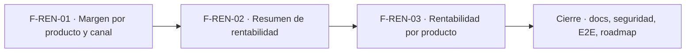

# Tasks: Inicio, rentabilidad y reportes · Rentabilidad margen

**Input**: [spec.md](./spec.md) y [plan.md](./plan.md) · **Épica**: MSF-120
**Formato**: `- [ ] T### [P] [Historia][USx] descripción (FR/SC)`. `[P]` = paralelizable (archivos distintos, sin dependencia dentro del mismo grupo). Cada FR/SC tiene **una sola** tarea dueña. Las dependencias y el orden son **solo dentro de la misma historia**; entre historias rige la tabla *Plan de ejecución* (objetos ya mergeados, nunca una tarea abierta de otra).
**Validación por historia**: `pnpm test:db`, `pnpm lint`, `pnpm build` y `pnpm test:web` verdes antes de cerrar la fase. Cada tabla nueva: esquema re-verificado (Principio VII). Cada migración lleva su reversión en el encabezado.

## Phase 1: F-REN-01 · Margen por producto y canal

**Goal**: umbral configurable, vista `analitica.margen_producto_canal`, rol de lectura de Superset, restricción por sección en el token y tableros/datasets versionados con importación automática.

- [ ] T001 [F-REN-01][US1] Migración `supabase/migrations/20261130100000_rentabilidad_umbral.sql`: `dominio.rentabilidad_config` (`organizacion_id` PK, `umbral_margen_bajo` 0 < valor ≤ 1, por defecto 0,10, `updated_at`), RLS por organización (select `rentabilidad`≥`lectura`; insert/update `edicion`; sin delete), `anon` sin privilegios, `public.leer_umbral_margen_bajo` y `public.guardar_umbral_margen_bajo` (idempotente, bloqueo optimista, rango; `revoke … from public, anon`, `grant … to authenticated`), reversión en el encabezado (FR-005)
- [ ] T002 [F-REN-01][US1] Migración `supabase/migrations/20261130100100_rentabilidad_umbral_actividad.sql`: disparador que registra `rentabilidad.umbral_actualizado` (actor, antes/después) con `private.insertar_actividad`; sin evento si no cambió (FR-006)
- [ ] T003 [F-REN-01][US1] Migración `supabase/migrations/20261130100200_analitica_margen_producto_canal.sql`: esquema `analitica` y vista `analitica.margen_producto_canal` (neto de `public.precios_empresa_neto`, costo con `private.a_pesos`, comisión 0, margen, margen %, estado contra el umbral; sin fila si falta costo, neto o cotización; `organizacion_id` en la vista; sin acceso para `anon`/`authenticated`) (FR-001, FR-002, FR-003, FR-004)
- [ ] T004 [P] [F-REN-01][US1] Migración `supabase/migrations/20261130100300_analitica_rol_superset.sql`: rol de solo lectura de Superset con `select` únicamente sobre `analitica`; variable de su credencial en `.env.example` y `infra/superset/.env.example` sin valor real (FR-008)
- [ ] T005 [P] [F-REN-01][US1] Migración `supabase/migrations/20261130100400_reportes_seccion.sql`: `public.reportes.seccion` nullable y `public.resolver_organizacion_reporte` (misma firma) exige `private.nivel_seccion(seccion) in ('lectura','edicion')` cuando la columna está definida (FR-007)
- [ ] T006 [F-REN-01][US1] `supabase/functions/emitir-acceso-reporte/index.ts`: responder 403 sin emitir token cuando falta la sección del reporte, conservando la cláusula `rls` por `organizacion_id` (soporte de FR-007; prueba `supabase/functions/emitir-acceso-reporte/handler.test.ts`)
- [ ] T007 [P] [F-REN-01][US1] pgTAP `supabase/tests/database/rentabilidad_margen.test.sql`: fórmula (neto, costo, margen, %), conversión USD/ARS, sin costo/cotización/neto → sin fila, estados en los bordes (`< 0`, `= 0`, `= umbral`), umbral por defecto y cambiado, rango inválido, evento de actividad, `anon`/`authenticated` sin acceso a `analitica`; `rls_en_toda_tabla` verde (SC-001)
- [ ] T008 [P] [F-REN-01][US1] pgTAP `supabase/tests/database/rentabilidad_permisos.test.sql`: la RPC de umbral solo con `edicion`, lectura con `lectura`, matriz de los 7 roles para `rentabilidad`, bloqueo optimista (SC-002)
- [ ] T009 [F-REN-01][US1] pgTAP + prueba de la función `supabase/tests/database/rentabilidad_aislamiento.test.sql`: aislamiento entre dos organizaciones (la vista expone `organizacion_id`, el token de A solo lleva A) y 403 del token para roles sin `rentabilidad` (SC-003)
- [ ] T010 [F-REN-01][US1] `infra/superset/dashboards/rentabilidad/`: YAML de la conexión (sin credenciales en Git) y del dataset `margen_producto_canal`, sin Mercado Libre ni su comisión (FR-010)
- [ ] T011 [F-REN-01][US1] Empaquetado de los YAML y su importación automática con `infra/superset/importar-dashboards.mjs` en CI/despliegue, más el registro idempotente en `reportes` con `seccion = 'rentabilidad'`; test del importador (FR-009)

**Checkpoint F-REN-01**: `pnpm test:db`, `pnpm lint`, `pnpm build` y `pnpm test:web` verdes.

## Phase 2: F-REN-02 · Resumen de rentabilidad

**Goal**: vistas del resumen y consolidado, pantalla `/rentabilidad` con pestaña Resumen, aviso, estados y diálogo del umbral.

- [ ] T012 [F-REN-02][US2] Migración `supabase/migrations/20261130110000_analitica_rentabilidad_resumen.sql`: `analitica.rentabilidad_resumen_empresa` y `analitica.rentabilidad_consolidado` (Σ márgenes ÷ Σ netos, productos distintos con margen, bajos y negativos, umbral vigente), derivadas de `analitica.margen_producto_canal` (FR-011, FR-012)
- [ ] T013 [P] [F-REN-02][US2] Migración `supabase/migrations/20261130110100_rentabilidad_conteo_margen.sql`: `public.rentabilidad_conteo_margen()` (`security invoker`, `revoke … from public, anon`, `grant … to authenticated`) (soporte de FR-015)
- [ ] T014 [F-REN-02][US2] pgTAP `supabase/tests/database/rentabilidad_consolidado.test.sql`: ponderación (caso donde difiere del promedio simple), conteos y coherencia con `rentabilidad_conteo_margen` (SC-005)
- [ ] T015 [F-REN-02][US2] Dataset y tablero «Resumen» en `infra/superset/dashboards/rentabilidad/` (tarjetas por empresa, barra, chips, Consolidado) (soporte de FR-011 y FR-012)
- [ ] T016 [P] [F-REN-02][US2] `apps/web/src/lib/rentabilidad.ts`: llamadas a `leer_umbral_margen_bajo`, `guardar_umbral_margen_bajo` y `rentabilidad_conteo_margen`, y mapeo de errores a mensajes claros (soporte de FR-015 y FR-018)
- [ ] T017 [F-REN-02][US2] `apps/web/src/pages/rentabilidad/` + ruta, menú «Análisis» con ícono: título, subtítulo, pestañas `Resumen` y `Por producto` (sin «Por publicación de ML»), `ReporteEmbebido` del tablero, estados compartidos, 320/768/1440 px (FR-013)
- [ ] T018 [P] [F-REN-02][US2] Componente «Cómo se calcula» (fórmulas, tabla Canal / Precio usado / Comisión-costo por tienda, aclaración de estimación) (FR-014)
- [ ] T019 [F-REN-02][US2] Aviso «Hay productos que se venden por debajo del costo o casi…» con `Ver detalle` hacia «Por producto» con filtro «Bajo o negativo»; oculto sin bajos ni negativos (FR-015)
- [ ] T020 [F-REN-02][US2] Acceso restringido: `AccesoRestringido` sin `lectura` en `rentabilidad` (sin pedir token) y ante 403 del token (FR-016)
- [ ] T021 [F-REN-02][US2] Error de carga del tablero con `Reintentar` (repite token y montaje) y estado vacío del resumen con los patrones compartidos (FR-017)
- [ ] T022 [P] [F-REN-02][US2] Diálogo «Umbral de margen bajo» (campo en %, `Cancelar`, `Guardar`), solo con `edicion`, validación de rango, recarga del tablero y aviso, confirmación de guardado (FR-018)
- [ ] T023 [F-REN-02][US2] Vitest de la pantalla: tarjetas/consolidado, aviso con y sin bajos, navegación con filtro, vacío, error con reintento, acceso restringido, diálogo de umbral, ocultación de Mercado Libre, cambio de empresa que no altera el tablero, teclado/lector (SC-004)

**Checkpoint F-REN-02**: `pnpm test:db`, `pnpm lint`, `pnpm build` y `pnpm test:web` verdes.

## Phase 3: F-REN-03 · Rentabilidad por producto

**Goal**: tablero «Por producto» (tabla, filtros, orden, búsqueda) y su pestaña, con el filtro inicial desde el resumen.

- [ ] T024 [F-REN-03][US3] Dataset y tablero «Por producto» en `infra/superset/dashboards/rentabilidad/`: tabla con `Producto` (nombre + SKU), `Canal`, `Precio`, `Costo`, `Comisión`, `Margen`, `Margen %` con barra y `Estado`, contador «N filas» (FR-019)
- [ ] T025 [F-REN-03][US3] Filtros nativos del tablero: estado (`Todos`, `Bajo o negativo`, `Solo negativo`), canal (`Todos los canales` + tiendas, sin Mercado Libre), orden «Mayor/Menor margen primero» y buscador «Buscar producto o SKU» (FR-020)
- [ ] T026 [F-REN-03][US3] Estado «Sin resultados / Cambiá el filtro o la búsqueda.» y resalte de márgenes negativos con el color de error del sistema de diseño (FR-021)
- [ ] T027 [F-REN-03][US3] Pestaña «Por producto» en `apps/web/src/pages/rentabilidad/`: nota «Margen = Precio − Costo − Comisión…», filtro inicial «Bajo o negativo» pasado al tablero (validar `urlParams`/filtros nativos; si no, `Desvío:` y orden por menor margen), error/reintento y acceso restringido compartidos (FR-022)
- [ ] T028 [P] [F-REN-03][US3] pgTAP `supabase/tests/database/rentabilidad_por_producto.test.sql`: un producto en dos tiendas = dos filas, el negativo queda «Negativo», orden y filtros coinciden con la vista (SC-007)
- [ ] T029 [F-REN-03][US3] Vitest de la pestaña: columnas, filtros, orden, búsqueda, vacío, filtro inicial desde el resumen, error/reintento, acceso restringido, teclado/lector (SC-006)

**Checkpoint F-REN-03**: `pnpm test:db`, `pnpm lint`, `pnpm build` y `pnpm test:web` verdes.

## Phase 4: Cierre (docs, seguridad, verificación de la épica)

**Goal**: lo que ninguna historia atiende. Las tareas `[CIERRE]` las ejecuta la Tarea de cierre y **nunca** son prerequisito de una historia.

- [ ] T030 [P] [CIERRE] `docs/rentabilidad.md` (fórmula, umbral, ponderación, contrato `analitica.margen_producto_canal`, permisos, importación de tableros, reversión, preguntas abiertas), `docs/operar-superset.md` y fila/sección de `docs/roadmap-template.md` (estado, link a la spec); `pnpm docs:check` verde (FR-023)
- [ ] T031 [P] [CIERRE] Revisión de seguridad de la superficie nueva: RLS y grants de tabla y RPC, `anon` sin acceso, esquema `analitica` cerrado, rol de lectura de Superset, token por sección, y esquema de cada objeto contra el Principio VII (FR-024)
- [ ] T032 [CIERRE] E2E de Rentabilidad con los tres roles (Administrador edita el umbral, Administración solo lee, Operador/Consulta ven acceso restringido) y el cambio de umbral reflejado en el aviso (SC-008)
- [ ] T033 [CIERRE] `pnpm lint`, `pnpm build`, `pnpm infra:config`, `pnpm test`, `rls_en_toda_tabla` verde, `pnpm prototipo:check` y `pnpm matriz:check` (SC-009)

**Checkpoint Cierre**: ninguna tarea queda `[ ]` sin hacerse o cerrarse con `Desvío:` y seguimiento trazado.

## Dependencias

Dentro de F-REN-01: T001 → T002 → T003; T004 [P] y T005 [P] arrancan solos; T005 → T006; T007 [P] y T008 [P] tras T002/T003; T009 tras T003, T005 y T006; T010 tras T003 y T004 → T011 (también T005).
Dentro de F-REN-02: T012 → T014; T013 [P] con T012; T015 tras T012; T016 [P] arranca solo; T017 tras T016 → (T018 [P], T022 [P]); T019 tras T017 y T013; T020 y T021 tras T017; T023 al final.
Dentro de F-REN-03: T024 → T025 → T026 → T027 → T029; T028 [P] tras T024.
Cierre: T030 [P] y T031 [P] arrancan cuando todas las historias estén mergeadas; T032 → T033 al final.
Entre historias (de entrega): F-REN-02 requiere de F-REN-01 la vista, el umbral, el token por sección y el importador (ya mergeados); F-REN-03 requiere de F-REN-02 la pantalla `/rentabilidad` (mismo archivo de pestañas) y el directorio de tableros. Por eso van en serie.

## Plan de ejecución (historias)

El **orden de toma** de las historias lo declara esta tabla: el orquestador la **consume** (no lo infiere del orden de las tareas). Una historia arranca cuando sus dependencias (`Depende de`) están **Finalizadas (mergeadas)**; las del **mismo** `Grupo` van **en paralelo**. Aquí hay dependencias reales (la vista y el umbral de F-REN-01; el archivo de la pantalla y el directorio de tableros compartidos entre F-REN-02 y F-REN-03), por eso cada grupo tiene una sola historia.

| Historia | Depende de | Grupo |
|----------|------------|-------|
| F-REN-01 | — | 1 |
| F-REN-02 | F-REN-01 | 2 |
| F-REN-03 | F-REN-02 | 3 |
| [Cierre] | F-REN-01, F-REN-02, F-REN-03 | 4 |

