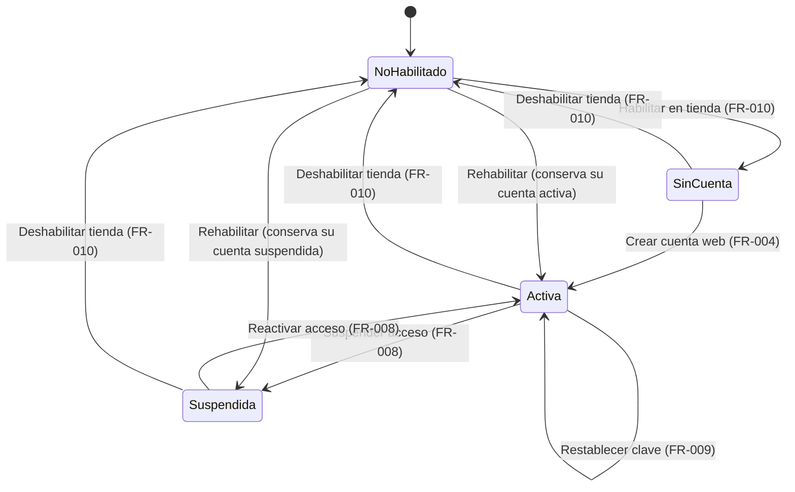
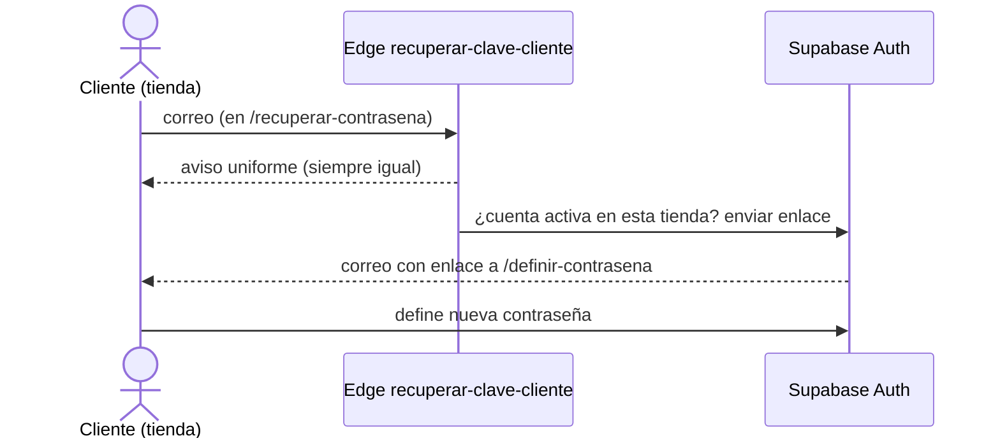
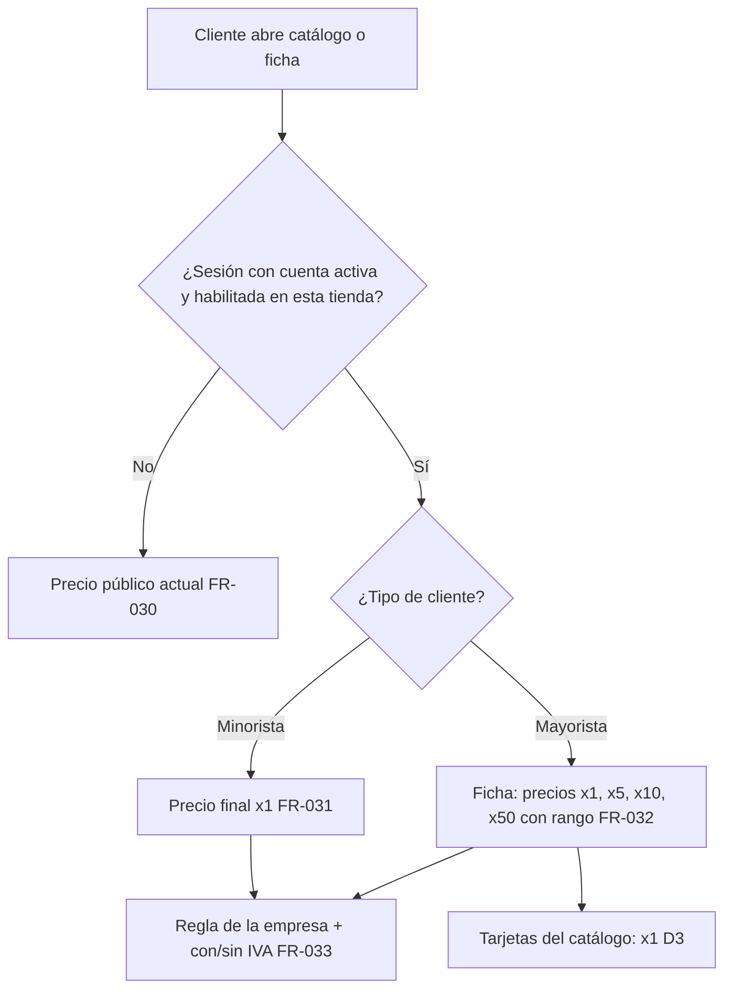

# Feature Specification: Clientes y proveedores · Cuenta web del cliente

**Feature Branch**: `epic/MSF-237-clientes-y-proveedores-cuenta-web-del-cl`

**Componente**: Clientes y proveedores

**Jira Epic**: MSF-237 — Clientes y proveedores · Cuenta web del cliente (spec `cuenta-web-del-cliente`)

**Historias previstas**: F-CLI-05 (L), F-CLI-06 (S), F-CLI-07 (M), todas P0.

**Created**: 2026-10-24

**Status**: Draft — lista para planificar. Las decisiones de Nicolás quedan en *Decisiones abiertas*; ninguna bloquea implementar con el supuesto indicado.

**Delivery scope**: `refine` (`apps/web`: panel de Clientes y front público de la tienda), `supabase` (migraciones, funciones, pgTAP, Edge Functions y configuración de Auth). Sin `kestra`, `superset` ni `workers`.

**Prioridad / Hito**: P0 · Hito 3 (16 de noviembre al 11 de diciembre de 2026) · ~28 h · alcance diciembre.

**Input**: Epic MSF-237. Objetivo: «Al terminar, un cliente con cuenta web entra a la tienda de una empresa habilitada con su correo y contraseña, recupera su contraseña si la olvida y ve los precios de su escala (minorista o mayorista).»

## Regla de fuentes (literal de la épica)

1. Comportamiento y datos: mandan los requisitos y escenarios de esta historia.
2. Qué se ve (disposición, textos, estados, popups, flujos): el prototipo validado es referencia visual, no hace falta que quede extremadamente idéntico; los flujos (si hay) aclaran estados y acciones.
3. Cómo se construye (componentes, estilos y patrones): mandan el template y el system design del producto (épica Plataforma · Sistema de diseño). No copiar el HTML ni el CSS del prototipo: reproducir lo que muestra con los componentes del template y los tokens del sistema de diseño.
4. El prototipo muestra más que esta historia: implementar solo lo que piden los requisitos de esta historia; otras secciones, botones o diálogos son de otras historias.
5. Si algo no se puede igualar con el template / el sistema de diseño: usar lo más cercano, sin inventar, y anotar la diferencia en la descripción del PR.
6. Si el prototipo y los requisitos se contradicen: requisitos para el comportamiento, prototipo para lo visual, y dejar la contradicción anotada en el PR.

Prototipos (solo lectura, ya presentes en `design/pantallas/`): `ClienteFicha.dc.html` (bloques **Tiendas** y **Cuenta web**, estados Activa, Suspendida, Sin cuenta y No habilitado) y `Clientes.dc.html` (columna **Cuenta web** y diálogo de cliente con **Habilitado en** y **Cuenta web**), con sus `.inventory.json` (corridos con `pnpm prototipo:inventario`).

**No existen en el prototipo**: las pantallas públicas *Ingresar*, *Definir contraseña* y *Recuperar contraseña* del cliente (página «Tiendas públicas») ni el precio según el tipo de cliente. La épica pide dibujarlas antes de iniciar; hasta entonces se construyen con los componentes del sistema de diseño y los patrones de la tienda pública, sin inventar elementos más allá de lo que piden los requisitos, y la diferencia se anota en el PR (regla 5).

## Dependencias

| Dependencia | Estado en esta rama | ¿Bloquea? |
|---|---|---|
| MSF-180 · Clientes alta y búsqueda (`public.clientes`, `tipo`, `public.escala_de_cliente`, `correo`) | **Presente** (migraciones `20260908172920…`, `20261016130300…`) | Sí; ya está en la base. |
| MSF-142 · Migración inicial de datos (deja a los clientes con correo listos para la invitación) | **Presente** (`20261201100000…`) | No (relacionada). |
| `public.clientes_empresas` + `public.guardar_empresas_de_cliente` («Habilitado en», relación N:M cliente↔tienda) | **Presente** (`20261021160100…`) | Sí; se reutiliza, no se rehace. |
| MSF-167 · Tienda catálogo y ficha (front público, `publico.catalogo_pagina_por_dominio`, `publico.producto_por_dominio`, `private.precio_final_publico`) | **Presente** (`20261023150000…150300`, `apps/web/src/pages/tienda-publica/`) | Sí; ya está en la base. |
| MSF-114 · Precios e IVA (`private.precio_para`, `aplicar_regla_precio`, `aplicar_iva`, `public.producto_precios_escala`) | **Presente** (`20261022150000`, `20261022150100`) | Sí; ya está en la base. |
| MSF-147 · Tienda dominio e identidad (resolución por `Host`) | **Presente**, llega vía MSF-167 | No. |
| F-CLI-20 (MSF-450, P3) · historial de compras y favoritos de la cuenta | Backlog | No: fuera de alcance. |

Bloquea a: ninguna épica cargada.

## Supuestos (de la épica)

- Las cuentas de cliente usan Supabase Auth pero **no son usuarios del panel**: viven en `cuentas_cliente` y no pueden leer nada del panel.
- En el lanzamiento la cuenta se crea **por invitación desde el panel**; no hay auto-registro público.
- La recuperación de contraseña **reutiliza el flujo del template**, con su propia pantalla en la tienda.
- Las tiendas **no cobran en línea**; la cuenta solo da acceso a precios de su escala y a sus datos.
- El historial de compras y los favoritos quedan en el Backlog (F-CLI-20).
- El template ya trae Supabase Auth con invitación, definir contraseña, recuperación, cambio de contraseña y de correo y los correos de Auth, pero para usuarios del panel y en `apps/web`. La tienda pública no está en las páginas del panel: se **reutilizan el flujo y las plantillas de Auth, no las páginas**.
- `invitar-miembro` agrega al usuario a `usuarios_organizacion`; la cuenta web **NO** debe quedar ahí (con `private.organizacion_id()` nulo no accede al panel). Hace falta una **invitación propia**.

## Contradicciones y tensiones (anotar en el PR)

1. **Roadmap vs. épica (de la épica).** El «Roadmap a diciembre» no menciona la cuenta web de clientes y Tiendas online deja las cuentas de cliente en P3 (F-TDA-27). Rige el roadmap hasta que se defina; esta spec implementa la épica P0 tal como está cargada y no resuelve el conflicto.
2. **Diálogo vs. formulario.** El prototipo dibuja el alta/edición de cliente como diálogo; la app usa las páginas `clientes/create.tsx` y `clientes/edit.tsx`. El comportamiento y los campos mandan; el campo «Cuenta web» y la casilla de invitación se agregan a ese formulario. Se anota en el PR.
3. **Tipo «Distribuidor».** La ficha del prototipo dibuja Minorista, Mayorista y Distribuidor; la base solo tiene `minorista` y `mayorista` (`clientes_tipo_ck`). La épica pide «minorista o mayorista»: Distribuidor queda fuera.
4. **Fecha límite (de la épica).** Si no entra antes del 31 de diciembre, F-CLI-07 pasa a Etapa 2 (alternativa: la escala mayorista se aplica solo en ventas internas). Es un riesgo de plan, no un requisito: esta spec no lo implementa.

## Decisiones abiertas (no bloquean; se implementa el supuesto)

- **D1 · Una cuenta o una por marca** (pregunta abierta de la épica: «si un cliente puede entrar a las dos marcas con la misma cuenta»). **Supuesto**: la cuenta web se crea **por tienda** (así lo dibuja el prototipo: «la cuenta web se crea por tienda», una pestaña por tienda con su propio estado). Hay **un solo usuario de Auth por cliente** (su correo) y **una fila de `cuentas_cliente` por (cliente, tienda)**: con la misma contraseña entra a las tiendas donde su cuenta esté activa.
- **D2 · Auto-registro con aprobación del mayorista** (pregunta abierta de la épica). **Supuesto**: solo invitación (FR-007). El auto-registro no se construye.
- **D3 · Precio en el catálogo para el mayorista.** La épica pide que «vea los precios de su escala» sin definir cantidades (las tiendas no cobran). **Supuesto**: la **ficha** del producto muestra al mayorista la tabla de escalas (x1, x5, x10, x50 con su rango de unidades, como en el prototipo de la ficha de cliente) y las **tarjetas del catálogo** siguen mostrando el precio x1; si Nicolás prefiere otra cosa en el listado, se ajusta en F-CLI-07.
- **D4 · Estado agregado en el listado con «Todas mis empresas».** **Supuesto**: la columna «Cuenta web» muestra el estado de la tienda activa; en vista combinada muestra «Activa» si alguna de sus tiendas está activa, si no «Suspendida» si alguna lo está, y si no «Sin cuenta».
- **D5 · Cliente con correo ya usado por un usuario del panel.** **Supuesto**: la invitación se rechaza con un mensaje genérico («No se puede crear la cuenta con ese correo»); una misma persona no mezcla identidad de panel y de cliente (la cuenta web no puede quedar con membresía).
- **D6 · Pantallas públicas sin dibujar.** Se construyen con el sistema de diseño (ver arriba) y se piden dibujar antes de iniciar; no bloquea la spec.

## Modelo y supuestos técnicos

- **Tabla nueva `public.cuentas_cliente`** (id, `organizacion_id`, `cliente_id`, `empresa_id`, `auth_user_id`, `estado` ∈ `activa|suspendida`, `created_at`; única `(cliente_id, empresa_id)`). «Sin cuenta» = no hay fila; «No habilitado» = el cliente no está en `clientes_empresas` para esa empresa (se **deriva**, no se guarda). El correo de acceso es el `correo` del cliente; el último ingreso se lee de `auth.users.last_sign_in_at` por función.
- **Invitación propia**: Edge Function `invitar-cliente` (patrón de `invitar-miembro`: dependencias inyectadas, service-role solo en la función), que valida con una RPC `security invoker` llamada con el JWT del operador, crea o reutiliza el usuario de Auth y **no toca `usuarios_organizacion`**. El enlace vuelve a la tienda (`/definir-contrasena`).
- **Acceso a la tienda**: `publico.acceso_cliente_por_dominio(host)` (rol `authenticated`) devuelve el estado de la cuenta del llamador en la tienda de ese `Host`. Solo `activa` + cliente habilitado + empresa activa permite ver precios de escala. La suspensión rige **al instante** porque el estado se consulta en cada llamada (no viaja en el token).
- **Recuperación**: Edge Function `recuperar-clave-cliente` (anónima, sin service-role en el navegador) responde **siempre lo mismo** y solo envía el correo de Auth si hay cuenta activa para esa tienda; reutiliza plantillas y flujo de Auth.
- **Precios**: `publico.precios_cliente_por_dominio(host, productos)` compone las mismas fórmulas únicas de Precios (`a_pesos` → `aplicar_regla_precio` → `aplicar_iva`) por escala; un pgTAP de **paridad** exige que coincida con `private.precio_para(...).final`.
- **El panel no admite cuentas web**: sin fila en `usuarios_organizacion`, `private.organizacion_id()` es nulo, RLS no devuelve filas y el login del panel muestra «Acceso restringido».
- **Front público**: `apps/web/src/pages/tienda-publica/` con rutas registradas por archivo (`rutas/*.tsx`), carga diferida por ruta.

## Esquema de datos (Constitución, Principio VII)

| Objeto | Esquema | Historia | Naturaleza / justificación |
|---|---|---|---|
| `public.cuentas_cliente` (tabla **nueva**) | `public` | F-CLI-05 | Cuenta de **autenticación** atada a `public.clientes` (que ya vive en `public` por excepción documentada) y a Supabase Auth: es plataforma/transversal, no una regla de negocio del producto. RLS por organización + sección Clientes (`private.organizacion_id()`, `private.puede_escribir()`), igual patrón que `clientes_empresas`. Migración aditiva con reversión documentada. |
| `public.preparar_cuenta_cliente`, `public.vincular_cuenta_cliente`, `public.cambiar_estado_cuenta_cliente` (RPC) | `public` | F-CLI-05 | Operan sobre la tabla anterior; `grant execute … to authenticated` (`vincular_…` solo `service_role`) y `revoke … from public, anon`. |
| `publico.acceso_cliente_por_dominio(host)` (función) | `publico` | F-CLI-05 | Contrato de lectura mínima por `Host`; `publico` sigue sin tablas. `authenticated` solo. |
| `publico.precios_cliente_por_dominio(host, productos)` (función) y `private.precio_final_publico_escala(uuid, uuid, text)` | `publico` / `private` | F-CLI-07 | Lógica de precio por escala; la interna sin `grant` a `anon`/`authenticated`. |
| Edge Functions `invitar-cliente`, `recuperar-clave-cliente` | `supabase/functions` | F-CLI-05 / F-CLI-06 | Sin tablas; secretos solo en el entorno de la función. |

RLS: `cuentas_cliente` es una tabla expuesta, con RLS activada; ningún rol de cliente recibe política sobre ella (se accede solo por las funciones de `publico`). `anon` no recibe privilegios sobre `public` ni sobre la tabla (migración `20261013130000`). El pgTAP de aislamiento sigue recorriendo `public` + `dominio` y verifica la nueva tabla. Cada historia trae **su propia migración aditiva** con timestamp propio.

## Navegación y patrones (Principio VI)

- **Panel**: no se agregan ítems de navegación. Cambian la ficha (`/clientes/show/:id`), el listado (`/clientes`) y el formulario de alta/edición de **Clientes** (ya en el menú), con los patrones compartidos de carga, vacío, error y éxito (snackbar).
- **Tienda pública**: tres rutas nuevas bajo el `Host` de la tienda (`/ingresar`, `/definir-contrasena`, `/recuperar-contrasena`), sin menú del panel ni empresa activa; estados del kit, teclado y lector de pantalla a 320 / 768 / 1440 px, sin identificadores técnicos en pantalla, carga diferida por ruta.
- **Empresas en la UI**: filtros con `FiltroEmpresa`, selección múltiple con `SelectorEmpresas`; no se agregan variantes propias.

## User Scenarios & Testing *(mandatory)*

### US1 — F-CLI-05 · Cuenta web del cliente y acceso a la tienda (P0, L)

Como operador de Clientes quiero habilitar a un cliente en una tienda y crearle una cuenta web por invitación, ver su estado y suspenderla o reactivarla, para que solo quien yo autorice acceda a los precios de esa tienda.

**Escenarios de aceptación**
1. *Dado (Given)* un cliente con correo y habilitado en San Javucho sin cuenta, *cuando (When)* en la ficha (pestaña San Javucho) pulso «Crear cuenta web», *entonces (Then)* queda «Activa», se envía el enlace para definir la clave y veo «Cuenta creada en San Javucho: se envió el enlace para definir la clave».
2. *Dado (Given)* una cuenta Activa, *cuando (When)* pulso «Suspender acceso», *entonces (Then)* pasa a «Suspendida» («No puede ingresar hasta que la reactives.») y el acceso a la tienda se corta al instante; «Reactivar acceso» la devuelve a Activa.
3. *Dado (Given)* una cuenta Activa, *cuando (When)* pulso «Restablecer clave», *entonces (Then)* se envía un enlace para definir una nueva clave («Enlace para definir una nueva clave enviado»).
4. *Dado (Given)* un cliente no habilitado en una tienda, *entonces (Then)* esa pestaña dice «No habilitado — El cliente no puede comprar en esta tienda.» y ofrece «Habilitar en <Tienda>».
5. *Dado (Given)* una cuenta web, *cuando (When)* intenta entrar al panel o leer cualquier dato del panel, *entonces (Then)* no puede (Acceso restringido; ninguna tabla le devuelve filas).
6. *Dado (Given)* el listado de Clientes, *entonces (Then)* la columna «Cuenta web» muestra el estado y el filtro «Con cuenta web» deja los que tienen cuenta activa.
7. *Dado (Given)* el alta/edición de cliente, *cuando (When)* elijo «Cuenta web: Activa» con «Enviar invitación por correo al crear la cuenta» tildada, *entonces (Then)* se crea la cuenta en cada tienda tildada en «Habilitado en» y se envía la invitación («Cliente creado · invitación enviada»).
8. *Dado (Given)* que cambio la empresa de la barra superior, *entonces (Then)* el listado y la ficha se reencuadran a esa tienda y no muestran estados de la anterior.

### US2 — F-CLI-06 · Ingreso y recuperación de contraseña del cliente (P0, S)

Como cliente con cuenta web quiero definir mi contraseña, ingresar a la tienda con mi correo y recuperar la contraseña si la olvido.

**Escenarios de aceptación**
1. *Dado (Given)* el enlace de la invitación, *cuando (When)* lo abro, *entonces (Then)* llego a «Definir contraseña» en la tienda (mismo dominio) y, al definirla con la política de contraseñas del template, quedo ingresado.
2. *Dado (Given)* una cuenta Activa en esa tienda, *cuando (When)* ingreso con correo y contraseña correctos, *entonces (Then)* entro a la tienda.
3. *Dado (Given)* credenciales incorrectas, *entonces (Then)* veo un mensaje genérico (no revela si el correo existe).
4. *Dado (Given)* una cuenta Suspendida, sin cuenta o no habilitada en esa tienda, *cuando (When)* ingreso, *entonces (Then)* no entro: veo el mismo mensaje genérico y no queda sesión abierta.
5. *Dado (Given)* que olvidé la contraseña, *cuando (When)* pido recuperarla con mi correo, *entonces (Then)* veo siempre el mismo aviso («Si el correo tiene una cuenta, te enviamos un enlace») y, si la cuenta está activa en esa tienda, recibo el enlace para definir una nueva contraseña.

### US3 — F-CLI-07 · Precios de la tienda según el tipo de cliente (P0, M)

Como cliente con cuenta activa quiero ver los precios de mi escala (minorista o mayorista) en la tienda.

**Escenarios de aceptación**
1. *Dado (Given)* un visitante sin sesión (o con cuenta suspendida / no habilitada), *entonces (Then)* ve el precio público de siempre (sin cambios).
2. *Dado (Given)* un cliente **minorista** con cuenta activa, *entonces (Then)* ve el precio de lista (x1) de la empresa.
3. *Dado (Given)* un cliente **mayorista** con cuenta activa, *cuando (When)* abre la ficha de un producto, *entonces (Then)* ve los precios de sus escalas (x1, x5, x10, x50) con su rango de unidades, calculados con la regla de la empresa y su interruptor con/sin IVA.
4. *Dado (Given)* una escala sin precio cargado, *entonces (Then)* usa el precio x1 (misma regla que `precio_para`).
5. *Dado (Given)* que el operador cambia el tipo del cliente o suspende su cuenta, *entonces (Then)* la próxima carga de la tienda refleja el cambio.

### Casos límite

- Cliente sin correo: «Crear cuenta web» deshabilitado con el motivo («Cargá un correo para crear la cuenta»).
- Cliente con cuenta ya creada en otra tienda: reutiliza el mismo usuario de Auth (D1); no se envía otra invitación de alta, sino el enlace de la nueva tienda.
- Invitación repetida / reenvío: idempotente — no duplica fila ni usuario (Constitución III).
- Deshabilitar la tienda con cuenta activa: pasa a «No habilitado» y no puede ingresar; la cuenta se conserva y vuelve a su estado al rehabilitar.
- Eliminar o archivar un cliente: sus cuentas dejan de dar acceso (la fila se elimina en cascada y el acceso devuelve vacío); el usuario de Auth huérfano no tiene organización ni acceso a nada.
- Enlace de invitación vencido o ya usado: mensaje claro con salida a «Recuperar contraseña».
- Empresa desactivada: la tienda no resuelve (404 de la tienda) y nadie ingresa.
- Cambio de empresa con un formulario abierto: se reencuadra (Principio VIII).

## Requirements *(mandatory)*

### F-CLI-05 · Cuenta web del cliente y acceso a la tienda

- **FR-001**: La tabla `public.cuentas_cliente` (única `(cliente_id, empresa_id)`, `estado` ∈ `activa|suspendida`) existe con RLS por organización + sección Clientes; el cliente y la empresa deben ser de la misma organización (disparador, como `clientes_empresas`). **Verificación**: pgTAP `supabase/tests/database/cuentas_cliente.test.sql`: RLS activada, única `(cliente_id, empresa_id)`, disparador de misma organización; el pgTAP de aislamiento recorre `public` + `dominio`.
- **FR-002**: Los cuatro estados de la ficha se resuelven así: *Activa* y *Suspendida* (guardados), *Sin cuenta* (sin fila) y *No habilitado* (derivado de `clientes_empresas`); «No habilitado» prevalece sobre el guardado. **Verificación**: Vitest `apps/web/src/lib/cuentasCliente.test.ts`: derivación de los cuatro estados; «No habilitado» prevalece sobre el guardado.
- **FR-003**: Hay un solo usuario de Auth por cliente (D1), con el correo del cliente; sin correo no se puede crear cuenta. **Verificación**: Vitest `supabase/functions/invitar-cliente/handler.test.ts`: sin correo ⇒ rechazo; un solo usuario de Auth por cliente al crear en dos tiendas.
- **FR-004**: «Crear cuenta web» invoca la Edge Function `invitar-cliente`, que crea o reutiliza el usuario de Auth, registra la fila `activa` y envía el enlace para definir contraseña con redirección al dominio de la tienda; **no agrega al usuario a `usuarios_organizacion`**. Solo para un cliente habilitado en esa tienda. **Verificación**: Vitest `invitar-cliente/handler.test.ts`: crea o reutiliza usuario, registra fila `activa`, redirección al dominio de la tienda, no escribe `usuarios_organizacion`, solo cliente habilitado.
- **FR-005**: Crear, suspender, reactivar y restablecer exigen edición de la sección Clientes y alcance sobre la tienda; operadores sin permiso reciben un error claro y no cambia nada. **Verificación**: pgTAP `cuentas_cliente.test.sql`: operador sin edición de Clientes o sin alcance sobre la tienda ⇒ `42501` y sin cambios en tabla.
- **FR-006**: Una cuenta web no accede al panel ni lee ni escribe ninguna tabla de `public`/`dominio` (pgTAP con una sesión de cuenta web); el login del panel la lleva a «Acceso restringido». **Verificación**: pgTAP `cuentas_cliente.test.sql` con sesión de cuenta web (cero filas y cero escrituras en `public`/`dominio`) + Vitest `apps/web/src/lib/cuentasCliente.test.ts` de «Acceso restringido».
- **FR-007**: No hay auto-registro: `enable_signup` sigue en `false` y no existe pantalla ni ruta pública de registro. **Verificación**: Vitest estático `apps/web/src/lib/configAuth.test.ts` (`enable_signup = false` en `supabase/config.toml`) + `grep` de rutas de registro en `tienda-publica/rutas/` dentro del mismo test.
- **FR-008**: Suspender y reactivar cambian `estado` mediante `public.cambiar_estado_cuenta_cliente`, de forma idempotente y con efecto inmediato en el acceso. **Verificación**: pgTAP `cuentas_cliente.test.sql`: `cambiar_estado_cuenta_cliente` suspender/reactivar, idempotente, y `acceso_cliente_por_dominio` refleja el cambio en la misma transacción.
- **FR-009**: «Restablecer clave» (solo cuenta Activa) envía el enlace de Auth para definir una nueva clave, con redirección a la tienda. **Verificación**: Vitest `invitar-cliente/handler.test.ts`: acción `restablecer` solo con cuenta activa, envía enlace con redirección a la tienda.
- **FR-010**: Habilitar o deshabilitar al cliente en una tienda reutiliza `guardar_empresas_de_cliente`; la acción «Habilitar en <Tienda>» y el interruptor actualizan el estado derivado sin perder la cuenta. **Verificación**: Vitest `cuentasCliente.test.ts`: habilitar/deshabilitar llama `guardar_empresas_de_cliente` y conserva la cuenta; Vitest `BloqueCuentaWeb.test.tsx` («Habilitar en <Tienda>»).
- **FR-011**: `publico.acceso_cliente_por_dominio(host)` devuelve el estado efectivo de la cuenta del llamador en esa tienda (`activa`, `suspendida`, `sin_cuenta`, `no_habilitado`) y el tipo del cliente solo si está activa; host desconocido y empresa desactivada responden igual (`null`). **Verificación**: pgTAP `supabase/tests/database/acceso_cliente_por_dominio.test.sql`: `activa`/`suspendida`/`sin_cuenta`/`no_habilitado`, tipo solo si activa, host desconocido y empresa desactivada ⇒ `null`.
- **FR-012**: La ficha muestra el bloque **Tiendas** («El cliente es de la organización. Acá elegís en qué tiendas puede comprar.»): por tienda, interruptor «Habilitado en la tienda», etiqueta, texto («Compra con su tipo y escala» / «No ve ni compra en esta tienda») y chip de estado de la cuenta (Cuenta activa / Suspendida / Sin cuenta / No habilitado). **Verificación**: Vitest + axe `apps/web/src/components/clientes/BloqueTiendas.test.tsx`: textos, interruptor y chip de estado.
- **FR-013**: La ficha muestra el bloque **Cuenta web**: pestañas por tienda, chip + texto del estado (Activa «Puede ingresar a las tiendas con su correo.»; Suspendida «No puede ingresar hasta que la reactives.»; Sin cuenta «El cliente compra sin registrarse.»; No habilitado «El cliente no puede comprar en esta tienda.»), «Correo de acceso» y «Último ingreso» (si hay cuenta) y las acciones por estado (Restablecer clave / Suspender acceso; Reactivar acceso; Crear cuenta web; Habilitar en <Tienda>). **Verificación**: Vitest + axe `apps/web/src/components/clientes/BloqueCuentaWeb.test.tsx`: pestañas, textos por estado, correo, último ingreso y acciones por estado; «Crear cuenta web» deshabilitada sin correo.
- **FR-014**: El listado muestra la columna **Cuenta web** (chip Activa / Suspendida / Sin cuenta; D4) y el filtro «Con cuenta web». **Verificación**: Vitest `apps/web/src/pages/clientes/list.test.tsx`: columna «Cuenta web», agregado D4 en «Todas mis empresas» y filtro «Con cuenta web».
- **FR-015**: El formulario de alta/edición de cliente agrega el campo **Cuenta web** (Sin cuenta / Activa / Suspendida) con su nota, y la casilla «Enviar invitación por correo al crear la cuenta»; «Habilitado en» usa `SelectorEmpresas`. Al guardar con «Activa» se crea la cuenta en cada tienda tildada. **Verificación**: Vitest `apps/web/src/pages/clientes/formulario-cuenta-web.test.tsx` (create/edit): campo, casilla de invitación, `SelectorEmpresas`, creación por tienda tildada; `pnpm ui:empresas:check`.
- **FR-016**: Crear, suspender, reactivar y restablecer registran un evento de Actividad con actor, cliente y tienda (Constitución III). **Verificación**: pgTAP `supabase/tests/database/cuentas_cliente_actividad.test.sql`: evento con actor, cliente y tienda por cada acción, en la misma transacción.
- **FR-017**: Principio VIII: el listado y la ficha usan la empresa activa de la barra superior (una sola fuente de verdad), invalidan todas sus consultas al cambiar de empresa, reencuadran la paginación y el formulario no guarda datos de la empresa anterior. **Verificación**: Vitest `apps/web/src/pages/clientes/empresa-activa.test.tsx`: cambia de empresa, invalida consultas, reencuadra paginación y no guarda datos de la anterior.
- **FR-018**: Los errores de la invitación no filtran información: correo ya usado por el panel (D5), cliente fuera de la organización o tienda no habilitada responden con mensajes controlados. **Verificación**: Vitest `invitar-cliente/handler.test.ts`: correo de usuario del panel (D5), cliente de otra organización y tienda no habilitada ⇒ mensajes controlados idénticos.

### F-CLI-06 · Ingreso y recuperación de contraseña del cliente

- **FR-020**: La tienda tiene la pantalla **Ingresar** (`/ingresar`: correo y contraseña) y un acceso «Ingresar» / «Salir» en su encabezado; al ingresar consulta `acceso_cliente_por_dominio` y solo entra si el estado es `activa`. **Verificación**: Vitest + axe `apps/web/src/pages/tienda-publica/rutas/ingresar.test.tsx`: ingreso, consulta de `acceso_cliente_por_dominio`, solo `activa` entra; «Ingresar»/«Salir» en el encabezado.
- **FR-021**: Credenciales incorrectas o cuenta no activa en esa tienda (suspendida, sin cuenta, no habilitada) muestran el **mismo** mensaje genérico y cierran cualquier sesión abierta. **Verificación**: Vitest `apps/web/src/lib/tiendaCuenta.test.ts`: mismo mensaje genérico y `signOut` ante credenciales incorrectas, suspendida, sin cuenta y no habilitada.
- **FR-022**: La pantalla **Definir contraseña** (`/definir-contrasena`) atiende los enlaces de invitación y de restablecimiento, aplica la política de contraseñas del template (`passwordPolicy`) y, al terminar, deja al cliente ingresado; un enlace vencido o usado muestra un mensaje claro con salida a recuperar. **Verificación**: Vitest `rutas/definir-contrasena.test.tsx`: invitación y restablecimiento, `passwordPolicy`, ingreso al terminar, enlace vencido/usado con salida a recuperar.
- **FR-023**: La pantalla **Recuperar contraseña** (`/recuperar-contrasena`) pide el correo y la Edge Function `recuperar-clave-cliente` responde siempre lo mismo; solo envía el correo de Auth si hay cuenta activa en esa tienda (sin enumeración de cuentas). **Verificación**: Vitest `supabase/functions/recuperar-clave-cliente/handler.test.ts`: respuesta idéntica con y sin cuenta; envía solo con cuenta activa en la tienda del `host`; + `rutas/recuperar-contrasena.test.tsx`.
- **FR-024**: Los enlaces y la redirección de los correos vuelven al **dominio de la tienda** (lista de redirecciones permitidas de Auth) y usan las plantillas de Auth del template. **Verificación**: Vitest estático `apps/web/src/lib/configAuth.test.ts` (`additional_redirect_urls` con dominios de tienda) + `pnpm infra:config`.
- **FR-025**: Se conserva sin cambios el bloqueo por intentos fallidos del template (Auth Hook) sobre el correo del cliente. **Verificación**: `pnpm test:auth:hook-bloqueo` con caso de correo de cuenta web (bloqueo tras fallos repetidos).

### F-CLI-07 · Precios de la tienda según el tipo de cliente

- **FR-030**: Visitante sin sesión, cuenta suspendida, sin cuenta o no habilitada ven el precio público actual; nada cambia para ellos. **Verificación**: Vitest `apps/web/src/pages/tienda-publica/catalogo/TarjetaProducto.test.tsx`: visitante, suspendida, sin cuenta y no habilitada ven el precio público de hoy (snapshot sin regresión).
- **FR-031**: Un cliente **minorista** con cuenta activa ve el precio final de la escala x1 de la empresa. **Verificación**: Vitest + axe `apps/web/src/pages/tienda-publica/ficha/ficha-precios-cliente.test.tsx`: minorista activo ve x1.
- **FR-032**: Un cliente **mayorista** con cuenta activa ve, en la ficha del producto, el precio final de cada escala (x1, x5, x10, x50) con su rango de unidades (D3); las tarjetas del catálogo siguen mostrando x1. **Verificación**: Vitest `ficha-precios-cliente.test.tsx`: mayorista ve x1/x5/x10/x50 con rango en la ficha; `TarjetaProducto.test.tsx`: tarjetas con x1.
- **FR-033**: `publico.precios_cliente_por_dominio(host, productos)` calcula en el servidor con las fórmulas únicas de Precios (regla de la empresa, interruptor con/sin IVA, escala sin precio ⇒ x1) y coincide con `private.precio_para(...).final`; solo responde a una cuenta activa de esa tienda. **Verificación**: pgTAP `supabase/tests/database/precios_cliente.test.sql`: paridad con `private.precio_para(...).final` por escala, con/sin IVA, escala sin precio ⇒ x1; solo cuenta activa.
- **FR-034**: La respuesta es de lista blanca: no expone costos, margen, existencias, `organizacion_id` ni datos de otro cliente; el cliente no puede pedir la escala de otro tipo. **Verificación**: pgTAP `precios_cliente.test.sql`: lista blanca de claves y que no se pueda pedir otra escala.
- **FR-035**: El precio refleja el tipo y el estado actuales del cliente en cada carga (sin caché de escala en la sesión). **Verificación**: Vitest `apps/web/src/lib/tiendaPreciosCliente.test.ts`: una llamada por carga y sin caché de escala entre cargas.

## Matriz pantalla↔criterios

Ítems tomados de `design/pantallas/ClienteFicha.inventory.json` y `design/pantallas/Clientes.inventory.json` (`pnpm prototipo:inventario`), más los bloques visibles que el inventario no lista. **FUERA DE ALCANCE** = lo que la épica no pide: no es deuda, es de otra épica (se declara con su motivo; no genera tareas).

### Ficha del cliente (`ClienteFicha.dc.html`)

| Ítem | Dueño | Criterio / nota |
|---|---|---|
| Bloque «Tiendas» (título, subtítulo, interruptor «Habilitado en la tienda», etiqueta, texto, chip de estado) | F-CLI-05 | FR-012, FR-010 |
| Bloque «Cuenta web» (pestañas por tienda, chip + texto de estado) | F-CLI-05 | FR-013, FR-002 |
| Campo «Correo de acceso» y «Último ingreso» | F-CLI-05 | FR-013 |
| Botones «Restablecer clave», «Suspender acceso», «Reactivar acceso», «Crear cuenta web», «Habilitar en <Tienda>» | F-CLI-05 | FR-004, FR-008, FR-009, FR-010, FR-013 |
| Mensajes «Cuenta creada en <Tienda>: se envió el enlace…», «Enlace para definir una nueva clave enviado» | F-CLI-05 | FR-004, FR-009 |
| Empresa activa (selector de la barra superior; pestaña de tienda de la ficha) | F-CLI-05 | FR-017 (Principio VIII; test que cambia de empresa) |
| Botón «Clientes» (volver) | **Fuera de alcance** | Ya existe (F-CLI-01, MSF-180); esta épica no lo toca. |
| Botón «Etiqueta» y «Imprimir etiqueta de envío» | **Fuera de alcance** | Etiquetas de envío: otra historia de Clientes. |
| Botón «Guardar cambios» | **Fuera de alcance** | Guarda los datos del cliente (MSF-180); las acciones de Cuenta web y Tiendas se aplican al instante. |
| Campos Número, DNI / CUIT, Nombre o razón social, Correo, Teléfono, Celular, Dirección, CP, Localidad, Provincia, Expreso preferido | **Fuera de alcance** | Datos del cliente, entregados en MSF-180. El «Correo» es el origen del «Correo de acceso» (FR-003). |
| Bloque «Tipo de cliente», «Configurar tipos de cliente →» y la tabla de escalas de ejemplo | **Fuera de alcance** | Tipos de cliente: F-CLI-03 / `TiposCliente.dc.html`. Esta épica solo **lee** el tipo (FR-031, FR-032). |
| Bloque «Comunicaciones» y «Incluir en el correo masivo» | **Fuera de alcance** | Correo masivo: otra historia de Clientes. |
| Bloque «Resumen comercial», «Nuevo comprobante», «Últimos comprobantes» (0003-00001251, 0003-00001230, 0003-00001204, 0003-00001177) | **Fuera de alcance** | Ventas / historial; no es cuenta web. |

### Listado y formulario de cliente (`Clientes.dc.html`)

| Ítem | Dueño | Criterio / nota |
|---|---|---|
| Columna «Cuenta web» (chip) | F-CLI-05 | FR-014, D4 |
| Filtro «Con cuenta web» | F-CLI-05 | FR-014 |
| Campo «Habilitado en» (diálogo/formulario) | F-CLI-05 | FR-015 (ya existe; se reutiliza con `SelectorEmpresas` y se conecta con la cuenta) |
| Campo «Cuenta web» (Sin cuenta / Activa / Suspendida) y nota | F-CLI-05 | FR-015 |
| Casilla «Enviar invitación por correo al crear la cuenta» y mensaje «Cliente creado · invitación enviada» | F-CLI-05 | FR-015, FR-004 |
| Botones «Guardar cliente» / «Cancelar» | F-CLI-05 | FR-015 (guardan también la cuenta web) |
| Empresa activa («Si elegís una empresa en la barra superior, se filtra por esa tienda») | F-CLI-05 | FR-017 |
| Columnas selección, Cliente, Tipo, Tiendas, Contacto, Localidad, Expreso preferido, acciones; botones «Ver ficha», «Nuevo cliente» | **Fuera de alcance** | Listado de Clientes entregado (F-CLI-01/02, MSF-180/142); esta épica solo suma la columna y el filtro. |
| Campos Número, DNI / CUIT, Nombre o razón social, Tipo de cliente, Correo, Teléfono, Celular, Dirección, CP, Localidad, Provincia, Expreso preferido | **Fuera de alcance** | Datos del cliente (MSF-180). |
| Botones «Importar», «Descargar plantilla CSV», «Importar 54 clientes» y el diálogo «Importar clientes» | **Fuera de alcance** | Importación: MSF-142 / otra historia. |
| Botones «Etiquetas», «Exportar», «Exportar a Excel» | **Fuera de alcance** | Otras historias de Clientes. |
| Diálogo «Enviar correo a seleccionados» (Asunto, Mensaje, «Enviar correo»), casilla «Incluir en el correo masivo» | **Fuera de alcance** | Correo masivo. |
| Botón «Eliminar cliente» y diálogo «Eliminar cliente» | **Fuera de alcance** | Ya existe; el efecto sobre la cuenta se cubre en Casos límite. |
| Tabla de ranking (#, Cliente, Tipo, Comprobantes, Facturado, Participación), «Desde», «Hasta», «Aplicar» | **Fuera de alcance** | Ranking de clientes (spec `ranking-de-clientes`). |
| «Configurar tipos de cliente →» | **Fuera de alcance** | Tipos de cliente (F-CLI-03). |

### Pantallas públicas (no dibujadas en el prototipo)

| Ítem | Dueño | Criterio / nota |
|---|---|---|
| Ingresar (correo, contraseña, «Ingresar» / «Salir» del encabezado) | F-CLI-06 | FR-020, FR-021 |
| Definir contraseña | F-CLI-06 | FR-022 |
| Recuperar contraseña | F-CLI-06 | FR-023, FR-024 |
| Precio según el tipo de cliente (ficha y tarjetas) | F-CLI-07 | FR-030…FR-035, D3 |
| Historial de compras y favoritos de la cuenta | **Fuera de alcance** | F-CLI-20 (MSF-450, P3). |
| Registro público / auto-registro | **Fuera de alcance** | D2; la épica es solo por invitación. |

## Fuera de alcance

- Auto-registro público y aprobación del mayorista (D2).
- Historial de compras, favoritos y datos personales editables de la cuenta (F-CLI-20).
- Cobro en línea y carrito (MSF-176): las tiendas no cobran.
- Tipo «Distribuidor» y administración de tipos de cliente (F-CLI-03 / `TiposCliente`).
- Selección automática de escala por cantidad en ventas internas (F-VTA-06): esta épica solo muestra las escalas.
- Cambio de correo y de contraseña desde la tienda (más allá de definir/recuperar).
- Resolver el conflicto de roadmap con F-TDA-27 (queda anotado, rige el roadmap).

## Flujos

La épica describe los flujos en prosa (estados de la cuenta web del prototipo, invitación, ingreso, recuperación y precio por tipo); se transcriben sin agregar estados ni transiciones.

### Estados de la cuenta web por tienda (F-CLI-05 · FR-002, FR-004, FR-008, FR-009, FR-010, FR-013)



### Invitación y primer ingreso (F-CLI-05 · F-CLI-06 · FR-004, FR-022, FR-020, FR-011)

```mermaid
sequenceDiagram
  actor Op as Operador (panel)
  participant EF as Edge invitar-cliente
  participant DB as Postgres (cuentas_cliente)
  participant Auth as Supabase Auth
  actor Cli as Cliente (tienda)
  Op->>EF: Crear cuenta web (cliente, tienda)
  EF->>DB: preparar_cuenta_cliente (permisos, correo, habilitado)
  EF->>Auth: invitar por correo (sin usuarios_organizacion)
  EF->>DB: vincular_cuenta_cliente (estado activa)
  Auth-->>Cli: correo con enlace a /definir-contrasena
  Cli->>Auth: define su contraseña
  Cli->>Auth: ingresa con correo y contraseña
  Cli->>DB: acceso_cliente_por_dominio(host)
  DB-->>Cli: activa / otro estado
  Note over Cli: solo "activa" entra; otro estado cierra la sesión
```

### Recuperación de contraseña (F-CLI-06 · FR-023, FR-024, FR-022)



### Precio según el tipo de cliente (F-CLI-07 · FR-030…FR-035)



## Success Criteria *(mandatory)*

- **SC-001** (F-CLI-05): crear la cuenta de un cliente habilitado deja una fila `activa`, un usuario de Auth **sin** fila en `usuarios_organizacion` y el envío del enlace; repetir la acción no duplica nada. **Verificación**: Vitest `invitar-cliente/handler.test.ts`: fila `activa`, usuario sin `usuarios_organizacion`, enlace enviado; reintento sin duplicar.
- **SC-002** (F-CLI-05): con una sesión de cuenta web, ninguna tabla de `public`/`dominio` devuelve filas y el panel muestra «Acceso restringido» (pgTAP + Vitest). **Verificación**: pgTAP `cuentas_cliente.test.sql` (sesión de cuenta web) + Vitest «Acceso restringido» del login del panel.
- **SC-003** (F-CLI-05): la ficha, el listado y el formulario muestran los cuatro estados y sus acciones; suspender corta el acceso a la tienda al instante. **Verificación**: Vitest + axe a 320/768/1440 de ficha, listado y formulario; pgTAP de suspensión inmediata; `pnpm --filter @platform/web pantallas:capturar`.
- **SC-004** (F-CLI-05): al cambiar de empresa en la barra superior, listado y ficha no muestran estados de la anterior (test). **Verificación**: Vitest `apps/web/src/pages/clientes/empresa-activa.test.tsx`: tras cambiar de empresa no queda ningún estado de la anterior.
- **SC-005** (F-CLI-06): el cliente define su contraseña, ingresa, y una cuenta suspendida / sin cuenta / no habilitada no entra (E2E con dos tiendas del seed). **Verificación**: E2E Playwright `e2e/cuenta-web-cliente.spec.ts` con dos tiendas del seed: definir contraseña, ingresar; suspendida/sin cuenta/no habilitada no entran.
- **SC-006** (F-CLI-06): recuperar contraseña responde igual para un correo con cuenta y sin ella. **Verificación**: E2E `e2e/cuenta-web-cliente.spec.ts` (recuperar igual con y sin cuenta) + `recuperar-clave-cliente/handler.test.ts`.
- **SC-007** (F-CLI-07): el precio de cada escala coincide con `private.precio_para(...).final` para los productos del seed (pgTAP de paridad) y un mayorista ve sus escalas en la ficha mientras un visitante no. **Verificación**: pgTAP `precios_cliente.test.sql` (paridad) + Vitest `ficha-precios-cliente.test.tsx` (mayorista ve escalas, visitante no).
- **SC-008** (F-CLI-07): la respuesta de precios no contiene costos, existencias ni `organizacion_id` (pgTAP de lista blanca). **Verificación**: pgTAP `precios_cliente.test.sql`: sin costos, existencias ni `organizacion_id`.
- **SC-009** (cierre): `docs/` actualizados (`docs/clientes.md`, `docs/tiendas-online.md`, `docs/precios-escalas.md`, `docs/acceso-ingreso.md`) y fila de la épica en `docs/roadmap-template.md`. **Verificación**: `pnpm docs:check` + revisión de que `docs/clientes.md`, `docs/tiendas-online.md`, `docs/precios-escalas.md`, `docs/acceso-ingreso.md` y la fila de `docs/roadmap-template.md` mencionan la épica.
- **SC-010** (cierre): `pnpm lint`, `pnpm build`, `pnpm infra:config`, `pnpm test`, `pnpm prototipo:check`, `pnpm matriz:check` y `pnpm docs:check` verdes. **Verificación**: `pnpm lint && pnpm build && pnpm infra:config && pnpm test && pnpm prototipo:check && pnpm matriz:check && pnpm docs:check`.

## Verificación por requisito

Cada requisito tiene su verificación nombrada (archivo de test o comando) y su tarea dueña. pgTAP: `pnpm test` con `pnpm dev:supabase` corriendo; Vitest: `pnpm --filter @platform/web test <archivo>` o `pnpm test`; E2E: `pnpm test:e2e`.

| Requisito | Tarea | Verificación (test / comando) |
|---|---|---|
| FR-001 | T001 | pgTAP `supabase/tests/database/cuentas_cliente.test.sql`: RLS activada, única `(cliente_id, empresa_id)`, disparador de misma organización; el pgTAP de aislamiento recorre `public` + `dominio`. |
| FR-002 | T008 | Vitest `apps/web/src/lib/cuentasCliente.test.ts`: derivación de los cuatro estados; «No habilitado» prevalece sobre el guardado. |
| FR-003 | T006 | Vitest `supabase/functions/invitar-cliente/handler.test.ts`: sin correo ⇒ rechazo; un solo usuario de Auth por cliente al crear en dos tiendas. |
| FR-004 | T006 | Vitest `invitar-cliente/handler.test.ts`: crea o reutiliza usuario, registra fila `activa`, redirección al dominio de la tienda, no escribe `usuarios_organizacion`, solo cliente habilitado. |
| FR-005 | T002 | pgTAP `cuentas_cliente.test.sql`: operador sin edición de Clientes o sin alcance sobre la tienda ⇒ `42501` y sin cambios en tabla. |
| FR-006 | T005 | pgTAP `cuentas_cliente.test.sql` con sesión de cuenta web (cero filas y cero escrituras en `public`/`dominio`) + Vitest `apps/web/src/lib/cuentasCliente.test.ts` de «Acceso restringido». |
| FR-007 | T007 | Vitest estático `apps/web/src/lib/configAuth.test.ts` (`enable_signup = false` en `supabase/config.toml`) + `grep` de rutas de registro en `tienda-publica/rutas/` dentro del mismo test. |
| FR-008 | T002 | pgTAP `cuentas_cliente.test.sql`: `cambiar_estado_cuenta_cliente` suspender/reactivar, idempotente, y `acceso_cliente_por_dominio` refleja el cambio en la misma transacción. |
| FR-009 | T006 | Vitest `invitar-cliente/handler.test.ts`: acción `restablecer` solo con cuenta activa, envía enlace con redirección a la tienda. |
| FR-010 | T008 | Vitest `cuentasCliente.test.ts`: habilitar/deshabilitar llama `guardar_empresas_de_cliente` y conserva la cuenta; Vitest `BloqueCuentaWeb.test.tsx` («Habilitar en <Tienda>»). |
| FR-011 | T004 | pgTAP `supabase/tests/database/acceso_cliente_por_dominio.test.sql`: `activa`/`suspendida`/`sin_cuenta`/`no_habilitado`, tipo solo si activa, host desconocido y empresa desactivada ⇒ `null`. |
| FR-012 | T009 | Vitest + axe `apps/web/src/components/clientes/BloqueTiendas.test.tsx`: textos, interruptor y chip de estado. |
| FR-013 | T010 | Vitest + axe `apps/web/src/components/clientes/BloqueCuentaWeb.test.tsx`: pestañas, textos por estado, correo, último ingreso y acciones por estado; «Crear cuenta web» deshabilitada sin correo. |
| FR-014 | T012 | Vitest `apps/web/src/pages/clientes/list.test.tsx`: columna «Cuenta web», agregado D4 en «Todas mis empresas» y filtro «Con cuenta web». |
| FR-015 | T013 | Vitest `apps/web/src/pages/clientes/formulario-cuenta-web.test.tsx` (create/edit): campo, casilla de invitación, `SelectorEmpresas`, creación por tienda tildada; `pnpm ui:empresas:check`. |
| FR-016 | T003 | pgTAP `supabase/tests/database/cuentas_cliente_actividad.test.sql`: evento con actor, cliente y tienda por cada acción, en la misma transacción. |
| FR-017 | T014 | Vitest `apps/web/src/pages/clientes/empresa-activa.test.tsx`: cambia de empresa, invalida consultas, reencuadra paginación y no guarda datos de la anterior. |
| FR-018 | T006 | Vitest `invitar-cliente/handler.test.ts`: correo de usuario del panel (D5), cliente de otra organización y tienda no habilitada ⇒ mensajes controlados idénticos. |
| FR-020 | T023 | Vitest + axe `apps/web/src/pages/tienda-publica/rutas/ingresar.test.tsx`: ingreso, consulta de `acceso_cliente_por_dominio`, solo `activa` entra; «Ingresar»/«Salir» en el encabezado. |
| FR-021 | T022 | Vitest `apps/web/src/lib/tiendaCuenta.test.ts`: mismo mensaje genérico y `signOut` ante credenciales incorrectas, suspendida, sin cuenta y no habilitada. |
| FR-022 | T024 | Vitest `rutas/definir-contrasena.test.tsx`: invitación y restablecimiento, `passwordPolicy`, ingreso al terminar, enlace vencido/usado con salida a recuperar. |
| FR-023 | T020 | Vitest `supabase/functions/recuperar-clave-cliente/handler.test.ts`: respuesta idéntica con y sin cuenta; envía solo con cuenta activa en la tienda del `host`; + `rutas/recuperar-contrasena.test.tsx`. |
| FR-024 | T021 | Vitest estático `apps/web/src/lib/configAuth.test.ts` (`additional_redirect_urls` con dominios de tienda) + `pnpm infra:config`. |
| FR-025 | T026 | `pnpm test:auth:hook-bloqueo` con caso de correo de cuenta web (bloqueo tras fallos repetidos). |
| FR-030 | T035 | Vitest `apps/web/src/pages/tienda-publica/catalogo/TarjetaProducto.test.tsx`: visitante, suspendida, sin cuenta y no habilitada ven el precio público de hoy (snapshot sin regresión). |
| FR-031 | T034 | Vitest + axe `apps/web/src/pages/tienda-publica/ficha/ficha-precios-cliente.test.tsx`: minorista activo ve x1. |
| FR-032 | T034 | Vitest `ficha-precios-cliente.test.tsx`: mayorista ve x1/x5/x10/x50 con rango en la ficha; `TarjetaProducto.test.tsx`: tarjetas con x1. |
| FR-033 | T031 | pgTAP `supabase/tests/database/precios_cliente.test.sql`: paridad con `private.precio_para(...).final` por escala, con/sin IVA, escala sin precio ⇒ x1; solo cuenta activa. |
| FR-034 | T031 | pgTAP `precios_cliente.test.sql`: lista blanca de claves y que no se pueda pedir otra escala. |
| FR-035 | T033 | Vitest `apps/web/src/lib/tiendaPreciosCliente.test.ts`: una llamada por carga y sin caché de escala entre cargas. |
| SC-001 | T006 | Vitest `invitar-cliente/handler.test.ts`: fila `activa`, usuario sin `usuarios_organizacion`, enlace enviado; reintento sin duplicar. |
| SC-002 | T005 | pgTAP `cuentas_cliente.test.sql` (sesión de cuenta web) + Vitest «Acceso restringido» del login del panel. |
| SC-003 | T015 | Vitest + axe a 320/768/1440 de ficha, listado y formulario; pgTAP de suspensión inmediata; `pnpm --filter @platform/web pantallas:capturar`. |
| SC-004 | T014 | Vitest `apps/web/src/pages/clientes/empresa-activa.test.tsx`: tras cambiar de empresa no queda ningún estado de la anterior. |
| SC-005 | T027 | E2E Playwright `e2e/cuenta-web-cliente.spec.ts` con dos tiendas del seed: definir contraseña, ingresar; suspendida/sin cuenta/no habilitada no entran. |
| SC-006 | T027 | E2E `e2e/cuenta-web-cliente.spec.ts` (recuperar igual con y sin cuenta) + `recuperar-clave-cliente/handler.test.ts`. |
| SC-007 | T032 | pgTAP `precios_cliente.test.sql` (paridad) + Vitest `ficha-precios-cliente.test.tsx` (mayorista ve escalas, visitante no). |
| SC-008 | T032 | pgTAP `precios_cliente.test.sql`: sin costos, existencias ni `organizacion_id`. |
| SC-009 | T040, T042 | `pnpm docs:check` + revisión de que `docs/clientes.md`, `docs/tiendas-online.md`, `docs/precios-escalas.md`, `docs/acceso-ingreso.md` y la fila de `docs/roadmap-template.md` mencionan la épica. |
| SC-010 | T043 | `pnpm lint && pnpm build && pnpm infra:config && pnpm test && pnpm prototipo:check && pnpm matriz:check && pnpm docs:check`. |
