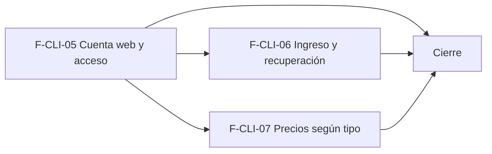

# Tasks: Clientes y proveedores · Cuenta web del cliente

**Input**: `specs/20261024-051500-cuenta-web-del-cliente/` (spec.md, plan.md, contracts/cuenta-web-cliente.md)

**Formato**: `- [ ] T### [P] [F-CLI-xx][USy] descripción`. **[P]** = paralelizable (archivos distintos, sin dependencia; las [P] del mismo grupo van en paralelo); sin [P] = secuencial. Las dependencias de cada tarea son solo dentro de su historia. Las tareas `[CIERRE]` van al final y nunca son prerequisito de una historia. Una tarea marcada «soporta FRxx» colabora con la tarea dueña de ese requisito pero **no** lo posee (dueño único).

**Delivery scope**: `refine`, `supabase`

## Matriz de trazabilidad Jira ↔ US ↔ tasks

| Jira | Historia | FR / SC (dueño único) | Tasks |
|------|----------|-----------------------|-------|
| F-CLI-05 (clave Jira: la asigna el orquestador) | US1 Cuenta web del cliente y acceso a la tienda | FR-001…FR-018, SC-001…SC-004 | T001–T015 |
| F-CLI-06 | US2 Ingreso y recuperación de contraseña del cliente | FR-020…FR-025, SC-005, SC-006 | T020–T027 |
| F-CLI-07 | US3 Precios de la tienda según el tipo de cliente | FR-030…FR-035, SC-007, SC-008 | T030–T036 |
| Tarea de cierre (label cierre) | Documentación, seguridad, roadmap y gates | SC-009, SC-010 | T040–T043 |

### Dueño único por requisito

| Requisito | Tarea dueña | | Requisito | Tarea dueña |
|---|---|---|---|---|
| FR-001 | T001 | | FR-020 | T023 |
| FR-002, FR-010 | T008 | | FR-021 | T022 |
| FR-003, FR-004, FR-009, FR-018 | T006 | | FR-022 | T024 |
| FR-005, FR-008 | T002 | | FR-023 | T020 |
| FR-006, SC-002 | T005 | | FR-024 | T021 |
| FR-007 | T007 | | FR-025 | T026 |
| FR-011 | T004 | | SC-005, SC-006 | T027 |
| FR-012 | T009 | | FR-030 | T035 |
| FR-013 | T010 | | FR-031, FR-032 | T034 |
| FR-014 | T012 | | FR-033, FR-034 | T031 |
| FR-015 | T013 | | FR-035 | T033 |
| FR-016 | T003 | | SC-007, SC-008 | T032 |
| FR-017, SC-004 | T014 | | SC-009 | T040, T042 |
| SC-001 | T006 | | SC-010 | T043 |
| SC-003 | T015 | | | |

---

## Fase 1 — F-CLI-05 · Cuenta web del cliente y acceso a la tienda (US1)

- [ ] T001 [F-CLI-05][US1] Migración `supabase/migrations/20261206100000_cuentas_cliente.sql`: tabla `public.cuentas_cliente` (id, organizacion_id, cliente_id, empresa_id, auth_user_id, estado `activa|suspendida`, created_at; única `(cliente_id, empresa_id)`), RLS por organización + sección Clientes, disparador que valida cliente/empresa de la misma organización (patrón `clientes_empresas`), índices, `revoke` a `anon` y reversión documentada. Esquema `public` justificado en la spec. **FR-001**.
- [ ] T002 [P] [F-CLI-05][US1] Migración `…20261206100100_cuentas_cliente_rpc.sql`: `preparar_cuenta_cliente`, `vincular_cuenta_cliente` (idempotente, solo `service_role`), `cambiar_estado_cuenta_cliente` y `cuentas_web_de_cliente` con `grant … to authenticated` / `revoke … from public, anon` y reversión. **FR-005, FR-008**.
- [ ] T003 [P] [F-CLI-05][US1] Migración `…20261206100150_cuentas_cliente_actividad.sql`: evento de Actividad (creada / suspendida / reactivada / restablecida) con actor, cliente y tienda, en la misma transacción (patrón `registrar_actividad_cliente`). **FR-016**.
- [ ] T004 [P] [F-CLI-05][US1] Migración `…20261206100200_acceso_cliente_por_dominio.sql`: `publico.acceso_cliente_por_dominio(host)` (estados `activa|suspendida|sin_cuenta|no_habilitado`, tipo solo si activa, host desconocido y empresa desactivada ⇒ `null`). **FR-011**.
- [ ] T005 [F-CLI-05][US1] pgTAP `supabase/tests/database/cuentas_cliente.test.sql` (+ ajuste del test de superficie de `anon`): RLS y disparador de `cuentas_cliente`, permisos sin edición ⇒ `42501`, idempotencia, y **sesión de cuenta web sin ninguna fila ni escritura en `public`/`dominio`** y sin membresía. **FR-006, SC-002**.
- [ ] T006 [F-CLI-05][US1] Edge Function `supabase/functions/invitar-cliente/{handler,index}.ts` + `handler.test.ts` (patrón `invitar-miembro`): `crear` / `restablecer`, correo requerido, crea o reutiliza el usuario de Auth, **no escribe `usuarios_organizacion`**, rechaza correo de usuario del panel (D5), enlace con redirección a la tienda, idempotente y errores controlados. **FR-003, FR-004, FR-009, FR-018, SC-001**.
- [ ] T007 [P] [F-CLI-05][US1] Test estático de que `enable_signup` sigue en `false` en `supabase/config.toml` y de que la tienda no expone ruta de registro (extiende el chequeo de configuración existente). **FR-007**.
- [ ] T008 [F-CLI-05][US1] `apps/web/src/lib/cuentasCliente.ts` (+ test): consultas de `cuentas_web_de_cliente`, derivación del estado efectivo (Activa / Suspendida / Sin cuenta / No habilitado; «No habilitado» prevalece) y acciones (crear, restablecer, suspender, reactivar, habilitar tienda con `guardar_empresas_de_cliente`), con textos del prototipo. **FR-002, FR-010**.
- [ ] T009 [P] [F-CLI-05][US1] `apps/web/src/components/clientes/BloqueTiendas.tsx` (+ test con axe): título, subtítulo, interruptor «Habilitado en la tienda», etiqueta de tienda, texto y chip de estado, según la ficha del prototipo. **FR-012**.
- [ ] T010 [P] [F-CLI-05][US1] `apps/web/src/components/clientes/BloqueCuentaWeb.tsx` (+ test con axe): pestañas por tienda, chip + texto de estado, «Correo de acceso», «Último ingreso» y acciones por estado con los mensajes del prototipo; «Crear cuenta web» deshabilitada con motivo si no hay correo. **FR-013**.
- [ ] T011 [F-CLI-05][US1] Integrar ambos bloques en `apps/web/src/pages/clientes/show.tsx` (estados de carga / vacío / error del kit). Soporta FR-012 y FR-013.
- [ ] T012 [P] [F-CLI-05][US1] `apps/web/src/pages/clientes/list.tsx` (+ test): columna «Cuenta web» con chip (agregado D4) y filtro «Con cuenta web». **FR-014**.
- [ ] T013 [P] [F-CLI-05][US1] Formularios `clientes/create.tsx` y `clientes/edit.tsx` (+ test): campo «Cuenta web» (Sin cuenta / Activa / Suspendida) con su nota, casilla «Enviar invitación por correo al crear la cuenta», «Habilitado en» con `SelectorEmpresas`, y creación de la cuenta en cada tienda tildada al guardar. **FR-015**.
- [ ] T014 [F-CLI-05][US1] Empresa activa (Principio VIII) en listado, ficha y formulario: una sola fuente de verdad, invalidar todas las consultas al cambiar de empresa, reencuadrar paginación y no guardar datos de la anterior; test que cambia de empresa. **FR-017, SC-004**.
- [ ] T015 [F-CLI-05][US1] Prueba de los cuatro estados en ficha, listado y formulario (Vitest + axe a 320/768/1440) y revisión lado a lado con el prototipo (`pnpm --filter @platform/web pantallas:capturar`); `pnpm prototipo:check` y `pnpm matriz:check`. **SC-003**.

**Checkpoint F-CLI-05**: se puede crear, suspender, reactivar y restablecer una cuenta web desde el panel y la cuenta no ve nada del panel.

---

## Fase 2 — F-CLI-06 · Ingreso y recuperación de contraseña del cliente (US2)

- [ ] T020 [F-CLI-06][US2] Edge Function `supabase/functions/recuperar-clave-cliente/{handler,index}.ts` + `handler.test.ts`: anónima, respuesta **siempre igual**, envía el correo de Auth solo si hay cuenta activa en la tienda del `host`, redirección al dominio de la tienda. **FR-023**.
- [ ] T021 [P] [F-CLI-06][US2] `supabase/config.toml` (`additional_redirect_urls` con los dominios de tienda) y procedimiento equivalente para STG/PROD self-hosted documentado en `docs/acceso-ingreso.md`; plantillas de Auth reutilizadas. **FR-024**.
- [ ] T022 [F-CLI-06][US2] `apps/web/src/lib/tiendaCuenta.ts` (+ test): ingresar, salir, sesión, `acceso_cliente_por_dominio` tras ingresar y cierre de sesión con mensaje genérico idéntico ante credenciales incorrectas o cuenta no activa. **FR-021**.
- [ ] T023 [P] [F-CLI-06][US2] Ruta `apps/web/src/pages/tienda-publica/rutas/ingresar.tsx` (+ test con axe) y acceso «Ingresar» / «Salir» en el encabezado de la tienda. **FR-020**.
- [ ] T024 [P] [F-CLI-06][US2] Ruta `rutas/definir-contrasena.tsx` (+ test): enlaces de invitación y de restablecimiento, política `passwordPolicy`, ingreso al terminar y mensaje claro ante enlace vencido o usado. **FR-022**.
- [ ] T025 [P] [F-CLI-06][US2] Ruta `rutas/recuperar-contrasena.tsx` (+ test): campo de correo y aviso uniforme. Soporta FR-023.
- [ ] T026 [P] [F-CLI-06][US2] Prueba de que el bloqueo por intentos del template (Auth Hook) alcanza al correo del cliente sin cambios (`pnpm test:auth:hook-bloqueo` y caso de cuenta web). **FR-025**.
- [ ] T027 [F-CLI-06][US2] E2E Playwright con las dos tiendas del seed: invitación → definir contraseña → ingresar; suspendida / sin cuenta / no habilitada no entran; recuperar responde igual con y sin cuenta. **SC-005, SC-006**.

**Checkpoint F-CLI-06**: el cliente define su contraseña, ingresa, y recupera su contraseña en su tienda.

---

## Fase 3 — F-CLI-07 · Precios de la tienda según el tipo de cliente (US3)

- [ ] T030 [F-CLI-07][US3] Migración `supabase/migrations/20261206110000_precio_final_publico_escala.sql`: `private.precio_final_publico_escala(producto, empresa, escala)` con las fórmulas únicas (`a_pesos` → `aplicar_regla_precio` → `aplicar_iva`, escala sin precio ⇒ x1), sin `grant` a `anon`/`authenticated` y con reversión. Soporta FR-033.
- [ ] T031 [F-CLI-07][US3] Migración `…20261206110100_precios_cliente_por_dominio.sql`: `publico.precios_cliente_por_dominio(host, productos)` (solo cuenta activa y habilitada; minorista x1, mayorista cuatro escalas con rango; lista blanca; máximo de productos por llamada). **FR-033, FR-034**.
- [ ] T032 [F-CLI-07][US3] pgTAP `supabase/tests/database/precios_cliente.test.sql`: paridad con `private.precio_para(...).final` por escala, lista blanca (sin costos, existencias ni `organizacion_id`), `null` para visitante / suspendida / no habilitada / host desconocido. **SC-007, SC-008**.
- [ ] T033 [P] [F-CLI-07][US3] `apps/web/src/lib/tiendaPreciosCliente.ts` (+ test): una llamada por página con la sesión del cliente, sin caché de escala entre cargas. **FR-035**.
- [ ] T034 [P] [F-CLI-07][US3] Ficha del producto (`tienda-publica/ficha/`, + test con axe): minorista ve x1; mayorista ve x1, x5, x10, x50 con su rango de unidades. **FR-031, FR-032**.
- [ ] T035 [P] [F-CLI-07][US3] Tarjetas del catálogo (`tienda-publica/catalogo/TarjetaProducto.tsx`, + test): siguen mostrando x1 y el visitante / cuenta no activa ve exactamente el precio público de hoy (sin regresión). **FR-030**.
- [ ] T036 [F-CLI-07][US3] Vitest de ficha y tarjeta con tres sesiones (visitante, minorista, mayorista) y cambio de tipo / suspensión entre cargas. Soporta FR-035 y SC-007.

**Checkpoint F-CLI-07**: el mayorista ve sus escalas en la ficha; el resto, el precio público.

---

## Fase 4 — Cierre (integración, documentación, seguridad y roadmap)

- [ ] T040 [CIERRE] Documentación: `docs/clientes.md` (cuenta web, estados, invitación), `docs/tiendas-online.md` (rutas de ingreso, funciones públicas), `docs/precios-escalas.md` (precio por tipo de cliente en la tienda), `docs/acceso-ingreso.md` (cuentas web fuera del panel y redirecciones de Auth por dominio, STG/PROD); nota de contradicciones y decisiones D1–D6 para el PR. **SC-009**.
- [ ] T041 [CIERRE] Revisión de seguridad: `authz-security` (RLS y funciones nuevas, cuenta web sin acceso al panel, enumeración), `crypto-secrets` (Edge Functions, sin service-role en el navegador) y `supply-chain-security` si se agregan dependencias; hallazgos al PR.
- [ ] T042 [CIERRE] Actualizar la fila de la épica en `docs/roadmap-template.md` (estado, link a la spec, horizonte) al mergear el PR; paso manual con criterio. **SC-009**.
- [ ] T043 [CIERRE] Gates finales: `pnpm lint`, `pnpm build`, `pnpm infra:config`, `pnpm test`, `pnpm prototipo:check`, `pnpm matriz:check`, `pnpm docs:check` verdes y evidencia en el PR. **SC-010**.

---

## Plan de ejecución (historias)

| Historia | Depende de | Grupo |
|---|---|---|
| F-CLI-05 | — | 1 |
| F-CLI-06 | F-CLI-05 | 2 |
| F-CLI-07 | F-CLI-05 | 2 |
| [Cierre] | F-CLI-05, F-CLI-06, F-CLI-07 | 3 |

F-CLI-05 crea la cuenta, su estado y el acceso por tienda que usan las otras dos. F-CLI-06 (rutas de ingreso/recuperación y una Edge Function) y F-CLI-07 (migración de precios, ficha y tarjeta) son independientes entre sí —no comparten archivos, tabla ni migración— y van en paralelo. Cada una trae sus propias pruebas con datos sembrados, sin esperar tareas de la otra.

