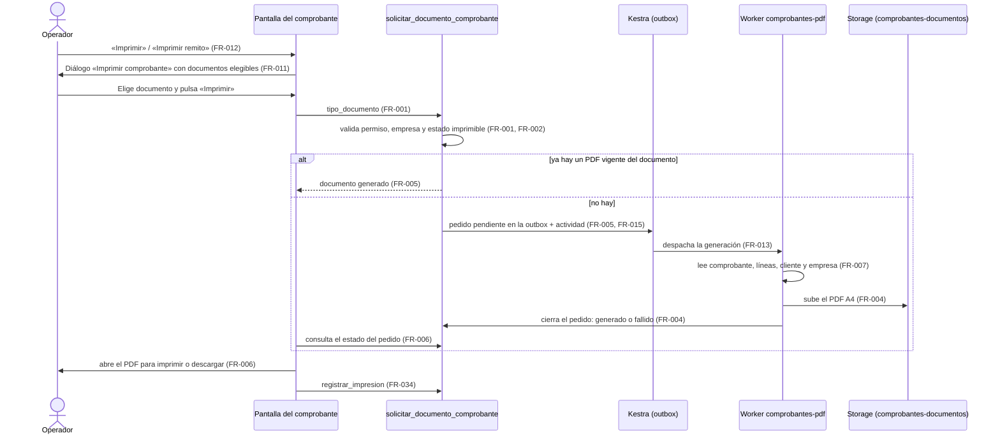
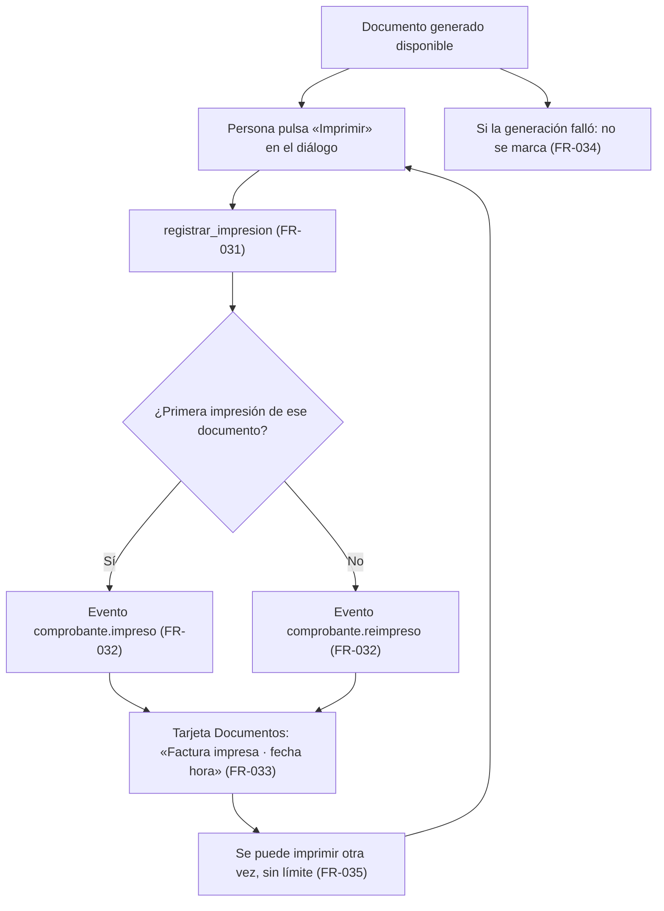
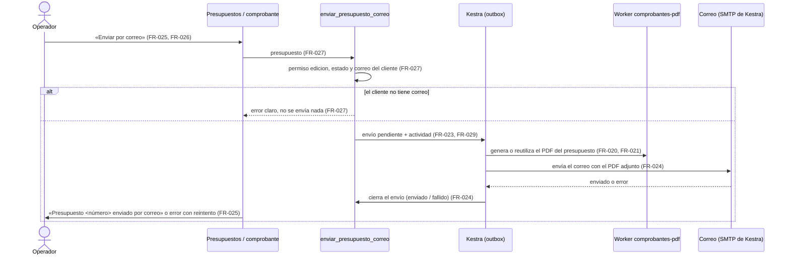

# Feature Specification: Ventas y despacho · Ventas impresión

**Feature Branch**: `epic/MSF-213-ventas-y-despacho-ventas-impresion`

**Jira Epic**: MSF-213 — Ventas y despacho · Ventas impresión (spec `ventas-impresion`)

**Created**: 2026-10-24

**Status**: Ready for implementation — la especificación viene completa desde Jira. Los puntos de «A revisar» no bloquean: cada uno lleva decisión provisoria en *Decisiones abiertas*.

**Delivery scope**: `refine` (apps/web), `supabase` (migraciones + RPC + pgTAP), `kestra` (despacho de la generación del PDF y envío del correo) y `workers` (generación del PDF). Sin `superset`.

**Prioridad / Hito**: P0 · Hito 4 (30 de noviembre al 11 de diciembre de 2026) · 16 h · alcance diciembre.

**Dependencias**:
- Bloqueada por: MSF-159 (`ventas-comprobantes`: comprobante confirmado y presupuesto). Está desplegada en DEV (Review In DEV) pero **su rama `epic/MSF-159-ventas-y-despacho-ventas-comprobantes` aún no está en `main`**: esta épica **no puede mergear antes que ella**. Las firmas de `obtener_comprobante`, `confirmar_comprobante`, `listar_presupuestos` y las tablas `dominio.comprobantes_venta` / `comprobantes_venta_lineas` se **verifican contra `main` (o la rama de MSF-159) al implementar**; no se inventan aquí.
- Bloquea a: ninguna épica.

**Input**: Epic MSF-213. Objetivo: «Al terminar, se imprimen o descargan en PDF la factura interna, el remito y el presupuesto con los datos de la empresa, y el presupuesto se puede enviar por correo.»

## Regla de fuentes (literal de la épica)

1. Comportamiento y datos: mandan los requisitos y escenarios de esta historia.
2. Qué se ve (disposición, textos, estados, popups, flujos): el prototipo validado es referencia visual, no hace falta que quede extremadamente idéntico; los flujos (si hay) aclaran estados y acciones.
3. Cómo se construye (componentes, estilos y patrones): mandan el template y el system design del producto (épica Plataforma · Sistema de diseño, MSF-117). No copiar el HTML ni el CSS del prototipo.
4. El prototipo muestra más que esta historia: implementar solo lo que piden los requisitos; otras secciones, botones o diálogos son de otras historias.
5. Si algo no se puede igualar con el template / el sistema de diseño: usar lo más cercano, sin inventar, y anotar la diferencia en la descripción del PR.
6. Si el prototipo y los requisitos se contradicen: requisitos para el comportamiento, prototipo para lo visual, y dejar la contradicción anotada en el PR.

Prototipos (solo lectura): `design/pantallas/VentasComprobante.dc.html` (botones «Imprimir» e «Imprimir remito», diálogo «Imprimir comprobante», tarjeta «Documentos») y `design/pantallas/VentasPresupuestos.dc.html` (acciones de fila «Enviar por correo» e «Imprimir»). **No hay artboards de la hoja impresa** (factura, remito, presupuesto en PDF): el formato es decisión provisoria (ver *Decisiones abiertas* 2). Inventarios al día en `design/pantallas/*.inventory.json`.

## Modelo y supuestos

- **Los documentos son internos (no fiscales)** y llevan la leyenda «Documento no válido como factura» (supuesto de la épica).
- **Tres documentos**: factura interna, remito y presupuesto. Cada uno se genera como **PDF A4** que la persona puede **imprimir o descargar**.
- **Los datos de la empresa** (razón social, CUIT, dirección, logo) **salen de la ficha de empresa** (supuesto de la épica). Estado verificado en el árbol: `dominio.empresas` tiene `nombre`, `direccion`, `correo`, `whatsapp`, `instagram`; **no tiene razón social ni CUIT**; el logo existe como `dominio.tienda_identidad.logo_ruta` (bucket `tienda-identidad`, MSF-266). Qué se agrega: ver FR-007/FR-008 y *Decisiones abiertas* 4.
- **El PDF se genera en un worker** (supuesto de la épica), despachado por Kestra con la outbox de ejecuciones (patrón de `historial-importador`, `docs/historial-ventas.md`). Ver *Decisiones abiertas* 3 y 5.
- **Estados imprimibles**: la factura y el remito, solo con el comprobante `confirmada`; el presupuesto, en `pendiente`, `aceptado` y `vencido` (ver *Decisiones abiertas* 6).
- **Formato exacto** de cada documento: se confirma con el cliente con ejemplos del panel actual (supuesto de la épica); mientras tanto el contenido de FR-009/FR-010/FR-020 es provisorio y vive en **una sola plantilla por documento** para ajustarlo sin tocar el resto.
- **Importes sin IVA y con IVA discriminado** como en el comprobante (MSF-159); el remito no lleva importes (provisorio).
- **Quién imprime**: `ventas` en `lectura` en la empresa del comprobante alcanza para pedir e imprimir un documento (precedente de Service, `docs/service-impresion.md`); **enviar por correo** exige `edicion` (acción hacia afuera).

### Esquema de datos (Constitución, Principio VII)

| Objeto | Esquema | Justificación | RLS / acceso |
|--------|---------|---------------|--------------|
| `dominio.empresas` (**existente**; se **altera** de forma aditiva en F-VTA-19: `razon_social`, `cuit`) | **`dominio`** | Dato de negocio de quién vende (ya vive ahí). | RLS vigente por `organizacion_id`; las columnas nuevas se agregan al `grant update` por columna existente; `anon` sin acceso. |
| `dominio.comprobante_documentos` (**nueva**, F-VTA-19) | **`dominio`** | Documento de venta generado (pedido, estado y archivo): entidad de negocio del producto. | RLS por `organizacion_id` + sección `ventas` (`select` con `lectura`/`edicion`); **sin escritura directa**: solo RPC `security definer`; sin `delete` directo; `anon` sin acceso. |
| `dominio.comprobante_impresiones` (**nueva**, F-VTA-21) | **`dominio`** | Registro de cada impresión de un documento de venta. | Ídem; tabla **append-only** (sin `update` ni `delete` para nadie). |
| `dominio.comprobante_envios_correo` (**nueva**, F-VTA-20) | **`dominio`** | Registro del envío por correo de un presupuesto. | Ídem; escritura solo por RPC y por la función de cierre del flow. |
| Bucket `comprobantes-documentos` (Storage, **nuevo**, F-VTA-19) | Infraestructura de plataforma (patrón de `tienda-identidad` / `productos-imagenes`) | Archivos PDF. | **Privado**; lectura por política sobre `storage.objects` acotada a la organización y a `ventas`; escritura solo con la clave de servicio del worker. |
| `public.registro_actividad` y outbox de ejecuciones (**existentes**) | `public` (sin cambio de esquema) | Auditoría y despacho transversales. | Vigentes. |

`rls_en_toda_tabla` (pgTAP, recorre `public` + `dominio`) debe seguir verde. Todas las migraciones son **aditivas** con reversión en su encabezado; **cada historia trae su propia migración** (timestamps propios, sin encadenarse a las de otra).

## Flujos

### Flujo 1 · Imprimir un documento (secuencia)



(Mapa: FR-001/FR-002/FR-005/FR-015 → RPC de F-VTA-19; FR-004 → worker; FR-006/FR-011/FR-012 → pantalla; FR-013 → flow de Kestra; FR-034 → F-VTA-21.)

### Flujo 2 · Ciclo del pedido de documento (máquina de estados)

```mermaid
stateDiagram-v2
  [*] --> pendiente: solicitar_documento_comprobante (FR-001, FR-005)
  pendiente --> pendiente: otro pedido igual no crea uno nuevo (FR-005)
  pendiente --> generado: el worker sube el PDF (FR-004)
  pendiente --> fallido: el worker falla; error sanitizado (FR-004, FR-013)
  fallido --> pendiente: «Reintentar» (FR-006)
  generado --> [*]
  note right of generado
    Se reutiliza para reimprimir
    sin regenerar (FR-005, FR-035)
  end note
```

### Flujo 3 · Marca de impreso y reimpresión (proceso)



### Flujo 4 · Envío del presupuesto por correo (secuencia)



## User Scenarios & Testing *(mandatory)*

### User Story 1 - Impresión de factura y remito (F-VTA-19, P0, talla M)

Como operador, quiero imprimir o descargar en PDF la factura interna y el remito de un comprobante confirmado, con los datos de la empresa, para entregárselos al cliente y para el armado.

**Why this priority**: es el entregable central de la épica y trae la infraestructura (worker, almacenamiento, despacho) que usan las otras dos historias.

**Independent Test**: con un comprobante `confirmada` de una empresa con razón social, CUIT, dirección y logo cargados, «Imprimir» → elegir Factura genera un PDF A4 con esos datos y la leyenda «Documento no válido como factura»; «Imprimir remito» genera el remito; un `borrador` no se puede imprimir; otra organización o empresa sin acceso no ve ni pide el documento.

**Acceptance Scenarios**:

1. **Given** una factura `confirmada`, **When** se pulsa «Imprimir» y se elige «Factura A …», **Then** se pide el documento, la pantalla muestra «Preparando documento…» y al estar listo abre el PDF para imprimir o descargar.
2. **Given** una factura `confirmada`, **When** se pulsa «Imprimir remito», **Then** el diálogo abre con el remito elegido y genera el PDF del remito.
3. **Given** un PDF ya generado del mismo documento, **When** se vuelve a pedir, **Then** se abre el existente sin generar otro.
4. **Given** una empresa sin razón social, CUIT o logo cargados, **When** se genera el documento, **Then** lo no cargado se omite (no se inventa ni se imprime en blanco).
5. **Given** una factura en `borrador`, **When** se abre el comprobante, **Then** los botones de impresión no están disponibles y se explica por qué.
6. **Given** el worker falla, **When** pasa el tiempo, **Then** el documento queda `fallido`, la pantalla muestra un error claro y permite reintentar; el detalle técnico no se muestra.
7. **Given** una persona con `ventas` en `ninguno` o de otra organización, **When** pide el documento, **Then** se rechaza (RLS y RPC).

### User Story 2 - Presupuesto en PDF y envío por correo (F-VTA-20, P0, talla M)

Como operador, quiero imprimir el presupuesto en PDF y enviárselo por correo al cliente, para cerrar la cotización sin salir del panel.

**Why this priority**: completa el recorrido comercial del presupuesto que entrega MSF-159.

**Independent Test**: desde «Presupuestos», «Imprimir» en una fila genera el PDF del presupuesto con «Válido hasta»; «Enviar por correo» manda el PDF adjunto al correo del cliente y deja registrado quién y cuándo; un cliente sin correo recibe un error claro sin envío.

**Acceptance Scenarios**:

1. **Given** un presupuesto, **When** se pulsa «Imprimir» en su fila, **Then** se genera/abre el PDF del presupuesto con los datos de la empresa y la leyenda.
2. **Given** un presupuesto de un cliente con correo, **When** se pulsa «Enviar por correo», **Then** se envía el correo con el PDF adjunto y la pantalla muestra «Presupuesto <número> enviado por correo».
3. **Given** un presupuesto cuyo cliente no tiene correo, **When** se pulsa «Enviar por correo», **Then** se rechaza con un mensaje claro y no se crea ningún envío.
4. **Given** un envío en curso, **When** se vuelve a pulsar, **Then** no se duplica el correo.
5. **Given** el envío falla, **Then** queda `fallido` con error claro y se puede reintentar.
6. **Given** una persona con `ventas` en `lectura`, **Then** puede imprimir pero no ve «Enviar por correo» habilitado.

### User Story 3 - Marca de impreso y reimpresión (F-VTA-21, P0, talla S)

Como operador, quiero ver si un documento ya se imprimió (cuándo) y poder reimprimirlo, para no entregar dos veces por error y poder reponer una copia.

**Why this priority**: da trazabilidad a la impresión; es chica y depende del flujo de F-VTA-19.

**Independent Test**: tras imprimir una factura, la tarjeta «Documentos» muestra «Factura impresa · dd/mm hh:mm»; imprimir de nuevo actualiza la fecha, suma una impresión al registro y emite `comprobante.reimpreso`; un documento cuya generación falló no queda marcado.

**Acceptance Scenarios**:

1. **Given** un documento nunca impreso, **When** se imprime, **Then** se registra la impresión (quién, cuándo) y la tarjeta muestra la marca con fecha y hora.
2. **Given** un documento ya impreso, **When** se vuelve a imprimir, **Then** se registra una impresión más, la marca muestra la última fecha y se emite `comprobante.reimpreso`.
3. **Given** la generación falló, **Then** no se registra impresión.
4. **Given** un documento impreso, **When** se abre el comprobante, **Then** el botón «Imprimir» sigue disponible (reimpresión sin límite ni permiso adicional).

### Edge Cases

- Comprobante o presupuesto de **otra empresa/organización**: no aparece ni se imprime (RLS + empresa activa).
- **Cambio de empresa activa** con el diálogo abierto: se cierra con aviso; no se imprime con datos de la anterior (Principio VIII).
- Presupuesto **modificado después** de un PDF: el PDF viejo no se reutiliza (FR-021).
- **Nombres largos / muchas líneas**: el PDF pagina en A4 sin cortar filas ni totales.
- **Doble clic** en «Imprimir»: un solo pedido (idempotente).
- El **logo** no existe o es ilegible: el documento se genera sin logo.
- **Reintento del worker** tras corte: no duplica archivos ni envíos (Principio III).
- Archivo PDF ausente en Storage con pedido `generado`: se trata como `fallido` y se permite regenerar.

## Requirements *(mandatory)*

### Functional Requirements

**F-VTA-19 — Impresión de factura y remito**
- **FR-001**: `solicitar_documento_comprobante(comprobante_id, tipo_documento)` crea el pedido de un documento (`factura` o `remito` en esta historia); exige `ventas` en `lectura` como mínimo en la empresa del comprobante; la organización y el solicitante salen de la sesión, nunca del llamador.
- **FR-002**: Solo se pueden pedir `factura` y `remito` de un comprobante tipo `factura` en estado `confirmada`; cualquier otro estado o tipo se rechaza con mensaje claro.
- **FR-003**: `dominio.comprobante_documentos` guarda el pedido (comprobante, tipo, estado `pendiente`/`generado`/`fallido`, ruta del archivo, solicitante, fechas, error sanitizado); los PDF se guardan en el bucket privado `comprobantes-documentos` en la ruta `<organizacion>/<empresa>/<comprobante>/<documento>.pdf`; se descargan con URL firmada de corta vida.
- **FR-004**: Un worker (`workers/comprobantes-pdf`) genera el PDF **A4**, lo sube y cierra el pedido como `generado` o `fallido`; sigue el contrato `workers/CONTRATO.md` (códigos de salida, errores sanitizados, sin secretos en la línea de comandos).
- **FR-005**: El pedido es **idempotente**: no puede haber dos pedidos `pendiente` del mismo comprobante y tipo, y si existe un PDF `generado` vigente del mismo documento se reutiliza en vez de generar otro (el comprobante confirmado es inmutable).
- **FR-006**: La pantalla muestra el estado del pedido («Preparando documento…», listo, error claro con «Reintentar»), consulta su avance sin recargar y, al estar listo, abre el PDF para imprimir o descargar. Un `fallido` permite crear un pedido nuevo.
- **FR-007**: El worker lee los datos de la empresa (razón social, CUIT, dirección, nombre, logo) de la ficha de empresa y omite lo no cargado; el logo sale de `tienda_identidad.logo_ruta` (*Decisiones abiertas* 4). La lectura se hace con una función de datos `private.datos_documento_comprobante` no ejecutable por `authenticated`.
- **FR-008**: La ficha de empresa (pestaña General) permite cargar **Razón social** y **CUIT** (CUIT de 11 dígitos validado); `dominio.empresas` gana `razon_social` y `cuit` con migración aditiva y reversión.
- **FR-009**: **Factura interna** (provisorio): encabezado con logo y datos de la empresa; leyenda «Documento no válido como factura»; tipo y número, fecha y operador; cliente (nombre, CUIT / DNI, condición frente al IVA, dirección de entrega); tabla Producto · Cantidad · Precio · Importe (precios sin IVA); Subtotal sin IVA, IVA y Total; forma de pago y envío elegidos. Los tres documentos de la épica llevan la leyenda.
- **FR-010**: **Remito** (provisorio): encabezado de empresa y leyenda; número del comprobante y fecha; cliente y dirección de entrega; envío elegido; tabla Producto · Código · Cantidad · Depósito, **sin importes**.
- **FR-011**: El diálogo «Imprimir comprobante» (texto «Se marca como impreso con fecha y hora.», lista de documentos elegibles con su subtítulo —Factura: «Original para el cliente»; Remito: «Para el armado y la entrega»—, botones «Cancelar» e «Imprimir») permite elegir uno; muestra solo los documentos que aplican al comprobante abierto.
- **FR-012**: El comprobante muestra los botones «Imprimir» (cabecera) e «Imprimir remito» (tarjeta Documentos) que abren el diálogo (el segundo con el remito preseleccionado); tras «Imprimir» confirma con «Enviado a imprimir». Si el comprobante no es imprimible (FR-002) los botones no se ofrecen y se indica el motivo.
- **FR-013**: El despacho usa Kestra con la outbox de ejecuciones (capacidad `generar-documento-venta-*`), con reintentos acotados; una falla no reintentable (código 78) agota la orden; la ejecución queda auditada (origen, actor, estado, error).
- **FR-014**: Documento y diálogo respetan la **empresa activa** (Principio VIII): el comprobante pertenece a una empresa; al cambiar la empresa activa se invalidan y recargan las consultas y el diálogo abierto se cierra con aviso; nunca se imprime con datos de otra empresa.
- **FR-015**: Cada pedido registra el evento `comprobante.documento_solicitado` con `private.registrar_actividad` en la misma transacción.
- **FR-016**: Acceso y seguridad: las RPC llevan `security definer`, `search_path = ''`, `revoke … from public, anon` y `grant execute … to authenticated`; `anon` no ejecuta nada nuevo; el bucket es privado; ningún secreto va al navegador (el worker usa la clave de servicio solo en el servidor).

**F-VTA-20 — Presupuesto en PDF y envío por correo**
- **FR-020**: **Presupuesto** (provisorio): encabezado y leyenda «Documento no válido como factura» más «Versión sin valor fiscal»; número, fecha y «Válido hasta»; cliente; tabla de líneas; Subtotal sin IVA, IVA y Total.
- **FR-021**: `solicitar_documento_comprobante` acepta el tipo `presupuesto` para un comprobante tipo `presupuesto` en cualquier estado visible en Presupuestos (`pendiente`, `aceptado`, `vencido`); un presupuesto modificado desde el último PDF genera uno nuevo (FR-005).
- **FR-022**: La acción «Imprimir» de cada fila de Presupuestos genera/abre el PDF del presupuesto y confirma con «Enviado a imprimir · <número>».
- **FR-023**: `dominio.comprobante_envios_correo` registra cada envío (presupuesto, destinatario, estado `pendiente`/`enviado`/`fallido`, quién, cuándo, error sanitizado); no puede haber dos `pendiente` del mismo presupuesto.
- **FR-024**: Un flow de Kestra genera o reutiliza el PDF, envía el correo con el PDF adjunto usando el SMTP de Kestra existente (`KESTRA_SMTP_*`, asunto y cuerpo fijos provisorios) y cierra el envío como `enviado` o `fallido`.
- **FR-025**: La acción «Enviar por correo» de cada fila de Presupuestos pide el envío y muestra «Presupuesto <número> enviado por correo» al completarse, o el error claro con «Reintentar».
- **FR-026**: El detalle de un presupuesto ofrece la opción «Presupuesto» en el diálogo de impresión y, en la tarjeta Documentos, «Enviar por correo» con la marca «Presupuesto enviado por correo · fecha hora» (variante del texto del prototipo, *Decisiones abiertas* 9).
- **FR-027**: `enviar_presupuesto_correo(comprobante_id)` exige `ventas` en `edicion` en la empresa; toma como destinatario el correo del cliente; si el cliente no tiene correo (incluido Consumidor final) rechaza con mensaje claro sin crear envío; es idempotente (FR-023).
- **FR-028**: Las acciones por fila de Presupuestos respetan la **empresa activa** y el nivel de permiso (`lectura` imprime; «Enviar por correo» solo con `edicion`).
- **FR-029**: Cada envío registra `presupuesto.enviado_por_correo` (o `presupuesto.envio_fallido`) con `private.registrar_actividad`.

**F-VTA-21 — Marca de impreso y reimpresión**
- **FR-030**: `dominio.comprobante_impresiones` guarda cada impresión (comprobante, tipo de documento, documento generado, quién, cuándo); es append-only.
- **FR-031**: `registrar_impresion(documento_id)` registra la impresión de un documento `generado` del comprobante; exige `ventas` en `lectura` en la empresa; rechaza un documento no generado.
- **FR-032**: La primera impresión de un documento emite `comprobante.impreso`; las siguientes, `comprobante.reimpreso` (quién, cuándo, tipo) con `private.registrar_actividad`.
- **FR-033**: La tarjeta «Documentos» muestra por documento la marca con la **última** impresión («Factura impresa · dd/mm hh:mm», «Remito impreso · …», «Presupuesto impreso · …») y la casilla vacía si nunca se imprimió.
- **FR-034**: La impresión se registra al confirmar «Imprimir» con el documento ya disponible; si la generación falló o se canceló el diálogo, no se registra.
- **FR-035**: La reimpresión no tiene límite ni permiso adicional: «Imprimir» sigue disponible tras imprimir y reutiliza el PDF vigente (FR-005); el registro conserva todas las impresiones.

### Key Entities

- **Documento de venta generado** (`comprobante_documentos`): pedido y archivo PDF de un tipo de documento de un comprobante.
- **Impresión** (`comprobante_impresiones`): hecho de haber impreso un documento, con quién y cuándo.
- **Envío por correo** (`comprobante_envios_correo`): hecho de enviar un presupuesto a un destinatario.

### Success Criteria

- **SC-001** *(F-VTA-19)*: pgTAP: aislamiento entre organizaciones y empresas, `lectura`/`ninguno`/`anon`, solo `confirmada` imprimible, idempotencia del pedido y reutilización, `rls_en_toda_tabla` verde, `anon` sin ejecutar RPC nuevas.
- **SC-002** *(F-VTA-19)*: tests del worker: el PDF es A4, contiene los datos de la empresa, las líneas y totales, la leyenda «Documento no válido como factura»; omite lo no cargado; el remito no contiene importes; errores sanitizados y códigos de salida del contrato.
- **SC-003** *(F-VTA-19)*: Vitest: botones y diálogo, elegibilidad, estados «Preparando…»/error/«Reintentar», cambio de empresa cierra el diálogo, ficha de empresa con Razón social y CUIT.
- **SC-004** *(F-VTA-20)*: pgTAP: presupuesto imprimible en sus estados, envío con `edicion`, cliente sin correo, idempotencia, aislamiento.
- **SC-005** *(F-VTA-20)*: tests del worker (plantilla de presupuesto) y del flow (renderizado/validación de Kestra) del correo con adjunto.
- **SC-006** *(F-VTA-20)*: Vitest: acciones de fila, envío, errores, `lectura` sin envío, cambio de empresa.
- **SC-007** *(F-VTA-21)*: pgTAP: impresión registrada, `impreso` vs `reimpreso`, append-only, documento no generado rechazado, aislamiento.
- **SC-008** *(F-VTA-21)*: Vitest: marca con fecha y hora, reimpresión, sin marca si falla.
- **SC-009** *(Cierre)*: E2E del recorrido: comprobante confirmado → imprimir factura y remito → marca → presupuesto → PDF → correo.
- **SC-010** *(Cierre)*: revisión de seguridad (RLS, `security definer`, bucket privado, worker, flow).
- **SC-011** *(Cierre)*: `docs/ventas-impresion.md` e índice, fila del roadmap, `pnpm lint`, `pnpm build`, `pnpm test`, `pnpm docs:check`, `pnpm prototipo:check` y `pnpm matriz:check` verdes.

## Verificación por requisito

Cada FR/SC tiene su verificación nombrada (archivo de test o comando). Los archivos se crean en la tarea indicada en la matriz de trazabilidad. Comandos base: `pnpm test:db` (pgTAP), `pnpm --filter @platform/web test` (Vitest web), `pnpm --filter @workers/comprobantes-pdf test` (worker), `node --test infra/kestra/flows/comprobantes-correo.test.mjs` (flow de correo), `pnpm infra:config`.

| Requisito | Verificación |
|-----------|--------------|
| FR-001 | pgTAP `supabase/tests/database/ventas_impresion_documentos.test.sql` (`pnpm test:db`): `lectura` pide, `ninguno`/`anon` rechazados, organización y solicitante tomados de la sesión |
| FR-002 | pgTAP `ventas_impresion_documentos.test.sql`: `borrador`/otro tipo rechazados, `confirmada` aceptada |
| FR-003 | pgTAP `ventas_impresion_documentos.test.sql`: estructura, estados, RLS y bucket privado `comprobantes-documentos`; Vitest `apps/web/src/lib/ventasImpresion.test.ts` (URL firmada de corta vida) |
| FR-004 | `pnpm --filter @workers/comprobantes-pdf test` (`src/generar.test.ts`): PDF A4 subido, cierre `generado`/`fallido`, códigos de salida y errores sanitizados |
| FR-005 | pgTAP `ventas_impresion_documentos.test.sql`: un solo `pendiente` por comprobante y tipo, reutilización del `generado`; Vitest `ImprimirComprobanteDialog.test.tsx` (doble clic = un pedido) |
| FR-006 | Vitest `apps/web/src/components/ventas/ImprimirComprobanteDialog.test.tsx`: «Preparando documento…», consulta de avance, error con «Reintentar», apertura del PDF |
| FR-007 | pgTAP `ventas_impresion_documentos.test.sql` (`private.datos_documento_comprobante` no ejecutable por `authenticated`); worker `src/plantillas/factura.test.ts` (lo no cargado se omite) |
| FR-008 | Vitest `apps/web/src/pages/empresas/edit.test.tsx` (Razón social y CUIT de 11 dígitos); pgTAP `ventas_impresion_documentos.test.sql` (columnas y restricción de `cuit`) |
| FR-009 | worker `src/plantillas/factura.test.ts`: encabezado, leyenda, cliente, tabla, totales, pago y envío |
| FR-010 | worker `src/plantillas/remito.test.ts`: encabezado, leyenda, tabla Producto · Código · Cantidad · Depósito, sin importes |
| FR-011 | Vitest `ImprimirComprobanteDialog.test.tsx`: textos, subtítulos, documentos elegibles según el comprobante, «Cancelar» e «Imprimir» |
| FR-012 | Vitest `apps/web/src/components/ventas/DocumentosComprobante.test.tsx`: botones «Imprimir» e «Imprimir remito», snack «Enviado a imprimir», motivo si no es imprimible |
| FR-013 | `pnpm infra:config` (flow `comprobantes-documentos.yml` válido) y `node --test infra/kestra/flows/comprobantes-documentos.test.mjs`: reclamo, intervalo, reintentos acotados, código 78 agota la orden |
| FR-014 | Vitest `DocumentosComprobante.test.tsx`: cambio de empresa activa invalida consultas y cierra el diálogo con aviso |
| FR-015 | pgTAP `ventas_impresion_documentos.test.sql`: evento `comprobante.documento_solicitado` en la misma transacción |
| FR-016 | pgTAP `ventas_impresion_documentos.test.sql`: `security definer`, `search_path`, `anon` sin ejecutar RPC nuevas; revisión T036 (`authz-security`, `infra-security`) |
| FR-020 | worker `src/plantillas/presupuesto.test.ts`: leyendas, «Válido hasta», cliente, líneas y totales |
| FR-021 | pgTAP `supabase/tests/database/ventas_impresion_presupuesto.test.sql`: estados `pendiente`/`aceptado`/`vencido` imprimibles, regeneración si el presupuesto cambió |
| FR-022 | Vitest `apps/web/src/pages/ventas/presupuestos.test.tsx`: acción «Imprimir» y snack «Enviado a imprimir · <número>» |
| FR-023 | pgTAP `ventas_impresion_presupuesto.test.sql`: estructura, RLS y un solo envío `pendiente` por presupuesto |
| FR-024 | `node --test infra/kestra/flows/comprobantes-correo.test.mjs` + `pnpm infra:config`: PDF adjunto, SMTP `KESTRA_SMTP_*`, cierre `enviado`/`fallido` |
| FR-025 | Vitest `presupuestos.test.tsx`: «Enviar por correo», snack «Presupuesto <número> enviado por correo», error con «Reintentar» |
| FR-026 | Vitest `DocumentosComprobante.test.tsx` e `ImprimirComprobanteDialog.test.tsx`: opción «Presupuesto», botón y marca «Presupuesto enviado por correo · fecha hora» |
| FR-027 | pgTAP `ventas_impresion_presupuesto.test.sql`: `edicion` requerida, cliente sin correo rechazado, idempotencia |
| FR-028 | Vitest `presupuestos.test.tsx`: `lectura` imprime sin envío; cambio de empresa recarga las acciones |
| FR-029 | pgTAP `ventas_impresion_presupuesto.test.sql`: eventos `presupuesto.enviado_por_correo` y `presupuesto.envio_fallido` |
| FR-030 | pgTAP `supabase/tests/database/ventas_impresion_marcas.test.sql`: tabla append-only (sin `update`/`delete`) |
| FR-031 | pgTAP `ventas_impresion_marcas.test.sql`: registra documento `generado`, exige `lectura`, rechaza no generado |
| FR-032 | pgTAP `ventas_impresion_marcas.test.sql`: `comprobante.impreso` la primera vez y `comprobante.reimpreso` después |
| FR-033 | Vitest `DocumentosComprobante.test.tsx`: marca con la última impresión y casilla vacía si nunca se imprimió |
| FR-034 | Vitest `ImprimirComprobanteDialog.test.tsx`: se registra al confirmar con documento disponible; no si falló o se canceló |
| FR-035 | Vitest `ImprimirComprobanteDialog.test.tsx`: «Imprimir» sigue disponible y reutiliza el PDF; pgTAP `ventas_impresion_marcas.test.sql` conserva todas las impresiones |
| SC-001 | `pnpm test:db` (`ventas_impresion_documentos.test.sql`, incluye `rls_en_toda_tabla`) |
| SC-002 | `pnpm --filter @workers/comprobantes-pdf test` (plantillas de factura y remito, errores y códigos de salida) |
| SC-003 | `pnpm --filter @platform/web test` (`edit.test.tsx`, `ImprimirComprobanteDialog.test.tsx`, `DocumentosComprobante.test.tsx`) |
| SC-004 | `pnpm test:db` (`ventas_impresion_presupuesto.test.sql`) |
| SC-005 | `pnpm --filter @workers/comprobantes-pdf test` (`presupuesto.test.ts`) y `node --test infra/kestra/flows/comprobantes-correo.test.mjs` |
| SC-006 | `pnpm --filter @platform/web test` (`presupuestos.test.tsx`, `DocumentosComprobante.test.tsx`) |
| SC-007 | `pnpm test:db` (`ventas_impresion_marcas.test.sql`) |
| SC-008 | `pnpm --filter @platform/web test` (`DocumentosComprobante.test.tsx`, `ImprimirComprobanteDialog.test.tsx`) |
| SC-009 | `pnpm test:e2e` (`apps/web/e2e/ventas-impresion.e2e.ts`) |
| SC-010 | Informe de revisión de seguridad (T036) con `authz-security`, `database-reviewer` e `infra-security`; `pnpm test:db` (`rls_en_toda_tabla`, `anon` sin RPC nuevas) |
| SC-011 | `pnpm lint && pnpm build && pnpm test && pnpm docs:check && pnpm prototipo:check && pnpm matriz:check && pnpm infra:config` |

## Decisiones abiertas (provisorias; no bloquean)

1. **¿Las 16 h son adicionales a las 45 h de «Comprobante»?** El roadmap a diciembre no nombra la impresión de forma explícita. Se conservan las 16 h de la épica; pendiente de Nicolás.
2. **Formato de factura interna y remito** (pendiente del cliente, con ejemplos del panel actual): contenido provisorio en FR-009/FR-010/FR-020; una plantilla por documento; el remito sin importes y sin firma ni observaciones (el campo Observaciones está fuera de MSF-159).
3. **Alternativa (b) del riesgo de fecha** (impresión del navegador y formatos finales en Etapa 2): **no se adopta**; manda el supuesto de la épica (PDF generado en un worker). Si Nicolás elige (b), F-VTA-19 se reduce a una vista imprimible sin worker ni Kestra (como Service) y F-VTA-20 mantiene el correo.
4. **Datos de la empresa**: se agregan `razon_social` y `cuit` a `dominio.empresas` con dos campos en la ficha (FR-008) porque hoy no existen; el logo se toma del logo de identidad de la tienda (`tienda_identidad.logo_ruta`, PNG/SVG ≤ 1 MB) en vez de agregar una subida nueva. Alternativa: una subida de logo propia de la ficha.
5. **Latencia**: el despacho por la outbox de Kestra reclama cada 2 minutos (`historial-importador`); para imprimir se acorta el intervalo del flow a 1 minuto y la pantalla muestra «Preparando documento…». Si esa espera es inaceptable para el mostrador, la alternativa es la (b) de la decisión 3 para facturas y remitos.
6. **Estados imprimibles**: factura y remito solo `confirmada`; presupuesto en `pendiente`, `aceptado` y `vencido`. `anulada` y los estados de despacho son de MSF-177/MSF-135 y no se tratan aquí.
7. **Permisos**: `lectura` imprime; `edicion` envía por correo.
8. **Correo**: remitente y SMTP son los globales de Kestra (no uno por empresa); asunto y cuerpo fijos provisorios; sin cuerpo editable ni destinatarios alternativos (el prototipo no los muestra).
9. **Texto de la marca del presupuesto**: el prototipo dice «Presupuesto original enviado por correo» (pensado para una factura con presupuesto origen, que MSF-159 deja fuera); se usa «Presupuesto enviado por correo · fecha hora». Se anota en el PR.
10. **Reimpresión sin marca de agua**: la hoja reimpresa es idéntica a la original; no se pide «COPIA».
11. **Conservación de PDF**: los PDF generados se conservan; no hay purga en esta épica.

## Matriz pantalla↔criterios

Prototipos: `VentasComprobante.dc.html` y `VentasPresupuestos.dc.html` (inventarios en `design/pantallas/*.inventory.json`). Lo que la épica no pide se declara FUERA DE ALCANCE (nota, no tarea). «MSF-159» = lo entrega `ventas-comprobantes`, ya especificado allí.

### Ventas · Comprobante (`VentasComprobante`)

| Ítem del prototipo | Criterio |
|--------------------|----------|
| Botón «Imprimir» (cabecera) | FR-012 |
| Botón «Imprimir remito» (tarjeta Documentos) | FR-012 |
| Diálogo «Imprimir comprobante» (texto «Se marca como impreso con fecha y hora.», opciones Factura / Remito / Presupuesto con subtítulo, «Cancelar», «Imprimir») | FR-011 (Factura y Remito), FR-026 (Presupuesto en un presupuesto); la opción «Presupuesto» dentro de una factura es **FUERA DE ALCANCE** (la factura no tiene presupuesto origen: MSF-159 deja «Facturar» fuera) |
| Tarjeta «Documentos»: «Factura impresa · fecha», «Remito impreso» | FR-033 |
| Tarjeta «Documentos»: «Presupuesto original enviado por correo» y botón «Enviar por correo» | FR-026 (variante de texto, decisión 9) |
| Snack «Enviado a imprimir» | FR-012 |
| Snack «Correo enviado al cliente» | FR-025 / FR-026 |
| Campos Tienda, Canal de venta, Cliente, CUIT / DNI, Condición frente al IVA, Dirección de entrega, Fecha, Operador | Pantalla de **MSF-159** (comprobante); esta épica solo los **lee** para el documento impreso (FR-009, FR-010) |
| Botones «Comprobantes», «Guardar cambios», «Agregar producto», «Local», «Principal», «Copiar» | **FUERA DE ALCANCE** — MSF-159 |
| Tabla de líneas (Producto, Cantidad, Precio, Importe) | Pantalla de MSF-159; su contenido se imprime (FR-009). La tabla de la **nota de crédito** es **FUERA DE ALCANCE** |
| Botón «Nota de crédito», diálogo «Nota de crédito», «Emitir nota de crédito», su «Cancelar» | **FUERA DE ALCANCE** — la épica no pide impresión de notas de crédito (roadmap aparte) |
| Botón «Agregar flete», líneas manuales, «Relacionados» | **FUERA DE ALCANCE** — MSF-159 los dejó fuera |
| Campos Cuenta de cobro, Guía, Fecha de envío, Armó, Controló, Entregó; «Ir a Pagos →» | **FUERA DE ALCANCE** — Pagos y despacho (MSF-135) |
| Tabla «Historial de estados y acciones» (Cuándo, Acción, Quién, Tienda) | **FUERA DE ALCANCE** — MSF-177; las impresiones y envíos quedan en actividad (FR-015, FR-032, FR-029) |
| Observaciones | **FUERA DE ALCANCE** — la épica no lo pide (el remito no las imprime, decisión 2) |
| Empresa activa | FR-014 (test SC-003) |

### Ventas · Presupuestos (`VentasPresupuestos`)

| Ítem del prototipo | Criterio |
|--------------------|----------|
| Acción de fila «Imprimir» | FR-022 |
| Acción de fila «Enviar por correo» | FR-025 |
| Tabla (Presupuesto, Tienda, Fecha, Cliente, Operador, Válido hasta, Estado, Total, Acciones), búsqueda «Buscar por cliente o número», filtros de estado, «Nuevo presupuesto», acción de fila «Copiar» | **FUERA DE ALCANCE** — lo entrega MSF-159 (pantalla de Presupuestos); esta épica solo agrega dos acciones a la fila |
| Botón «Exportar» | **FUERA DE ALCANCE** — la épica no lo pide |
| Acción de fila «Facturar» | **FUERA DE ALCANCE** — MSF-159 decisión 2 |
| Pestañas Comprobantes / Presupuestos / Pagos / Faltantes / Devoluciones (RMA) / Transportes y contrarreembolsos | **FUERA DE ALCANCE** — otras épicas |
| Empresa activa | FR-028 (test SC-006) |

## Matriz de trazabilidad Jira ↔ US ↔ FR ↔ tareas

| Jira | Historia | US | FR / SC | Tareas |
|------|----------|----|---------|--------|
| MSF-213 (épica) | F-VTA-19 Impresión de factura y remito | US1 | FR-001…FR-016, SC-001…SC-003 | T001–T014 |
| MSF-213 (épica) | F-VTA-21 Marca de impreso y reimpresión | US3 | FR-030…FR-035, SC-007, SC-008 | T015–T022 |
| MSF-213 (épica) | F-VTA-20 Presupuesto en PDF y envío por correo | US2 | FR-020…FR-029, SC-004…SC-006 | T023–T034 |
| Tarea de cierre (label cierre) | Integración, seguridad, docs y roadmap | — | SC-009…SC-011 | T035–T038 |
