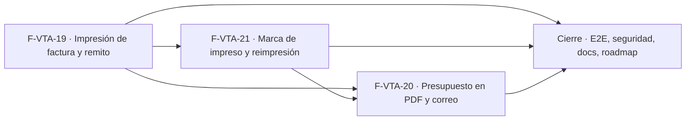

# Tasks: Ventas y despacho · Ventas impresión

**Input**: [spec.md](./spec.md) y [plan.md](./plan.md) · **Contratos**: [contracts/ventas-impresion.md](./contracts/ventas-impresion.md) · **Épica**: MSF-213
**Formato**: `- [ ] T### [P] [Historia][USx] descripción (FR/SC)`. `[P]` = paralelizable (archivos distintos, sin dependencia dentro del mismo grupo). Cada FR/SC tiene **una sola** tarea dueña; «soporte de» marca una tarea que contribuye sin ser dueña. Las historias son autosuficientes: ninguna tarea depende de otra historia ni de una `[CIERRE]`; el orden entre historias lo da el *Plan de ejecución*.
**Verificación**: cada FR/SC tiene su test o comando nombrado en la sección «Verificación por requisito» de `spec.md`; la tarea que crea el test la nombra.
**Validación por historia**: `pnpm test:db`, `pnpm lint`, `pnpm build` y `pnpm test:web` verdes antes de cerrar la fase (y `pnpm infra:config` cuando se toca Kestra o un worker).
**Esquema (Principio VII, re-verificado)**: `empresas` (alterada), `comprobante_documentos`, `comprobante_impresiones` y `comprobante_envios_correo` → `dominio`; bucket `comprobantes-documentos` → plataforma (Storage); `registro_actividad` y outbox → `public` (solo datos).
**Antes de empezar cada historia**: verificar contra `main` (o la rama de MSF-159) las firmas de `obtener_comprobante`, `listar_presupuestos` y las tablas de comprobantes, y las funciones de la outbox de ejecuciones; no inventarlas. MSF-159 debe estar mergeada antes del PR de esta épica.

## Phase 1: F-VTA-19 · Impresión de factura y remito

**Goal**: pedir, generar (worker) y abrir el PDF de factura y remito de un comprobante confirmado, con datos de la empresa.

- [ ] T001 [P] [F-VTA-19][US1] Migración `supabase/migrations/20261207100100_empresas_razon_social_cuit.sql`: columnas aditivas `razon_social` y `cuit` (11 dígitos) en `dominio.empresas`, `grant update` por columna, reversión en el encabezado (soporte de FR-008)
- [ ] T002 [P] [F-VTA-19][US1] Migración `supabase/migrations/20261207100200_comprobante_documentos.sql`: `dominio.comprobante_documentos` (FK compuesta al comprobante, estados, ruta, solicitante, fechas, error), índice único parcial de pedidos `pendiente`, RLS por organización + `ventas`, sin escritura directa, bucket privado `comprobantes-documentos` y sus políticas de `storage.objects` (FR-003)
- [ ] T003 [F-VTA-19][US1] Migración `supabase/migrations/20261207100300_documento_funciones_worker.sql`: `private.datos_documento_comprobante` y `private.cerrar_documento_comprobante` (idempotente), `revoke` a `public`, `anon` y `authenticated` (FR-007)
- [ ] T004 [F-VTA-19][US1] Migración `supabase/migrations/20261207100400_documento_rpc.sql`: `solicitar_documento_comprobante` (permiso, estado imprimible, idempotencia, reutilización, orden de outbox, evento `comprobante.documento_solicitado`), `obtener_documento_comprobante`, `listar_documentos_comprobante`; `security definer`, `search_path = ''`, `revoke … from public, anon` + `grant execute … to authenticated` (FR-001, FR-002, FR-005, FR-015, FR-016)
- [ ] T005 [F-VTA-19][US1] pgTAP `supabase/tests/database/ventas_impresion_documentos.test.sql` (verifica FR-001, FR-002, FR-003, FR-005, FR-007, FR-015, FR-016; `pnpm test:db`): aislamiento entre organizaciones y empresas, `lectura`/`ninguno`/`anon`, solo `confirmada`, idempotencia y reutilización, funciones del worker no ejecutables por `authenticated`, `rls_en_toda_tabla` verde (SC-001)
- [ ] T006 [P] [F-VTA-19][US1] Worker `workers/comprobantes-pdf` (`@workers/comprobantes-pdf`, scripts `build`/`lint`/`test`/`start`): entrypoint, lectura de datos por la conexión Postgres, subida a Storage con clave de servicio, cierre `generado`/`fallido`, códigos de salida y errores sanitizados según `workers/CONTRATO.md`, motor de PDF A4 con versión exacta (FR-004)
- [ ] T007 [F-VTA-19][US1] Plantillas `workers/comprobantes-pdf/src/plantillas/factura.ts` y `remito.ts` y tests `factura.test.ts`, `remito.test.ts` y `generar.test.ts` (`pnpm --filter @workers/comprobantes-pdf test`): A4, datos de empresa, logo opcional, lo no cargado se omite, líneas y totales, leyenda «Documento no válido como factura», remito sin importes, paginado (FR-009, FR-010, SC-002)
- [ ] T008 [P] [F-VTA-19][US1] Flow `infra/kestra/flows/comprobantes-documentos.yml` y su test `comprobantes-documentos.test.mjs` (`node --test`) (reclamo de `generar-documento-venta-`, intervalo de 1 minuto, reintentos acotados, código 78 agota la orden), variables en `infra/kestra/.env.example` e imagen del worker; `pnpm infra:config` verde (FR-013)
- [ ] T009 [P] [F-VTA-19][US1] `apps/web/src/lib/ventasImpresion.ts`: tipos, llamadas a las RPC, URL firmada del bucket, consulta de avance del pedido, mapeo de errores a mensajes claros (soporte de FR-006)
- [ ] T010 [P] [F-VTA-19][US1] Ficha de empresa `apps/web/src/pages/empresas/edit.tsx`: campos «Razón social» y «CUIT» (11 dígitos validados) en General, con su test (FR-008)
- [ ] T011 [F-VTA-19][US1] `apps/web/src/components/ventas/ImprimirComprobanteDialog.tsx` (carga diferida): diálogo «Imprimir comprobante» con texto «Se marca como impreso con fecha y hora.», documentos elegibles con subtítulo, «Cancelar» e «Imprimir»; estados «Preparando documento…», error con «Reintentar» y apertura del PDF; intervalo y tope de la consulta declarados (FR-006, FR-011)
- [ ] T012 [F-VTA-19][US1] `apps/web/src/components/ventas/DocumentosComprobante.tsx` y `pages/ventas/comprobante.tsx`: botones «Imprimir» e «Imprimir remito», tarjeta «Documentos», snack «Enviado a imprimir», motivo cuando no es imprimible, y empresa activa (invalidar consultas y cerrar el diálogo con aviso al cambiar) (FR-012, FR-014)
- [ ] T013 [F-VTA-19][US1] Vitest `pages/empresas/edit.test.tsx`, `components/ventas/ImprimirComprobanteDialog.test.tsx`, `components/ventas/DocumentosComprobante.test.tsx` y `lib/ventasImpresion.test.ts` (`pnpm --filter @platform/web test`): elegibilidad, estados de carga/error/reintento, cambio de empresa cierra el diálogo, controles según permiso (SC-003)
- [ ] T014 [F-VTA-19][US1] Documentación `docs/ventas-impresion.md` (modelo, RPC, worker, flow, puesta en marcha del host, reversión) (soporte de SC-001, SC-002)

**Checkpoint F-VTA-19**: `pnpm test:db`, `pnpm lint`, `pnpm build`, `pnpm test:web`, `pnpm infra:config` y tests del worker verdes.

## Phase 2: F-VTA-21 · Marca de impreso y reimpresión

**Goal**: registrar cada impresión, mostrar la marca con fecha y hora y permitir reimprimir sin límite.

- [ ] T015 [P] [F-VTA-21][US3] Migración `supabase/migrations/20261207200100_comprobante_impresiones.sql`: `dominio.comprobante_impresiones` append-only (sin `update`/`delete`), RLS por organización + `ventas`, sin escritura directa, reversión en el encabezado (FR-030)
- [ ] T016 [F-VTA-21][US3] Migración `supabase/migrations/20261207200200_registrar_impresion.sql`: `registrar_impresion` (documento `generado`, permiso `lectura`, `comprobante.impreso`/`comprobante.reimpreso` en la misma transacción) y `ultimas_impresiones_comprobante`; `revoke … from public, anon` + `grant execute … to authenticated` (FR-031, FR-032)
- [ ] T017 [F-VTA-21][US3] pgTAP `supabase/tests/database/ventas_impresion_marcas.test.sql` (verifica FR-030, FR-031, FR-032; `pnpm test:db`): impresión y reimpresión, evento correcto, append-only, documento no generado rechazado, aislamiento y `anon` (SC-007)
- [ ] T018 [P] [F-VTA-21][US3] `apps/web/src/lib/ventasImpresiones.ts`: tipos y llamadas a las RPC de marcas (soporte de FR-033)
- [ ] T019 [P] [F-VTA-21][US3] `DocumentosComprobante.tsx`: marcas «Factura impresa · dd/mm hh:mm», «Remito impreso · …», «Presupuesto impreso · …» con la última impresión y casilla vacía si nunca se imprimió (FR-033; requiere T018)
- [ ] T020 [P] [F-VTA-21][US3] `ImprimirComprobanteDialog.tsx`: registrar la impresión al confirmar «Imprimir» con el documento disponible, no registrar si falló o se canceló, y mantener «Imprimir» disponible tras imprimir (FR-034, FR-035; requiere T018)
- [ ] T021 [F-VTA-21][US3] Vitest en `DocumentosComprobante.test.tsx` e `ImprimirComprobanteDialog.test.tsx` (verifica FR-033, FR-034, FR-035): marca con fecha y hora, reimpresión actualiza la última, sin marca si falla (SC-008)
- [ ] T022 [F-VTA-21][US3] Documentación: sección «Marca de impreso y reimpresión» en `docs/ventas-impresion.md` y eventos `comprobante.impreso`/`comprobante.reimpreso` en `docs/actividad.md` (soporte de SC-007, SC-008)

**Checkpoint F-VTA-21**: `pnpm test:db`, `pnpm lint`, `pnpm build` y `pnpm test:web` verdes.

## Phase 3: F-VTA-20 · Presupuesto en PDF y envío por correo

**Goal**: imprimir el presupuesto en PDF y enviarlo por correo con registro del envío.

- [ ] T023 [P] [F-VTA-20][US2] Migración `supabase/migrations/20261208100100_solicitar_documento_presupuesto.sql`: `create or replace public.solicitar_documento_comprobante` aceptando `presupuesto` (estados `pendiente`/`aceptado`/`vencido`, regeneración si el presupuesto cambió), mismos `revoke`/`grant`, reversión en el encabezado (FR-021)
- [ ] T024 [P] [F-VTA-20][US2] Migración `supabase/migrations/20261208100200_comprobante_envios_correo.sql`: `dominio.comprobante_envios_correo` con índice único parcial de `pendiente`, RLS por organización + `ventas`, sin escritura directa, `private.cerrar_envio_correo` no ejecutable por `authenticated` (FR-023)
- [ ] T025 [F-VTA-20][US2] Migración `supabase/migrations/20261208100300_enviar_presupuesto_correo.sql`: `enviar_presupuesto_correo` (`edicion`, correo del cliente, rechazo sin correo, idempotencia, orden de outbox, `presupuesto.enviado_por_correo`/`presupuesto.envio_fallido`) y `listar_envios_correo_presupuesto`; `revoke … from public, anon` + `grant execute … to authenticated` (FR-027, FR-029)
- [ ] T026 [F-VTA-20][US2] pgTAP `supabase/tests/database/ventas_impresion_presupuesto.test.sql` (verifica FR-021, FR-023, FR-027, FR-029; `pnpm test:db`): presupuesto imprimible en sus estados, `edicion` para enviar, cliente sin correo, idempotencia, aislamiento y `anon` (SC-004)
- [ ] T027 [P] [F-VTA-20][US2] Plantilla `workers/comprobantes-pdf/src/plantillas/presupuesto.ts` (empresa, leyendas, «Válido hasta», cliente, líneas, totales) y su registro en el worker, con test `presupuesto.test.ts` (FR-020)
- [ ] T028 [P] [F-VTA-20][US2] Flow `infra/kestra/flows/comprobantes-correo.yml`: reclamo de `enviar-presupuesto-correo`, generación o reutilización del PDF, `MailSend` con adjunto y SMTP de `KESTRA_SMTP_*`, cierre del envío `enviado`/`fallido`, reintentos acotados; `pnpm infra:config` verde y test `comprobantes-correo.test.mjs` (`node --test`) (FR-024)
- [ ] T029 [F-VTA-20][US2] Tests del worker (plantilla de presupuesto) y del flow (renderizado/validación, adjunto, cierre en error) (SC-005; requiere T027 y T028)
- [ ] T030 [P] [F-VTA-20][US2] `apps/web/src/lib/ventasPresupuestoCorreo.ts`: tipos y llamadas a `enviar_presupuesto_correo`, `listar_envios_correo_presupuesto` y al pedido del PDF del presupuesto (soporte de FR-025)
- [ ] T031 [F-VTA-20][US2] `apps/web/src/pages/ventas/presupuestos.tsx`: acciones de fila «Imprimir» y «Enviar por correo» (snacks «Enviado a imprimir · <número>» y «Presupuesto <número> enviado por correo», errores con «Reintentar»), `lectura` sin envío y empresa activa (FR-022, FR-025, FR-028; requiere T030)
- [ ] T032 [F-VTA-20][US2] Detalle del presupuesto en `comprobante.tsx`, `DocumentosComprobante.tsx` e `ImprimirComprobanteDialog.tsx`: opción «Presupuesto» del diálogo, botón «Enviar por correo» y marca «Presupuesto enviado por correo · fecha hora» (FR-026; requiere T030)
- [ ] T033 [F-VTA-20][US2] Vitest `pages/ventas/presupuestos.test.tsx` y ampliación de `DocumentosComprobante.test.tsx`/`ImprimirComprobanteDialog.test.tsx` (verifica FR-022, FR-025, FR-026, FR-028): errores, cliente sin correo, `lectura`, cambio de empresa (SC-006)
- [ ] T034 [F-VTA-20][US2] Documentación: sección «Presupuesto y correo» en `docs/ventas-impresion.md` (SMTP, remitente global, variables, puesta en marcha del flow) y eventos de envío en `docs/actividad.md` (soporte de SC-004…SC-006)

**Checkpoint F-VTA-20**: `pnpm test:db`, `pnpm lint`, `pnpm build`, `pnpm test:web`, `pnpm infra:config` y tests del worker verdes.

## Phase 4: Cierre, seguridad y recorrido completo

- [ ] T035 [CIERRE] E2E `apps/web/e2e/ventas-impresion.e2e.ts`: factura confirmada → imprimir factura y remito → marca y reimpresión → presupuesto → PDF → correo (SMTP de prueba); mide y registra la latencia de generación (se omite sin `SUPABASE_URL`/`SUPABASE_SERVICE_ROLE_KEY`) (SC-009)
- [ ] T036 [P] [CIERRE] Revisión de seguridad (`authz-security`, `database-reviewer`, `infra-security`) de RLS de las tablas nuevas, RPC `security definer`, bucket privado y URL firmadas, funciones `private.*` del worker, red y secretos del worker y de los flows (SC-010)
- [ ] T037 [CIERRE] Validación final: `pnpm lint && pnpm build && pnpm test && pnpm docs:check && pnpm matriz:check && pnpm prototipo:check && pnpm infra:config` y `rls_en_toda_tabla` verdes; entrada de `docs/ventas-impresion.md` en `docs/README.md` (SC-011)
- [ ] T038 [CIERRE] Al merge del PR (merge commit `--no-ff`): actualizar la fila de Ventas en `docs/roadmap-template.md` (paso manual) y comprobar que ninguna tarea queda `[ ]` (soporte de SC-011)

## Dependencias

Dentro de F-VTA-19: T002 → T003, T004 → T005; T001 [P], T006 [P] → T007; T008 [P]; T009 [P] y T010 [P] → T011 (necesita T009) → T012 → T013 (necesita T010, T011, T012) → T014.
Dentro de F-VTA-21: T015 → T016 → T017; T018 [P] → T019 [P] y T020 [P] (archivos distintos) → T021 → T022.
Dentro de F-VTA-20: T024 → T025; T023 [P], T025 → T026; T027 [P] y T028 [P] → T029; T030 [P] → T031 y T032 → T033 → T034.
Cierre: T036 [P] puede arrancar con las historias; T035 y T037 → T038 al final. Las tareas `[CIERRE]` nunca son prerequisito de una historia.
Entre historias: F-VTA-21 y F-VTA-20 requieren F-VTA-19 **mergeada** (tabla de documentos, RPC, worker, diálogo y tarjeta); F-VTA-20 requiere además F-VTA-21 mergeada porque comparten `DocumentosComprobante.tsx` e `ImprimirComprobanteDialog.tsx`.

## Plan de ejecución (historias)

El **orden de toma** de las historias lo declara esta tabla: el orquestador la **consume** (no lo infiere del orden de las tareas). Una historia arranca cuando sus dependencias (`Depende de`) están **Finalizadas (mergeadas)**; las del mismo `Grupo` van en paralelo y los grupos avanzan en orden.

| Historia | Depende de | Grupo |
|----------|------------|-------|
| F-VTA-19 | — | 1 |
| F-VTA-21 | F-VTA-19 | 2 |
| F-VTA-20 | F-VTA-19, F-VTA-21 | 3 |
| [Cierre] | F-VTA-19, F-VTA-20, F-VTA-21 | 4 |

