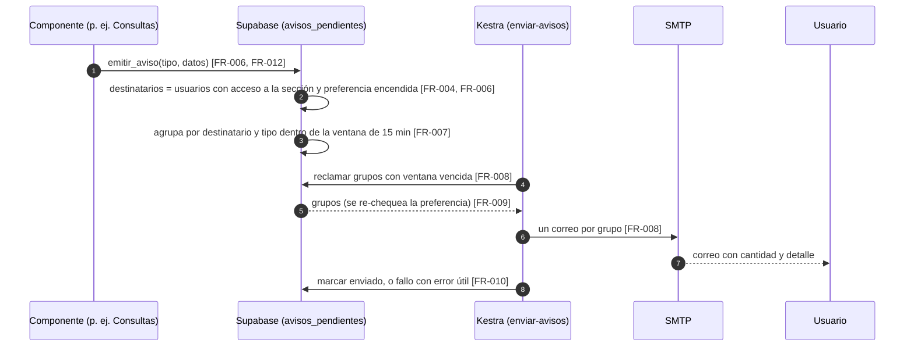
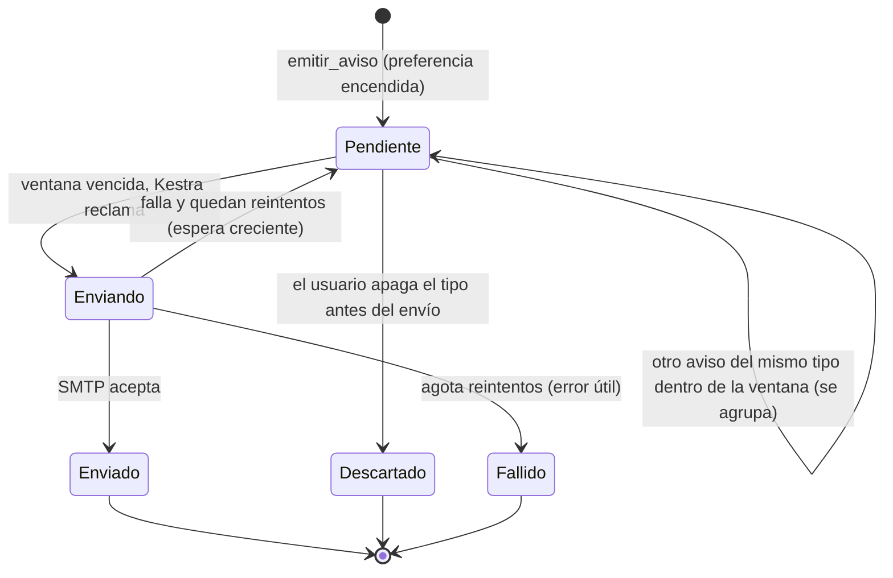
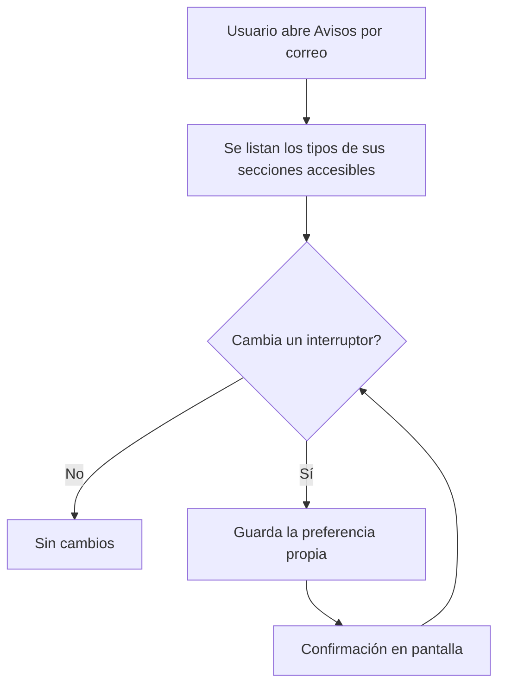
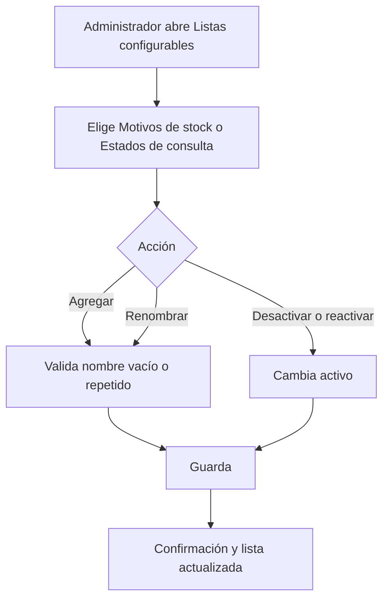

# Feature Specification: Plataforma · Avisos y listas configurables

**Épica**: MSF-189 · **Spec**: `avisos-y-listas-configurables` · **Hito**: Etapa 2 (con los avisos de inicio, antes de Mercado Libre) · **Prioridad**: P1 · **Horas aprox.**: 12 (roadmap original 16; las tallas suman 12)
**Alcance de entrega**: `refine`, `supabase` y `kestra` (sin `superset` ni `workers`: el envío es un flow de Kestra con SMTP genérico, como `aviso-fallo-copias`; ver `plan.md`).
**Fuente**: especificación de Nicolás cargada en la épica (Jira) y artefactos del producto (documento del componente Plataforma, Funcionalidades e historias, Roadmap, Relevamiento). Esta spec **traduce**; no agrega alcance. Lo que la épica deja abierto está en *Decisiones abiertas*, con el valor por defecto que se asume.

## Objetivo

Al terminar, cada usuario elige qué avisos recibe por correo, los repetidos llegan agrupados, y el administrador adapta las listas del negocio (motivos de stock, estados de consultas).

## Modelo y supuestos

- El envío usa el servicio de correo del template: **Kestra + SMTP genérico** (`KESTRA_SMTP_*`, `infra/kestra/.env.example`) y el **outbox durable con reintentos** de la plataforma. El template **no** trae correo transaccional de negocio, solo los correos de Supabase Auth.
- Los **avisos de seguridad** (invitación, recuperación de contraseña) **quedan fuera del control del usuario**: siguen saliendo por Supabase Auth, no aparecen en la pantalla de preferencias y no pasan por esta cola.
- La **consulta nueva ya envía un aviso por correo** desde el componente Consultas (MSF-122); esta épica lo **vuelve configurable** (pasa por las preferencias y la agrupación).
- Cada usuario ve solo los **tipos de aviso de las secciones a las que tiene acceso** (`private.nivel_seccion`, MSF-125).
- La **ventana de agrupación es de 15 minutos** (propuesta a confirmar con el cliente, *Decisiones abiertas* 1).
- Los demás componentes (Stock, Precios y dólar, Mercado Libre) **generan** avisos y los registran como tipos propios en sus épicas; esta épica entrega el **mecanismo** y registra el tipo `consulta_nueva`.
- **Ya existe** en el repo: `private.nivel_seccion`, `private.organizacion_id`, `private.puede_escribir`, `dominio.motivos_movimiento` (motivos de stock, F-STK-02: editable por el Administrador, pantalla `/stock/motivos`; el Jira lo llama `motivos_stock`, manda el nombre del repo), el outbox `public.despachos_ejecucion` (de ejecuciones de workers, no de correo), los flows de Kestra y el SMTP genérico. **No existe todavía**: ninguna tabla de avisos o preferencias, ningún estado de consulta (MSF-122 está sin mergear). Se proponen en las migraciones del plan; ninguna se asume.

### Esquema de datos (Constitución, Principio VII)

| Objeto | Esquema | Historia | Justificación | RLS / acceso |
|--------|---------|----------|---------------|--------------|
| `tipos_aviso` (**nueva**) | `public` | F-NOT-01 | Catálogo transversal de tipos de aviso (plataforma): clave, nombre, sección que lo habilita. Lo registran los distintos componentes. | select para `authenticated`; sin escritura desde la app; `anon` sin privilegios |
| `preferencias_aviso` (**nueva**) | `public` | F-NOT-01 | Preferencia de cada usuario por tipo (clave `user_id` + `tipo_aviso`). Dato de la persona, genérico de plataforma. | `user_id = auth.uid()` para select/insert/update; sin delete; `anon` sin privilegios |
| `avisos_pendientes` (**nueva**) | `public` | F-NOT-01 | Cola/outbox durable de correos de avisos: destinatario, tipo, ventana, estado, intentos, error útil. Mecanismo de plataforma. | RLS activada **sin políticas** para `authenticated`; solo funciones `security definer` y el rol de Kestra; `anon` sin privilegios |
| `estados_consulta` (**nueva o ajuste, ver Decisiones 4**) | `dominio` | F-CFG-01 | Lista de estados de la consulta (entidad del negocio; Consultas es dominio). | `organizacion_id = (select private.organizacion_id())`; select con acceso a `consultas`; insert/update solo `private.puede_escribir()`; sin delete (se desactiva); `anon` sin privilegios |
| `motivos_movimiento` (existente) | `dominio` | — | **Sin cambio de tabla ni de RLS**: F-CFG-01 solo ofrece su edición en «Listas configurables». | RLS vigente de F-STK-02 |

Migraciones **aditivas**; cada historia trae la suya con reversión en el encabezado. Se re-verifica el esquema de cada tabla en plan, tareas, implementación y PR.

## User Scenarios & Testing *(mandatory)*

### User Story 1 - Avisos por correo configurables (F-NOT-01, P1, talla M)

Cada usuario elige qué avisos recibe por correo; los avisos repetidos de un mismo tipo llegan agrupados en un solo correo.

**Independent Test**: dos usuarios con roles distintos ven tipos distintos; apagar un tipo deja de enviarlo; tres avisos del mismo tipo dentro de la ventana salen en un correo.

**Acceptance Scenarios**:

1. **Given** un usuario con acceso a Consultas, **When** abre «Avisos por correo», **Then** ve el tipo «Consulta nueva» con su interruptor encendido por defecto; **And** un usuario sin acceso a Consultas no ve ese tipo.
2. **Given** un tipo encendido, **When** el usuario lo apaga, **Then** la preferencia se guarda, se confirma con un aviso en pantalla y deja de recibir ese tipo.
3. **Given** el usuario apagó un tipo, **When** se genera un aviso de ese tipo, **Then** no se encola para él; **And** si había avisos ya pendientes de ese tipo, se descartan antes de enviarse.
4. **Given** varios avisos del mismo tipo para el mismo destinatario dentro de la ventana de 15 minutos, **When** vence la ventana, **Then** recibe **un solo correo** que los resume (cantidad y detalle de cada aviso).
5. **Given** un aviso solo en la ventana, **When** vence, **Then** recibe un correo con ese aviso.
6. **Given** el servicio de correo falla, **When** se intenta enviar, **Then** se reintenta con espera creciente sin duplicar el correo ya enviado; si agota los reintentos queda **fallido** con el error útil.
7. **Given** la pantalla de preferencias, **When** se revisa, **Then** no aparecen los avisos de seguridad (invitación, recuperación de contraseña) ni hay forma de apagarlos.
8. **Given** una consulta nueva, **When** entra, **Then** su aviso por correo pasa por las preferencias y la agrupación (ya no sale directo) (FR-012).

### User Story 2 - Listas configurables (F-CFG-01, P1, talla S)

El administrador adapta las listas del negocio: motivos de stock y estados de consultas.

**Independent Test**: el Administrador crea, renombra y desactiva un estado de consulta y un motivo de stock; un rol no administrador ve la pantalla restringida.

**Acceptance Scenarios**:

1. **Given** el Administrador, **When** abre «Listas configurables», **Then** ve las listas «Motivos de stock» y «Estados de consulta» con su nombre y si están activos.
2. **Given** una lista, **When** el Administrador agrega un ítem con un nombre válido y no repetido en esa lista, **Then** queda activo y disponible para elegir; **And** un nombre vacío o repetido se rechaza con un mensaje claro.
3. **Given** un ítem, **When** el Administrador lo renombra, **Then** el nuevo nombre se ve en todos los registros que ya lo usan.
4. **Given** un ítem activo, **When** el Administrador lo desactiva, **Then** deja de ofrecerse para nuevas selecciones pero se sigue mostrando en los registros que ya lo usaron; no se borra y puede reactivarse.
5. **Given** un usuario que no es Administrador, **When** entra a «Listas configurables», **Then** ve la pantalla de acceso restringido y la base rechaza la escritura.
6. **Given** motivos de stock editados en «Listas configurables» o en `/stock/motivos`, **When** se consultan, **Then** son **la misma lista** (misma tabla, sin copia).

### Edge Cases

- Usuario sin correo válido, suspendido o fuera de la organización: no recibe avisos; el aviso no se encola.
- Reinicio de Kestra a mitad de un envío: el aviso reclamado vuelve a estar disponible y no se envía dos veces (reclamo con vencimiento + marca de enviado idempotente).
- Dos organizaciones: ningún usuario ve ni recibe avisos de otra.
- Usuario que pasa a tener más o menos acceso a una sección: el filtro por `nivel_seccion` se evalúa al encolar y al enviar.
- Dos administradores renombran el mismo ítem a la vez: gana el último; el nombre sigue siendo único por lista.

## Flujos

Transcriben el objetivo y los supuestos de la épica; no agregan estados ni pasos. Cada paso mapea a un FR; lo que no, se declara fuera de alcance.

### Flujo 1 · Del hecho al correo (secuencia)

### Flujo 2 · Estados de un aviso pendiente (máquina de estados)

Mapeo: Pendiente/agrupación → FR-007; Descartado → FR-009; Enviando/Enviado → FR-008, FR-010; reintentos y Fallido → FR-010.

### Flujo 3 · Preferencias del usuario (proceso)

Mapeo: A–B → FR-003; D–E → FR-002, FR-005.

### Flujo 4 · Edición de una lista (proceso)

Mapeo: A–B → FR-013; Agregar/Renombrar → FR-014; Desactivar → FR-015.

## Requirements *(mandatory)*

### Functional Requirements

**F-NOT-01 · Avisos por correo configurables**

- **FR-001**: El sistema DEBE tener un catálogo `public.tipos_aviso` (clave, nombre, sección que lo habilita) donde cada componente registra sus tipos; esta épica registra `consulta_nueva`. Los avisos de seguridad (invitación, recuperación de contraseña) NO son tipos del catálogo y quedan fuera del control del usuario.
- **FR-002**: El sistema DEBE guardar las preferencias en `public.preferencias_aviso` con clave `user_id` + `tipo_aviso` (por usuario, ver *Decisiones abiertas* 3) y permitir a cada usuario leer y cambiar **solo las propias** (RPC `guardar_preferencia_aviso`); RLS lo impone en la base.
- **FR-003**: La pantalla «Avisos por correo» DEBE listar solo los tipos cuya sección el usuario puede ver (`private.nivel_seccion` ≥ `lectura`), con un interruptor por tipo, y cumplir Principio VI (teclado, lector de pantalla, 320/768/1440 px, estados de carga/vacío/error/éxito).
- **FR-004**: Sin fila de preferencia, un tipo cuenta como **encendido** (conserva el aviso de consulta nueva que hoy ya sale; ver *Decisiones abiertas* 2).
- **FR-005**: Cambiar un interruptor DEBE confirmarse en pantalla y fallar con mensaje claro si no se pudo guardar o si el tipo no es visible para el usuario.
- **FR-006**: Los componentes DEBEN generar avisos con `private.emitir_aviso(tipo, organizacion, datos)`, que resuelve los destinatarios (usuarios activos de la organización con acceso a la sección del tipo y preferencia encendida) y encola en `public.avisos_pendientes`.
- **FR-007**: Los avisos del mismo tipo para el mismo destinatario DEBEN agruparse en una ventana de **15 minutos** abierta por el primero; al vencer, sale **un correo** con la cantidad y el detalle de cada aviso.
- **FR-008**: Un flow de Kestra DEBE reclamar los grupos vencidos (sin tomar el mismo grupo dos veces) y enviar un correo por grupo por SMTP genérico (`KESTRA_SMTP_*`), sin credenciales en Git.
- **FR-009**: Antes de enviar, el sistema DEBE volver a verificar que la preferencia siga encendida y que el destinatario siga activo y con acceso a la sección; si no, descarta el aviso.
- **FR-010**: El envío DEBE ser idempotente y reintentable: estado, intentos, `enviado_en` y error útil quedan registrados en `avisos_pendientes`; las fallas se reintentan con espera creciente y, agotados los reintentos, queda `fallido`.
- **FR-011**: Ningún usuario DEBE ver, cambiar ni recibir preferencias o avisos de otro usuario u otra organización (pgTAP con dos organizaciones).
- **FR-012**: El aviso de consulta nueva del componente Consultas DEBE emitirse con `private.emitir_aviso` (tipo `consulta_nueva`), de modo que respete las preferencias y la agrupación en lugar de salir directo.

**F-CFG-01 · Listas configurables**

- **FR-013**: El sistema DEBE ofrecer una pantalla de administración «Listas configurables» (solo Administrador) con las listas «Motivos de stock» y «Estados de consulta».
- **FR-014**: El Administrador DEBE poder agregar y renombrar ítems de cada lista; el nombre no puede ser vacío ni repetido dentro de la lista (sin distinguir mayúsculas ni espacios en los extremos).
- **FR-015**: El Administrador DEBE poder desactivar y reactivar ítems; no se borran. Un ítem desactivado no se ofrece en nuevas selecciones y se sigue mostrando donde ya se usó.
- **FR-016**: «Motivos de stock» DEBE leer y escribir la **misma** `dominio.motivos_movimiento` de F-STK-02 (sin tabla nueva ni copia); «Estados de consulta» usa `dominio.estados_consulta` (Decisiones abiertas 4). La escritura la restringe RLS al Administrador (`private.puede_escribir()`).

**Transversal**

- **FR-017**: Cada RPC nueva de `public` DEBE tener `revoke execute … from public, anon` y `grant execute … to authenticated` explícitos; `anon` sin privilegios sobre las tablas nuevas.
- **FR-018**: La documentación (`docs/avisos-por-correo.md`, `docs/listas-configurables.md`, roadmap) DEBE actualizarse en el mismo cambio y `pnpm docs:check` pasar.
- **FR-019**: Revisión de seguridad: RLS en las 4 tablas nuevas o ajustadas, grants de RPC, `security definer` de `emitir_aviso` y del reclamo, y esquema de cada tabla contra el Principio VII.

### Success Criteria *(mandatory)*

- **SC-001**: Dos usuarios con roles distintos ven tipos de aviso distintos, y uno nunca ve ni cambia las preferencias del otro (pgTAP + Vitest).
- **SC-002**: Un tipo apagado no genera correo para ese usuario, ni siquiera de avisos ya pendientes (pgTAP).
- **SC-003**: Tres avisos del mismo tipo dentro de la ventana producen un correo con «3» y el detalle de cada uno; uno solo produce un correo individual (pgTAP de agrupación + flow de Kestra validado).
- **SC-004**: Un fallo de SMTP se reintenta sin duplicar el envío y termina en `fallido` con error útil tras agotar los reintentos (pgTAP del reclamo + prueba del flow).
- **SC-005**: La pantalla de preferencias cumple teclado, lector y 320/768/1440 px y no ofrece los avisos de seguridad (Vitest).
- **SC-006**: El Administrador crea, renombra, desactiva y reactiva un estado de consulta y un motivo de stock; un rol no administrador no puede escribir (pgTAP + Vitest).
- **SC-007**: `rls_en_toda_tabla` verde con las tablas nuevas y suite completa `pnpm test` verde.

## Decisiones abiertas

Valor por defecto asumido; se implementa así salvo que Nicolás indique otra cosa.

1. **Ventana de agrupación de 15 minutos**: propuesta de la épica, a confirmar con el cliente. Es una constante de base (`private.ventana_agrupacion_aviso()`), cambiable con una migración.
2. **Preferencia por defecto = encendida**: la épica no lo dice; se elige encendida para no apagar el aviso de consulta nueva que hoy ya se envía.
3. **Preferencias por usuario** (no por usuario y empresa), tal como la épica define la clave `user_id` + `tipo_aviso`. Si más adelante hace falta por empresa, se agrega `empresa_id` a la clave con una migración aditiva. El repo ya admite usuarios en varias empresas (`usuarios_empresas`, MSF-121).
4. **`estados_consulta`**: no existe hoy; la define MSF-122. F-CFG-01 usa la forma mínima (`id`, `organizacion_id`, `nombre`, `activo`, `orden`) y **verifica contra MSF-122 antes de migrar**: si MSF-122 ya creó la tabla, la migración solo agrega lo que falte (aditiva); si los estados fueran fijos en código, se resuelve con el Administrador antes de seguir. Reordenar estados queda fuera de alcance (no se pide).
5. **Motivos de stock en dos lugares**: Stock ya los edita en `/stock/motivos`. Se deja **una sola lista** (misma tabla) editable desde ambos; si Nicolás prefiere que quede solo en Listas configurables, se retira la ruta de Stock en una historia aparte.
6. **Proveedor de correo de negocio**: el template solo manda correos de Supabase Auth. Se construye sobre SMTP genérico (variables `KESTRA_SMTP_*`); **elegir el proveedor concreto** y su remitente queda para operaciones, sin cambiar el código.
7. **Estados de consulta «de sistema»** (p. ej. el que usa «Cerrar»): si MSF-122 tiene lógica atada a algún estado, hay que decidir si no se puede desactivar. No se agrega regla hasta ver MSF-122.
8. **Catálogo de tipos**: la épica solo nombra el aviso de consulta nueva; Stock, Precios y dólar y Mercado Libre registran sus tipos en sus propias épicas.

## Matriz pantalla↔criterios

**Prototipo**: la épica declara que **no hay pantalla dibujada** para preferencias de avisos ni para listas configurables («se dibujan al entrar a la etapa»). `pnpm prototipo:inventario` no tiene `.dc.html` propio de esta épica; no hay ítems que mapear 1 a 1. Se implementan con los componentes del template y los tokens del sistema de diseño; al dibujarse las pantallas, la matriz se actualiza y cualquier diferencia se anota en el PR (regla de fuentes 5 y 6). Inventarios vecinos revisados (`Consultas`, `ServicioEstados`, `StockMovimientos`):

| Ítem del inventario | Destino | Criterio |
|---|---|---|
| `Consultas.dc.html` · columna `Estado` de la bandeja | Fuera de alcance: la bandeja es de MSF-122; F-CFG-01 solo edita la lista de la que sale | FR-014…FR-016 |
| `Consultas.dc.html` · botones `Cerrar`, `Responder por ·` y diálogo «Consulta de ·» | Fuera de alcance: Consultas (MSF-122) | — |
| `ServicioEstados.dc.html` (estados de reparación: Orden, Qué significa, Avisa al cliente, Cierra) | Fuera de alcance: son estados de reparación (F-SVC-01), no de consulta; y la épica no pide ordenar ni los atributos | — |
| Pantalla «Avisos por correo»: lista de tipos con interruptor, confirmación | En alcance (sin prototipo) | FR-003, FR-005, US1-1/2 |
| Pantalla «Avisos por correo»: avisos de seguridad | Fuera de alcance: fuera del control del usuario | FR-001, US1-7 |
| Pantalla «Listas configurables»: listas, agregar, renombrar, activar/desactivar | En alcance (sin prototipo) | FR-013…FR-016 |
| Pantalla «Listas configurables»: reordenar, borrar ítems | Fuera de alcance: no se pide; los ítems se desactivan | FR-015 |
| Campanita de avisos en la barra superior | Fuera de alcance: MSF-224 (reutiliza los avisos de F-NOT-01) | — |
| Navegación (Principio VI) | `/cuenta/avisos` (preferencias: menú de la cuenta del usuario, audiencia todos los roles con algún tipo visible) y `/configuracion/listas` (ítem «Listas configurables» en Administración, icono de ajustes, solo Administrador); rutas nuevas, sin compatibilidad previa que mantener | FR-003, FR-013 |
| Fila **Empresa activa** (Constitución VIII) | **No aplica**: las preferencias son del usuario y las listas son de la organización, no dependen de la empresa de la barra superior; test de que cambiar de empresa no altera ninguna de las dos pantallas | SC-005, SC-006 |

## Matriz de trazabilidad Jira ↔ US ↔ FR ↔ tareas

| Jira | Historia | FR / SC | Tareas |
|------|----------|---------|--------|
| F-NOT-01 | US1 Avisos por correo configurables | FR-001…FR-012, SC-001…SC-005 | T001–T017 |
| F-CFG-01 | US2 Listas configurables | FR-013…FR-016, SC-006 | T018–T024 |
| Tarea de cierre (label `cierre`) | Docs, seguridad, E2E y roadmap | FR-017…FR-019, SC-007 | T025–T028 |
