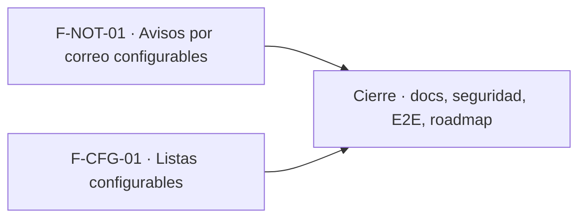

# Tasks: Plataforma · Avisos y listas configurables

**Input**: [spec.md](./spec.md) y [plan.md](./plan.md) · **Épica**: MSF-189
**Formato**: `- [ ] T### [P] [Historia][USx] descripción (FR/SC)`. `[P]` = paralelizable (archivos distintos, sin dependencia dentro del mismo grupo). Cada FR/SC tiene **una sola** tarea dueña. Las dependencias y el orden son **solo dentro de la misma historia**; entre historias rige la tabla *Plan de ejecución* del final.
**Validación por historia**: `pnpm test:db`, `pnpm lint`, `pnpm build` y `pnpm test:web` verdes antes de cerrar la fase (`pnpm infra:config` y `pnpm test:kestra:copias` en F-NOT-01). Cada tabla nueva: esquema re-verificado (Principio VII). Tras tocar código: `graphify update .`.

## Phase 1: F-NOT-01 · Avisos por correo configurables

**Goal**: catálogo y preferencias, cola con agrupación de 15 min, envío por Kestra con reintentos y pantalla «Avisos por correo». Requiere MSF-125 (`private.nivel_seccion`) mergeada.

- [ ] T001 [F-NOT-01][US1] Migración `supabase/migrations/20261024120000_avisos_catalogo.sql`: `public.tipos_aviso` (clave, nombre, sección) con RLS (select `authenticated`, sin escritura), siembra de `consulta_nueva`, `anon` sin privilegios, reversión en el encabezado (FR-001)
- [ ] T002 [F-NOT-01][US1] Migración `supabase/migrations/20261024120100_avisos_preferencias.sql`: `public.preferencias_aviso` (PK `user_id` + `tipo_aviso`) con RLS `user_id = auth.uid()` y `public.guardar_preferencia_aviso(p_tipo, p_activo)` (rechaza tipos no visibles y desconocidos); `revoke … from public, anon`, `grant … to authenticated` (FR-002)
- [ ] T003 [F-NOT-01][US1] Migración `supabase/migrations/20261024120200_avisos_listar_preferencias.sql`: `public.listar_preferencias_aviso()` — solo tipos con `private.nivel_seccion` ≥ `lectura`; sin fila = encendido (FR-004)
- [ ] T004 [F-NOT-01][US1] Migración `supabase/migrations/20261024120300_avisos_cola.sql`: `public.avisos_pendientes` (RLS sin políticas para `authenticated`), `private.nivel_seccion_de_usuario(user_id, sección)` (el nivel de OTRO usuario, no el de la sesión) y `private.emitir_aviso(p_tipo, p_organizacion, p_datos)` (`security definer`, destinatarios activos con acceso y preferencia encendida) (FR-006)
- [ ] T005 [F-NOT-01][US1] Migración `supabase/migrations/20261024120400_avisos_agrupacion.sql`: `private.ventana_agrupacion_aviso()` (15 min) y agrupación por destinatario + tipo (una ventana abierta por el primer aviso; los siguientes se suman) dentro de `emitir_aviso` (FR-007)
- [ ] T006 [F-NOT-01][US1] Migración `supabase/migrations/20261024120500_avisos_reclamar.sql`: `private.reclamar_avisos_listos()` (`for update skip locked`, reclamo con vencimiento, re-verifica preferencia, actividad y acceso; descarta si ya no corresponde) y rol de base para Kestra con solo ese privilegio (FR-009)
- [ ] T007 [F-NOT-01][US1] Migración `supabase/migrations/20261024120600_avisos_resultado.sql`: `private.marcar_aviso_enviado` (idempotente) y `private.registrar_fallo_aviso` (intentos, espera creciente, `fallido` con error útil al agotar) (FR-010)
- [ ] T008 [F-NOT-01][US1] pgTAP `supabase/tests/database/avisos_aislamiento.test.sql`: dos organizaciones y dos roles; cada usuario ve y cambia solo lo suyo, tipos filtrados por sección, `anon` sin ejecución ni acceso (FR-011, SC-001)
- [ ] T009 [F-NOT-01][US1] pgTAP `supabase/tests/database/avisos_preferencia_apagada.test.sql`: tipo apagado no encola y descarta pendientes al reclamar; sin fila = encendido (SC-002)
- [ ] T010 [F-NOT-01][US1] pgTAP `supabase/tests/database/avisos_agrupacion.test.sql`: tres avisos en la ventana = un grupo de 3; uno solo = individual; fuera de ventana = grupos distintos (SC-003)
- [ ] T011 [F-NOT-01][US1] pgTAP `supabase/tests/database/avisos_reintentos.test.sql`: reclamo sin doble toma, reclamo vencido vuelve a estar disponible, fallos con espera creciente, `fallido` con error útil, `marcar_aviso_enviado` idempotente (SC-004)
- [ ] T012 [F-NOT-01][US1] Flow `infra/kestra/flows/enviar-avisos.yml` (Schedule cada minuto: reclamar → un `MailSend` por grupo con SMTP `KESTRA_SMTP_*` → marcar enviado o fallo; valores escapados en el HTML), variables en `infra/kestra/.env.example` y extensión de `infra/kestra/validar-copias-flows.test.mjs` o test hermano; `pnpm infra:config` (FR-008)
- [ ] T013 [P] [F-NOT-01][US1] `apps/web/src/lib/avisos.ts` y `apps/web/src/hooks/usePreferenciasAviso.ts`: lectura de `listar_preferencias_aviso`, guardado con `guardar_preferencia_aviso`, mapeo de errores a mensajes claros (soporte de FR-003 y FR-005)
- [ ] T014 [F-NOT-01][US1] `apps/web/src/pages/cuenta/avisos.tsx`: pantalla «Avisos por correo» (un interruptor por tipo visible, estados de carga/vacío/error), ruta `/cuenta/avisos` y acceso desde el menú de la cuenta, carga diferida, teclado/lector y 320/768/1440 px (FR-003)
- [ ] T015 [F-NOT-01][US1] Confirmación en pantalla al guardar y mensaje claro si falla o el tipo no es visible, sin dejar el interruptor en estado falso (FR-005)
- [ ] T016 [F-NOT-01][US1] Vitest `apps/web/src/pages/cuenta/avisos.test.tsx`: tipos según rol, interruptor y confirmación, error de guardado, sin avisos de seguridad, teclado/lector y **cambio de empresa activa sin efecto** (SC-005)
- [ ] T017 [P] [F-NOT-01][US1] Conectar el punto donde Consultas genera el aviso de consulta nueva a `private.emitir_aviso('consulta_nueva', …)` en vez del envío directo (FR-012). Si MSF-122 aún no está mergeada al implementar, cerrar con `Desvío: <motivo>` y trazar la **Historia `[Deuda MSF-189]`** (no se deja `[ ]`)

**Checkpoint F-NOT-01**: `pnpm test:db`, `pnpm lint`, `pnpm build`, `pnpm test:web` y `pnpm infra:config` verdes.

## Phase 2: F-CFG-01 · Listas configurables

**Goal**: pantalla de administración con motivos de stock y estados de consulta. Requiere MSF-136 (`dominio.motivos_movimiento`, ya en el repo) y MSF-122 (estados de consulta) mergeadas.

- [ ] T018 [F-CFG-01][US2] Verificar contra MSF-122 (grafo y migraciones) si `dominio.estados_consulta` existe; migración `supabase/migrations/20261024130000_estados_consulta_lista.sql` aditiva que la crea (id, organizacion_id, nombre, activo, orden) o agrega lo que falte, con RLS (select con acceso a `consultas`; escritura `private.puede_escribir()`; sin delete) y `anon` sin privilegios; motivos reutiliza `dominio.motivos_movimiento` sin cambios (FR-016)
- [ ] T019 [F-CFG-01][US2] Migración `supabase/migrations/20261024130100_estados_consulta_rpc.sql`: `public.crear_estado_consulta` y `public.renombrar_estado_consulta` (nombre no vacío ni repetido sin distinguir mayúsculas/espacios; nuevo estado al final del orden) (FR-014)
- [ ] T020 [F-CFG-01][US2] Misma serie, `supabase/migrations/20261024130200_estados_consulta_activar.sql`: `public.cambiar_estado_estado_consulta` (activar/desactivar, sin borrar; no afecta los registros que ya lo usan) (FR-015)
- [ ] T021 [F-CFG-01][US2] pgTAP `supabase/tests/database/listas_configurables.test.sql`: dos organizaciones, solo Administrador escribe, nombre vacío/repetido, desactivar y reactivar, motivos y estados, `anon` sin ejecución (SC-006)
- [ ] T022 [P] [F-CFG-01][US2] `apps/web/src/lib/listas.ts` y `apps/web/src/hooks/useEstadosConsulta.ts`: lectura y RPC de estados, mapeo de errores (soporte de FR-014 y FR-015)
- [ ] T023 [F-CFG-01][US2] Extraer de `apps/web/src/pages/stock/motivos.tsx` el editor reutilizable y montar `apps/web/src/pages/configuracion/listas.tsx` con «Motivos de stock» y «Estados de consulta» (agregar, renombrar, activar/desactivar), ruta `/configuracion/listas` solo Administrador con `AccesoRestringido`, ítem «Listas configurables» en Administración; `/stock/motivos` sigue funcionando (FR-013)
- [ ] T024 [F-CFG-01][US2] Vitest `apps/web/src/pages/configuracion/listas.test.tsx`: alta, renombre, duplicado y vacío, desactivar/reactivar, rol no administrador restringido, **cambio de empresa activa sin efecto**, teclado/lector y 320/768/1440 px (soporte de SC-006)

**Checkpoint F-CFG-01**: `pnpm test:db`, `pnpm lint`, `pnpm build` y `pnpm test:web` verdes.

## Phase 3: Cierre

**Goal**: documentación, verificación de seguridad y E2E que ninguna historia atiende.

- [ ] T025 [P] [CIERRE] `docs/avisos-por-correo.md` (modelo, tipos, agrupación, reintentos, SMTP, variables, reversión), `docs/listas-configurables.md`, `.env.example` y fila de `docs/roadmap-template.md`; `pnpm docs:check` (FR-018)
- [ ] T026 [P] [CIERRE] Verificación de grants: toda RPC nueva de `public` con `revoke … from public, anon` y `grant … to authenticated`; el test pgTAP de `anon` del repo sigue verde (FR-017)
- [ ] T027 [P] [CIERRE] Revisión de seguridad: RLS en `tipos_aviso`, `preferencias_aviso`, `avisos_pendientes` y `estados_consulta`, `security definer` de `emitir_aviso` y del reclamo, rol de Kestra de mínimo privilegio, escape en el HTML del correo, esquema de cada tabla contra el Principio VII (FR-019)
- [ ] T028 [CIERRE] E2E: apagar «Consulta nueva», generar una consulta y comprobar que no sale correo; encenderlo, generar tres y comprobar un correo agrupado; `rls_en_toda_tabla` verde y suite completa `pnpm test` verde (SC-007)

## Dependencias dentro de cada historia

- F-NOT-01: T001 → T002 → T003; T004 tras T001 → T005 → T006 → T007; T008–T011 tras T007 (T008 también tras T003); T012 tras T007; T013 [P] desde T003; T014 tras T013 → T015 → T016; T017 [P] desde T004.
- F-CFG-01: T018 → T019 → T020 → T021; T022 [P] desde T020; T023 tras T022; T024 al final.
- Cierre: T025 [P], T026 [P] y T027 [P] arrancan con todas las historias mergeadas; T028 al final.

## Plan de ejecución (historias)

El **orden de toma** lo declara esta tabla: el orquestador la **consume**. Una historia arranca cuando sus dependencias están **Finalizadas (mergeadas)**; las del **mismo** `Grupo` van **en paralelo**. F-NOT-01 y F-CFG-01 son independientes (tablas, migraciones, rutas y componentes distintos; sus bloqueos externos son MSF-125 y MSF-122/MSF-136 respectivamente) y van en paralelo.

| Historia | Depende de | Grupo |
|----------|------------|-------|
| F-NOT-01 | — | 1 |
| F-CFG-01 | — | 1 |
| [Cierre] | F-NOT-01, F-CFG-01 | 2 |

