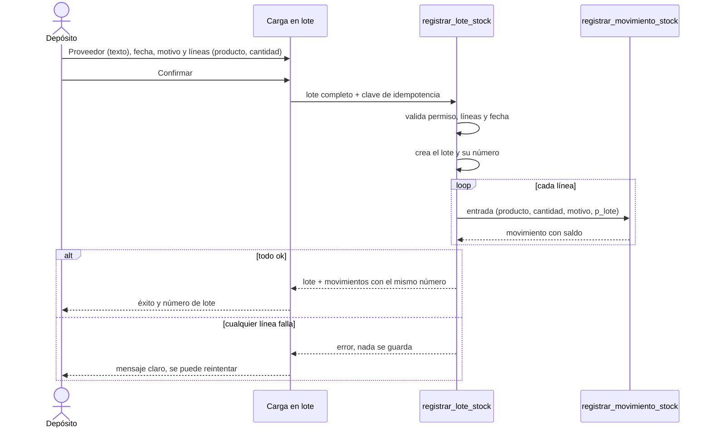
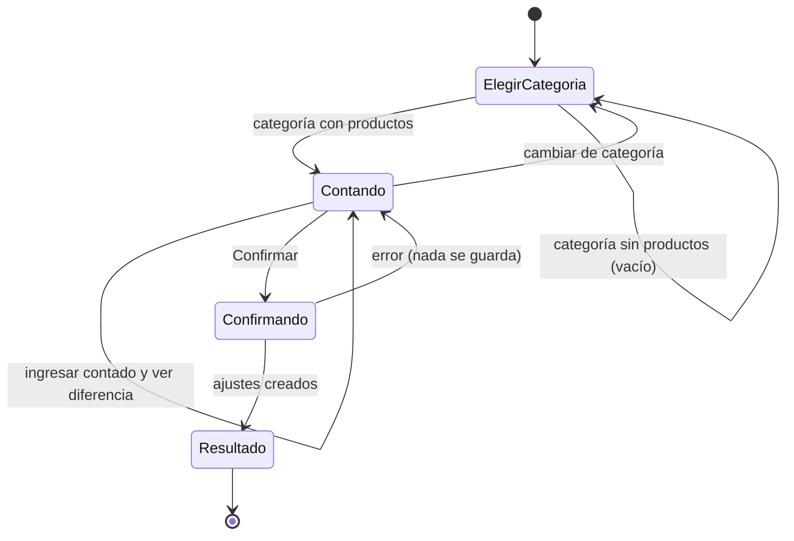

# Feature Specification: Stock · Stock lotes e inventario

**Feature Branch**: `epic/MSF-131-stock-stock-lotes-e-inventario`

**Componente**: Stock

**Jira Epic**: MSF-131 — Stock · Stock lotes e inventario (spec `stock-lotes-e-inventario`)

**Historias Jira**: F-STK-10 «Movimientos en lote» (P2, M) · F-STK-11 «Toma de inventario» (P2, M)

**Created**: 2026-10-24

**Status**: Draft — lista para planificar. Cuatro puntos de «A revisar» se resolvieron con un default razonable (ver *Decisiones*); ninguno bloquea, todos esperan el OK de Nicolás.

**Delivery scope**: `refine` (`apps/web`) y `supabase` (migraciones, RPC y pgTAP). Sin `kestra`, `superset` ni `workers`.

**Prioridad / Hito**: P2 · Etapa 3 (sin fecha) · 16 h · fuera de diciembre.

**Input**: Epic MSF-131. Objetivo: «Al terminar, el depósito puede cargar un remito completo de una vez y hacer una toma de inventario ordenada que corrige diferencias con ajustes.»

## Regla de fuentes (literal de la épica)

- Comportamiento y datos: mandan los requisitos y escenarios de esta historia.
- Qué se ve (disposición, textos, estados, popups, flujos): el prototipo validado es referencia visual, no hace falta que quede extremadamente idéntico; los flujos (si hay) aclaran estados y acciones.
- Cómo se construye (componentes, estilos y patrones): mandan el template y el system design del producto (épica MSF-117). No copiar el HTML ni el CSS del prototipo.
- El prototipo muestra más que esta historia: implementar solo lo que piden los requisitos.
- Si algo no se puede igualar con el template / sistema de diseño: usar lo más cercano, sin inventar, y anotar la diferencia en la descripción del PR.
- Si el prototipo y los requisitos se contradicen: requisitos para el comportamiento, prototipo para lo visual, y anotar la contradicción en el PR.

## Dependencias y supuestos

| Dependencia | Estado en esta rama | ¿Bloquea? |
|---|---|---|
| MSF-136 · Stock movimientos (`registrar_movimiento_stock`, motivos, libro inmutable, stock sin negativos) | Presente | No: ambas historias la reutilizan. |
| MSF-292 · Stock depósitos y reservas (`registrar_movimiento_stock` ya recibe `p_deposito`) | Presente | No: ambas usan el depósito por defecto. |
| MSF-219 · Ingreso de mercadería por proveedor | Presente | No. Es otra cosa: aquí el proveedor es **texto libre**, no la entidad `dominio.proveedores`, y no hay costo ni anulación (ver D1). |

Supuestos de la épica (literales):

- Ambas historias reutilizan la RPC `registrar_movimiento_stock`.
- El proveedor del lote es un texto libre, no una entidad.
- El stock negativo está bloqueado y el historial de movimientos no se edita ni se borra: las correcciones son nuevos ajustes.
- F-STK-10 y F-STK-11 son independientes entre sí. Esta épica no bloquea a ninguna otra.

## Esquemas y datos (Principio VII)

Estado actual verificado en migraciones: `dominio.movimientos_stock` (libro de solo agregado; sin `lote_id`), `dominio.motivos_movimiento` (siembra por organización: Compra a proveedor, Venta en local, Conteo de inventario, Devolución, Rotura o pérdida, más los de sistema), `public.registrar_movimiento_stock(p_producto, p_tipo, p_cantidad, p_motivo, p_nota, p_fecha, p_deposito)`.

| Objeto | Esquema | Justificación | Cambio |
|---|---|---|---|
| `dominio.lotes_stock` | `dominio` | Entidad de negocio del producto (remito de mercadería). RLS por organización. | Tabla nueva (F-STK-10). |
| `dominio.movimientos_stock.lote_id` | `dominio` | Vincula cada movimiento a su lote. | Columna nullable nueva, aditiva (F-STK-10). |
| `dominio.motivos_movimiento` «Toma de inventario» | `dominio` | Dato sembrado por organización. | Fila de sistema nueva + relleno (F-STK-11). |
| RPC `registrar_lote_stock`, `listar_lotes_stock`, `listar_movimientos_lote` | `public` (API), lógica sobre `dominio` | Contratos en `contracts/stock-lotes-e-inventario.md`. | Nuevas (F-STK-10). |
| RPC `confirmar_toma_inventario` | `public` | Idem. | Nueva (F-STK-11). |
| `public.registrar_movimiento_stock` | `public` | Gana `p_lote uuid default null` al final. | Aditivo, **alto riesgo de contrato** (F-STK-10). |

Reversión (documentada también en cada migración): `drop function` de las RPC nuevas; en migración posterior `alter table dominio.movimientos_stock drop column lote_id` y `drop table dominio.lotes_stock` (exportar antes los datos); restaurar `registrar_movimiento_stock` a la firma de 7 parámetros; `delete from dominio.motivos_movimiento where nombre = 'Toma de inventario'` y restaurar `private.sembrar_motivos_movimiento`. Nada se destruye en el mismo PR que lo crea.

## Navegación y patrones del panel (Principio VI)

- Ubicación: dentro de `Stock` (ítem de navegación existente, mismo icono), como dos pestañas nuevas en `PestanasStock`: «Carga en lote» (`/stock/lote`) y «Toma de inventario» (`/stock/toma-inventario`). Rutas nuevas, sin compatibilidad previa que mantener.
- Audiencia: la sección `stock`. Con nivel `lectura` se ve el historial de lotes pero no el formulario ni «Confirmar»; con `edicion` se opera; sin acceso no se ve la pestaña.
- Patrones compartidos de carga, vacío, error y éxito; teclado, lector de pantalla y anchos de 320/768/1440 px; sin ids como identidad visible: se muestra nombre/SKU del producto y el **número de lote**.

## User Scenarios & Testing *(mandatory)*

### User Story 1 - Movimientos en lote (F-STK-10, P2, talla M)

Como persona del depósito, quiero cargar un remito completo de una sola vez —varios productos con su cantidad bajo un mismo número de lote— para no registrar un movimiento por producto.

**Why this priority**: es el ahorro de tiempo central del depósito al recibir mercadería.

**Independent Test**: cargar un lote de 5 productos y ver 5 movimientos de entrada con el mismo número de lote, con el stock de cada producto actualizado.

**Acceptance Scenarios**:

1. **Given** el formulario con 5 productos y sus cantidades, **When** confirma, **Then** se crean 5 movimientos de entrada, todos con el mismo número de lote, y el stock de cada producto sube en su cantidad.
2. **Given** un lote con proveedor «Distribuidora Sur» (texto libre), **When** se registra, **Then** el lote guarda ese texto tal cual y no exige que exista como proveedor.
3. **Given** un lote con una línea inválida (cantidad 0 o negativa, producto repetido, producto inexistente o inactivo), **When** confirma, **Then** se rechaza con un mensaje claro y no se crea ningún movimiento ni lote (todo o nada).
4. **Given** una falla al mover el stock de la 3.ª línea, **When** confirma, **Then** no queda ningún movimiento, ni lote, ni cambio de stock.
5. **Given** un usuario con Stock en solo lectura, **When** abre la pestaña, **Then** ve el historial de lotes pero no el formulario, y la base rechaza la llamada a la RPC.
6. **Given** un doble clic en «Confirmar», **When** llegan dos envíos, **Then** se crea un solo lote y el stock sube una vez.
7. **Given** lotes ya registrados, **When** abre el historial, **Then** ve cada lote (número, fecha, proveedor, productos, unidades) y, al abrirlo, sus movimientos con el mismo número.
8. **Given** un lote registrado, **When** se intenta editar o borrar el lote o sus movimientos, **Then** la base lo rechaza: la corrección es un nuevo movimiento.

### User Story 2 - Toma de inventario (F-STK-11, P2, talla M)

Como persona del depósito, quiero contar una categoría, ver las diferencias contra el sistema y confirmar para que se corrijan con ajustes, sin perder el historial.

**Why this priority**: ordena el conteo físico y deja el stock del sistema igual a lo contado.

**Independent Test**: contar una categoría, confirmar y ver los ajustes en el historial de movimientos.

**Acceptance Scenarios**:

1. **Given** una categoría con 4 productos, **When** la elige, **Then** ve los productos de esa categoría con su stock en el sistema y un campo «Contado» por producto.
2. **Given** un contado distinto del sistema, **When** lo ingresa, **Then** la fila muestra la diferencia (contado − sistema) con su signo antes de confirmar.
3. **Given** 4 productos contados, 2 con diferencia, **When** confirma, **Then** se crean 2 movimientos de tipo ajuste con motivo «Toma de inventario» que dejan el stock en lo contado; los 2 sin diferencia no generan movimiento.
4. **Given** un producto sin contar (campo vacío), **When** confirma, **Then** ese producto no se toca.
5. **Given** un contado inválido (negativo, decimal, texto), **When** intenta confirmar, **Then** se rechaza con mensaje claro y no cambia nada.
6. **Given** una falla en un ajuste, **When** confirma, **Then** no queda ningún ajuste de la toma (todo o nada).
7. **Given** un usuario sin nivel de edición en Stock, **When** abre la toma, **Then** no ve «Confirmar» y la base rechaza la RPC (ver D3).
8. **Given** un doble envío de la misma confirmación, **When** llegan dos, **Then** el segundo no genera movimientos (el ajuste fija el valor contado: la diferencia ya es 0).
9. **Given** la confirmación hecha, **When** termina, **Then** la pantalla muestra los ajustes generados (producto, diferencia, saldo) y el historial de Movimientos los lista; los movimientos anteriores quedan intactos.

### Edge Cases

- Lote sin líneas: «Confirmar» deshabilitado y la RPC rechaza (`22023`).
- Fecha futura: rechazada, igual que en `registrar_movimiento_stock`.
- Categoría sin productos: estado vacío del patrón compartido.
- Stock cambia entre que se carga la toma y se confirma: el ajuste fija el valor contado; el resultado muestra la diferencia real aplicada.

## Flujos

### Flujo 1 — Carga en lote (F-STK-10)

| Paso | Dueño |
|---|---|
| Completar proveedor, fecha, motivo y líneas | FR-001, FR-002 |
| Confirmar con clave de idempotencia | FR-008 |
| Validar permiso, líneas y fecha | FR-003, FR-007 |
| Crear lote y número | FR-004, FR-005 |
| Una entrada por línea vía `registrar_movimiento_stock` | FR-003, FR-006 |
| Todo o nada | FR-003, SC-002 |
| Éxito con número de lote / error con reintento | FR-001, FR-009 |

### Flujo 2 — Toma de inventario (F-STK-11)

| Estado / transición | Dueño |
|---|---|
| Elegir categoría | FR-101 |
| Categoría sin productos | FR-101 (estado vacío) |
| Contando: ingresar contado y ver diferencia | FR-102 |
| Confirmar | FR-103, FR-105 |
| Ajustes solo para productos con diferencia, motivo «Toma de inventario» | FR-103, FR-104 |
| Error: nada se guarda | FR-103, SC-003 |
| Resultado: ajustes generados | FR-106 |

## Requirements *(mandatory)*

### Functional Requirements — F-STK-10 Movimientos en lote

- **FR-001**: La pestaña «Carga en lote» (`/stock/lote`) ofrece un formulario con **Proveedor** (texto libre, opcional, hasta 120 caracteres), **Fecha** (por defecto hoy, no futura), **Motivo** (activo y aplicable a entradas) y una lista de líneas **Producto + Cantidad** con alta y baja de líneas, y un botón «Confirmar». Tras confirmar muestra el número de lote. **Verificación:** `lote.test.tsx` (formulario, líneas, número de lote tras confirmar) · `pnpm --filter @platform/web test -- lote`.
- **FR-002**: Cada línea tiene un producto activo y una cantidad entera mayor a cero; no puede repetirse un producto en el mismo lote; hay al menos una línea. **Verificación:** `lote.test.tsx` (cantidad 0/negativa, producto repetido, sin líneas) · `stock_lotes.test.sql` (rechazo en servidor).
- **FR-003**: `registrar_lote_stock` registra el lote completo en una sola transacción: un movimiento de **entrada** por línea mediante `registrar_movimiento_stock`, o ninguno. Ante cualquier error no queda lote, movimiento ni cambio de stock. **Verificación:** `stock_lotes.test.sql` (lote de 5 → 5 entradas; línea inválida → 0 lotes/0 movimientos) · `pnpm test:db`.
- **FR-004**: El **número de lote** es correlativo por organización, lo asigna el servidor y es el mismo en todos los movimientos del lote. **Verificación:** Test de concurrencia T006 (`stock_lotes_concurrencia.test.sql`: números distintos y consecutivos) · `pnpm test:db`.
- **FR-005**: `dominio.lotes_stock` guarda número, proveedor (texto), fecha, motivo, actor y fecha de creación; tiene RLS por organización, es de solo agregado (sin update ni delete) y no referencia `dominio.proveedores`. **Verificación:** `stock_lotes.test.sql` (update/delete rechazados, otra organización no ve lotes) · `rls_en_toda_tabla` · `pnpm test:db`.
- **FR-006**: `registrar_movimiento_stock` gana `p_lote uuid default null` (al final, aditivo); `movimientos_stock.lote_id` queda fijado al insertar. El libro sigue inmutable y el stock negativo sigue bloqueado. **Verificación:** `stock_lotes.test.sql` (`lote_id` fijado, stock negativo rechazado, libro inmutable) · `pnpm test:db`.
- **FR-007**: Solo la sección `stock` en `edicion` puede registrar un lote (`42501` en caso contrario); `anon` no ejecuta las RPC nuevas (`revoke ... from public, anon`, `grant execute ... to authenticated`). **Verificación:** `stock_lotes.test.sql` (`lectura` → `42501`; `anon` sin ejecución) · `pnpm test:db`.
- **FR-008**: El envío es idempotente por clave generada por el cliente: un reintento o doble clic devuelve el mismo lote sin volver a mover stock. **Verificación:** `stock_lotes.test.sql` y T006 (misma clave → un solo lote) · `lote.test.tsx` (doble clic con clave estable).
- **FR-009**: El historial de lotes (`listar_lotes_stock`) muestra número, fecha, proveedor, cantidad de productos y unidades, del más reciente al más antiguo; el detalle (`listar_movimientos_lote`) muestra los movimientos del lote. Lectura y edición lo ven. El alta registra `stock.lote_registrado` en la actividad. **Verificación:** `stock_lotes.test.sql` (`listar_lotes_stock`, `listar_movimientos_lote`, actividad `stock.lote_registrado`) · `lote.test.tsx` (historial y detalle).

### Functional Requirements — F-STK-11 Toma de inventario

- **FR-101**: La pestaña «Toma de inventario» (`/stock/toma-inventario`) permite elegir una categoría y lista sus productos activos con **Producto/SKU**, **Stock en el sistema** y un campo **Contado**; categoría sin productos muestra el estado vacío compartido. **Verificación:** `toma-inventario.test.tsx` (categoría con 4 productos, estado vacío) · `pnpm --filter @platform/web test -- toma-inventario`.
- **FR-102**: El contado es un entero de cero o más; la fila muestra la diferencia (contado − sistema) con signo antes de confirmar. Los productos con el campo vacío no se tocan. **Verificación:** `toma-inventario.test.tsx` (diferencia con signo, campo vacío no se toca, contado inválido rechazado).
- **FR-103**: `confirmar_toma_inventario` crea, en una sola transacción, un movimiento de tipo **ajuste** por cada producto con diferencia distinta de cero, mediante `registrar_movimiento_stock` (que fija el stock al valor contado); los productos sin diferencia no generan movimiento. Ante cualquier error no queda ningún ajuste. Repetir la misma confirmación no crea movimientos. **Verificación:** `stock_toma_inventario.test.sql` (2 ajustes de 4, sin diferencia no hay movimiento, reenvío idempotente, falla → 0 ajustes) · `pnpm test:db`.
- **FR-104**: El motivo de los ajustes es «Toma de inventario»: motivo de sistema por organización (aplica a `ajuste`), sembrado en organizaciones nuevas y rellenado en las existentes (ver D2). **Verificación:** `stock_toma_inventario.test.sql` (motivo de sistema «Toma de inventario» en organización nueva y existente) · `pnpm test:db`.
- **FR-105**: Solo `stock` en `edicion` puede confirmar (`42501`); con otro nivel no se muestra «Confirmar». `anon` no ejecuta la RPC. **Verificación:** `stock_toma_inventario.test.sql` (`lectura` → `42501`, `anon` sin ejecución) · `toma-inventario.test.tsx` (sin «Confirmar» sin `edicion`).
- **FR-106**: Tras confirmar, la pantalla muestra los ajustes generados (producto, diferencia, saldo); el historial de Movimientos los lista. No se edita ni borra ningún movimiento previo: las correcciones son nuevos ajustes. **Verificación:** `toma-inventario.test.tsx` (resultado con ajustes) · `stock_toma_inventario.test.sql` (movimientos previos intactos).

### Key Entities

- **Lote de stock** (`dominio.lotes_stock`): número correlativo, proveedor (texto), fecha, motivo, actor; agrupa movimientos de entrada.
- **Movimiento** (`dominio.movimientos_stock`, existente): gana `lote_id` opcional.
- **Toma de inventario**: no es una entidad persistida; es la pantalla + `confirmar_toma_inventario`, que produce ajustes (D4).

## Decisiones (traducción de «A revisar»; ninguna bloquea)

- **D1 · ¿F-STK-10 es lo mismo que el «ingreso de mercadería» del roadmap?** Se trata como **distinto**: MSF-219 (ya presente) cubre ingreso por **proveedor entidad** con costo y anulación y declara que no toca F-STK-10. Esta épica es la carga en lote con proveedor **texto libre** y número de lote. Si Nicolás decide que son lo mismo, F-STK-10 se retira o se redefine (conflicto de prioridad P0 vs P2).
- **D2 · Motivo «Toma de inventario».** Se agrega como **motivo de sistema** nuevo (aplica a `ajuste`) en vez de reutilizar «Conteo de inventario» (ya sembrado), porque la épica nombra literalmente «Toma de inventario». Alternativa: reutilizar «Conteo de inventario» y no sembrar nada.
- **D3 · CA-STK-11-3 «Operador sin permiso de edición en Stock».** Se interpreta como **cualquier rol cuyo nivel en la sección Stock no sea `edicion`** (lectura o ninguno), no como el Operador por defecto, que sí edita Stock. Lo decide la base (`private.nivel_seccion('stock')`), no el nombre del rol.
- **D4 · Supuestos que completan la épica sin ampliar alcance:** (a) la carga en lote es siempre de **entradas** (un remito); (b) el número de lote es **correlativo generado por el servidor**, no tipeado; (c) ambas historias operan sobre el **depósito por defecto** (`p_deposito` nulo), elegir depósito queda fuera; (d) la toma **no se guarda como borrador ni entidad**; (e) las pestañas nuevas y el historial de lotes **no están dibujados** en el prototipo: se construyen con el sistema de diseño y la diferencia se anota en el PR.

## Success Criteria

- **SC-001**: Cargar un lote de 5 productos produce 5 movimientos de entrada con el mismo número de lote y el stock de cada uno actualizado (verificación de la épica). **Verificación:** `stock_lotes.test.sql` (5 productos, mismo número) · `lote.test.tsx` · `pnpm test:db`.
- **SC-002**: Una falla en cualquier línea de un lote deja 0 lotes, 0 movimientos y stock sin cambios; dos envíos simultáneos con la misma clave crean un solo lote. **Verificación:** `stock_lotes.test.sql` y T006 (falla → 0/0/sin cambios; misma clave simultánea → un lote) · `pnpm test:db`.
- **SC-003**: Contar una categoría, confirmar y ver los ajustes: solo los productos con diferencia generan un ajuste y el stock queda en lo contado; una falla deja 0 ajustes. **Verificación:** `stock_toma_inventario.test.sql` y `toma-inventario.test.tsx` · `pnpm test:db`.
- **SC-004**: La prueba pgTAP de aislamiento sigue verde con `dominio.lotes_stock`, las RPC nuevas no son ejecutables por `anon` y un usuario de otra organización no ve ni escribe lotes ni ajustes. **Verificación:** `aislamiento_organizaciones` y `rls_en_toda_tabla` (pgTAP) + test de ejecutabilidad por `anon` · `pnpm test:db`.

## Matriz pantalla↔criterios

El árbol `design/pantallas` **no trae pantallas dibujadas para esta épica** (la épica lo declara: «Ninguna pantalla dibujada todavía»). Se tomó el inventario determinista (`pnpm prototipo:inventario`, `.inventory.json` del árbol) de la pantalla anfitriona `Stock.dc.html` (y `StockMovimientos`, `StockNuevoMovimiento`). Lo que la épica no pide **no es deuda**: otras épicas lo entregaron o lo pedirán.

### Ítems del prototipo existente (`Stock.dc.html`)

| Ítem del inventario | Destino | Criterio / motivo |
|---|---|---|
| Tabs `Stock actual`, `Movimientos`, `Ingreso de mercadería`, `Depósitos de mercadería` | Fuera de alcance de esta épica | Ya entregados (MSF-136/219/292); solo se agregan dos pestañas junto a ellos (FR-001, FR-101). |
| Tabs `Faltantes`, `Actualizar por Excel` | Fuera de alcance | Otras épicas; la épica no los pide. |
| Tabla `Producto / Stock / Reservado / Disponible / Mínimo / Estado / Último movimiento` y botón `Ver solo alertas` | Fuera de alcance | Listado de MSF-136/231; la toma solo reutiliza «Producto» y «Stock» como datos de sus filas (FR-101). |
| Botones `Ingreso de mercadería`, `Nuevo movimiento`, `Movimiento`, `Entrada`, `Salida`, `Ajuste` | Fuera de alcance | Movimiento individual ya entregado (MSF-136). |
| Diálogo `Registrar movimiento de stock` y campos `Producto`, `Tipo de movimiento`, `Depósito de mercadería`, `Tienda o canal`, `Fecha`, `Motivo`, `Nota (opcional)`; botones `Cancelar`, `Registrar`, `Depósito principal`, `Local mostrador` | Fuera de alcance | Diálogo individual (MSF-136/292). `Fecha` y `Motivo` se reutilizan como concepto y componente en FR-001. |
| Buscador `Buscar por nombre o SKU` | Fuera de alcance | Del listado; el selector de producto de las líneas reutiliza el buscador por nombre/SKU (FR-001). |

### Elementos nuevos que la épica pide (no dibujados)

| Elemento | Destino | Criterio |
|---|---|---|
| Pestaña `Carga en lote` | En alcance | FR-001 |
| Campos `Proveedor`, `Fecha`, `Motivo`, líneas `Producto`/`Cantidad`, agregar/quitar línea, botón `Confirmar` | En alcance | FR-001, FR-002, US1-1/3 |
| Número de lote visible tras confirmar y en el historial | En alcance | FR-004, FR-009, US1-1/7 |
| Historial de lotes y detalle de movimientos | En alcance | FR-009, US1-7 |
| Pestaña `Toma de inventario`, selector `Categoría` | En alcance | FR-101, US2-1 |
| Tabla de la toma: `Producto/SKU`, `Stock en el sistema`, `Contado`, `Diferencia` | En alcance | FR-101, FR-102, US2-1/2 |
| Botón `Confirmar` y resultado con ajustes | En alcance | FR-103, FR-106, US2-3/9 |
| Estados vacío, carga, error y éxito | En alcance | Principio VI; US1-3/4, US2-6 |
| Botón/estado por rol (lectura) | En alcance | FR-007, FR-105, US1-5, US2-7 |
| Borrador/guardado de la toma, exportar o imprimir la hoja de conteo, escaneo, elección de depósito | Fuera de alcance | La épica no lo pide (D4). |
| Anulación o edición de lote | Fuera de alcance | La épica dice que el historial no se edita ni se borra. |

### Empresa activa (Principio VIII)

| Fila | Destino | Motivo |
|---|---|---|
| Empresa activa | **No aplica** | El stock es **único por organización** (MSF-231) y los movimientos no tienen empresa; el prototipo de Stock no muestra selector ni columna de empresa en estas pantallas. Las pantallas no leen ni escriben datos acotados a una empresa, por eso no hay test de cambio de empresa; sí hay uno que verifica que no consultan por empresa. |

## Matriz de trazabilidad Jira ↔ US ↔ FR/SC ↔ tareas

| Jira | Historia | FR / SC | Tareas |
|------|----------|---------|--------|
| F-STK-10 | US1 Movimientos en lote | FR-001…009, SC-001, SC-002 | T001–T010 |
| F-STK-11 | US2 Toma de inventario | FR-101…106, SC-003 | T011–T017 |
| Tarea de cierre (label `cierre`) | Docs, seguridad y roadmap | SC-004 | T018–T020 |

## Verificación por requisito

| Requisito | Verificación nombrada |
|---|---|
| FR-001 | `lote.test.tsx` (formulario, líneas, número de lote tras confirmar) · `pnpm --filter @platform/web test -- lote` |
| FR-002 | `lote.test.tsx` (cantidad 0/negativa, producto repetido, sin líneas) · `stock_lotes.test.sql` (rechazo en servidor) |
| FR-003 | `stock_lotes.test.sql` (lote de 5 → 5 entradas; línea inválida → 0 lotes/0 movimientos) · `pnpm test:db` |
| FR-004 | Test de concurrencia T006 (`stock_lotes_concurrencia.test.sql`: números distintos y consecutivos) · `pnpm test:db` |
| FR-005 | `stock_lotes.test.sql` (update/delete rechazados, otra organización no ve lotes) · `rls_en_toda_tabla` · `pnpm test:db` |
| FR-006 | `stock_lotes.test.sql` (`lote_id` fijado, stock negativo rechazado, libro inmutable) · `pnpm test:db` |
| FR-007 | `stock_lotes.test.sql` (`lectura` → `42501`; `anon` sin ejecución) · `pnpm test:db` |
| FR-008 | `stock_lotes.test.sql` y T006 (misma clave → un solo lote) · `lote.test.tsx` (doble clic con clave estable) |
| FR-009 | `stock_lotes.test.sql` (`listar_lotes_stock`, `listar_movimientos_lote`, actividad `stock.lote_registrado`) · `lote.test.tsx` (historial y detalle) |
| FR-101 | `toma-inventario.test.tsx` (categoría con 4 productos, estado vacío) · `pnpm --filter @platform/web test -- toma-inventario` |
| FR-102 | `toma-inventario.test.tsx` (diferencia con signo, campo vacío no se toca, contado inválido rechazado) |
| FR-103 | `stock_toma_inventario.test.sql` (2 ajustes de 4, sin diferencia no hay movimiento, reenvío idempotente, falla → 0 ajustes) · `pnpm test:db` |
| FR-104 | `stock_toma_inventario.test.sql` (motivo de sistema «Toma de inventario» en organización nueva y existente) · `pnpm test:db` |
| FR-105 | `stock_toma_inventario.test.sql` (`lectura` → `42501`, `anon` sin ejecución) · `toma-inventario.test.tsx` (sin «Confirmar» sin `edicion`) |
| FR-106 | `toma-inventario.test.tsx` (resultado con ajustes) · `stock_toma_inventario.test.sql` (movimientos previos intactos) |
| SC-001 | `stock_lotes.test.sql` (5 productos, mismo número) · `lote.test.tsx` · `pnpm test:db` |
| SC-002 | `stock_lotes.test.sql` y T006 (falla → 0/0/sin cambios; misma clave simultánea → un lote) · `pnpm test:db` |
| SC-003 | `stock_toma_inventario.test.sql` y `toma-inventario.test.tsx` · `pnpm test:db` |
| SC-004 | `aislamiento_organizaciones` y `rls_en_toda_tabla` (pgTAP) + test de ejecutabilidad por `anon` · `pnpm test:db` |
