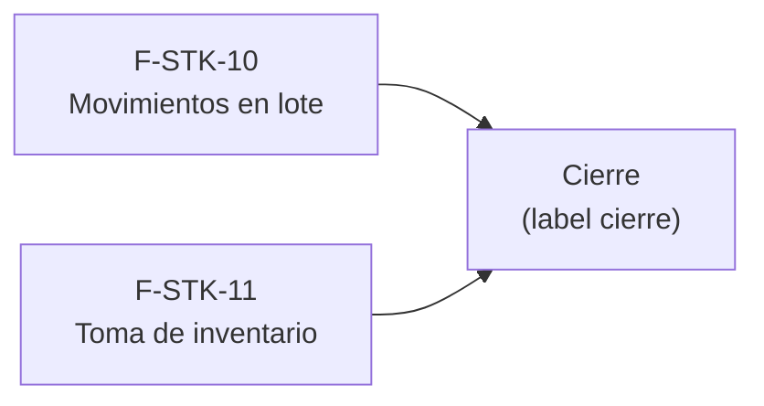

# Tasks: Stock · Stock lotes e inventario

**Input**: `specs/20261024-120000-stock-lotes-e-inventario/` (spec.md, plan.md, contracts/)

**Formato**: `- [ ] T### [P] [STORY-x][USy] descripción`. **[P]** = paralelizable (archivos distintos, sin dependencia; las [P] del mismo grupo van en paralelo); sin [P] = secuencial. Las dependencias de cada historia son solo dentro de esa historia.

**Delivery scope**: `refine`, `supabase`

## Matriz de trazabilidad Jira ↔ US ↔ tasks

| Jira | Historia | FR / SC | Tasks |
|------|----------|---------|-------|
| F-STK-10 | US1 Movimientos en lote | FR-001…009, SC-001, SC-002 | T001–T010 |
| F-STK-11 | US2 Toma de inventario | FR-101…106, SC-003 | T011–T017 |
| Tarea de cierre (label `cierre`) | Docs, seguridad y roadmap | SC-004 | T018–T020 |

## Phase 1: F-STK-10 · Movimientos en lote (US1)

**Goal**: cargar un remito de varios productos con un mismo número de lote, todo o nada.

- [ ] T001 [F-STK-10][US1] Migración `…_stock_lotes_tabla.sql` (esquema `dominio`): `dominio.lotes_stock` (número correlativo por organización, proveedor texto ≤120, fecha, motivo, actor, `clave_idempotencia`), `movimientos_stock.lote_id` con FK compuesta, RLS solo lectura (`lectura`/`edicion`), solo agregado, reversión documentada (FR-005)
- [ ] T002 [F-STK-10][US1] Migración `…_stock_registrar_movimiento_lote.sql`: `registrar_movimiento_stock` gana `p_lote uuid default null` (drop + create, `revoke ... from public, anon`, `grant ... to authenticated`), fija `lote_id` al insertar sin romper inmutabilidad ni stock sin negativos (FR-006)
- [ ] T003 [F-STK-10][US1] Migración `…_stock_registrar_lote.sql`: `registrar_lote_stock` (valida permiso `edicion`, líneas, fecha y motivo; asigna número; una entrada por línea vía `registrar_movimiento_stock`; todo o nada; idempotente por clave; actividad `stock.lote_registrado`) (FR-003, FR-004, FR-007, FR-008)
- [ ] T004 [F-STK-10][US1] Misma migración o `…_stock_lotes_lecturas.sql`: `listar_lotes_stock` y `listar_movimientos_lote` (lectura para `lectura`/`edicion`, aisladas por organización) (FR-009)
- [ ] T005 [P] [F-STK-10][US1] pgTAP `stock_lotes.test.sql`: lote de 5 productos → 5 movimientos con el mismo número y stock actualizado; línea inválida/falla → 0 lotes y 0 movimientos; misma clave → un solo lote; lectura rechazada con `42501`; update/delete de lote y movimientos rechazados; `anon` sin ejecución; otra organización no ve lotes (SC-001, SC-002)
- [ ] T006 [P] [F-STK-10][US1] Test de concurrencia (`stock_lotes_concurrencia.test.sql`): dos lotes simultáneos de la misma organización obtienen números distintos y consecutivos; dos envíos con la misma clave crean un solo lote (FR-004, FR-008)
- [ ] T007 [F-STK-10][US1] `pages/stock/lote.tsx`: formulario (Proveedor, Fecha, Motivo, líneas Producto+Cantidad con alta/baja, Confirmar), validación en cliente, éxito con número de lote, error con reintento, doble envío con clave estable, sin formulario en `lectura` (FR-001, FR-002)
- [ ] T008 [F-STK-10][US1] Historial de lotes y detalle de movimientos en la misma pestaña (número, fecha, proveedor, productos, unidades; abrir un lote lista sus movimientos), con estados de carga/vacío/error (FR-009)
- [ ] T009 [F-STK-10][US1] Pestaña «Carga en lote» en `PestanasStock.tsx` y ruta `/stock/lote` en `App.tsx` protegida por sección `stock` (FR-001)
- [ ] T010 [P] [F-STK-10][US1] Vitest `lote.test.tsx`: 5 líneas, validaciones (0, negativo, repetido, sin líneas), error del servidor con reintento, doble clic, rol lectura sin formulario, la pantalla no consulta por empresa (SC-001)

**Checkpoint**: `pnpm test:db` y Vitest de la historia en verde.

## Phase 2: F-STK-11 · Toma de inventario (US2)

**Goal**: contar una categoría y corregir las diferencias con ajustes.

- [ ] T011 [F-STK-11][US2] Migración `…_stock_motivo_toma_inventario.sql`: motivo de sistema «Toma de inventario» (aplica a `ajuste`) en `sembrar_motivos_movimiento`, relleno de organizaciones existentes, reversión documentada (FR-104)
- [ ] T012 [F-STK-11][US2] Migración `…_stock_confirmar_toma.sql`: `confirmar_toma_inventario` (permiso `edicion`, contado entero ≥ 0, sin repetidos, un ajuste por producto con diferencia vía `registrar_movimiento_stock`, devuelve los ajustes, todo o nada, `revoke ... from public, anon`) (FR-103, FR-105)
- [ ] T013 [P] [F-STK-11][US2] pgTAP `stock_toma_inventario.test.sql`: 4 contados con 2 diferencias → 2 ajustes con motivo «Toma de inventario» y stock en lo contado; sin diferencia no hay movimiento; reenvío no crea movimientos; falla → 0 ajustes; nivel lectura → `42501`; `anon` sin ejecución; movimientos previos intactos (SC-003)
- [ ] T014 [F-STK-11][US2] `pages/stock/toma-inventario.tsx`: selector de categoría, tabla Producto/SKU · Stock en el sistema · Contado · Diferencia, estado vacío, validación de contado (FR-101, FR-102)
- [ ] T015 [F-STK-11][US2] Confirmar y resultado con los ajustes generados (producto, diferencia, saldo), error con reintento, «Confirmar» oculto sin `edicion` (FR-106)
- [ ] T016 [F-STK-11][US2] Pestaña «Toma de inventario» en `PestanasStock.tsx` y ruta `/stock/toma-inventario` en `App.tsx` protegida por sección `stock` (FR-101)
- [ ] T017 [P] [F-STK-11][US2] Vitest `toma-inventario.test.tsx`: categoría con 4 productos, diferencia con signo, campo vacío no se toca, contado inválido rechazado, resultado con ajustes, rol sin edición, la pantalla no consulta por empresa (SC-003)

**Checkpoint**: `pnpm test:db` y Vitest de la historia en verde.

## Phase 3: Cierre (docs, seguridad y roadmap)

- [ ] T018 [CIERRE] Guía `docs/stock-lotes-e-inventario.md` (lotes, toma, motivo de sistema, permisos, reversión) y enlace desde `docs/stock.md`; `pnpm docs:check` verde
- [ ] T019 [CIERRE] Revisión de seguridad: `rls_en_toda_tabla`/`aislamiento_organizaciones` verdes con `dominio.lotes_stock`, test de ejecutabilidad por `anon` sin las RPC nuevas, revisión de autorización de las RPC, `pnpm lint`, `pnpm build`, `pnpm test` (SC-004)
- [ ] T020 [CIERRE] Roadmap: fila de esta spec en `docs/roadmap-template.md` (estado, link a la spec) como paso manual del cierre

**Checkpoint**: sin tareas `[ ]`; toda tarea hecha con evidencia o cerrada con `Desvío:` y seguimiento trazado.

## Plan de ejecución (historias)

| Historia | Depende de | Grupo |
|----------|------------|-------|
| F-STK-10 | — | 1 |
| F-STK-11 | — | 1 |
| [Cierre] | F-STK-10, F-STK-11 | 2 |

