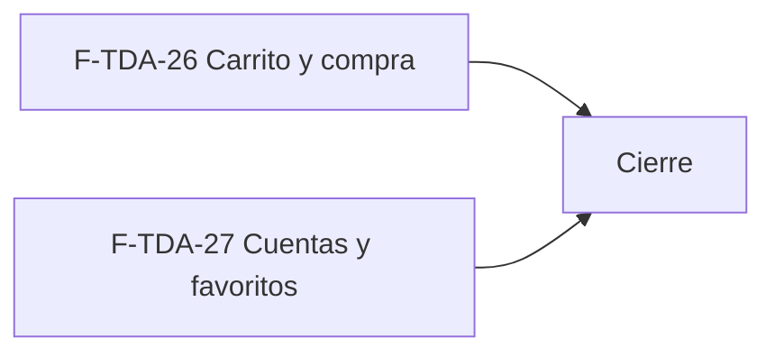

# Tasks: Tiendas online · Tienda compra y cuentas

**Input**: `specs/20261024-120000-tienda-compra-y-cuentas/` (spec.md, plan.md)

**Formato**: `- [ ] T### [P] [F-TDA-xx][USy] descripción`. **[P]** = paralelizable; sin [P] = secuencial. Las dependencias son solo dentro de la misma historia. Regla del proyecto: ninguna tarea queda `[ ]` al cierre — se hace con evidencia o se cierra con `[x]` + `Desvío:` y seguimiento trazado.

**Delivery scope**: a confirmar (previsible `refine`, `supabase`).

**Estado**: lista **parcial** (NEEDS_INFO). Las tareas de implementación se desglosan cuando Nicolás responda P1–P5; no se inventan antes.

## Matriz de trazabilidad Jira ↔ US ↔ tasks

| Jira | Historia | FR / SC (dueño único) | Tasks |
|------|----------|-----------------------|-------|
| F-TDA-26 | US1 Carrito y compra online | FR-001, SC-001 | T001–T002 |
| F-TDA-27 | US2 Cuentas de clientes y favoritos | FR-002, FR-003, SC-002 | T010–T011 |
| Tarea de cierre (label cierre) | Documentación, gates y roadmap | FR-004, SC-003 | T020–T022 |

## F-TDA-26 · Carrito y compra online (US1)

- [ ] T001 [F-TDA-26][US1] Con las respuestas P1/P2/P5, redactar en `spec.md` los FR/escenarios de carrito, pago y pedido, el `## Flujos` (Mermaid) y el `contracts/tienda-compra-y-cuentas.md`; declarar esquema (`public`/`dominio`) de cada tabla. **FR-001**. Verif.: la redacción queda revisada por `pnpm docs:check` y `pnpm matriz:check`.
- [ ] T002 [F-TDA-26][US1] Implementar carrito y compra online según lo redactado en T001 (migración aditiva con reversión + RLS + pgTAP, rutas en `tienda-publica/rutas/`, Vitest/E2E). **SC-001**. Verif.: `Compra.test.tsx`, `tienda-compra.e2e.ts`, pgTAP (`pnpm test:db`); cubre también la verificación de FR-001.

## F-TDA-27 · Cuentas de clientes y favoritos (US2)

- [ ] T010 [F-TDA-27][US2] Con las respuestas P3/P4, redactar en `spec.md` los FR/escenarios de favoritos (e historial si se confirma) y declarar el esquema de cada tabla. **FR-002, FR-003**. Verif.: `pnpm docs:check` y `pnpm matriz:check`.
- [ ] T011 [F-TDA-27][US2] Implementar cuentas y favoritos según T010 (migración aditiva con reversión + RLS + pgTAP, rutas, Vitest/E2E). **SC-002**. Verif.: `Favoritos.test.tsx`, `CuentaOpcional.test.tsx`, `favoritos_rls.sql`, `tienda-cuenta-favoritos.e2e.ts`; cubre también la verificación de FR-002/FR-003.

## Cierre

- [ ] T020 [CIERRE] Documentar en `docs/tiendas-online.md` lo entregado (y `AGENTS.md`/`CLAUDE.md` si cambia una regla). **SC-003**.
- [ ] T021 [CIERRE] Actualizar la fila de la épica en `docs/roadmap-template.md` al mergear el PR (paso manual con criterio). **SC-003**.
- [ ] T022 [CIERRE] Gates finales: `pnpm lint`, `pnpm build`, `pnpm infra:config`, `pnpm test`, `pnpm prototipo:check`, `pnpm matriz:check`, `pnpm docs:check` verdes, con evidencia en el PR; confirmar que ningún FR-004 expone datos internos. **FR-004, SC-003**.

---

## Plan de ejecución (historias)

| Historia | Depende de | Grupo |
|---|---|---|
| F-TDA-26 | — | 1 |
| F-TDA-27 | — | 1 |
| [Cierre] | F-TDA-26, F-TDA-27 | 2 |

Las dos historias son independientes según la épica (no comparten tabla ni migración; cada una trae la suya), así que van en paralelo. Si P3/P4 muestran que la cuenta es requisito del checkout, F-TDA-27 pasa a depender de F-TDA-26 o viceversa.

