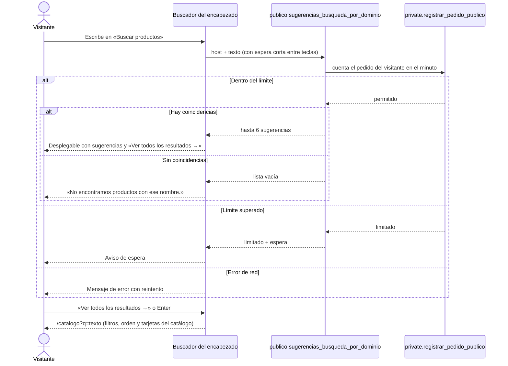
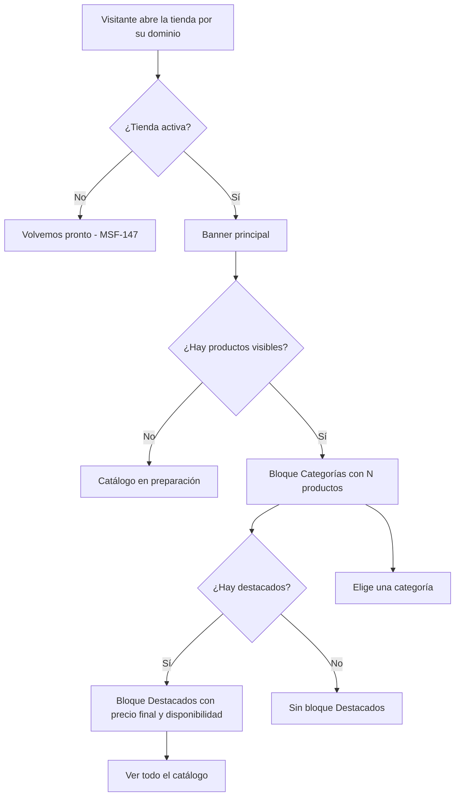
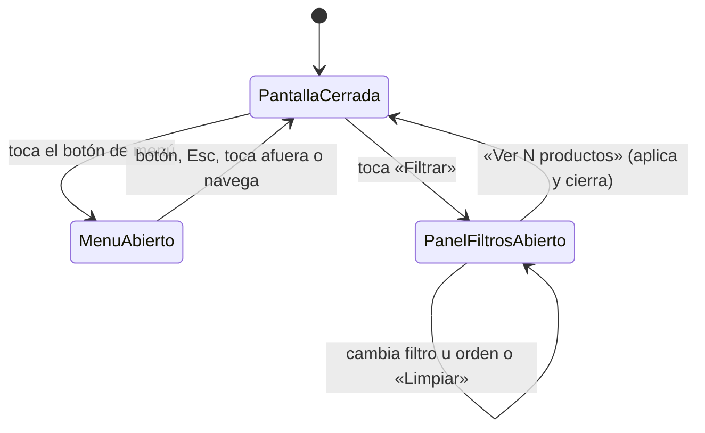
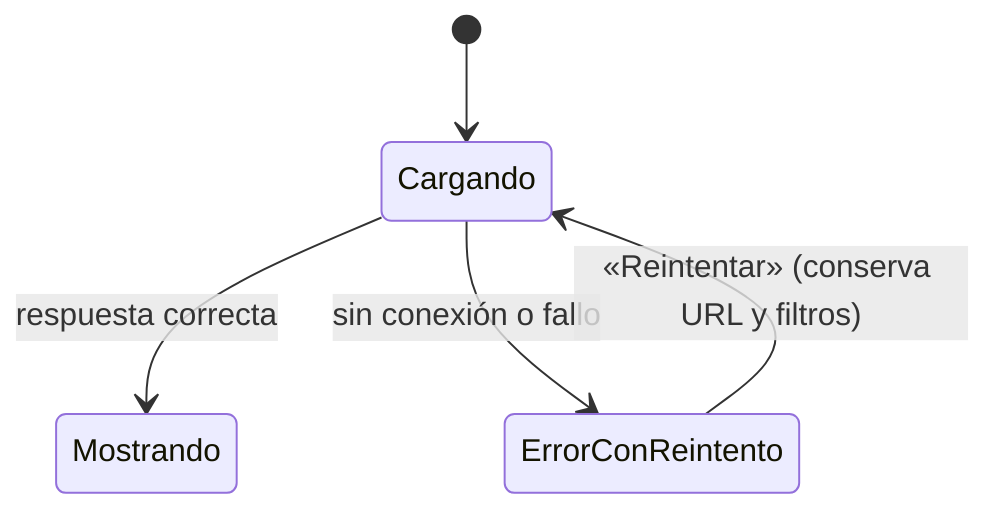

# Feature Specification: Tiendas online · Tienda inicio búsqueda móvil

**Feature Branch**: `epic/MSF-191-tiendas-online-tienda-inicio-busqueda-mo`

**Componente**: Tiendas online

**Jira Epic**: MSF-191 — Tiendas online · Tienda inicio búsqueda móvil (spec `tienda-inicio-busqueda-movil`)

**Historias previstas**: F-TDA-10 Página de inicio (L), F-TDA-15 Búsqueda de productos (M), F-TDA-17 Versión móvil completa (L), todas P0.

**Created**: 2026-10-24

**Status**: Draft — lista para planificar. Las decisiones de Nicolás quedan en *Decisiones abiertas*; ninguna bloquea implementar con el supuesto indicado.

**Delivery scope**: `refine` (`apps/web`: front público de la tienda) y `supabase` (migraciones: extensión `unaccent`, índice de búsqueda, una tabla de control de pedidos y funciones; pgTAP). Sin `kestra`, `superset` ni `workers`.

**Prioridad / Hito**: P0 · Hito 3 (16 de noviembre al 11 de diciembre de 2026) · ~39 h · alcance diciembre.

**Input**: Epic MSF-191. Objetivo: «Al terminar, la tienda tiene una página de inicio completa, un buscador que sugiere resultados mientras se escribe, y toda la experiencia funciona bien en celular.»

## Regla de fuentes (literal de la épica)

1. Comportamiento y datos: mandan los requisitos y escenarios de esta historia.
2. Qué se ve (disposición, textos, estados, popups, flujos): el prototipo validado es referencia visual, no hace falta que quede extremadamente idéntico; los flujos (si hay) aclaran estados y acciones.
3. Cómo se construye (componentes, estilos y patrones): mandan el template y el system design del producto (épica Plataforma · Sistema de diseño). No copiar el HTML ni el CSS del prototipo: reproducir lo que muestra con los componentes del template y los tokens del sistema de diseño.
4. El prototipo muestra más que esta historia: implementar solo lo que piden los requisitos de esta historia; otras secciones, botones o diálogos son de otras historias.
5. Si algo no se puede igualar con el template / el sistema de diseño: usar lo más cercano, sin inventar, y anotar la diferencia en la descripción del PR.
6. Si el prototipo y los requisitos se contradicen: requisitos para el comportamiento, prototipo para lo visual, y dejar la contradicción anotada en el PR.

Prototipos (solo lectura, ya presentes en `design/pantallas/`, con su `.inventory.json` al día — `pnpm prototipo:check` OK): `MJC_Home`, `MJC_M_Home`, `SJ_Home`, `SJ_M_Home`, `MJC_M_Catalogo`, `SJ_M_Catalogo`, `MJC_M_Producto` (y su par `SJ_M_Producto`, mismos ítems). Los demás `.dc.html` son de MSF-147, MSF-167 o MSF-212.

## Dependencias

| Dependencia | Estado en esta rama | ¿Bloquea? |
|---|---|---|
| MSF-167 · Tienda catálogo y ficha (`publico.categorias_por_dominio`, `publico.catalogo_pagina_por_dominio`, `publico.producto_por_dominio`, `private.precio_final_publico`, `private.disponible_publico`, `urlImagenProducto`, `TarjetaProducto`, `PanelFiltros`, `ListadoProductos`, `EtiquetaDisponibilidad`, `PaginaNoEncontrada`, `LayoutTienda`) | **Presente** (migraciones `20261023150000…150300`, `apps/web/src/pages/tienda-publica/`) | Sí; ya está en la base. |
| MSF-147 · Tienda dominio e identidad (`BannerHome` y contenido de la home, destacados, `publico.catalogo_visible_por_dominio`, `private.catalogo_tienda_efectivo`, `private.normalizar_host`) | **Presente** | Sí; ya está en la base. |
| MSF-117 · Sistema de diseño (tokens, `TemaTienda`) | Presente | No. |
| MSF-212 · tienda-whatsapp-y-contacto (relacionada, sin bloqueo) | No existe aún la página de Contacto | No: la página de Contacto se verifica en móvil cuando exista (FR-046). |
| `pg_trgm` | **Presente** (migraciones `20261016160000…`, `20261020120101…`) | No. |
| `unaccent` | **No existe en el stack** (comentario de `20261020100100_modelos_equipo.sql`) | La habilita F-TDA-15 con una migración aditiva. |

Bloquea a: MSF-149 · tienda-seo-legal-y-estados (el 404 con buscador usa la búsqueda: F-TDA-15 deja el buscador como componente reutilizable `BuscadorTienda`).

## Supuestos (de la épica)

- La búsqueda usa las extensiones `unaccent` y `pg_trgm` de Postgres (sin motor externo).
- Los tamaños de pantalla a verificar son 360, 390, 412 y 430 px de ancho (celular), y tabletas de 768 y 1024 px.

## Contradicciones prototipo ↔ épica (anotar en el PR)

1. **Resultados de búsqueda sin artboard.** La búsqueda existe en el prototipo solo como interacción (campo, desplegable, «Ver todos los resultados →», «No encontramos productos con ese nombre.»). La épica pide que los resultados reutilicen filtros y tarjetas del catálogo: la página de resultados es el catálogo con el término (`/catalogo?q=…`), sin pantalla propia.
2. **Panel de filtros móvil sin «Precio máximo».** `MJC_M_Catalogo` / `SJ_M_Catalogo` dibujan Categoría, Disponibilidad «Solo con stock» y Ordenar; el catálogo de escritorio (MSF-167) además filtra por «Precio máximo». La épica pide que *toda* la experiencia funcione en celular: el comportamiento manda y el panel móvil incluye «Precio máximo» (D5).
3. **Sin artboards de tableta.** 768 y 1024 px no están dibujados: se resuelven con el mismo layout responsivo de los artboards de escritorio y de celular, sin inventar un diseño nuevo.
4. **Estados no dibujados** (sugerencias, aviso de espera, «catálogo en preparación», error con reintento): se construyen con los componentes del kit y los textos de los requisitos; se anotan en el PR.
5. **«Últimas unidades · quedan N»** en las tarjetas: sigue fuera de alcance (MSF-167, contradicción 1): solo «Disponible» y «Sin stock».

## Decisiones abiertas (no bloquean; se implementa el supuesto)

- **D1 · Límite de búsquedas** (de la épica: «F-TDA-15 exige limitar los pedidos por visitante y por minuto, pero el relevamiento no fija el número»). **Supuesto**: **30 pedidos por visitante por minuto** (cada sugerencia y cada página de resultados cuenta uno), en una constante única `LIMITE_BUSQUEDAS_POR_MINUTO`. Nicolás fija el número definitivo; cambiarlo es tocar esa constante.
- **D2 · Horas** (de la épica): el roadmap asigna menos horas que la suma de las épicas; el recorte queda pendiente. No cambia el alcance.
- **D3 · Quién es «el visitante»**. Sin sesión, el visitante se identifica por la IP que informa el proxy (`x-forwarded-for`) combinada con el host; solo se guarda su **hash** (nunca la IP). **Supuesto**: sin cabecera el visitante cae en un grupo común «desconocido» (límite compartido). Riesgo anotado en el plan.
- **D4 · Mínimo de caracteres**. La épica fija «hasta 6» sugerencias; el mínimo no está dicho. **Supuesto**: la búsqueda arranca con 2 caracteres (constante única), el texto se recorta a 100 caracteres y un texto vacío no pide nada.
- **D5 · «Precio máximo» en el panel móvil**: ver contradicción 2. **Supuesto**: se incluye, con los mismos valores y comportamiento que en escritorio.
- **D6 · «Catálogo en preparación»**. La épica cita el estado sin decir dónde. **Supuesto**: aplica a la **home** de una tienda activa sin ningún producto visible (reemplaza los bloques «Categorías» y «Destacados»). El catálogo vacío por filtros sigue usando «No encontramos productos» de MSF-167.
- **D7 · Cantidad de destacados en la home**. No está dicha. **Supuesto**: hasta 8 (constante única), en el orden de MSF-147; sin destacados el bloque no se muestra.
- **D8 · Textos no dibujados**: aviso de espera «Hiciste muchas búsquedas seguidas. Esperá unos segundos y probá de nuevo.», error «No pudimos cargar esta página. Revisá tu conexión y probá de nuevo.» con botón «Reintentar», y «Catálogo en preparación». Textos propuestos; Nicolás los ajusta en la revisión.
- **D9 · Rendimiento «conexión media»**. **Supuesto**: emulación móvil de Lighthouse con red «4G lento» y CPU ×4; criterio «contenido principal visible (LCP) en menos de 3 s» en home, catálogo y ficha.
- **D10 · Contacto en el menú**. El menú del prototipo incluye «Contacto»; la página la entrega MSF-212. **Supuesto**: no se agrega la entrada hasta que exista la página (FR-046 deja la verificación móvil).

## Modelo y supuestos técnicos

- **Búsqueda sin motor externo**: texto normalizado con `lower(unaccent(...))` (función `private.normalizar_busqueda`, inmutable, para poder indexarla) y similitud `pg_trgm` (`similarity`/`%`) sobre el nombre del producto. Cubre tildes, mayúsculas y errores de tipeo. Índice GIN trigrama sobre la expresión normalizada. Las consultas usan parámetros (sin SQL dinámico).
- **Visibilidad y precios reutilizados**: toda función nueva parte de `private.catalogo_tienda_efectivo` (visibilidad efectiva única de MSF-147), `private.precio_final_publico` y `private.disponible_publico` (MSF-167). Lista blanca de campos: nunca costos, existencias, proveedor, códigos internos ni `organizacion_id`. Mismo `null` para host desconocido y empresa desactivada.
- **Límite de pedidos**: tabla `public.limite_pedidos_publicos` (hash de visitante, ventana de minuto, contador) escrita únicamente por funciones `SECURITY DEFINER` con `insert … on conflict do update` (atómico: sin condición de carrera) y limpieza oportunista de ventanas viejas.
- **Front público**: `apps/web/src/pages/tienda-publica/`. La home sigue siendo `rutas/inicio.tsx` → `PaginaTienda` (secciones por glob, `secciones/*.tsx`); el buscador es un componente de `layout/`; el listado de resultados reutiliza `catalogo/*` y `secciones-catalogo/ListadoProductos.tsx`. Cada historia aporta archivos propios; el archivo compartido `LayoutTienda` lo toca primero F-TDA-15 y después F-TDA-17 (orden en el Plan de ejecución).
- **Rutas nuevas**: ninguna; los resultados son `/catalogo?q=<texto>` (más `categoria`, `stock`, `max`, `orden`, `pagina` de MSF-167).

## Esquema de datos (Constitución, Principio VII)

| Objeto | Esquema | Historia | Naturaleza / justificación |
|---|---|---|---|
| `publico.destacados_por_dominio(host)` | `publico` (función) | F-TDA-10 | Contrato de lectura anónima mínima; `publico` sigue sin tablas. |
| extensión `unaccent` | `extensions` | F-TDA-15 | Capacidad de plataforma (patrón de `pg_trgm`); la usa la búsqueda. |
| `private.normalizar_busqueda(text)` | `private` (función) | F-TDA-15 | Lógica interna inmutable; sin acceso de roles de API. |
| índice `productos_nombre_busqueda_trgm` sobre `dominio.productos` | `dominio` (índice; **altera** la tabla existente) | F-TDA-15 | `dominio.productos` es dominio del producto; el índice acelera su búsqueda. Sin cambio de columnas. |
| **tabla nueva** `public.limite_pedidos_publicos` | **`public`** | F-TDA-15 | Control de abuso **transversal** (no es una entidad del negocio de la tienda): lo podrá reutilizar cualquier RPC pública. Va en `public`, no en `dominio`. **RLS activada, sin políticas y sin privilegios para `anon`/`authenticated`** (nace sin grants, regla de `20261013130000`); solo la escriben funciones `SECURITY DEFINER`. No guarda IP: solo hash. |
| `private.registrar_pedido_publico(visitante text, limite int)` | `private` (función) | F-TDA-15 | Cuenta el pedido del minuto y devuelve si se superó el límite. |
| `publico.sugerencias_busqueda_por_dominio(host, q)` | `publico` (función) | F-TDA-15 | Lectura anónima (hasta 6). |
| `publico.busqueda_pagina_por_dominio(host, q, …)` | `publico` (función) | F-TDA-15 | Lectura anónima paginada, mismo formato que el catálogo. |

RLS: `dominio.*` conserva su RLS por organización; las funciones `SECURITY DEFINER` la saltean **a propósito** y filtran por la tienda del `host` y `empresa.activa`. El pgTAP de aislamiento sigue recorriendo `public` + `dominio` (la tabla nueva debe aparecer con RLS) y verifica que `publico` no tiene tablas. Cada historia trae **su propia migración aditiva** con reversión explícita (`drop function …`, `drop index …`, `drop table public.limite_pedidos_publicos`; `unaccent` no se baja: es inocua). Nada se destruye en el mismo PR que lo crea.

Regla `anon`: las funciones públicas viven en `publico` con `revoke … from public, anon` y `grant execute … to anon, authenticated` explícito (lectura pública deliberada, igual que MSF-167); las de `private` no se exponen.

## Navegación y patrones (Principio VI)

Es el **front público** de la tienda, no el panel: sin sesión, sin menú del panel y sin empresa activa. Cada pantalla usa los estados de carga / vacío / error del kit, funciona con teclado y lector de pantalla, no muestra identificadores técnicos (nunca ids ni UUID en pantalla) y se carga por ruta con `lazy`. El buscador se implementa como *combobox* accesible. El peso nuevo fuera del recorrido principal (buscador, panel de filtros móvil) se carga diferido.

## User Scenarios & Testing *(mandatory)*

### US1 — Página de inicio (F-TDA-10, P0)

El visitante abre la tienda y ve la home completa: banner, categorías con la cantidad de productos, destacados con precio y disponibilidad, y el acceso al catálogo.

1. **Given** la tienda de Mundo JC con 6 categorías visibles, **When** abre `/`, **Then** ve el banner, las 6 categorías con su «N productos» y los destacados de **su** tienda, y no los de San Javucho.
2. **Given** un destacado con precio de la empresa, **Then** la tarjeta muestra el precio final (no el `precio_lista`) y «Disponible» o «Sin stock».
3. **Given** una tienda activa sin ningún producto visible, **Then** la home muestra «Catálogo en preparación» y no un error ni bloques vacíos.
4. **Given** una categoría con 0 productos visibles, **Then** se muestra con «0 productos».

### US2 — Búsqueda de productos (F-TDA-15, P0)

El visitante escribe en el buscador del encabezado y recibe sugerencias (hasta 6) mientras escribe; puede abrir una sugerencia o ver todos los resultados con los filtros del catálogo.

1. **Given** el seed de Mundo JC, **When** escribe «cargdor» (error de tipeo), «CARGADOR» o «cárgador», **Then** las sugerencias incluyen los cargadores.
2. **Given** más de 6 coincidencias, **Then** el desplegable muestra 6 y «Ver todos los resultados →».
3. **Given** un texto sin coincidencias, **Then** el desplegable dice «No encontramos productos con ese nombre.».
4. **Given** el visitante activa «Ver todos los resultados →» (o Enter), **Then** llega a `/catalogo?q=…` con tarjetas, filtros, orden y paginación del catálogo.
5. **Given** que superó el límite de pedidos por minuto, **Then** ve un aviso de espera y no se ejecutan más búsquedas hasta que pase el minuto.
6. **Given** la tienda de San Javucho, **Then** nunca aparecen productos de Mundo JC.

### US3 — Versión móvil completa (F-TDA-17, P0)

Todas las pantallas públicas funcionan bien en celular y tableta: menú desplegable, panel de filtros, ficha, buscador y estados.

1. **Given** un celular de 360, 390, 412 o 430 px, **When** abre el menú, **Then** ve «Inicio» y las categorías de su tienda y puede navegar con una mano.
2. **Given** el catálogo en móvil, **When** toca «Filtrar», **Then** abre el panel con Categoría, Disponibilidad, Precio máximo y Ordenar, y «Ver N productos» aplica y cierra.
3. **Given** una tableta de 768 o 1024 px, **Then** ninguna pantalla pública tiene scroll horizontal ni elementos cortados.
4. **Given** que se cae la conexión al cargar una pantalla, **Then** ve un mensaje de error con «Reintentar» y, al volver la conexión, recupera la pantalla sin perder los filtros de la URL.
5. **Given** una conexión media de celular, **Then** home, catálogo y ficha muestran su contenido principal en menos de 3 segundos.

### Casos borde

- Texto de búsqueda con HTML/script, comillas, `%` o `_`: se trata como texto literal (escapado en pantalla, parametrizado en la base, sin interpretarse como patrón).
- Texto de búsqueda muy largo: se recorta a 100 caracteres.
- Búsqueda vacía o de solo espacios: no se hace pedido ni se muestra «sin resultados».
- Respuesta tardía de una búsqueda anterior: se descarta si ya hay un texto más nuevo.
- `q` inválida en la URL de resultados: se normaliza (recorte, espacios) sin error.
- Host desconocido o tienda desactivada: «Volvemos pronto» de MSF-147 (no cambia), también en móvil.
- Cambio de tamaño o rotación con el menú o el panel de filtros abiertos: el estado de los filtros se conserva.
- Producto que pasa a oculto entre la sugerencia y la ficha: la ficha muestra la 404 de MSF-167.

## Requirements *(mandatory)*

### F-TDA-10 — Página de inicio

- **FR-001**: `publico.destacados_por_dominio(host)` ejecutable por `anon` devuelve los productos **destacados y efectivamente visibles** de la tienda del `host` (hasta 8, D7), con `id`, `nombre`, `precio` (final en pesos de la empresa, `private.precio_final_publico`; `null` si no es calculable), `disponible` (`private.disponible_publico`), `imagen` y `categoria_id`. Lista blanca; mismo `null` para host desconocido y empresa desactivada; nunca costos, existencias, proveedor ni `organizacion_id`.
- **FR-002**: La home (`/`) compone, en este orden: el banner principal de MSF-147 (título, subtítulo y botón configurables — «Ver catálogo» / «Explorar productos» según la tienda — reutilizando `BannerHome`, sin reimplementarlo), el bloque «Categorías» y el bloque «Destacados».
- **FR-003**: Bloque «Categorías»: una tarjeta por categoría visible de la tienda (`categorias_por_dominio`, en el orden de Catálogo) con su nombre y «N productos» (incluido «0 productos»), que enlaza a `/categoria/:categoriaId`.
- **FR-004**: Bloque «Destacados» con las tarjetas de producto del catálogo (`TarjetaProducto`: imagen o «Sin imagen», nombre, precio y `EtiquetaDisponibilidad`) y el enlace «Ver todo el catálogo →» a `/catalogo`. Sin destacados, el bloque no se muestra.
- **FR-005**: Los destacados de la home muestran el **precio final de la empresa** y la disponibilidad, reemplazando la lista mínima de MSF-147 que leía `precio_lista` (cierra D8 de MSF-167). Sin precio calculable, no se muestra precio (sin texto inventado).
- **FR-006**: Estado «Catálogo en preparación» (D6): tienda activa sin ningún producto visible → mensaje en lugar de los bloques «Categorías» y «Destacados», sin error. Con productos visibles pero sin destacados, solo se oculta «Destacados».
- **FR-007**: Estados de carga y error del kit en los bloques de la home (un bloque que falla no rompe el resto); texto escapado; teclado y lector de pantalla; encabezados jerárquicos (un solo `h1`).
- **FR-008**: Aislamiento: la home de una empresa nunca muestra categorías, productos ni precios de otra (todas las funciones filtran por `host` y `empresa.activa`).

### F-TDA-15 — Búsqueda de productos

- **FR-020**: Migración aditiva que habilita `unaccent` (`create extension if not exists unaccent with schema extensions`, con verificación como la de `pg_trgm`), crea `private.normalizar_busqueda(text)` (minúsculas + sin tildes + espacios colapsados, `immutable`) y el índice GIN trigrama `productos_nombre_busqueda_trgm` sobre `dominio.productos`.
- **FR-021**: `publico.sugerencias_busqueda_por_dominio(host, q)` devuelve hasta **6** productos efectivamente visibles de la tienda del `host` cuyo nombre coincide con `q` ignorando mayúsculas y tildes y tolerando errores de tipeo (umbral de similitud `pg_trgm` en constante única), ordenados por relevancia (desempate estable por nombre e id), con `id`, `nombre`, `precio` final, `disponible`, `imagen` y `categoria_id`. `q` vacía o menor al mínimo (D4) → lista vacía sin consultar; se recorta a 100 caracteres; consulta parametrizada.
- **FR-022**: Límite de pedidos: `private.registrar_pedido_publico(visitante, limite)` cuenta los pedidos de búsqueda del visitante en el minuto en curso (`public.limite_pedidos_publicos`, atómico) y, superado el límite (D1), la función pública responde `{limitado: true, espera_segundos}` sin ejecutar la búsqueda. El visitante es el hash de la IP del proxy + host (D3); nunca se guarda la IP. Las sugerencias y los resultados completos comparten el mismo contador. Las ventanas de más de 10 minutos se purgan en la misma llamada.
- **FR-023**: `publico.busqueda_pagina_por_dominio(host, q, categoria, solo_con_stock, precio_max, orden, pagina)` devuelve la misma forma que `catalogo_pagina_por_dominio` de MSF-167 (total, página, tamaño 24, categorías con conteo, productos) restringida a los que coinciden con `q`; mismos filtros, normalización de parámetros y lista blanca; «Más relevantes» ordena por similitud con `q`. Cuenta para el límite (FR-022). No modifica `catalogo_pagina_por_dominio`.
- **FR-024**: Buscador en el encabezado (`BuscadorTienda`, campo «Buscar productos»): al escribir pide sugerencias (con espera corta entre teclas y descartando respuestas viejas) y las muestra en un desplegable, hasta 6, cada una con imagen o «Sin imagen», nombre, precio y disponibilidad, que enlaza a la ficha. Teclado completo (flechas, Enter, Esc), *combobox* accesible y cierre al hacer clic afuera. Se monta en `LayoutTienda` para todas las pantallas públicas (el 404 de MSF-149 lo reutiliza).
- **FR-025**: «Ver todos los resultados →» (y Enter sin sugerencia elegida) lleva a `/catalogo?q=<texto>`: página de resultados con el título «Resultados para “<texto>”», migas «Inicio / Resultados», y los filtros, orden, paginación, tarjeta y estado vacío del catálogo (reutiliza `ListadoProductos`); `q` viaja en la URL compartible junto con `categoria`, `stock`, `max`, `orden` y `pagina`; cambiar un filtro conserva `q`.
- **FR-026**: Sin coincidencias: el desplegable dice «No encontramos productos con ese nombre.»; la página de resultados usa «No encontramos productos» con «Limpiar filtros» de MSF-167. Un texto vacío no muestra ninguno de los dos.
- **FR-027**: Aviso de espera por límite (D1, D8): en el desplegable y en la página de resultados, un aviso visible y anunciado por lector de pantalla indica cuánto esperar; al pasar el tiempo la búsqueda vuelve a funcionar sin recargar.
- **FR-028**: Error de red o del servidor en la búsqueda: mensaje en el desplegable con la posibilidad de reintentar; sin romper el resto de la pantalla.
- **FR-029**: Aislamiento y seguridad: solo productos efectivamente visibles de la tienda del `host`; nunca datos de otra empresa; texto del visitante escapado en pantalla y tratado como literal en la base (comodines `%`/`_` y comillas incluidos); lista blanca de campos.

### F-TDA-17 — Versión móvil completa

- **FR-040**: Menú desplegable móvil: en anchos de celular el encabezado muestra la marca, el buscador y un botón de menú que abre un panel con «Inicio» y la sección «Categorías» (las categorías visibles de la tienda, con la actual marcada); se cierra con el botón, Esc, al navegar o al tocar afuera; foco gestionado y navegable con teclado y lector de pantalla. La entrada «Contacto» queda fuera hasta que exista la página (D10).
- **FR-041**: Panel de filtros móvil del catálogo y de la categoría: botón «Filtrar» (con la cantidad de filtros activos) que abre un panel «Filtros» con «Limpiar», Categoría, Disponibilidad «Solo con stock», «Precio máximo» (D5) y Ordenar; botón «Ver N productos» que aplica y cierra el panel. Mismo estado en la URL que en escritorio (filtros en la URL de MSF-167).
- **FR-042**: Ficha de producto móvil: una columna; galería con miniaturas táctiles; ampliación de imagen usable en pantalla chica; precio, disponibilidad, datos y compatibilidad legibles; enlace «← Todos los productos» arriba. El botón y el diálogo de WhatsApp quedan fuera (MSF-212).
- **FR-043**: Adaptación responsiva de **todas** las pantallas públicas existentes — home, catálogo, categoría, resultados de búsqueda, ficha, 404 y «Volvemos pronto» — a 360, 390, 412 y 430 px (celular) y 768 y 1024 px (tableta): sin scroll horizontal, texto y botones accesibles al tacto, tarjetas en la cantidad de columnas que cada ancho permite, buscador siempre alcanzable. En tableta se reutiliza el layout de escritorio/celular, sin diseño nuevo (contradicción 3).
- **FR-044**: Buscador móvil: el campo y su desplegable de sugerencias se adaptan al ancho del celular (el desplegable no se corta ni genera scroll horizontal) y conviven con el menú desplegable abierto o cerrado.
- **FR-045**: Mensaje de error con reintento sin conexión: componente `ErrorConReintento` («No pudimos cargar esta página…» + «Reintentar», D8) usado por home, catálogo, categoría, resultados, ficha y menú de categorías ante un fallo de red; «Reintentar» vuelve a pedir lo mismo conservando la URL y los filtros, y al recuperarse muestra la pantalla normal.
- **FR-046**: La página de Contacto (MSF-212) no existe todavía: **no se construye** acá; la comprobación móvil queda anotada en `docs/tiendas-online.md` como parte de la verificación de esa épica.
- **FR-047**: Rendimiento: en emulación móvil de conexión media (D9) home, catálogo y ficha muestran su contenido principal en menos de 3 segundos; imágenes con carga diferida, paneles móviles de carga diferida y sin pedidos redundantes.
- **FR-048**: Accesibilidad móvil: menú y panel de filtros con foco atrapado mientras están abiertos y devuelto al botón que los abrió; estado (expandido/cerrado, cantidad de filtros) comunicado a lector de pantalla; sin pérdida de contenido al ampliar el texto del sistema.

### Transversales

- **FR-060**: La tienda de una empresa nunca muestra datos de otra: todas las funciones nuevas filtran por el `host` y `empresa.activa`; se verifica con las dos tiendas del seed (pgTAP y E2E).

## Matriz pantalla↔criterios

Ítems tomados de `design/pantallas/MJC_Home.inventory.json`, `SJ_Home.inventory.json`, `MJC_M_Home.inventory.json`, `SJ_M_Home.inventory.json`, `MJC_M_Catalogo.inventory.json`, `SJ_M_Catalogo.inventory.json`, `MJC_M_Producto.inventory.json` y `SJ_M_Producto.inventory.json`, corrido con `pnpm prototipo:inventario` (`pnpm prototipo:check`: OK). Los pares `MJC_*` / `SJ_*` tienen los mismos ítems; solo cambian datos, marca y colores.

### Home (`MJC_Home`, `SJ_Home`, `MJC_M_Home`, `SJ_M_Home`)

| Ítem del inventario | Dueño | Criterio / nota |
|---|---|---|
| Campo «Buscar productos» (`(buscar: Buscar productos)`) | F-TDA-15 | FR-024. En móvil: FR-044. |
| Botón «Ver todos los resultados →» y texto «No encontramos productos con ese nombre.» (desplegable) | F-TDA-15 | FR-025, FR-026. |
| Sugerencias de búsqueda (hasta 6; estado citado, no dibujado) | F-TDA-15 | FR-021, FR-024. |
| Botón «SAN JAVUCHO» / marca MundoJC en el encabezado | F-TDA-17 (móvil) | Ya existe (MSF-147/167, enlaza a `/`); FR-040/FR-043 solo lo adaptan al celular. |
| Botón «Inicio» (menú y menú móvil) | F-TDA-17 | FR-040 (escritorio ya existe en MSF-167). |
| Botones de categoría del menú («Cargadores», «Protectores», «Joysticks», «Cases y estuches», «Vidrios templados», «Skins y calcos») | F-TDA-17 (menú móvil) | FR-040. Salen de la base, no son fijos. |
| Botón «Contacto» (menú y menú móvil) | **Fuera de alcance** | Página de Contacto: tienda-whatsapp-y-contacto (MSF-212); la verificación móvil queda anotada (FR-046, D10). |
| Menú desplegable móvil («Categorías» + lista) | F-TDA-17 | FR-040. |
| Botón «Ver catálogo» (MundoJC) / «Explorar productos» (San Javucho) del banner | F-TDA-10 | FR-002 (texto y destino configurables por la tienda, `BannerHome` de MSF-147). |
| Título «Todo para tu consola» y subtítulo del banner | F-TDA-10 | FR-002 (contenido de la tienda, MSF-147). |
| Bloque «Categorías» y botones «<Categoría> N productos» | F-TDA-10 | FR-003. |
| Bloque «Destacados» y enlace «Ver todo el catálogo →» (móvil: «Ver todo el catálogo») | F-TDA-10 | FR-004. |
| Tarjeta de destacado («Sin imagen», nombre, precio) | F-TDA-10 | FR-004, FR-005. |
| Etiqueta «Sin stock» / «Disponible» de la tarjeta | F-TDA-10 (uso) | FR-004 reutiliza `EtiquetaDisponibilidad` de MSF-167. |
| Estado «catálogo en preparación» (citado, no dibujado) | F-TDA-10 | FR-006 (D6). |
| Pie: columna «Categorías», lema, © | F-TDA-17 (adaptación móvil) | Ya existe (MSF-147/167); FR-043 lo adapta al celular. |
| Bloque «Consultas por WhatsApp», botón «Escribinos», teléfono y correo (encabezado y pie) | **Fuera de alcance** | Contacto/WhatsApp (MSF-212). |

### Catálogo móvil (`MJC_M_Catalogo`, `SJ_M_Catalogo`)

| Ítem del inventario | Dueño | Criterio / nota |
|---|---|---|
| Campo «Buscar productos» | F-TDA-15 / F-TDA-17 | FR-024 / FR-044. |
| Menú móvil («Inicio», categorías, «Contacto») | F-TDA-17 | FR-040 (Contacto fuera, D10). |
| Botón «Filtrar·N» | F-TDA-17 | FR-041. |
| Botón «· ▾» (Ordenar) | F-TDA-17 | FR-041. |
| Panel «Filtros»: «Limpiar», «Categoría», «Disponibilidad» · «Solo con stock», «Ordenar» | F-TDA-17 | FR-041. |
| «Precio máximo» (no dibujado en el panel móvil) | F-TDA-17 | FR-041 (D5, contradicción 2). |
| Botón «Ver · productos» (aplica y cierra) | F-TDA-17 | FR-041. |
| Botón «Limpiar filtros» y texto «No hay productos con esos filtros» | F-TDA-17 (móvil) | Estado vacío de MSF-167 adaptado al celular: FR-043. |
| Tarjetas «Sin imagen» / «Sin stock» | F-TDA-17 (móvil) | FR-043 (tarjetas de MSF-167 en la grilla móvil). |
| Pie móvil | F-TDA-17 | FR-043. |

### Ficha móvil (`MJC_M_Producto`, `SJ_M_Producto`)

| Ítem del inventario | Dueño | Criterio / nota |
|---|---|---|
| Menú móvil y marca | F-TDA-17 | FR-040. |
| Botón «← Todos los productos» | F-TDA-17 | FR-042. |
| Galería, nombre, precio, disponibilidad, datos | F-TDA-17 (móvil) | FR-042 (contenido de MSF-167 en una columna). |
| Botón «Consultar por WhatsApp» y diálogo («Cancelar», «Abrir WhatsApp») | **Fuera de alcance** | MSF-212. |
| Tarjetas relacionadas («Sin imagen», «Sin stock») | **Fuera de alcance** | «Productos relacionados» no lo pide la épica (ya declarado fuera en MSF-167). |

### Estados citados por las historias (no todos dibujados)

| Estado | Dueño | Criterio |
|---|---|---|
| Menú desplegable móvil | F-TDA-17 | FR-040 |
| Panel de filtros móvil | F-TDA-17 | FR-041 |
| Sugerencias de búsqueda (hasta 6) | F-TDA-15 | FR-021, FR-024 |
| «No encontramos productos con ese nombre.» | F-TDA-15 | FR-026 |
| Aviso de espera por límite de pedidos | F-TDA-15 | FR-027 |
| «Catálogo en preparación» | F-TDA-10 | FR-006 |
| Mensaje de error con reintento sin conexión | F-TDA-17 | FR-045 |

### Tabletas (768 y 1024 px)

Sin artboard: se resuelven con el layout responsivo (FR-043), sin diseño nuevo. Dueño: F-TDA-17.

### Empresa activa (Principio VIII)

| Ítem | Dueño | Criterio / nota |
|---|---|---|
| Empresa activa de la barra superior | **No aplica** | Es el front público anónimo: no hay barra superior, sesión ni selector. La tienda se resuelve por el `Host` y nunca mezcla empresas (FR-008, FR-029, FR-060). El equivalente a «cambiar de empresa» es cambiar de dominio: se verifica en el E2E con las dos tiendas del seed (SC-003, SC-006). |

## Fuera de alcance

- Página de Contacto, botón «Escribinos», WhatsApp, teléfono y correo (MSF-212); entrada «Contacto» del menú hasta que exista.
- Pantalla propia de resultados de búsqueda (no hay artboard; se reutiliza el catálogo) y tabletas dibujadas.
- «Productos relacionados»; «Últimas unidades · quedan N».
- Compra, carrito y cuentas (MSF-176, MSF-237); SEO, páginas legales y 404 con buscador (MSF-149: solo se deja `BuscadorTienda` reutilizable).
- Motor de búsqueda externo (la épica fija `unaccent` + `pg_trgm`); búsqueda por SKU, descripción o categoría; historial o búsquedas populares.
- Editar contenido del banner, precios o stock: son de MSF-147, Precios y Stock.

## Flujos

La épica describe los flujos en prosa (historias y escenarios); se transcriben sin agregar estados ni transiciones.

### Búsqueda con sugerencias y límite (F-TDA-15 · FR-021…FR-028)

### Página de inicio (F-TDA-10 · FR-002…FR-006)

### Menú y filtros en celular (F-TDA-17 · FR-040, FR-041, FR-048)

### Error con reintento (F-TDA-17 · FR-045)

## Success Criteria *(mandatory)*

- **SC-001** (F-TDA-10): pgTAP de `destacados_por_dominio`: solo destacados visibles de la tienda del host, precio final de la empresa, `disponible` booleano, tope, mismo `null` para desconocido/desactivado, lista blanca (FR-001, FR-008, FR-060).
- **SC-002** (F-TDA-10): Vitest + axe de la home: banner, categorías con «N productos» (incluido 0), destacados con precio y etiqueta, «Catálogo en preparación», un bloque que falla sin romper el resto (FR-002…FR-007).
- **SC-003** (F-TDA-10): E2E con las dos tiendas del seed a ancho de escritorio: cada home muestra solo sus categorías y destacados, con el precio de su empresa (FR-003, FR-004, FR-005, FR-008, FR-060).
- **SC-004** (F-TDA-15): pgTAP de búsqueda sobre el seed: tildes, mayúsculas y errores de tipeo encuentran el producto; tope de 6; orden por relevancia; comodines y comillas literales; texto vacío/largo; aislamiento entre tiendas; lista blanca; límite por visitante y minuto (permite el límite, rechaza el siguiente, vuelve tras el minuto); `public.limite_pedidos_publicos` con RLS y sin privilegios de `anon` (FR-020, FR-021, FR-022, FR-023, FR-029).
- **SC-005** (F-TDA-15): Vitest + axe del buscador: sugerencias, teclado, *combobox*, respuesta tardía descartada, sin coincidencias, aviso de espera, error de red, texto escapado, y de la página de resultados (`q` en la URL, filtros que la conservan) (FR-024, FR-025, FR-026, FR-027, FR-028).
- **SC-006** (F-TDA-15): E2E con las dos tiendas: buscar con tilde/mayúsculas/error de tipeo, abrir una sugerencia, «Ver todos los resultados →» y URL compartible; nunca aparecen productos de la otra tienda (FR-024, FR-025, FR-029, FR-060).
- **SC-007** (F-TDA-17): Vitest + axe del menú móvil, del panel de filtros móvil, de la ficha móvil y de `ErrorConReintento` (foco, teclado, estado anunciado) (FR-040, FR-041, FR-042, FR-045, FR-048).
- **SC-008** (F-TDA-17): E2E en 360, 390, 412 y 430 px y en 768 y 1024 px sobre las dos tiendas: home, catálogo (con panel de filtros), categoría, resultados, ficha, 404 y «Volvemos pronto» sin scroll horizontal; menú y filtros operables; error con reintento simulando la conexión caída (FR-040…FR-045).
- **SC-009** (F-TDA-17): medición de rendimiento en emulación móvil de conexión media (D9): contenido principal de home, catálogo y ficha en menos de 3 s, anotada en `docs/tiendas-online.md` (FR-047).
- **SC-010** (Cierre): `pnpm lint`, `pnpm build`, `pnpm infra:config`, `pnpm test`, `pnpm prototipo:check`, `pnpm matriz:check` y `pnpm docs:check` pasan.
- **SC-011** (Cierre): documentación al día (`docs/tiendas-online.md`: búsqueda, límite, móvil; notas de contradicciones para el PR; verificación pendiente de Contacto en móvil, FR-046).
- **SC-012** (Cierre): la fila de la épica en `docs/roadmap-template.md` refleja estado y link a esta spec al cerrar el PR (paso manual).

## Verificación por requisito

Comandos: pgTAP = `pnpm test` (con `pnpm dev:supabase`; archivo en `supabase/tests/database/`); Vitest = `pnpm --filter @platform/web test -- <archivo>`; E2E = `pnpm --filter @platform/web e2e -- <archivo>`.

| Requisito | Verificación nombrada |
|---|---|
| FR-001 | pgTAP `tienda_destacados_publicos.test.sql` (SC-001): destacados visibles, tope 8, precio final, `disponible`, lista blanca |
| FR-002 | Vitest `tienda-publica/rutas/inicio.test.tsx` (SC-002): orden banner → Categorías → Destacados · E2E `tienda-inicio.e2e.ts` (SC-003) |
| FR-003 | Vitest `secciones/CategoriasInicio.test.tsx` («N productos», «0 productos») · E2E `tienda-inicio.e2e.ts` |
| FR-004, FR-005 | Vitest `secciones/DestacadosInicio.test.tsx` (precio final, etiqueta, «Ver todo el catálogo →») · E2E `tienda-inicio.e2e.ts` |
| FR-006 | Vitest `secciones/EstadoPreparacion.test.tsx`: tienda sin productos visibles muestra «Catálogo en preparación» y sin destacados solo se oculta «Destacados» · pgTAP `tienda_destacados_publicos.test.sql` (`hay_productos`) |
| FR-007 | Vitest + axe `rutas/inicio.test.tsx`: bloque con error aislado, un solo `h1`, sin violaciones axe |
| FR-008, FR-060 | pgTAP `tienda_destacados_publicos.test.sql` y `tienda_busqueda_publica.test.sql` (aislamiento) · E2E `tienda-inicio.e2e.ts`, `tienda-busqueda.e2e.ts`, `tienda-movil.e2e.ts` con las dos tiendas |
| FR-020 | pgTAP `tienda_busqueda_publica.test.sql`: `unaccent` instalada, `normalizar_busqueda` inmutable, índice `productos_nombre_busqueda_trgm` existe |
| FR-021 | pgTAP `tienda_busqueda_publica.test.sql`: «cargdor»/«CARGADOR»/«cárgador», tope 6, orden, vacío/corto/largo |
| FR-022 | pgTAP `tienda_busqueda_publica.test.sql`: permite 30, rechaza el 31, vuelve al minuto siguiente; tabla con RLS y sin grants; sin IP guardada |
| FR-023 | pgTAP `tienda_busqueda_publica.test.sql`: misma forma que `catalogo_pagina_por_dominio`, filtros, relevancia, `catalogo_pagina_por_dominio` intacta |
| FR-024 | Vitest + axe `layout/BuscadorTienda.test.tsx` (combobox, teclado, respuesta tardía descartada) · E2E `tienda-busqueda.e2e.ts` |
| FR-025 | Vitest `secciones-catalogo/ListadoProductos.test.tsx` (`q` en la URL, filtros conservan `q`, título y migas) · E2E `tienda-busqueda.e2e.ts` (URL compartible) |
| FR-026 | Vitest `layout/BuscadorTienda.test.tsx`: «No encontramos productos con ese nombre.» y texto vacío sin mensaje · `ListadoProductos.test.tsx`: «No encontramos productos» + «Limpiar filtros» |
| FR-027 | Vitest + axe `layout/BuscadorTienda.test.tsx` y `ListadoProductos.test.tsx`: respuesta `{limitado, espera_segundos}` muestra aviso con `role="status"` y, con reloj simulado, la búsqueda se libera sola |
| FR-028 | Vitest `layout/BuscadorTienda.test.tsx`: error de red muestra mensaje con reintento y el resto no se rompe |
| FR-029 | pgTAP `tienda_busqueda_publica.test.sql` (comodines, comillas, lista blanca, aislamiento) · Vitest `BuscadorTienda.test.tsx` (texto escapado) |
| FR-040 | Vitest + axe `layout/MenuMovil.test.tsx` (Inicio, categorías, cierre por botón/Esc/afuera/navegar, sin «Contacto») · E2E `tienda-movil.e2e.ts` |
| FR-041 | Vitest + axe `catalogo/PanelFiltrosMovil.test.tsx` («Filtrar·N», Precio máximo, «Ver N productos») · E2E `tienda-movil.e2e.ts` |
| FR-042 | Vitest + axe `ficha/FichaMovil.test.tsx` · E2E `tienda-movil.e2e.ts` (ficha sin scroll horizontal) |
| FR-043 | E2E `tienda-movil.e2e.ts` en 360/390/412/430/768/1024 px (sin scroll horizontal en las 7 pantallas) · E2E de regresión de escritorio (`tienda-categorias`, `tienda-catalogo`, `tienda-ficha`, `tienda-inicio`, `tienda-busqueda`) |
| FR-044 | E2E `tienda-movil.e2e.ts`: desplegable de sugerencias dentro del ancho del celular, con menú abierto y cerrado |
| FR-045 | Vitest + axe `ErrorConReintento.test.tsx` · E2E `tienda-movil.e2e.ts` (conexión caída → «Reintentar» conserva URL y filtros) |
| FR-046 | `pnpm docs:check` y `grep -n "Contacto" docs/tienda-movil.md docs/tiendas-online.md`: la nota de verificación móvil pendiente existe; `grep -rn "Contacto" apps/web/src/pages/tienda-publica/layout/MenuMovil.tsx` no devuelve la entrada |
| FR-047 | Medición SC-009 (Lighthouse móvil `--throttling-method=devtools`, «4G lento», CPU ×4: LCP < 3 s) · Vitest `ImagenProducto.test.tsx` (`loading="lazy"`) |
| FR-048 | Vitest + axe `MenuMovil.test.tsx` y `PanelFiltrosMovil.test.tsx`: foco atrapado y devuelto, `aria-expanded`, cantidad de filtros anunciada |
| SC-001 | `pnpm test` (pgTAP) `tienda_destacados_publicos.test.sql` |
| SC-002 | `pnpm --filter @platform/web test -- rutas/inicio` |
| SC-003 | `pnpm --filter @platform/web e2e -- tienda-inicio.e2e.ts` |
| SC-004 | `pnpm test` (pgTAP) `tienda_busqueda_publica.test.sql` |
| SC-005 | `pnpm --filter @platform/web test -- BuscadorTienda ListadoProductos` |
| SC-006 | `pnpm --filter @platform/web e2e -- tienda-busqueda.e2e.ts` |
| SC-007 | `pnpm --filter @platform/web test -- MenuMovil PanelFiltrosMovil FichaMovil ErrorConReintento` |
| SC-008 | `pnpm --filter @platform/web e2e -- tienda-movil.e2e.ts` |
| SC-009 | Lighthouse móvil (D9) sobre home, catálogo y ficha; valores registrados en `docs/tienda-movil.md` y comprobados con `grep -n "LCP" docs/tienda-movil.md` |
| SC-010 | `pnpm lint && pnpm build && pnpm infra:config && pnpm test && pnpm prototipo:check && pnpm matriz:check && pnpm docs:check` |
| SC-011 | `pnpm docs:check` y `grep -n "tienda-busqueda\|tienda-movil" docs/tiendas-online.md` (enlaces y contradicciones presentes) |
| SC-012 | `grep -n "MSF-191" docs/roadmap-template.md` muestra estado y link a esta spec tras el merge (paso manual) |
