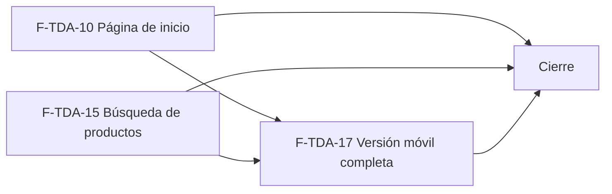

# Tasks: Tiendas online · Tienda inicio búsqueda móvil

**Input**: `specs/20261024-120000-tienda-inicio-busqueda-movil/` (spec.md, plan.md, contracts/tienda-inicio-busqueda.md)

**Formato**: `- [ ] T### [P] [F-TDA-xx][USy] descripción`. **[P]** = paralelizable (archivos distintos, sin dependencia; las [P] del mismo grupo van en paralelo); sin [P] = secuencial. Las dependencias de cada tarea son solo dentro de su historia. Regla del proyecto: ninguna tarea queda `[ ]` al cierre — se hace con evidencia o se cierra con `[x]` + `Desvío:` y seguimiento trazado.

**Delivery scope**: `refine`, `supabase`

## Matriz de trazabilidad Jira ↔ US ↔ tasks

| Jira | Historia | FR / SC (dueño único) | Tasks |
|------|----------|-----------------------|-------|
| F-TDA-10 (clave Jira: la asigna el orquestador) | US1 Página de inicio | FR-001…FR-008, FR-060, SC-001, SC-002, SC-003 | T001–T007 |
| F-TDA-15 | US2 Búsqueda de productos | FR-020…FR-029, SC-004, SC-005, SC-006 | T020–T029 |
| F-TDA-17 | US3 Versión móvil completa | FR-040…FR-048, SC-007, SC-008, SC-009 | T040–T051 |
| Tarea de cierre (label cierre) | Documentación general, gates y roadmap | SC-010, SC-011, SC-012 | T070–T072 |

### Dueño único por requisito

| Requisito | Tarea dueña | | Requisito | Tarea dueña |
|---|---|---|---|---|
| FR-001 | T001 | | FR-023, FR-029 | T022 |
| FR-003 | T002 | | FR-024 | T023 |
| FR-004, FR-005 | T003 | | FR-025 | T024 |
| FR-002, FR-006, FR-007 | T004 | | FR-026, FR-027, FR-028 | T025 |
| FR-008, FR-060, SC-001 | T005 | | SC-004 | T026 |
| SC-002 | T006 | | SC-005 | T027 |
| SC-003 | T007 | | SC-006 | T028 |
| FR-020, FR-022 | T020 | | FR-040 | T040 |
| FR-021 | T021 | | FR-041 | T041 |
| FR-042 | T042 | | FR-045 | T043 |
| FR-043, FR-044 | T044 | | FR-048 | T045 |
| FR-047 | T046 | | FR-046 | T047 |
| SC-007 | T048 | | SC-008 | T049 |
| SC-009 | T050 | | SC-011 | T070 |
| SC-010 | T071 | | SC-012 | T072 |

(FR-029 —la restricción de seguridad de toda la búsqueda— tiene a T022 como única dueña; T021 la cumple por construcción y T026 la verifica.) Toda tarea declara los requisitos que implementa (**FR/SC**) o verifica (**Verifica**); la verificación de cada FR está en la tabla «Verificación por requisito» de la spec.

---

## Fase 1 — F-TDA-10 · Página de inicio (US1)

**Esquemas (Principio VII, re-verificado)**: sin tablas; `publico.destacados_por_dominio` → `publico` (función de lectura anónima).

- [ ] T001 [F-TDA-10][US1] Migración `supabase/migrations/20261202100000_tienda_destacados_publicos.sql`: `publico.destacados_por_dominio(host)` (`SECURITY DEFINER`, `stable`, `search_path = ''`, normaliza el host, filtra por `empresa.activa`, hasta 8 destacados efectivamente visibles vía `private.catalogo_tienda_efectivo`, `precio` = `private.precio_final_publico`, `disponible` = `private.disponible_publico`, `hay_productos`; mismo `null` para desconocido/desactivado; lista blanca); `revoke … from public, anon`, `grant execute … to anon, authenticated`; reversión en el encabezado. **FR-001**.
- [ ] T002 [P] [F-TDA-10][US1] `secciones/CategoriasInicio.tsx` (orden 40): bloque «Categorías» con una tarjeta por categoría visible (`useCategoriasTienda`), nombre y «N productos» (incluido «0 productos») que enlaza a `/categoria/:categoriaId`; se oculta cuando la tienda no tiene productos visibles. **FR-003**.
- [ ] T003 [P] [F-TDA-10][US1] `lib/tiendaInicio.ts` (cliente de `destacados_por_dominio` + hook) y `secciones/DestacadosInicio.tsx` (orden 50): bloque «Destacados» con `TarjetaProducto` (imagen o «Sin imagen», nombre, precio final, `EtiquetaDisponibilidad`) y enlace «Ver todo el catálogo →» a `/catalogo`; sin destacados no se muestra; **reemplaza** `secciones/ProductosTienda.tsx` y su test (que leían `precio_lista`). **FR-004, FR-005**.
- [ ] T004 [P] [F-TDA-10][US1] `secciones/EstadoPreparacion.tsx` y composición de la home: orden de secciones banner (20) → «Categorías» (40) → «Destacados» (50); tienda activa sin productos visibles → «Catálogo en preparación» en lugar de los bloques; estados de carga y error del kit por bloque (un bloque que falla no rompe el resto), texto escapado y un solo `h1`. **FR-002, FR-006, FR-007**.
- [ ] T005 [F-TDA-10][US1] pgTAP `supabase/tests/database/tienda_destacados_publicos.test.sql`: dos tiendas del seed, solo destacados visibles del host, tope de 8, precio final de la empresa (paridad con `precio_final_publico`), `disponible` booleano, `hay_productos`, `null` idéntico para desconocido/desactivado, lista blanca, `anon` ejecuta la función y `publico` sin tablas. **FR-008, FR-060, SC-001**. Verifica FR-001.
- [ ] T006 [F-TDA-10][US1] Vitest + axe de la home: banner reutilizado, categorías con «N productos» (y 0), destacados con precio y etiqueta, sin destacados, «Catálogo en preparación», bloque con error aislado. **SC-002**. Verifica FR-002…FR-007.
- [ ] T007 [F-TDA-10][US1] E2E `apps/web/e2e/tienda-inicio.e2e.ts` con las dos tiendas del seed a ancho de escritorio: cada home muestra solo sus categorías y destacados con el precio de su empresa, «Ver todo el catálogo →» lleva a `/catalogo`. **SC-003**. Verifica FR-003, FR-004, FR-005, FR-008, FR-060.

**Checkpoint F-TDA-10**: `pnpm test` (pgTAP + Vitest), `pnpm lint`, `pnpm build`.

---

## Fase 2 — F-TDA-15 · Búsqueda de productos (US2)

**Esquemas (re-verificado)**: tabla nueva `public.limite_pedidos_publicos` → **`public`** (control de abuso transversal; RLS activada, sin políticas ni grants); índice sobre `dominio.productos` → `dominio`; `private.normalizar_busqueda` / `private.registrar_pedido_publico` → `private`; `publico.sugerencias_busqueda_por_dominio` / `busqueda_pagina_por_dominio` → `publico` (funciones).

- [ ] T020 [F-TDA-15][US2] Migración `supabase/migrations/20261202110000_tienda_busqueda_base.sql`: `create extension if not exists unaccent with schema extensions` (verificada como `pg_trgm`), `private.normalizar_busqueda(text)` (`immutable`), índice GIN trigrama `productos_nombre_busqueda_trgm` sobre `dominio.productos`, tabla `public.limite_pedidos_publicos` (PK visitante+ventana, RLS activada, sin políticas, sin privilegios para `anon`/`authenticated`) y `private.registrar_pedido_publico(visitante, limite)` (`insert … on conflict do update` atómico, devuelve `{limitado, espera_segundos}`, purga ventanas de más de 10 minutos); constante única `LIMITE_BUSQUEDAS_POR_MINUTO = 30`; `revoke` a los roles de API; reversión en el encabezado. **FR-020, FR-022**.
- [ ] T021 [P] [F-TDA-15][US2] Migración `supabase/migrations/20261202110100_tienda_busqueda_sugerencias.sql`: `publico.sugerencias_busqueda_por_dominio(host, q)` (hasta 6 productos visibles; tildes, mayúsculas y errores de tipeo con `normalizar_busqueda` + similitud `pg_trgm`; mínimo 2 caracteres y recorte a 100; visitante = hash de `x-forwarded-for` + host, sin guardar la IP; llama a `registrar_pedido_publico`; precio final y `disponible`; mismo `null`; lista blanca; grants a `anon, authenticated`); reversión en el encabezado. **FR-021**.
- [ ] T022 [P] [F-TDA-15][US2] Migración `supabase/migrations/20261202110200_tienda_busqueda_resultados.sql`: `publico.busqueda_pagina_por_dominio(host, q, categoria, solo_con_stock, precio_max, orden, pagina)` con la misma forma y normalización que `catalogo_pagina_por_dominio` (reutiliza `precio_final_publico`, `disponible_publico`, `catalogo_tienda_efectivo`), «relevancia» por similitud, cuenta para el límite; texto literal (sin comodines), lista blanca y aislamiento por host; no modifica la función de MSF-167; reversión en el encabezado. **FR-023, FR-029**.
- [ ] T023 [F-TDA-15][US2] `lib/tiendaBusqueda.ts` (cliente RPC, normalización de `q`, constantes del mínimo y de la espera entre teclas) y `layout/BuscadorTienda.tsx` montado en `LayoutTienda`: campo «Buscar productos», sugerencias con imagen o «Sin imagen», nombre, precio y disponibilidad que enlazan a la ficha, hasta 6, descarte de respuestas viejas, *combobox* accesible (flechas, Enter, Esc, clic afuera), carga diferida. **FR-024**.
- [ ] T024 [F-TDA-15][US2] «Ver todos los resultados →» / Enter → `/catalogo?q=…`: `rutas/catalogo.tsx` y `secciones-catalogo/ListadoProductos.tsx` leen `q`, llaman a `busqueda_pagina_por_dominio`, título «Resultados para “<texto>”», migas «Inicio / Resultados», y reutilizan filtros, orden, paginación y tarjeta del catálogo; `q` se conserva al cambiar filtros y viaja en la URL compartible; `q` inválida se normaliza. **FR-025**.
- [ ] T025 [F-TDA-15][US2] Estados del buscador y de la página de resultados: «No encontramos productos con ese nombre.» en el desplegable (texto vacío no muestra nada), aviso de espera por límite anunciado a lector de pantalla y que se libera solo, y error de red/servidor con reintento en el desplegable. **FR-026, FR-027, FR-028**.
- [ ] T026 [F-TDA-15][US2] pgTAP `supabase/tests/database/tienda_busqueda_publica.test.sql`: sobre el seed, «cargdor» / «CARGADOR» / «cárgador» encuentran los cargadores; tope de 6; orden por relevancia; `%`, `_`, comillas y texto largo/vacío; aislamiento entre las dos tiendas; lista blanca; el límite permite 30, rechaza el 31 y vuelve en el minuto siguiente; `public.limite_pedidos_publicos` con RLS y sin privilegios para `anon`/`authenticated`; sin IP guardada. **SC-004**. Verifica FR-020, FR-021, FR-022, FR-023, FR-029.
- [ ] T027 [P] [F-TDA-15][US2] Vitest + axe del buscador y de la página de resultados: sugerencias, teclado, *combobox*, respuesta tardía descartada, sin coincidencias, aviso de espera, error de red, texto escapado, `q` en la URL y filtros que la conservan. **SC-005**. Verifica FR-024…FR-028.
- [ ] T028 [P] [F-TDA-15][US2] E2E `apps/web/e2e/tienda-busqueda.e2e.ts` con las dos tiendas del seed (ancho de escritorio): buscar con tilde, mayúsculas y error de tipeo, abrir una sugerencia, «Ver todos los resultados →» y URL compartible; nunca aparecen productos de la otra tienda. **SC-006**. Verifica FR-024, FR-025, FR-029, FR-060.
- [ ] T029 [F-TDA-15][US2] `docs/tienda-busqueda.md` (nuevo): cómo funciona la búsqueda (`unaccent` + `pg_trgm`), el límite por visitante y minuto (D1, D3), constantes únicas, reversión y qué ve el visitante; sin tocar `docs/tiendas-online.md` (lo consolida el cierre). Documentación obligatoria del cambio.

**Checkpoint F-TDA-15**: pgTAP + Vitest de la historia verdes; `pnpm lint`, `pnpm build`.

---

## Fase 3 — F-TDA-17 · Versión móvil completa (US3)

**Esquemas (re-verificado)**: sin tablas ni migraciones; solo front.

- [ ] T040 [P] [F-TDA-17][US3] `layout/MenuMovil.tsx` (carga diferida) y botón de menú en `layout/LayoutTienda.tsx` / `MenuCategorias.tsx` a anchos de celular: panel con «Inicio» y «Categorías» (categoría actual marcada), cierre por botón, Esc, tocar afuera o navegar; sin entrada «Contacto» (D10). **FR-040**.
- [ ] T041 [P] [F-TDA-17][US3] `catalogo/PanelFiltrosMovil.tsx` (carga diferida) y su uso en `secciones-catalogo/ListadoProductos.tsx`: botón «Filtrar» con la cantidad de filtros activos, panel «Filtros» con «Limpiar», Categoría, «Solo con stock», «Precio máximo» (D5) y Ordenar, botón «Ver N productos» que aplica y cierra; mismo estado en la URL que escritorio. **FR-041**.
- [ ] T042 [P] [F-TDA-17][US3] Ficha móvil en `ficha/*` y `rutas/producto.tsx`: una columna, galería con miniaturas táctiles, ampliación usable en pantalla chica, datos y compatibilidad legibles, enlace «← Todos los productos» arriba; sin WhatsApp. **FR-042**.
- [ ] T043 [F-TDA-17][US3] `ErrorConReintento.tsx` («No pudimos cargar esta página…» + «Reintentar», D8) y su uso en home, catálogo, categoría, resultados, ficha y menú de categorías ante fallo de red; «Reintentar» repite el pedido conservando URL y filtros y, al recuperarse, muestra la pantalla normal. **FR-045**.
- [ ] T044 [F-TDA-17][US3] Repaso responsivo de **todas** las pantallas públicas (home, catálogo, categoría, resultados, ficha, 404, «Volvemos pronto», encabezado, pie) a 360, 390, 412, 430, 768 y 1024 px: sin scroll horizontal, columnas de tarjetas por ancho, objetivos táctiles; buscador y desplegable de sugerencias adaptados al celular y conviviendo con el menú. **FR-043, FR-044**.
- [ ] T045 [F-TDA-17][US3] Accesibilidad móvil de menú y panel de filtros: foco atrapado y devuelto al botón que los abrió, estado expandido/cerrado y cantidad de filtros anunciados, sin pérdida de contenido con texto ampliado. **FR-048**.
- [ ] T046 [F-TDA-17][US3] Rendimiento móvil: carga diferida de menú y panel móviles, `loading="lazy"` en imágenes, sin pedidos redundantes por pantalla; ajustar lo que la medición (T050) marque. **FR-047**.
- [ ] T047 [F-TDA-17][US3] `docs/tienda-movil.md` (nuevo): tamaños verificados (360/390/412/430/768/1024), componentes móviles, estado de «Contacto» (no existe todavía: la comprobación móvil queda para MSF-212) y notas de contradicciones para el PR; sin tocar `docs/tiendas-online.md`. **FR-046**.
- [ ] T048 [P] [F-TDA-17][US3] Vitest + axe del menú móvil, del panel de filtros móvil, de la ficha móvil y de `ErrorConReintento` (foco, teclado, estado anunciado). **SC-007**. Verifica FR-040, FR-041, FR-042, FR-045, FR-048.
- [ ] T049 [P] [F-TDA-17][US3] E2E `apps/web/e2e/tienda-movil.e2e.ts` en 360, 390, 412 y 430 px y en 768 y 1024 px sobre las dos tiendas: home, catálogo (con panel de filtros), categoría, resultados, ficha, 404 y «Volvemos pronto» sin scroll horizontal; menú y filtros operables; error con reintento simulando la conexión caída. **SC-008**. Verifica FR-040…FR-045.
- [ ] T050 [F-TDA-17][US3] Medición de rendimiento en emulación móvil «4G lento» (D9): contenido principal de home, catálogo y ficha en menos de 3 s, con los valores anotados en `docs/tienda-movil.md`. **SC-009**. Verifica FR-047.
- [ ] T051 [F-TDA-17][US3] Regresión de escritorio: los E2E existentes de las dos tiendas (`tienda-categorias`, `tienda-catalogo`, `tienda-ficha`, `tienda-inicio`, `tienda-busqueda`) siguen verdes a ancho de escritorio con la versión móvil activa (la épica pide E2E en escritorio **y** celular). Verifica FR-043.

**Checkpoint F-TDA-17**: `pnpm test`, `pnpm lint`, `pnpm build` y el E2E de móvil/escritorio verdes.

---

## Fase 4 — Cierre `[CIERRE]`

Trabajo real que ninguna historia atiende; lo ejecuta la **Tarea de cierre** (label `cierre`).

- [ ] T070 [CIERRE] Actualizar `docs/tiendas-online.md` con la home, la búsqueda y la versión móvil (enlazando a `docs/tienda-busqueda.md` y `docs/tienda-movil.md`) y las contradicciones prototipo↔épica para el PR. **SC-011**.
- [ ] T071 [CIERRE] Correr y registrar `pnpm lint`, `pnpm build`, `pnpm infra:config`, `pnpm test`, `pnpm prototipo:check`, `pnpm matriz:check` y `pnpm docs:check`; revisión de seguridad de la tabla `public.limite_pedidos_publicos`, de los grants de `anon` y del hash de visitante. **SC-010**.
- [ ] T072 [CIERRE] Al cerrar el PR (merge commit, sin squash), actualizar la fila de MSF-191 en `docs/roadmap-template.md` (estado, link a esta spec; paso manual con criterio). **SC-012**.

---

## Plan de ejecución (historias)

| Historia | Depende de | Grupo |
|---|---|---|
| F-TDA-10 | — | 1 |
| F-TDA-15 | — | 1 |
| F-TDA-17 | F-TDA-10, F-TDA-15 | 2 |
| [Cierre] | F-TDA-10, F-TDA-15, F-TDA-17 | 3 |

F-TDA-10 y F-TDA-15 son independientes (home y secciones vs. buscador, resultados y migraciones de búsqueda: no comparten archivos, tabla ni migración) y van en paralelo. F-TDA-17 espera a ambas porque adapta a móvil la home, el buscador y los resultados y toca `LayoutTienda` / `ListadoProductos`, que F-TDA-15 modifica antes.

