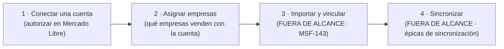
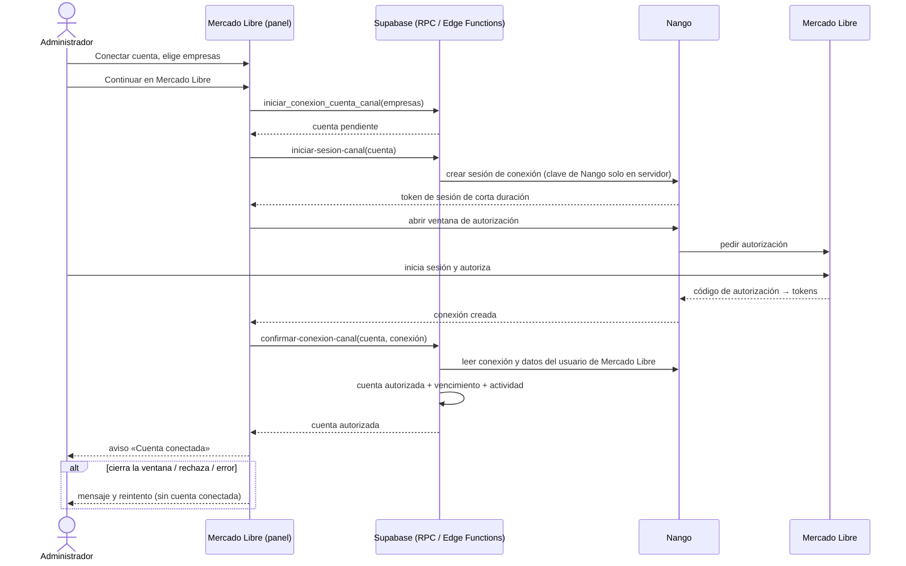
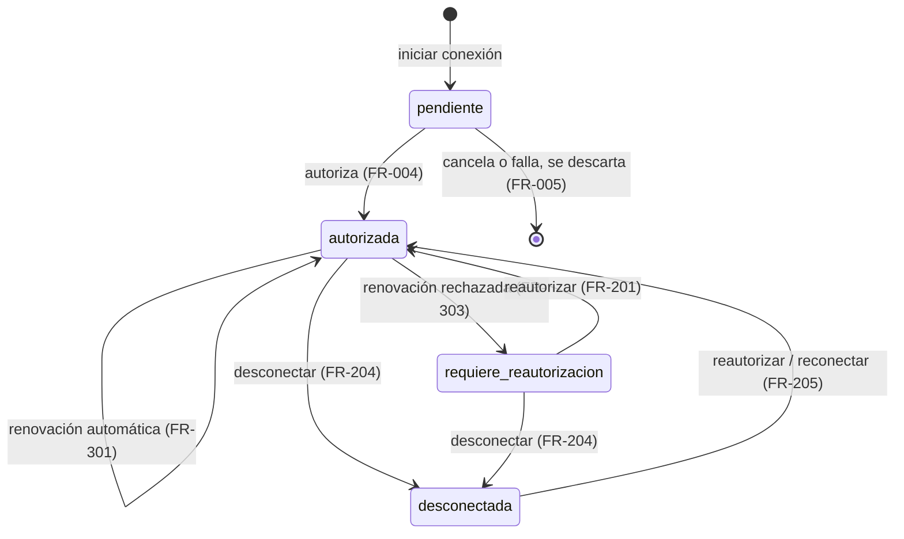
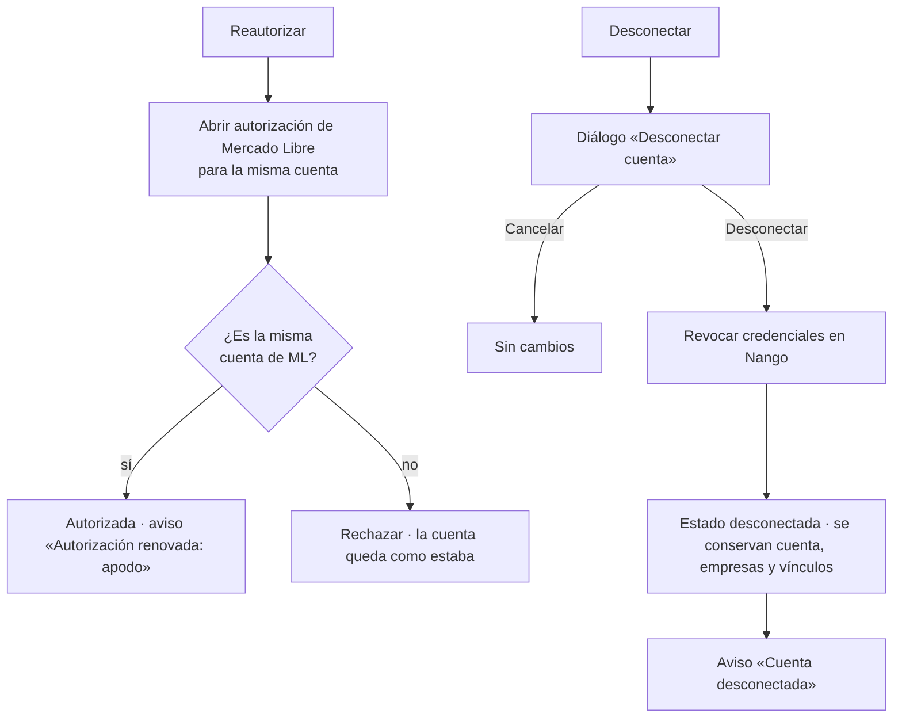
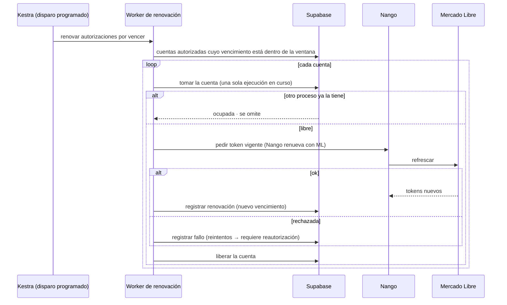

# Feature Specification: Mercado Libre · Ml conexión de cuentas

**Feature Branch**: `epic/MSF-129-mercado-libre-ml-conexion-de-cuentas`

**Componente**: Mercado Libre

**Jira Epic**: MSF-129 — Mercado Libre · Ml conexión de cuentas (spec `ml-conexion-de-cuentas`)

**Historias Jira**: F-MLC-01 «Conectar una cuenta de Mercado Libre» (P1, M) · F-MLC-02 «Listado de cuentas y estado» (P1, M) · F-MLC-03 «Reautorizar y desconectar» (P1, S) · F-MLC-04 «Renovación automática de la autorización» (P1, S) · F-MLC-05 «Cuenta de Mercado Libre para una o varias empresas» (P1, M)

**Created**: 2026-10-24

**Status**: Draft — lista para planificar. La especificación viene completa desde Jira. Los puntos de «A revisar» se resolvieron con un default razonable (ver *Decisiones*); ninguno bloquea, todos esperan el OK de Nicolás.

**Delivery scope**: `refine` (`apps/web`), `supabase` (migraciones, RPC, Edge Functions y pgTAP), `kestra` (flow programado de renovación) y `workers` (worker de renovación, único lugar con la clave de Nango). Sin `superset`.

**Prioridad / Hito**: P1 · Etapa 2 (desde enero de 2027, después de rentabilidad completa, reportes e inicio con alertas) · ~25 h (el relevamiento estimaba 37; se restan 12 h porque el template ya trae la conexión OAuth con Nango y el bloqueo por conexión).

**Input**: Epic MSF-129. Objetivo: «Al terminar, el administrador conecta una o varias cuentas de Mercado Libre por OAuth, decide qué empresas atiende cada una, ve su estado de autorización, puede reautorizar o desconectar, y el sistema renueva solo las credenciales sin que dos procesos lo hagan a la vez.»

## Regla de fuentes (literal de la épica)

1. Comportamiento y datos: mandan los requisitos y escenarios de esta historia.
2. Qué se ve (disposición, textos, estados, popups, flujos): el prototipo validado es referencia visual, no hace falta que quede extremadamente idéntico; los flujos (si hay) aclaran estados y acciones.
3. Cómo se construye (componentes, estilos y patrones): mandan el template y el system design del producto (épica Plataforma · Sistema de diseño, MSF-117). No copiar el HTML ni el CSS del prototipo: reproducir lo que muestra con los componentes del template y los tokens del sistema de diseño.
4. El prototipo muestra más que esta historia: implementar solo lo que piden los requisitos de esta historia; otras secciones, botones o diálogos son de otras historias.
5. Si algo no se puede igualar con el template / el sistema de diseño: usar lo más cercano, sin inventar, y anotar la diferencia en la descripción del PR.
6. Si el prototipo y los requisitos se contradicen: requisitos para el comportamiento, prototipo para lo visual, y dejar la contradicción anotada en el PR.

## Dependencias y supuestos

| Dependencia | Estado en esta rama | ¿Bloquea? |
|---|---|---|
| MSF-138 · Empresas (`dominio.empresas`, F-EMP-01) | Presente (`dominio.depositos_empresas` y otras ya la referencian) | No: se usa como FK de `cuenta_canal_empresas`. |
| MSF-125 · Usuarios y roles (`private.nivel_seccion`, sección `mercado_libre` en la matriz) | Presente (`20261013130002_roles_basicos_permisos.sql` siembra `mercado_libre`: solo Administrador con edición) | No. |
| Plataforma F-AUD-01 · `public.registro_actividad` / `private.registrar_actividad(tipo, detalle, empresa_id)` | Presente (`20261016120000_registro_actividad.sql`) | No: el punto de «A revisar» sobre la épica faltante queda resuelto, ver D8. |
| Conexiones OAuth de plataforma (Nango self-hosted, `integraciones_oauth`, `conexiones_oauth`, Edge Function `iniciar-sesion-oauth`, `providers/nango`) | Presente (template) | No: se reutiliza el mecanismo, no el esquema (ver D1). |
| MSF-156 · Inicio y alertas / MSF-189 · Avisos y listas configurables | No verificadas | No: relacionadas, sin bloqueo. El formato del aviso de F-MLC-04 queda pendiente (ver D7). |
| MSF-143 · Ml importación y listado de publicaciones | **Bloqueada por esta épica** | — (esta épica expone las cuentas conectadas). |

Supuestos de la épica (literales):

- El cliente crea la aplicación en el portal de desarrolladores de Mercado Libre y entrega el identificador y la clave, que se configuran en Nango (T). Nunca en Git ni en el navegador.
- La aprobación de permisos de la aplicación por parte de Mercado Libre puede demorar: se pide antes de empezar la etapa.
- Una cuenta puede servir a una, varias o todas las empresas y una empresa puede usar más de una cuenta.
- **El template ya trae:** Nango self-hosted, tablas `integraciones_oauth` y `conexiones_oauth` con RLS, Edge Function `iniciar-sesion-oauth`, páginas `conexiones-oauth/list` e `integraciones-oauth/administrar`, ejecuciones programadas (disparo programado de Kestra), la regla de una sola ejecución en curso por conexión y el panel de funcionalidades por organización (`private.tiene_feature`). El catálogo de integraciones viene vacío: no hay integración ni conector de Mercado Libre.
- **El template no trae y hay que extender:** `private.nivel_seccion('mercado_libre')` y los roles de negocio (ya presentes, ver tabla), la relación cuenta–empresas y el estado de autorización por cuenta.

## Esquemas y datos (Principio VII)

Estado actual verificado en migraciones y en el grafo (`graphify-out/graph.json` confirma las páginas y la UI OAuth del template; tablas y RPC se confirmaron contra las migraciones): `public.integraciones_oauth` y `public.conexiones_oauth` (con `unique (organizacion_id, integracion_id)`, es decir **una** conexión por organización e integración), `dominio.empresas`, `public.registro_actividad`. **No existe** ninguna tabla de cuentas de canal: se propone la migración.

| Objeto | Esquema | Justificación | Cambio |
|---|---|---|---|
| `dominio.cuentas_canal` (canal `mercado_libre`, `nango_connection_id`, usuario y apodo de Mercado Libre, estado de autorización, vencimiento, última renovación) | `dominio` | Cuenta de venta de un canal: entidad de negocio del producto (la épica la llama `cuentas_canal`), no plataforma genérica. RLS por organización. | Tabla nueva (F-MLC-01). |
| `dominio.cuenta_canal_empresas` (`cuenta_canal_id`, `empresa_id`, `organizacion_id`) | `dominio` | Relación cuenta–empresas, igual que `dominio.depositos_empresas`. RLS por organización; trigger de misma organización. | Tabla nueva (F-MLC-01); la edición posterior es de F-MLC-05. |
| `public.integraciones_oauth`, fila `mercado_libre` | `public` | Catálogo genérico de plataforma; el alta usa `registrar_integracion_oauth` (superadmin), sin migración de esquema. | Dato, no esquema (F-MLC-01). |
| `dominio.bloqueos_renovacion` | `dominio` | **Condicional** (D2): solo si la verificación de Nango (F-MLC-04) muestra que no renueva solo y la regla de ejecución única del template no cubre la cuenta. | Migración aditiva solo si hace falta. |
| RPC `iniciar_conexion_cuenta_canal`, `listar_cuentas_canal`, `desconectar_cuenta_canal`, `asignar_empresas_cuenta_canal`, `registrar_renovacion_cuenta_canal`, más `confirmar_conexion_cuenta_canal` (solo Edge Function) | `public` (API), lógica sobre `dominio` | Contratos en `contracts/ml-conexion-de-cuentas.md`. | Nuevas. |
| Edge Functions `iniciar-sesion-canal`, `confirmar-conexion-canal` | — | Sesión de conexión y confirmación server-side (el navegador nunca ve secretos ni decide la identidad de la cuenta). | Nuevas (F-MLC-01). |

`conexiones_oauth` **no se modifica** (D1). Reversión (documentada también en cada migración): `drop function` de las RPC nuevas; en migración posterior `drop table dominio.cuenta_canal_empresas` y `drop table dominio.cuentas_canal` (exportar antes los datos); retirar la fila `mercado_libre` con `actualizar_integracion_oauth(id, false)` (deshabilitar, no borrar). Nada se destruye en el mismo PR que lo crea.

## Navegación y patrones del panel (Principio VI)

- **Ubicación**: ítem «Mercado Libre» en el grupo **Canales** del menú lateral, **después de Empresas** (el grupo ya existe en `destinosPanel.ts`; se agrega el ítem sin duplicar el grupo). Icono: «link» (el del prototipo, `AdminSider.dc.html`; en MUI `Link`). Audiencia: solo Administrador (`audiencia: 'administrador'`, sección `mercado_libre`). Nota de Nicolás (2026-10-13) aplicada.
- **Rutas canónicas**: `/mercado-libre` (cuentas) y, en la ficha de empresa, la pestaña «Mercado Libre» (`/empresas/:id/mercado-libre`). No hay rutas anteriores que mantener.
- **Encendido**: la sección se enciende por organización con el panel de funcionalidades (`private.tiene_feature`), funcionalidad `mercado_libre` (ver `docs/registrar-funcionalidad-desde-migracion.md`).
- **Estados**: cargando, vacío (pantalla «sin cuentas conectadas»), error y éxito (snackbar) con los patrones compartidos (`EstadosPagina`, `EncabezadoPagina`, `ContenedorSeccion`); teclado, lector de pantalla y 320/768/1440 px; la tabla usa `ContenidoAdaptable` (tarjetas en angosto). Sin identificadores técnicos como identidad: el nombre visible de la cuenta es el apodo de Mercado Libre; el «Usuario <número>» del prototipo es dato secundario de la celda.
- **Carga diferida**: la pantalla no agrega peso fuera del recorrido principal; `@nangohq/frontend` ya se carga en el template (`providers/nango`).

## User Scenarios & Testing *(mandatory)*

### US1 — Conectar una cuenta de Mercado Libre (F-MLC-01, P1)

El administrador entra a «Mercado Libre», ve qué se va a solicitar, elige qué empresas venden con la cuenta, autoriza en Mercado Libre y la cuenta queda conectada.

**Escenarios de aceptación**
1. **Given** una organización sin cuentas, **When** el administrador abre «Mercado Libre», **Then** ve «Todavía no hay cuentas conectadas.», los cuatro pasos (Conectar una cuenta, Asignar empresas, Importar y vincular, Sincronizar), «Qué se solicita» y el botón «Conectar primera cuenta».
2. **Given** esa pantalla, **When** pulsa «Conectar primera cuenta», **Then** se abre «Conectar cuenta de Mercado Libre» con la pregunta «¿Qué empresas venden con esta cuenta?» y una casilla por empresa; «Continuar en Mercado Libre» está deshabilitado hasta marcar al menos una.
3. **Given** dos o más empresas marcadas, **Then** aparece la nota «Cuenta compartida: al vincular cada publicación vas a elegir a qué empresa pertenece, y usa el precio y las reglas de esa empresa.»
4. **Given** una selección válida, **When** pulsa «Continuar en Mercado Libre», **Then** se abre la ventana de Mercado Libre y la pantalla muestra «Esperando la autorización en Mercado Libre… Iniciá sesión con la cuenta que querés conectar en la ventana que se abrió.» con «Cancelar».
5. **Given** que autoriza, **Then** la cuenta aparece como «Autorizada» con su apodo y las empresas elegidas, y un aviso confirma «Cuenta conectada».
6. **Given** que cierra la ventana, cancela, o Mercado Libre rechaza la autorización, **Then** no queda cuenta conectada, se ve un mensaje claro y puede reintentar.
7. **Given** que conecta una cuenta de Mercado Libre que ya estaba conectada, **Then** no se duplica: se reutiliza la misma cuenta y se actualiza su autorización.
8. **Given** un usuario sin permiso de edición sobre `mercado_libre` (o una organización con la funcionalidad apagada), **Then** no ve la sección ni puede llamar a las RPC (`42501`).

### US2 — Listado de cuentas y estado (F-MLC-02, P1)

**Escenarios de aceptación**
1. **Given** una o más cuentas, **When** abre «Mercado Libre», **Then** ve «Cuentas conectadas, publicaciones y sincronización de stock y precio.» y la tarjeta «Cuentas de Mercado Libre» con «Cada cuenta se autoriza por separado. Una cuenta puede servir a una o a las dos empresas.» y el botón «Conectar cuenta».
2. **Then** cada fila muestra Cuenta (apodo + «Usuario <número>»), Empresa, Autorización, Publicaciones, Sincronización, Último envío y las acciones «Reautorizar» y «Desconectar».
3. **Given** una cuenta autorizada con vencimiento próximo, **Then** su Autorización dice «Vence en N días» con el tono de advertencia; **Given** una cuenta que necesita volver a autorizar, **Then** dice «Requiere reautorización» con el tono de error.
4. **Given** una cuenta recién conectada, **Then** Publicaciones muestra «0», Sincronización «Sin publicaciones» y Último envío «—» (los datos reales llegan con otras épicas).
5. **Then** la tarjeta «Alcance de la integración» lista lo que el sistema hace y lo que todavía no hace.
6. **Given** una organización A y otra B, **Then** cada una ve solo sus cuentas.

### US3 — Reautorizar y desconectar (F-MLC-03, P1)

**Escenarios de aceptación**
1. **Given** una cuenta, **When** pulsa «Reautorizar» y autoriza con la misma cuenta de Mercado Libre, **Then** vuelve a «Autorizada» y un aviso dice «Autorización renovada: <apodo>».
2. **Given** que en la ventana inicia sesión con **otra** cuenta de Mercado Libre, **Then** se rechaza y la cuenta original queda como estaba.
3. **When** pulsa «Desconectar», **Then** se pide confirmación («Desconectar cuenta»: «Se deja de enviar stock y precio a sus publicaciones y de recibir sus ventas. Los vínculos se conservan para cuando vuelvas a conectarla.») con «Cancelar» y «Desconectar».
4. **When** confirma, **Then** la cuenta queda «Desconectada», se revocan sus credenciales, se conservan la cuenta, sus empresas y sus vínculos, y un aviso dice «Cuenta desconectada».
5. **Given** una cuenta desconectada, **When** pulsa «Reautorizar», **Then** vuelve a conectarse con la misma fila.

### US4 — Renovación automática de la autorización (F-MLC-04, P1)

**Escenarios de aceptación**
1. **Given** una cuenta autorizada que se acerca a su vencimiento, **When** corre el flow programado, **Then** la autorización se renueva sin intervención y el vencimiento se actualiza.
2. **Given** que dos procesos intentan renovar la misma cuenta a la vez, **Then** solo uno lo hace; el otro espera o se descarta sin renovar de nuevo.
3. **Given** que Mercado Libre rechaza la renovación (autorización revocada o vencida), **Then**, agotados los reintentos, la cuenta pasa a «Requiere reautorización», queda en la actividad y el administrador la ve en el listado.
4. **Given** una cuenta que no se pudo renovar y vence en pocos días, **Then** el listado muestra «Vence en N días».
5. **Then** ningún token, secreto ni respuesta cruda de Mercado Libre queda en logs, actividad ni base de datos.

### US5 — Cuenta de Mercado Libre para una o varias empresas (F-MLC-05, P1)

**Escenarios de aceptación**
1. **Given** una cuenta asignada a Mundo JC, **When** el administrador abre la ficha de Mundo JC → «Mercado Libre», **Then** ve «Cuentas que usa Mundo JC» con cada cuenta, su estado de autorización y un interruptor.
2. **When** activa o desactiva el interruptor de una cuenta, **Then** la asignación cambia para esa empresa y se registra en la actividad.
3. **Given** una cuenta con una sola empresa, **When** intenta quitarla, **Then** se rechaza con un mensaje (toda cuenta conectada atiende al menos una empresa).
4. **Given** una cuenta asignada a las dos empresas y una empresa con dos cuentas, **Then** ambas relaciones son válidas y se ven en el listado y en la ficha.
5. **Then** «Administrar cuentas →» lleva a `/mercado-libre`.
6. **Given** que cambia a la otra empresa («Cambiar a San Javucho ↔»), **Then** la pestaña recarga las cuentas de esa empresa y no muestra interruptores de la anterior.

### Casos límite

- Doble clic en «Continuar en Mercado Libre»: una sola sesión de conexión.
- Ventana bloqueada por el navegador: mensaje con instrucción y reintento.
- Cuenta `pendiente` abandonada: se descarta y no aparece en el listado.
- Empresa dada de baja con cuentas asignadas: la baja de empresas no es de esta épica; la cuenta conserva sus otras empresas y, si quedara sin ninguna, el listado lo señala sin romperse.
- Nango caído: error con reintento; no se pierde ninguna cuenta ya conectada.

## Flujos

### Flujo 1 — Asistente de conexión (F-MLC-01)

Los cuatro pasos del asistente vienen del relevamiento y del prototipo: Conectar → Asignar empresas → Importar y vincular → Sincronizar. Esta épica entrega los pasos 1 y 2; el 3 y el 4 son de otras épicas.

| Paso | Dueño |
|---|---|
| 1 · Conectar una cuenta | FR-003, FR-004 |
| 2 · Asignar empresas | FR-002 (elegir al conectar), FR-401…FR-405 (editar después) |
| 3 · Importar y vincular | FUERA DE ALCANCE: lo entrega MSF-143 (bloqueada por esta épica). |
| 4 · Sincronizar | FUERA DE ALCANCE: lo entregan las épicas de sincronización de stock y precio. |

### Flujo 2 — Conexión por OAuth (F-MLC-01)

| Paso | Dueño |
|---|---|
| Elegir empresas, «Continuar» | FR-002 |
| Cuenta `pendiente`, sesión server-side, ventana y espera con «Cancelar» | FR-003 |
| Confirmación server-side, cuenta autorizada, aviso | FR-004 |
| Cierre, rechazo o error | FR-005 |
| Misma cuenta de Mercado Libre | FR-006 |
| Actividad | FR-008 |

### Flujo 3 — Estado de autorización de una cuenta (F-MLC-02, F-MLC-03, F-MLC-04)

«Vence en N días» no es un estado guardado: es la presentación de una cuenta autorizada cuyo vencimiento está dentro del umbral (D3).

| Estado / transición | Presentación (FR-103) | Dueño |
|---|---|---|
| `pendiente` | No se lista | FR-003, FR-005 |
| `autorizada` | «Autorizada»; con vencimiento dentro del umbral, «Vence en N días» | FR-103 |
| `requiere_reautorizacion` | «Requiere reautorización» | FR-103, FR-303 |
| `desconectada` | «Desconectada» | FR-103, FR-204 |

### Flujo 4 — Reautorizar y desconectar (F-MLC-03)

| Paso | Dueño |
|---|---|
| Reautorizar, misma cuenta, aviso | FR-201 |
| Cuenta distinta rechazada | FR-202 |
| Diálogo de desconexión, «Cancelar» sin cambios | FR-203 |
| Revocar, conservar, aviso | FR-204 |
| Reautorizar una cuenta desconectada | FR-205 |

### Flujo 5 — Renovación automática (F-MLC-04)

| Paso | Dueño |
|---|---|
| Disparo programado y selección de cuentas por vencer | FR-301 |
| Una sola renovación a la vez por cuenta | FR-302 |
| Fallo → reintentos → «Requiere reautorización» | FR-303 |
| Registro y aviso en el listado | FR-304 |
| Sin secretos en logs ni datos | FR-305 |
| Verificación de qué hace Nango al pedir el token | FR-306 |

## Requirements *(mandatory)*

### Functional Requirements — F-MLC-01 · Conectar una cuenta (US1)

- **FR-001**: Cuando la organización no tiene cuentas conectadas, «Mercado Libre» DEBE mostrar la pantalla «sin cuentas conectadas»: título, «Todavía no hay cuentas conectadas.», la tarjeta «Conectar Mercado Libre» con los cuatro pasos (con su texto), la tarjeta «Qué se solicita» (permisos que sí se piden y los que no) y el botón «Conectar primera cuenta».
- **FR-002**: El diálogo «Conectar cuenta de Mercado Libre» DEBE preguntar «¿Qué empresas venden con esta cuenta?» con `SelectorEmpresas` (una casilla por empresa de la organización), mostrar la nota de cuenta compartida cuando haya dos o más empresas marcadas, el texto «Se va a abrir Mercado Libre para iniciar sesión con la cuenta y autorizar el acceso.», «Cancelar» y «Continuar en Mercado Libre» (deshabilitado sin al menos una empresa).
- **FR-003**: «Continuar en Mercado Libre» DEBE crear la cuenta en estado `pendiente` con sus empresas, pedir al servidor una sesión de conexión de corta duración (Edge Function `iniciar-sesion-canal`; la clave de Nango nunca llega al navegador) y abrir la ventana de autorización de Mercado Libre. Mientras espera DEBE mostrar «Esperando la autorización en Mercado Libre… Iniciá sesión con la cuenta que querés conectar en la ventana que se abrió.» con «Cancelar». Un doble clic no abre dos sesiones.
- **FR-004**: Al completarse la autorización, el servidor (Edge Function `confirmar-conexion-canal`) DEBE leer la conexión en Nango y la identidad de la cuenta en Mercado Libre (id de usuario y apodo; el navegador no los informa), guardar el `nango_connection_id`, el vencimiento y pasar la cuenta a `autorizada`, y la pantalla DEBE mostrar el aviso «Cuenta conectada».
- **FR-005**: Si el usuario cancela, cierra la ventana o Mercado Libre/Nango rechazan o fallan, NO DEBE quedar una cuenta usable: la cuenta `pendiente` se descarta, se muestra un mensaje claro y se puede reintentar. Las cuentas `pendiente` abandonadas se limpian.
- **FR-006**: Conectar una cuenta de Mercado Libre ya conectada en la organización (mismo id de usuario) DEBE reutilizar su fila (idempotencia, Principio III): `unique (organizacion_id, canal, usuario_externo_id)`; no se duplica ni se pisan las empresas ya asignadas salvo que se elijan otras en el diálogo (D9).
- **FR-007**: `dominio.cuentas_canal` y `dominio.cuenta_canal_empresas` DEBEN tener RLS por organización: lectura con nivel `lectura`/`edicion` en `mercado_libre`, sin escritura directa para `authenticated` (solo RPC `security definer`); trigger que exige empresa y cuenta de la misma organización. Todas las RPC DEBEN llevar `revoke ... from public, anon` y `grant ... to authenticated` explícito, y exigir `edicion` en `mercado_libre` para escribir (`42501` si no).
- **FR-008**: Conectar una cuenta DEBE registrar la actividad `mercado_libre.cuenta_conectada` (actor, apodo, empresas) mediante `private.registrar_actividad`.
- **FR-009**: El ítem «Mercado Libre» DEBE aparecer en Canales, después de Empresas, solo para el Administrador, con ruta `/mercado-libre` y la funcionalidad `mercado_libre` encendible por organización (`private.tiene_feature`).
- **FR-010**: La integración `mercado_libre` DEBE quedar registrada en `integraciones_oauth` (vía `registrar_integracion_oauth`, superadmin) con el proveedor correspondiente en Nango; el identificador y la clave de la aplicación se configuran en Nango y nunca se guardan en Git, base de datos de negocio ni navegador (`.env.example` solo con nombres de variables).

### Functional Requirements — F-MLC-02 · Listado de cuentas y estado (US2)

- **FR-101**: Con al menos una cuenta (no `pendiente`), «Mercado Libre» DEBE mostrar el título, el subtítulo «Cuentas conectadas, publicaciones y sincronización de stock y precio.», la tarjeta «Cuentas de Mercado Libre» con su texto de ayuda y el botón «Conectar cuenta» (abre el diálogo de FR-002).
- **FR-102**: La tabla DEBE mostrar las columnas Cuenta (apodo y «Usuario <número>»), Empresa (las empresas asignadas, separadas por «y»/comas), Autorización, Publicaciones, Sincronización, Último envío y una columna de acciones sin título (FR-201 y FR-203 aportan los botones).
- **FR-103**: La columna Autorización DEBE mostrar un chip según el estado: «Autorizada» (verde), «Vence en N días» (advertencia; cuenta autorizada con vencimiento dentro del umbral de D3), «Requiere reautorización» (error) y «Desconectada» (neutro).
- **FR-104**: Las columnas Publicaciones, Sincronización y Último envío DEBEN mostrar los valores de cuenta sin datos del prototipo («0», «Sin publicaciones», «—») hasta que otras épicas les den fuente; esta épica no define esa fuente.
- **FR-105**: La pantalla DEBE incluir la tarjeta informativa «Alcance de la integración» con «El sistema hace» (Importar publicaciones y vincularlas con productos; Recibir las ventas y descontar el stock compartido; Enviar stock y precio de las publicaciones vinculadas; Detectar cambios hechos directamente en Mercado Libre) y «Todavía no hace» (Crear o pausar publicaciones; Editar títulos, fotos o ficha técnica; Responder preguntas o gestionar pedidos y envíos), como texto fijo.
- **FR-106**: El listado DEBE tener estados de carga y error con reintento (el vacío es FR-001), mostrar acciones solo con nivel `edicion`, ser accesible por teclado y adaptarse a 320/768/1440 px. Una organización nunca ve cuentas de otra (se verifica con pgTAP).
- **FR-107**: `listar_cuentas_canal()` DEBE devolver las cuentas de la organización con sus empresas y el estado de autorización, sin ningún token ni secreto.

### Functional Requirements — F-MLC-03 · Reautorizar y desconectar (US3)

- **FR-201**: «Reautorizar» DEBE abrir la autorización de Mercado Libre para la misma fila de cuenta (reutiliza `iniciar-sesion-canal`), y al confirmarse DEBE dejarla `autorizada`, actualizar el vencimiento y mostrar «Autorización renovada: <apodo>».
- **FR-202**: Si en la reautorización inicia sesión otra cuenta de Mercado Libre (id de usuario distinto), `confirmar-conexion-canal` DEBE rechazar, dejar la cuenta como estaba y mostrar un mensaje claro.
- **FR-203**: «Desconectar» DEBE pedir confirmación con el diálogo «Desconectar cuenta» (texto y botones «Cancelar» / «Desconectar» del prototipo; «Desconectar» con estilo destructivo); «Cancelar» no cambia nada.
- **FR-204**: Confirmada la desconexión, `desconectar_cuenta_canal` DEBE revocar la conexión en Nango, pasar la cuenta a `desconectada` y **conservar** la fila de cuenta, sus empresas y cualquier vínculo; mostrar «Cuenta desconectada»; y registrar `mercado_libre.cuenta_desconectada`. Los consumidores (sincronización, ventas) DEBEN tratar como inactivas las cuentas que no estén `autorizada`.
- **FR-205**: «Reautorizar» sobre una cuenta `desconectada` o `requiere_reautorizacion` DEBE reconectarla sobre la misma fila y registrar `mercado_libre.cuenta_reautorizada`.
- **FR-206**: Reautorizar y desconectar DEBEN exigir nivel `edicion`, no ser accionables dos veces en paralelo (doble clic) y mostrar error con reintento.

### Functional Requirements — F-MLC-04 · Renovación automática (US4)

- **FR-301**: Un flow programado de Kestra DEBE disparar un worker que renueve la autorización de cada cuenta `autorizada` cuyo vencimiento esté dentro de la ventana de renovación, pidiendo el token vigente a Nango (que renueva con Mercado Libre) y registrando el nuevo vencimiento (`registrar_renovacion_cuenta_canal`). Es idempotente: reintentarlo no duplica efectos.
- **FR-302**: Nunca DEBEN renovar a la vez dos procesos la misma cuenta: se reutiliza la regla de una sola ejecución en curso por conexión del template; si esa regla no cubre `cuentas_canal`, se agrega `dominio.bloqueos_renovacion` (D2). Un test de concurrencia lo demuestra.
- **FR-303**: Si la renovación es rechazada, tras los reintentos configurados la cuenta DEBE pasar a `requiere_reautorizacion` y registrarse `mercado_libre.autorizacion_fallida` con un motivo sanitizado.
- **FR-304**: Una renovación exitosa DEBE registrar `mercado_libre.autorizacion_renovada`; el listado DEBE reflejar el estado y el «Vence en N días» (FR-103) como aviso al administrador. Las alertas en Inicio y los avisos por correo quedan fuera de alcance (D7).
- **FR-305**: Ningún token, secreto ni respuesta cruda de Nango/Mercado Libre DEBE quedar en logs, actividad, evidencia ni base de datos; la clave de Nango vive solo en el worker (`NANGO_SECRET_KEY_<entorno>`).
- **FR-306**: Antes de implementar el worker DEBE verificarse y documentarse (sin suponer): (a) que Nango tiene proveedor de Mercado Libre o hay que definir uno personalizado, (b) si Nango renueva solo el token al pedirlo y cuál es el vencimiento que expone. El resultado decide D2 y queda en `docs/`.

### Functional Requirements — F-MLC-05 · Una o varias empresas (US5)

- **FR-401**: El modelo DEBE permitir que una cuenta atienda a una, varias o todas las empresas y que una empresa use más de una cuenta (relación N:M en `dominio.cuenta_canal_empresas`).
- **FR-402**: La pestaña «Mercado Libre» de la ficha de empresa DEBE mostrar la tarjeta «Cuentas que usa <empresa>» con, por cuenta, apodo, texto secundario, chip de autorización e interruptor de asignación; el texto «Una cuenta puede servir a las dos empresas. En ese caso, cada publicación se asigna a una sola empresa al vincularla.» y el enlace «Administrar cuentas →» a `/mercado-libre`.
- **FR-403**: Cambiar el interruptor DEBE invocar `asignar_empresas_cuenta_canal` y aplicarse al instante (D5), con aviso de éxito o error; DEBE rechazar dejar una cuenta conectada sin ninguna empresa y empresas de otra organización, y registrar `mercado_libre.empresas_asignadas`.
- **FR-404**: La pestaña toma la empresa de la ficha (no de otro estado): al cambiar de empresa recarga sus cuentas y descarta interruptores de la anterior (Principio VIII).
- **FR-405**: La asignación DEBE ser coherente en ambos sentidos: lo que el listado muestra en «Empresa» coincide con lo que cada ficha muestra activado.

## Decisiones (traducción de «A revisar»; ninguna bloquea)

| ID | Punto de «A revisar» | Default adoptado | Impacto si Nicolás lo cambia |
|---|---|---|---|
| D1 | ¿`cuentas_canal` referencia `conexiones_oauth` o guarda su `nango_connection_id`? | **Guarda el suyo.** `conexiones_oauth` tiene `unique (organizacion_id, integracion_id)`: no admite varias cuentas de Mercado Libre por organización. No se toca el esquema del template. | Referenciarla exigiría quitar esa unicidad (cambio al contrato del template). |
| D2 | ¿Nango renueva solo? ¿Hace falta `bloqueos_renovacion`? | **No se crea** salvo que FR-306 muestre que Nango no renueva solo y la regla de ejecución única del template no cubre la cuenta; entonces, migración aditiva. | Si hace falta, suma una tabla `dominio` y su pgTAP (misma historia). |
| D3 | Umbral de «Vence en N días» | **7 días** (el prototipo muestra 5 como ejemplo). | Solo una constante. |
| D4 | Qué pasa con una cuenta desconectada | **Sigue en el listado** como «Desconectada» (el prototipo dice «los vínculos se conservan para cuando vuelvas a conectarla»); se reconecta con «Reautorizar». | Ocultarla cambia FR-103/FR-205. |
| D5 | ¿La asignación en la ficha usa «Guardar»? | **Se aplica al instante** (el «Guardar» del prototipo pertenece a las reglas de precio y stock, fuera de esta épica). | Con «Guardar» habría que compartir estado con esas reglas. |
| D6 | Texto del aviso al conectar | «Cuenta conectada» (el prototipo agrega «· importando publicaciones»; la importación es de MSF-143). | El sufijo se suma cuando exista la importación. |
| D7 | Formato de alertas en Inicio y avisos por correo | **Fuera de alcance**: F-MLC-04 avisa en el listado y en la actividad. Se enlaza con MSF-156/MSF-189 cuando confirmen el formato. | Sumaría una integración con esas épicas. |
| D8 | `registro_actividad` (épica faltante) y sección `mercado_libre` | **Ya existen** en el repo (`20261016120000`, `20261013130002`); se usan. El Operador no ve Mercado Libre (matriz actual: solo Administrador). | Dar acceso al Operador es un cambio de la matriz, no de esta épica. |
| D9 | Identidad de la cuenta | Una cuenta de Mercado Libre = un id de usuario; conectar la misma dos veces reutiliza la fila. | — |

Preguntas abiertas con el cliente (no bloquean): cuántas cuentas existen hoy y a qué empresas sirve cada una.

## Success Criteria

- **SC-001**: Con el proveedor de Nango simulado en las pruebas, el administrador conecta dos cuentas, cada una con distintas empresas, y ambas aparecen «Autorizadas» en el listado con sus empresas (F-MLC-02).
- **SC-002**: pgTAP del cierre: otra organización no lee ni escribe cuentas ni asignaciones; `anon` no ejecuta ninguna RPC nueva; sin nivel `edicion` las RPC devuelven `42501`; `rls_en_toda_tabla` y `aislamiento_organizaciones` pasan con las tablas nuevas.
- **SC-003**: Dos renovaciones simultáneas de la misma cuenta producen una sola renovación efectiva (F-MLC-04).
- **SC-004**: Desconectar y reconectar conserva la fila, las empresas y los vínculos; una cuenta desconectada no figura como activa para los consumidores (F-MLC-03).
- **SC-005**: Una cuenta con las dos empresas y una empresa con dos cuentas se ven coherentes en listado y ficha (F-MLC-05).
- **SC-006**: `pnpm lint`, `pnpm build`, `pnpm infra:config`, `pnpm test`, `pnpm docs:check`, `pnpm prototipo:check` y `pnpm matriz:check` en verde; ningún secreto en Git (cierre).

## Matriz pantalla↔criterios

Inventarios deterministas (`pnpm prototipo:inventario`, `.inventory.json`) de `MLConexion`, `MLCuenta`, `StoreML` y `SJ_StoreML`. Lo que la épica no pide **no es deuda**: lo entregan o lo pedirán otras épicas. Las pantallas `MLPublicaciones`, `MLSincronizacion`, `MLImportaciones` y `MLVincular` no son de esta épica.

### `MLConexion.dc.html` — Mercado Libre · sin cuentas conectadas

| Ítem del inventario / visible | Destino | Criterio / motivo |
|---|---|---|
| Botón `Conectar primera cuenta` | En alcance | FR-001, FR-002 |
| Título, subtítulo «Todavía no hay cuentas conectadas.», tarjetas «Conectar Mercado Libre» (4 pasos) y «Qué se solicita» | En alcance | FR-001 |
| Migas «Canales / Mercado Libre» y menú lateral | En alcance | FR-009 |

### `MLCuenta.dc.html` — Mercado Libre · cuentas (varias)

| Ítem del inventario / visible | Destino | Criterio / motivo |
|---|---|---|
| Tabla columnas `Cuenta`, `Empresa`, `Autorización` | En alcance | FR-102, FR-103 |
| Columnas `Publicaciones`, `Sincronización`, `Último envío` | En alcance (valores sin datos) | FR-102, FR-104; la fuente de datos es de otras épicas |
| Columna de acciones (sin título) | En alcance | FR-102, FR-201, FR-203 |
| Botón `Conectar cuenta` | En alcance | FR-101 |
| Botón `Reautorizar` | En alcance | FR-201, FR-202, FR-205 |
| Botón `Desconectar` y diálogo `Desconectar cuenta` (`Cancelar`, `Desconectar`) | En alcance | FR-203, FR-204 |
| Diálogo `Conectar cuenta de Mercado Libre`; casillas `San Javucho`, `Mundo JC` (una por empresa, `SelectorEmpresas`); botones `Cancelar`, `Continuar en Mercado Libre` | En alcance | FR-002 |
| Banner «Esperando la autorización en Mercado Libre…» y su `Cancelar` | En alcance | FR-003 |
| Botón `Simular autorización` | Fuera de alcance | Ayuda de demostración del prototipo; la autorización real es OAuth (FR-003, FR-004). |
| Botón `Ver pantalla de conexión` y texto «Así se ve la sección cuando todavía no hay ninguna cuenta conectada:» | Fuera de alcance | Atajo de demostración; la pantalla vacía se muestra sola cuando no hay cuentas (FR-001). |
| Tarjeta `Alcance de la integración` | En alcance | FR-105 |
| Subtítulo y tarjeta «Cuentas de Mercado Libre» | En alcance | FR-101 |
| Avisos «Cuenta conectada», «Autorización renovada: <apodo>», «Cuenta desconectada» | En alcance | FR-004, FR-201, FR-204 (D6) |
| Botón `Importar publicaciones` y banner «Importando publicaciones… N de 127» con `Cancelar` | Fuera de alcance | Importación de publicaciones: MSF-143 (bloqueada por esta épica). |
| Tabs `Cuentas`, `Publicaciones`, `Sincronización`, `Importaciones` | `Cuentas`: en alcance (es esta pantalla); resto fuera de alcance | Las otras pestañas son de las épicas de publicaciones, sincronización e importaciones; no se muestran hasta que existan. |
| Sufijo «· importando publicaciones» del aviso al conectar | Fuera de alcance | D6; llega con MSF-143. |
| Estado «Importando…» de la celda Sincronización de una cuenta nueva | Fuera de alcance | Depende de la importación (MSF-143); acá se muestra «Sin publicaciones». |

### `StoreML.dc.html` y `SJ_StoreML.dc.html` — Empresa · Mercado Libre

| Ítem del inventario / visible | Destino | Criterio / motivo |
|---|---|---|
| Tarjeta «Cuentas que usa <empresa>» (cuenta, subtítulo, chip, interruptor) | En alcance | FR-402, FR-403 |
| Texto «Una cuenta puede servir a las dos empresas…» y botón `Administrar cuentas →` | En alcance | FR-402 |
| Pestaña `Mercado Libre` | En alcance (solo la tarjeta de cuentas) | FR-402, FR-404 |
| Botón `Cambiar a San Javucho ↔` / `Cambiar a Mundo JC ↔` | En alcance (ya existe en la ficha; la pestaña debe respetarlo) | FR-404 |
| Botones `Empresas`, `Ver tienda`; tabs `General`, `Precios y moneda`, `Identidad visual`, `Contenido`, `Catálogo visible`, `Dominio y publicación`; cabecera «mundojc.com.ar · Publicada» | Fuera de alcance | Ficha de empresa ya entregada o de otras épicas (MSF-138 y las de tienda); esta épica solo agrega el contenido de la pestaña Mercado Libre. |
| Campos `Recargo sobre el precio de la empresa`, `Margen mínimo`, botones `Automático` / `Con revisión` («Envío de cambios de precio») | Fuera de alcance | Reglas de precio en Mercado Libre: épica de precios/sincronización, no pedidas aquí. |
| Campos `Stock que se publica`, `Stock de seguridad`, interruptor «Enviar stock automáticamente», nota de Full | Fuera de alcance | Reglas de stock en Mercado Libre: épica de sincronización. |
| Tarjeta «Ejemplo con un producto» y su cálculo | Fuera de alcance | Simulador de reglas de precio y stock: misma épica. |
| Botón `Guardar` | Fuera de alcance | Guarda las reglas de precio y stock; la asignación de cuentas se aplica al instante (D5). |

### Empresa activa (Principio VIII)

| Fila | Destino | Motivo |
|---|---|---|
| Empresa activa | **Listado `/mercado-libre`: no aplica. Pestaña de la ficha: se rige por la empresa de la ficha** | Las cuentas son de la organización y una cuenta sirve a varias empresas; el prototipo no muestra selector ni filtro de empresa en el listado (solo la columna «Empresa»), por eso el listado no se filtra por la barra superior y hay un test que verifica que no consulta por empresa activa. La pestaña «Mercado Libre» de la ficha toma la empresa de la ficha, no del selector, y hay un test que cambia de empresa con «Cambiar a …» (FR-404). El diálogo «Conectar cuenta» ofrece todas las empresas de la organización, con `SelectorEmpresas`. |

## Matriz de trazabilidad Jira ↔ US ↔ FR/SC ↔ tareas

| Jira | Historia | FR / SC | Tareas |
|------|----------|---------|--------|
| F-MLC-01 | US1 Conectar una cuenta | FR-001…010 | T001–T014 |
| F-MLC-02 | US2 Listado y estado | FR-101…107, SC-001 | T015–T022 |
| F-MLC-03 | US3 Reautorizar y desconectar | FR-201…206, SC-004 | T023–T030 |
| F-MLC-04 | US4 Renovación automática | FR-301…306, SC-003 | T031–T040 |
| F-MLC-05 | US5 Una o varias empresas | FR-401…405, SC-005 | T041–T048 |
| Tarea de cierre (label `cierre`) | Docs, seguridad y roadmap | SC-002, SC-006 | T049–T052 |

SC-002 (aislamiento y permisos) tiene dueño único en el cierre, que ejecuta la suma de pgTAP de todas las historias; cada historia trae además su propio pgTAP de lo que crea.

## Verificación por requisito

| Requisito | Verificación |
|---|---|
| FR-001…FR-003, FR-101…FR-106, FR-201…FR-203, FR-402…FR-404 | Vitest de pantalla (textos, estados, cambio de empresa, rol sin edición) |
| FR-004…FR-008, FR-107, FR-204…FR-206, FR-403, FR-405 | pgTAP (RLS, `42501`, `anon`, idempotencia, conservación) |
| FR-009 | Vitest de `SiderPanel`/`destinosPanel` + migración de la funcionalidad |
| FR-010, FR-306 | Revisión de configuración (`pnpm infra:config`, `.env.example`) y documento de verificación de Nango |
| FR-301…FR-305 | Vitest/Node del worker + pgTAP de concurrencia + revisión de logs |
