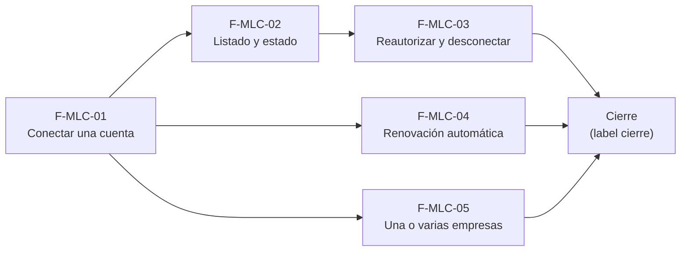

# Tasks: Mercado Libre · Ml conexión de cuentas

**Input**: `specs/20261024-130000-ml-conexion-de-cuentas/` (spec.md, plan.md, contracts/)

**Formato**: `- [ ] T### [P] [STORY-x][USy] descripción`. **[P]** = paralelizable (archivos distintos, sin dependencia; las [P] del mismo grupo van en paralelo); sin [P] = secuencial. Las dependencias de cada historia son solo dentro de esa historia; el orden entre historias lo da el *Plan de ejecución* del final.

**Delivery scope**: `refine`, `supabase`, `kestra`, `workers`

## Matriz de trazabilidad Jira ↔ US ↔ tasks

| Jira | Historia | FR / SC | Tasks |
|------|----------|---------|-------|
| F-MLC-01 | US1 Conectar una cuenta | FR-001…010 | T001–T014 |
| F-MLC-02 | US2 Listado y estado | FR-101…107, SC-001 | T015–T022 |
| F-MLC-03 | US3 Reautorizar y desconectar | FR-201…206, SC-004 | T023–T030 |
| F-MLC-04 | US4 Renovación automática | FR-301…306, SC-003 | T031–T040 |
| F-MLC-05 | US5 Una o varias empresas | FR-401…405, SC-005 | T041–T048 |
| Tarea de cierre (label `cierre`) | Docs, seguridad y roadmap | SC-002, SC-006 | T049–T052 |

## Phase 1: F-MLC-01 · Conectar una cuenta (US1)

**Goal**: el administrador conecta una cuenta de Mercado Libre por OAuth, eligiendo qué empresas la usan.

- [ ] T001 [F-MLC-01][US1] Migración `…_cuentas_canal_tablas.sql` (esquema `dominio`): `dominio.cuentas_canal` (canal, `nango_connection_id`, `usuario_externo_id`, apodo, estado `pendiente|autorizada|requiere_reautorizacion|desconectada`, `vence_en`, `ultima_renovacion_en`, `unique (organizacion_id, canal, usuario_externo_id)`) y `dominio.cuenta_canal_empresas` (PK cuenta+empresa, trigger de misma organización como `validar_deposito_empresa`); RLS solo lectura por nivel `lectura`/`edicion` en `mercado_libre`; reversión documentada (FR-006, FR-007)
- [ ] T002 [F-MLC-01][US1] Migración `…_cuentas_canal_conexion.sql`: `iniciar_conexion_cuenta_canal` y `confirmar_conexion_cuenta_canal` (idempotente por usuario de Mercado Libre, descarta la `pendiente`, `revoke ... from public, anon`, `grant ... to authenticated` salvo la de confirmación que es solo de servicio), limpieza de `pendiente` abandonadas y actividad `mercado_libre.cuenta_conectada` vía `private.registrar_actividad` (FR-005, FR-006, FR-008)
- [ ] T003 [P] [F-MLC-01][US1] pgTAP `cuentas_canal_conexion.test.sql`: cuenta con 2 empresas; misma cuenta de ML dos veces → una fila; empresa de otra organización → `22023`; sin `edicion` → `42501`; otra organización no ve cuentas; `anon` sin ejecución; `rls_en_toda_tabla` con las tablas nuevas; escritura directa rechazada (FR-006, FR-007)
- [ ] T004 [F-MLC-01][US1] Edge Function `supabase/functions/iniciar-sesion-canal/` (patrón de `iniciar-sesion-oauth`): autentica como el usuario, verifica que la cuenta es de su organización y devuelve el token de sesión de corta duración generado con la clave de Nango del servidor (FR-003)
- [ ] T005 [F-MLC-01][US1] Edge Function `supabase/functions/confirmar-conexion-canal/`: tras `nango.auth`, lee la conexión en Nango y el usuario/apodo de Mercado Libre, calcula el vencimiento y llama a `confirmar_conexion_cuenta_canal`; errores sanitizados, sin tokens en respuestas ni logs (FR-004, FR-005)
- [ ] T006 [F-MLC-01][US1] Alta de la integración `mercado_libre` (`registrar_integracion_oauth`, superadmin) y configuración del proveedor en Nango documentadas; variables nuevas solo como nombres en `.env.example`, sin secretos (FR-010)
- [ ] T007 [F-MLC-01][US1] Migración `…_funcionalidad_mercado_libre.sql`: registrar la funcionalidad `mercado_libre` por organización según `docs/registrar-funcionalidad-desde-migracion.md` (FR-009)
- [ ] T008 [F-MLC-01][US1] `pages/mercado-libre/index.tsx`: pantalla «sin cuentas conectadas» (título, subtítulo, «Conectar Mercado Libre» con 4 pasos, «Qué se solicita», «Conectar primera cuenta»), estados cargando/error con los patrones compartidos (FR-001)
- [ ] T009 [F-MLC-01][US1] Diálogo «Conectar cuenta de Mercado Libre» con `SelectorEmpresas`, nota de cuenta compartida con 2+ empresas, texto de apertura, «Cancelar» y «Continuar en Mercado Libre» deshabilitado sin empresa (FR-002)
- [ ] T010 [F-MLC-01][US1] Flujo de conexión en el cliente: crear cuenta `pendiente`, pedir sesión, abrir la ventana con `providers/nango`, banner «Esperando la autorización…» con «Cancelar», confirmar, aviso «Cuenta conectada», manejo de cierre/rechazo/ventana bloqueada con reintento y doble clic protegido (FR-003, FR-004, FR-005)
- [ ] T011 [F-MLC-01][US1] Ruta `/mercado-libre` en `App.tsx` protegida por sección `mercado_libre` y funcionalidad, e ítem «Mercado Libre» (icono `Link`) en el grupo `canales` de `destinosPanel.ts` **después de Empresas**, audiencia `administrador` y `seccionPermiso: 'mercado_libre'`, sin duplicar el grupo (FR-009)
- [ ] T012 [P] [F-MLC-01][US1] Vitest `mercado-libre/index.test.tsx`: pantalla vacía con textos, diálogo (botón deshabilitado, nota con 2 empresas), espera y cancelación, éxito, rechazo con reintento, rol sin edición (FR-001, FR-002, FR-003, FR-004, FR-005)
- [ ] T013 [P] [F-MLC-01][US1] Vitest de navegación (`SiderPanel.test.tsx`/`destinosPanel.permisos.test.ts`): «Mercado Libre» en Canales tras Empresas para el Administrador y oculto al miembro (FR-009)
- [ ] T014 [P] [F-MLC-01][US1] Test de las Edge Functions con Nango simulado: sesión solo para el dueño, confirmación obtiene identidad del servidor y no del cuerpo, ningún secreto en la respuesta (FR-003, FR-004, FR-010)

**Checkpoint**: `pnpm test:db`, Vitest y `pnpm lint` de la historia en verde.

## Phase 2: F-MLC-02 · Listado de cuentas y estado (US2)

**Goal**: ver todas las cuentas con su estado de autorización.

- [ ] T015 [F-MLC-02][US2] Migración `…_cuentas_canal_listar.sql`: `listar_cuentas_canal()` (cuentas no `pendiente` de la organización con empresas y estado, sin secretos, `revoke ... from public, anon`, `grant ... to authenticated`) (FR-107)
- [ ] T016 [P] [F-MLC-02][US2] pgTAP `cuentas_canal_listar.test.sql`: devuelve solo las de la organización, excluye `pendiente`, nivel `lectura` puede listar, `anon` sin ejecución, sin columnas de credencial (FR-106, FR-107)
- [ ] T017 [F-MLC-02][US2] Listado en `pages/mercado-libre/`: título, subtítulo, tarjeta «Cuentas de Mercado Libre» con su ayuda y botón «Conectar cuenta» que abre el diálogo existente (FR-101)
- [ ] T018 [F-MLC-02][US2] Tabla con columnas Cuenta (apodo + «Usuario N»), Empresa, Autorización, Publicaciones, Sincronización, Último envío y columna de acciones sin título, con `ContenidoAdaptable` (FR-102)
- [ ] T019 [F-MLC-02][US2] Chips de Autorización: «Autorizada», «Vence en N días» (umbral 7 días en una constante), «Requiere reautorización», «Desconectada» (FR-103)
- [ ] T020 [F-MLC-02][US2] Valores sin datos de Publicaciones/Sincronización/Último envío («0», «Sin publicaciones», «—») y tarjeta estática «Alcance de la integración» (FR-104, FR-105)
- [ ] T021 [F-MLC-02][US2] Estados cargando/error con reintento, acciones solo con nivel `edicion`, teclado y 320/768/1440 px; la pantalla alterna con el vacío de F-MLC-01 según haya cuentas (FR-106)
- [ ] T022 [P] [F-MLC-02][US2] Vitest `mercado-libre/listado.test.tsx`: dos cuentas con empresas y chips (incluye «Vence en 5 días» y «Requiere reautorización»), cuenta nueva con valores vacíos, tarjeta de alcance, rol lectura sin acciones, no consulta por empresa activa, y el escenario de SC-001 con Nango simulado: dos cuentas conectadas con distintas empresas quedan «Autorizadas» (SC-001, FR-101…FR-106)

**Checkpoint**: Vitest y pgTAP de la historia en verde.

## Phase 3: F-MLC-03 · Reautorizar y desconectar (US3)

**Goal**: renovar la autorización a mano y desconectar con confirmación, sin perder lo vinculado.

- [ ] T023 [F-MLC-03][US3] Migración `…_cuentas_canal_desconectar.sql`: `desconectar_cuenta_canal` (pasa a `desconectada`, conserva fila y empresas, `edicion`, actividad `mercado_libre.cuenta_desconectada`, `revoke ... from public, anon`) y actividad `mercado_libre.cuenta_reautorizada` en la reconexión (FR-204, FR-205)
- [ ] T024 [F-MLC-03][US3] Edge Function `desconectar-cuenta-canal`: revoca la conexión en Nango y llama a la RPC; si Nango falla, la cuenta no cambia de estado y se informa con reintento (FR-204, FR-206)
- [ ] T025 [F-MLC-03][US3] Regla de misma cuenta en `confirmar-conexion-canal`: si el usuario de Mercado Libre devuelto difiere del de la cuenta existente, rechaza y la deja como estaba (FR-202)
- [ ] T026 [P] [F-MLC-03][US3] pgTAP `cuentas_canal_desconectar.test.sql`: desconectar conserva fila y empresas, estado `desconectada`, reconectar reutiliza la fila, sin `edicion` → `42501`, `anon` sin ejecución, otra organización no puede desconectar, consumidores solo ven `autorizada` como activa (SC-004, FR-204, FR-205, FR-206)
- [ ] T027 [F-MLC-03][US3] Acción «Reautorizar» en cada fila (también para `desconectada` y `requiere_reautorizacion`): abre la autorización de la misma cuenta, aviso «Autorización renovada: <apodo>», error claro si es otra cuenta de Mercado Libre (FR-201, FR-202, FR-205)
- [ ] T028 [F-MLC-03][US3] Acción «Desconectar» y diálogo «Desconectar cuenta» (texto del prototipo, «Cancelar» sin cambios, «Desconectar» destructivo), aviso «Cuenta desconectada» (FR-203, FR-204)
- [ ] T029 [F-MLC-03][US3] Protección de doble clic, deshabilitado en curso y error con reintento en ambas acciones; ocultas sin `edicion` (FR-206)
- [ ] T030 [P] [F-MLC-03][US3] Vitest `mercado-libre/acciones.test.tsx`: reautorizar OK, otra cuenta rechazada, desconectar con cancelar y con confirmar, cuenta desconectada con «Reautorizar», doble clic, rol lectura (FR-201…FR-206)

**Checkpoint**: Vitest y pgTAP de la historia en verde.

## Phase 4: F-MLC-04 · Renovación automática de la autorización (US4)

**Goal**: el sistema renueva solo las credenciales, de a una cuenta por vez, y avisa si no puede.

- [ ] T031 [F-MLC-04][US4] Verificación documentada de Nango en `docs/mercado-libre-nango.md`: ¿existe el proveedor de Mercado Libre o se define uno personalizado?, ¿renueva solo el token al pedirlo?, ¿qué vencimiento expone? Con esto se cierra D2 (¿hace falta `bloqueos_renovacion`?) y se elige qué vencimiento muestra el listado (FR-306)
- [ ] T032 [F-MLC-04][US4] Migración `…_cuentas_canal_renovacion.sql`: `registrar_renovacion_cuenta_canal` (solo rol de orquestación/worker; `renovada` actualiza vencimiento, `rechazada` cuenta intentos y tras el máximo deja `requiere_reautorizacion`; actividad `mercado_libre.autorizacion_renovada` / `autorizacion_fallida` con motivo sanitizado); si T031 lo exige, también `dominio.bloqueos_renovacion` aditiva con su reversión, si no, queda la nota de que no hace falta (FR-302, FR-303, FR-304)
- [ ] T033 [P] [F-MLC-04][US4] pgTAP `cuentas_canal_renovacion.test.sql`: `renovada` actualiza `vence_en`; N `rechazada` → `requiere_reautorizacion`; usuarios `authenticated` y `anon` no pueden ejecutarla; el motivo no admite ni guarda tokens; actividad registrada (FR-303, FR-304, FR-305)
- [ ] T034 [F-MLC-04][US4] Worker `workers/renovar-autorizacion-ml/` (según `workers/CONTRATO.md`): selecciona cuentas `autorizada` dentro de la ventana de renovación, toma cada cuenta con la regla de una sola ejecución en curso, pide el token vigente a Nango, registra el resultado, libera; idempotente y con reintentos acotados (FR-301, FR-302)
- [ ] T035 [F-MLC-04][US4] Sanitización: ningún token, secreto ni respuesta cruda en logs, evidencia, actividad ni DB; la clave `NANGO_SECRET_KEY_<entorno>` solo en el worker y nombres en `.env.example` (FR-305)
- [ ] T036 [F-MLC-04][US4] Flow `infra/kestra/flows/renovar-autorizacion-ml.yml` con disparo programado que despacha el worker; `pnpm infra:config` verde (FR-301)
- [ ] T037 [P] [F-MLC-04][US4] Test de concurrencia: dos ejecuciones simultáneas sobre la misma cuenta producen una sola renovación efectiva y la otra se omite (SC-003, FR-302)
- [ ] T038 [P] [F-MLC-04][US4] Test del worker con Nango simulado: renovación ok, rechazo con reintentos hasta `requiere_reautorizacion`, cuenta ocupada omitida, reejecución sin duplicar efectos, ningún secreto en la salida (FR-301, FR-303, FR-305)
- [ ] T039 [F-MLC-04][US4] Aviso visible: el listado ya muestra el estado y «Vence en N días» desde la base; dejar documentado en `docs/mercado-libre-nango.md` que las alertas de Inicio y el correo quedan fuera (D7) y cubrir que una cuenta con renovación fallida y vencimiento próximo se presenta así (FR-304)
- [ ] T040 [P] [F-MLC-04][US4] Vitest del caso de presentación: cuenta `autorizada` con vencimiento a 5 días → «Vence en 5 días»; `requiere_reautorizacion` → chip de error (FR-304)

**Checkpoint**: tests del worker, pgTAP y `pnpm infra:config` en verde.

## Phase 5: F-MLC-05 · Cuenta para una o varias empresas (US5)

**Goal**: decidir y ver qué empresas atiende cada cuenta, y qué cuentas usa cada empresa.

- [ ] T041 [F-MLC-05][US5] Migración `…_cuentas_canal_asignar_empresas.sql`: `asignar_empresas_cuenta_canal` (reemplaza el conjunto, rechaza vacío en cuenta conectada y empresas de otra organización, `edicion`, actividad `mercado_libre.empresas_asignadas`, `revoke ... from public, anon`, `grant ... to authenticated`) (FR-401, FR-403)
- [ ] T042 [P] [F-MLC-05][US5] pgTAP `cuentas_canal_asignar.test.sql`: una cuenta con las dos empresas y una empresa con dos cuentas; quitar la última empresa → rechazo; empresa de otra organización → rechazo; `42501` sin `edicion`; `anon` sin ejecución (SC-005, FR-401, FR-403)
- [ ] T043 [F-MLC-05][US5] Pestaña «Mercado Libre» en `PestanasEmpresa.tsx` y ruta `/empresas/:id/mercado-libre` protegida por sección `mercado_libre` (FR-402)
- [ ] T044 [F-MLC-05][US5] Tarjeta «Cuentas que usa <empresa>»: por cuenta apodo, subtítulo, chip de autorización e interruptor; texto «Una cuenta puede servir a las dos empresas…» y enlace «Administrar cuentas →» a `/mercado-libre` (FR-402)
- [ ] T045 [F-MLC-05][US5] Interruptor conectado a `asignar_empresas_cuenta_canal`: aplicación inmediata, aviso de éxito/error, rechazo con mensaje al quitar la última empresa (FR-403)
- [ ] T046 [F-MLC-05][US5] La pestaña toma la empresa de la ficha: al usar «Cambiar a …» recarga las cuentas, cierra operaciones en curso y no deja interruptores de la empresa anterior (FR-404)
- [ ] T047 [F-MLC-05][US5] Coherencia en ambos sentidos: la asignación leída por la ficha y por `listar_cuentas_canal` es la misma fuente (FR-405)
- [ ] T048 [P] [F-MLC-05][US5] Vitest `empresas/mercado-libre.test.tsx`: tarjeta con textos, alternar interruptor, rechazo de la última empresa, cambio de empresa recarga y no arrastra estado, enlace «Administrar cuentas →» (FR-402…FR-405, SC-005)

**Checkpoint**: Vitest y pgTAP de la historia en verde.

## Phase 6: Cierre (docs, seguridad y roadmap)

- [ ] T049 [CIERRE] Guía `docs/mercado-libre-conexion-de-cuentas.md` (flujo, estados, permisos, variables de Nango, reversión) y actualizar `docs/adoptar-conexiones-oauth.md` §5 (mapeo del producto); `pnpm docs:check` verde (SC-006)
- [ ] T050 [CIERRE] Revisión de seguridad: `rls_en_toda_tabla` y `aislamiento_organizaciones` verdes con las tablas `dominio` nuevas, ninguna RPC nueva ejecutable por `anon`, revisión de autorización de las RPC y Edge Functions, ningún secreto en Git (SC-002, SC-006)
- [ ] T051 [CIERRE] Validaciones finales: `pnpm lint`, `pnpm build`, `pnpm infra:config`, `pnpm test`, `pnpm prototipo:check` y `pnpm matriz:check` (SC-006)
- [ ] T052 [CIERRE] Roadmap: fila de esta spec en `docs/roadmap-template.md` (estado, link a la spec) como paso manual del cierre (SC-006)

**Checkpoint**: sin tareas `[ ]`; toda tarea hecha con evidencia o cerrada con `Desvío:` y seguimiento trazado.

## Plan de ejecución (historias)

| Historia | Depende de | Grupo |
|----------|------------|-------|
| F-MLC-01 | — | 1 |
| F-MLC-02 | F-MLC-01 | 2 |
| F-MLC-04 | F-MLC-01 | 2 |
| F-MLC-05 | F-MLC-01 | 2 |
| F-MLC-03 | F-MLC-01, F-MLC-02 | 3 |
| [Cierre] | F-MLC-01, F-MLC-02, F-MLC-03, F-MLC-04, F-MLC-05 | 4 |

