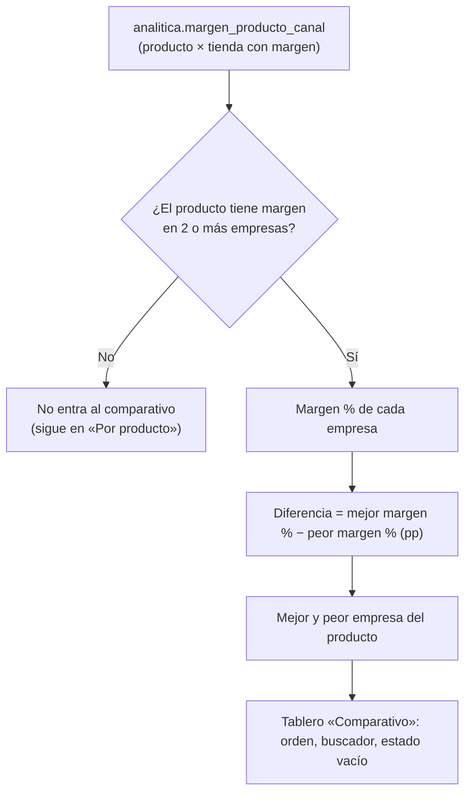
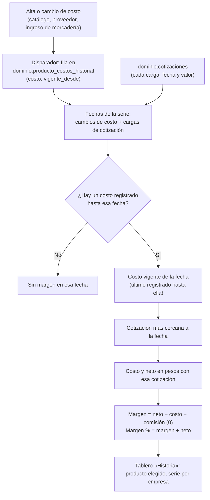
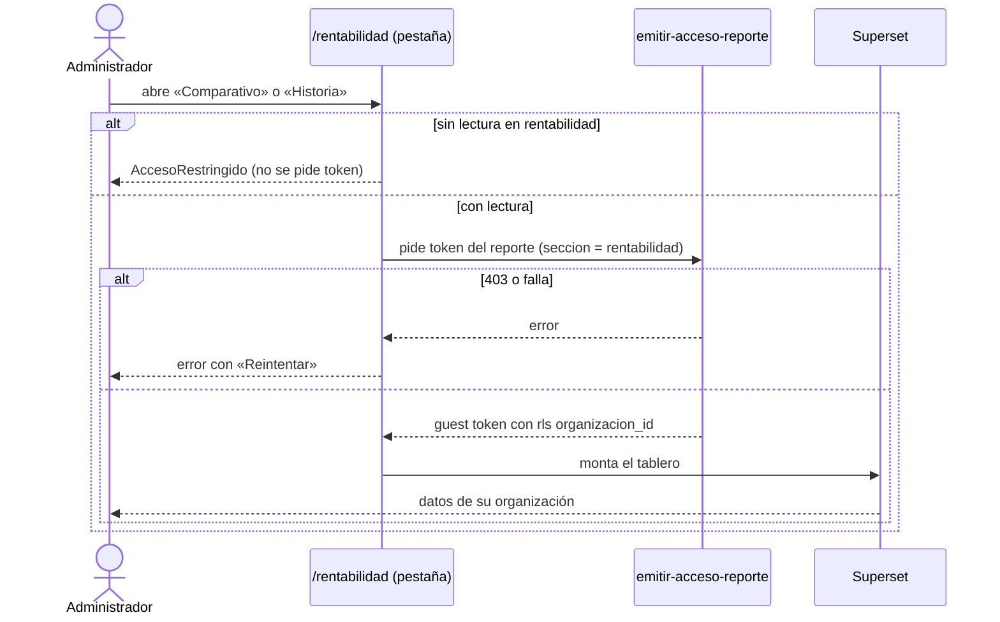

# Feature Specification: Inicio, rentabilidad y reportes · Rentabilidad comparativos e historia

**Épica**: MSF-127 · **Spec**: `rentabilidad-comparativos-e-historia` · **Hito**: Etapa 2 (desde enero de 2027; primer bloque, junto con reportes e inicio) · **Prioridad**: P1 · **Alcance (Jira)**: etapa-2 · **Horas aprox.**: 18
**Alcance de entrega**: `refine`, `supabase`, `superset` (sin `kestra` ni `workers`: el cálculo es SQL y los tableros los sirve Superset, igual que MSF-120).
**Fuente**: especificación de Nicolás cargada en la épica (Jira) y artefactos del producto. Esta spec **traduce**; no agrega alcance. Se apoya en lo ya entregado por MSF-120 (`rentabilidad-margen`).

## Objetivo

Al terminar, el administrador compara el margen del mismo producto entre empresas y reconstruye cómo evolucionó su margen con la cotización de cada fecha.

## Modelo y supuestos

- **Bloqueada por MSF-120**: la vista base `analitica.margen_producto_canal`, el umbral de margen bajo, el rol de lectura de Superset, `reportes.seccion`, la pantalla `/rentabilidad` y el importador de tableros ya existen (se reutilizan, no se recrean). Por esa cadena llegan MSF-116 (historial de cotizaciones, `dominio.cotizaciones`, F-PRE-04) y MSF-114 (precios).
- **Canales = tiendas de cada empresa.** Hasta que exista Mercado Libre, comparar canales es comparar las tiendas de las empresas; las columnas de cuentas de Mercado Libre las suma la épica de Mercado Libre.
- **Costo histórico — decisión de Nicolás (registrada, AGE-1102, 24/10)**: **historia de costos propia** desde el lanzamiento, en `dominio.producto_costos_historial`. Ya **no** se reconstruye desde Actividad: Actividad registra el cambio de costo como `producto.precio_actualizado` «Cambió el costo de <producto>» **sin importes, por diseño** (`supabase/migrations/20261022121200_precios_actividad_producto.sql`; `docs/actividad.md`), y así se mantiene. Por eso F-REN-07 **no depende** de F-AUD-01 ni del evento `producto.costo_modificado` (la «verificación previa» de la épica queda resuelta por esta decisión).
- **Precio y cotización — decisión de Nicolás**: el precio se **convierte con la cotización más cercana a cada fecha** (la carga de `dominio.cotizaciones` de menor distancia en el tiempo; a igual distancia, la anterior). El precio es el neto de la tienda **vigente hoy**, en su moneda; la épica no pide reconstruir precios de lista históricos.
- **Fechas de la serie**: cada fecha de cambio de costo (`producto_costos_historial.vigente_desde`) y cada fecha de carga de cotización. Así el margen se reconstruye tanto cuando se mueve el dólar como cuando cambia el costo.
- **Comparabilidad — decisión de Nicolás**: el comparativo muestra **solo productos presentes (con margen) en 2 o más empresas**.
- Los supuestos de MSF-120 siguen vigentes: margen sobre el **neto sin IVA**, costo sin IVA, comisión de tienda 0, umbral de margen bajo de la organización (10 % por defecto).

### Esquema de datos (Constitución, Principio VII)

| Objeto | Esquema | Historia | Justificación | RLS / acceso |
|--------|---------|----------|---------------|--------------|
| Vista `analitica.margen_comparativo_producto` (**nueva**) | `analitica` (solo vistas) | F-REN-06 | Contrato de lectura para Superset; no almacena datos. Cada fila lleva `organizacion_id`. | Sin acceso para `anon`/`authenticated`; `select` solo al rol de Superset de MSF-120; aislamiento por la cláusula `rls` del guest token |
| Tabla `dominio.producto_costos_historial` (**nueva**, append-only) | **`dominio`** | F-REN-07 | Dato de negocio del producto (historia del costo, hermano de `dominio.producto_costos`), no plataforma. | RLS por `private.organizacion_id()` y sección `rentabilidad` (`lectura`/`edicion`) para `select`; sin políticas de insert/update/delete para `authenticated` (la escribe un disparador `security definer`); `anon` sin privilegios |
| Disparador sobre `dominio.producto_costos` (**alta/cambio de costo**) | `dominio` | F-REN-07 | Captura de todos los escritores del costo (RPC de catálogo, proveedores, ingresos de mercadería) en un solo lugar; no cambia ninguna firma. | `security definer`, `set search_path = ''` |
| Vista `analitica.margen_historico_producto_canal` y funciones `analitica.costo_en_fecha`, `analitica.cotizacion_cercana` (**nuevas**) | `analitica` | F-REN-07 | Margen por producto × tienda × fecha; solo lectura derivada. | Ídem vista del comparativo; funciones sin ejecución para `anon`/`authenticated` |
| Reportes `Comparativo` e `Historia` en `public.reportes` (filas, `seccion = 'rentabilidad'`) | `public` (plataforma; tabla de la spec 007) | F-REN-06 / F-REN-07 | Registro idempotente por el importador; no cambia el esquema. | RLS vigente de `reportes` |

Esquema verificado contra el repo: existen `dominio.producto_costos` (`20261021180000…`/`20261022121100…`), `dominio.cotizaciones`, `analitica.margen_producto_canal` (`20261130100200`); **no existe** `dominio.producto_costos_historial` (la crea F-REN-07, aditiva).

La prueba pgTAP `rls_en_toda_tabla` recorre `public` + `dominio` y debe seguir verde. Reversión de cada migración: ver `plan.md` (todas aditivas).

## User Scenarios & Testing *(mandatory)*

### User Story 1 - Comparativo entre canales y empresas (F-REN-06, P1, talla M)

Como administrador quiero ver el margen del mismo producto lado a lado en cada empresa (tienda), con la diferencia entre la mejor y la peor, para detectar dónde se gana de más o de menos por el mismo producto.

**Escenarios**:
1. **Dado** un producto con margen calculado en dos empresas (neto $ 10.000 / costo $ 6.000 en una; neto $ 9.000 / costo $ 6.000 en otra), **cuando** abro «Comparativo», **entonces** veo una fila del producto con el margen % de cada empresa (40 % y 33,3 %), la diferencia en puntos porcentuales (6,7 pp) y cuál empresa tiene el mejor y el peor margen.
2. **Dado** un producto con margen en una sola empresa, **entonces** no aparece en el comparativo (no hay con qué compararlo); sigue en «Por producto».
3. **Dado** un producto sin costo, sin neto positivo o sin cotización en una empresa, **entonces** esa empresa no cuenta para el producto (misma regla de MSF-120: sin fila, no se inventa margen).
4. **Dado** una empresa nueva (o una tienda que pasa a activa), **entonces** aparece sola como columna/serie del comparativo.
5. **Dado** el buscador «Buscar producto o SKU», **entonces** filtra por nombre o SKU; **dado** el orden por diferencia, **entonces** alterna «Mayor diferencia primero» / «Menor diferencia primero».
6. **Dado** filtros sin coincidencias o una organización sin ningún producto comparable, **entonces** veo el estado vacío del patrón compartido.
7. **Dado** dos organizaciones, **cuando** A abre el tablero, **entonces** el token lleva `organizacion_id = '<A>'` y ninguna fila de B aparece.
8. **Dado** un usuario sin `lectura` en `rentabilidad`, **entonces** ve `AccesoRestringido` y no se pide token; **dado** un fallo del tablero, **entonces** error con `Reintentar`.
9. **Dado** que la organización no tiene Mercado Libre activo, **entonces** no hay columnas ni series de Mercado Libre.

### User Story 2 - Rentabilidad con la cotización de cada fecha (F-REN-07, P1, talla M)

Como administrador quiero elegir un producto y ver cómo evolucionó su margen en cada empresa con la cotización del dólar de cada fecha y el costo que regía en ese momento, para entender si el margen cambió por el dólar o por un cambio de costo.

**Escenarios**:
1. **Dado** un producto cuyo costo cambió y una serie de cotizaciones, **cuando** abro «Historia» y elijo el producto, **entonces** veo, por cada fecha y empresa: cotización más cercana a esa fecha, costo vigente ese día, neto y costo en pesos con esa cotización, margen y margen %.
2. **Dado** un cambio de costo entre dos fechas, **entonces** el costo usado cambia desde la fecha del cambio (el costo de una fecha es el último registrado hasta ella).
3. **Dado** una fecha anterior al primer costo registrado, **entonces** esa fecha no tiene margen (no se inventa un costo).
4. **Dado** un producto en ARS, **entonces** la cotización no altera su margen (serie plana salvo cambios de costo); **dado** uno en USD, el margen se mueve con la cotización más cercana a cada fecha.
5. **Dado** un producto sin historia suficiente (sin cotizaciones o sin costo registrado), **entonces** estado vacío compartido con el motivo en lenguaje de negocio.
6. **Dado** dos organizaciones, **entonces** el historial de A nunca incluye cotizaciones, costos ni productos de B.
7. **Dado** un usuario sin `lectura` en `rentabilidad`, **entonces** `AccesoRestringido` sin pedir token; **dado** un fallo del tablero, error con `Reintentar`.
8. **Dado** que costo y margen **solo** los ve quien tiene `rentabilidad`, **entonces** la historia de costos no expone importes a roles sin esa sección (ni en Actividad ni en la tabla ni en el tablero).
9. **Dado** que un costo se edita desde cualquier flujo (catálogo, proveedor, ingreso de mercadería), **entonces** queda una fila nueva en la historia de costos con su fecha; **dado** un costo ya existente al lanzar, **entonces** queda una fila inicial (no se pierde el punto de partida); **dado** que se guarda el mismo costo, **entonces** no se agrega fila.

### Edge Cases

- Cotización confirmada el mismo día que un cambio de costo → el costo vigente de esa fecha es el último registrado **hasta ese instante** (`vigente_desde ≤ fecha`).
- Producto dado de baja o empresa pausada → fuera de ambas vistas (mismo criterio activo/activa de MSF-120).
- Varias cargas de cotización el mismo día → una fila por carga (el historial es append-only); dos cotizaciones equidistantes de una fecha → se usa la anterior.
- Producto sin ninguna cotización cargada en la organización → sin filas en la historia.
- Neto ≤ 0 en una fecha → sin margen para esa fecha (evita división por cero).
- Dos productos con el mismo SKU en organizaciones distintas → nunca se mezclan.
- Superset caído con el administrador logueado → estado de error con reintento; el resto de la app sigue.

## Flujos

### F1 · Comparativo de un producto entre empresas

Dueños: base y regla de comparabilidad FR-001, FR-002; diferencia y mejor/peor FR-003; tablero, orden y buscador FR-004; vacío FR-004. Pasos sin dueño: ninguno. **Fuera de alcance**: columnas de cuentas de Mercado Libre (épica de Mercado Libre).

### F2 · Reconstrucción del margen con la cotización de cada fecha

Dueños: captura del costo FR-009; costo en fecha y cotización más cercana FR-010; margen por fecha FR-011; sin costo/sin historia FR-012; tablero FR-013. Pasos sin dueño: ninguno. **Fuera de alcance**: reconstruir precios de lista históricos (la épica no lo pide).

### F3 · Acceso a los tableros (igual que MSF-120)

Dueños: restricción por sección y token FR-007 (reutiliza MSF-120); acceso restringido y error FR-006 (Comparativo) y FR-014 (Historia); secreto de costos FR-008. Pasos sin dueño: ninguno.

## Requirements *(mandatory)*

### Funcionales — F-REN-06 (US1)

- **FR-001**: Existe la vista `analitica.margen_comparativo_producto`, derivada de `analitica.margen_producto_canal`, con una fila por producto × empresa **solo para productos con margen calculado en 2 o más empresas**, con columnas `organizacion_id`, `producto_id`, `producto_nombre`, `sku`, `empresa_id`, `empresa_nombre`, `precio_neto`, `costo`, `margen`, `margen_pct`, `estado` y `empresas_comparadas`. Declarada en `contracts/analitica-comparativos-historia.md`. **Verificación**: `pnpm test:db` → `supabase/tests/database/rentabilidad_comparativo.test.sql` (columnas, filas, producto de una sola empresa excluido, sin costo/neto/cotización → sin fila).
- **FR-002**: La comparación respeta la regla de MSF-120 (neto sin IVA, costo con `private.a_pesos`, comisión 0) sin duplicar fórmulas: toda cifra sale de `analitica.margen_producto_canal`; no existen filas de Mercado Libre. **Verificación**: `pnpm test:db` → `rentabilidad_comparativo.test.sql` (valores iguales a los de la vista base) y revisión `grep -ri mercado infra/superset/dashboards/rentabilidad` sin resultados nuevos.
- **FR-003**: Por producto, la vista expone `margen_pct_mejor`, `margen_pct_peor`, `diferencia_pp` (mejor − peor, en puntos porcentuales), `empresa_mejor` y `empresa_peor`. **Verificación**: `pnpm test:db` → `rentabilidad_comparativo.test.sql` (caso 40 % vs 33,3 % → 6,7 pp; empate de empresas con criterio estable por nombre).
- **FR-004**: El tablero «Comparativo» muestra una fila por producto con SKU, el margen % de cada empresa, la diferencia (pp) y mejor/peor empresa; ofrece buscador «Buscar producto o SKU» y orden «Mayor diferencia primero» / «Menor diferencia primero»; sin coincidencias u organización sin productos comparables muestra el estado vacío compartido. **Verificación**: Vitest de la pestaña (vacío, error) y `pnpm test:db` → `rentabilidad_comparativo.test.sql` (orden y filtros del dataset).
- **FR-005**: Datasets y tablero «Comparativo» se exportan a YAML bajo `infra/superset/dashboards/rentabilidad/` y se importan con `infra/superset/importar-dashboards.mjs`; el registro como `reportes` con `seccion = 'rentabilidad'` es idempotente. **Verificación**: `pnpm test:superset:importar-dashboards`.
- **FR-006**: La pantalla `/rentabilidad` suma la pestaña `Comparativo` (embebe el tablero con `ReporteEmbebido`), usa los patrones compartidos de carga, vacío y error con `Reintentar` (repite token y montaje), muestra `AccesoRestringido` sin `lectura` en `rentabilidad` sin pedir token ni siquiera ante 403, funciona con teclado y lector de pantalla a 320/768/1440 px, y no ofrece Mercado Libre. **Verificación**: `pnpm --filter @platform/web test` → `pages/rentabilidad/*.test.tsx` (pestaña, `ReporteEmbebido`, vacío, error/reintento, acceso restringido, sin ML, teclado/lector) y `pnpm --filter @platform/web pantallas:capturar` a 320/768/1440 px.
- **SC-001**: pgTAP de la vista: comparabilidad (≥ 2 empresas), diferencia pp, mejor/peor, exclusiones, `anon`/`authenticated` sin acceso a `analitica`, rol de Superset solo `select`, `rls_en_toda_tabla` verde. **Verificación**: `pnpm test:db` (ejecuta `rentabilidad_comparativo.test.sql` y `rls_en_toda_tabla`).
- **SC-002**: Aislamiento entre dos organizaciones en la vista del comparativo y token rechazado (403) para roles sin `rentabilidad`. **Verificación**: `pnpm test:db` → `rentabilidad_comparativo_aislamiento.test.sql`.
- **SC-003**: Vitest de la pestaña «Comparativo» completo, incluido que el cambio de empresa de la barra superior no altera el tablero. **Verificación**: `pnpm --filter @platform/web test` (suite de la pestaña).

### Funcionales — F-REN-07 (US2)

- **FR-007**: Los tableros nuevos reutilizan sin cambios la restricción por sección y el guest token de MSF-120 (`emitir-acceso-reporte`, `reportes.seccion = 'rentabilidad'`, cláusula `rls` por `organizacion_id`); no se modifica la firma de nada existente. **Verificación**: `pnpm test:db` → `rentabilidad_historia_aislamiento.test.sql` y `node --test supabase/functions/emitir-acceso-reporte/handler.test.ts`.
- **FR-008**: Los importes de la historia de costos y del margen histórico solo son visibles con `rentabilidad` ≥ `lectura`; no se agregan costos ni importes a Actividad ni a ninguna vista/función legible por `authenticated` sin esa sección. **Verificación**: `pnpm test:db` → `rentabilidad_historia_aislamiento.test.sql` (roles sin la sección y `anon` sin acceso).
- **FR-009**: Existe `dominio.producto_costos_historial` (append-only: `id`, `organizacion_id`, `producto_id`, `costo`, `vigente_desde`) con RLS por organización y sección `rentabilidad`; un disparador `security definer` sobre `dominio.producto_costos` agrega una fila en cada alta o cambio real de costo (guardar el mismo costo no agrega fila) sin cambiar la firma de ningún RPC existente; la migración siembra una fila inicial por cada costo ya existente. Declarada en el contrato. **Verificación**: `pnpm test:db` → `rentabilidad_historia.test.sql` (alta, cambio, mismo costo sin fila, siembra, sin update/delete para `authenticated`) y `rls_en_toda_tabla`.
- **FR-010**: Existen `analitica.costo_en_fecha(producto_id, organizacion_id, fecha)` (último costo con `vigente_desde ≤ fecha`, `null` si no hay) y `analitica.cotizacion_cercana(organizacion_id, fecha)` (carga de `dominio.cotizaciones` de menor distancia temporal; empate → la anterior; `null` si no hay cotizaciones). **Verificación**: `pnpm test:db` → `rentabilidad_historia.test.sql` (cambio entre dos fechas; fecha anterior al primer registro → `null`; cotización más cercana y empate).
- **FR-011**: Existe la vista `analitica.margen_historico_producto_canal` con una fila por producto × empresa × fecha de la serie (cambio de costo o carga de cotización), con las columnas del contrato: neto y costo convertidos a pesos con la cotización más cercana a **esa** fecha, `margen = neto − costo − comisión (0)`, `margen_pct = margen / neto`. **Verificación**: `pnpm test:db` → `rentabilidad_historia.test.sql` (USD se mueve con la cotización; ARS queda plano salvo cambio de costo; varias cargas el mismo día = varias filas).
- **FR-012**: Sin costo registrado hasta la fecha, sin neto positivo o sin ninguna cotización, esa fecha **no tiene fila**; un producto sin historia suficiente muestra el estado vacío compartido con un motivo de negocio. **Verificación**: `pnpm test:db` → `rentabilidad_historia.test.sql` (exclusiones) y Vitest (vacío).
- **FR-013**: El tablero «Historia» permite elegir un producto y muestra, por empresa, la evolución del margen % por fecha y la tabla de apoyo (fecha, cotización, costo, neto, margen, margen %); se exporta a YAML bajo `infra/superset/dashboards/rentabilidad/` y se importa/registra de forma idempotente con `seccion = 'rentabilidad'`. **Verificación**: `pnpm test:superset:importar-dashboards` y Vitest de la pestaña.
- **FR-014**: La pantalla `/rentabilidad` suma la pestaña `Historia` (embebe el tablero con `ReporteEmbebido`) con los mismos estados, acceso restringido, accesibilidad y responsividad que FR-006, y sin Mercado Libre. **Verificación**: `pnpm --filter @platform/web test` → `pages/rentabilidad/*.test.tsx` y `pnpm --filter @platform/web pantallas:capturar`.
- **SC-004**: pgTAP de la historia: tabla, disparador, siembra, costo en fecha, cotización más cercana, exclusiones, `rls_en_toda_tabla` verde, `anon`/`authenticated` sin acceso a `analitica`. **Verificación**: `pnpm test:db` (ejecuta `rentabilidad_historia.test.sql` y `rls_en_toda_tabla`).
- **SC-005**: Aislamiento entre dos organizaciones y secreto de costos para roles sin `rentabilidad` (tabla y vistas). **Verificación**: `pnpm test:db` → `rentabilidad_historia_aislamiento.test.sql`.
- **SC-006**: Vitest de la pestaña «Historia»: elección de producto, vacío, error con reintento, acceso restringido, teclado/lector, cambio de empresa que no altera el tablero. **Verificación**: `pnpm --filter @platform/web test`.

### Funcionales — Cierre

- **FR-015**: `docs/rentabilidad.md` (comparativo, historia, contrato de las vistas nuevas, historia de costos y su decisión, reversión), `docs/operar-superset.md` y `docs/roadmap-template.md` actualizados; `pnpm docs:check` verde. **Verificación**: `pnpm docs:check`.
- **FR-016**: Revisión de seguridad de la superficie nueva (esquema `analitica` cerrado, rol de Superset solo `select`, token por sección, secreto de costos) y re-verificación de esquemas contra el Principio VII. **Verificación**: informe con `authz-security` e `infra-security` en el PR, más `pnpm test:db` (`rls_en_toda_tabla`, `anon` sin RPC ejecutables).
- **SC-007**: E2E de **ambos tableros** (Administrador ve; Administración lee; Operador/Consulta ven acceso restringido). **Verificación**: `pnpm test:e2e -- rentabilidad`.
- **SC-008**: `pnpm lint`, `pnpm build`, `pnpm infra:config`, `pnpm test`, `rls_en_toda_tabla`, `pnpm prototipo:check` y `pnpm matriz:check` verdes. **Verificación**: `pnpm lint && pnpm build && pnpm infra:config && pnpm test && pnpm prototipo:check && pnpm matriz:check`.

## Decisiones tomadas y entrega

**Decididas por Nicolás (AGE-1102, 24/10; spec aprobada 24/10 19:34)** — no quedan decisiones abiertas de producto:
1. Historia de costos propia: `dominio.producto_costos_historial` (no Actividad).
2. Precio convertido con la cotización más cercana a cada fecha.
3. Comparativo solo entre productos presentes en 2 o más empresas.

**Pendiente menor (no bloquea)**: los márgenes de ejemplo de los escenarios son ilustrativos (a validar con el cliente).

**Entrega y cola (instrucción del CTO)**: la épica queda en cola por cupo con `espera-fase`; **no es una traba** ni hay gate técnico. Prerrequisitos verificados en la rama (head `306fcbba`): MSF-120 (`analitica.margen_producto_canal`, `20261130100200`) y `dominio.cotizaciones` (F-PRE-04). Al liberarse un cupo se despacha **primero F-REN-06 (MSF-261)** y, al cerrarla, **F-REN-07 (MSF-280)**, en ese orden. No se crea otra rama ni se re-especifica.

## Verificación por requisito

Cada FR/SC lleva su verificación inline. NFR: accesibilidad y responsividad en FR-006/FR-014; rendimiento: las vistas se calculan al leer y los tableros cargan bajo demanda (`ReporteEmbebido`).

## Matriz pantalla↔criterios

La épica declara que **no tiene pantallas dibujadas en el prototipo** («se dibujan al entrar en la etapa»). Se revisó el inventario existente (`design/pantallas/Rentabilidad*.inventory.json`, `pnpm prototipo:check` al día): la pantalla `/rentabilidad` y sus pestañas son de MSF-120. La épica pide **menos** que el prototipo: lo que no pide no es deuda. Se implementa con los componentes del template y los tokens del sistema de diseño (regla de fuentes 3 y 4).

| Ítem | Destino | Criterio |
|---|---|---|
| Pestaña `Comparativo` (nueva; **no está en el prototipo**) con tabla producto × empresa, diferencia (pp), mejor/peor, buscador «Buscar producto o SKU» y orden por diferencia | En alcance, con los componentes del template | US1, FR-004, FR-006 |
| Pestaña `Historia` (nueva; **no está en el prototipo**) con selector de producto, serie por empresa y tabla de apoyo | En alcance, con los componentes del template | US2, FR-013, FR-014 |
| Pestañas existentes `Resumen`, `Por producto` | Ya entregadas por MSF-120; no se tocan | — |
| Pestaña / botón `Por publicación de ML`, botón `Editar comisión`, diálogo «Comisión estimada de Mercado Libre» (campo `Comisión sobre el precio`, `Cancelar`, `Guardar`) | Fuera de alcance: comisión y publicaciones de Mercado Libre son de la épica de Mercado Libre (Etapa 2) | FR-002 |
| Columnas de la tabla de Rentabilidad (`Producto`, `Canal`, `Precio`, `Costo`, `Comisión`, `Margen`, `Margen %`, `Estado`), campo «Buscar producto o SKU» del prototipo | Ya entregados por MSF-120 en «Por producto»; aquí se reutiliza la misma convención en las tablas de apoyo de ambos tableros | FR-004, FR-013 |
| Estados que el prototipo no dibuja: vacío, error con `Reintentar`, acceso restringido | En alcance | US1-6/8, US2-5/7, FR-006, FR-014 |
| Filtro de empresas / `FiltroEmpresa` / `SelectorEmpresas` | No aplica: el comparativo muestra **todas** las empresas lado a lado (es su objetivo) y no hay selección de empresas en formularios; no se agregan `Chip` ni `Select` propios | US1, FR-004 |
| Fila **Empresa activa** | No aplica: ambos tableros comparan todas las empresas de la organización y el prototipo no muestra selector ni texto de empresa para esta funcionalidad; el test comprueba que el cambio de empresa de la barra superior **no altera** el tablero ni deja datos de otra organización | SC-003, SC-006 |

## Matriz de trazabilidad Jira ↔ US ↔ FR ↔ tareas

| Jira | Historia | FR / SC | Tareas |
|------|----------|---------|--------|
| F-REN-06 (MSF-261) | US1 Comparativo entre canales y empresas | FR-001…006, SC-001…003 | T001–T009 |
| F-REN-07 (MSF-280) | US2 Rentabilidad con la cotización de cada fecha | FR-007…014, SC-004…006 | T010–T020 |
| Tarea de cierre (label `cierre`) | Docs, seguridad, E2E y roadmap | FR-015, FR-016, SC-007, SC-008 | T021–T024 |
