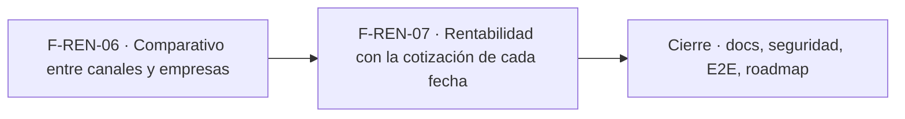

# Tasks: Inicio, rentabilidad y reportes · Rentabilidad comparativos e historia

**Input**: [spec.md](./spec.md) y [plan.md](./plan.md) · **Épica**: MSF-127 (en cola `espera-fase`: orden de despacho F-REN-06 / MSF-261 → F-REN-07 / MSF-280, sin rama nueva)
**Formato**: `- [ ] T### [P] [Historia][USx] descripción (FR/SC)`. `[P]` = paralelizable (archivos distintos, sin dependencia dentro del mismo grupo). Cada FR/SC tiene **una sola** tarea dueña. Las dependencias y el orden son **solo dentro de la misma historia**; entre historias rige la tabla *Plan de ejecución*.
**Validación por historia**: `pnpm test:db`, `pnpm lint`, `pnpm build` y `pnpm test:web` verdes antes de cerrar la fase. Cada migración lleva su reversión en el encabezado y re-verifica el esquema (Principio VII).

## Phase 1: F-REN-06 · Comparativo entre canales y empresas

**Goal**: vista del comparativo (solo productos presentes en 2 o más empresas), tablero versionado y pestaña `Comparativo`.

- [ ] T001 [F-REN-06][US1] Migración `supabase/migrations/20270111100000_analitica_margen_comparativo.sql`: `analitica.margen_comparativo_producto` derivada de `analitica.margen_producto_canal` (solo productos con margen en ≥ 2 empresas; columnas del contrato; sin acceso para `anon`/`authenticated`; `select` al rol de Superset; reversión en el encabezado) (FR-001, FR-002) (verificación: pgTAP T003)
- [ ] T002 [F-REN-06][US1] Misma vista (migración `20270111100100_analitica_margen_comparativo_diferencia.sql`): columnas `margen_pct_mejor`, `margen_pct_peor`, `diferencia_pp`, `empresa_mejor`, `empresa_peor` con desempate estable por nombre (FR-003) (verificación: pgTAP T003)
- [ ] T003 [P] [F-REN-06][US1] pgTAP `supabase/tests/database/rentabilidad_comparativo.test.sql`: comparabilidad, diferencia pp (40 % vs 33,3 % = 6,7), mejor/peor, exclusiones (sin costo/neto/cotización, una sola empresa), valores iguales a la vista base, `anon`/`authenticated` sin acceso, rol de Superset solo `select`, `rls_en_toda_tabla` (SC-001)
- [ ] T004 [P] [F-REN-06][US1] pgTAP `supabase/tests/database/rentabilidad_comparativo_aislamiento.test.sql`: dos organizaciones y 403 del token para roles sin `rentabilidad` (SC-002)
- [ ] T005 [F-REN-06][US1] Dataset y tablero «Comparativo» en `infra/superset/dashboards/rentabilidad/` (fila por producto, margen % por empresa, diferencia, mejor/peor, buscador y orden por diferencia, vacío) sin Mercado Libre (FR-004) (verificación: Vitest T008 y pgTAP T003)
- [ ] T006 [F-REN-06][US1] Empaquetado, importación y registro idempotente en `reportes` (`seccion = 'rentabilidad'`) del tablero «Comparativo»; test del importador (FR-005) (verificación: `pnpm test:superset:importar-dashboards`)
- [ ] T007 [F-REN-06][US1] `apps/web/src/pages/rentabilidad/`: pestaña `Comparativo` con `ReporteEmbebido`, estados compartidos (vacío, error con `Reintentar`), `AccesoRestringido` sin `lectura` (sin pedir token, tampoco ante 403), accesibilidad y 320/768/1440 px, sin Mercado Libre (FR-006)
- [ ] T008 [F-REN-06][US1] Vitest de la pestaña `Comparativo`: vacío, error/reintento, acceso restringido, sin ML, teclado/lector, cambio de empresa que no altera el tablero (SC-003)
- [ ] T009 [F-REN-06][US1] Capturas `pnpm --filter @platform/web pantallas:capturar` a 320/768/1440 px y revisión lado a lado con el sistema de diseño; diferencias anotadas en el PR (soporte de FR-006)

**Checkpoint F-REN-06**: `pnpm test:db`, `pnpm lint`, `pnpm build` y `pnpm test:web` verdes.

## Phase 2: F-REN-07 · Rentabilidad con la cotización de cada fecha

**Goal**: historia de costos propia, margen por fecha con la cotización más cercana, tablero «Historia» y pestaña. Sin compuerta: la decisión de Nicolás ya está tomada.

- [ ] T010 [F-REN-07][US2] Migración `supabase/migrations/20270111110000_dominio_producto_costos_historial.sql`: tabla `dominio.producto_costos_historial` (append-only; RLS por organización y `rentabilidad`; sin políticas de escritura; `anon` sin privilegios), disparador `security definer` sobre `dominio.producto_costos` (alta y cambio real de costo), siembra de una fila por costo existente y reversión en el encabezado; re-verifica el esquema (Principio VII) (FR-009) (verificación: pgTAP T014)
- [ ] T011 [F-REN-07][US2] Migración `20270111110100_analitica_margen_historico.sql` (parte 1): `analitica.costo_en_fecha` y `analitica.cotizacion_cercana` (`security definer`, `search_path = ''`, sin ejecución para `anon`/`authenticated`, solo rol de Superset) (FR-010) (verificación: pgTAP T014)
- [ ] T012 [F-REN-07][US2] Misma migración (parte 2): `analitica.margen_historico_producto_canal` (fechas = cambios de costo + cargas de cotización; neto y costo en pesos con la cotización más cercana; margen y margen %; sin fila si falta costo, neto positivo o cotización; `select` al rol de Superset) (FR-011, FR-012) (verificación: pgTAP T014)
- [ ] T013 [F-REN-07][US2] Garantía de secreto: ni Actividad ni vista/función legible por `authenticated` expone importes de costo o margen del historial; los RPC de costo no cambian de firma (FR-008) (verificación: pgTAP T015)
- [ ] T014 [P] [F-REN-07][US2] pgTAP `supabase/tests/database/rentabilidad_historia.test.sql`: alta/cambio/mismo costo del disparador (vía RPC de catálogo), siembra, sin update/delete para `authenticated`, costo en fecha (fecha anterior → null), cotización más cercana y empate, USD se mueve y ARS queda plano, varias cargas el mismo día, exclusiones, `anon`/`authenticated` sin acceso, `rls_en_toda_tabla` (SC-004)
- [ ] T015 [P] [F-REN-07][US2] pgTAP `supabase/tests/database/rentabilidad_historia_aislamiento.test.sql`: dos organizaciones, 403 del token sin `rentabilidad`, secreto de costos para roles sin la sección y `anon` (FR-007, SC-005)
- [ ] T016 [F-REN-07][US2] Dataset y tablero «Historia» en `infra/superset/dashboards/rentabilidad/` (selector de producto, serie de margen % por empresa y fecha, tabla de apoyo, vacío) sin Mercado Libre (FR-013) (verificación: `pnpm test:superset:importar-dashboards` y Vitest T019)
- [ ] T017 [F-REN-07][US2] Empaquetado, importación y registro idempotente en `reportes` (`seccion = 'rentabilidad'`) del tablero «Historia» (soporte de FR-013) (verificación: `pnpm test:superset:importar-dashboards`)
- [ ] T018 [F-REN-07][US2] `apps/web/src/pages/rentabilidad/`: pestaña `Historia` con `ReporteEmbebido`, estados compartidos, `AccesoRestringido`, accesibilidad y 320/768/1440 px, sin Mercado Libre (FR-014)
- [ ] T019 [F-REN-07][US2] Vitest de la pestaña `Historia`: elección de producto, vacío con motivo de negocio, error/reintento, acceso restringido, teclado/lector, cambio de empresa que no altera el tablero (SC-006)
- [ ] T020 [F-REN-07][US2] Capturas `pantallas:capturar` a 320/768/1440 px y revisión contra el sistema de diseño; diferencias anotadas en el PR (soporte de FR-014)

**Checkpoint F-REN-07**: `pnpm test:db`, `pnpm lint`, `pnpm build` y `pnpm test:web` verdes.

## Phase 3: Cierre

- [ ] T021 [P] [CIERRE] `docs/rentabilidad.md` (comparativo, historia, contrato de las vistas, historia de costos y su decisión, reversión), `docs/operar-superset.md` y fila/sección de `docs/roadmap-template.md`; `pnpm docs:check` verde (FR-015)
- [ ] T022 [P] [CIERRE] Revisión de seguridad de la superficie nueva (esquema `analitica` cerrado, rol de Superset, token por sección, secreto de costos) y esquema de cada objeto contra el Principio VII (FR-016)
- [ ] T023 [CIERRE] E2E de ambos tableros con los tres roles (Administrador, Administración, Operador/Consulta) (SC-007)
- [ ] T024 [CIERRE] `pnpm lint`, `pnpm build`, `pnpm infra:config`, `pnpm test`, `rls_en_toda_tabla`, `pnpm prototipo:check` y `pnpm matriz:check` (SC-008)

**Checkpoint Cierre**: ninguna tarea queda `[ ]` sin hacerse o cerrarse con `Desvío:` y seguimiento trazado.

## Dependencias

Dentro de F-REN-06: T001 → T002 → (T003 [P], T004 [P]); T005 tras T002; T006 tras T005; T007 tras T006; T008 tras T007; T009 tras T007.
Dentro de F-REN-07: T010 → T011 → T012 → T013; T014 [P] y T015 [P] tras T013; T016 tras T012; T017 tras T016; T018 tras T017; T019 y T020 tras T018.
Cierre: T021 [P] y T022 [P] cuando ambas historias estén mergeadas; T023 → T024.
Entre historias: F-REN-07 reutiliza el archivo de pestañas y el directorio de tableros que toca F-REN-06 (mismo `pages/rentabilidad/` y `reportes.json`), por eso va en serie. **Cola**: la épica espera cupo (`espera-fase`); orden de despacho F-REN-06 (MSF-261) → F-REN-07 (MSF-280), sin rama nueva.

## Plan de ejecución (historias)

| Historia | Depende de | Grupo |
|----------|------------|-------|
| F-REN-06 | — | 1 |
| F-REN-07 | F-REN-06 | 2 |
| [Cierre] | F-REN-06, F-REN-07 | 3 |

