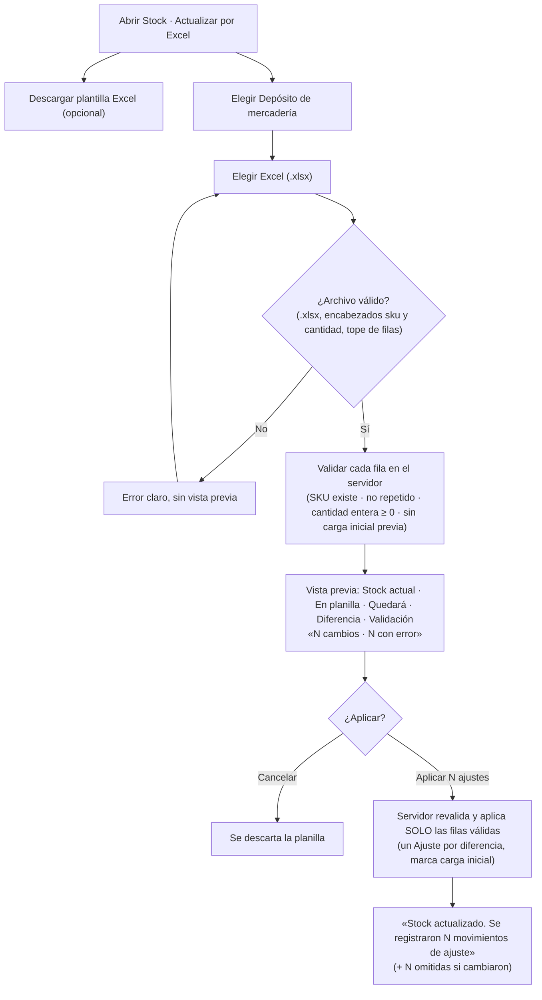
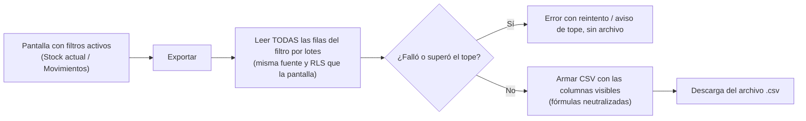
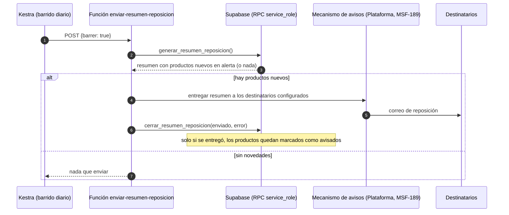
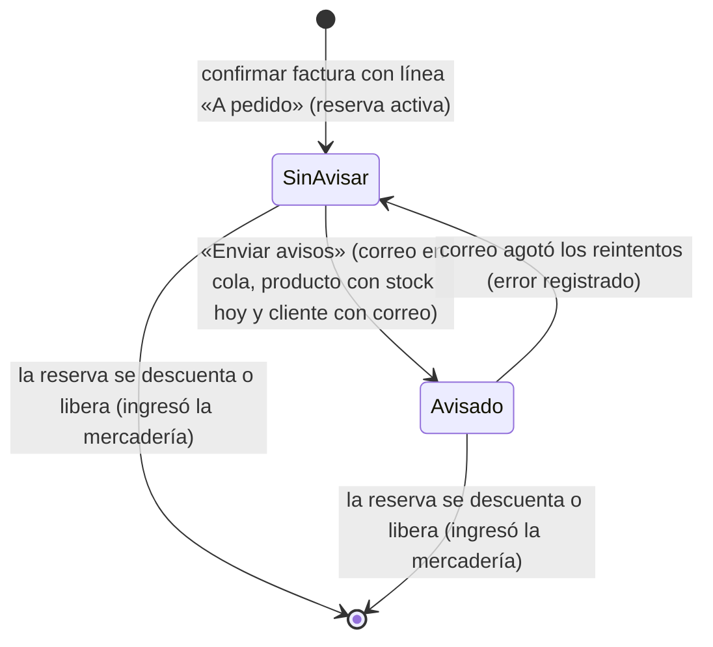
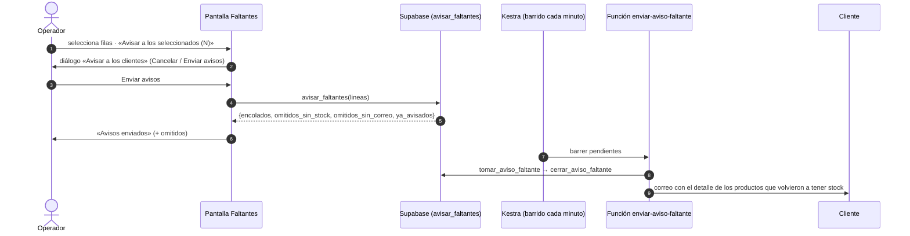

# Feature Specification: Stock · Stock carga, exportación y avisos

**Feature Branch**: `epic/MSF-368-stock-stock-carga-exportacion-y-avisos`

**Jira Epic**: MSF-368 — Stock · Stock carga exportación y avisos (spec `stock-carga-exportacion-y-avisos`)

**Created**: 2026-10-24

**Status**: Ready for implementation — traducción fiel de la épica de Nicolás; no agrega alcance. Las decisiones que la épica deja abiertas figuran en *Decisiones tomadas al traducir*; las que necesitan el OK de Nicolás están marcadas **(OK pendiente)**.

**Delivery scope**: `refine` (`apps/web`), `supabase` (migraciones, RPC y pgTAP) y `kestra` (dos flows de barrido para los envíos de correo). Sin `superset` ni `workers` (Principio V: el archivo se lee en el navegador y se aplica con una RPC; los correos reutilizan la Edge Function + flow de Kestra que ya usa F-CON-03).

**Prioridad / Hito**: P1 · Etapa 2 (desde enero de 2027) · ~32 h · alcance etapa2.

**Historias**: F-STK-07 (M), F-STK-08 (S), F-STK-09 (M), F-STK-17 (M), F-STK-18 (S).

**Input**: Epic MSF-368. Objetivo: «Al terminar, el equipo arranca con el inventario real cargado desde una planilla, puede sacar stock y movimientos a CSV y recibe un resumen de reposición sin tener que entrar a mirar. También sabe qué se pidió sin stock, a quién avisar cuando vuelve y qué productos se venden más.»

## Regla de fuentes (literal de la épica)

1. Comportamiento y datos: mandan los requisitos y escenarios de esta historia.
2. Qué se ve (disposición, textos, estados, popups, flujos): el prototipo validado es referencia visual, no hace falta que quede extremadamente idéntico; los flujos (si hay) aclaran estados y acciones.
3. Cómo se construye (componentes, estilos y patrones): mandan el template y el system design del producto (épica Plataforma · Sistema de diseño, MSF-117). No copiar el HTML ni el CSS del prototipo: reproducir lo que muestra con los componentes del template y los tokens del sistema de diseño.
4. El prototipo muestra más que esta historia: implementar solo lo que piden los requisitos de esta historia; otras secciones, botones o diálogos son de otras historias.
5. Si algo no se puede igualar con el template / el sistema de diseño: usar lo más cercano, sin inventar, y anotar la diferencia en la descripción del PR.
6. Si el prototipo y los requisitos se contradicen: requisitos para el comportamiento, prototipo para lo visual, y dejar la contradicción anotada en el PR.

Prototipos (solo lectura, ya presentes en el árbol): `design/pantallas/StockExcel.dc.html` (Stock · Actualización por Excel), `design/pantallas/StockMovimientos.dc.html` (Stock · movimientos) y `design/pantallas/VentasFaltantes.dc.html` (Ventas · Faltantes). **F-STK-18 (Más vendidos) no tiene pantalla dibujada**: se construye con los componentes del template y el sistema de diseño, y se anota en el PR.

## Dependencias

| Dependencia | Para qué | ¿En la base de esta rama? |
|---|---|---|
| MSF-231 · Stock único y alertas (+ MSF-136 movimientos, MSF-292 depósitos y reservas) | `registrar_movimiento_stock` (con depósito), `public.stock_estados` (estados de alerta que se exportan y avisan), `dominio.reservas_stock` | Sí (`main`) |
| MSF-159 · Ventas comprobantes | `dominio.comprobantes_venta` y `comprobantes_venta_lineas`, `confirmar_comprobante` (reserva las líneas «A pedido»); lo leen F-STK-17 y F-STK-18 | Sí (`main`) |
| MSF-189 · Plataforma · Avisos y listas configurables | Mecanismo de aviso por correo y destinatarios de F-STK-09 | **No** (no hay spec ni migración en `main`; ver *Riesgos* en `plan.md`) |
| Relacionada, sin bloqueo: MSF-135 (F-VTA-18 / F-VTA-26) | Puede solapar F-STK-17 | — |
| Relacionada, sin bloqueo: MSF-206 (Importaciones y monitoreo) | Posible base común de la carga de F-STK-07 | — |

Bloquea a: ninguna épica.

## Modelo y supuestos

- **Stock único** compartido entre empresas y canales (MSF-231): la única vía de escritura de cantidad es `registrar_movimiento_stock`. Esta épica la usa; no la reemplaza.
- La carga inicial usa el **SKU como clave** y **cada producto admite una sola carga inicial** (supuestos de la épica).
- El resumen por correo usa el **mecanismo de avisos del componente Plataforma** (supuesto de la épica).
- La exportación **respeta los filtros y las columnas visibles** (supuesto de la épica).
- Los correos a clientes (F-STK-17) reutilizan el patrón ya construido para F-CON-03: el disparador/RPC solo encola, una Edge Function manda el correo y un flow de Kestra la barre (el repo prohíbe disparar HTTP desde SQL, `docs/adoptar-ciclo-ejecuciones.md` §3.1).
- **Permisos** (contrato vigente): `private.nivel_seccion('stock')` (`lectura`/`edicion`) para pantallas de Stock y `private.nivel_ventas_en_empresa(empresa)` (`lectura`/`edicion`) para los datos de venta de F-STK-17 y F-STK-18. No se cambia ningún permiso.

### Esquema de datos (Constitución, Principio VII)

| Objeto | Esquema | Justificación | RLS |
|--------|---------|---------------|-----|
| `cargas_iniciales_stock` (nueva, F-STK-07) | **`dominio`** | Dato del producto: registra qué producto ya tuvo su carga inicial (una por producto) y con qué movimiento. | Por `organizacion_id` + `nivel_seccion('stock')` en `lectura`/`edicion` para leer; **sin** políticas de escritura para `authenticated`; la escribe solo la RPC `aplicar_carga_inicial_stock`. `anon` sin privilegios. |
| `stock_avisos_reposicion` (nueva, F-STK-09) | **`dominio`** | Registro del resumen de reposición de cada organización (fecha, productos, estado, error): dato del producto. | Igual que arriba; solo las RPC de `service_role` de la función de envío escriben. |
| `stock_alertas_avisadas` (nueva, F-STK-09) | **`dominio`** | Marca, por producto, el estado de alerta con el que ya se avisó (para detectar «nuevo en alerta»). | Igual. |
| `faltantes_avisos` (nueva, F-STK-17) | **`dominio`** | Aviso de reposición enviado (o en cola) por línea de venta faltante: dato del producto. | Por `organizacion_id` + empresa del comprobante con `ventas` en `lectura`/`edicion`; sin escritura desde la app; las RPC `avisar_faltantes` y las de `service_role` la escriben. |
| `comprobantes_venta_lineas`, `comprobantes_venta`, `reservas_stock`, `existencias`, `movimientos_stock`, `productos`, `depositos` (existentes) | **`dominio`** | Solo se leen (o, en el caso de movimientos/existencias, se escriben por `registrar_movimiento_stock`). No se alteran. | Sin cambios. |
| `public.faltantes_listado` (vista, F-STK-17) | **`public`** (vista `security_invoker`, sin tabla) | Contrato de lectura de la pantalla, igual criterio que `public.stock_estados`. | Hereda la RLS de las tablas `dominio` base. |

**No se crea una tabla `faltantes`** (ver *Decisiones* 6): el faltante se **deriva** de las líneas de venta y las reservas existentes, así no queda dueño duplicado frente a F-VTA-18 (MSF-135). El esquema de cada tabla se re-verifica en spec, plan, tareas, implementación y revisión (tarea de cierre).

## Navegación y patrones del panel (Principio VI)

- **Ubicación**: todo vive dentro de **Stock** (ícono y ítem existentes). La tira de pestañas gana, **en este orden y con estos nombres** (los del prototipo): … **Faltantes** (`/stock/faltantes`), **Actualizar por Excel** (`/stock/excel`) y, sin prototipo, **Más vendidos** (`/stock/mas-vendidos`). Las demás pestañas (Stock actual, Movimientos, Ingreso de mercadería, Depósitos de mercadería, Carga en lote, Toma de inventario) ya existen y no cambian. Rutas con carga diferida, protegidas por la sección `stock`.
- **Audiencia y contexto**: organización activa (`ContextoOrganizacionActiva`). Rutas anteriores: ninguna que mantener. Exportar no agrega ruta (botón en `/stock` y `/stock/movimientos`).
- Estados compartidos de carga, vacío, error y éxito; teclado, lector de pantalla y 320 / 768 / 1440 px; **sin UUID visible**. La planilla se lee en el navegador y su carga es diferida (la librería de lectura de Excel solo se descarga al abrir `/stock/excel`).
- **Empresa activa** (Principio VIII): ver la fila «Empresa activa» de la matriz. F-STK-17 y F-STK-18 la respetan (datos de venta por tienda); F-STK-07 y F-STK-08 no aplican (stock único compartido).

## Decisiones tomadas al traducir («A revisar»)

1. **Prioridad**: la épica es P1/Etapa 2 y se traduce así; si la carga inicial pasa a P0 (pregunta #3 de Funcionalidades) cambia el hito, no el alcance. **(OK pendiente de Nicolás sobre el hito; no bloquea la spec.)**
2. **F-STK-07 y F-STK-17 «sin dibujar» en el documento de Stock**: sí tienen artboard (`StockExcel`, `VentasFaltantes`); la spec se apoya en ellos.
3. **«Modo» de StockExcel** (Reemplazar cantidad / Sumar a lo actual): la épica pide **carga inicial** (cantidad absoluta, **una por producto**). Se construye solo el comportamiento «reemplazar la cantidad del depósito por la de la planilla»; el campo «Modo» y «Sumar a lo actual» quedan **FUERA DE ALCANCE** (el ingreso rápido ya existe en «Carga en lote» e «Ingreso de mercadería»; el conteo repetido es «Toma de inventario»). **(OK pendiente)**
4. **Mecanismo de avisos (MSF-189)**: la épica lo declara bloqueante y no está en `main`. F-STK-09 produce el resumen (qué productos, con qué contenido, una vez y sin duplicar) y lo entrega por el mecanismo de Plataforma; el contrato de destinatarios/canal se confirma al implementar (ver `contracts/` y *Riesgos*). La frecuencia del resumen no la fija la épica: se propone **una corrida diaria** configurable en el flow. **(OK pendiente)**
5. **Definición de «nuevo en alerta»** (F-STK-09): ver FR-202.
6. **Dueño de `faltantes` y del aviso** («A revisar» sobre F-VTA-18/F-VTA-26): F-STK-17 es dueña de la **lectura derivada** (`faltantes_listado`) y del **aviso** (`faltantes_avisos`, correos); no crea tabla `faltantes`. Si MSF-135 define una tabla propia, solo habrá que reapuntar la vista. **(OK pendiente)**
7. **Qué es un faltante**: una línea de **factura confirmada «A pedido»** (el producto no tenía stock al venderse: `confirmar_comprobante` la reserva sin descontar). Está **abierto** mientras su reserva sigue **activa** y se **cierra solo** cuando la reserva deja de estar activa (la mercadería ingresó y se entregó/liberó). No hay botón de cierre manual (prototipo: «Un faltante se cierra solo cuando se ingresa la mercadería»). **(OK pendiente)**
8. **Quién se avisa**: solo los faltantes seleccionados cuyo producto **volvió a tener stock** (stock disponible ≥ 1 hoy) y que **no fueron avisados**; los demás seleccionados se omiten y se informa cuántos. **(OK pendiente)**
9. **Ventas de la épica**: la fuente habla de «Consultas y ventas»; en Jira las ventas están en Ventas y despacho, por eso el bloqueo es contra MSF-159.
10. **Formato de exportación**: CSV (la épica), no .xlsx como otras exportaciones del repo.

## User Scenarios & Testing *(mandatory)*

### User Story 1 — Carga inicial y masiva de stock (F-STK-07, P1, M)

Como equipo, quiero cargar el inventario real desde una planilla Excel, ver antes qué filas son válidas y confirmar solo las válidas, para arrancar con el stock correcto sin tipearlo producto por producto.

**Why this priority**: sin inventario real cargado no hay stock confiable el día de la salida.

**Independent Test**: pgTAP de la RPC + Vitest de la pantalla con una planilla de filas válidas e inválidas.

**Acceptance Scenarios**:
1. **Given** la pestaña «Actualizar por Excel», **When** descargo la plantilla, **Then** obtengo `stock.xlsx` con las columnas `sku`, `cantidad` y `motivo`.
2. **Given** un depósito elegido y una planilla con filas válidas, un SKU inexistente, un SKU repetido, una cantidad inválida y un producto con cantidad igual a la actual, **When** la elijo, **Then** veo la vista previa con Stock actual, En planilla, Quedará, Diferencia y Validación por fila, y los contadores «N cambios» y «N con error».
3. **Given** la vista previa, **When** presiono «Aplicar N ajustes», **Then** se crea un movimiento de tipo Ajuste por cada fila válida con diferencia, en ese depósito, y **las filas con error no se aplican**; veo «Stock actualizado. Se registraron N movimientos de ajuste. Podés verlos en Stock · Movimientos.».
4. **Given** un producto que ya tuvo su carga inicial, **When** una planilla lo incluye, **Then** la fila queda con error «Ya tuvo carga inicial» y no se aplica.
5. **Given** dos personas aplicando a la vez una planilla con el mismo producto, **When** ambas confirman, **Then** solo una lo carga y la otra lo recibe como «Ya tuvo carga inicial».
6. **Given** que entre la vista previa y «Aplicar» alguien cambió el stock o cargó un producto, **When** aplico, **Then** el servidor revalida: las filas que dejaron de ser válidas se omiten y se informa cuántas.
7. **Given** una planilla sin encabezado `sku` o `cantidad`, vacía o que no es .xlsx, **When** la elijo, **Then** veo un error claro y no hay vista previa.
8. **Given** un rol `lectura`, **When** abro Stock, **Then** no veo la pestaña «Actualizar por Excel»; un POST directo a la RPC se rechaza (`42501`).

### User Story 2 — Exportar stock y movimientos (F-STK-08, P1, S)

Como equipo, quiero sacar el stock actual y los movimientos a CSV, tal como los estoy viendo, para trabajarlos fuera del panel.

**Independent Test**: Vitest de armado del CSV y comparación con las filas de pantalla.

**Acceptance Scenarios**:
1. **Given** `/stock` con una búsqueda, un filtro de estado y «Ver solo alertas», **When** presiono «Exportar», **Then** el CSV tiene exactamente las filas del filtro (no solo la página visible) y las columnas que la tabla muestra, con sus encabezados.
2. **Given** `/stock/movimientos` filtrado por un producto, **When** presiono «Exportar», **Then** el CSV tiene los movimientos de ese producto con las columnas visibles de la tabla.
3. **Given** un valor que empieza con `=`, `+`, `-` o `@` (p. ej. un nombre de producto), **When** se exporta, **Then** el CSV lo neutraliza y no se ejecuta como fórmula al abrirlo.
4. **Given** una exportación en curso, **When** falla la consulta, **Then** veo el error con reintento y no se descarga un archivo parcial.
5. **Given** un rol `lectura`, **When** exporto, **Then** funciona (ve los mismos datos).

### User Story 3 — Avisos de reposición (F-STK-09, P1, M)

Como equipo, quiero recibir por correo un resumen de los productos que entraron en alerta, sin tener que entrar a mirar.

**Independent Test**: pgTAP: simular productos nuevos en alerta, generar el resumen y revisar su contenido; segunda corrida sin novedades.

**Acceptance Scenarios**:
1. **Given** productos que pasaron a «Stock bajo» o «Sin stock» desde el último resumen, **When** corre el barrido, **Then** se genera un resumen con esos productos (nombre, SKU, stock, disponible, mínimo, estado) y se entrega por el mecanismo de avisos.
2. **Given** que no hay productos nuevos en alerta, **When** corre el barrido, **Then** no se genera ni se envía nada.
3. **Given** un resumen entregado, **When** corre otro barrido sin cambios, **Then** los mismos productos no vuelven a avisarse.
4. **Given** un producto avisado como «Stock bajo» que luego queda «Sin stock», **When** corre el barrido, **Then** se avisa de nuevo (empeoró).
5. **Given** un producto avisado que vuelve a «Disponible» y más tarde entra otra vez en alerta, **When** corre el barrido, **Then** se avisa de nuevo.
6. **Given** que falla la entrega del resumen, **When** se reintenta, **Then** los productos no se pierden ni se marcan como avisados, y el error queda registrado.

### User Story 4 — Faltantes con aviso de reposición (F-STK-17, P1, M)

Como equipo, quiero ver qué líneas se vendieron o pidieron sin stock y avisar a los clientes cuando el producto vuelve.

**Independent Test**: pgTAP de la vista y de `avisar_faltantes` + Vitest de la pantalla y el diálogo.

**Acceptance Scenarios**:
1. **Given** facturas confirmadas con líneas «A pedido», **When** abro Faltantes, **Then** veo una fila por línea con Tienda, Cliente, Producto (nombre y SKU), Pedido, Comprobante, Desde, Stock hoy y Aviso.
2. **Given** una línea cuya reserva se descontó o liberó, **When** abro Faltantes, **Then** ya no aparece (se cerró sola).
3. **Given** el filtro de tienda, **When** elijo una tienda o cambio la empresa activa de la barra superior, **Then** la lista, los contadores y la selección se reencuadran a esa tienda.
4. **Given** filas seleccionadas, **When** presiono «Avisar a los seleccionados (N)», **Then** se abre «Avisar a los clientes» con el texto del prototipo; «Enviar avisos» marca los faltantes como Avisado y encola un correo por cliente con el detalle de los productos que volvieron a tener stock.
5. **Given** un faltante ya Avisado, **When** se vuelve a seleccionar y avisar, **Then** no se vuelve a enviar.
6. **Given** seleccionados que no tienen stock hoy o cuyo cliente no tiene correo, **When** envío, **Then** se omiten y el mensaje de resultado dice cuántos.
7. **Given** un rol sin `ventas` en `edicion` para esa tienda, **When** abro Faltantes, **Then** puede ver pero no avisar; una tienda sin `ventas` en `lectura`/`edicion` no aparece.
8. **Given** el correo falla tras los reintentos, **When** se agota el tope, **Then** el faltante vuelve a «Sin avisar» y el error queda registrado.

### User Story 5 — Reporte de productos más vendidos (F-STK-18, P1, S)

Como equipo, quiero saber qué productos se venden más en un período.

**Independent Test**: pgTAP de `productos_mas_vendidos` con ventas de ejemplo + Vitest de la pantalla.

**Acceptance Scenarios**:
1. **Given** facturas confirmadas en el período, **When** abro Más vendidos, **Then** veo los productos ordenados por unidades vendidas con posición, producto (nombre y SKU) y unidades.
2. **Given** presupuestos, borradores y anuladas, **When** se calcula, **Then** no suman.
3. **Given** el selector de período (atajos y rango), **When** lo cambio, **Then** el ranking se recalcula.
4. **Given** una tienda elegida o la empresa activa de la barra superior, **When** se calcula, **Then** solo cuentan las ventas de esa tienda; sin elegir, las de todas las tiendas a las que tengo acceso.
5. **Given** un período sin ventas, **Then** veo el estado vacío «No hay ventas en el período».

### Edge Cases

- Planilla con filas en blanco intercaladas: se ignoran. SKU con espacios: se recortan. SKU numérico (Excel lo guarda como número): se lee como texto.
- Más filas que el tope técnico (ver `plan.md`): se rechaza la planilla con el mensaje del tope; no se aplica nada.
- Producto inactivo o de otra organización en la planilla: «SKU no existe» (no se revela el de otra organización).
- Exportación sin filas: se descarga un CSV solo con encabezados y se avisa «No hay filas para exportar».
- Un cliente con varios faltantes seleccionados: un solo correo con todos.
- Cambiar de empresa con el diálogo «Avisar a los clientes» abierto: se cierra con aviso y se descarta la selección.
- El resumen de reposición con cientos de productos: el correo muestra los primeros N y el total, con enlace al panel (tope en `plan.md`).

## Flujos

### Flujo 1 — Carga inicial desde planilla (F-STK-07)

### Flujo 2 — Exportar a CSV (F-STK-08)

### Flujo 3 — Resumen de reposición (F-STK-09)

### Flujo 4 — Ciclo de vida de un faltante y su aviso (F-STK-17)

### Flujo 5 — Aviso a clientes con faltantes (F-STK-17)

## Requirements *(mandatory)*

### Functional Requirements

**F-STK-07 — Carga inicial y masiva de stock**
- **FR-001**: Pestaña «Actualizar por Excel» en Stock (`/stock/excel`), visible y operable solo con `private.nivel_seccion('stock') = 'edicion'`. Encabezado «Actualizar stock por Excel» y texto «Cargá las cantidades contadas desde una planilla. Cada diferencia genera un movimiento de ajuste. El stock es compartido: el cambio vale para todas las tiendas.»
- **FR-002**: Botón «Descargar plantilla Excel» que descarga `stock.xlsx` con las columnas `sku`, `cantidad` y `motivo`, y avisa «Plantilla stock.xlsx descargada».
- **FR-003**: Paso «1 · Planilla»: selector «Depósito de mercadería» (depósitos activos de la organización; por defecto el predeterminado), selector de archivo «Elegir Excel» / «Cambiar archivo» que muestra el nombre y «N filas · hoja 1» (o «Ningún archivo elegido»), y la tarjeta «Formato de la planilla» (tabla Columna/Contenido: `sku` — Código del producto (obligatorio); `cantidad` — Unidades en el depósito elegido; `motivo` — Opcional. Queda en el movimiento) con la nota «Las reservas por «A pedido» no cambian: se ajusta el stock físico, no el disponible.»
- **FR-004**: La planilla se lee en el navegador (.xlsx, primera hoja). SKU es la clave (se recorta; un valor numérico se lee como texto). Se ignoran filas en blanco. Se rechaza, con mensaje claro y sin vista previa, un archivo que no sea .xlsx, vacío, sin encabezado `sku` o `cantidad`, o con más filas que el tope técnico (2.000) o más de 5 MB de tamaño (el tope de filas acota además lo que se procesa al descomprimir).
- **FR-005**: Paso «2 · Diferencias a aplicar» con los contadores «N cambios» y «N con error» y la tabla SKU · Producto · Stock actual · En planilla · Quedará · Diferencia · Validación. «Quedará» es la cantidad de la planilla; «Diferencia» lleva signo y color (positivo/negativo/neutro); Validación muestra «Ajuste», «Sin cambios» o el error. Las filas con error se resaltan.
- **FR-006**: Reglas de validación por fila, evaluadas por el servidor (`validar_carga_stock`): SKU vacío; «SKU no existe» (no está en la organización o está inactivo); SKU repetido en la planilla; cantidad que no sea entero ≥ 0; «Ya tuvo carga inicial» (el producto ya figura en `cargas_iniciales_stock`); «Sin cambios» (cantidad igual a la actual; no es error y no consume la carga inicial). `motivo` ≤ 500 caracteres.
- **FR-007**: Pie de la vista previa «Se creará un movimiento de tipo Ajuste por cada diferencia, en <depósito>.» con «Cancelar» (descarta la planilla) y «Aplicar N ajustes» (deshabilitado con N = 0).
- **FR-008**: `aplicar_carga_inicial_stock` aplica **solo las filas válidas** en una transacción, revalidando todo en el servidor: cada fila con diferencia crea un movimiento de tipo **ajuste** (por `registrar_movimiento_stock` con el depósito elegido, motivo de sistema «Carga inicial de stock», nota = `motivo` de la planilla) y registra el producto en `cargas_iniciales_stock`. Las filas que dejaron de ser válidas se omiten y se informan; un fallo inesperado revierte todo (nada parcial).
- **FR-009**: Idempotencia y concurrencia: una clave de envío estable evita duplicar al reintentar; dos cargas simultáneas del mismo producto se serializan (restricción única `(organizacion_id, producto_id)`): una gana y la otra recibe «Ya tuvo carga inicial». El stock nunca queda negativo (lo garantiza `registrar_movimiento_stock`).
- **FR-010**: Resultado: alerta de éxito «Stock actualizado. Se registraron N movimientos de ajuste. Podés verlos en Stock · Movimientos.» y aviso emergente «Stock actualizado en <depósito>»; muestra además cuántas filas se omitieron. Error con reintento; doble clic no duplica.
- **FR-011**: Auditoría: cada carga deja un evento de actividad `stock.carga_inicial` (actor, depósito, cantidad de ajustes y omitidas), además de los movimientos y los eventos `stock.actualizado` que ya emite el motor de stock.
- **FR-012**: Permisos: RPC `security definer`, exige sesión, organización activa y `edicion` en Stock (`42501`); `revoke … from public, anon` y `grant execute … to authenticated`; organización y actor salen de la sesión.

**F-STK-08 — Exportar stock y movimientos**
- **FR-101**: Botón «Exportar» en `/stock/movimientos` (como el prototipo) y en `/stock` (la épica pide exportar el stock; `Stock.dc.html` no lo dibuja: se coloca en la misma barra de herramientas y la diferencia se anota en el PR).
- **FR-102**: Genera un archivo **CSV** (UTF-8 con BOM, separador `;`, fin de línea CRLF, comillas escapadas) y lo descarga.
- **FR-103**: Respeta **todos los filtros activos** de la pantalla (Stock actual: búsqueda por nombre o SKU, estado y «Ver solo alertas»; Movimientos: producto y cualquier otro filtro que la pantalla tenga) y exporta **todas las filas del filtro**, no solo la página visible.
- **FR-104**: Respeta las **columnas visibles**: las mismas columnas de datos de la tabla, con sus encabezados y orden, sin la columna de acciones; los valores salen como se muestran (estado en palabras, fechas legibles, cantidades como números).
- **FR-105**: Nombre de archivo `stock-actual-AAAA-MM-DD.csv` y `movimientos-stock-AAAA-MM-DD.csv` (fecha en la zona de la organización).
- **FR-106**: Los valores de texto que empiezan con `=`, `+`, `-`, `@`, tab o retorno se neutralizan (misma función `neutralizarFormula` que las demás exportaciones).
- **FR-107**: Lee por lotes la **misma fuente y RLS** que la pantalla (sin RPC nueva ni permisos nuevos); tope de filas con aviso; estados de «Exportando…», error con reintento, y sin archivo parcial; sin filas → CSV con encabezados y aviso «No hay filas para exportar».
- **FR-108**: Disponible con `lectura` o `edicion` en Stock (exportar no escribe).

**F-STK-09 — Avisos de reposición**
- **FR-201**: Un **resumen de reposición** por organización, por correo, con los productos que **entraron en alerta** (estado `stock_bajo` o `sin_stock` de `public.stock_estados`) desde el último resumen. Sin productos nuevos no se genera ni se envía nada.
- **FR-202**: «Nuevo en alerta» = el producto está hoy en `stock_bajo`/`sin_stock` y **no figura en `stock_alertas_avisadas`** con ese estado o uno peor (`stock_bajo` → `sin_stock` cuenta como nuevo). Un producto que vuelve a `disponible` pierde su marca y puede avisarse de nuevo.
- **FR-203**: Contenido del resumen: asunto con el total («N productos sin stock y M con stock bajo»), y por producto nombre, SKU, stock, disponible, mínimo y estado, con «Sin stock» primero y luego por nombre; enlace al panel de Stock. Un tope de productos por correo con el total y el enlace (valor en `plan.md`).
- **FR-204**: La entrega y los **destinatarios** los define el mecanismo de avisos del componente Plataforma (MSF-189); esta épica no agrega pantalla de destinatarios ni de configuración. Sin destinatarios el resumen queda registrado como «sin destinatario» y no marca productos.
- **FR-205**: Disparo por un flow de Kestra que barre a intervalo fijo (propuesta: diario, hora editable en el YAML) y llama a una Edge Function; el SQL solo calcula y registra (sin HTTP desde SQL).
- **FR-206**: Los productos se marcan como avisados **solo después de una entrega exitosa**; reintentar no duplica el correo ni pierde productos (`generar_resumen_reposicion` reserva el resumen con vencimiento, como `tomar_aviso_consulta`).
- **FR-207**: Cada resumen queda registrado en `stock_avisos_reposicion` (organización, generado en, productos incluidos, estado `pendiente/enviado/fallido/sin_destinatario`, intentos, último error sanitizado) para auditar.
- **FR-208**: Seguridad: tablas con RLS por organización y sección `stock` (lectura para `lectura`/`edicion`); sin escritura desde la app; las RPC del resumen son exclusivas de `service_role` (`anon` y `authenticated` sin ejecución).

**F-STK-17 — Faltantes con aviso de reposición**
- **FR-301**: Pestaña «Faltantes» en Stock (`/stock/faltantes`) con título «Faltantes» y subtítulo «Líneas vendidas o pedidas sin stock. Se avisa al cliente cuando el producto vuelve.»; visible con `lectura` o `edicion` en Stock.
- **FR-302**: Fuente: vista `public.faltantes_listado` (`security_invoker`) derivada de `comprobantes_venta_lineas` de **facturas confirmadas** con `a_pedido = true` y **reserva activa** en `reservas_stock` (referencia `comprobante:<id>:linea:<orden>`). Solo tiendas con `ventas` en `lectura`/`edicion` (`private.nivel_ventas_en_empresa`). Una línea sale sola cuando su reserva deja de estar activa; **no hay cierre manual**.
- **FR-303**: Tabla con selección por fila y «seleccionar todo» y las columnas: Tienda (chip), Cliente, Producto (nombre y SKU), Pedido (cantidad), Comprobante (número, enlace al comprobante), Desde (fecha de confirmación), Stock hoy (chip: Sin stock / Stock bajo / Disponible, sobre `stock_estados`) y Aviso (chip «Sin avisar» / «Avisado»). Orden por «Desde» descendente; paginación.
- **FR-304**: Filtro de tienda con `FiltroEmpresa` («Todas las tiendas» + una por empresa) y el texto «Por defecto se ven todas; si elegís una empresa en la barra superior, se filtra por esa tienda.» La empresa activa de la barra superior filtra la lista.
- **FR-305**: Pie «N seleccionados de M faltantes» y «Un faltante se cierra solo cuando se ingresa la mercadería.»
- **FR-306**: «Avisar a los seleccionados (N)», deshabilitado con N = 0, abre el diálogo «Avisar a los clientes»: «Se envía un correo a N clientes con el detalle de los productos que volvieron a tener stock. Los faltantes avisados quedan marcados y no se vuelven a avisar.» con «Cancelar» y «Enviar avisos». Al confirmar: aviso emergente «Avisos enviados» (más, si corresponde, cuántos se omitieron por falta de stock o de correo).
- **FR-307**: `avisar_faltantes(p_lineas)` (a) toma solo las líneas visibles para la persona y con `ventas` en `edicion` en su tienda, (b) omite las ya avisadas, las de producto sin stock disponible hoy y las de clientes sin correo, (c) registra el aviso en `faltantes_avisos` por línea (idempotente: una fila por línea) y (d) encola **un correo por cliente** con todos sus faltantes avisables. Devuelve cuántos se encolaron y cuántos se omitieron por cada motivo.
- **FR-308**: El envío lo hace una Edge Function `enviar-aviso-faltante` barrida por un flow de Kestra (patrón F-CON-03: toma con reserva de 2 min, cierre, tope de intentos, error sanitizado; SQL sin HTTP). Si se agotan los intentos, el faltante vuelve a «Sin avisar» y el error queda registrado. Un fallo de envío nunca toca la venta ni el stock.
- **FR-309**: Seguridad: `faltantes_avisos` con RLS por organización y tienda; sin escritura directa para `authenticated`; las RPC de toma y cierre son solo de `service_role`; `avisar_faltantes` con `revoke … from public, anon` y `grant execute … to authenticated`.
- **FR-310**: Estados compartidos: cargando, vacío («No hay faltantes»), error con reintento. Sin UUID visible.
- **FR-311**: Empresa activa: al cambiar la empresa se invalidan todas las consultas, se reencuadra la paginación, se descarta la selección que ya no existe y se cierra con aviso el diálogo abierto; nunca se muestran filas de la empresa anterior.

**F-STK-18 — Reporte de productos más vendidos**
- **FR-401**: Pestaña «Más vendidos» en Stock (`/stock/mas-vendidos`), visible con `lectura` o `edicion` en Stock. Sin prototipo: se construye con los componentes del template y se anota en el PR.
- **FR-402**: `productos_mas_vendidos(p_desde, p_hasta, p_empresa_id, p_pagina, p_tamano)` suma las **unidades** de las líneas de comprobantes que cuentan como facturados (único predicado `private.comprobante_cuenta_como_facturado`, hoy: factura no borrador y no anulada) cuya **fecha** cae en el período; incluye líneas «A pedido». Presupuestos, borradores y anuladas no suman.
- **FR-403**: Solo cuentan las tiendas con `ventas` en `lectura`/`edicion` de la persona; `p_empresa_id` acota a una tienda (una ajena devuelve cero filas).
- **FR-404**: Período con atajos (Este mes, Mes anterior, Últimos 90 días, Año en curso) y rango «Desde/Hasta», con el mismo rango máximo (5 años) y zona (`America/Argentina/Buenos_Aires`) que el ranking de clientes; el servidor revalida.
- **FR-405**: Tabla: Posición · Producto (nombre y SKU) · Unidades vendidas; orden por unidades descendente, luego nombre; paginada (25 por página, tope 200).
- **FR-406**: Filtro de tienda con `FiltroEmpresa` y la empresa activa de la barra superior; mismo reencuadre que FR-311.
- **FR-407**: Estados compartidos: cargando, vacío («No hay ventas en el período»), error con reintento.
- **FR-408**: RPC `security definer`, `search_path = ''`, organización de la sesión, `revoke … from public, anon` y `grant execute … to authenticated`; exige `stock` en `lectura`/`edicion`.

**Fuera de alcance (declarado, sin tareas)**: «Modo» y «Sumar a lo actual» de StockExcel (Decisiones 3); el bloque «Avisos de la tienda web» y las demás pestañas de Ventas del artboard Faltantes (otras épicas); el desglose por depósito «L 1 · D 2» del chip Stock hoy; columnas resumen de Movimientos del prototipo (Inicial, Entradas, Ventas, Devol., Ajustes, Queda, Reserv., Disp., Cobertura, Última venta, Estado), búsqueda propia, «Categoría» y «Nuevo movimiento» (pantalla existente de MSF-136/MSF-292, sin cambios acá); pantalla de destinatarios o configuración de avisos (MSF-189); exportar el reporte de más vendidos, importes, margen y gráficos; Superset; consumidores del evento `stock.actualizado` (MSF-123).

### Key Entities

- **Carga inicial de stock (`dominio.cargas_iniciales_stock`)**: producto, depósito, movimiento de ajuste, cantidad cargada, responsable, fecha; una por producto y organización.
- **Resumen de reposición (`dominio.stock_avisos_reposicion`)** y **marca de alerta avisada (`dominio.stock_alertas_avisadas`)**.
- **Faltante (derivado, `public.faltantes_listado`)** y **aviso de faltante (`dominio.faltantes_avisos`)**: una fila por línea de venta; estado `pendiente/enviado/fallido/sin_destinatario`, intentos, error útil.
- **Producto más vendido (derivado)**: producto, unidades en el período.

## Success Criteria *(mandatory)*

- **SC-001** (F-STK-07): planilla con filas válidas e inválidas → la vista previa marca cada fila; «Aplicar» confirma solo las válidas (movimientos de ajuste, stock en lo cargado) y deja las inválidas sin tocar; pgTAP + Vitest.
- **SC-002** (F-STK-07): un producto no admite una segunda carga inicial, ni siquiera con dos cargas simultáneas; reintentar con la misma clave no duplica movimientos.
- **SC-003** (F-STK-07): `lectura` no puede ejecutar la carga (`42501`); `anon` sin ejecución; otra organización no ve ni afecta cargas ajenas.
- **SC-101** (F-STK-08): exportar con filtros produce un CSV cuyas filas y columnas coinciden con las de la pantalla (mismas cantidades, mismo contenido); sin archivo parcial ante error.
- **SC-102** (F-STK-08): un valor con `=`/`+`/`-`/`@` queda neutralizado y el CSV abre bien en Excel (UTF-8 con BOM).
- **SC-201** (F-STK-09): al simular productos nuevos en alerta, el resumen incluye exactamente esos productos con el contenido de FR-203; una segunda corrida sin cambios no genera resumen; empeorar o salir y volver a entrar en alerta vuelve a avisar.
- **SC-202** (F-STK-09): una entrega fallida no marca los productos como avisados y queda registrada; las RPC del resumen no son ejecutables por `authenticated` ni `anon`.
- **SC-301** (F-STK-17): la vista lista exactamente las líneas «A pedido» de facturas confirmadas con reserva activa y las cierra al descontar/liberar la reserva; una tienda sin `ventas` no ve filas.
- **SC-302** (F-STK-17): «Enviar avisos» marca Avisado, encola un correo por cliente, no repite un aviso ya hecho y omite (informando) sin stock o sin correo; el fallo agotado vuelve a «Sin avisar».
- **SC-303** (F-STK-17): cambiar de empresa reencuadra la lista y la selección y cierra el diálogo; test de Vitest.
- **SC-401** (F-STK-18): el ranking suma solo líneas de facturas que cuentan, en el período y tienda elegidos, ordenado por unidades; presupuestos/borradores/anuladas no suman; una tienda ajena devuelve cero filas.
- **SC-402** (F-STK-18): cambiar período o empresa recalcula y reencuadra; estado vacío correcto.
- **SC-900** (cierre): `rls_en_toda_tabla` y `aislamiento_organizaciones` verdes con las 4 tablas nuevas; ninguna función nueva de `public` ejecutable por `anon`; `pnpm lint`, `pnpm build`, `pnpm test`, `pnpm docs:check` verdes.

## Matriz pantalla↔criterios

Inventario determinista con `pnpm prototipo:inventario` sobre `StockExcel.dc.html`, `StockMovimientos.dc.html` y `VentasFaltantes.dc.html` (`design/pantallas/*.inventory.json`, coinciden con los generados). «Existente» = ya entregado por MSF-136/MSF-231/MSF-292 y sin cambios acá; se lista para que ningún elemento visible quede sin dueño.

### Stock · Actualización por Excel (`StockExcel.dc.html`, F-STK-07)

| Ítem del inventario | Tipo | Criterio / decisión |
|---|---|---|
| Tabla «Formato de la planilla»: Columna, Contenido | tabla | FR-003 |
| Tabla de diferencias: SKU, Producto, Stock actual, En planilla, Quedará, Diferencia, Validación | tabla | FR-005, FR-006 |
| Campo «Depósito de mercadería» | campo | FR-003 |
| Campo «Modo» (Reemplazar cantidad / Sumar a lo actual) | campo | **FUERA DE ALCANCE**: la épica pide carga inicial única por producto (Decisiones 3); el comportamiento fijo es «reemplazar» |
| Botón «Descargar plantilla Excel» | botón | FR-002 |
| Botón «Elegir Excel» / «Cambiar archivo» (texto del archivo y «N filas · hoja 1») | botón | FR-003, FR-004 |
| Botón «Cancelar» | botón | FR-007 |
| Botón «Aplicar · ajustes» («Aplicar N ajustes») | botón | FR-007, FR-008, FR-010 |
| Pestañas «Stock actual», «Movimientos», «Ingreso de mercadería», «Depósitos de mercadería» | tabs | Existente (sin cambios) |
| Pestaña «Faltantes» | tab | FR-301 |
| Pestaña «Actualizar por Excel» | tab | FR-001 |
| Diálogos | — | El prototipo no tiene diálogos; el éxito es una alerta en la misma pantalla (FR-010) |
| Aviso emergente «Stock actualizado en <depósito>» y «Plantilla … descargada» | snackbar | FR-010, FR-002 |

### Stock · movimientos (`StockMovimientos.dc.html`, F-STK-08)

| Ítem del inventario | Tipo | Criterio / decisión |
|---|---|---|
| Botón «Exportar» | botón | FR-101…FR-108 |
| Botón «Nuevo movimiento» | botón | Existente (MSF-136) |
| Tabla resumen: Producto, Inicial, Entradas, Ventas, Devol., Ajustes, Queda, Reserv., Disp., Cobertura, Última venta, Estado | tabla | **FUERA DE ALCANCE**: pantalla existente de MSF-136/MSF-292; esta épica solo agrega la exportación de lo que la tabla muestra hoy (FR-104) |
| Tabla detalle: Fecha, Tipo, Comprobante o motivo, Tienda, Depósito, Cant., Saldo, Operador | tabla | **FUERA DE ALCANCE** (idem); su exportación cubre las columnas que la tabla tenga visibles (FR-104) |
| Campo «Buscar producto o SKU» y botón «Categoría: ·» | campo/botón | **FUERA DE ALCANCE**: filtros de la pantalla existente; si existen, la exportación los respeta (FR-103) |
| Pestañas Stock actual / Movimientos / Ingreso de mercadería / Depósitos de mercadería | tabs | Existente |
| Pestañas «Faltantes» y «Actualizar por Excel» | tabs | FR-301, FR-001 |

### Ventas · Faltantes (`VentasFaltantes.dc.html`, F-STK-17)

| Ítem del inventario | Tipo | Criterio / decisión |
|---|---|---|
| Tabla Faltantes: (casilla), Tienda, Cliente, Producto, Pedido, Comprobante, Desde, Stock hoy, Aviso | tabla | FR-302, FR-303 |
| Pie «N seleccionados de M faltantes» y «Un faltante se cierra solo…» | texto | FR-305 |
| Filtro de tienda «Todas las tiendas» + una por empresa y su texto de ayuda | filtro | FR-304, FR-311 |
| Botón «Avisar a los seleccionados (N)» | botón | FR-306 |
| Diálogo «Avisar a los clientes» con «Cancelar» y «Enviar avisos» | diálogo | FR-306, FR-307, FR-308 |
| Aviso emergente «Avisos enviados» | snackbar | FR-306 |
| Tabla «Avisos de la tienda web»: Producto, Contacto, Tienda, Pedido el, Stock hoy (y el chip «4 pendientes») | tabla | **FUERA DE ALCANCE**: visitantes de la tienda web que piden «avisame cuando vuelva» (tiendas públicas, otra épica); la épica solo pide faltantes de líneas de venta |
| Pestañas «Comprobantes», «Presupuestos», «Pagos», «Devoluciones (RMA)», «Transportes y contrarreembolsos» | tabs | **FUERA DE ALCANCE**: navegación de Ventas (otras épicas) |
| Pestaña «Faltantes» | tab | FR-301 (en la tira de Stock; si Ventas ya expone su tira, «Faltantes» enlaza a la misma ruta) |
| Chip «L 1 · D 2» (desglose por depósito) en Stock hoy | texto | **FUERA DE ALCANCE**: sin requisito; Stock hoy muestra el estado (FR-303) |

### Reporte de más vendidos (F-STK-18)

Sin pantalla dibujada (ver *Regla de fuentes* y FR-401): las columnas, el período y el filtro salen de FR-402…FR-407; se anota en el PR.

### Empresa activa (Principio VIII)

| Pantalla | ¿Aplica? | Criterio / test |
|---|---|---|
| Actualizar por Excel | **No aplica**: el stock es único y compartido por todas las tiendas (el propio texto de la pantalla lo dice); no lee ni escribe datos de una empresa | Test Vitest: la pantalla no consulta por empresa (FR-001) |
| Stock actual / Movimientos (Exportar) | **No aplica**: las pantallas existentes no filtran por empresa y la exportación replica lo que muestran | FR-103 |
| Faltantes | **Sí** | FR-304, FR-311, SC-303 |
| Más vendidos | **Sí** | FR-406, SC-402 |

## Verificación por requisito

Cada requisito tiene su verificación nombrada (archivo de prueba o comando) y su tarea dueña en `tasks.md`. Rutas: pgTAP en `supabase/tests/database/`, Vitest junto a la pantalla en `apps/web/src/`, handlers con `node --test` en `supabase/functions/<función>/handler.test.ts`. «Comando» = se verifica ejecutándolo.

| Requisito | Verificación (test o comando) | Tarea |
|---|---|---|
| FR-001 | Vitest `pages/stock/excel.test.tsx` («rol `lectura` sin pestaña», encabezado y texto; la pantalla no consulta por empresa) | T010 |
| FR-002 | Vitest `lib/cargaStock.test.ts` (plantilla `stock.xlsx` con `sku`, `cantidad`, `motivo`) y `excel.test.tsx` (aviso «Plantilla stock.xlsx descargada») | T010 |
| FR-003 | Vitest `excel.test.tsx` (selector de depósito con el predeterminado, «Elegir Excel»/«Cambiar archivo», «N filas · hoja 1», tarjeta de formato) | T010 |
| FR-004 | Vitest `lib/cargaStock.test.ts` (SKU recortado, numérico→texto, filas en blanco, rechazo de no-.xlsx / vacío / sin encabezados / más de 2.000 filas, archivo de más de 5 MB) | T010 |
| FR-005 | Vitest `excel.test.tsx` (vista previa con filas mixtas, contadores, signo y color de la diferencia, filas con error resaltadas) | T010 |
| FR-006 | pgTAP `stock_carga_inicial.test.sql` (cada regla de `validar_carga_stock`: SKU vacío, no existe, repetido, cantidad inválida, ya tuvo carga, sin cambios, `motivo` > 500) | T004 |
| FR-007 | Vitest `excel.test.tsx` («Aplicar N ajustes» deshabilitado con 0, «Cancelar» descarta la planilla, pie con el depósito) | T010 |
| FR-008 | pgTAP `stock_carga_inicial.test.sql` (solo filas válidas, un ajuste por diferencia con el depósito elegido, omitidas informadas, falla inesperada revierte todo) | T004 |
| FR-009 | pgTAP `stock_carga_inicial.test.sql` (misma clave no duplica; dos cargas simultáneas del mismo producto → una gana; stock nunca negativo) | T004 |
| FR-010 | Vitest `excel.test.tsx` (alerta de éxito, aviso emergente, omitidas, error con reintento, doble clic no duplica) | T010 |
| FR-011 | pgTAP `stock_carga_inicial.test.sql` (evento `stock.carga_inicial` con actor, depósito, ajustes y omitidas) | T004 |
| FR-012 | pgTAP `stock_carga_inicial.test.sql` (`lectura` → `42501`, `anon` sin ejecución, organización de la sesión) | T004 |
| FR-101 | Vitest `pages/stock/list.test.tsx` y `movimientos.test.tsx` (botón «Exportar» presente en ambas) | T016 |
| FR-102 | Vitest `lib/exportarCsv.test.ts` (BOM, `;`, CRLF, comillas escapadas) | T015 |
| FR-103 | Vitest `list.test.tsx` y `movimientos.test.tsx` (con búsqueda, estado, «Ver solo alertas» y producto, el CSV trae todas las filas del filtro, no solo la página) | T016 |
| FR-104 | Vitest `list.test.tsx` y `movimientos.test.tsx` (mismas columnas, encabezados y orden que la tabla, sin acciones) y `exportarCsv.test.ts` (fechas, estados y cantidades legibles) | T016 |
| FR-105 | Vitest `lib/exportarCsv.test.ts` (nombres `stock-actual-AAAA-MM-DD.csv` y `movimientos-stock-AAAA-MM-DD.csv`, fecha en la zona de la organización) | T015 |
| FR-106 | Vitest `lib/exportarCsv.test.ts` (`=`, `+`, `-`, `@`, tab y retorno neutralizados con `neutralizarFormula`) | T015 |
| FR-107 | Vitest `list.test.tsx` y `movimientos.test.tsx` (lotes, «Exportando…», falla de red sin descarga, sin filas → encabezados y aviso, tope con aviso) | T016 |
| FR-108 | Vitest `list.test.tsx` y `movimientos.test.tsx` (rol `lectura` exporta) | T016 |
| FR-201 | pgTAP `stock_resumen_reposicion.test.sql` (el resumen incluye solo `stock_bajo`/`sin_stock` nuevos; sin novedades no genera nada) | T022 |
| FR-202 | pgTAP `stock_resumen_reposicion.test.sql` (bajo→sin stock avisa de nuevo; volver a «Disponible» y re-entrar avisa de nuevo; mismo estado no repite) | T022 |
| FR-203 | `node --test supabase/functions/enviar-resumen-reposicion/handler.test.ts` (asunto con totales, orden «Sin stock» primero, campos por producto, enlace, tope 50 + total) | T023 |
| FR-204 | `node --test supabase/functions/enviar-resumen-reposicion/handler.test.ts` (sin destinatarios → «sin destinatario») y pgTAP `stock_resumen_reposicion.test.sql` (no marca productos) | T023 |
| FR-205 | Comando `pnpm infra:config` (flow `avisos-reposicion-stock.yml` válido) y `node --test` del handler (el barrido llama a la función; el SQL no hace HTTP: revisión de la migración en T051) | T021 |
| FR-206 | pgTAP `stock_resumen_reposicion.test.sql` (entrega fallida no marca; reintento no duplica ni pierde productos; reserva con vencimiento) | T022 |
| FR-207 | pgTAP `stock_resumen_reposicion.test.sql` (registro con estado, intentos y error sanitizado) | T022 |
| FR-208 | pgTAP `stock_resumen_reposicion.test.sql` (RLS por organización y sección `stock`; RPC no ejecutables por `authenticated`/`anon`) y `rls_en_toda_tabla` | T022 |
| FR-301 | Vitest `pages/stock/faltantes.test.tsx` (título, subtítulo y pestaña visible con `lectura`/`edicion`) | T039 |
| FR-302 | pgTAP `faltantes_listado.test.sql` (solo facturas confirmadas «A pedido» con reserva activa; se cierra al descontar/liberar; tienda sin `ventas` no ve filas) | T030 |
| FR-303 | Vitest `faltantes.test.tsx` (columnas, casilla por fila y «seleccionar todo», chips, orden por «Desde» descendente, paginación) | T039 |
| FR-304 | Vitest `faltantes.empresa.test.tsx` (`FiltroEmpresa`, texto de ayuda, la empresa activa filtra la lista) | T038 |
| FR-305 | Vitest `faltantes.test.tsx` (pie «N seleccionados de M faltantes» y frase de cierre) | T039 |
| FR-306 | Vitest `faltantes.test.tsx` (botón deshabilitado con 0, diálogo con el texto del prototipo, «Avisos enviados» con omitidos) | T039 |
| FR-307 | pgTAP `faltantes_avisos.test.sql` (`avisar_faltantes`: omite ya avisadas / sin stock / sin correo / sin permiso, idempotente por línea, un correo por cliente, conteos devueltos) | T031 |
| FR-308 | pgTAP `faltantes_avisos.test.sql` (toma con reserva de 2 min, cierre, tope de intentos → vuelve a «Sin avisar» con error), `node --test supabase/functions/enviar-aviso-faltante/handler.test.ts` y `pnpm infra:config` (flow `avisos-faltantes.yml`) | T031 |
| FR-309 | pgTAP `faltantes_avisos.test.sql` (RLS por organización y tienda; RPC de toma y cierre solo `service_role`; `avisar_faltantes` sin `anon`) y `rls_en_toda_tabla` | T031 |
| FR-310 | Vitest `faltantes.test.tsx` (cargando, vacío «No hay faltantes», error con reintento, sin UUID visible) | T039 |
| FR-311 | Vitest `faltantes.empresa.test.tsx` (invalida consultas, reencuadra paginación, descarta selección, cierra el diálogo con aviso) | T038 |
| FR-401 | Vitest `pages/stock/mas-vendidos.test.tsx` (pestaña y ruta visibles con `lectura`/`edicion`) | T048 |
| FR-402 | pgTAP `productos_mas_vendidos.test.sql` (suma solo facturas que cuentan, incluye «A pedido», presupuestos/borradores/anuladas no suman) | T042 |
| FR-403 | pgTAP `productos_mas_vendidos.test.sql` (solo tiendas con `ventas` visible; `p_empresa_id` ajena → 0 filas) | T042 |
| FR-404 | Vitest `mas-vendidos.test.tsx` (atajos y rango Desde/Hasta) y pgTAP `productos_mas_vendidos.test.sql` (rango máximo de 5 años revalidado) | T048 |
| FR-405 | pgTAP `productos_mas_vendidos.test.sql` (orden por unidades y desempate por nombre; tope 200) y Vitest `mas-vendidos.test.tsx` (columnas y 25 por página) | T042 |
| FR-406 | Vitest `mas-vendidos.test.tsx` (`FiltroEmpresa` y cambio de empresa recalcula y reencuadra) | T048 |
| FR-407 | Vitest `mas-vendidos.test.tsx` (cargando, vacío «No hay ventas en el período», error con reintento) | T048 |
| FR-408 | pgTAP `productos_mas_vendidos.test.sql` (sin sesión `42501`, `anon` sin ejecución, exige `stock`, `search_path = ''`) | T042 |
| SC-001 | pgTAP `stock_carga_inicial.test.sql` + Vitest `excel.test.tsx` (filas válidas e inválidas) | T010 |
| SC-002 | pgTAP `stock_carga_inicial.test.sql` (carga única, concurrencia, misma clave) | T004 |
| SC-003 | pgTAP `stock_carga_inicial.test.sql` (`lectura` `42501`, `anon`, otra organización) | T004 |
| SC-101 | Vitest `list.test.tsx` y `movimientos.test.tsx` (filas y columnas del CSV = pantalla; sin archivo parcial) | T016 |
| SC-102 | Vitest `lib/exportarCsv.test.ts` (neutralización y BOM) | T015 |
| SC-201 | pgTAP `stock_resumen_reposicion.test.sql` (simular productos nuevos en alerta, segunda corrida sin novedades, empeorar, salir y volver) | T022 |
| SC-202 | pgTAP `stock_resumen_reposicion.test.sql` (entrega fallida; RPC no ejecutables) | T022 |
| SC-301 | pgTAP `faltantes_listado.test.sql` | T030 |
| SC-302 | pgTAP `faltantes_avisos.test.sql` | T031 |
| SC-303 | Vitest `faltantes.empresa.test.tsx` | T038 |
| SC-401 | pgTAP `productos_mas_vendidos.test.sql` | T042 |
| SC-402 | Vitest `mas-vendidos.test.tsx` | T048 |
| SC-900 | Comandos `pnpm test:db` (`rls_en_toda_tabla`, `aislamiento_organizaciones`, test de `anon`), `pnpm lint`, `pnpm build`, `pnpm test`, `pnpm docs:check`, `pnpm infra:config` | T051 |

## Matriz de trazabilidad Jira ↔ US ↔ requisitos

| Jira | Historia | FR / SC |
|------|----------|---------|
| F-STK-07 | US1 Carga inicial y masiva de stock | FR-001…FR-012, SC-001…SC-003 |
| F-STK-08 | US2 Exportar stock y movimientos | FR-101…FR-108, SC-101, SC-102 |
| F-STK-09 | US3 Avisos de reposición | FR-201…FR-208, SC-201, SC-202 |
| F-STK-17 | US4 Faltantes con aviso de reposición | FR-301…FR-311, SC-301…SC-303 |
| F-STK-18 | US5 Reporte de productos más vendidos | FR-401…FR-408, SC-401, SC-402 |
| Tarea de cierre (label `cierre`) | Docs, seguridad y roadmap | SC-900 |
