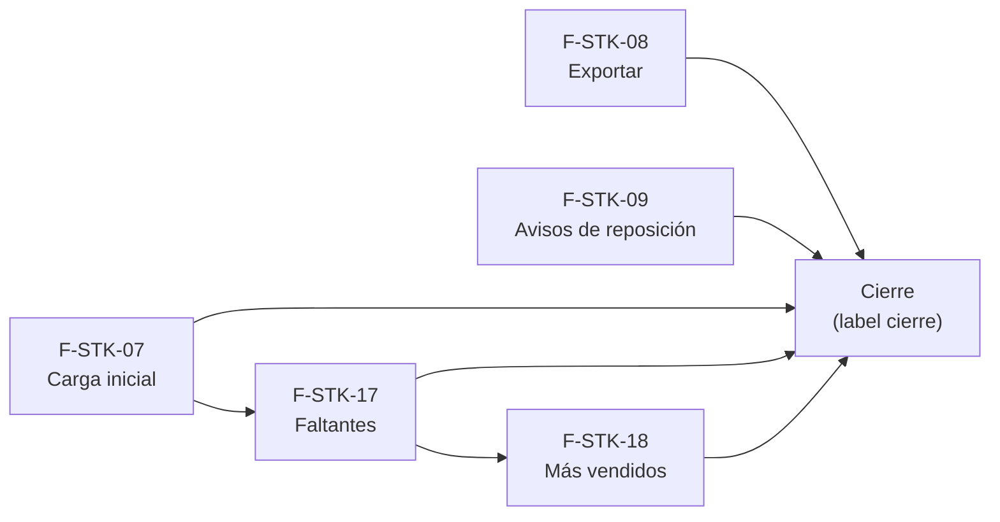

# Tasks: Stock · Stock carga, exportación y avisos

**Input**: `specs/20261024-130000-stock-carga-exportacion-y-avisos/` (spec.md, plan.md, contracts/)

**Formato**: `- [ ] T### [P] [STORY-x][USy] descripción`. **[P]** = paralelizable (archivos distintos, sin dependencia; las [P] del mismo grupo van en paralelo); sin [P] = secuencial. Las dependencias de cada historia son solo dentro de esa historia. Cada FR/SC tiene una única tarea dueña (entre paréntesis).

**Delivery scope**: `refine`, `supabase`, `kestra`

## Matriz de trazabilidad Jira ↔ US ↔ tasks

| Jira | Historia | FR / SC | Tasks |
|------|----------|---------|-------|
| F-STK-07 | US1 Carga inicial y masiva de stock | FR-001…FR-012, SC-001…SC-003 | T001–T011 |
| F-STK-08 | US2 Exportar stock y movimientos | FR-101…FR-108, SC-101, SC-102 | T012–T017 |
| F-STK-09 | US3 Avisos de reposición | FR-201…FR-208, SC-201, SC-202 | T018–T024 |
| F-STK-17 | US4 Faltantes con aviso de reposición | FR-301…FR-311, SC-301…SC-303 | T025–T040 |
| F-STK-18 | US5 Reporte de productos más vendidos | FR-401…FR-408, SC-401, SC-402 | T041–T049 |
| Tarea de cierre (label `cierre`) | Docs índice, seguridad y roadmap | SC-900 | T050–T052 |

## Phase 1: F-STK-07 · Carga inicial y masiva de stock (US1)

**Goal**: cargar el inventario desde una planilla `.xlsx`, ver qué filas son válidas y aplicar solo las válidas.

- [ ] T001 [F-STK-07][US1] Migración `20261206100000_stock_cargas_iniciales.sql` (esquema `dominio`, Principio VII): `dominio.cargas_iniciales_stock` con `unique (organizacion_id, producto_id)`, FK compuestas, RLS de solo lectura (`stock` `lectura`/`edicion`), sin escritura para `authenticated`, `anon` sin privilegios, reversión en el encabezado
- [ ] T002 [F-STK-07][US1] Migración `20261206100100_stock_carga_inicial_rpc.sql` — `validar_carga_stock(p_deposito, p_filas)`: SKU vacío, «SKU no existe», repetido, cantidad inválida, «Ya tuvo carga inicial», «Sin cambios», `motivo` ≤ 500; `revoke … from public, anon` + `grant … to authenticated` (FR-006)
- [ ] T003 [F-STK-07][US1] Misma migración: `aplicar_carga_inicial_stock(p_deposito, p_filas, p_clave)` — permiso `edicion`, revalida, bloquea por producto en orden estable, un ajuste por diferencia vía `registrar_movimiento_stock` (motivo de sistema «Carga inicial de stock», nota = `motivo`), inserta la carga inicial, solo filas válidas, todo o nada ante falla, idempotente por clave, evento `stock.carga_inicial` (FR-008, FR-009, FR-011, FR-012)
- [ ] T004 [P] [F-STK-07][US1] pgTAP `stock_carga_inicial.test.sql`: filas válidas + inválidas aplican solo las válidas; segunda carga del mismo producto rechazada; dos cargas simultáneas del mismo producto → una gana; misma clave no duplica; `lectura` → `42501`; `anon` sin ejecución; otra organización no ve cargas; aislamiento/RLS de la tabla nueva (SC-002, SC-003)
- [ ] T005 [P] [F-STK-07][US1] `apps/web/src/lib/cargaStock.ts`: plantilla `stock.xlsx` con `write-excel-file` (columnas `sku`, `cantidad`, `motivo`) y lectura/normalización de la planilla con `read-excel-file` (carga diferida; SKU recortado y numérico→texto; filas en blanco ignoradas; rechazo de no-.xlsx, vacío, sin encabezados o más de 2.000 filas); dependencia revisada con `supply-chain-security` (FR-002, FR-004)
- [ ] T006 [F-STK-07][US1] `apps/web/src/pages/stock/excel.tsx` — paso «1 · Planilla»: encabezado y texto, selector «Depósito de mercadería» (activos, predeterminado), «Elegir Excel»/«Cambiar archivo» con nombre y «N filas · hoja 1», tarjeta «Formato de la planilla» con la nota de reservas (FR-003)
- [ ] T007 [F-STK-07][US1] Misma pantalla — paso «2 · Diferencias a aplicar»: contadores «N cambios»/«N con error», tabla SKU · Producto · Stock actual · En planilla · Quedará · Diferencia · Validación (color por signo, filas con error resaltadas), pie «Se creará un movimiento de tipo Ajuste…», «Cancelar» y «Aplicar N ajustes» (deshabilitado con 0) (FR-005, FR-007)
- [ ] T008 [F-STK-07][US1] Misma pantalla — resultado: alerta «Stock actualizado. Se registraron N movimientos de ajuste. Podés verlos en Stock · Movimientos.», aviso «Stock actualizado en <depósito>», filas omitidas, error con reintento, clave estable contra doble envío (FR-010)
- [ ] T009 [F-STK-07][US1] Pestaña «Actualizar por Excel» (al final de la tira, después de «Faltantes» cuando exista) en `PestanasStock.tsx` y ruta `/stock/excel` con carga diferida en `App.tsx`, visible y operable solo con `edicion` en Stock (FR-001)
- [ ] T010 [P] [F-STK-07][US1] Vitest `excel.test.tsx` y `cargaStock.test.ts`: plantilla, lectura y rechazos, vista previa con filas mixtas, aplicar solo válidas, contadores, doble clic, rol `lectura` sin pestaña, la pantalla no consulta por empresa (SC-001)
- [ ] T011 [P] [F-STK-07][US1] Guía `docs/stock-carga-excel.md` (formato de planilla, reglas, carga inicial única, permisos, reversión) y contratos de F-STK-07 revisados en `contracts/`

**Checkpoint**: `pnpm test:db` y Vitest de F-STK-07 en verde; `pnpm docs:check`.

## Phase 2: F-STK-08 · Exportar stock y movimientos (US2)

**Goal**: sacar a CSV lo que se ve, con filtros y columnas visibles.

- [ ] T012 [F-STK-08][US2] `apps/web/src/lib/exportarCsv.ts`: armado del CSV (UTF-8 con BOM, `;`, CRLF, comillas escapadas), neutralización con `neutralizarFormula`, nombre `…-AAAA-MM-DD.csv` en la zona de la organización y descarga (FR-102, FR-105, FR-106)
- [ ] T013 [F-STK-08][US2] Hook `useExportarCsv`: pide por lotes la misma consulta que la pantalla (mismos filtros, sin paginar), tope de 100.000 filas con aviso, estado «Exportando…», error con reintento sin archivo parcial, sin filas → encabezados + «No hay filas para exportar» (FR-107)
- [ ] T014 [F-STK-08][US2] Integración en `pages/stock/list.tsx` y `pages/stock/movimientos.tsx`: botón «Exportar» en ambas, columnas declaradas en un solo arreglo compartido con la tabla (columnas visibles, sin acciones), filtros activos (búsqueda, estado, «Ver solo alertas», producto), disponible con `lectura` o `edicion` (FR-101, FR-103, FR-104, FR-108)
- [ ] T015 [P] [F-STK-08][US2] Vitest `exportarCsv.test.ts`: BOM, separador, comillas, `=`/`+`/`-`/`@` neutralizados, fechas y estados legibles, sin filas (SC-102)
- [ ] T016 [P] [F-STK-08][US2] Vitest de pantallas (`list.test.tsx`, `movimientos.test.tsx`): con filtros, el CSV tiene las mismas filas y columnas que la pantalla; falla de red sin descarga; rol `lectura` exporta (SC-101)
- [ ] T017 [P] [F-STK-08][US2] Guía `docs/stock-exportacion.md` (qué respeta la exportación, formato, tope, reversión: no hay SQL)

**Checkpoint**: Vitest de F-STK-08 en verde; `pnpm docs:check`.

## Phase 3: F-STK-09 · Avisos de reposición (US3)

**Goal**: resumen por correo de los productos que entraron en alerta, sin duplicar.

- [ ] T018 [F-STK-09][US3] Migración `20261206110000_stock_avisos_reposicion.sql` (esquema `dominio`): `stock_alertas_avisadas` y `stock_avisos_reposicion` con RLS por organización + `stock` `lectura`/`edicion`, sin escritura para `authenticated`, `anon` sin privilegios, reversión en el encabezado
- [ ] T019 [F-STK-09][US3] Migración `20261206110100_stock_resumen_reposicion_rpc.sql`: `generar_resumen_reposicion`, `cerrar_resumen_reposicion`, `organizaciones_con_resumen_pendiente` (solo `service_role`; nuevo en alerta = FR-202; reserva con vencimiento; marcas solo tras entrega exitosa; registro con estado, intentos y error sanitizado) (FR-201, FR-202, FR-206, FR-207, FR-208)
- [ ] T020 [F-STK-09][US3] Edge Function `supabase/functions/enviar-resumen-reposicion` (handler + adaptador como `enviar-aviso-consulta`): arma el correo (asunto «N productos sin stock y M con stock bajo», lista con «Sin stock» primero, tope 50 + total + enlace a `/stock`), obtiene destinatarios y entrega por el mecanismo de avisos de Plataforma (MSF-189; contrato a confirmar, ver `contracts/`); sin destinatarios → «sin destinatario» (FR-203, FR-204)
- [ ] T021 [F-STK-09][US3] Flow `infra/kestra/flows/avisos-reposicion-stock.yml` (barrido diario, hora editable; token en `.env.example` y secreto de Kestra) y `pnpm infra:config` verde (FR-205)
- [ ] T022 [P] [F-STK-09][US3] pgTAP `stock_resumen_reposicion.test.sql`: simular productos nuevos en alerta → contenido del resumen; segunda corrida sin cambios → nada; empeorar y salir/volver a alerta → avisa de nuevo; entrega fallida no marca; RPC no ejecutables por `authenticated`/`anon`; aislamiento (SC-201, SC-202)
- [ ] T023 [P] [F-STK-09][US3] Test del handler (`node --test`, como el de consultas): contenido del correo, tope de productos, sin destinatario, error de entrega cierra con error
- [ ] T024 [P] [F-STK-09][US3] Guía `docs/stock-avisos-reposicion.md` (qué es «nuevo en alerta», contenido, frecuencia, dependencia de MSF-189, variables, reversión)

**Checkpoint**: `pnpm test:db`, handler y `pnpm infra:config` en verde; `pnpm docs:check`.

## Phase 4: F-STK-17 · Faltantes con aviso de reposición (US4)

**Goal**: ver las líneas pedidas sin stock y avisar al cliente cuando el producto vuelve.

- [ ] T025 [F-STK-17][US4] Migración `20261206120000_faltantes_listado.sql`: vista `public.faltantes_listado` (`security_invoker`; facturas confirmadas, `a_pedido`, reserva activa por `referencia`, tiendas con `ventas` visible, estado/disponible de `stock_estados`, estado del aviso); `anon` sin acceso; reversión en el encabezado (FR-302)
- [ ] T026 [F-STK-17][US4] Migración `20261206120100_faltantes_avisos.sql` (esquema `dominio`): tabla `faltantes_avisos` (una fila por línea) con RLS por organización y tienda, sin escritura para `authenticated`; RPC `service_role` `faltantes_avisos_pendientes`, `tomar_aviso_faltante` (reserva 2 min, cuenta intento) y `cerrar_aviso_faltante` (agotado el tope → vuelve a «Sin avisar» y deja el error) (FR-309)
- [ ] T027 [F-STK-17][US4] Migración `20261206120200_avisar_faltantes.sql`: `avisar_faltantes(p_lineas)` — permiso `edicion` por tienda, omite ya avisadas / sin stock / sin correo / sin permiso, idempotente por línea, encola un correo por cliente, devuelve los conteos; `revoke … from public, anon` + `grant … to authenticated` (FR-307)
- [ ] T028 [F-STK-17][US4] Edge Function `supabase/functions/enviar-aviso-faltante` (patrón `enviar-aviso-consulta`: toma, correo con el detalle de los productos que volvieron a tener stock, cierre, tope de intentos, error sanitizado; un fallo no toca venta ni stock) (FR-308)
- [ ] T029 [F-STK-17][US4] Flow `infra/kestra/flows/avisos-faltantes.yml` (barrido cada minuto, como `avisos-consultas.yml`), token en `.env.example` y `pnpm infra:config` verde
- [ ] T030 [P] [F-STK-17][US4] pgTAP `faltantes_listado.test.sql`: lista exactamente las líneas «A pedido» de facturas confirmadas con reserva activa; se cierra al descontar/liberar; borrador/presupuesto no aparecen; tienda sin `ventas` no ve filas; otra organización aislada; `anon` sin acceso (SC-301)
- [ ] T031 [P] [F-STK-17][US4] pgTAP `faltantes_avisos.test.sql`: `avisar_faltantes` marca y encola un correo por cliente, no repite, omite sin stock/sin correo/sin permiso; toma/cierre; agotado vuelve a «Sin avisar»; RPC de `service_role` no ejecutables por `authenticated`/`anon` (SC-302)
- [ ] T032 [F-STK-17][US4] `apps/web/src/lib/faltantes.ts` + hook de lista (consulta de `faltantes_listado` con tienda, paginación y selección) y llamada a `avisar_faltantes`
- [ ] T033 [F-STK-17][US4] `apps/web/src/pages/stock/faltantes.tsx` — tabla con casilla por fila y «seleccionar todo», columnas Tienda · Cliente · Producto · Pedido · Comprobante (enlace) · Desde · Stock hoy · Aviso, pie con «N seleccionados de M faltantes» y la frase de cierre, estados cargando/vacío («No hay faltantes»)/error (FR-303, FR-305, FR-310)
- [ ] T034 [F-STK-17][US4] Filtro de tienda con `FiltroEmpresa` («Todas las tiendas» + una por empresa), texto de ayuda y empresa activa de la barra superior (FR-304)
- [ ] T035 [F-STK-17][US4] Botón «Avisar a los seleccionados (N)» y diálogo «Avisar a los clientes» («Cancelar»/«Enviar avisos»), aviso «Avisos enviados» con los omitidos por falta de stock o de correo (FR-306)
- [ ] T036 [F-STK-17][US4] Pestaña «Faltantes» (antes de «Actualizar por Excel») en `PestanasStock.tsx` y ruta `/stock/faltantes` con carga diferida en `App.tsx`, con el título «Faltantes» y el subtítulo del prototipo (FR-301)
- [ ] T037 [F-STK-17][US4] Reencuadre por empresa activa: invalida todas las consultas, reencuadra la paginación, descarta la selección que ya no existe y cierra con aviso el diálogo abierto (FR-311)
- [ ] T038 [P] [F-STK-17][US4] Vitest `faltantes.empresa.test.tsx`: cambiar de empresa recarga la lista, reencuadra y cierra el diálogo; nunca muestra filas de la empresa anterior (SC-303)
- [ ] T039 [P] [F-STK-17][US4] Vitest `faltantes.test.tsx`: columnas, selección, contadores, diálogo, resultado con omitidos, rol sin `edicion` no avisa
- [ ] T040 [P] [F-STK-17][US4] Guía `docs/stock-faltantes.md` (definición de faltante, ciclo de vida, aviso, reversión) y nota sobre MSF-135

**Checkpoint**: `pnpm test:db`, Vitest de F-STK-17 y `pnpm infra:config` en verde; `pnpm docs:check`.

## Phase 5: F-STK-18 · Reporte de productos más vendidos (US5)

**Goal**: ranking de productos por unidades vendidas en un período.

- [ ] T041 [F-STK-18][US5] Migración `20261206130000_productos_mas_vendidos.sql`: `productos_mas_vendidos` (`security definer`, `search_path = ''`, `stock` `lectura`/`edicion`, tiendas con `ventas` visible, `comprobante_cuenta_como_facturado`, rango máximo 5 años, `p_empresa_id` ajena → 0 filas); `revoke … from public, anon` + `grant … to authenticated`; reversión en el encabezado (FR-402, FR-403, FR-408)
- [ ] T042 [P] [F-STK-18][US5] pgTAP `productos_mas_vendidos.test.sql`: suma solo líneas de facturas que cuentan, en período y tienda; presupuestos/borradores/anuladas no suman; orden y desempate; tienda ajena → 0 filas; `anon` sin ejecución; sin sesión `42501` (SC-401)
- [ ] T043 [F-STK-18][US5] `apps/web/src/lib/masVendidos.ts` + hook: período con atajos (Este mes, Mes anterior, Últimos 90 días, Año en curso) y rango Desde/Hasta reutilizando `periodosRanking` (FR-404)
- [ ] T044 [F-STK-18][US5] `apps/web/src/pages/stock/mas-vendidos.tsx`: tabla Posición · Producto (nombre y SKU) · Unidades vendidas, orden y paginación (25 por página) (FR-405)
- [ ] T045 [F-STK-18][US5] Filtro de tienda con `FiltroEmpresa` y empresa activa de la barra superior, con reencuadre completo al cambiarla (FR-406)
- [ ] T046 [F-STK-18][US5] Estados compartidos: cargando, vacío «No hay ventas en el período», error con reintento (FR-407)
- [ ] T047 [F-STK-18][US5] Pestaña «Más vendidos» en `PestanasStock.tsx` y ruta `/stock/mas-vendidos` con carga diferida en `App.tsx`; anotar en el PR que no hay prototipo (FR-401)
- [ ] T048 [P] [F-STK-18][US5] Vitest `mas-vendidos.test.tsx`: período, tienda, cambio de empresa recalcula y reencuadra, estado vacío (SC-402)
- [ ] T049 [P] [F-STK-18][US5] Guía `docs/stock-mas-vendidos.md` (qué cuenta, período, tienda, permisos, reversión)

**Checkpoint**: `pnpm test:db` y Vitest de F-STK-18 en verde; `pnpm docs:check`.

## Phase 6: Cierre (docs índice, seguridad y roadmap)

- [ ] T050 [CIERRE] Enlazar las cinco guías desde `docs/stock.md`, actualizar `docs/guia-funcional.md` si corresponde y correr `pnpm docs:check`
- [ ] T051 [CIERRE] Revisión de seguridad y esquemas: `rls_en_toda_tabla`/`aislamiento_organizaciones` verdes con las 4 tablas nuevas, test de `anon` sin las RPC nuevas, re-verificar el esquema declarado de cada tabla (Principio VII), revisión de autorización de las RPC con `authz-security`, `pnpm lint`, `pnpm build`, `pnpm test` (SC-900)
- [ ] T052 [CIERRE] Roadmap: fila de esta spec en `docs/roadmap-template.md` (estado, link a la spec) como paso manual del cierre

**Checkpoint**: sin tareas `[ ]`; toda tarea hecha con evidencia o cerrada con `Desvío:` y seguimiento trazado.

## Plan de ejecución (historias)

| Historia | Depende de | Grupo |
|----------|------------|-------|
| F-STK-07 | — | 1 |
| F-STK-08 | — | 1 |
| F-STK-09 | — | 1 |
| F-STK-17 | F-STK-07 | 2 |
| F-STK-18 | F-STK-17 | 3 |
| [Cierre] | F-STK-07, F-STK-08, F-STK-09, F-STK-17, F-STK-18 | 4 |

F-STK-07, F-STK-08 y F-STK-09 no comparten archivos ni tablas y corren en paralelo. F-STK-07, F-STK-17 y F-STK-18 editan `PestanasStock.tsx` y `App.tsx` (una línea cada una), por eso van en grupos sucesivos.

