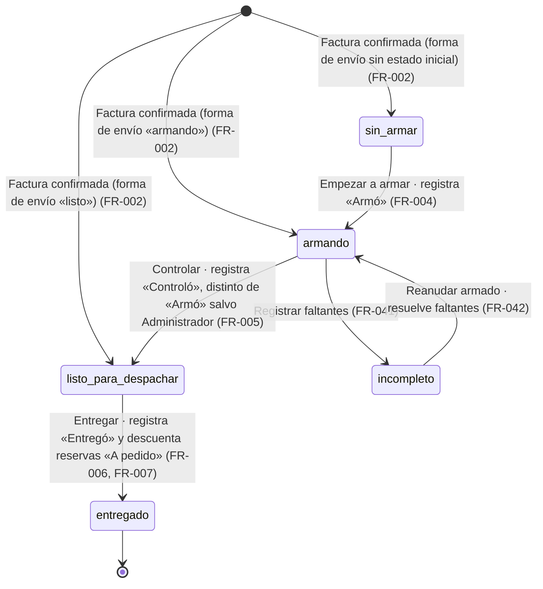
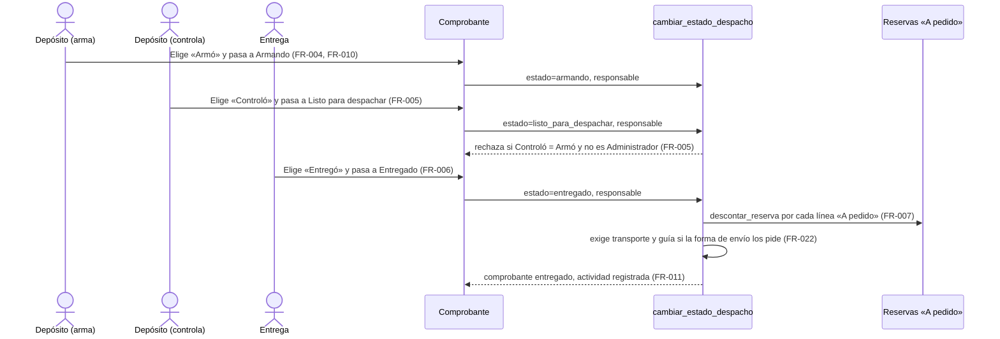

# Feature Specification: Ventas y despacho · Ventas despacho y faltantes

**Feature Branch**: `epic/MSF-135-ventas-y-despacho-ventas-despacho-y-falt`

**Jira Epic**: MSF-135 — Ventas y despacho · Ventas despacho y faltantes (spec `ventas-despacho-y-faltantes`)

**Created**: 2026-10-24

**Status**: Spec aprobada — **en espera de MSF-177** (Blocked, decisión del CTO, AGE-1084, 2026-10-24); no se despacha F-VTA-15 hasta que MSF-177 esté Dev Deployed (ver *Espera de MSF-177*). La especificación viene completa desde Jira. Los puntos de «A revisar» no bloquean: cada uno lleva decisión provisoria en *Decisiones abiertas*.

**Delivery scope**: `refine` (apps/web) y `supabase` (migraciones + RPC + pgTAP). Sin `kestra`, `superset` ni `workers`.

**Prioridad / Hito**: P0 · Hito 4 (30 de noviembre al 11 de diciembre de 2026) · 25 h (el roadmap a diciembre asigna 20 h a «Despacho» y 23 h a «Devoluciones RMA y faltantes con aviso»; ver *Decisiones abiertas* 6) · alcance diciembre.

**Dependencias**:
- Bloqueada por: MSF-159 (ventas-comprobantes: reservas de stock y columnas de despacho). MSF-139 (transportes, formas de envío) llega por cadena (MSF-139 → MSF-159). Desbloqueada y desplegada en DEV según Jira (2026-10-24).
- Bloquea a: MSF-161 (Ventas avisos de faltantes), de la otra mitad del componente.
- **Bloqueo operativo vigente: MSF-177** (listado, estados y anulación; mismo componente, solape de módulos, archivos y tabla). Dependencia declarada MSF-159: **cumplida** (`Dev Deployed At` 2026-10-21, PR #342 en `dokploy`). MSF-177 no está Dev Deployed (solo F-VTA-10 / MSF-365 en revisión, PR #356). Sus estados Armando e Incompleto se solapan con `estado_despacho` (*Decisiones abiertas* 1 y *Espera de MSF-177*).
- **Estado verificado**: este worktree parte de `main` sin la rama de MSF-159; los objetos de MSF-159 se verificaron en `origin/epic/MSF-159-ventas-y-despacho-ventas-comprobantes` (spec `20261023-100000-ventas-comprobantes`, migraciones `20261203…`–`20261204…`). Existen en `main`: `dominio.formas_envio` (con `exige_transporte_guia` y `estado_despacho_inicial`), `dominio.transportes` y `dominio.transportes_empresas`, `dominio.reservas_stock` + `public.descontar_reserva(uuid)`, `dominio.depositos`/`existencias_deposito`, `private.rol_en_empresa(uuid)`, `private.puede_accion`, el rol `deposito` y `private.registrar_actividad`. Los nombres y firmas se **re-verifican contra `main` al implementar**; si MSF-159 no está mergeada, las historias esperan (tabla *Plan de ejecución* en `tasks.md`).

**Input**: Epic MSF-135. Objetivo: «Al terminar, cada factura confirmada pasa por armado, control y entrega con el responsable de cada paso, sale con transporte y guía, y lo que no se pudo despachar por falta de stock queda registrado como faltante.»

**Regla de fuentes** (literal de la épica):
- Comportamiento y datos: mandan los requisitos y escenarios de esta historia.
- Qué se ve (disposición, textos, estados, popups, flujos): el prototipo validado es referencia visual, no hace falta que quede extremadamente idéntico; los flujos (si hay) aclaran estados y acciones.
- Cómo se construye (componentes, estilos y patrones): mandan el template y el system design del producto (MSF-117, `docs/sistema-de-diseno.md`). No se copia HTML ni CSS del prototipo.
- El prototipo muestra más que esta historia: se implementa solo lo que piden los requisitos; otras secciones, botones o diálogos son de otras historias.
- Si algo no se puede igualar: lo más cercano, sin inventar, anotando la diferencia en la descripción del PR. Si prototipo y requisitos se contradicen: requisitos para el comportamiento, prototipo para lo visual, y la contradicción queda anotada en el PR.
- Prototipos (solo lectura): `design/pantallas/VentasComprobante.dc.html` (armado, control, entrega, transporte y guía), `VentasFaltantes.dc.html` y `VentasTransportes.dc.html` (catálogo que ya existe por MSF-139). Inventarios al día en `design/pantallas/*.inventory.json` (`pnpm prototipo:check` verde). **No existe artboard «Despacho»/«Tablero»** para F-VTA-17.

## Modelo y supuestos

- **Los comprobantes son internos**, no facturas fiscales de ARCA. El despacho aplica solo a `factura` confirmada; el presupuesto nunca entra al despacho.
- **Responsables** (armó, controló, entregó): usuarios del equipo con acceso a Ventas en la empresa del comprobante.
- **Quién arma y controla**: usuarios con rol **Depósito** (más el Administrador). Quien armó **no puede ser quien controló, salvo el Administrador**.
- **Estado de despacho** (`estado_despacho`): campo propio, **separado** del `estado` documental de MSF-159 (`borrador`/`confirmada`; `anulada` es de MSF-177). Valores: `sin_armar`, `armando`, `incompleto`, `listo_para_despachar`, `entregado` (los tres primeros de entrada ya existen como `estado_despacho_inicial` de la forma de envío, MSF-139).
- **Stock**: la factura ya descontó al confirmar (MSF-159). Solo las líneas «A pedido» tienen **reserva activa**; **se descuentan al pasar a Entregado** (`descontar_reserva`). Los productos normales no se vuelven a tocar (*Decisiones abiertas* 5).
- **Faltante**: línea de una factura que no se pudo armar por falta de stock. Aquí **solo se registra**; el aviso al cliente es P1 (MSF-161). Un registro de faltante no mueve stock (corregir el stock es de Stock · toma de inventario).
- **Transporte y guía**: el catálogo de transportes y las formas de envío (MSF-139) ya existen; esta épica solo **elige** el transporte, carga la guía y la fecha de envío en el comprobante.

### Esquema de datos (Constitución, Principio VII)

| Objeto | Esquema | Justificación | RLS / acceso |
|--------|---------|---------------|--------------|
| `comprobantes_venta` (**existente**; se **altera** aditivamente en F-VTA-15 con `estado_despacho`, `armo_id`, `controlo_id`, `entrego_id`, `entregado_en`, y en F-VTA-16 con `transporte_id`, `guia`, `fecha_envio`) | **`dominio`** | Documento de venta: entidad de negocio del producto. | RLS vigente (select por organización y sección `ventas`). **Sin políticas ni grants de escritura nuevos**: se escribe solo por RPC `security definer`. `anon` sin acceso. |
| `faltantes_venta` (**nueva**, F-VTA-18) | **`dominio`** | Registro de negocio de lo no despachado por falta de stock. | `organizacion_id` + FK compuestas a comprobante, producto y depósito; select por organización, sección `ventas` (`lectura`/`edicion`) y empresa accesible; **escritura solo por RPC**; sin `delete`; `anon` sin acceso. |
| `permisos_rol_accion` (**existente**; F-VTA-15 agrega la acción `despachar` en `ventas` como **dato** y amplía su `check`) | `public` (sin cambio de esquema) | Mecanismo de acceso transversal. | RLS vigente. |
| `public.registro_actividad` (**existente**) | `public` (sin cambio) | Auditoría transversal vía `private.registrar_actividad`. | Vigente. |

No se crean otras tablas. `rls_en_toda_tabla` (pgTAP, recorre `public` + `dominio`) debe seguir verde. Todas las migraciones son **aditivas**, con reversión en su encabezado; **cada historia trae su propia migración** (timestamps propios, sin encadenarse a las de otra historia). Re-verificación de esquema por tabla en spec, plan, tareas, implementación y PR (Principio VII).

## Flujos

### Flujo 1 · Estado de despacho de una factura (máquina de estados)



Cada transición exige la acción `despachar` (FR-008), usa bloqueo optimista (FR-003) y queda en la actividad (FR-011). `entregado` es terminal. `anulada` y la anulación de una factura entregada son de MSF-177 (FUERA).

### Flujo 2 · Armado, control y entrega (secuencia)



### Flujo 3 · Registro de un faltante (proceso)

```mermaid
flowchart TD
    A[Pedido en Armando] --> B{¿Alcanza el stock para armar una línea?}
    B -- sí --> Z[Sigue el armado]
    B -- no --> C["Estado Incompleto: elegir línea y cantidad faltante (FR-041, FR-047)"]
    C --> D{¿Cantidad entre 1 y lo pedido de la línea?}
    D -- no --> E[Rechaza con mensaje claro, sin cambios]
    D -- sí --> F["Guarda faltante abierto, una vez por línea (FR-040, FR-041)"]
    F --> G[Aparece en Ventas · Faltantes (FR-043, FR-044)]
    G --> H["Llega mercadería: Reanudar armado → faltantes resueltos (FR-042)"]
```

## User Scenarios & Testing *(mandatory)*

### User Story 1 - Armado, control y entrega con responsables (F-VTA-15, P0, talla M)

Cada factura confirmada tiene un estado de despacho y, en cada paso, un responsable: quien armó, quien controló y quien entregó.

**Why this priority**: sin esto el pedido confirmado no tiene seguimiento ni responsables. Es la base de las otras tres historias.

**Independent Test**: confirmar una factura; pasarla a Armando con un usuario Depósito, controlarla con otro y entregarla; el comprobante muestra los tres responsables y la reserva «A pedido» queda descontada.

**Acceptance Scenarios**:
1. **Given** una factura recién confirmada, **Then** tiene `estado_despacho` igual al estado inicial de su forma de envío (o `sin_armar` si no se resuelve) y no depende de reintentos de la confirmación.
2. **Given** una factura `sin_armar`, **When** un usuario con `despachar` elige un «Armó» válido y avanza, **Then** pasa a `armando` con ese responsable.
3. **Given** una factura `armando` armada por X, **When** se intenta controlar con X, **Then** se rechaza salvo que X sea Administrador.
4. **Given** una factura `listo_para_despachar` con líneas «A pedido», **When** se entrega con un «Entregó» válido, **Then** pasa a `entregado` y cada reserva activa queda descontada, todo o nada.
5. **Given** una transición no permitida (p. ej. `sin_armar` → `entregado`) o un responsable sin el rol requerido, **Then** se rechaza con mensaje en castellano y sin cambios.
6. **Given** un usuario con Ventas en `lectura` sin la acción `despachar`, **Then** ve el estado y los responsables pero no puede avanzar.

### User Story 2 - Transporte y guía de envío (F-VTA-16, P0, talla S)

La factura que sale con transporte lo registra con su guía y fecha de envío.

**Independent Test**: una factura con forma de envío «Expreso» no puede pasar a Entregado sin transporte y guía; con «Retiro en local» sí.

**Acceptance Scenarios**:
1. **Given** una factura confirmada cuya forma de envío exige transporte y guía, **When** se elige un transporte activo de la empresa y se carga la guía, **Then** se guardan junto con la fecha de envío.
2. **Given** esa factura sin transporte o sin guía, **When** se intenta entregar, **Then** se rechaza indicando qué falta.
3. **Given** una forma de envío «Retiro en local», **Then** se muestra «El cliente retira en el local. No hace falta transporte ni guía.» y se entrega sin ellos.
4. **Given** un transporte inactivo o que no se usa en la empresa del comprobante, **Then** no se puede elegir.

### User Story 3 - Tablero de despacho (F-VTA-17, P0, talla M)

El equipo ve todas las facturas por despachar y su estado.

**Independent Test**: con facturas en cada estado, el tablero cuenta y filtra por estado; cambiar la empresa activa recarga la lista; abrir una fila lleva al comprobante.

**Acceptance Scenarios**:
1. **Given** facturas confirmadas, **When** se abre el tablero, **Then** se listan con número, tienda, fecha, cliente, estado de despacho, responsables, transporte y guía.
2. **Given** el filtro de estado, **Then** muestra solo ese estado y los conteos por estado.
3. **Given** otra empresa activa en la barra superior, **Then** la lista se reencuadra y no muestra filas de la anterior.
4. **Given** una factura anulada (MSF-177) o un presupuesto, **Then** no aparece.

### User Story 4 - Registro de faltantes (F-VTA-18, P0, talla S)

Lo que no se pudo despachar por falta de stock queda registrado y consultable.

**Independent Test**: en un pedido en Armando, registrar 3 unidades faltantes de una línea de 10 lo pasa a Incompleto y la línea aparece en Ventas · Faltantes con cliente, producto, comprobante, desde y stock de hoy.

**Acceptance Scenarios**:
1. **Given** una factura en `armando`, **When** se registra una cantidad entre 1 y lo pedido para una línea, **Then** se guarda un faltante abierto y la factura pasa a `incompleto`.
2. **Given** un faltante ya abierto de esa línea, **When** se vuelve a registrar, **Then** se actualiza la cantidad (no se duplica).
3. **Given** una cantidad 0, negativa o mayor a la de la línea, **Then** se rechaza sin cambios.
4. **Given** una factura que vuelve de `incompleto` a `armando`, **Then** sus faltantes pasan a resueltos y dejan de listarse.
5. **Given** la pantalla Faltantes, **Then** lista solo los abiertos de las empresas accesibles, con «Sin resultados» cuando no hay.

### Edge Cases

- Reintento de la misma transición sobre el estado ya alcanzado: idempotente, sin duplicar actividad ni descuentos.
- Dos personas avanzan el mismo pedido a la vez: gana la primera; la segunda recibe conflicto por `p_actualizado_en` (`40001`).
- Responsable de otra organización, suspendido o sin acceso a la empresa: se rechaza.
- Cambio de empresa activa con un comprobante o diálogo abierto: se cierra con aviso (Principio VIII).
- Falla de `descontar_reserva` en una línea «A pedido»: la entrega no se aplica (todo o nada).
- Una factura sin líneas «A pedido» se entrega sin tocar stock.

## Requirements *(mandatory)*

### Functional Requirements

**F-VTA-15 — Armado, control y entrega con responsables**

- **FR-001**: `dominio.comprobantes_venta` gana, de forma aditiva, `estado_despacho` (`sin_armar` | `armando` | `incompleto` | `listo_para_despachar` | `entregado`, nulable, solo para `tipo = 'factura'`), `armo_id`, `controlo_id`, `entrego_id` (→ `auth.users`, `on delete set null`) y `entregado_en`. **Verificación**: `supabase/tests/despacho_estados.test.sql` (columnas, check de valores y solo `factura`; T006).
- **FR-002**: Al pasar una factura a `confirmada` se fija `estado_despacho` con el `estado_despacho_inicial` de su forma de envío (`envio_id`), o `sin_armar` si no resuelve; una sola vez, sin tocar `confirmar_comprobante`. **Verificación**: `supabase/tests/despacho_estados.test.sql` (estado inicial por forma de envío y `sin_armar` por defecto; T006).
- **FR-003**: `cambiar_estado_despacho` solo admite las transiciones del Flujo 1 (`incompleto` lo fija FR-041), usa bloqueo optimista por `p_actualizado_en`, es idempotente ante el estado ya alcanzado y rechaza comprobantes que no sean factura en estado vivo (MSF-598: confirmada, aceptado, en proceso, armando, incompleto, cobrado o deuda; se rechazan borrador, pendiente y anulada — el estado documental/de cobro es independiente del de despacho). **Verificación**: `supabase/tests/despacho_estados.test.sql` (transiciones válidas/inválidas, conflicto `40001`, idempotencia, despacho de factura cobrada/en deuda y rechazo de anulada; T006).
- **FR-004**: Pasar a `armando` exige un «Armó» con rol Depósito o Administrador en la empresa del comprobante. **Verificación**: `supabase/tests/despacho_estados.test.sql` (Armó con rol Depósito/Administrador; T006).
- **FR-005**: Pasar a `listo_para_despachar` exige un «Controló» con rol Depósito o Administrador y distinto de «Armó», salvo que sea Administrador. **Verificación**: `supabase/tests/despacho_estados.test.sql` (Controló ≠ Armó y excepción del Administrador; T006).
- **FR-006**: Pasar a `entregado` exige un «Entregó» elegible (*Decisiones abiertas* 2) y fija `entregado_en`. **Verificación**: `supabase/tests/despacho_estados.test.sql` (Entregó elegible y `entregado_en`; T006).
- **FR-007**: Al pasar a `entregado` se descuentan, en la misma transacción, las reservas activas de las líneas «A pedido» (`public.descontar_reserva`, referencia `comprobante:<id>:linea:<orden>`); todo o nada; sin tocar las líneas de stock normal. **Verificación**: `supabase/tests/despacho_entrega.test.sql` (reservas descontadas, todo o nada, stock normal intacto; T007).
- **FR-008**: Nueva acción `despachar` en `ventas` (datos en `permisos_rol_accion`: Administrador y Depósito) que habilita las RPC de despacho aun con Ventas en `lectura`. **Verificación**: `supabase/tests/despacho_estados.test.sql` (`lectura` sin `despachar` rechazada, `lectura` con `despachar` avanza; T006).
- **FR-009**: `listar_responsables_despacho(p_empresa_id, p_funcion)` devuelve los usuarios elegibles de la empresa (nombre y rol) para `armar`, `controlar` o `entregar`. **Verificación**: `supabase/tests/despacho_estados.test.sql` (elegibles por función y empresa, otra organización sin filas; T006).
- **FR-010**: El comprobante muestra el estado de despacho (chip y texto de ayuda), la tarjeta «Responsables» (Operador en lectura; Armó, Controló y Entregó con selector «Seleccionar») y las acciones para avanzar al siguiente paso, con estados de carga, error y éxito del kit de panel. **Verificación**: `ResponsablesDespacho.test.tsx` (chip, tarjeta, selectores, acciones por estado, carga/error/éxito; T011).
- **FR-011**: Cada transición registra una actividad `despacho.estado_cambiado` con estado anterior, nuevo y responsable. **Verificación**: `supabase/tests/despacho_estados.test.sql` (actividad `despacho.estado_cambiado` con anterior, nuevo y responsable; T006).
- **FR-012**: La tarjeta y sus diálogos respetan la empresa activa (Principio VIII): al cambiar de empresa se cierran con aviso y no guardan datos bajo otra tienda. **Verificación**: `ResponsablesDespacho.test.tsx` (cambio de empresa con diálogo abierto; T011).

**F-VTA-16 — Transporte y guía de envío**

- **FR-020**: `comprobantes_venta` gana `transporte_id` (FK compuesta a `dominio.transportes (id, organizacion_id)`), `guia` (texto ≤ 100) y `fecha_envio` (date). **Verificación**: `supabase/tests/envio_transporte.test.sql` (columnas y FK compuesta a `transportes`; T016).
- **FR-021**: `guardar_envio_comprobante` guarda transporte, guía y fecha de envío de una factura confirmada no entregada; el transporte debe estar activo y asignado a la empresa del comprobante; permiso `despachar` o `edicion` en la empresa; bloqueo optimista. **Verificación**: `supabase/tests/envio_transporte.test.sql` (transporte inactivo/ajeno rechazado, permisos, bloqueo optimista; T016).
- **FR-022**: Pasar a `entregado` se rechaza si la forma de envío tiene `exige_transporte_guia` y falta transporte o guía. **Verificación**: `supabase/tests/envio_transporte.test.sql` (exigencia al entregar y retiro en local sin exigencia; T016).
- **FR-023**: El bloque «Envío y transporte» del comprobante muestra, según la forma de envío, el selector de transporte (rótulo «Transporte / expreso», «Correo» o «Mensajería propia»), Guía y Fecha de envío; para «Retiro en local» muestra «El cliente retira en el local. No hace falta transporte ni guía.»; respeta la empresa activa y los estados del kit. **Verificación**: `EnvioTransporte.test.tsx` (rótulos por tipo, retiro en local, estados del kit, cambio de empresa; T019).

**F-VTA-17 — Tablero de despacho**

- **FR-030**: `listar_despacho(p_busqueda, p_estado, p_empresa_id, p_pagina, p_tamano)` devuelve las facturas confirmadas no anuladas con su estado de despacho, responsables, transporte y guía, filtrables por estado, búsqueda por cliente o número y empresa, paginadas en el servidor, con conteo por estado. **Verificación**: `supabase/tests/despacho_listar.test.sql` (filtros, búsqueda, conteos, paginación, anuladas excluidas, aislamiento; T022).
- **FR-031**: Pantalla «Despacho» (`/ventas/despacho`) con tabla (tarjetas en pantallas angostas), búsqueda «Buscar por cliente o número», filtro por estado con conteos, paginación, estados vacío («Sin resultados»), carga y error con «Reintentar»; cada fila abre el comprobante. **Verificación**: `despacho.test.tsx` (columnas, búsqueda, filtro, vacío/error con «Reintentar», fila abre comprobante; T026).
- **FR-032**: Navegación: entrada «Despacho» en Ventas del menú (icono declarado en el plan), ruta protegida por la sección `ventas`. **Verificación**: `despacho.test.tsx` y `destinosPanel.test.ts` (entrada de menú y ruta protegida por `ventas`; T026).
- **FR-033**: El tablero sigue la empresa activa: filtro de tienda con `FiltroEmpresa`, recarga todas las consultas al cambiar de empresa y reencuadra la paginación. **Verificación**: `despacho.test.tsx` (cambio de empresa recarga y reencuadra la paginación; T026).

**F-VTA-18 — Registro de faltantes**

- **FR-040**: Nueva tabla `dominio.faltantes_venta` (organización, empresa, comprobante, línea, producto, depósito, `cantidad_faltante > 0`, `estado` `abierto`|`resuelto`, `registrado_por`, `creado_en`, `resuelto_en`), única por línea abierta, con RLS y escritura solo por RPC. **Verificación**: `supabase/tests/faltantes.test.sql` (tabla, cantidad > 0, único abierto por línea, `rls_en_toda_tabla`; T032).
- **FR-041**: `registrar_faltantes_despacho` registra uno o más faltantes de una factura en `armando` (cantidad entre 1 y lo pedido de la línea; actualiza el abierto existente) y la pasa a `incompleto`, todo o nada, con actividad `despacho.faltante_registrado`. **Verificación**: `supabase/tests/faltantes.test.sql` (cantidad inválida, upsert sin duplicar, paso a `incompleto`, todo o nada; T032).
- **FR-042**: Al volver una factura de `incompleto` a `armando`, sus faltantes abiertos pasan a `resuelto` (*Decisiones abiertas* 3). **Verificación**: `supabase/tests/faltantes.test.sql` (faltantes abiertos pasan a `resuelto` al reanudar; T032).
- **FR-043**: `listar_faltantes(p_empresa_id, p_pagina, p_tamano)` devuelve los faltantes abiertos de las empresas accesibles con cliente, producto (nombre y SKU), cantidad, comprobante, fecha de registro y el stock de hoy (estado y disponible por la lectura de Stock existente). **Verificación**: `supabase/tests/faltantes.test.sql` (`listar_faltantes`: abiertos, empresas accesibles, stock de hoy; T032).
- **FR-044**: Pantalla «Faltantes» (`/ventas/faltantes`) con título «Faltantes», filtro de tienda y su texto «Por defecto se ven todas; si elegís una empresa en la barra superior, se filtra por esa tienda.», tabla Tienda, Cliente, Producto (con SKU), Pedido, Comprobante, Desde, Stock hoy, paginación y estados vacío («Sin resultados»), carga y error. **Verificación**: `faltantes.test.tsx` (título, filtro y texto, columnas, paginación, «Sin resultados», carga/error; T037).
- **FR-045**: Navegación: entrada «Faltantes» en Ventas del menú, ruta protegida por la sección `ventas`. **Verificación**: `faltantes.test.tsx` y `destinosPanel.test.ts` (entrada de menú y ruta protegida por `ventas`; T037).
- **FR-046**: La pantalla sigue la empresa activa: recarga todas sus consultas y reencuadra la paginación al cambiar de empresa. **Verificación**: `faltantes.test.tsx` (cambio de empresa recarga y reencuadra; T037).
- **FR-047**: En el comprobante, elegir el estado «Incompleto» abre el diálogo «Registrar faltantes» (línea y cantidad faltante) que usa FR-041; cierra con aviso si cambia la empresa activa. **Verificación**: `RegistrarFaltantesDialog.test.tsx` (diálogo al elegir «Incompleto», validaciones, cierre con aviso al cambiar de empresa; T037).

### Success Criteria

Cada FR y SC nombra su verificación (archivo de prueba o comando) al final de su línea; los archivos de pgTAP viven en `supabase/tests/` y los de Vitest junto a su componente o página en `apps/web`.

- **SC-001** *(F-VTA-15)*: pgTAP de transiciones y responsables: estado inicial, transiciones válidas e inválidas, rol Depósito, regla Armó ≠ Controló (y excepción del Administrador), conflicto por `p_actualizado_en`, `lectura` sin `despachar` rechazada, `anon` sin acceso, otra organización sin filas. **Verificación**: `pnpm test:db` (ejecuta `despacho_estados.test.sql`).
- **SC-002** *(F-VTA-15)*: pgTAP de entrega: reservas «A pedido» descontadas, todo o nada si una falla, idempotencia y stock normal intacto. **Verificación**: `pnpm test:db` (ejecuta `despacho_entrega.test.sql`).
- **SC-003** *(F-VTA-15)*: Vitest de la tarjeta de responsables: selectores, acciones por estado, errores, solo lectura y cambio de empresa. **Verificación**: `pnpm --filter @platform/web test ResponsablesDespacho`.
- **SC-004** *(F-VTA-16)*: pgTAP de transporte y guía: transporte inactivo o ajeno rechazado, exigencia al entregar según la forma de envío, retiro sin exigencia, permisos. **Verificación**: `pnpm test:db` (ejecuta `envio_transporte.test.sql`).
- **SC-005** *(F-VTA-16)*: Vitest del bloque de envío: rótulos por tipo, retiro en local, errores y cambio de empresa. **Verificación**: `pnpm --filter @platform/web test EnvioTransporte`.
- **SC-006** *(F-VTA-17)*: pgTAP de `listar_despacho`: filtros, conteos, anuladas y presupuestos excluidos, aislamiento por organización y empresa. **Verificación**: `pnpm test:db` (ejecuta `despacho_listar.test.sql`).
- **SC-007** *(F-VTA-17)*: Vitest del tablero: columnas, filtros, vacío/error, `lectura`, **cambio de empresa**. **Verificación**: `pnpm --filter @platform/web test despacho`.
- **SC-008** *(F-VTA-18)*: pgTAP de faltantes: validación de cantidad, no duplicados, paso a Incompleto, resolución al reanudar, `listar_faltantes` y aislamiento; `rls_en_toda_tabla` verde. **Verificación**: `pnpm test:db` (ejecuta `faltantes.test.sql` y `rls_en_toda_tabla`).
- **SC-009** *(F-VTA-18)*: Vitest de Faltantes y del diálogo «Registrar faltantes»: columnas, vacío, validaciones, **cambio de empresa**. **Verificación**: `pnpm --filter @platform/web test faltantes RegistrarFaltantesDialog`.
- **SC-010** *(Cierre)*: revisión de seguridad (RLS, `security definer`, permisos de RPC, esquemas), docs e índice, fila del roadmap, `pnpm lint`, `pnpm build`, `pnpm test`, `pnpm docs:check`, `pnpm prototipo:check` y `pnpm matriz:check` verdes. **Verificación**: `pnpm lint`, `pnpm build`, `pnpm test`, `pnpm docs:check`, `pnpm prototipo:check`, `pnpm matriz:check`.

## Espera de MSF-177 (decisión del CTO, AGE-1084)

Espera de dependencia **legítima**, no un cuelgue: no alcance nuevo, no migración no aditiva, no deploy. La spec sigue aprobada tal cual.

Instrucción del CTO del 2026-10-24 ~20:07 UTC (reemplaza la de las 19:57): la espera es real y **no se retoma ni se destraba**. El «bloqueo-importante» es un falso positivo: MSF-159 cumplida (`Dev Deployed At` 2026-10-21, PR #342 en `dokploy`); MSF-177 sin Dev Deployed (PR #343 abierto, solo F-VTA-10 en revisión, PR #356); la rama de la épica (`4f507c20`) está 108 commits detrás de `origin/dokploy` y tiene solo 4 commits propios, todos de spec. El pase a Spec Review de las 20:02 UTC fue un re-run del Especificador, no un cambio de alcance. La épica queda en Blocked con etiqueta `espera-dependencia`; no es gate de Nicolás ni requiere nueva aprobación.

1. **No se abre otra traba de MSF-135 mientras MSF-177 no esté Dev Deployed.**
2. **Al liberarse MSF-177**: integrar `origin/dokploy` en la rama de la épica; renumerar las migraciones de esta épica a un bloque posterior al último de MSF-177 (p. ej. `20261208…`) **sin cambiar su contenido**; re-verificar `comprobantes.estado` (F-VTA-10) contra `estado_despacho` (F-VTA-15); volver la épica a Spec Approved / Implementation In Progress; despachar **F-VTA-15** (T001–T012) en el orden de `tasks.md`.
3. Las dependencias se verifican contra `dokploy` o la rama de la épica, **nunca contra `main`**.
4. Sin force-push. Un PR por historia hacia la rama de la épica.
5. Si al liberarse falta una dependencia real, o persiste la duplicación `Armando`/`Incompleto`, **frenar y escalar una sola vez**; no inventar ni recortar.

## Decisiones abiertas (provisorias; no bloquean)

1. **Un campo o dos para Armando/Incompleto** (solapamiento con MSF-177/F-VTA-10): se implementan **dos campos**: `estado` documental (MSF-159/177) y `estado_despacho` (esta épica). MSF-177 puede mostrar un chip combinado leyendo ambos. Se **re-verifica al liberarse MSF-177** (regla 2 y 5 de *Espera de MSF-177*). Alternativa: un solo campo, que obligaría a MSF-177 a reescribir `estado`.
2. **Quién entrega** (matriz de roles abierta): se asume que entrega quien tenga la acción `despachar` (Administrador y Depósito). Si Nicolás quiere que entregue Mostrador u Operador, se agrega la acción a esos roles sin migración de esquema.
3. **Cierre del faltante**: la épica solo pide registrarlo. Provisorio: se resuelve al **reanudar el armado**. El prototipo dice «se cierra solo cuando se ingresa la mercadería» (cierre automático por ingreso de stock): **FUERA DE ALCANCE** hasta que se pida, por acoplarse al módulo Stock.
4. **Tablero sin artboard «Despacho»**: se construye como listado filtrable por estado con los componentes del kit, ruta `/ventas/despacho`; se anota en el PR. Si Nicolás dibuja el artboard, se ajusta la disposición.
5. **¿Los productos normales también reservan hasta la entrega?** No: MSF-159 los descuenta al confirmar y no se cambia; solo «A pedido» reserva y descuenta al entregar.
6. **Horas**: 25 h de la épica vs 20 h + 23 h del roadmap (que incluye RMA y avisos, fuera de esta épica). Manda el roadmap: confirmar el total; se conservan 25 h.
7. **Depósito con Ventas en `lectura`**: la matriz inicial le da `lectura` en Ventas. Se resuelve con la acción `despachar` (FR-008) y no subiendo su nivel a `edicion`. Los niveles/acciones iniciales son propuestos y se confirman con el cliente.
8. **Transportes elegibles por tipo de envío**: correo → transportes `correo`; expreso → `expreso`; moto → `moto_propia`; terminal → cualquiera de la empresa.
9. **Rol Depósito del template**: el template trae solo administrador y miembro; los roles de Acceso (F-ROL-01) ya sembraron `deposito`. Se usa tal cual.

## Matriz pantalla↔criterios

Prototipos: `VentasComprobante.dc.html`, `VentasFaltantes.dc.html`, `VentasTransportes.dc.html` (inventarios en `design/pantallas/*.inventory.json`). Lo que la épica no pide se declara FUERA DE ALCANCE (nota, no tarea). «MSF-159» = ya entregado por esa épica.

### Ventas · Comprobante (`VentasComprobante`)

| Ítem del inventario / visible | Dueño |
|---|---|
| Campo Operador (en la tarjeta «Responsables», solo lectura) | FR-010 |
| Campos Armó, Controló, Entregó (selector «Seleccionar») | FR-004, FR-005, FR-006, FR-009, FR-010 |
| Estado de despacho: chips Armando, Incompleto, Entregado (y Sin armar, Listo para despachar) con su texto de ayuda | FR-001, FR-003, FR-010 (texto de «Entregado» adaptado: el stock normal ya se descontó al confirmar, MSF-159 FR-031; se anota en el PR) |
| Estados Pendiente, Aceptado, Cobrado, En proceso, Deuda | **FUERA DE ALCANCE** — estado documental y de cobro: MSF-159/MSF-177/Pagos |
| Campo Guía, campo Fecha de envío | FR-020, FR-021, FR-023 |
| Selector de transporte («Transporte / expreso», «Correo», «Mensajería propia») | FR-021, FR-023 |
| Texto «El cliente retira en el local. No hace falta transporte ni guía.» | FR-023 |
| Chips de Envío y transporte (Retiro en local, Moto, Expreso, Correo) | **MSF-159** FR-005 (solo la elección de la forma de envío) |
| Aviso de contrarreembolso («El transporte cobra al entregar…») y rendición | **FUERA DE ALCANCE** — contrarreembolsos y su rendición: épica Pagos/Transportes; la épica no los pide |
| Diálogo «Registrar faltantes» (al elegir Incompleto) | FR-047 (no está en el prototipo; se agrega por requisito y se anota en el PR) |
| Campos Tienda, Canal de venta, Cliente, CUIT / DNI, Fecha, Condición frente al IVA, Dirección de entrega | **MSF-159** FR-002, FR-006 |
| Campo Cuenta de cobro, botón «Ir a Pagos →» | **FUERA DE ALCANCE** — cobro y conciliación: épica Pagos |
| Botones «Comprobantes», «Guardar cambios», «Agregar producto», «Local», «Principal», «Agregar flete» y tabla de líneas (Producto, Cantidad, Precio, Importe) | **MSF-159** (comprobante y líneas); «Agregar flete»: FUERA DE ALCANCE en MSF-159 |
| Botones «Copiar», «Imprimir», «Imprimir remito», «Enviar por correo» y diálogo «Imprimir comprobante» (con «Cancelar»/«Imprimir») | **FUERA DE ALCANCE** — impresión y envío: MSF-213; el remito como documento no lo pide la épica |
| Botón «Nota de crédito», diálogo «Nota de crédito» y «Emitir nota de crédito» | **FUERA DE ALCANCE** — la épica no la pide |
| Tabla Historial de estados y acciones (Cuándo, Acción, Quién, Tienda) | **FUERA DE ALCANCE** como pantalla (MSF-177); los cambios de despacho quedan en la actividad (FR-011) |
| Empresa activa | FR-012, FR-023, FR-047 (tests SC-003, SC-005, SC-009) |

### Ventas · Faltantes (`VentasFaltantes`)

| Ítem del inventario / visible | Dueño |
|---|---|
| Título «Faltantes» y subtítulo «Líneas vendidas o pedidas sin stock.» (se omite «Se avisa al cliente cuando el producto vuelve.» hasta MSF-161) | FR-044 |
| Filtro Tienda («Todas las tiendas» + una por empresa) y su texto de ayuda | FR-044, FR-046 |
| Tabla: Tienda, Cliente, Producto (con SKU), Pedido, Comprobante, Desde, Stock hoy | FR-043, FR-044 |
| Paginación y «Sin resultados» | FR-044 |
| Columna de casillas, «N seleccionados de M faltantes» y botón «Avisar a los seleccionados (·)» | **FUERA DE ALCANCE** — aviso al cliente: MSF-161 (P1) |
| Columna Aviso («Sin avisar»/«Avisado») | **FUERA DE ALCANCE** — MSF-161 |
| Diálogo «Avisar a los clientes», «Cancelar», «Enviar avisos» | **FUERA DE ALCANCE** — MSF-161 |
| Tabla «Avisos de la tienda web» (Producto, Contacto, Tienda, Pedido el, Stock hoy) | **FUERA DE ALCANCE** — avisos «avisame cuando vuelva»: MSF-161 |
| Texto «Un faltante se cierra solo cuando se ingresa la mercadería» | **FUERA DE ALCANCE** — cierre automático por ingreso (*Decisiones abiertas* 3); el cierre de esta épica es FR-042 |
| Pestañas y botones Comprobantes, Presupuestos, Pagos, Faltantes, Devoluciones (RMA), Transportes y contrarreembolsos | Faltantes: FR-045 (entrada de menú); las demás **FUERA DE ALCANCE** — son de otras épicas |
| Empresa activa | FR-046 (test SC-009) |

### Ventas · Transportes y contrarreembolsos (`VentasTransportes`)

| Ítem del inventario / visible | Dueño |
|---|---|
| Catálogo: tabla Empresa de transporte, Terminal de retiro, Localidad, Teléfono, Contacto; botones «Nueva empresa», «Cancelar», «Guardar empresa» y el diálogo con todos sus campos (Empresa de transporte, Tipo, CUIT, Terminal de retiro, Localidad, Teléfono, Correo, Persona de contacto, Dirección de la oficina, Cobra contrarreembolso, Comisión, Plazo de rendición, Orden, Activa, Empresas donde se usa) | **MSF-139** (F-VTA-04): ya entregado; esta épica solo lo consume (FR-021, FR-023) |
| Columna «Envíos del mes» | **FUERA DE ALCANCE** — la épica no pide seguimiento de envíos por transporte |
| Tablas de envíos (Fecha, Tienda, Comprobante, Cliente, Empresa de transporte, Guía, Importe, Estado; Mensajero, Costo de envío, Abona al recibir, Enviado, Rendido) y botón «Marcar cobrado» | **FUERA DE ALCANCE** — contrarreembolsos y motos a rendir: la épica no los pide |
| Botón «Exportar» y pestañas de otras épicas | **FUERA DE ALCANCE** — la épica no los pide |
| Empresa activa | Catálogo: MSF-139; esta épica no agrega pantalla aquí (no aplica) |

### Ventas · Despacho (tablero, F-VTA-17) — sin artboard

No hay prototipo: se construye con los componentes del kit (*Decisiones abiertas* 4). Columnas, filtros, navegación y empresa activa: FR-030 a FR-033; test SC-007. Si se dibuja el artboard «Despacho», se actualiza esta matriz.

## Matriz de trazabilidad Jira ↔ US ↔ FR ↔ tareas

| Jira | Historia | US | FR / SC | Tareas |
|------|----------|----|---------|--------|
| F-VTA-15 | Armado, control y entrega con responsables | US1 | FR-001…FR-012, SC-001…SC-003 | T001–T012 |
| F-VTA-16 | Transporte y guía de envío | US2 | FR-020…FR-023, SC-004, SC-005 | T013–T020 |
| F-VTA-17 | Tablero de despacho | US3 | FR-030…FR-033, SC-006, SC-007 | T021–T027 |
| F-VTA-18 | Registro de faltantes | US4 | FR-040…FR-047, SC-008, SC-009 | T028–T038 |
| Tarea de cierre (label `cierre`) | Seguridad, docs, roadmap y verificación final | — | SC-010 | T039–T041 |
