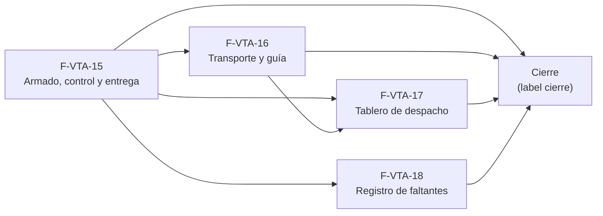

# Tasks: Ventas y despacho · Ventas despacho y faltantes

**Input**: `specs/20261024-130000-ventas-despacho-y-faltantes/` (spec.md, plan.md, contracts/) · **Épica**: MSF-135

**Formato**: `- [ ] T### [P] [STORY-x][USy] descripción (FR/SC)`. **[P]** = paralelizable (archivos distintos, sin dependencia; las [P] del mismo grupo van en paralelo); sin [P] = secuencial. Cada FR/SC tiene **una sola** tarea dueña. Las dependencias y el orden son **solo dentro de la misma historia**; entre historias rige la tabla *Plan de ejecución* (objetos ya mergeados, nunca una tarea abierta de otra). Cada historia trae **su propia migración** con timestamp propio.

**Delivery scope**: `refine`, `supabase`

**Validación por historia**: `pnpm test:db`, `pnpm lint`, `pnpm build` y `pnpm test` verdes antes de cerrar la fase. Cada tabla nueva o alterada: esquema re-verificado (Principio VII). Cada migración lleva su reversión en el encabezado. Los objetos de MSF-159 se re-verifican contra `main` al empezar cada historia.

**Espera de MSF-177 (CTO, AGE-1084)**: ninguna fase arranca hasta que MSF-177 esté Dev Deployed; al liberarse: integrar `origin/dokploy`, renumerar migraciones a un bloque posterior (p. ej. `20261208…`) sin cambiar contenido, re-verificar `estado` vs `estado_despacho` y despachar **F-VTA-15 (T001–T012)** primero. Verificar dependencias contra `dokploy`/rama de la épica, nunca `main`; sin force-push; un PR por historia hacia la rama de la épica; si falta una dependencia real, frenar y escalar una sola vez. Es espera, no tarea ni traba nueva.

## Matriz de trazabilidad Jira ↔ US ↔ tasks

| Jira | Historia | FR / SC (dueño único) | Tasks |
|------|----------|-----------------------|-------|
| F-VTA-15 | US1 Armado, control y entrega con responsables | FR-001 → T001 · FR-008 → T002 · FR-002 → T003 · FR-009 → T004 · FR-003…FR-007, FR-011 → T005 · SC-001 → T006 · SC-002 → T007 · FR-010 → T009 · FR-012 → T010 · SC-003 → T011 | T001–T012 |
| F-VTA-16 | US2 Transporte y guía de envío | FR-020 → T013 · FR-021 → T014 · FR-022 → T015 · SC-004 → T016 · FR-023 → T018 · SC-005 → T019 | T013–T020 |
| F-VTA-17 | US3 Tablero de despacho | FR-030 → T021 · SC-006 → T022 · FR-031, FR-033 → T024 · FR-032 → T025 · SC-007 → T026 | T021–T027 |
| F-VTA-18 | US4 Registro de faltantes | FR-040 → T028 · FR-041 → T029 · FR-042 → T030 · FR-043 → T031 · SC-008 → T032 · FR-044, FR-046 → T034 · FR-045 → T035 · FR-047 → T036 · SC-009 → T037 | T028–T038 |
| Tarea de cierre (label `cierre`) | Seguridad, docs, roadmap y verificación final | SC-010 → T041 | T039–T041 |

## Phase 1: F-VTA-15 · Armado, control y entrega con responsables (US1)

**Goal**: cada factura confirmada tiene estado de despacho y responsables de armado, control y entrega; al entregar se descuentan las reservas «A pedido».

- [ ] T001 [F-VTA-15][US1] Migración `20261207100100_despacho_columnas.sql` (esquema `dominio`, alter aditiva de `comprobantes_venta`): `estado_despacho` (check de 5 valores, solo `factura`), `armo_id`, `controlo_id`, `entrego_id` (→ `auth.users`, `on delete set null`), `entregado_en`, índice `(organizacion_id, empresa_id, estado_despacho)` y reversión en el encabezado (FR-001)
- [ ] T002 [P] [F-VTA-15][US1] Migración `20261207100200_despacho_accion_permiso.sql` (esquema `public`, dato): acción `despachar` en `ventas` — amplía `permisos_rol_accion_accion_check`, `private.matriz_acciones_iniciales()` (Administrador y Depósito) y `private.puede_accion` (exige al menos `lectura`), partiendo de las definiciones vigentes con `editar_precio`; siembra las filas por organización (FR-008)
- [ ] T003 [P] [F-VTA-15][US1] Migración `20261207100300_despacho_estado_inicial.sql`: `private.asignar_estado_despacho_inicial()` y disparador `AFTER UPDATE OF estado` de `comprobantes_venta` al pasar una factura a `confirmada` (estado de la forma de envío, o `sin_armar`; una sola vez; no ejecutable por `authenticated`) (FR-002)
- [ ] T004 [P] [F-VTA-15][US1] Migración `20261207100400_despacho_responsables.sql`: `listar_responsables_despacho(p_empresa_id, p_funcion)` con `private.rol_en_empresa`/`usuarios_empresas` (Depósito y Administrador; usuarios activos y de la organización), `revoke … from public, anon` y `grant … to authenticated` (FR-009)
- [ ] T005 [F-VTA-15][US1] Migración `20261207100500_despacho_cambiar_estado.sql`: `cambiar_estado_despacho` (transiciones del Flujo 1, bloqueo optimista, idempotencia, Armó/Controló/Entregó con la regla Armó ≠ Controló salvo Administrador, `entregado_en`, descuento de reservas «A pedido» con `descontar_reserva` en la misma transacción —re-verificar el nivel `stock` exigido y, si hace falta, una variante `private`—, actividad `despacho.estado_cambiado`) (FR-003, FR-004, FR-005, FR-006, FR-007, FR-011)
- [ ] T006 [P] [F-VTA-15][US1] pgTAP `despacho_estados.test.sql`: estado inicial por forma de envío, transiciones válidas/inválidas, roles de Armó/Controló/Entregó, excepción del Administrador, conflicto `40001`, `lectura` sin `despachar` rechazada, `anon` sin acceso, otra organización sin filas (SC-001; verifica además FR-001, FR-002, FR-003, FR-004, FR-005, FR-006, FR-008, FR-009, FR-011)
- [ ] T007 [P] [F-VTA-15][US1] pgTAP `despacho_entrega.test.sql`: reservas «A pedido» descontadas al entregar, todo o nada si una falla, reintento idempotente, líneas de stock normal intactas, presupuesto rechazado (SC-002; verifica FR-007)
- [ ] T008 [P] [F-VTA-15][US1] `apps/web/src/lib/ventasDespacho.ts`: tipos, etiquetas de estado y ayudas, próximos pasos permitidos y envoltorios de las RPC (soporte de FR-010; lo verifica T011)
- [ ] T009 [F-VTA-15][US1] `components/ventas/ResponsablesDespacho.tsx`: chip y texto de ayuda del estado, tarjeta «Responsables» (Operador, Armó, Controló, Entregó con «Seleccionar») y acciones de avance; carga/error/éxito del kit; solo lectura sin `despachar` (FR-010)
- [ ] T010 [F-VTA-15][US1] `pages/ventas/comprobante.tsx`: integra la tarjeta solo en facturas confirmadas y cierra con aviso al cambiar la empresa activa, sin guardar datos bajo otra tienda (FR-012)
- [ ] T011 [P] [F-VTA-15][US1] Vitest `ResponsablesDespacho.test.tsx`: selectores, acciones por estado, errores del servidor, `lectura`, doble clic y cambio de empresa (SC-003; verifica FR-010, FR-012)
- [ ] T012 [P] [F-VTA-15][US1] `docs/ventas-despacho.md`: modelo, estados, responsables, acción `despachar`, RPC y reversión (documenta FR-001…FR-012; verifica `pnpm docs:check`)

**Dependencias**: T001 → (T002 [P], T003 [P], T004 [P]) → T005 → (T006 [P], T007 [P]); T008 [P] desde el contrato; T009 → T010 → T011 [P]; T012 [P] al final. La UI se prueba contra mocks y luego contra las RPC tras T005.

**Checkpoint**: `pnpm test:db` y las pruebas de la tarjeta de responsables verdes.

## Phase 2: F-VTA-16 · Transporte y guía de envío (US2)

**Goal**: la factura registra transporte, guía y fecha de envío, y no sale sin ellos cuando la forma de envío los exige. Trae su propia migración.

- [x] T013 [F-VTA-16][US2] Migración `20261207110100_envio_columnas.sql` (esquema `dominio`, alter aditiva): `transporte_id` (FK compuesta a `dominio.transportes (id, organizacion_id)`), `guia` (≤ 100), `fecha_envio`; reversión en el encabezado (FR-020) — Evidencia: `supabase/migrations/20261214110100_envio_columnas.sql` (`ee0a560e`: versión renumerada del bloque de migraciones) y pgTAP de T016 (`8cdd7879`)
- [x] T014 [F-VTA-16][US2] Migración `20261207110200_envio_guardar.sql`: `guardar_envio_comprobante` (factura confirmada no entregada; transporte activo y asignado a la empresa; permiso `despachar` o `edicion`; bloqueo optimista; actividad) (FR-021) — Evidencia: `supabase/migrations/20261214110200_envio_guardar.sql` (`ee0a560e`) y pgTAP de T016 (`8cdd7879`)
- [x] T015 [F-VTA-16][US2] Migración `20261207110300_envio_exige_al_entregar.sql`: disparador `BEFORE UPDATE OF estado_despacho` que rechaza `entregado` si `formas_envio.exige_transporte_guia` y faltan transporte o guía (FR-022) — Evidencia: `supabase/migrations/20261214110300_envio_exige_al_entregar.sql` (`ce5de9f9`; mensaje del rechazo en `e5fd9385`) y pgTAP de T016 (`8cdd7879`)
- [x] T016 [P] [F-VTA-16][US2] pgTAP `envio_transporte.test.sql`: transporte inactivo o ajeno rechazado, exigencia según la forma de envío, retiro en local sin exigencia, permisos y aislamiento (SC-004; verifica FR-020, FR-021, FR-022) — Evidencia: `supabase/tests/database/envio_transporte.test.sql` (`8cdd7879`; ajustes `503fe6d2`, `0ceee3d4`, `d4eb52f1`), en verde en el job `database` del PR #463
- [x] T017 [P] [F-VTA-16][US2] `apps/web/src/lib/ventasEnvio.ts`: transportes elegibles por tipo de envío (*Decisiones abiertas* 8), rótulos y envoltorio de la RPC (soporte de FR-023; lo verifica T019) — Evidencia: `apps/web/src/lib/ventasEnvio.ts` (`842b181a`; lectura del transporte ya cargado en `f03b7a4e`) y `apps/web/src/lib/ventasEnvio.test.ts`
- [x] T018 [F-VTA-16][US2] `components/ventas/EnvioTransporte.tsx` e integración en `comprobante.tsx`: selector de transporte con rótulo por tipo, Guía, Fecha de envío, texto de «Retiro en local», estados del kit y cierre con aviso al cambiar la empresa activa (FR-023) — Evidencia: `apps/web/src/components/ventas/EnvioTransporte.tsx` (`842b181a`; `f03b7a4e`, `0c2aad5a`) y `apps/web/src/pages/ventas/comprobante.tsx`; compuerta «solo factura confirmada» cubierta por `apps/web/src/pages/ventas/comprobante.envio.test.tsx` (`a1af212a`)
- [x] T019 [P] [F-VTA-16][US2] Vitest `EnvioTransporte.test.tsx`: rótulos por tipo, retiro en local, error de guía faltante, `lectura` y cambio de empresa (SC-005; verifica FR-023) — Evidencia: `apps/web/src/components/ventas/EnvioTransporte.test.tsx` (`94d8b94f`; `f03b7a4e`, `3376e914`, `d4eb52f1`, `80be4ef2`)
- [x] T020 [P] [F-VTA-16][US2] `docs/ventas-despacho.md`: sección «Transporte y guía» (documenta FR-020…FR-023; verifica `pnpm docs:check`; si el archivo no existe aún en la rama, se crea) — Evidencia: `docs/ventas-despacho.md`, sección «Transporte y guía» (`ce5de9f9`; `f03b7a4e`, `0c2aad5a`, `c5e19656`); `pnpm docs:check` en verde

**Dependencias**: T013 → (T014, T015) → T016 [P]; T017 [P]; T018 → T019 [P]; T020 [P] al final.

**Checkpoint**: pgTAP de transporte y pruebas del bloque de envío verdes.

## Phase 3: F-VTA-17 · Tablero de despacho (US3)

**Goal**: el equipo ve las facturas por despachar con su estado, responsables, transporte y guía. Sin artboard: se construye con el kit.

- [ ] T021 [F-VTA-17][US3] Migración `20261207120100_despacho_listar.sql`: `listar_despacho` (facturas confirmadas no anuladas, búsqueda por cliente o número, filtro de estado y empresa, paginación y conteos por estado, `puede_despachar` por fila) con `revoke … from public, anon` y `grant … to authenticated` (FR-030)
- [ ] T022 [P] [F-VTA-17][US3] pgTAP `despacho_listar.test.sql`: filtros, conteos, anuladas y presupuestos excluidos, aislamiento por organización y empresa, `ninguno` sin acceso (SC-006; verifica FR-030)
- [ ] T023 [P] [F-VTA-17][US3] `apps/web/src/lib/ventasDespachoLista.ts`: tipos, parámetros y envoltorio de `listar_despacho` (soporte de FR-031; lo verifica T026)
- [ ] T024 [F-VTA-17][US3] `pages/ventas/despacho.tsx`: tabla (tarjetas en pantallas angostas), «Buscar por cliente o número», filtro de estado con conteos, `FiltroEmpresa` que sigue la empresa activa, recarga de todas las consultas y reencuadre de paginación al cambiar de empresa, estados vacío «Sin resultados»/carga/error con «Reintentar», fila que abre el comprobante (FR-031, FR-033)
- [ ] T025 [F-VTA-17][US3] Navegación: entrada «Despacho» en el grupo Ventas de `destinosPanel.ts` (icono `LocalShippingIcon`, sección `ventas`), ruta `/ventas/despacho` en `App.tsx` y prueba de permisos del menú (FR-032)
- [ ] T026 [P] [F-VTA-17][US3] Vitest `despacho.test.tsx`: columnas, filtros, conteos, vacío/error, `lectura`, ruta protegida y **cambio de empresa** (SC-007; verifica FR-031, FR-032, FR-033)
- [ ] T027 [P] [F-VTA-17][US3] `docs/ventas-despacho.md`: sección «Tablero» y la decisión de no tener artboard (documenta FR-030…FR-033; verifica `pnpm docs:check`)

**Dependencias**: T021 → T022 [P]; T023 [P]; T024 → T025 → T026 [P]; T027 [P] al final.

**Checkpoint**: pgTAP de `listar_despacho` y pruebas del tablero verdes.

## Phase 4: F-VTA-18 · Registro de faltantes (US4)

**Goal**: lo que no se pudo despachar por falta de stock queda registrado, pasa el pedido a Incompleto y se consulta en Ventas · Faltantes. Trae su propia migración.

- [ ] T028 [F-VTA-18][US4] Migración `20261207130100_faltantes_tabla.sql` (esquema `dominio`, tabla nueva): `faltantes_venta` con FK compuestas, `cantidad_faltante > 0`, `estado` `abierto`/`resuelto`, índice único `(comprobante_id, linea_orden) where estado = 'abierto'`, RLS por organización/`ventas`/empresa accesible, sin grants de escritura ni `delete`, `anon` sin acceso, reversión en el encabezado (FR-040)
- [ ] T029 [F-VTA-18][US4] Migración `20261207130200_faltantes_registrar.sql`: `registrar_faltantes_despacho` (factura en `armando`, cantidad entre 1 y lo pedido, upsert del abierto, pasa a `incompleto`, todo o nada, actividad `despacho.faltante_registrado`) (FR-041)
- [ ] T030 [F-VTA-18][US4] Misma migración o `…_faltantes_resolver.sql`: disparador que pasa a `resuelto` los faltantes abiertos al volver `estado_despacho` de `incompleto` a `armando` (FR-042)
- [ ] T031 [F-VTA-18][US4] Migración `20261207130300_faltantes_listar.sql`: `listar_faltantes` (abiertos de empresas accesibles, cliente, producto y SKU, cantidad, comprobante, desde, estado y disponible de stock por la lectura de Stock existente, paginación) (FR-043)
- [ ] T032 [P] [F-VTA-18][US4] pgTAP `faltantes.test.sql`: cantidad inválida, no duplicados, paso a Incompleto, resolución al reanudar, `listar_faltantes`, `lectura` sin `despachar`, `anon` sin acceso, otra organización sin filas, `rls_en_toda_tabla` (SC-008; verifica FR-040, FR-041, FR-042, FR-043)
- [ ] T033 [P] [F-VTA-18][US4] `apps/web/src/lib/ventasFaltantes.ts`: tipos, etiquetas de «Stock hoy» y envoltorios de las RPC (soporte de FR-044 y FR-047; lo verifican T037)
- [ ] T034 [F-VTA-18][US4] `pages/ventas/faltantes.tsx`: título «Faltantes», filtro de tienda con su texto, tabla Tienda/Cliente/Producto/Pedido/Comprobante/Desde/Stock hoy (tarjetas en pantallas angostas), paginación, «Sin resultados», carga y error; recarga y reencuadre al cambiar de empresa (FR-044, FR-046)
- [ ] T035 [F-VTA-18][US4] Navegación: entrada «Faltantes» en el grupo Ventas de `destinosPanel.ts` (icono `ProductionQuantityLimitsIcon`, sección `ventas`), ruta `/ventas/faltantes` en `App.tsx` y prueba de permisos del menú (FR-045)
- [ ] T036 [F-VTA-18][US4] `components/ventas/RegistrarFaltantesDialog.tsx` e integración en `comprobante.tsx`: al elegir «Incompleto» abre «Registrar faltantes» (línea y cantidad), valida, usa `registrar_faltantes_despacho` y se cierra con aviso si cambia la empresa activa (FR-047)
- [ ] T037 [P] [F-VTA-18][US4] Vitest `faltantes.test.tsx` y `RegistrarFaltantesDialog.test.tsx`: columnas, vacío/error, validaciones, `lectura`, **cambio de empresa** (SC-009; verifica FR-044, FR-045, FR-046, FR-047)
- [ ] T038 [P] [F-VTA-18][US4] `docs/ventas-faltantes.md`: modelo, reglas, RPC, decisión de cierre (*Decisiones abiertas* 3) y reversión (documenta FR-040…FR-047; verifica `pnpm docs:check`)

**Dependencias**: T028 → (T029, T031) → T030 → T032 [P]; T033 [P]; T034 → T035 → T036 → T037 [P]; T038 [P] al final.

**Checkpoint**: pgTAP de faltantes y pruebas de Faltantes verdes.

## Phase 5: Cierre (Tarea de cierre, label `cierre`)

**Goal**: lo transversal que ninguna historia atiende.

- [ ] T039 [CIERRE] Revisión de seguridad del diff de la épica (`authz-security`, `crypto-secrets` si aplica): RLS de `faltantes_venta`, `security definer` y `search_path` de cada RPC, `revoke/grant`, acción `despachar` y `anon`; re-verificación del esquema de cada tabla (Principio VII) (soporte de SC-010)
- [ ] T040 [CIERRE] Índice de `docs/README.md` y fila de `docs/roadmap-template.md` (estado, enlace a la spec, mover a «Backlog entregado»); notas de desvío del PR (prototipo vs. requisitos, artboard «Despacho», acción «Registrar faltantes») (soporte de SC-010; verifica `pnpm docs:check`)
- [ ] T041 [CIERRE] Verificación final: `pnpm lint`, `pnpm build`, `pnpm test`, `pnpm docs:check`, `pnpm prototipo:check` y `pnpm matriz:check` verdes, y recorrido manual factura → armado → control → entrega con transporte y guía y un faltante (SC-010)

## Plan de ejecución (historias)

| Historia | Depende de | Grupo |
|----------|------------|-------|
| F-VTA-15 | — | 1 |
| F-VTA-16 | F-VTA-15 | 2 |
| F-VTA-18 | F-VTA-15 | 2 |
| F-VTA-17 | F-VTA-15, F-VTA-16 | 3 |
| [Cierre] | F-VTA-15, F-VTA-16, F-VTA-17, F-VTA-18 | 4 |

F-VTA-16 y F-VTA-18 comparten solo `comprobante.tsx` (componentes distintos) y ninguna tabla ni migración: van en paralelo. El tablero (F-VTA-17) lee `estado_despacho` (F-VTA-15) y transporte/guía (F-VTA-16).
