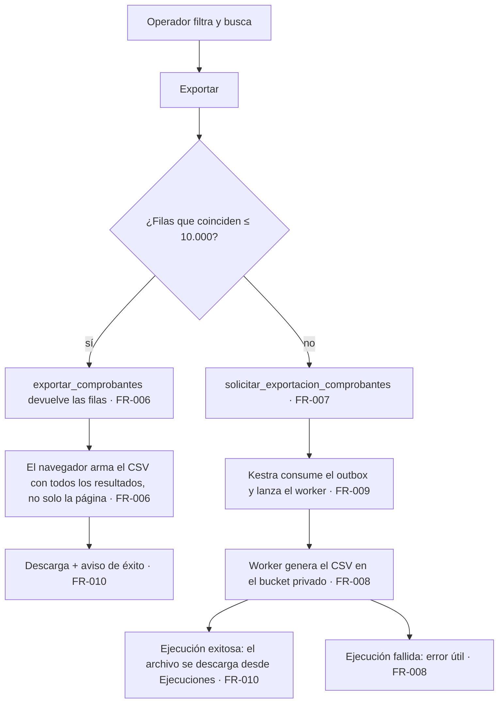
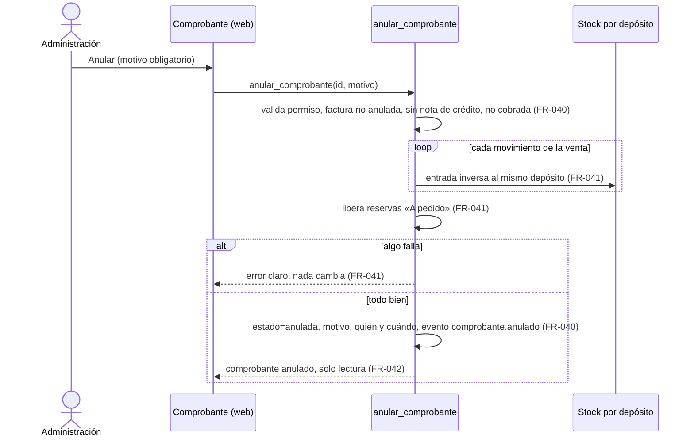
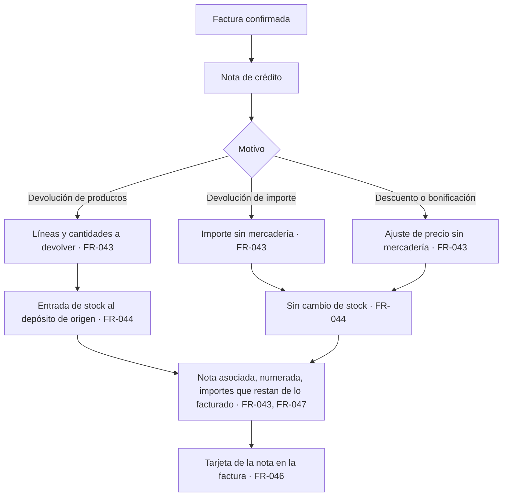

# Feature Specification: Ventas y despacho · Ventas listado, estados y anulación

**Feature Branch**: `epic/MSF-177-ventas-y-despacho-ventas-listado-estados`

**Jira Epic**: MSF-177 — Ventas y despacho · Ventas listado, estados y anulación (spec `ventas-listado-estados-y-anulacion`)

**Created**: 2026-10-24

**Status**: Ready for implementation — la especificación viene completa desde Jira. Los puntos de «A revisar» no bloquean: cada uno lleva decisión provisoria en *Decisiones abiertas*.

**Delivery scope**: `refine` (apps/web), `supabase` (migraciones + RPC + pgTAP), `kestra` (flow de la exportación grande) y `workers` (worker de exportación). Sin `superset`.

**Prioridad / Hito**: P0 · Hito 3 (16 de noviembre al 11 de diciembre de 2026) · 31 h (la suma por talla M+M+M da ~24 h; se conserva el valor del documento) · alcance diciembre.

**Dependencias**:
- Bloqueada por: MSF-159 (Ventas comprobantes). Los roles operativos Mostrador, Depósito y Administración (MSF-125) llegan por cadena (MSF-125 → MSF-121 → MSF-139 → MSF-159) y no se vinculan directo. MSF-159 está desplegada en DEV.
- **Estado verificado (rama `epic/MSF-159-…`, contrato `specs/20261023-100000-ventas-comprobantes/contracts/ventas-comprobantes.md`)**: existen `dominio.comprobantes_venta` (alterada por F-VTA-05: `empresa_id`, `canal`, `operador_id`, `forma_pago_id`, `envio_id`, `numero_entero`, `confirmado_en/por`, `updated_at`), `dominio.comprobantes_venta_lineas`, la numeración (`private.siguiente_numero_comprobante`), `confirmar_comprobante` (salidas de stock con motivo «Venta de factura» y `referencia = 'comprobante:<id>:linea:<orden>'`, reservas «A pedido»), `listar_presupuestos`, `private.comprobante_cuenta_como_facturado(tipo, estado)` y el estado `anulada` **reservado** para esta épica. **No existen** todavía: el listado de comprobantes, el catálogo/transiciones de estado, el historial por comprobante, `anular_comprobante`, la nota de crédito ni la exportación. Los nombres exactos de columnas de totales, del motor de stock y de `registro_actividad` se **verifican contra `main` al implementar** (no se inventan aquí).
- Bloquea a: MSF-195 (Cobros y conciliación); fuera de esta mitad del componente, a MSF-338 (Ventas reportes básicos), MSF-178 (Ventas RMA y devoluciones) y MSF-192 (Rentabilidad real y reportes de ventas).
- Relacionada, sin bloqueo: el paso a **Cobrado** y **Deuda** lo dispara F-VTA-12 (MSF-195); esta épica solo deja los estados, su regla y el punto de entrada.

**Input**: Epic MSF-177. Objetivo: «Al terminar, se puede buscar, filtrar y exportar todo lo vendido, cada comprobante tiene un estado claro de cobro y armado, y un error o una devolución se corrige con una anulación o una nota de crédito sin perder trazabilidad.»

**Regla de fuentes** (literal de la épica):
1. Comportamiento y datos: mandan los requisitos y escenarios de esta historia.
2. Qué se ve (disposición, textos, estados, popups, flujos): el prototipo validado es referencia visual, no hace falta que quede extremadamente idéntico; los flujos (si hay) aclaran estados y acciones.
3. Cómo se construye (componentes, estilos y patrones): mandan el template y el system design del producto (MSF-117, `docs/sistema-de-diseno.md`). No copiar el HTML ni el CSS del prototipo.
4. El prototipo muestra más que esta historia: se implementa solo lo que piden los requisitos; otras secciones, botones o diálogos son de otras historias.
5. Si algo no se puede igualar: lo más cercano, sin inventar, anotando la diferencia en el PR.
6. Si prototipo y requisitos se contradicen: requisitos para el comportamiento, prototipo para lo visual, y la contradicción queda anotada en el PR.

Prototipos (solo lectura): `design/pantallas/VentasComprobantes.dc.html` (F-VTA-09 y F-VTA-10), `VentasComprobante.dc.html` (F-VTA-10 y F-VTA-11) y `VentasPresupuestos.dc.html` (presupuestos en el listado, F-VTA-09). Inventarios al día en `design/pantallas/*.inventory.json`.

## Modelo y supuestos

- **El listado es solo de ventas internas**; Mercado Libre se suma en Etapa 2.
- **Estados del panel actual, se conservan**: Pendiente, Aceptado, Cobrado, En proceso, Deuda, Armando e Incompleto. Se suman los de MSF-159 que ya existen (`borrador`, `confirmada`, `pendiente`/`aceptado` de presupuesto) y `anulada`. «Entregado» (visible en el prototipo) es de MSF-135 y **no** se entrega aquí.
- **Las transiciones por rol viven como datos** (tabla de transiciones por organización); la matriz inicial es una **propuesta a confirmar con el cliente** (*Decisiones abiertas* 1 y 2). La pantalla para que el Administrador la edite es **Etapa 2** (el roadmap manda; *Decisiones abiertas* 1).
- **La nota de crédito es un documento de venta propio** (`tipo = 'nota_credito'`), asociado a una factura. Guarda cantidades e importes **positivos**; todas las lecturas (listado, detalle, facturado) los presentan y suman **con signo negativo**.
- **Anular ≠ nota de crédito**: anular corrige un **error** (el documento deja de valer y se revierte lo que movió); la nota de crédito corrige una **devolución o ajuste** sobre un documento válido. Ninguna borra datos: el número no se reutiliza y quedan quién, cuándo y por qué.
- **Empresa/tienda**: todo documento pertenece a una sola empresa; el listado respeta la empresa activa de la barra superior (F-ROL-06).

### Esquema de datos (Constitución, Principio VII)

| Objeto | Esquema | Justificación | RLS / acceso |
|--------|---------|---------------|--------------|
| `comprobantes_venta` (**existente**, MSF-159; se **altera** de forma aditiva en F-VTA-11) | **`dominio`** | Documento de venta: entidad de negocio del producto. | RLS vigente (`organizacion_id` + sección `ventas`). Se agregan columnas nulables: `comprobante_origen_id` (FK compuesta a la factura), `nc_tipo`, `nc_concepto`, `anulado_en`, `anulado_por`, `motivo_anulacion`; se amplía de forma aditiva el valor permitido de `tipo` (`nota_credito`), verificando al implementar el `check` real. **Sin escritura directa**: solo RPC `security definer`. `anon` sin acceso. |
| `comprobantes_venta_lineas` (**existente**, MSF-159; sin cambio de estructura) | **`dominio`** | Detalle de venta. | Vigente. Las líneas de una nota de crédito «devolución de productos» se guardan con cantidad > 0 (el signo lo da el tipo del documento). |
| `transiciones_estado_comprobante` (**nueva**, F-VTA-10) | **`dominio`** | Regla de negocio de ventas: qué estado puede pasar a cuál y qué rol puede hacerlo. | RLS por organización; `select` con `ventas` ≥ `lectura`; **sin escritura directa** (la siembra y, en Etapa 2, la edición, son por función `security definer`); sin `delete` directo; `anon` sin acceso. |
| `public.registro_actividad` (**existente**) | `public` (sin cambio) | Auditoría transversal vía `private.registrar_actividad`; de ahí sale el historial del comprobante. | Vigente. |
| `permisos_rol_accion` (**existente**; F-VTA-11 agrega **datos**: acciones `anular` y `emitir_nota_credito` en `ventas`; F-VTA-09 agrega `exportar`) | `public` (sin cambio) | Mecanismo de acceso transversal. | Vigente (MSF-121/125). |
| Bucket `exportaciones-ventas` (**nuevo**, F-VTA-09) | Storage (plataforma) | Archivo CSV de la exportación grande; no es tabla. | Privado, política por prefijo de organización; solo lo lee quien la pidió. |

No se crean otras tablas. `rls_en_toda_tabla` (pgTAP, recorre `public` + `dominio`) debe seguir verde. Todas las migraciones son **aditivas** con reversión en su encabezado; **cada historia trae su propia migración** (timestamps propios, sin encadenarse a las de otra historia).

## Flujos

### Flujo 1 · Estados del comprobante y de cobro (máquina de estados — propuesta a confirmar con el cliente)

```mermaid
stateDiagram-v2
  [*] --> borrador: alta de factura (MSF-159)
  borrador --> pendiente: confirmar (MSF-159; `confirmada` se muestra «Pendiente», FR-023)
  pendiente --> aceptado: Mostrador / Administración (FR-021, FR-022)
  pendiente --> en_proceso: Mostrador / Administración (FR-021, FR-022)
  aceptado --> en_proceso: Mostrador / Administración (FR-021, FR-022)
  aceptado --> armando: Depósito / Administración (FR-021, FR-022)
  en_proceso --> armando: Depósito / Administración (FR-021, FR-022)
  armando --> incompleto: Depósito / Administración (FR-021, FR-022)
  incompleto --> armando: Depósito / Administración (FR-021, FR-022)
  pendiente --> cobrado: lo dispara cobros (MSF-195), no una persona (FR-026)
  aceptado --> cobrado: ídem (FR-026)
  en_proceso --> cobrado: ídem (FR-026)
  armando --> cobrado: ídem (FR-026)
  cobrado --> deuda: ídem (FR-026)
  deuda --> cobrado: ídem (FR-026)
  pendiente --> anulada: anular (FR-040)
  aceptado --> anulada: anular (FR-040)
  en_proceso --> anulada: anular (FR-040)
  armando --> anulada: anular (FR-040)
  incompleto --> anulada: anular (FR-040)
  deuda --> anulada: anular (FR-040)
  anulada --> [*]
  note right of armando
    «Entregado» es de MSF-135 (FUERA).
    Las transiciones son datos sembrados: ajustables en Etapa 2 (FR-021).
  end note
```

(Mapa: nodos y transiciones → FR-020/021/022/023/026/040. El presupuesto conserva `pendiente → aceptado` de MSF-159 sin cambios.)

### Flujo 2 · Exportación (proceso)



### Flujo 3 · Anulación (secuencia)



### Flujo 4 · Nota de crédito (proceso)



## User Scenarios & Testing *(mandatory)*

### User Story 1 - Listado de ventas con filtros y exportación (F-VTA-09, P0, talla M)

Como operador, quiero buscar, filtrar y exportar todo lo vendido para encontrar un comprobante rápido y llevarme los datos a una planilla.

**Why this priority**: es la puerta de entrada a todo lo vendido.

**Independent Test**: con dos empresas y varias facturas, la pantalla «Comprobantes» lista con paginación, busca por cliente o número, filtra por Operador/Estado/Pago/Envío y Tienda, «Limpiar filtros» restablece, «Exportar» baja un CSV con **todas** las filas filtradas (≤ 10.000) y, por encima, encola la exportación y avisa; otra organización o empresa no accesible no se ve.

**Acceptance Scenarios**:
1. **Given** facturas de varias empresas, **When** se abre Comprobantes, **Then** se ven todas las tiendas por defecto con las columnas Comprobante, Tienda, Fecha, Cliente, Operador, Estado, Pago, Envío y Total, el contador «N comprobantes» y la paginación.
2. **Given** la empresa activa «Mundo JC», **Then** el filtro Tienda muestra solo esa empresa; al cambiar de empresa se recarga todo (Principio VIII).
3. **Given** el buscador, **When** se escribe parte del cliente o del número, **Then** se filtra sin distinguir mayúsculas ni tildes; sin coincidencias aparece «Sin resultados» con «Probá con otra búsqueda o limpiá los filtros.».
4. **Given** filtros activos, **When** se pulsa «Limpiar filtros», **Then** vuelven a «Todos» y se vacía la búsqueda.
5. **Given** filtros aplicados y menos de 10.000 filas, **When** se pulsa «Exportar», **Then** se descarga un CSV con todas las filas que coinciden, no solo la página.
6. **Given** más de 10.000 filas, **When** se pulsa «Exportar», **Then** se solicita una exportación diferida, la pantalla avisa y el archivo queda disponible desde Ejecuciones al terminar.
7. **Given** un usuario sin `ventas` (o sin permiso de exportar), **Then** la ruta muestra «Acceso restringido» o no ofrece «Exportar».

### User Story 2 - Estados del comprobante y de cobro (F-VTA-10, P0, talla M)

Como operador, quiero ver y cambiar el estado de cada comprobante según mi rol, con su historial, para saber en qué punto está el cobro y el armado.

**Why this priority**: sin estados claros no hay seguimiento de cobro ni de armado.

**Independent Test**: Mostrador pasa Pendiente → Aceptado; Depósito pasa Aceptado → Armando → Incompleto; ninguno puede saltar una transición no permitida ni pasar a Cobrado/Deuda a mano; cada cambio queda en el historial con quién, cuándo y tienda; otra organización no ve nada.

**Acceptance Scenarios**:
1. **Given** una factura en Pendiente, **When** Mostrador la pasa a Aceptado, **Then** el estado cambia y se registra «Estado: Pendiente → Aceptado» con usuario, fecha y tienda.
2. **Given** un rol sin la transición, **When** intenta el cambio, **Then** se rechaza con mensaje claro y el chip aparece deshabilitado.
3. **Given** el estado Cobrado o Deuda, **Then** se muestra con su tono y es filtrable, pero ninguna persona lo cambia a mano (lo dispara cobros, MSF-195).
4. **Given** un reintento al mismo estado, **Then** no duplica eventos y devuelve el estado actual.
5. **Given** el detalle, **Then** el texto de ayuda cambia con el estado elegido y el historial lista Cuándo, Acción, Quién y Tienda.
6. **Given** un comprobante borrador, anulado o ajeno a la empresa, **Then** no admite cambios de estado.

### User Story 3 - Anulación y nota de crédito (F-VTA-11, P0, talla M)

Como administración, quiero anular un comprobante emitido por error o emitir una nota de crédito por una devolución o un ajuste, sin perder trazabilidad.

**Why this priority**: es la única forma de corregir una venta sin borrar datos.

**Independent Test**: anular una factura confirmada con dos depósitos devuelve exactamente lo descontado y libera las reservas «A pedido»; una nota «Devolución de productos» devuelve la mercadería al depósito de origen y resta de lo facturado; «Devolución de importe» y «Descuento» no tocan el stock; no se puede acreditar más de lo facturado ni anular lo que ya tiene nota.

**Acceptance Scenarios**:
1. **Given** una factura confirmada sin notas ni cobro, **When** se anula con motivo, **Then** pasa a `anulada`, el stock vuelve a cada depósito de origen, las reservas «A pedido» se liberan y queda el evento con motivo, quién y cuándo.
2. **Given** una factura con nota de crédito o ya cobrada, **When** se intenta anular, **Then** se rechaza indicando que se corrija con nota de crédito.
3. **Given** un reintento de anulación, **Then** no duplica movimientos y devuelve el estado actual.
4. **Given** la factura, **When** se abre «Nota de crédito», **Then** el diálogo ofrece los tres motivos con su descripción, un ejemplo y los botones Cancelar / Emitir nota de crédito.
5. **Given** «Devolución de productos», **When** se emite, **Then** se crea la nota numerada y asociada, las cantidades restan de lo facturado y cada unidad vuelve al depósito de origen de su línea.
6. **Given** «Devolución de importe» o «Descuento o bonificación», **When** se emite, **Then** el importe resta de lo facturado y el stock no cambia.
7. **Given** notas previas, **When** se emite otra que excede lo aún acreditable, **Then** se rechaza con mensaje claro.
8. **Given** la factura con nota, **Then** muestra la tarjeta «Nota de crédito … Asociada a esta factura» con Producto, Cantidad, Precio, Importe y el aviso de cantidades negativas.

### Edge Cases

- Cambio de empresa activa con el listado o un diálogo abierto: se recarga todo; el diálogo se cierra con aviso o se reencuadra, nunca guarda datos bajo otra empresa (Principio VIII).
- Exportación con filtros que devuelven 0 filas: se informa «Sin resultados», no se descarga un archivo vacío.
- Dos usuarios anulan o acreditan lo mismo a la vez: solo uno lo logra; el otro recibe el estado actual o el error de tope (bloqueo de fila).
- Anular un comprobante cuyo producto ya está desactivado: la reversión de stock procede igual (es un movimiento de entrada, no una venta).
- Presupuestos: no se anulan ni reciben nota de crédito en esta épica (*Decisiones abiertas* 6).

## Requirements *(mandatory)*

### Functional Requirements

**F-VTA-09 — Listado con filtros y exportación**
- **FR-001**: `listar_comprobantes` devuelve, paginado y con orden estable (fecha descendente, luego número), los documentos de venta **facturas y notas de crédito** (los presupuestos tienen su pestaña) de las empresas accesibles del usuario: id, número, tipo, empresa, fecha, cliente, operador, estado (etiqueta), forma de pago, envío, total (con signo) y conteo total de filas (`filas`); `security invoker`, exige `ventas` ≥ `lectura`, organización de la sesión.
- **FR-002**: El parámetro de búsqueda filtra por **cliente o número**, sin distinguir mayúsculas ni tildes (tolera espacios sobrantes).
- **FR-003**: La RPC filtra por **Operador, Estado, Pago y Envío** y por empresa; `operadores_de_comprobantes` entrega las opciones del filtro Operador; las opciones de Pago y Envío salen de los catálogos de MSF-139.
- **FR-004**: El filtro **Tienda** usa `FiltroEmpresa` («Todas las tiendas» + una por empresa accesible). Por defecto se ven todas; la empresa activa de la barra superior lo acota; al cambiar de empresa se invalidan y recargan todas las consultas, se reencuadra la paginación y se descarta la selección que ya no existe (Principio VIII).
- **FR-005**: La pantalla **Comprobantes** (`/ventas/comprobantes`) reproduce el prototipo: encabezado «Comprobantes» y subtítulo, botón «Nuevo comprobante» (ruta de alta de MSF-159), pestañas de Ventas, filtro de tienda con su texto, buscador «Buscar por cliente o número», filtros Operador/Estado/Pago/Envío con «Todos», «Limpiar filtros» (solo con filtros o búsqueda), contador «N comprobantes», tabla Comprobante (enlace al detalle `/ventas/comprobantes/:id` + tipo) · Tienda · Fecha · Cliente · Operador · Estado (chip con tono) · Pago · Envío · Total (a la derecha), paginación «1–12 de N», «Sin resultados»; estados de carga/error con «Reintentar»; icono y entrada de menú en Ventas, «Acceso restringido» sin `ventas`; 320/768/1440 px con tarjetas en angosto; teclado y lector de pantalla.
- **FR-006**: `exportar_comprobantes` devuelve **todas** las filas que coinciden con los filtros (no la página), hasta 10.000, para Comprobantes o Presupuestos; exige el permiso `exportar` de `ventas` y respeta empresas accesibles; el navegador arma el CSV (separador y codificación abiertos por Excel) reutilizando el helper de exportación existente (`apps/web/src/lib/exportarClientes.ts`).
- **FR-007**: `solicitar_exportacion_comprobantes` registra la solicitud de una exportación de **más de 10.000 filas** (filtros incluidos) en el ciclo de ejecuciones existente, con bloqueo de simultáneas por usuario y bucket privado `exportaciones-ventas`; idempotente por solicitud.
- **FR-008**: El worker `workers/exportar-comprobantes` lee las filas con los filtros guardados, escribe el CSV en el bucket, es **idempotente** (reintentar no duplica archivos), registra origen, actor, estado, timestamps y error útil, y sale con los códigos del contrato de workers.
- **FR-009**: El flow de Kestra `infra/kestra/flows/exportar-comprobantes.yaml` consume el outbox y lanza el worker con los reintentos del contrato; `pnpm infra:config` verde.
- **FR-010**: El botón **«Exportar»** (Comprobantes y Presupuestos) elige la vía según el conteo (≤ 10.000 inmediata; mayor, diferida con aviso y enlace a Ejecuciones), muestra éxito/error con los patrones del kit, avisa «Sin resultados» si no hay filas y no se ofrece sin permiso.

**F-VTA-10 — Estados del comprobante y de cobro**
- **FR-020**: Tabla `dominio.transiciones_estado_comprobante` (organización, tipo de documento, estado desde, estado hasta, rol) con `check` de estados válidos (`pendiente`, `aceptado`, `cobrado`, `en_proceso`, `deuda`, `armando`, `incompleto`, `anulada`, más `confirmada`/`borrador` de MSF-159), RLS por organización y sin escritura directa.
- **FR-021**: La matriz inicial (Flujo 1) se **siembra** por organización (las existentes en la migración y las nuevas por la misma función de siembra): Administrador y Administración todas las manuales; Mostrador Pendiente → Aceptado / En proceso; Depósito → Armando, Incompleto y su vuelta; Cobrado/Deuda con actor `sistema`. Ajustable luego por datos; **la pantalla de edición es Etapa 2** (FUERA).
- **FR-022**: `cambiar_estado_comprobante(id, estado, actualizado_en)` valida que la transición exista para el **rol del actor en la empresa del comprobante**, usa bloqueo optimista, es idempotente (mismo estado = devuelve el actual), rechaza `borrador`/`anulada`/presupuestos y registra `comprobante.estado_cambiado` (desde, hasta, actor, empresa) en la misma transacción.
- **FR-023**: Etiqueta y tono de cada estado salen de un único catálogo del frontend (`apps/web/src/lib/estadosComprobante.ts`): `confirmada` se muestra «Pendiente» y `borrador` «Borrador»; tonos del prototipo (Pendiente neutro, Aceptado, Cobrado/ok, En proceso/info, Armando, Incompleto/advertencia, Deuda/error).
- **FR-024**: El detalle del comprobante muestra el chip de estado junto al título y la tarjeta **Estado** con los chips de los estados, el texto de ayuda del estado elegido y deshabilitadas (con motivo) las transiciones que el rol no puede hacer.
- **FR-025**: `historial_comprobante(id)` devuelve los eventos del comprobante (cuándo, acción, quién, tienda) desde `registro_actividad`, solo de la organización y con `ventas` ≥ `lectura`.
- **FR-026**: **Cobrado** y **Deuda** existen como estados, se muestran y se filtran, pero `cambiar_estado_comprobante` los rechaza para personas; `private.marcar_estado_cobro_comprobante(id, estado)` (no ejecutable por `authenticated`) es el punto de entrada que usará MSF-195 (F-VTA-12). El disparo en sí queda FUERA.
- **FR-027**: La tarjeta **Historial de estados y acciones** (Cuándo, Acción, Quién, Tienda; texto «Quién hizo cada cambio, cuándo y desde qué tienda.» y la nota «El comprobante pertenece a una sola tienda…») usa `historial_comprobante`, con estados de carga/vacío/error.

**F-VTA-11 — Anulación y nota de crédito**
- **FR-040**: `anular_comprobante(id, motivo, actualizado_en)` anula una **factura confirmada** (cualquier estado operativo no anulado), exige `anular` de `ventas` en su empresa, **motivo obligatorio**, rechaza si ya tiene nota de crédito o está Cobrada (se corrige con nota de crédito), es idempotente, pasa a `anulada`, guarda `anulado_en/por` y motivo, **no reutiliza el número** y registra `comprobante.anulado`.
- **FR-041**: La anulación revierte **todo o nada** y bajo concurrencia exactamente lo que movió la venta: una entrada al mismo depósito por cada salida generada con `referencia = 'comprobante:<id>:linea:<orden>'` (motivo de sistema «Anulación de factura») y libera las reservas «A pedido» vigentes; sin stock negativo ni doble reversión.
- **FR-042**: La pantalla ofrece **«Anular»** con diálogo (motivo obligatorio, confirmación) y deja el comprobante `anulada` de solo lectura con su chip y el motivo visible; acción **no presente en el prototipo** (requisito de la épica; se anota en el PR).
- **FR-043**: `emitir_nota_credito(factura_id, tipo, lineas, concepto)` emite una nota de los tipos **Devolución de productos**, **Devolución de importe** y **Descuento o bonificación**: documento `nota_credito` con número correlativo propio, asociado a la factura (`comprobante_origen_id`), solo sobre factura confirmada no anulada, exige `emitir_nota_credito` de `ventas`, **no excede lo aún acreditable** (por línea en productos; por importe en los otros), bloqueo de la factura bajo concurrencia, IVA según las líneas/alícuota de la factura, y registra `comprobante.nota_credito_emitida`.
- **FR-044**: Efecto en stock: **Devolución de productos** crea una entrada al **depósito de origen** de cada línea (motivo de sistema «Devolución de cliente»); **Devolución de importe** y **Descuento** no cambian el stock.
- **FR-045**: El botón **«Nota de crédito»** de la cabecera abre el diálogo del prototipo: título «Nota de crédito», texto «Se emite una nota de crédito asociada a …», los tres motivos con su descripción, ejemplo, **Cancelar** y **Emitir nota de crédito**, aviso de éxito; los datos mínimos para emitir (líneas y cantidades, o importe y concepto) se piden con componentes del kit y la diferencia con el prototipo se anota en el PR.
- **FR-046**: La factura con notas muestra por cada una la tarjeta «Nota de crédito {número}» con la etiqueta «Asociada a esta factura», el tipo y su descripción, la tabla Producto · Cantidad · Precio · Importe (negativos) y el aviso sobre cantidades negativas y el efecto en stock.
- **FR-047**: `private.comprobante_cuenta_como_facturado` pasa a considerar la **nota de crédito emitida** con signo negativo, de modo que las notas **restan de lo facturado** (ranking de clientes F-CLI-08 y totales del listado); el efecto en cuenta corriente/cobros es de MSF-195 (FUERA).
- **FR-048**: Acciones `anular` y `emitir_nota_credito` sembradas en `permisos_rol_accion` para Administrador y Administración (la acción `exportar` es de FR-006); las RPC las verifican (no solo la UI).

### Success Criteria

- **SC-001** *(F-VTA-09)*: pgTAP de `listar_comprobantes`/`operadores_de_comprobantes`/`exportar_comprobantes`: búsqueda sin tildes, cada filtro, paginación y orden, tope 10.000, aislamiento por organización/empresa/sección, `anon` sin ejecución; `rls_en_toda_tabla` verde.
- **SC-002** *(F-VTA-09)*: Vitest de la pantalla: columnas, filtros y «Limpiar filtros», vacío/sin resultados/error, filtro de tienda con empresa activa y cambio de empresa que reencuadra, «Exportar» por ambas vías y sin permiso, acceso restringido, teclado y anchos.
- **SC-003** *(F-VTA-09)*: Vitest del worker (CSV con filtros, idempotencia, códigos de salida) y `pnpm infra:config` verde.
- **SC-004** *(F-VTA-10)*: pgTAP de estados: transiciones por rol (permitida/negada), Cobrado/Deuda solo por la función `private`, idempotencia, historial, aislamiento; siembra por organización; `rls_en_toda_tabla` verde.
- **SC-005** *(F-VTA-10)*: Vitest del detalle: tarjeta Estado (ayuda, chips deshabilitados), chip, historial, cambio de empresa.
- **SC-006** *(F-VTA-11)*: pgTAP de anulación: reversión exacta por depósito, reservas liberadas, bloqueos (nota/cobro/anulada), idempotencia, concurrencia, permisos, número no reutilizado.
- **SC-007** *(F-VTA-11)*: pgTAP de nota de crédito: los tres tipos, tope acreditable, stock solo en productos, numeración, facturado neto, permisos, aislamiento.
- **SC-008** *(F-VTA-11)*: Vitest de los diálogos Anular y Nota de crédito y de la tarjeta de la nota (éxito, error, solo lectura posterior, empresa activa).
- **SC-009** *(Cierre)*: revisión de seguridad (RLS, `security definer`, permisos de RPC, bucket, worker), `docs/ventas-listado-estados.md` e índice, fila del roadmap, `pnpm lint`, `pnpm build`, `pnpm test`, `pnpm infra:config`, `pnpm docs:check`, `pnpm prototipo:check` y `pnpm matriz:check` verdes.

## Decisiones abiertas (provisorias; no bloquean)

1. **Transiciones editables por el Administrador (RF-VTA-10-5) vs. Roadmap a diciembre (Etapa 2)**: manda el roadmap. Se entrega la matriz como **datos sembrados por organización**, sin pantalla de edición (FR-021). Si Nicolás prefiere que la edición entre en diciembre, es una historia nueva.
2. **Matriz inicial de roles y transiciones**: la del Flujo 1 es una **propuesta a confirmar con el cliente** (el documento del componente no se pudo leer desde el repo); por ser datos, corregirla es una migración de datos, no de estructura.
3. **`confirmada` (MSF-159) se muestra como «Pendiente»**: evita cambiar el comportamiento ya entregado de `confirmar_comprobante`; el catálogo traduce.
4. **«Entregado»** (visible en el prototipo, en filtros y ayudas) es de MSF-135: no se entrega aquí; el filtro Estado lista los siete estados del panel y MSF-135 lo extiende.
5. **Cobrado y Deuda**: se muestran y filtran, pero solo los dispara cobros (MSF-195) mediante la función `private` de FR-026.
6. **Alcance de la anulación**: solo facturas confirmadas, no cobradas ni con nota de crédito; los presupuestos no se anulan; la ejecutan Administrador y Administración. Es una propuesta (la épica no detalla reglas): ajustarla es cambiar la RPC o los datos de permisos.
7. **Nota de crédito**: el prototipo solo muestra el motivo y un ejemplo; para emitir hacen falta líneas y cantidades (productos) o importe y concepto (los otros): se piden con componentes del kit y se anota en el PR. Se admiten **notas parciales** hasta lo acreditable. Descuento sobre cuenta corriente: FUERA (MSF-195).
8. **«Presupuestos en el listado»**: se interpreta como el botón **«Exportar»** de la pantalla Presupuestos (ya entregada por MSF-159) y su filtrado; el listado de Comprobantes lista facturas y notas, no presupuestos.
9. **Exportación grande**: umbral 10.000 filas del documento; vía Kestra + worker + bucket + Ejecuciones, siguiendo el patrón del importador del historial. Cómo se descarga desde Ejecuciones se verifica contra el ciclo de ejecuciones existente al implementar.
10. **Tipo «Factura A/B»** del prototipo: el comprobante es interno (no fiscal, MSF-159); se muestra «Factura» y «Nota de crédito» sin letra.
11. **Horas**: 31 h del documento vs. ~24 h por tallas; manda el roadmap ante conflicto; se conserva 31 h.
12. **Textos de ayuda de estado** del prototipo: se usan salvo los que contradicen el momento del descuento de stock (MSF-159 FR-031 descuenta al confirmar); la diferencia se anota en el PR.

## Matriz pantalla↔criterios

Prototipos: `VentasComprobantes.dc.html`, `VentasComprobante.dc.html`, `VentasPresupuestos.dc.html` (inventarios en `design/pantallas/*.inventory.json`). Lo que la épica no pide se declara FUERA DE ALCANCE (nota, no tarea).

### Ventas · Comprobantes (`VentasComprobantes`)

| Ítem del inventario / visible | Dueño |
|---|---|
| Tabla: Comprobante, Tienda, Fecha, Cliente, Operador, Estado, Pago, Envío, Total | FR-001, FR-005 |
| Columna final sin título (botón «Imprimir» por fila) | **FUERA DE ALCANCE** — impresión: MSF-213 |
| Campo «Buscar por cliente o número» | FR-002, FR-005 |
| Filtros Operador / Estado / Pago / Envío (chips «Filtro: valor») y opción «Todos» | FR-003, FR-005 |
| Estado: opciones Pendiente, Aceptado, Cobrado, En proceso, Deuda, Armando, Incompleto | FR-003, FR-023 |
| Estado: opción «Entregado» | **FUERA DE ALCANCE** — MSF-135 (*Decisiones abiertas* 4) |
| Botón «Limpiar filtros» | FR-005 |
| Botón «Exportar» | FR-006, FR-010 |
| Botón «Nuevo comprobante» | FR-005 (ruta de alta de MSF-159) |
| Pestañas Comprobantes / Presupuestos | FR-005 (Presupuestos ya existe, MSF-159) |
| Pestañas Pagos / Faltantes / Devoluciones (RMA) / Transportes y contrarreembolsos | **FUERA DE ALCANCE** — son de otras épicas (MSF-195, MSF-135, MSF-178, MSF-139) |
| Filtro Tienda (píldoras «Todas las tiendas» + empresas) y su texto «Por defecto se ven todas…» | FR-004 |
| Contador «N comprobantes», paginación «1–12 de N», «Sin resultados» | FR-005 |
| Tarjetas KPI (Facturado hoy, Pendiente de cobro, En armado, Con deuda) | **FUERA DE ALCANCE** — la épica pide buscar, filtrar y exportar; los indicadores dependen de cobros (MSF-195) y reportes (MSF-338) |
| Letra A/B del tipo («Factura B») | **FUERA DE ALCANCE** — comprobante interno no fiscal (*Decisiones abiertas* 10) |
| Diálogos | el prototipo no tiene ninguno en esta pantalla |
| Empresa activa | FR-004 (test SC-002) |

### Ventas · Comprobante (`VentasComprobante`)

| Ítem del inventario / visible | Dueño |
|---|---|
| Tarjeta/tabla «Historial de estados y acciones» (Cuándo, Acción, Quién, Tienda) y su nota | FR-025, FR-027 |
| Tarjeta «Estado» (chips de estado, texto de ayuda) y chip junto al título | FR-023, FR-024 |
| Botón «Nota de crédito» y diálogo «Nota de crédito» (motivos, ejemplo, «Cancelar», «Emitir nota de crédito») | FR-043, FR-045 |
| Tabla de la nota (Producto, Cantidad, Precio, Importe) y tarjeta «Asociada a esta factura» + aviso | FR-046 |
| Acción «Anular» (no está en el prototipo) | FR-040, FR-042 |
| Campos Tienda, Canal de venta, Cliente, CUIT / DNI, Fecha, Condición frente al IVA, Dirección de entrega, Operador; botones «Comprobantes», «Guardar cambios», «Agregar producto», «Local», «Principal»; tabla de líneas; forma de pago y envío | **Ya entregado por MSF-159** (FR-002, FR-005, FR-006, FR-010…FR-019 de esa épica); sin cambio aquí |
| Campo Cuenta de cobro, «Ir a Pagos →», «Sin conciliar» | **FUERA DE ALCANCE** — cobro y conciliación: MSF-195 |
| Campos Guía, Fecha de envío; Armó, Controló, Entregó; transporte | **FUERA DE ALCANCE** — despacho: MSF-135 |
| Botón «Copiar» | **FUERA DE ALCANCE** — la épica no lo pide |
| Botón «Imprimir», diálogo «Imprimir comprobante», «Imprimir remito», «Enviar por correo», sección Documentos | **FUERA DE ALCANCE** — impresión y envío: MSF-213 |
| Botón «Agregar flete», líneas manuales (flete, descuento), «Relacionados» | **FUERA DE ALCANCE** — la épica no los pide |
| Observaciones | **FUERA DE ALCANCE** — la épica no lo pide |
| Estado «Entregado» | **FUERA DE ALCANCE** — MSF-135 |
| Empresa activa | FR-024, FR-045 (test SC-005 y SC-008) |

### Ventas · Presupuestos (`VentasPresupuestos`)

| Ítem del inventario | Dueño |
|---|---|
| Botón «Exportar» | FR-006, FR-010 |
| Tabla, buscador, filtros de estado y de tienda, «Nuevo presupuesto», pestañas, «Sin resultados» y paginación | **Ya entregado por MSF-159** (FR-053/FR-054); sin cambio aquí |
| Botón «Facturar» y estado «Convertido en factura» | **FUERA DE ALCANCE** — MSF-159 *Decisiones abiertas* 2 |
| Acciones «Enviar por correo» e «Imprimir» | **FUERA DE ALCANCE** — MSF-213 |
| Empresa activa | FR-004 aplica a la exportación (test SC-002); el resto ya cubierto por MSF-159 |

## Matriz de trazabilidad Jira ↔ US ↔ FR ↔ tareas

| Jira | Historia | US | FR / SC | Tareas |
|------|----------|----|---------|--------|
| MSF-177 (épica) | F-VTA-09 Listado de ventas con filtros y exportación | US1 | FR-001…FR-010, SC-001…SC-003 | T011–T024 |
| MSF-177 (épica) | F-VTA-10 Estados del comprobante y de cobro | US2 | FR-020…FR-027, SC-004, SC-005 | T001–T010 |
| MSF-177 (épica) | F-VTA-11 Anulación y nota de crédito | US3 | FR-040…FR-048, SC-006…SC-008 | T025–T038 |
| Tarea de cierre (label `cierre`) | Seguridad, documentación, roadmap, validación final | — | SC-009 | T039–T041 |
