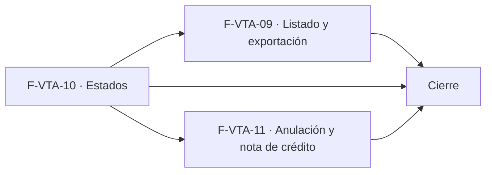

# Tasks: Ventas y despacho · Ventas listado, estados y anulación

**Input**: [spec.md](./spec.md) y [plan.md](./plan.md) · **Épica**: MSF-177
**Formato**: `- [ ] T### [P] [Historia][USx] descripción (FR/SC)`. `[P]` = paralelizable (archivos distintos, sin dependencia dentro del mismo grupo). Cada FR/SC tiene **una sola** tarea dueña. Las dependencias y el orden son **solo dentro de la misma historia**; entre historias rige la tabla *Plan de ejecución* (objetos ya mergeados, nunca una tarea abierta de otra).
**Validación por historia**: `pnpm test:db`, `pnpm lint`, `pnpm build` y `pnpm test:web` verdes antes de cerrar la fase (más `pnpm infra:config` en F-VTA-09). Cada tabla nueva o alterada: esquema re-verificado (Principio VII). Cada migración lleva su reversión en el encabezado.
**Base**: los objetos de MSF-159 (`comprobantes_venta`, líneas, numeración, `confirmar_comprobante`, `listar_presupuestos`, pantallas `comprobante.tsx` y `presupuestos.tsx`) ya están mergeados; sus nombres exactos se verifican antes de usarlos.

## Phase 1: F-VTA-10 · Estados del comprobante y de cobro

**Goal**: transiciones por rol como datos, cambio de estado auditado, punto de entrada para Cobrado/Deuda, historial por comprobante y su UI en el detalle.

- [ ] T001 [F-VTA-10][US2] Migración `supabase/migrations/20261207100000_comprobante_transiciones_estado.sql`: `dominio.transiciones_estado_comprobante` (organización, tipo, estado desde/hasta, rol; `check` de estados válidos), RLS por organización y sección `ventas` (`select` ≥ `lectura`), **sin escritura directa**, `anon` sin privilegios, reversión en el encabezado (FR-020)
- [ ] T002 [F-VTA-10][US2] Migración `supabase/migrations/20261207100100_transiciones_matriz_inicial.sql`: `private.sembrar_transiciones_comprobante(org)` con la matriz del Flujo 1, invocada para las organizaciones existentes y desde el mismo punto de siembra que usan las organizaciones nuevas (FR-021)
- [ ] T003 [F-VTA-10][US2] Migración `supabase/migrations/20261207100200_cambiar_estado_comprobante.sql`: `public.cambiar_estado_comprobante(p_id, p_estado, p_actualizado_en)` (`security definer`, rol del actor en la empresa del comprobante, bloqueo optimista, idempotente, rechaza borrador/anulada/presupuesto y Cobrado/Deuda, evento `comprobante.estado_cambiado`), `revoke … from public, anon` y `grant execute … to authenticated` (FR-022)
- [ ] T004 [P] [F-VTA-10][US2] Migración `supabase/migrations/20261207100300_estado_cobro_comprobante.sql`: `private.marcar_estado_cobro_comprobante(p_id, p_estado)` (Cobrado/Deuda con actor `sistema`, evento de actividad, sin `grant` a `authenticated`) como punto de entrada de MSF-195 (FR-026)
- [ ] T005 [P] [F-VTA-10][US2] Migración `supabase/migrations/20261207100400_historial_comprobante.sql`: `public.historial_comprobante(p_id)` (`security invoker`, eventos del comprobante desde `registro_actividad`: cuándo, acción, quién, tienda; orden descendente), `revoke`/`grant` (FR-025)
- [ ] T006 [F-VTA-10][US2] pgTAP `supabase/tests/database/comprobante_estados.test.sql`: transiciones permitidas/negadas por rol (Mostrador, Depósito, Administración, Administrador), Cobrado/Deuda solo por la función `private`, idempotencia, borrador/anulada/presupuesto rechazados, siembra por organización, historial, aislamiento entre organizaciones, `anon` sin ejecución; `rls_en_toda_tabla` verde (SC-004)
- [ ] T007 [P] [F-VTA-10][US2] `apps/web/src/lib/estadosComprobante.ts`: catálogo único de etiquetas, tonos y textos de ayuda (`confirmada` → «Pendiente», `borrador` → «Borrador»; sin «Entregado») y envoltorios de `cambiar_estado_comprobante` e `historial_comprobante` (FR-023)
- [ ] T008 [F-VTA-10][US2] `apps/web/src/pages/ventas/comprobante.tsx`: chip de estado junto al título y tarjeta **Estado** (chips, ayuda del estado, deshabilitados con motivo según el rol, error de transición, recarga al cambiar de empresa activa) (FR-024)
- [ ] T009 [F-VTA-10][US2] `apps/web/src/components/ventas/HistorialComprobante.tsx` + enchufe en el detalle: tarjeta «Historial de estados y acciones» (Cuándo, Acción, Quién, Tienda), subtítulo y nota de pie, estados de carga/vacío/error del kit (FR-027)
- [ ] T010 [F-VTA-10][US2] Vitest `apps/web/src/pages/ventas/comprobante.estados.test.tsx`: tarjeta Estado (ayuda por estado, chips deshabilitados por rol), chip, historial, error de transición, cambio de empresa que recarga, teclado y lector (SC-005)

**Checkpoint F-VTA-10**: `pnpm test:db`, `pnpm lint`, `pnpm build` y `pnpm test:web` verdes.

## Phase 2: F-VTA-09 · Listado de ventas con filtros y exportación

**Goal**: pantalla Comprobantes con búsqueda, filtros, tienda y paginación; exportación CSV inmediata hasta 10.000 filas y diferida (Kestra + worker) por encima.

- [ ] T011 [F-VTA-09][US1] Migración `supabase/migrations/20261207110000_listar_comprobantes.sql`: `public.listar_comprobantes(...)` y `public.operadores_de_comprobantes(...)` (`security invoker`, facturas y notas, búsqueda sin mayúsculas/tildes, filtros Operador/Estado/Pago/Envío/empresa dentro de `private.empresas_accesibles()`, orden estable, `filas`, total con signo), `revoke`/`grant`, índices de búsqueda, reversión en el encabezado (FR-001, FR-002, FR-003)
- [ ] T012 [P] [F-VTA-09][US1] Migración `supabase/migrations/20261207110100_exportar_comprobantes.sql`: `public.exportar_comprobantes(...)` (mismos filtros, hasta 10.000 filas, Comprobantes o Presupuestos, exige acción `exportar`), siembra de la acción `exportar` de `ventas` en `permisos_rol_accion`, `revoke`/`grant` (FR-006)
- [ ] T013 [P] [F-VTA-09][US1] Migración `supabase/migrations/20261207110200_solicitar_exportacion_comprobantes.sql`: bucket privado `exportaciones-ventas` con políticas por prefijo de organización y `public.solicitar_exportacion_comprobantes(...)` (permiso, bloqueo de simultáneas por usuario, `iniciar_ejecucion_worker`, idempotente), `revoke`/`grant` (FR-007)
- [ ] T014 [F-VTA-09][US1] pgTAP `supabase/tests/database/ventas_listado_exportacion.test.sql`: búsqueda sin tildes, cada filtro, paginación y orden, tope 10.000, solicitud grande y bloqueo de simultáneas, aislamiento por organización/empresa/sección, `anon` sin ejecución; `rls_en_toda_tabla` verde (SC-001)
- [ ] T015 [P] [F-VTA-09][US1] Worker `workers/exportar-comprobantes` (`package.json` `@workers/exportar-comprobantes`, scripts `build`/`lint`/`test`/`start`, `src/index.ts`, entrada por `ORGANIZACION_ID`/`EJECUCION_ID`, allowlist de egress): lee las filas con los filtros guardados, escribe el CSV en el bucket de forma idempotente y cierra la ejecución con estado y error útil (FR-008)
- [ ] T016 [F-VTA-09][US1] Vitest `workers/exportar-comprobantes/test/`: CSV con filtros, separador/codificación, idempotencia al reintentar, error útil y códigos de salida del contrato (SC-003)
- [ ] T017 [P] [F-VTA-09][US1] Flow de Kestra `infra/kestra/flows/exportar-comprobantes.yaml` que consume el outbox y lanza el worker con reintentos del contrato; `pnpm infra:config` verde (FR-009)
- [ ] T018 [P] [F-VTA-09][US1] `apps/web/src/hooks/useComprobantes.ts` (RPC, búsqueda con debounce, filtros, tienda y paginación en servidor, errores, invalidación al cambiar de empresa) (soporte de FR-004 y FR-005)
- [ ] T019 [P] [F-VTA-09][US1] `apps/web/src/lib/exportarComprobantes.ts`: arma el CSV desde `exportar_comprobantes` reutilizando el helper de `exportarClientes.ts`, decide la vía por `filas` y solicita la diferida (soporte de FR-010)
- [ ] T020 [P] [F-VTA-09][US1] Entrada de menú **Comprobantes** con icono en el grupo Ventas, ruta canónica `/ventas/comprobantes` protegida por nivel de `ventas` y «Acceso restringido» sin permiso (soporte de FR-005)
- [ ] T021 [F-VTA-09][US1] `apps/web/src/pages/ventas/comprobantes.tsx`: encabezado y subtítulo, «Nuevo comprobante», pestañas, buscador, filtros Operador/Estado/Pago/Envío con «Todos», «Limpiar filtros», contador, tabla con las columnas del prototipo (enlace al detalle, chip de estado de `estadosComprobante`, Total a la derecha), paginación «1–12 de N», «Sin resultados», carga/error con «Reintentar», tarjetas en angosto, teclado y lector (FR-005)
- [ ] T022 [F-VTA-09][US1] Filtro **Tienda** con `FiltroEmpresa` en Comprobantes: todas por defecto, acotado por la empresa activa, reencuadre de paginación y descarte de selección al cambiar de empresa; `pnpm ui:empresas:check` verde (FR-004)
- [ ] T023 [F-VTA-09][US1] Botón «Exportar» en `comprobantes.tsx` y `presupuestos.tsx`: vía inmediata o diferida según el conteo, descarga, aviso de éxito/error/«Sin resultados», enlace a Ejecuciones, oculto sin permiso (FR-010)
- [ ] T024 [F-VTA-09][US1] Vitest `apps/web/src/pages/ventas/comprobantes.test.tsx`: columnas, búsqueda, filtros y «Limpiar filtros», vacío/sin resultados/error, tienda con empresa activa y cambio de empresa, «Exportar» por ambas vías y sin permiso, acceso restringido, anchos y teclado (SC-002)

**Checkpoint F-VTA-09**: `pnpm test:db`, `pnpm lint`, `pnpm build`, `pnpm test:web` y `pnpm infra:config` verdes.

## Phase 3: F-VTA-11 · Anulación y nota de crédito

**Goal**: anulación con reversión de stock y nota de crédito de tres tipos, con trazabilidad, permisos y UI del detalle.

- [ ] T025 [F-VTA-11][US3] Migración `supabase/migrations/20261207120000_anulacion_nota_credito_base.sql`: columnas nulables de `dominio.comprobantes_venta` (`comprobante_origen_id` con FK compuesta, `nc_tipo`, `nc_concepto`, `anulado_en`, `anulado_por`, `motivo_anulacion`), ampliación aditiva del `check` de `tipo` (`nota_credito`, verificando el real) y acciones `anular` y `emitir_nota_credito` en `permisos_rol_accion` para Administrador y Administración; reversión en el encabezado (FR-048)
- [ ] T026 [F-VTA-11][US3] Migración `supabase/migrations/20261207120100_revertir_venta_comprobante.sql`: `private.revertir_venta_comprobante(p_id)` (entrada al mismo depósito por cada salida con `referencia = 'comprobante:<id>:linea:<orden>'`, motivo de sistema «Anulación de factura», libera reservas «A pedido», todo o nada, idempotente) (FR-041)
- [ ] T027 [F-VTA-11][US3] Migración `supabase/migrations/20261207120200_anular_comprobante.sql`: `public.anular_comprobante(p_id, p_motivo, p_actualizado_en)` (`security definer`, permiso `anular` en la empresa, motivo obligatorio, rechaza nota/cobro/anulada, bloqueo de fila, llama a la reversión, estado `anulada`, `anulado_en/por`, evento `comprobante.anulado`), `revoke`/`grant` (FR-040)
- [ ] T028 [F-VTA-11][US3] Migración `supabase/migrations/20261207120300_devolver_stock_nota_credito.sql`: `private.devolver_stock_nota_credito(p_nota_id)` (entrada al depósito de origen de cada línea, motivo de sistema «Devolución de cliente»; sin efecto para los otros tipos) (FR-044)
- [ ] T029 [F-VTA-11][US3] Migración `supabase/migrations/20261207120400_emitir_nota_credito.sql`: `public.emitir_nota_credito(p_factura_id, p_tipo, p_lineas, p_concepto)` (`security definer`, permiso `emitir_nota_credito`, factura confirmada no anulada, tope acreditable por línea/importe, número correlativo propio con `private.siguiente_numero_comprobante`, bloqueo de la factura, evento `comprobante.nota_credito_emitida`), `revoke`/`grant` (FR-043)
- [ ] T030 [P] [F-VTA-11][US3] Migración `supabase/migrations/20261207120500_facturado_neto_notas.sql`: `private.comprobante_cuenta_como_facturado` y las lecturas de facturado del ranking (F-CLI-08) y del listado suman las notas emitidas con signo negativo; documenta `BREAKING` en el contrato (FR-047)
- [ ] T031 [F-VTA-11][US3] pgTAP `supabase/tests/database/comprobante_anulacion.test.sql`: reversión exacta por depósito, reservas liberadas, bloqueos (nota/cobro/anulada/borrador/presupuesto), motivo obligatorio, idempotencia, concurrencia, permisos por rol, número no reutilizado, aislamiento, `anon` sin ejecución (SC-006)
- [ ] T032 [P] [F-VTA-11][US3] pgTAP `supabase/tests/database/comprobante_nota_credito.test.sql`: los tres tipos, tope acreditable con notas previas, stock solo en «Devolución de productos», numeración, facturado neto en el ranking, permisos, aislamiento; `rls_en_toda_tabla` verde (SC-007)
- [ ] T033 [P] [F-VTA-11][US3] `apps/web/src/lib/anularComprobante.ts`: envoltorio de `anular_comprobante` con errores en castellano (soporte de FR-042)
- [ ] T034 [P] [F-VTA-11][US3] `apps/web/src/lib/notaCredito.ts`: tipos, textos de los tres motivos, ejemplo, envoltorios de `emitir_nota_credito` y lectura de las notas asociadas (soporte de FR-045 y FR-046)
- [ ] T035 [F-VTA-11][US3] `apps/web/src/pages/ventas/comprobante.tsx` + `components/ventas/DialogoAnular.tsx`: botón «Anular» con diálogo (motivo obligatorio, confirmación), resultado/error y comprobante `anulada` de solo lectura con chip y motivo; oculto sin permiso (FR-042)
- [ ] T036 [F-VTA-11][US3] `components/ventas/DialogoNotaCredito.tsx` + botón «Nota de crédito» de la cabecera: título, texto con la factura asociada, tres motivos con su descripción, ejemplo, datos mínimos para emitir, Cancelar / Emitir nota de crédito, aviso de éxito, cierre con aviso al cambiar de empresa (FR-045)
- [ ] T037 [F-VTA-11][US3] `components/ventas/TarjetaNotaCredito.tsx` en el detalle: «Nota de crédito {número}», etiqueta «Asociada a esta factura», tipo y descripción, tabla Producto · Cantidad · Precio · Importe (negativos) y aviso sobre cantidades negativas y stock (FR-046)
- [ ] T038 [F-VTA-11][US3] Vitest `apps/web/src/pages/ventas/comprobante.anulacion.test.tsx`: diálogo Anular (motivo, éxito, error, solo lectura posterior), diálogo Nota de crédito (tres motivos, emisión, error de tope), tarjeta de la nota, permisos, cambio de empresa, teclado (SC-008)

**Checkpoint F-VTA-11**: `pnpm test:db`, `pnpm lint`, `pnpm build` y `pnpm test:web` verdes.

## Phase 4: Cierre (integración, docs, seguridad, roadmap)

**Goal**: trabajo que ninguna historia atiende; lo ejecuta la Tarea de cierre.

- [ ] T039 [CIERRE] Revisión de seguridad del conjunto: `authz-security` sobre RLS y RPC (`security definer`, permisos por empresa, `anon` sin acceso, concurrencia de stock), `crypto-secrets` sobre el worker y el bucket, `infra-security` sobre el flow y el Compose si cambian; hallazgos resueltos o trazados (soporte de SC-009)
- [ ] T040 [CIERRE] `docs/ventas-listado-estados.md` (listado y filtros, exportación grande, matriz de estados y roles, anulación vs. nota de crédito, reversión), índice en `docs/README.md`, actualización de `docs/permisos-por-rol.md` y mención en `AGENTS.md`/`CLAUDE.md` si corresponde; fila de Ventas listado, estados y anulación en `docs/roadmap-template.md` (soporte de SC-009)
- [ ] T041 [CIERRE] Validación final: `pnpm lint`, `pnpm build`, `pnpm test`, `pnpm infra:config`, `pnpm docs:check`, `pnpm prototipo:check` y `pnpm matriz:check` (SC-009)

## Plan de ejecución (historias)

El **orden de toma** lo declara esta tabla: el orquestador la **consume**. Una historia arranca cuando sus dependencias están **Finalizadas (mergeadas)**; las del **mismo** `Grupo` van **en paralelo**. F-VTA-10 va primero porque define el catálogo de estados y modifica `comprobante.tsx`, que F-VTA-09 (chips de estado del listado) y F-VTA-11 (botones y tarjetas del detalle) reutilizan. F-VTA-09 y F-VTA-11 son independientes entre sí (migraciones, RPC y pantallas distintas) y comparten grupo.

| Historia | Depende de | Grupo |
|----------|------------|-------|
| F-VTA-10 | — | 1 |
| F-VTA-09 | F-VTA-10 | 2 |
| F-VTA-11 | F-VTA-10 | 2 |
| [Cierre] | F-VTA-09, F-VTA-10, F-VTA-11 | 3 |

## Matriz de trazabilidad (FR/SC → tarea dueña)

| Historia | Requisito → tarea |
|----------|-------------------|
| F-VTA-10 | FR-020→T001 · FR-021→T002 · FR-022→T003 · FR-026→T004 · FR-025→T005 · SC-004→T006 · FR-023→T007 · FR-024→T008 · FR-027→T009 · SC-005→T010 |
| F-VTA-09 | FR-001/002/003→T011 · FR-006→T012 · FR-007→T013 · SC-001→T014 · FR-008→T015 · SC-003→T016 · FR-009→T017 · FR-005→T021 · FR-004→T022 · FR-010→T023 · SC-002→T024 |
| F-VTA-11 | FR-048→T025 · FR-041→T026 · FR-040→T027 · FR-044→T028 · FR-043→T029 · FR-047→T030 · SC-006→T031 · SC-007→T032 · FR-042→T035 · FR-045→T036 · FR-046→T037 · SC-008→T038 |
| Tarea de cierre (label `cierre`) | SC-009→T041 (T039 y T040 soportan SC-009) |
