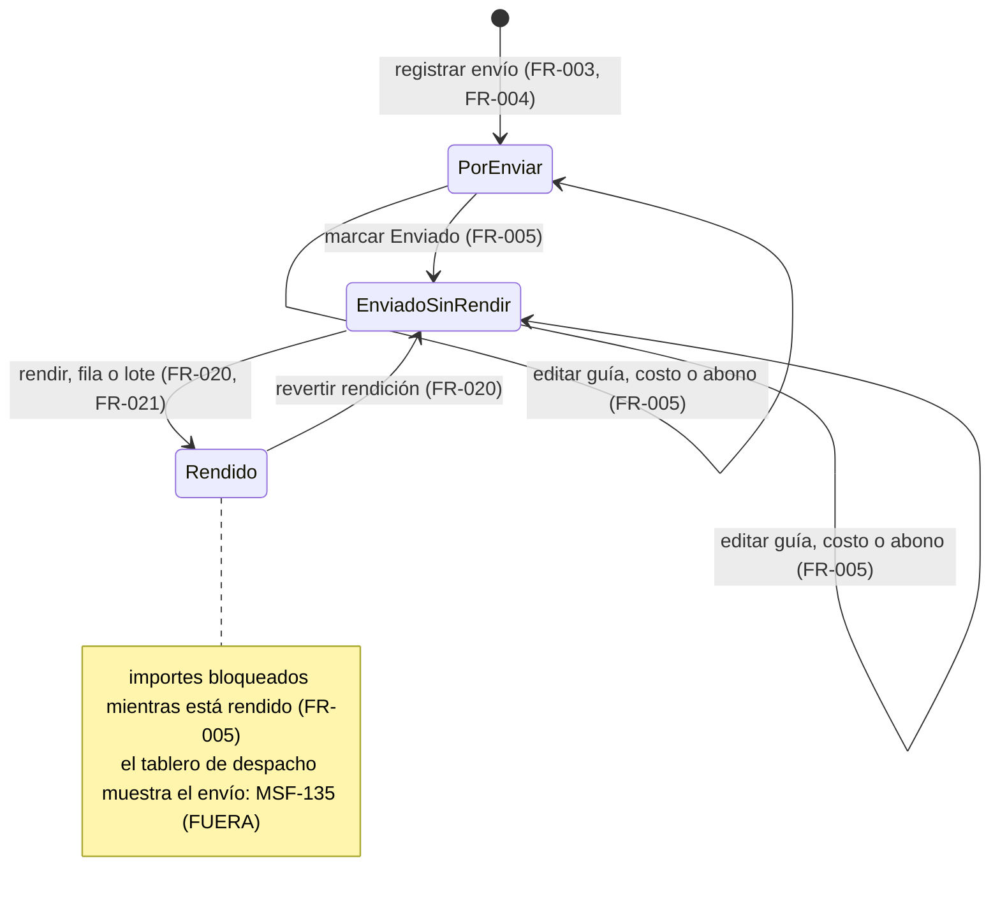
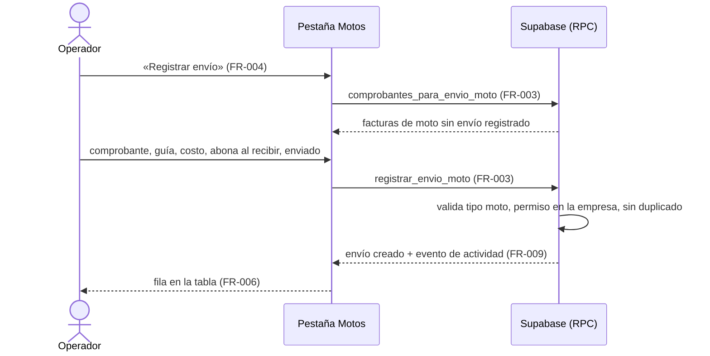
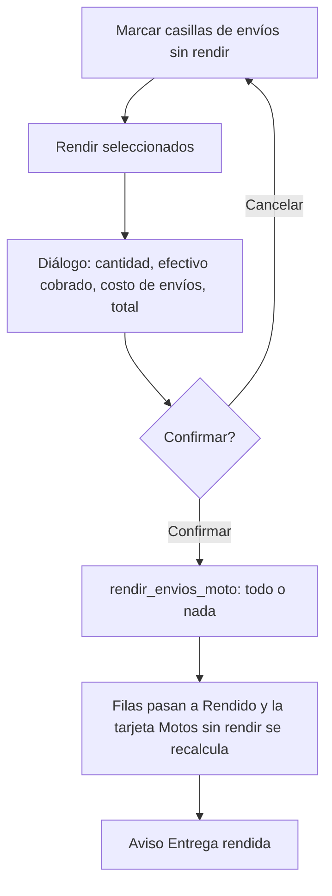

# Feature Specification: Ventas y despacho · Ventas motos

**Feature Branch**: `epic/MSF-145-ventas-y-despacho-ventas-motos`

**Jira Epic**: MSF-145 — Ventas y despacho · Ventas motos (spec `ventas-motos`)

**Created**: 2026-10-24

**Status**: Ready for implementation — la especificación viene completa desde Jira. Los puntos que la épica no define (la carga del envío y el total de la rendición no están dibujados en el prototipo) llevan decisión provisoria en *Decisiones abiertas*; ninguno bloquea.

**Delivery scope**: `refine` (apps/web) y `supabase` (migración + RPC + pgTAP). Sin `kestra`, `superset` ni `workers`.

**Prioridad / Hito**: P1 · Etapa 2 (desde enero de 2027) · 12 h aprox. (M + S).

**Dependencias**:
- Bloqueada por: MSF-159 (Ventas comprobantes): `dominio.comprobantes_venta` (clave foránea de `envios_moto`), forma de envío del comprobante (`envio_id`) y su catálogo `dominio.formas_envio` (MSF-139, que MSF-159 ya trae por cadena). **Verificado en esta rama**: ambas existen (`20261203100100_comprobantes_cabecera.sql`, `20261022120100_formas_envio.sql`, tipo de envío `moto` incluido).
- Relacionada, sin bloqueo: MSF-135 (despacho y faltantes): el tablero de despacho mostrará el envío en moto cuando ambas estén integradas; esta épica se construye y prueba contra `envios_moto` y el comprobante.
- Bloquea a: ninguna épica.

**Input**: Epic MSF-145. Objetivo: «Al terminar, los envíos con mensajería propia (motos) se registran con costo, abono y rendición.»

**Regla de fuentes** (literal de la épica):
- Comportamiento y datos: mandan los requisitos y escenarios de esta historia.
- Qué se ve (disposición, textos, estados, popups, flujos): el prototipo validado es referencia visual, no hace falta que quede extremadamente idéntico; los flujos (si hay) aclaran estados y acciones.
- Cómo se construye (componentes, estilos y patrones): mandan el template y el system design (MSF-117, `docs/sistema-de-diseno.md`). No se copia HTML ni CSS del prototipo.
- El prototipo muestra más que esta historia: se implementa solo lo que piden los requisitos; otras secciones, botones o diálogos son de otras historias.
- Si algo no se puede igualar: lo más cercano, sin inventar, anotando la diferencia en el PR. Si prototipo y requisitos se contradicen: requisitos para el comportamiento, prototipo para lo visual, y la contradicción queda anotada en el PR.
- Prototipo (solo lectura): `design/pantallas/VentasTransportes.dc.html` (inventario al día en `VentasTransportes.inventory.json`). Esta épica usa **solo** la pestaña **Motos** y la tarjeta «Motos sin rendir»; «Contrarreembolsos», «Terminales de retiro» y el diálogo «Nueva empresa» son de otras épicas (ventas-cobros-y-conciliacion y ventas-catalogos-de-cobro-y-envio).

## Modelo y supuestos

- **Mensajería propia (motos)**: el envío por moto es un envío de un comprobante cuya forma de envío es de tipo `moto`. Se registra con **guía**, **costo de envío**, **abono** (lo que el cliente paga en efectivo al recibir) y dos marcas: **enviado** y **rendido**.
- **Rendir** es cerrar la cuenta del mensajero: se rinde el efectivo cobrado y el costo del envío (texto de ayuda del prototipo). La rendición es reversible.
- Mientras no exista esta épica el envío por moto se carga como forma de envío con guía y observaciones; lo que se pierde es solo el control de costos y rendición, que no frena la venta ni el despacho. **Esta épica no cambia el comprobante ni su forma de envío**: un comprobante de moto sin envío registrado sigue funcionando como envío simple con guía opcional.
- **Empresa/tienda**: el envío pertenece a la empresa de su comprobante (no se duplica la empresa en `envios_moto`).
- Importes en pesos con dos decimales, como el resto de Ventas.
- **Nombre real de la tabla de comprobantes**: la épica la llama `comprobantes`; en la base es `dominio.comprobantes_venta` (verificado). La tabla nueva sí se llama `envios_moto`, como pide la épica.

### Esquema de datos (Constitución, Principio VII)

| Objeto | Esquema | Justificación | RLS / acceso |
|--------|---------|---------------|--------------|
| `envios_moto` (**nueva**, F-VTA-24) | **`dominio`** | Entidad de negocio del despacho de ventas, igual que `comprobantes_venta` y `formas_envio`; no es plataforma. | RLS por `organizacion_id`; `select` con la sección `ventas` en `lectura`/`edicion`; **escritura solo por RPC** (`security definer`); sin `delete` directo; `anon` sin privilegios (tabla nueva nace sin grants para `anon`). |
| `dominio.comprobantes_venta` (**existente**) | `dominio` (sin cambio) | Solo es referenciada por la FK compuesta `(comprobante_id, organizacion_id)`. | RLS vigente. |
| `dominio.formas_envio` (**existente**) | `dominio` (sin cambio) | Solo se lee para saber si el envío del comprobante es de tipo `moto`. | RLS vigente. |
| `public.registro_actividad` (**existente**) | `public` (sin cambio) | Auditoría transversal vía `private.registrar_actividad`. | Vigente. |

No se crean otras tablas. `rls_en_toda_tabla` (pgTAP, recorre `public` + `dominio`) debe seguir verde. Las migraciones son **aditivas** con reversión en su encabezado; **cada historia trae su propia migración** (timestamps propios, sin encadenarse a la de otra). El grafo (`graphify`) no conoce `envios_moto`: es una migración nueva, no inventada.

Columnas de `dominio.envios_moto` (las de la épica, más lo mínimo técnico): `id`, `organizacion_id`, `comprobante_id` (FK compuesta a `comprobantes_venta (id, organizacion_id)`, **única**: un envío en moto por comprobante), `guia` (texto opcional), `costo_envio` y `abono` (`numeric(14,2)`, `>= 0`, default 0), `enviado` y `rendido` (booleanos, default `false`), `created_at`, `updated_at` (bloqueo optimista).

## Flujos

### Flujo 1 · Ciclo de vida del envío en moto (máquina de estados)

La épica no trae diagrama: se transcriben los estados que fija el prototipo (chip «Por enviar»/«Enviado» y llave «Rendido», con mensajes «Entrega rendida» / «Rendición revertida»).

### Flujo 2 · Registro de un envío en moto (secuencia)

### Flujo 3 · Rendición en lote (proceso)

(Mapa: A→FR-021, B/C→FR-021 y FR-022, D/E→FR-021 y FR-024, F→FR-023, G→FR-020.)

## User Scenarios & Testing

### US1 · F-VTA-24 Registro de envíos en moto (P1, talla M)

Un operador con edición en Ventas registra, para una factura cuya forma de envío es «Moto», la guía, el costo del envío y cuánto abona el cliente al recibir, y marca cuándo salió. Ve todos los envíos en moto en la pestaña **Motos** de Transportes, filtrados por tienda.

**Escenarios**
1. *Dado* una factura con forma de envío «Moto» sin envío registrado, *cuando* el operador completa «Registrar envío», *entonces* aparece en la tabla «Por enviar» con su costo y abono.
2. *Dado* un comprobante de otra forma de envío (o un presupuesto, o uno ya registrado), *cuando* se abre el selector, *entonces* no se ofrece; y si se fuerza por RPC, la base responde `22023`/`23505` sin crear nada.
3. *Dado* un envío cargado, *cuando* se edita guía/costo/abono o se marca «Enviado», *entonces* se guarda con bloqueo optimista; dos ediciones simultáneas devuelven conflicto, no pisan.
4. *Dado* un usuario con `ventas` solo en lectura, *cuando* abre la pestaña, *entonces* ve la lista pero sin «Registrar envío» ni edición; la base rechaza la escritura directa (`42501`).
5. *Dado* que cambia la empresa activa, *cuando* la pestaña estaba abierta (con un diálogo abierto), *entonces* se recarga todo, no quedan filas de la empresa anterior y el diálogo se cierra con aviso.

### US2 · F-VTA-25 Rendición de motos (P1, talla S)

Quien cobra las rendiciones marca como rendidas las entregas del mensajero, de a una o en lote con un total a la vista, y ve cuánto efectivo falta rendir en «Motos sin rendir».

**Escenarios**
1. *Dado* un envío sin rendir, *cuando* se activa la llave «Rendido», *entonces* queda rendido con el aviso «Entrega rendida»; al desactivarla, «Rendición revertida».
2. *Dado* varios envíos sin rendir seleccionados, *cuando* se confirma «Rendir seleccionados», *entonces* el diálogo mostró cantidad, efectivo cobrado, costo de envíos y total, y todos quedan rendidos o ninguno.
3. *Dado* rendir dos veces el mismo envío, *entonces* la segunda no cambia nada (idempotente).
4. *Dado* la tarjeta «Motos sin rendir», *cuando* se rinde o se revierte, *entonces* monto y «N entregas» se recalculan.

## Requirements

### F-VTA-24 · Registro de envíos en moto (US1)

- **FR-001**: La pantalla `/ventas/transportes` suma la pestaña **Motos** en un control segmentado junto a «Terminales de retiro» (la pestaña actual, que sigue siendo la **por defecto** para no romper el acceso existente). Se llega con `/ventas/transportes?pestana=motos`. Muestra el texto de ayuda «Mensajería propia: se rinde el efectivo cobrado y el costo del envío.». La pestaña «Contrarreembolsos» **no** se crea (otra épica). Acceso por la sección `ventas`; sin permiso, «Acceso restringido». El menú no cambia (la entrada «Transportes» ya existe).
- **FR-002**: Se crea `dominio.envios_moto` con las columnas de *Esquema de datos*: un envío por comprobante (índice único), importes `>= 0`, FK compuesta que impide apuntar a un comprobante de otra organización, RLS de lectura por organización y sección `ventas`, **sin políticas de escritura** y sin `delete`, `anon` sin privilegios. Migración aditiva con reversión en su encabezado.
- **FR-003**: `registrar_envio_moto` (ver `contracts/ventas-motos.md`) crea el envío para un comprobante que sea **factura** (no anulada) con forma de envío de **tipo `moto`**, de la organización de la sesión y de una empresa donde el actor tenga `ventas` en `edicion`. Rechaza (con mensaje en castellano) un comprobante de otro tipo/forma de envío, un duplicado o importes negativos. `comprobantes_para_envio_moto` alimenta el selector con solo los comprobantes elegibles.
- **FR-004**: El botón **Registrar envío** (pestaña Motos) abre un diálogo del sistema de diseño con: Comprobante (selector con búsqueda), Guía, Costo de envío, Abona al recibir y Enviado. Valida y muestra errores claros; guarda y refresca la tabla con aviso de éxito. (*No está dibujado en el prototipo*: ver *Decisiones abiertas* 1.)
- **FR-005**: `actualizar_envio_moto` edita guía, costo, abono y Enviado, con bloqueo optimista por `updated_at` (`40001` ante conflicto). Mientras el envío está **rendido** no se editan costo ni abono (hay que revertir la rendición antes; *Decisiones abiertas* 5). La acción **Editar** de cada fila abre el mismo diálogo.
- **FR-006**: La tabla de la pestaña lista, paginada y de más reciente a más antigua, las columnas **Fecha** (dd/mm), **Tienda** (etiqueta de color de la empresa), **Comprobante** (número, enlace a `/ventas/comprobantes/:id`), **Cliente**, **Guía**, **Costo de envío**, **Abona al recibir** («—» si es 0) y **Enviado** (etiqueta «Enviado» / «Por enviar»). Usa los estados de carga, vacío, error y éxito del kit y es usable a 320, 768 y 1440 px. La columna **Mensajero** del prototipo queda fuera (*Decisiones abiertas* 2).
- **FR-007**: **Empresa activa (Principio VIII).** El filtro **Tienda** (`FiltroEmpresa`: «Todas las tiendas» + una por empresa) con su texto «Por defecto se ven todas; si elegís una empresa en la barra superior, se filtra por esa tienda.» filtra la tabla (y la tarjeta de F-VTA-25). Al cambiar la empresa activa la pestaña invalida y recarga todas sus consultas, vuelve a la página 1 y cierra con aviso cualquier diálogo abierto: nunca muestra filas ni totales de la empresa anterior ni guarda datos de una bajo otra. Un diálogo no mezcla empresas: la del envío es la de su comprobante.
- **FR-008**: Permisos: ver la pestaña requiere `ventas` en `lectura`/`edicion`; registrar y editar requieren `edicion` en la empresa del comprobante. Sin ese permiso la UI oculta «Registrar envío» y «Editar», y la base rechaza igual (`42501`). Todas las RPC: `security definer`, `search_path = ''`, `revoke … from public, anon` y `grant execute … to authenticated`; la organización y el actor salen de la sesión.
- **FR-009**: Cada registro o edición deja un evento (`envio_moto.registrado`, `envio_moto.actualizado`) en `public.registro_actividad` vía `private.registrar_actividad`, con actor, comprobante y cambios.

### F-VTA-25 · Rendición de motos (US2)

- **FR-020**: La columna **Rendido** muestra una llave por fila (accesible, con nombre «Rendido»). Activarla rinde el envío con el aviso «Entrega rendida»; desactivarla revierte con «Rendición revertida». `rendir_envios_moto` es **idempotente** y exige `edicion` en la empresa del envío.
- **FR-021**: **Rendición en lote**: una columna de casillas (y «seleccionar todo» de la página) permite elegir envíos sin rendir; el botón **Rendir seleccionados** abre un diálogo de confirmación y, al confirmar, `rendir_envios_moto` rinde **todos o ninguno** en una transacción. Un id inexistente, de otra organización o sin permiso aborta todo (`22023`/`42501`). (*No dibujado en el prototipo*: *Decisiones abiertas* 1.)
- **FR-022**: El diálogo de lote muestra la **cantidad**, el **efectivo cobrado** (suma de «Abona al recibir»), el **costo de envíos** (suma de «Costo de envío») y el **total a rendir**. El total provisorio es el efectivo cobrado; el costo se muestra aparte (*Decisiones abiertas* 3). El servidor devuelve los mismos totales al rendir.
- **FR-023**: La tarjeta **Motos sin rendir** (arriba de las pestañas, como en el prototipo) muestra la suma de «Abona al recibir» de los envíos sin rendir con abono mayor a 0 y «N entregas» con la cantidad de esos envíos; se recalcula al rendir/revertir y respeta el filtro Tienda (*Decisiones abiertas* 6). `resumen_motos_sin_rendir` la alimenta.
- **FR-024**: Cada rendición o reversión (de fila o lote) deja un evento (`envio_moto.rendido`, `envio_moto.rendicion_revertida`) en `public.registro_actividad` con actor, fecha, envíos y totales.
- **FR-025**: Al cambiar la empresa activa se descarta la selección del lote y se cierra con aviso el diálogo de rendición (Principio VIII, ver FR-007).

## Success Criteria

- **SC-001** (FR-001, FR-003, FR-004, FR-006): test de página: la pestaña Motos lista envíos con las columnas y formatos del prototipo; el diálogo registra uno elegible y no ofrece uno no elegible; estados de carga/vacío/error.
- **SC-002** (FR-002, FR-008): pgTAP `ventas_motos_registro`: aislamiento entre organizaciones y empresas, `lectura`/`ninguno`/`anon` sin escritura, un envío por comprobante, tipo de envío y tipo de comprobante validados, importes negativos rechazados, `rls_en_toda_tabla` verde.
- **SC-003** (FR-005, FR-009): pgTAP: edición con conflicto `40001`, importes bloqueados si está rendido, eventos de actividad.
- **SC-004** (FR-007): test que **cambia la empresa activa** con la pestaña y un diálogo abiertos: recarga, página 1, aviso, sin filas ajenas.
- **SC-005** (FR-020, FR-024): pgTAP y Vitest: rendir/revertir por fila, idempotencia, avisos y eventos.
- **SC-006** (FR-021, FR-022, FR-025): pgTAP y Vitest: lote todo o nada (un id ajeno aborta todo), totales del diálogo igual a los del servidor, selección descartada al cambiar de empresa.
- **SC-007** (FR-023): test: la tarjeta suma y cuenta según la regla, se recalcula al rendir y respeta el filtro Tienda.
- **SC-008** (documentación y cierre): `pnpm lint`, `pnpm build`, `pnpm test`, `pnpm docs:check`, `pnpm prototipo:check`, `pnpm matriz:check` e `infra:config` verdes; guía `docs/ventas-motos.md` y roadmap actualizados.

## Decisiones abiertas (provisorias; no bloquean)

1. **Dónde se carga el envío y cómo se rinde en lote.** El prototipo no dibuja la carga de costo ni la rendición en lote con total (la épica lo reconoce). Provisorio: botón «Registrar envío» + diálogo y acción «Editar» en la pestaña Motos, casillas + «Rendir seleccionados» + diálogo de totales, con componentes del kit. Se anota la diferencia en el PR.
2. **Columna «Mensajero» del prototipo** («Moto 1 · Mensajero A»). La tabla `envios_moto` de la épica no tiene ese dato; no se inventa. Queda fuera hasta que la épica lo pida.
3. **Total de la rendición.** Provisorio: total a rendir = efectivo cobrado (suma del abono); el costo de envíos se muestra como línea informativa, sin netear.
4. **Comprobante elegible.** Provisorio: factura (borrador o confirmada, no anulada) con forma de envío de tipo `moto`; el presupuesto no tiene envío.
5. **Envío rendido.** Provisorio: no se editan costo ni abono hasta revertir la rendición, para no alterar lo ya rendido.
6. **Tarjeta y filtro.** El prototipo calcula la tarjeta sobre todas las tiendas; por el Principio VIII respeta el filtro Tienda activo. Contradicción visual anotada en el PR.

## Matriz pantalla↔criterios

Fuente: `design/pantallas/VentasTransportes.dc.html` / `VentasTransportes.inventory.json` (`pnpm prototipo:inventario`).

### Ventas · Transportes y contrarreembolsos (`VentasTransportes`)

| Ítem del inventario / visible | Dueño |
|---|---|
| Pestaña **Motos** (control segmentado) y texto de ayuda «Mensajería propia: se rinde el efectivo cobrado y el costo del envío.» | FR-001 |
| Tabla Motos · columnas Fecha, Tienda, Comprobante, Cliente, Guía, Costo de envío, Abona al recibir, Enviado | FR-006 |
| Tabla Motos · columna Rendido (llave) | FR-020 |
| Tabla Motos · columna **Mensajero** | **FUERA DE ALCANCE** — la épica no define ese dato en `envios_moto` (*Decisiones abiertas* 2) |
| Chips «Enviado» / «Por enviar» y «—» en abono 0 | FR-006 |
| Avisos «Entrega rendida» / «Rendición revertida» | FR-020 |
| Tarjeta **Motos sin rendir** (monto y «N entregas») | FR-023 |
| Tarjetas «Contrarreembolsos pendientes» y «Cobrados este mes» | **FUERA DE ALCANCE** — contrarreembolsos: épica ventas-cobros-y-conciliacion |
| Filtro **Tienda** («Todas las tiendas» + empresas) y su texto | FR-007 |
| Pestaña **Contrarreembolsos**, su tabla (Empresa de transporte, Importe, Estado) y botón «Marcar cobrado» | **FUERA DE ALCANCE** — épica ventas-cobros-y-conciliacion |
| Pestaña **Terminales de retiro**, su tabla (Terminal de retiro, Localidad, Teléfono, Contacto), «Envíos del mes» y recuento «N de M empresas de transporte» | **FUERA DE ALCANCE** — ya entregada por MSF-139 (F-VTA-04); solo cambia su ubicación bajo el control segmentado (FR-001) |
| Botón «Nueva empresa», diálogo «Nueva empresa de transporte» y sus campos (Empresa de transporte, Tipo, CUIT, Terminal de retiro, Localidad, Teléfono, Correo, Persona de contacto, Dirección de la oficina, Cobra contrarreembolso, Comisión, Plazo de rendición, Orden, Activa, Empresas donde se usa), «Cancelar», «Guardar empresa» | **FUERA DE ALCANCE** — ventas-catalogos-de-cobro-y-envio (MSF-139) |
| Botón «Exportar» | **FUERA DE ALCANCE** — la épica no lo pide |
| Título «Transportes y contrarreembolsos» y su subtítulo | **FUERA DE ALCANCE** — se renombra cuando llegue «Contrarreembolsos»; el título actual «Transportes» no se toca |
| Pestañas de navegación Comprobantes / Presupuestos / Pagos / Faltantes / Devoluciones (RMA) / Transportes y contrarreembolsos | **FUERA DE ALCANCE** — pertenecen a otras épicas |
| «Registrar envío», «Editar», casillas y «Rendir seleccionados» con su diálogo (no están en el prototipo) | FR-004, FR-005, FR-021, FR-022 (*Decisiones abiertas* 1) |
| Empresa activa | FR-007, FR-025 (test SC-004, SC-006) |

## Matriz de trazabilidad Jira ↔ US ↔ FR ↔ tareas

| Jira | Historia | US | FR / SC | Tareas |
|------|----------|----|---------|--------|
| MSF-145 (épica) | F-VTA-24 Registro de envíos en moto | US1 | FR-001…FR-009, SC-001…SC-004 | T001–T010 |
| MSF-145 (épica) | F-VTA-25 Rendición de motos | US2 | FR-020…FR-025, SC-005…SC-007 | T011–T018 |
| Tarea de cierre (label `cierre`) | Documentación, índice, roadmap, validación | — | SC-008 | T019–T021 |
