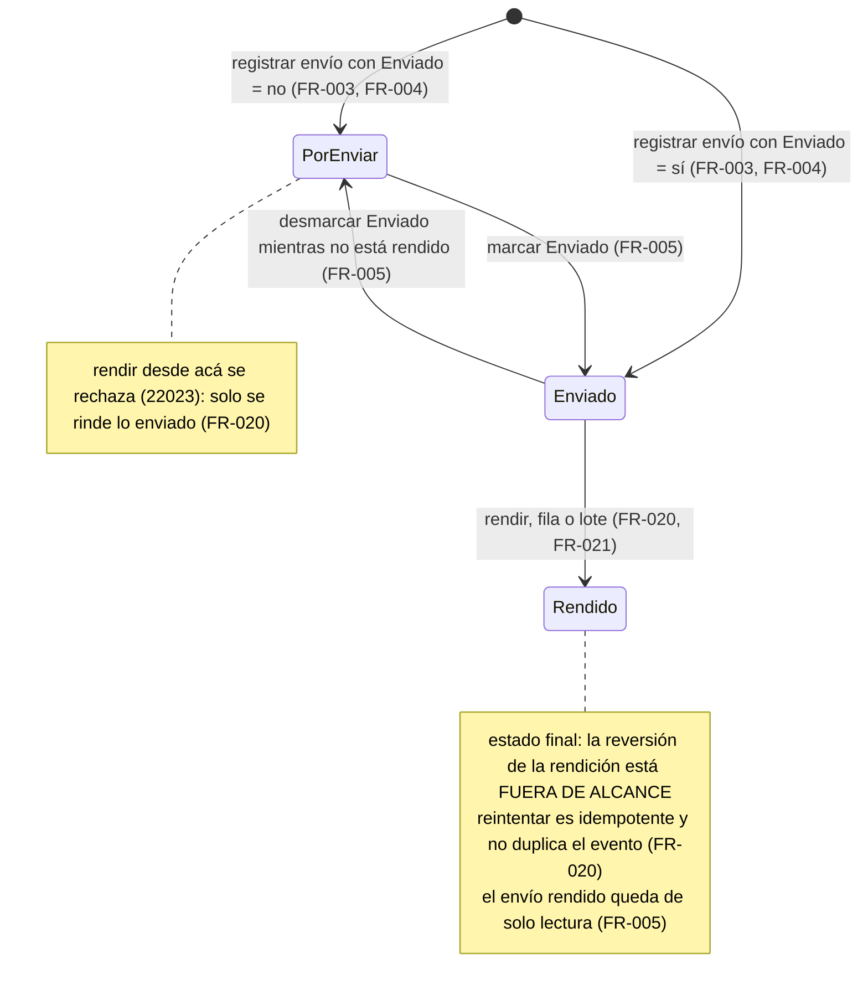
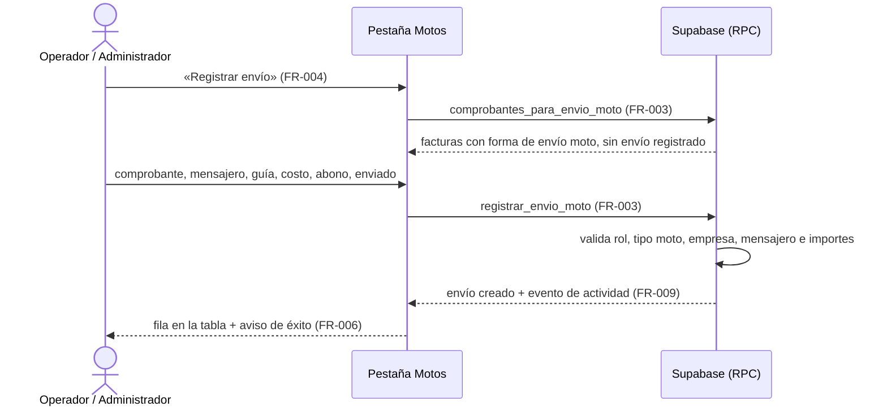
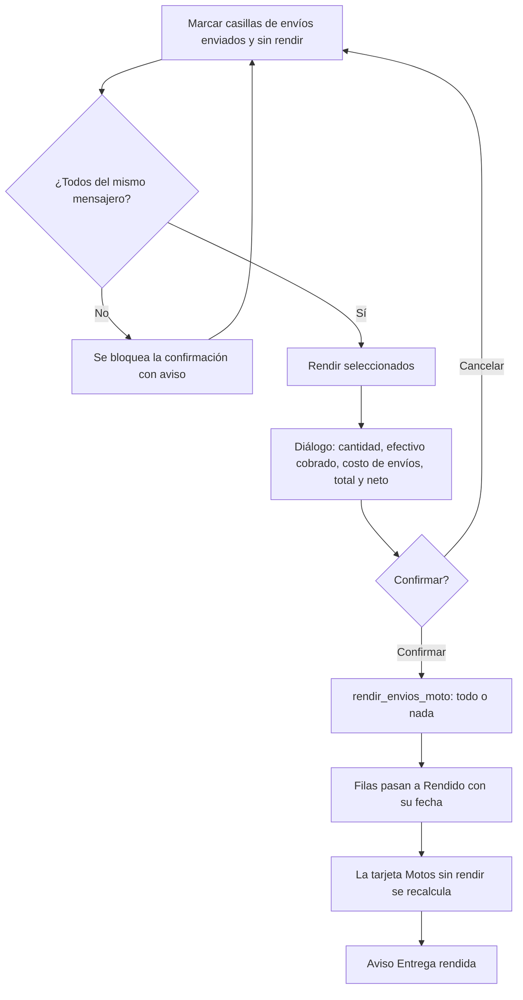
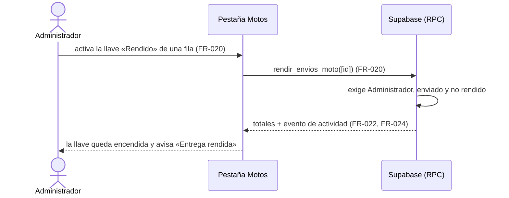

# Feature Specification: Ventas y despacho · Ventas motos

**Feature Branch**: `epic/MSF-145-ventas-y-despacho-ventas-motos`

**Jira Epic**: MSF-145 — Ventas y despacho · Ventas motos (spec `ventas-motos`)

**Created**: 2026-10-24

**Status**: Spec aprobada (piloto de spec, 2026-11-09) · **implementación en HOLD** hasta la Etapa 2 (2027-01-04) o pedido expreso de Nicolás. No se despacha Desarrollador, QA ni Code Review; ver *Estado de entrega*.

**Delivery scope**: `refine` (apps/web) y `supabase` (migraciones + RPC + pgTAP). Sin `kestra`, `superset` ni `workers`.

**Prioridad / Hito**: P1 · Etapa 2 (desde enero de 2027) · 12 h aprox. (F-VTA-24 M + F-VTA-25 S).

**Dependencias**:
- Dependencia de base (verificada): MSF-159 (Ventas comprobantes): `dominio.comprobantes_venta` (clave foránea de `envios_moto`), su forma de envío (`envio_id`) y el catálogo `dominio.formas_envio` (MSF-139, que MSF-159 trae por cadena). **Verificado en esta rama**: existen `dominio.comprobantes_venta` (`20261018100000`, ampliada en `20261203100100`), `dominio.formas_envio` con `tipo = 'moto'` (`20261022120100`) y los estados de factura `borrador` / `confirmada`.
- Relacionada, sin bloqueo: MSF-135 (despacho y faltantes). La visibilidad del envío en el tablero de Despacho **no entra** en esta épica (ver *Decisiones de producto* 3).
- Bloquea a: ninguna épica.

**Input**: Epic MSF-145. Objetivo: «Al terminar, los envíos con mensajería propia (motos) se registran con costo, abono y rendición.»

**Regla de fuentes** (literal de la épica):
- Comportamiento y datos: mandan los requisitos y escenarios de esta historia.
- Qué se ve (disposición, textos, estados, popups, flujos): el prototipo validado es referencia visual, no hace falta que quede extremadamente idéntico; los flujos (si hay) aclaran estados y acciones.
- Cómo se construye (componentes, estilos y patrones): mandan el template y el system design (MSF-117, `docs/sistema-de-diseno.md`). No se copia HTML ni CSS del prototipo.
- El prototipo muestra más que esta historia: se implementa solo lo que piden los requisitos; otras secciones, botones o diálogos son de otras historias.
- Si algo no se puede igualar: lo más cercano, sin inventar, anotando la diferencia en el PR. Si prototipo y requisitos se contradicen: requisitos para el comportamiento, prototipo para lo visual, y la contradicción queda anotada en el PR.
- Prototipo (solo lectura): `design/pantallas/VentasTransportes.dc.html` (inventario al día en `VentasTransportes.inventory.json`). Esta épica usa **solo** la pestaña **Motos** (texto de ayuda «Mensajería propia: se rinde el efectivo cobrado y el costo del envío.») y la tarjeta «Motos sin rendir». «Contrarreembolsos», «Terminales de retiro» y el diálogo «Nueva empresa» son de otras épicas (ventas-cobros-y-conciliacion y ventas-catalogos-de-cobro-y-envio).

## Estado de entrega (HOLD hasta Etapa 2)

- **Liberación parcial para piloto (Nicolás, 2026-11-09)**: esta corrida entrega **spec/plan/tasks**; la revisión EGM corre en modo sombra (solo comenta). **No** se pasa a *Implementation In Progress* ni se despachan Desarrollador, QA ni Code Review: la implementación sigue en hold hasta la **Etapa 2 (2027-01-04)** o un pedido expreso de Nicolás.
- **Condiciones para implementar**: liberación de la fase **y** MSF-159 integrada en `dev` (hoy en *Review In DEV*) **y** cupo libre de workers. Al liberar, revalidar `comprobantes_venta` y `formas_envio` en la base vigente antes de la primera migración.
- **Sin migración de histórico**: no se backfillean comprobantes ni envíos existentes; `envios_moto` nace vacía.
- Esta espera es declarada: no es una traba. No se abre gate de alcance (la spec ya está aprobada).

## Modelo y supuestos

- **Mensajería propia (motos)**: el envío por moto es un envío de un comprobante de venta cuya forma de envío es de tipo `moto`. Se registra con **mensajero**, **guía** (opcional), **costo de envío**, **abono** (lo que el cliente paga en efectivo al recibir) y las marcas **enviado** y **rendido** (con su fecha de rendición).
- **Mensajero**: campo de texto libre, obligatorio y no vacío. No hay tabla de mensajeros. Se normaliza (sin espacios sobrantes) y se compara/agrupa **sin distinguir mayúsculas**. Lo carga quien registra el envío.
- **Rendir** es cerrar la cuenta del mensajero: se rinde el efectivo cobrado y el costo del envío (texto de ayuda del prototipo). El **total de la rendición es la suma del `abono`**; el costo se muestra aparte y el neto (`abono − costo`) es informativo: ninguno se resta del total (ver *Decisiones de producto* 2). **La reversión de una rendición queda fuera de alcance.**
- **Solo se rinden envíos enviados y no rendidos.** El lote es **todo o nada** y **no puede mezclar mensajeros**.
- Mientras no exista esta épica, el envío por moto se carga como forma de envío con guía y observaciones (F-VTA-02 y F-VTA-16); lo que se pierde es solo el control de costos y rendición, que no frena la venta ni el despacho. **Esta épica no cambia el comprobante ni su forma de envío**: un comprobante de moto sin envío registrado sigue funcionando como envío simple con guía opcional.
- **Empresa/tienda**: el envío pertenece a la empresa de su comprobante (no se duplica la empresa en `envios_moto`).
- Importes en pesos con dos decimales, como el resto de Ventas (el prototipo los muestra redondeados; ver *Decisiones abiertas de detalle* 2).
- **Nombre real de la tabla de comprobantes**: la épica la llama `comprobantes`; en la base es `dominio.comprobantes_venta` (verificado). La tabla nueva se llama `dominio.envios_moto`.
- **Criterio de aceptación de la épica (actualizado por *Decisiones de producto* 3)**: `CA-VTA-24-1` — el envío **queda registrado y consultable en la pestaña Motos** (la visibilidad en Despacho es de MSF-135).

### Esquema de datos (Constitución, Principio VII)

| Objeto | Esquema | Justificación | RLS / acceso |
|--------|---------|---------------|--------------|
| `envios_moto` (**nueva**, F-VTA-24) | **`dominio`** | Entidad de negocio del despacho de ventas, igual que `comprobantes_venta` y `formas_envio`; no es plataforma. | RLS por `organizacion_id`, empresa accesible (la de su comprobante) y sección `ventas` en `lectura`/`edicion`; **sin políticas de escritura ni `delete`** (se escribe solo por RPC `security definer`); `anon` sin privilegios (nace sin grants). |
| `dominio.comprobantes_venta` (**existente**) | `dominio` (sin cambio) | Solo es referenciada por la FK compuesta `(comprobante_id, organizacion_id)`. | RLS vigente. |
| `dominio.formas_envio` (**existente**) | `dominio` (sin cambio) | Solo se lee para saber si la forma de envío del comprobante es de tipo `moto`. | RLS vigente. |
| `public.registro_actividad` (**existente**) | `public` (sin cambio) | Auditoría transversal vía `private.registrar_actividad`. | Vigente. |

No se crean otras tablas. `rls_en_toda_tabla` (pgTAP, recorre `public` + `dominio`) debe seguir verde. Las migraciones son **aditivas** con reversión en su encabezado; **cada historia trae su propia migración** (timestamps propios). El grafo (`graphify`) no conoce `envios_moto`: es una migración nueva, no inventada.

Columnas de `dominio.envios_moto`:

| Columna | Tipo | Regla |
|---|---|---|
| `id` | `uuid` | PK, `gen_random_uuid()`. |
| `organizacion_id` | `uuid` | `not null default private.organizacion_id()`, FK a `public.organizaciones`. |
| `comprobante_id` | `uuid` | `not null`; FK compuesta `(comprobante_id, organizacion_id)` a `comprobantes_venta (id, organizacion_id)`; **único por organización** (un envío por comprobante). |
| `mensajero` | `text` | `not null`, `btrim(mensajero) <> ''`, `length <= 100`; normalizado al escribir. |
| `guia` | `text` | Opcional (`null` permitido); sin espacios sobrantes. |
| `costo_envio` | `numeric(14,2)` | `not null default 0`, `>= 0` (cero válido). |
| `abono` | `numeric(14,2)` | `not null default 0`, `>= 0` (cero válido). |
| `enviado` | `boolean` | `not null default false`. |
| `rendido` | `boolean` | `not null default false`. **Solo lo escribe la RPC de rendición.** |
| `rendido_en` | `timestamptz` | Nulo mientras no está rendido. **Solo lo escribe la RPC de rendición.** |
| `created_at` | `timestamptz` | `not null default now()`. |
| `updated_at` | `timestamptz` | `not null default now()` (bloqueo optimista). |

Restricciones: `check (rendido or rendido_en is null)` y `check (not rendido or rendido_en is not null)`. Índice por `(organizacion_id, lower(mensajero))` para agrupar.

## Flujos

### Flujo 1 · Ciclo de vida del envío en moto (máquina de estados)

La épica no trae diagrama. Se transcriben los estados que fijan el prototipo (chips «Por enviar» / «Enviado» y llave «Rendido») y las reglas de las *Decisiones de producto* (solo se rinde lo enviado; la reversión queda fuera).

### Flujo 2 · Registro de un envío en moto (secuencia)

### Flujo 3 · Rendición en lote (proceso)

(Mapa: A→FR-021, B→FR-021 y FR-022, C/D→FR-021 y FR-022, E/F→FR-020 y FR-021, G→FR-020, H→FR-023, I→FR-020.)

### Flujo 4 · Rendición de una fila (secuencia)

## User Scenarios & Testing

### US1 · F-VTA-24 Registro de envíos en moto (P1, talla M)

Un operador (o administrador) con edición en Ventas registra, para una factura cuya forma de envío es «Moto», el **mensajero**, la guía, el costo del envío y cuánto abona el cliente al recibir, y marca cuándo salió. Ve todos los envíos en moto en la pestaña **Motos** de Transportes, filtrados por tienda.

**Escenarios**
1. **Given (Dado)** una factura con forma de envío «Moto» sin envío registrado, **When (cuando)** Operador o Administrador completa «Registrar envío» con mensajero no vacío, costo y abono ≥ 0, **Then (entonces)** aparece en la tabla con «Por enviar» (o «Enviado» si se marcó) y sus importes.
2. **Given (Dado)** un comprobante de otra forma de envío (o un presupuesto, o uno ya registrado), **When (cuando)** se abre el selector, **Then (entonces)** no se ofrece; y si se fuerza por RPC, la base responde `22023`/`23505` sin crear nada.
3. **Given (Dado)** un mensajero vacío o solo espacios, **When (cuando)** se intenta registrar o editar, **Then (entonces)** la UI lo marca y la RPC responde `22023` sin crear ni cambiar nada.
4. **Given (Dado)** un envío cargado, **When (cuando)** se edita mensajero/guía/costo/abono o se marca «Enviado», **Then (entonces)** se guarda con bloqueo optimista; dos ediciones simultáneas devuelven conflicto (`40001`), no pisan.
5. **Given (Dado)** un usuario con `ventas` solo en lectura (rol Consulta), **When (cuando)** abre la pestaña, **Then (entonces)** ve la lista pero sin «Registrar envío» ni «Editar»; la base rechaza la escritura (`42501`).
6. **Given (Dado)** que cambia la empresa activa, **When (cuando)** la pestaña estaba abierta (con un diálogo abierto), **Then (entonces)** se recarga todo, no quedan filas de la empresa anterior y el diálogo se cierra con aviso.
7. **Given (Dado)** un envío ya registrado, **When (cuando)** se intenta registrar otro para el mismo comprobante, **Then (entonces)** la base responde `23505` (uno por comprobante).

### US2 · F-VTA-25 Rendición de motos (P1, talla S)

El administrador marca como rendidas las entregas de un mensajero, de a una o en lote con un total a la vista, y ve cuánto efectivo falta rendir en «Motos sin rendir». La rendición no se revierte en esta épica.

**Escenarios**
1. **Given (Dado)** un envío enviado y no rendido, **When (cuando)** el Administrador activa la llave «Rendido», **Then (entonces)** queda rendido con la fecha y el aviso «Entrega rendida»; la llave ya no se apaga.
2. **Given (Dado)** un envío sin marcar «Enviado», **When (cuando)** se intenta rendir, **Then (entonces)** la UI no lo permite y la RPC responde `22023` sin cambiar nada; si ya estaba rendido, la operación es idempotente (escenario 5).
3. **Given (Dado)** varios envíos del **mismo mensajero**, enviados y sin rendir, **When (cuando)** se confirma «Rendir seleccionados», **Then (entonces)** el diálogo mostró cantidad, efectivo cobrado, costo de envíos, total y neto, y todos quedan rendidos o ninguno.
4. **Given (Dado)** una selección con envíos de mensajeros distintos (aun con mayúsculas o espacios diferentes), **When (cuando)** se intenta rendir, **Then (entonces)** la confirmación se bloquea y la RPC responde `22023`; no se rinde ninguno.
5. **Given (Dado)** rendir dos veces el mismo envío, **Then (entonces)** la segunda no cambia nada (idempotente, sin evento duplicado).
6. **Given (Dado)** la tarjeta «Motos sin rendir», **When (cuando)** se rinde un envío, **Then (entonces)** monto y «N entregas» se recalculan.

## Requirements

### F-VTA-24 · Registro de envíos en moto (US1)

- **FR-001**: La pantalla `/ventas/transportes` suma la pestaña **Motos** en el control segmentado junto a «Terminales de retiro» (la pestaña actual, que sigue siendo la **por defecto** para no romper el acceso existente). Se llega con `/ventas/transportes?pestana=motos`. Muestra el texto de ayuda «Mensajería propia: se rinde el efectivo cobrado y el costo del envío.». La pestaña «Contrarreembolsos» **no** se crea (otra épica). Acceso por la sección `ventas`; sin permiso, «Acceso restringido». **Navegación**: no cambia (la entrada «Transportes» del menú Ventas ya existe; mismo icono); no hay rutas anteriores que romper. **Verificación**: `pnpm --filter @platform/web test -- TransportesMotos` (Vitest `TransportesMotos.test.tsx`: pestaña por defecto, `?pestana=motos`, texto de ayuda, sin pestaña Contrarreembolsos, «Acceso restringido»).
- **FR-002**: Se crea `dominio.envios_moto` con las columnas y restricciones de *Esquema de datos*: un envío por comprobante, `mensajero` obligatorio y normalizado, `guia` opcional, `costo_envio` y `abono` no nulos y `>= 0` (cero válido), FK compuesta que impide apuntar a un comprobante de otra organización, `rendido`/`rendido_en` coherentes, RLS de lectura por organización, **empresa accesible** (la de su comprobante) y sección `ventas`, **sin políticas de escritura** y sin `delete`, `anon` sin privilegios. Migración aditiva con reversión en su encabezado y **sin migración de histórico**. **Verificación**: `pnpm test:db` → pgTAP `supabase/tests/database/ventas_motos_registro.test.sql` (columnas, `mensajero` no vacío y normalizado, único por comprobante, `check >= 0`, FK compuesta, coherencia de `rendido_en`, RLS por organización y empresa accesible, sin `delete`, `anon` sin privilegios) y `rls_en_toda_tabla`.
- **FR-003**: `registrar_envio_moto` (ver `contracts/ventas-motos.md`) crea el envío para un comprobante que sea **factura** (no presupuesto; hoy `borrador` o `confirmada`, nunca anulada) con forma de envío de **tipo `moto`** de la misma empresa, de la organización de la sesión y de una empresa donde el actor pueda registrar (FR-008). Exige **mensajero no vacío** (normalizado sin espacios sobrantes) y `costo_envio`/`abono >= 0`. Rechaza (con mensaje en castellano) un comprobante de otro tipo/forma de envío/empresa, un duplicado, un mensajero vacío o importes negativos. **Nunca** escribe `rendido` ni `rendido_en`. `comprobantes_para_envio_moto` alimenta el selector con solo los comprobantes elegibles. **Verificación**: `pnpm test:db` → `ventas_motos_registro.test.sql` (`registrar_envio_moto` válido; presupuesto, forma no-moto, empresa ajena, anulada, duplicado, mensajero vacío e importe negativo rechazados; `comprobantes_para_envio_moto` solo elegibles) y Vitest `EnvioMotoDialog.test.tsx` (selector).
- **FR-004**: El botón **Registrar envío** (pestaña Motos) abre un diálogo del sistema de diseño con: Comprobante (selector con búsqueda), **Mensajero**, Guía, Costo de envío, Abona al recibir y Enviado. Valida (mensajero obligatorio; importes de 0 en adelante con hasta dos decimales) y muestra errores claros; guarda y refresca la tabla con aviso de éxito. (*No está dibujado en el prototipo*: ver *Decisiones abiertas de detalle* 1.) **Verificación**: `pnpm --filter @platform/web test -- EnvioMotoDialog` (campos, validación de mensajero e importes, errores, aviso de éxito y refresco de la tabla).
- **FR-005**: `actualizar_envio_moto` edita **mensajero**, guía, costo, abono y Enviado, con bloqueo optimista por `updated_at` (`40001` ante conflicto). Un **envío rendido queda de solo lectura** (la rendición no se revierte en esta épica). La RPC **nunca** escribe `rendido` ni `rendido_en`. La acción **Editar** de cada fila abre el mismo diálogo. **Verificación**: `pnpm test:db` → `ventas_motos_registro.test.sql` (edición; `40001` ante conflicto; `55000` si está rendido; `rendido`/`rendido_en` intactos) y Vitest `EnvioMotoDialog.test.tsx` («Editar» abre el mismo diálogo con los valores actuales).
- **FR-006**: La tabla de la pestaña lista, paginada (25 por página) y de más reciente a más antigua, las columnas **Fecha** (dd/mm), **Tienda** (etiqueta de color de la empresa), **Comprobante** (número, enlace a `/ventas/comprobantes/:id`), **Cliente**, **Mensajero**, **Guía**, **Costo de envío**, **Abona al recibir** («—» si es 0) y **Enviado** (etiqueta «Enviado» / «Por enviar»). La columna **Rendido** es de F-VTA-25 (FR-020). Las acciones «Registrar envío» y «Editar» solo se muestran a quien puede escribir (FR-008). Usa los estados de carga, vacío, error y éxito del kit y es usable a 320, 768 y 1440 px; no muestra ids técnicos como identidad. **Verificación**: `pnpm --filter @platform/web test -- TransportesMotos` (columnas, formatos dd/mm y dos decimales, «—», chips, orden, paginación, estados carga/vacío/error, acciones por rol) y Playwright/captura `pnpm --filter @platform/web pantallas:capturar` a 320/768/1440 px.
- **FR-007**: **Empresa activa (Principio VIII).** El filtro **Tienda** (`FiltroEmpresa`: «Todas las tiendas» + una por empresa) con su texto «Por defecto se ven todas; si elegís una empresa en la barra superior, se filtra por esa tienda.» filtra la tabla (y la tarjeta de F-VTA-25). Al cambiar la empresa activa la pestaña invalida y recarga todas sus consultas, vuelve a la página 1 y cierra con aviso cualquier diálogo abierto: nunca muestra filas ni totales de la empresa anterior ni guarda datos de una bajo otra. Un envío pertenece a la empresa de su comprobante; un diálogo no mezcla empresas. **Verificación**: `pnpm --filter @platform/web test -- TransportesMotos` (test «cambio de empresa activa»: invalida y recarga, página 1, diálogo cerrado con aviso, sin filas ajenas) y `pnpm ui:empresas:check`.
- **FR-008**: **Permisos (servidor).** Ver la pestaña y listar requiere `ventas` en `lectura`/`edicion`. Registrar, editar y marcar Enviado requieren `ventas` en `edicion` **y** rol efectivo en la empresa **Operador o Administrador** (o superadmin con organización activa). Sin ese permiso la base rechaza (`42501`). Todas las RPC: `security definer`, `search_path = ''`, `revoke … from public, anon` y `grant execute … to authenticated`; la organización y el actor salen de la sesión. **Verificación**: `pnpm test:db` → `ventas_motos_registro.test.sql` (`42501` con Consulta, otro rol sin edición y `anon`, `search_path`) y Vitest `TransportesMotos.test.tsx` (botones ocultos en solo lectura).
- **FR-009**: Cada registro o edición deja un evento (`envio_moto.registrado`, `envio_moto.actualizado`) en `public.registro_actividad` vía `private.registrar_actividad`, con actor, comprobante, mensajero y cambios, en la misma transacción. **Verificación**: `pnpm test:db` → `ventas_motos_registro.test.sql` (filas `envio_moto.registrado` y `envio_moto.actualizado` en `public.registro_actividad` con actor, comprobante y mensajero).

### F-VTA-25 · Rendición de motos (US2)

- **FR-020**: `rendir_envios_moto` (ver `contracts/ventas-motos.md`) rinde uno o varios envíos **enviados y no rendidos**, en una transacción **todo o nada**, y es **idempotente** (reintentar sobre los ya rendidos no cambia nada ni duplica el evento; si todos ya lo estaban, devuelve cantidad 0 y totales 0). Exige **rol Administrador** en la empresa del envío (o superadmin). Escribe **solo** `rendido = true` y `rendido_en = now()`; ninguna otra RPC ni actualización directa puede tocar esas columnas. **La reversión queda fuera de alcance.** La columna/lave **Rendido** de la tabla muestra el estado y permite rendir la fila cuando corresponde; la llave encendida no se apaga. **Verificación**: `pnpm test:db` → `ventas_motos_rendicion.test.sql` (rendir; no enviado rechazado; ya rendido idempotente sin evento nuevo; `42501` para Operador/Consulta; `rendido_en` escrito solo por la RPC) y Vitest `TransportesMotos.test.tsx` (llave y aviso «Entrega rendida»; no existe «Rendición revertida»).
- **FR-021**: **Rendición en lote**: una columna de casillas (solo en filas enviadas y no rendidas) y «seleccionar todo» de la página permiten elegir envíos; el botón **Rendir seleccionados** abre un diálogo de confirmación y, al confirmar, `rendir_envios_moto` rinde **todos o ninguno**. La selección **no puede mezclar mensajeros** (comparados sin mayúsculas ni espacios sobrantes): si los mezcla, la confirmación se bloquea con un aviso y la RPC responde `22023`. Un id inexistente, de otra organización, no enviado o sin permiso aborta todo (`22023`/`42501`); los ids ya rendidos se **ignoran** (idempotencia, sin evento nuevo y sin contar para la regla de un solo mensajero) y solo cuentan los que pasan a rendidos. (*No dibujado en el prototipo*: *Decisiones abiertas de detalle* 1.) **Verificación**: `pnpm test:db` → `ventas_motos_rendicion.test.sql` (lote todo o nada: id ajeno, inexistente, no enviado o mezcla de mensajeros aborta; `22023`/`42501`) y Vitest `RendicionMotosDialog.test.tsx` (casillas, seleccionar todo, bloqueo por mensajeros mezclados, confirmar).
- **FR-022**: El diálogo de lote muestra la **cantidad**, el **efectivo cobrado** (suma de «Abona al recibir»), el **costo de envíos** (suma de «Costo de envío»), el **total a rendir** (igual al efectivo cobrado) y el **neto** (`efectivo cobrado − costo`, informativo). Ningún importe se resta del total. El servidor devuelve los mismos totales al rendir. **Verificación**: Vitest `RendicionMotosDialog.test.tsx` (cantidad, efectivo cobrado, costo de envíos, total y neto) y pgTAP `ventas_motos_rendicion.test.sql` (totales devueltos por `rendir_envios_moto` iguales a los del diálogo; el total es la suma del `abono`).
- **FR-023**: La tarjeta **Motos sin rendir** (arriba de las pestañas, como en el prototipo) muestra la suma de «Abona al recibir» de los envíos sin rendir con abono mayor a 0 y «N entregas» con la cantidad de esos envíos; se recalcula al rendir y respeta el filtro Tienda (Principio VIII). `resumen_motos_sin_rendir` la alimenta. Nota: la tarjeta cuenta todos los no rendidos con abono > 0 (como el prototipo); un envío sin marcar Enviado no puede rendirse aunque sume en la tarjeta. **Verificación**: `pnpm test:db` → `ventas_motos_rendicion.test.sql` (`resumen_motos_sin_rendir`: suma, cuenta, filtro por empresa) y Vitest `TransportesMotos.test.tsx` (tarjeta se recalcula al rendir).
- **FR-024**: Cada rendición (de fila o lote) deja un evento (`envio_moto.rendido`) en `public.registro_actividad` con actor, fecha, ids, mensajero, cantidad y totales, en la misma transacción; reintentar sobre lo ya rendido no duplica el evento. **Verificación**: `pnpm test:db` → `ventas_motos_rendicion.test.sql` (evento `envio_moto.rendido` con actor, fecha, envíos, mensajero y totales; sin evento duplicado).
- **FR-025**: Al cambiar la empresa activa se descarta la selección del lote y se cierra con aviso el diálogo de rendición (Principio VIII, ver FR-007). **Verificación**: `pnpm --filter @platform/web test -- RendicionMotosDialog` (cambio de empresa activa descarta la selección y cierra el diálogo con aviso).

## Success Criteria

- **SC-001** (FR-001, FR-003, FR-004, FR-006): Vitest `TransportesMotos.test.tsx` y `EnvioMotoDialog.test.tsx` (`pnpm --filter @platform/web test`): la pestaña Motos lista envíos con las columnas y formatos del prototipo; el diálogo registra uno elegible con mensajero y no ofrece uno no elegible; estados de carga/vacío/error; responsive 320/768/1440 px.
- **SC-002** (FR-002, FR-008): pgTAP `ventas_motos_registro`: aislamiento entre organizaciones de `envios_moto`, `lectura`/`Consulta`/`ninguno`/`anon` sin escritura, un envío por comprobante, tipo de envío y tipo de comprobante validados, mensajero obligatorio, importes negativos rechazados, `rls_en_toda_tabla` verde.
- **SC-003** (FR-005, FR-009): pgTAP: edición con conflicto `40001`, envío rendido de solo lectura (`55000`), `rendido`/`rendido_en` intactos, eventos de actividad.
- **SC-004** (FR-007): Vitest `TransportesMotos.test.tsx` — test que **cambia la empresa activa** con la pestaña y un diálogo abiertos: recarga, página 1, aviso, sin filas ajenas.
- **SC-005** (FR-020, FR-024): pgTAP `ventas_motos_rendicion.test.sql` y Vitest `TransportesMotos.test.tsx`: rendir por fila solo como Administrador y solo si está enviado, idempotencia, aviso «Entrega rendida», evento; sin reversión.
- **SC-006** (FR-021, FR-022, FR-025): pgTAP `ventas_motos_rendicion.test.sql` y Vitest `RendicionMotosDialog.test.tsx`: lote todo o nada (un id ajeno o una mezcla de mensajeros aborta todo), total = suma del abono con costo aparte y neto informativo, selección descartada al cambiar de empresa.
- **SC-007** (FR-023): Vitest `TransportesMotos.test.tsx` y pgTAP `ventas_motos_rendicion.test.sql`: la tarjeta suma y cuenta según la regla, se recalcula al rendir y respeta el filtro Tienda.
- **SC-008** (documentación y cierre; verificación: `pnpm docs:check` y los comandos que siguen): `pnpm lint`, `pnpm build`, `pnpm test`, `pnpm docs:check`, `pnpm prototipo:check`, `pnpm matriz:check` e `pnpm infra:config` verdes; guía `docs/ventas-motos.md` y roadmap actualizados.

## Decisiones de producto (2026-11-09)

Fijadas para cerrar los vacíos de las revisiones. **Prevalecen sobre lo que digan las historias.** Son revisables: si cambian, se cambian acá. Se transcriben literalmente:

1. **Mensajero.** Campo de texto `mensajero`, obligatorio y no vacío, en `envios_moto`; lo carga quien registra el envío (se agrega a `RF-VTA-24-1`). Se agrupa sin distinguir mayúsculas ni espacios sobrantes. No hay tabla de mensajeros.
2. **Total de la rendición.** Es la **suma del `abono`** de los envíos seleccionados. El **costo** se muestra aparte como columna y el neto (`abono − costo`) como dato informativo; ninguno se resta del total.
3. **Despacho.** La visibilidad en Despacho **no entra** en esta épica (queda para MSF-135). `CA-VTA-24-1` pasa a: «queda registrado y consultable en la pestaña **Motos**».
4. **Roles.** **Operador y Administrador** registran envíos y los marcan enviados; **solo el Administrador** rinde; **Consulta** es solo lectura (el servidor rechaza). `rendido` y la fecha de rendición se escriben **solo por la RPC de rendición**, nunca con una actualización directa.

Reglas que acompañan: costo y abono no nulos y **≥ 0** (cero es válido); guía opcional. Solo se rinden envíos **enviados y no rendidos**; el lote es **todo o nada** y **no puede mezclar mensajeros**. Sin migración de histórico. La reversión de una rendición queda **fuera de alcance**. pgTAP de aislamiento entre organizaciones de `envios_moto` incluido en SC-002.

## Decisiones abiertas de detalle (no bloquean)

1. **Dónde se carga el envío y cómo se rinde en lote.** El prototipo no dibuja la carga de costo ni la rendición en lote con total (la épica lo reconoce). Se resuelve con: botón «Registrar envío» + diálogo y acción «Editar» en la pestaña Motos; casillas + «Rendir seleccionados» + diálogo de totales, con componentes del kit. Se anota la diferencia en el PR.
2. **Formato de importes.** El prototipo redondea a pesos enteros (`$ 92.800`); la spec usa **dos decimales** como el resto de Ventas y el sistema de diseño. Diferencia visual anotada en el PR.
3. **Tarjeta y filtro.** El prototipo calcula la tarjeta sobre todas las tiendas; por el Principio VIII respeta el filtro Tienda activo. Contradicción visual anotada en el PR.
4. **Título de la pantalla.** El prototipo dice «Transportes y contrarreembolsos»; el título actual «Transportes» no se toca hasta que llegue la épica de Contrarreembolsos.
5. **Desactivar la llave «Rendido» (revertir)**: visible en el prototipo, **fuera de alcance** por las reglas de *Decisiones de producto* (2026-11-09): la reversión de la rendición no entra.

## Matriz pantalla↔criterios

Fuente: `design/pantallas/VentasTransportes.dc.html` / `VentasTransportes.inventory.json` (`pnpm prototipo:inventario`). Inventario generado: 3 tablas, 15 campos de diálogo, 11 botones/acciones y 6 pestañas de navegación. Todo ítem visible tiene dueño o fuera de alcance explícito.

### Ventas · Transportes y contrarreembolsos (`VentasTransportes`)

| Ítem del inventario / visible | Dueño |
|---|---|
| **Tabla 2 (Motos)** · columnas Fecha, Tienda, Comprobante, Cliente, Guía, Costo de envío, Abona al recibir, Enviado | FR-006 |
| **Tabla 2 (Motos)** · columna **Mensajero** (texto libre; el prototipo muestra «Moto 1 · Mensajero A») | FR-006, FR-003 (alta) y FR-005 (edición) |
| **Tabla 2 (Motos)** · columna **Rendido** (llave `role="switch"`, `aria-label="Rendido"`) | FR-020 |
| Chips «Enviado» / «Por enviar» y «—» en abono 0 | FR-006 |
| Aviso «Entrega rendida» | FR-020 |
| Aviso «Rendición revertida» y apagar la llave para revertir | **FUERA DE ALCANCE** — reglas de *Decisiones de producto* (2026-11-09): la reversión de la rendición no entra en esta épica |
| Tarjeta **Motos sin rendir** (monto y «N entregas») | FR-023 |
| Tarjetas «Contrarreembolsos pendientes» y «Cobrados este mes» | **FUERA DE ALCANCE** — contrarreembolsos: épica ventas-cobros-y-conciliacion |
| Control segmentado **Motos** con su texto de ayuda «Mensajería propia: se rinde el efectivo cobrado y el costo del envío.» | FR-001 |
| Pestaña **Contrarreembolsos** (control segmentado) | **FUERA DE ALCANCE** — épica ventas-cobros-y-conciliacion |
| Pestaña **Terminales de retiro** (control segmentado) | FR-001 (solo se conserva/ubica bajo el control segmentado; su contenido es de MSF-139) |
| Filtro **Tienda** («Todas las tiendas» + empresas) y su texto «Por defecto se ven todas; si elegís una empresa en la barra superior, se filtra por esa tienda.» | FR-007 |
| **Tabla 1 (Contrarreembolsos)** · columnas Fecha, Tienda, Comprobante, Cliente, Empresa de transporte, Guía, Importe, Estado; botón «Marcar cobrado» | **FUERA DE ALCANCE** — épica ventas-cobros-y-conciliacion |
| **Tabla 3 (Terminales de retiro)** · columnas Empresa de transporte, Terminal de retiro, Localidad, Teléfono, Contacto, Envíos del mes, columna final con «Editar»; recuento «N de M empresas de transporte» | **FUERA DE ALCANCE** — ya entregada por MSF-139 (F-VTA-04); solo cambia su ubicación bajo el control segmentado (FR-001) |
| Botón **Exportar** | **FUERA DE ALCANCE** — la épica no lo pide |
| Botón **Nueva empresa**, diálogo «Nueva empresa de transporte» y sus 15 campos (Empresa de transporte, Tipo, CUIT, Terminal de retiro, Localidad, Teléfono, Correo, Persona de contacto, Dirección de la oficina, Cobra contrarreembolso, Comisión, Plazo de rendición, Orden, Activa, Empresas donde se usa) | **FUERA DE ALCANCE** — ventas-catalogos-de-cobro-y-envio (MSF-139) |
| Botones «Cancelar» y «Guardar empresa» del diálogo de transporte | **FUERA DE ALCANCE** — MSF-139 |
| Título «Transportes y contrarreembolsos» y subtítulo «Cobros a la entrega por empresa de transporte, mensajería propia en moto y terminales de retiro.» | **FUERA DE ALCANCE** — el título actual «Transportes» no se toca (*Decisiones abiertas de detalle* 4); el subtítulo llega con Contrarreembolsos |
| Pestañas de navegación Comprobantes / Presupuestos / Pagos / Faltantes / Devoluciones (RMA) / Transportes y contrarreembolsos | **FUERA DE ALCANCE** — pertenecen a otras épicas; esta épica no las crea ni modifica |
| Diálogo de alta/edición de empresa de transporte (en el inventario figura con título «·» y sin id de pantalla) | **FUERA DE ALCANCE** — MSF-139 |
| **Registrar envío**, **Editar**, casillas, «seleccionar todo» y **Rendir seleccionados** con sus diálogos (no están dibujados en el prototipo) | FR-004, FR-005, FR-021, FR-022 (*Decisiones abiertas de detalle* 1) |
| Empresa activa (barra superior) y reencuadre de la pantalla | FR-007, FR-025 (tests SC-004, SC-006) |

## Matriz de trazabilidad Jira ↔ US ↔ FR ↔ tareas

| Jira | Historia | US | FR / SC | Tareas |
|------|----------|----|---------|--------|
| MSF-145 (épica) | F-VTA-24 Registro de envíos en moto | US1 | FR-001…FR-009, SC-001…SC-004 | T001–T010 |
| MSF-145 (épica) | F-VTA-25 Rendición de motos | US2 | FR-020…FR-025, SC-005…SC-007 | T011–T018 |
| Tarea de cierre (label `cierre`) | Documentación, índice, roadmap, validación | — | SC-008 | T019–T021 |
