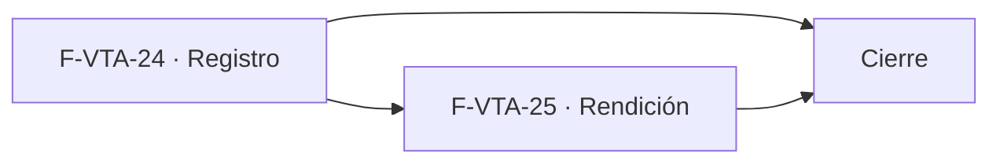

# Tasks: Ventas y despacho · Ventas motos

**Input**: [spec.md](./spec.md) y [plan.md](./plan.md) · **Contratos**: [contracts/ventas-motos.md](./contracts/ventas-motos.md) · **Épica**: MSF-145
**Formato**: `- [ ] T### [P] [Historia][USx] descripción (FR/SC)`. `[P]` = paralelizable (archivos distintos, sin dependencia dentro del mismo grupo). Cada FR/SC tiene **una sola** tarea dueña. Las dependencias de cada tarea son solo dentro de su historia.
**Validación por historia**: `pnpm test:db`, `pnpm lint`, `pnpm build` y `pnpm test:web` verdes antes de cerrar la fase.
**Esquema (Principio VII, re-verificado)**: `envios_moto` → `dominio`; `registro_actividad` → `public` (solo datos).
**HOLD**: no implementar hasta liberar la Etapa 2 (2027-01-04) o pedido expreso de Nicolás; revalidar MSF-159 antes de la primera migración (ver *Estado de entrega* en spec.md).

## Phase 1: F-VTA-24 · Registro de envíos en moto

**Goal**: tabla `envios_moto`, registro/edición con mensajero y pestaña Motos con filtro por tienda.

- [x] T001 [F-VTA-24][US1] Migración `supabase/migrations/20261205100100_envios_moto.sql`: `dominio.envios_moto` (columnas de la spec: `mensajero` obligatorio y normalizado, `guia` opcional, `costo_envio`/`abono` no nulos y `>= 0`, `rendido`/`rendido_en` coherentes), FK compuesta a `comprobantes_venta`, único por comprobante, índice por `(organizacion_id, lower(mensajero))`, RLS de lectura por organización y sección `ventas`, sin escritura directa ni `delete`, `anon` sin privilegios, reversión en el encabezado (FR-002)
- [x] T002 [F-VTA-24][US1] Migración `supabase/migrations/20261205100200_envios_moto_rpc.sql`: `registrar_envio_moto`, `actualizar_envio_moto`, `comprobantes_para_envio_moto`, `listar_envios_moto`; `security definer`, permisos por empresa y rol (Operador/Administrador), mensajero obligatorio, `rendido`/`rendido_en` intactos, eventos `envio_moto.registrado`/`actualizado` (FR-003, FR-005, FR-008, FR-009)
- [x] T003 [F-VTA-24][US1] pgTAP `supabase/tests/database/ventas_motos_registro.test.sql`: aislamiento por organización de `envios_moto`, `lectura`/`Consulta`/`ninguno`/`anon`, un envío por comprobante, tipo/forma de envío, mensajero vacío, importes, conflicto `40001`, envío rendido de solo lectura `55000`, `rendido`/`rendido_en` intactos, eventos, `rls_en_toda_tabla` (dueña de SC-002 y SC-003; verificación de FR-002, FR-003, FR-005, FR-008 y FR-009)
- [x] T004 [P] [F-VTA-24][US1] `apps/web/src/lib/ventas/enviosMoto.ts`: tipos y llamadas a las RPC de F-VTA-24 con mapeo de errores a mensajes claros (soporte de FR-004)
- [x] T005 [F-VTA-24][US1] `apps/web/src/components/ventas/EnvioMotoDialog.tsx`: diálogo Registrar/Editar envío (Comprobante con búsqueda, Mensajero, Guía, Costo de envío, Abona al recibir, Enviado), validación de mensajero e importes, errores y éxito (FR-004)
- [x] T006 [P] [F-VTA-24][US1] Control segmentado en `/ventas/transportes` con «Motos» y «Terminales de retiro» (por defecto), `?pestana=motos`, texto de ayuda, «Acceso restringido» sin permiso; sin pestaña Contrarreembolsos (FR-001)
- [x] T007 [F-VTA-24][US1] Pestaña Motos: tabla paginada (Fecha, Tienda, Comprobante con enlace, Cliente, Mensajero, Guía, Costo de envío, Abona al recibir, Enviado), «Registrar envío» y «Editar» según permiso, estados de carga/vacío/error/éxito, responsive 320/768/1440 px (FR-006)
- [x] T008 [F-VTA-24][US1] Filtro Tienda (`FiltroEmpresa`) con su texto y empresa activa: invalida y recarga consultas, vuelve a página 1, cierra con aviso el diálogo abierto (FR-007)
- [x] T009 [F-VTA-24][US1] Vitest `TransportesMotos.test.tsx` y `EnvioMotoDialog.test.tsx`: listado y formatos, registro de elegible con mensajero, no elegible, edición, solo lectura, **cambio de empresa activa**, estados; verificación de FR-001, FR-004, FR-005, FR-006, FR-007 y FR-008 (dueña de SC-001 y SC-004)
- [x] T010 [F-VTA-24][US1] `pnpm prototipo:check`, `pnpm matriz:check` y `pnpm ui:empresas:check` en verde para `VentasTransportes` (soporte de SC-001)

**Checkpoint F-VTA-24**: `pnpm test:db`, `pnpm lint`, `pnpm build` y `pnpm test:web` verdes.

## Phase 2: F-VTA-25 · Rendición de motos

**Goal**: rendir por fila y en lote con total, y tarjeta «Motos sin rendir». Requiere F-VTA-24 mergeada (tabla y pestaña).

- [x] T011 [F-VTA-25][US2] Migración `supabase/migrations/20261205200100_rendir_envios_moto.sql`: `rendir_envios_moto` (todo o nada, idempotente, solo enviados y no rendidos, sin mezclar mensajeros, solo Administrador, escribe únicamente `rendido`/`rendido_en`, devuelve totales) y `resumen_motos_sin_rendir`; eventos `envio_moto.rendido`; reversión en el encabezado (dueña de FR-024; RPC que sostienen FR-020, FR-021 y FR-022; `resumen_motos_sin_rendir` para FR-023)
- [x] T012 [F-VTA-25][US2] pgTAP `supabase/tests/database/ventas_motos_rendicion.test.sql`: rendir, no enviado y ya rendido (idempotencia), lote con id ajeno/inexistente o mezcla de mensajeros aborta todo, totales (total = suma del abono; costo aparte; neto), resumen, permisos (Operador/Consulta `42501`), evento único (verificación de SC-005, SC-006 y SC-007; cubre FR-020, FR-021, FR-022, FR-023 y FR-024)
- [x] T013 [P] [F-VTA-25][US2] `apps/web/src/lib/ventas/enviosMotoRendicion.ts`: llamadas a `rendir_envios_moto` y `resumen_motos_sin_rendir` (soporte de FR-020)
- [x] T014 [F-VTA-25][US2] Columna Rendido con llave por fila (encendida y sin apagar; deshabilitada si no es Administrador, no está enviado o ya está rendido) y aviso «Entrega rendida»; sin «Rendición revertida» (dueña de FR-020)
- [x] T015 [F-VTA-25][US2] Casillas, «seleccionar todo» y «Rendir seleccionados» con `RendicionMotosDialog` (cantidad, efectivo cobrado, costo de envíos, total y neto); bloqueo si mezcla mensajeros; descarte de selección y cierre con aviso al cambiar de empresa (dueña de FR-021, FR-022 y FR-025)
- [x] T016 [F-VTA-25][US2] Tarjeta «Motos sin rendir» arriba de las pestañas (monto, «N entregas»), con filtro Tienda y recálculo al rendir (dueña de FR-023)
- [x] T017 [F-VTA-25][US2] Vitest `TransportesMotos.test.tsx` y `RendicionMotosDialog.test.tsx`: llave, aviso, lote y totales, bloqueo por mensajeros mezclados, tarjeta, cambio de empresa activa (dueña de SC-005, SC-006 y SC-007; verificación de FR-020, FR-021, FR-022, FR-023 y FR-025)
- [x] T018 [F-VTA-25][US2] `pnpm prototipo:check`, `pnpm matriz:check` y `pnpm ui:empresas:check` en verde tras los cambios de la pantalla (soporte de SC-007)

**Checkpoint F-VTA-25**: `pnpm test:db`, `pnpm lint`, `pnpm build` y `pnpm test:web` verdes.

## Phase 3: Cierre (historia de cierre, label `cierre`)

**Goal**: trabajo que ninguna historia atiende. Solo se ejecuta con todas las historias finalizadas.

- [x] T019 [P] [CIERRE] Guía `docs/ventas-motos.md` (modelo, permisos, RPC, mensajero, total de la rendición, reversión fuera de alcance, pruebas) y entrada en `docs/README.md`; actualizar la nota de alcance de `docs/ventas-transportes.md` para que apunte a la nueva guía; `AGENTS.md`/`CLAUDE.md` si corresponde (soporte de SC-008)
- [x] T020 [P] [CIERRE] Actualizar `docs/roadmap-template.md`: fila de Ventas motos (estado, enlace a la spec) (soporte de SC-008)
- [x] T021 [CIERRE] Revisión de seguridad (`authz-security`) de la tabla y las RPC (roles, `security definer`, `search_path`, `anon`, aislamiento) y validación final: `pnpm lint`, `pnpm build`, `pnpm test`, `pnpm infra:config`, `pnpm docs:check`, `pnpm prototipo:check`, `pnpm matriz:check` (dueña de SC-008)

## Plan de ejecución (historias)

F-VTA-25 comparte tabla y página con F-VTA-24, por eso va después. El cierre espera a las dos.

| Historia | Depende de | Grupo |
|----------|------------|-------|
| F-VTA-24 | — | 1 |
| F-VTA-25 | F-VTA-24 | 2 |
| [Cierre] | F-VTA-24, F-VTA-25 | 3 |

