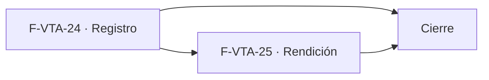

# Tasks: Ventas y despacho · Ventas motos

**Input**: [spec.md](./spec.md) y [plan.md](./plan.md) · **Contratos**: [contracts/ventas-motos.md](./contracts/ventas-motos.md) · **Épica**: MSF-145
**Formato**: `- [ ] T### [P] [Historia][USx] descripción (FR/SC)`. `[P]` = paralelizable (archivos distintos, sin dependencia dentro del mismo grupo). Cada FR/SC tiene **una sola** tarea dueña. Las dependencias de cada tarea son solo dentro de su historia.
**Validación por historia**: `pnpm test:db`, `pnpm lint`, `pnpm build` y `pnpm test:web` verdes antes de cerrar la fase.
**Esquema (Principio VII, re-verificado)**: `envios_moto` → `dominio`; `registro_actividad` → `public` (solo datos).

## Phase 1: F-VTA-24 · Registro de envíos en moto

**Goal**: tabla `envios_moto`, registro/edición y pestaña Motos con filtro por tienda.

- [ ] T001 [F-VTA-24][US1] Migración `supabase/migrations/20261205100100_envios_moto.sql`: `dominio.envios_moto` (columnas de la spec, FK compuesta a `comprobantes_venta`, único por comprobante, importes `>= 0`), RLS de lectura por organización y sección `ventas`, sin escritura directa ni `delete`, `anon` sin privilegios, reversión en el encabezado (FR-002)
- [ ] T002 [F-VTA-24][US1] Migración `supabase/migrations/20261205100200_envios_moto_rpc.sql`: `registrar_envio_moto`, `actualizar_envio_moto`, `comprobantes_para_envio_moto`, `listar_envios_moto`; `security definer`, permisos por empresa, eventos `envio_moto.registrado`/`actualizado` (FR-003, FR-005, FR-008, FR-009)
- [ ] T003 [F-VTA-24][US1] pgTAP `supabase/tests/database/ventas_motos_registro.test.sql`: aislamiento por organización y empresa, `lectura`/`ninguno`/`anon`, un envío por comprobante, tipo/forma de envío, importes, conflicto `40001`, importes bloqueados si rendido, eventos, `rls_en_toda_tabla` (SC-002, SC-003; verifican aquí FR-002, FR-003, FR-005, FR-008, FR-009)
- [ ] T004 [P] [F-VTA-24][US1] `apps/web/src/lib/ventas/enviosMoto.ts`: tipos y llamadas a las RPC de F-VTA-24 con mapeo de errores a mensajes claros (soporte de FR-004)
- [ ] T005 [P] [F-VTA-24][US1] `apps/web/src/components/ventas/EnvioMotoDialog.tsx`: diálogo Registrar/Editar envío (Comprobante con búsqueda, Guía, Costo de envío, Abona al recibir, Enviado), validación, errores y éxito (FR-004)
- [ ] T006 [F-VTA-24][US1] Control segmentado en `/ventas/transportes` con «Motos» y «Terminales de retiro» (por defecto), `?pestana=motos`, texto de ayuda, «Acceso restringido» sin permiso; sin pestaña Contrarreembolsos (FR-001)
- [ ] T007 [F-VTA-24][US1] Pestaña Motos: tabla paginada (Fecha, Tienda, Comprobante con enlace, Cliente, Guía, Costo de envío, Abona al recibir, Enviado), «Registrar envío» y «Editar» según permiso, estados de carga/vacío/error/éxito, responsive 320/768/1440 px (FR-006, FR-008)
- [ ] T008 [F-VTA-24][US1] Filtro Tienda (`FiltroEmpresa`) con su texto y empresa activa: invalida y recarga consultas, vuelve a página 1, cierra con aviso el diálogo abierto (FR-007)
- [ ] T009 [F-VTA-24][US1] Vitest `TransportesMotos.test.tsx` y `EnvioMotoDialog.test.tsx` (FR-001, FR-004, FR-006, FR-007 los verifican aquí): listado y formatos, registro de elegible, no elegible, edición, solo lectura, **cambio de empresa activa**, estados (SC-001, SC-004)
- [ ] T010 [F-VTA-24][US1] `pnpm prototipo:check` y `pnpm matriz:check` en verde para `VentasTransportes` (soporte de SC-001)

**Checkpoint F-VTA-24**: `pnpm test:db`, `pnpm lint`, `pnpm build` y `pnpm test:web` verdes.

## Phase 2: F-VTA-25 · Rendición de motos

**Goal**: rendir por fila y en lote con total, y tarjeta «Motos sin rendir». Requiere F-VTA-24 mergeada (tabla y pestaña).

- [ ] T011 [F-VTA-25][US2] Migración `supabase/migrations/20261205200100_rendir_envios_moto.sql`: `rendir_envios_moto` (todo o nada, idempotente, reversible, devuelve totales) y `resumen_motos_sin_rendir`; permisos por empresa; eventos `envio_moto.rendido`/`rendicion_revertida`; reversión en el encabezado (FR-020, FR-021, FR-023, FR-024)
- [ ] T012 [F-VTA-25][US2] pgTAP `supabase/tests/database/ventas_motos_rendicion.test.sql`: rendir/revertir, idempotencia, lote con id ajeno aborta todo, totales, resumen, permisos, eventos (SC-005, SC-006; verifican aquí FR-020, FR-021, FR-022, FR-023, FR-024)
- [ ] T013 [P] [F-VTA-25][US2] `apps/web/src/lib/ventas/enviosMotoRendicion.ts`: llamadas a `rendir_envios_moto` y `resumen_motos_sin_rendir` (soporte de FR-020)
- [ ] T014 [F-VTA-25][US2] Columna Rendido con llave por fila y avisos «Entrega rendida» / «Rendición revertida» (FR-020)
- [ ] T015 [F-VTA-25][US2] Casillas, «seleccionar todo» y «Rendir seleccionados» con `RendicionMotosDialog` (cantidad, efectivo cobrado, costo de envíos, total); descarte de selección y cierre con aviso al cambiar de empresa (FR-021, FR-022, FR-025)
- [ ] T016 [F-VTA-25][US2] Tarjeta «Motos sin rendir» arriba de las pestañas (monto, «N entregas»), con filtro Tienda y recálculo al rendir (FR-023)
- [ ] T017 [F-VTA-25][US2] Vitest `TransportesMotos.test.tsx` y `RendicionMotosDialog.test.tsx`: llave, reversión, lote y totales, tarjeta, cambio de empresa activa (SC-005, SC-006, SC-007; verifican aquí FR-020, FR-021, FR-022, FR-023, FR-025)
- [ ] T018 [F-VTA-25][US2] `pnpm prototipo:check` y `pnpm matriz:check` en verde tras los cambios de la pantalla (soporte de SC-007)

**Checkpoint F-VTA-25**: `pnpm test:db`, `pnpm lint`, `pnpm build` y `pnpm test:web` verdes.

## Phase 3: Cierre (historia de cierre, label `cierre`)

**Goal**: trabajo que ninguna historia atiende. Solo se ejecuta con todas las historias finalizadas.

- [ ] T019 [CIERRE] Guía `docs/ventas-motos.md` (modelo, permisos, RPC, reversión, pruebas) y entrada en `docs/README.md`; `AGENTS.md`/`CLAUDE.md` si corresponde (soporte de SC-008)
- [ ] T020 [CIERRE] Actualizar `docs/roadmap-template.md`: fila de Ventas motos (estado, enlace a la spec) (soporte de SC-008)
- [ ] T021 [CIERRE] Revisión de seguridad (`authz-security`) de la tabla y las RPC y validación final: `pnpm lint`, `pnpm build`, `pnpm test`, `pnpm infra:config`, `pnpm docs:check`, `pnpm prototipo:check`, `pnpm matriz:check` (SC-008)

## Plan de ejecución (historias)

> HOLD hasta Etapa 2 (2027-01-04): no despachar antes; al liberar, F-VTA-24 primero y F-VTA-25 tras su merge, con MSF-159 en `main` (no basta Review In DEV), cupo libre y revalidación previa; épica en Backlog (AGE-1773) (ver *Estado de entrega* en spec.md).

F-VTA-25 comparte tabla y página con F-VTA-24, por eso va después.

| Historia | Depende de | Grupo |
|----------|------------|-------|
| F-VTA-24 | — | 1 |
| F-VTA-25 | F-VTA-24 | 2 |
| [Cierre] | F-VTA-24, F-VTA-25 | 3 |

