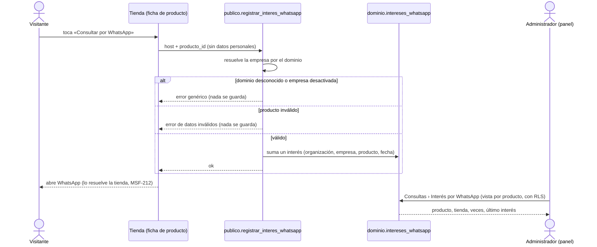
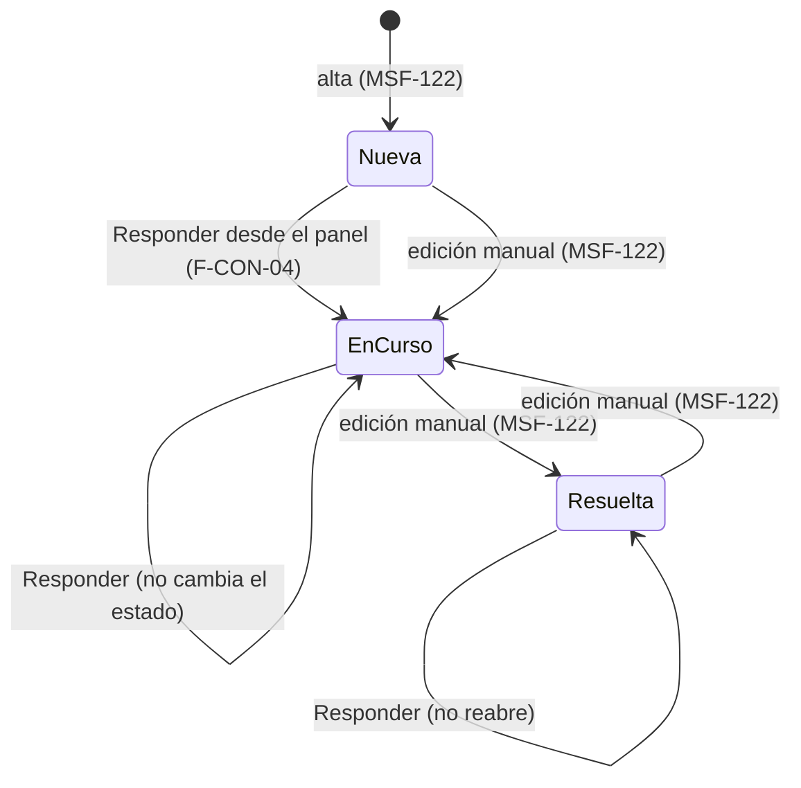

# Feature Specification: Consultas y ventas · Consultas seguimiento y whatsapp

**Épica**: MSF-130 · **Spec**: `consultas-seguimiento-y-whatsapp` · **Hito**: Etapa 2 (desde enero de 2027) · **Prioridad**: P1 · **Alcance (Jira)**: etapa2 · **Horas aprox.**: 12 (las tallas S+S suman 8 h: se mantiene 12 h por el documento de la épica)
**Alcance de entrega**: `refine`, `supabase` (sin `kestra`, `superset` ni `workers`: el interés se guarda con una RPC y se lee con una vista; el tablero de «productos más consultados» es de F-REP-04).
**Fuente**: especificación de Nicolás cargada en la épica (Jira), prototipo `design/pantallas/Consultas.dc.html` y artefactos del producto. Esta spec **traduce**; no agrega alcance.

> Nota de rama: la rama `design/prototipo` ya no existe; los prototipos viven en `design/pantallas/` y de ahí sale el inventario (`pnpm prototipo:inventario`, `pnpm prototipo:check` al día).

## Objetivo

Al terminar, el administrador ve cuántas veces se tocó «Consultar por WhatsApp» en cada producto, y el operador responde una consulta con un clic abriendo WhatsApp o el correo con un texto inicial.

## Modelo y supuestos

- El panel **sigue sin enviar mensajes**: solo abre la aplicación externa; el sistema **no sabe** si el mensaje se envió realmente.
- El interés por WhatsApp **alimenta el reporte de productos más consultados** (F-REP-04, épica de Inicio, rentabilidad y reportes). Esta épica solo deja el dato y su lectura; el reporte no es de acá.
- El botón de respuesta **todavía no está dibujado** como lo pide la épica (el prototipo muestra `Responder por ·` sin texto inicial ni cambio de estado): se dibuja al entrar a la Etapa 2. Hasta entonces manda esta spec para el comportamiento y el prototipo para lo visual (regla de fuentes 6).
- **Bloqueo**: MSF-122 *Consultas bandeja y aviso* (tabla `dominio.consultas`, detalle de la bandeja, RPC `public.actualizar_consulta`, sección `consultas` de permisos). **Ya existe en esa épica** (rama `epic/MSF-122-…`, no recreado acá): `dominio.consultas` (`estado` `nueva` | `en_curso` | `resuelta`, `responsable_id`, `nota_interna`, `updated_at`), `public.actualizar_consulta`, `public.consultas_bandeja`, el diálogo «Consulta de <nombre>» con el botón `Responder por <correo|WhatsApp>` (que hoy solo abre `mailto:`/WhatsApp), `publico.crear_consulta_publica` y `private.nivel_seccion('consultas')`. **Verificar antes de implementar** que MSF-122 esté mergeada: ninguno de esos objetos está todavía en este worktree (ni sus migraciones ni el grafo los traen).
- **Relacionadas sin bloqueo**: MSF-212 (F-TDA-14 *Tienda whatsapp y contacto*) **llama** a la RPC `registrar_interes_whatsapp` de esta épica: la tienda se construye contra el contrato (`contracts/consultas-seguimiento.md`) y esta épica no necesita el código de la tienda. MSF-144 (F-CON-06 *Contactos y respuestas rápidas*) arma después el texto inicial de F-CON-04: por eso el texto se arma en **una sola función** reemplazable.
- Supuestos propios de la traducción (a confirmar, ver *Decisiones abiertas*): quién puede ver el conteo con la sección `consultas`; el texto inicial es una plantilla fija; el responsable que ya existe no se pisa.

### Esquema de datos (Constitución, Principio VII)

| Objeto | Esquema | Historia | Justificación | RLS / acceso |
|--------|---------|----------|---------------|--------------|
| `intereses_whatsapp` (**nueva**: `id`, `organizacion_id`, `empresa_id`, `producto_id`, `created_at`; **sin datos personales**) | `dominio` | F-CON-02 | Registro de negocio: cuántas veces un visitante tocó el botón en un producto de una tienda. No es dato de plataforma. | `organizacion_id = (select private.organizacion_id())` y `empresa_id in (select private.empresas_accesibles())`; select con `consultas`≥`lectura`; **sin insert, update ni delete desde la app** (el alta es solo la RPC pública); `anon` sin privilegios sobre la tabla |
| RPC `publico.registrar_interes_whatsapp` | `publico` | F-CON-02 | Superficie para `anon` (precedente `publico.crear_consulta_publica`); no almacena datos; escribe por `security definer`. | `grant execute … to anon, authenticated`; entra a la lista de RPC permitidas a `anon` del pgTAP (ver `docs/acceso-ingreso.md`) |
| Vista `public.interes_whatsapp_por_producto` | `public` | F-CON-02 | Superficie de lectura, no almacena datos. | `security_invoker`: aplica la RLS de la tabla; `anon` sin acceso |
| F-CON-04 | — | F-CON-04 | **Sin tablas ni RPC nuevas**: reusa `public.actualizar_consulta` de MSF-122. | — |

La prueba pgTAP `rls_en_toda_tabla` (recorre `public` + `dominio`) debe seguir verde. Reversión de cada migración: ver `plan.md` (todas aditivas).

## User Scenarios & Testing *(mandatory)*

### User Story 1 - Interés por WhatsApp registrado (F-CON-02, P1, talla S)

El visitante toca «Consultar por WhatsApp» en la ficha de un producto de una tienda: el sistema suma **un interés** a ese producto de esa tienda, sin guardar ningún dato de la persona. El administrador ve cuántas veces se tocó en cada producto.

**Why this priority**: es el dato que alimenta el reporte de productos más consultados y le dice al negocio qué producto despierta interés aunque nadie escriba.

**Acceptance Scenarios**:

1. **Dado** una tienda con dominio conocido y un producto de la organización, **cuando** la tienda llama a `registrar_interes_whatsapp(host, producto_id)`, **entonces** se suma un interés a ese producto de esa empresa; la empresa sale **solo del dominio**, nunca de un dato enviado por el cliente.
2. **Dado** el interés guardado, **entonces** la fila contiene organización, empresa, producto y fecha, y **ningún** dato personal (nombre, teléfono, correo, IP ni mensaje).
3. **Dado** un dominio desconocido o una empresa desactivada, **cuando** se llama a la RPC, **entonces** responde el mismo error genérico en ambos casos y no se guarda nada.
4. **Dado** un `producto_id` inexistente o de otra organización, **entonces** error de datos inválidos y no se guarda nada.
5. **Dado** un usuario con `consultas`≥`lectura`, **cuando** abre Consultas y pulsa `Interés por WhatsApp`, **entonces** ve una lista por producto con el total de veces y la fecha del último interés, ordenada de mayor a menor.
6. **Dado** la empresa activa de la barra superior, **entonces** la lista muestra solo esa empresa; con «Todas mis empresas» muestra las accesibles con una columna `Tienda`; al cambiar de empresa se recarga todo y no queda nada de la anterior.
7. **Dado** un usuario con `consultas`=`ninguno` o de otra organización/empresa sin acceso, **entonces** no ve ningún conteo (la base lo impide, no solo la pantalla).
8. **Dado** que todavía no hubo ningún interés, **entonces** se ve el estado vacío compartido con una explicación.

**Independent Test**: pgTAP (alta, validaciones, aislamiento, permisos, sin datos personales) + Vitest de la lista + la RPC llamada como lo haría la tienda.

### User Story 2 - Responder desde el panel (F-CON-04, P1, talla S)

El operador abre una consulta y toca `Responder por <correo|WhatsApp>`: se abre WhatsApp o el correo con un **texto inicial**, la consulta pasa a **En curso** y queda como **responsable** quien respondió.

**Why this priority**: cierra el circuito de la consulta con un solo clic y deja registro de quién la está atendiendo.

**Acceptance Scenarios**:

1. **Dado** una consulta cuyo contacto es un teléfono, **cuando** toco `Responder por WhatsApp`, **entonces** se abre `https://wa.me/<dígitos>?text=<texto inicial>` en una pestaña nueva.
2. **Dado** una consulta cuyo contacto es un correo, **cuando** toco `Responder por correo`, **entonces** se abre `mailto:<correo>?subject=…&body=<texto inicial>`.
3. **Dado** el texto inicial, **entonces** saluda por el nombre, nombra la tienda y, si hay producto, lo nombra; el operador lo edita en la aplicación externa antes de enviar.
4. **Dado** una consulta `Nueva`, **cuando** respondo, **entonces** pasa a `En curso`, queda **yo** como responsable y se registra en la actividad (lo hace `actualizar_consulta` de MSF-122).
5. **Dado** una consulta que ya está `En curso` o `Resuelta`, **entonces** el estado **no cambia**; y si ya tiene otro responsable, **no se lo pisa** (solo se asigna si no tenía).
6. **Dado** que el registro falla (sin red, conflicto de edición, sin permiso), **entonces** la aplicación externa ya se abrió y el panel avisa con un mensaje claro y una forma de reintentar o recargar; nunca dice «mensaje enviado».
7. **Dado** un usuario con `consultas`=`lectura`, **entonces** el botón se ve deshabilitado con la ayuda «Necesitás permiso de edición» (no abre nada ni cambia nada).
8. **Dado** que el panel no sabe si el mensaje se envió, **entonces** la pantalla nunca afirma que se envió; solo registra que se abrió la respuesta.

**Independent Test**: Vitest del diálogo (enlace por canal, texto inicial, llamada a `actualizar_consulta`, no pisar responsable, fallos, solo lectura) + E2E.

### Edge Cases

- Contacto de teléfono **sin código de país** (la validación de MSF-122 acepta 7 a 15 dígitos): el enlace usa los dígitos tal cual; WhatsApp puede no resolver el chat correcto. No se inventa una regla de país (*Decisiones abiertas* 4).
- El texto inicial se codifica en la URL (acentos, saltos de línea, `&`); un nombre con caracteres especiales no rompe el enlace.
- Doble clic en `Responder`: no se duplica el cambio (la llamada es idempotente por `updated_at`: el segundo intento no cambia nada).
- Muchos toques del mismo visitante: cada toque suma un interés (no hay identificación para deduplicar sin guardar datos personales); el anti-spam es de la tienda (MSF-212), igual que en `crear_consulta_publica`.
- Producto con intereses y luego eliminado: la clave foránea compuesta impide borrarlo en silencio; un producto sin nombre visible no se muestra con su id técnico.
- Cambiar de empresa con el diálogo del conteo o el detalle abiertos: se cierran con aviso (Principio VIII).

## Flujos

### F1 · Interés por WhatsApp registrado y consultado



Dueños: alta y validación FR-001, FR-002, FR-003; lectura FR-004, FR-005; empresa activa FR-006. **Fuera de alcance**: el botón y la apertura de WhatsApp en la ficha (Tiendas online, MSF-212, F-TDA-14); el reporte de productos más consultados (F-REP-04); el anti-spam (MSF-212).

### F2 · Responder una consulta desde el panel

```mermaid
sequenceDiagram
  actor O as Operador
  participant P as Panel (detalle de la consulta)
  participant X as WhatsApp / correo (app externa)
  participant S as public.actualizar_consulta
  O->>P: abre «Consulta de <nombre>»
  O->>P: toca «Responder por <correo|WhatsApp>»
  P->>P: arma el texto inicial (nombre, tienda, producto)
  P->>X: abre wa.me / mailto con el texto (mismo gesto del clic)
  P->>S: estado en_curso si estaba nueva; responsable = yo si no había
  alt registro correcto
    S-->>P: nuevo updated_at (actividad registrada)
    P-->>O: aviso de éxito y detalle actualizado
  else falla (conflicto, permiso, red)
    S-->>P: error
    P-->>O: aviso claro + reintentar o recargar
  end
  Note over P,X: el panel no envía nada ni sabe si se envió
```

Dueños: enlace por canal FR-008; texto inicial FR-009; estado y responsable FR-010; permisos FR-011; fallos FR-012; sin envío FR-013. **Fuera de alcance**: contactos y respuestas rápidas (F-CON-06, MSF-144), confirmación de entrega, plantillas por tienda.

### F3 · Estado de la consulta (lo que cambia esta épica)



Dueños: FR-010. Las transiciones manuales son de MSF-122 (`actualizar_consulta`); esta épica solo agrega la de `Responder`.

## Requirements *(mandatory)*

### F-CON-02 · Interés por WhatsApp registrado

- **FR-001**: Migración aditiva `dominio.intereses_whatsapp` (`id`, `organizacion_id`, `empresa_id`, `producto_id`, `created_at`) con claves foráneas compuestas a `dominio.empresas` y `dominio.productos`, **sin ningún dato personal**, RLS por organización y empresa accesible, select con `consultas`≥`lectura`, sin políticas de escritura y sin privilegios para `anon`. *(verificación: pgTAP `supabase/tests/database/interes_whatsapp.test.sql`)*
- **FR-002**: `publico.registrar_interes_whatsapp(host, producto_id)` (contrato en `contracts/consultas-seguimiento.md`) resuelve la empresa **únicamente por el dominio** (`dominio.tiendas`), valida que el producto sea de la misma organización, suma un interés y no devuelve datos. Ejecutable por `anon` y `authenticated`; es la **única** entrada nueva a la lista de RPC permitidas a `anon`. *(verificación: pgTAP `supabase/tests/database/interes_whatsapp.test.sql`)*
- **FR-003**: Dominio desconocido o empresa desactivada → **el mismo** error genérico (`P0002`), resuelto **antes** de validar el producto (no se puede sondear qué dominios existen); producto inválido → `22023` con el campo en `DETAIL`. La función **no recibe ni guarda** nombre, contacto, mensaje ni IP. *(verificación: pgTAP `supabase/tests/database/interes_whatsapp.test.sql`)*
- **FR-004**: Vista `public.interes_whatsapp_por_producto` (`security_invoker`) con `organizacion_id`, `empresa_id`, `empresa_nombre`, `producto_id`, `producto_nombre`, `sku`, `total` y `ultimo_interes_at`, agrupada por empresa y producto; es el **contrato de lectura** para esta pantalla y para F-REP-04. *(verificación: pgTAP `supabase/tests/database/interes_whatsapp.test.sql`)*
- **FR-005**: En Consultas, el botón `Interés por WhatsApp` (visible con `consultas`≥`lectura`) abre un diálogo con la lista por producto: `Producto`, `Tienda` (solo con «Todas mis empresas»), `Veces` y `Último interés`, ordenada por `Veces` descendente; estados de carga, vacío y error con `Reintentar` compartidos; teclado, lector de pantalla y 320/768/1440 px. *Diferencia con el prototipo anotada*: el prototipo no dibuja este diálogo (regla de fuentes 5/6). *(verificación: Vitest `apps/web/src/pages/consultas/InteresWhatsappDialog.test.tsx` (`pnpm test:web`))*
- **FR-006**: **Empresa activa** (Principio VIII): el diálogo usa la empresa de la barra superior como única fuente de verdad; al cambiarla invalida y recarga todas sus consultas, reencuadra y no muestra datos de la empresa anterior. *(verificación: Vitest `InteresWhatsappDialog.test.tsx`, caso «cambio de empresa» (`pnpm test:web`))*
- **SC-001**: pgTAP `supabase/tests/database/interes_whatsapp.test.sql`: alta correcta, la fila no tiene columnas personales, dominio desconocido y empresa desactivada con el mismo error, producto de otra organización, aislamiento entre **dos organizaciones** y entre empresas sin acceso, permisos por `edicion`/`lectura`/`ninguno`, insert/update/delete directos rechazados, `anon` sin privilegios sobre la tabla y la vista, `anon` solo ejecuta las RPC permitidas, `rls_en_toda_tabla` verde. *(verificación: `pnpm test:db` (`interes_whatsapp.test.sql`))*
- **SC-002**: Vitest del diálogo: lista ordenada, vacío, error con reintento, columna `Tienda` según la empresa activa, cambio de empresa sin datos arrastrados, acceso sin permiso, teclado/lector. E2E: llamar la RPC como lo hace la tienda (host + producto) suma un interés sin datos personales y el administrador lo ve. *(verificación: `pnpm test:web` (`InteresWhatsappDialog.test.tsx`) y E2E Playwright `pnpm test:e2e`)*

### F-CON-04 · Responder desde el panel

- **FR-007**: El botón `Responder por <correo|WhatsApp>` del detalle de la consulta (MSF-122) se **extiende**: elige el canal por el formato del contacto (correo → `mailto:`, teléfono → WhatsApp) y se pinta como el prototipo. El diálogo, sus chips y sus campos siguen siendo de MSF-122. *(verificación: Vitest `apps/web/src/pages/consultas/responder.test.tsx`, casos de canal por contacto (`pnpm test:web`))*
- **FR-008**: Enlace por canal: WhatsApp = `https://wa.me/<solo dígitos del teléfono>?text=<texto codificado>`; correo = `mailto:<correo>?subject=<asunto>&body=<texto codificado>`. Se abre en pestaña nueva con `noopener`; se abre en el **mismo gesto** del clic para no ser bloqueado. Todo valor va codificado. *(verificación: Vitest `responder.test.tsx`, casos de enlace `wa.me`/`mailto` codificado (`pnpm test:web`))*
- **FR-009**: El texto inicial se arma en **una sola función** (`armarTextoInicial`) con una plantilla fija: saludo con el nombre, nombre de la tienda y, si la consulta tiene producto, su nombre. F-CON-06 (MSF-144) la reemplaza sin tocar el botón. *(verificación: Vitest `responder.test.tsx`, casos de texto con y sin producto (`pnpm test:web`))*
- **FR-010**: Al responder, el panel llama a `public.actualizar_consulta` pasando: estado `en_curso` si la consulta estaba `nueva` (si estaba `en_curso` o `resuelta` conserva el actual), responsable = el usuario actual **solo si no había** responsable, la nota interna vigente y el `updated_at` vigente. La actividad la registra `actualizar_consulta`. *(verificación: Vitest `responder.test.tsx`, parámetros de `actualizar_consulta`; pgTAP `consultas_responder.test.sql`)*
- **FR-011**: Con `consultas`=`edicion` el botón responde y registra; con `lectura` queda deshabilitado con la ayuda «Necesitás permiso de edición». La base lo impone (`actualizar_consulta` exige `edicion`), no solo la pantalla. *(verificación: Vitest `responder.test.tsx`, caso solo lectura; pgTAP `consultas_responder.test.sql` (permiso por rol))*
- **FR-012**: Si el registro falla (conflicto `40001`, permiso `42501`, red) la app externa ya se abrió; el panel muestra el error con una acción para reintentar o recargar y no deja la pantalla con datos viejos. Un reintento tras éxito no genera un conflicto. *(verificación: Vitest `responder.test.tsx`, casos de error con reintento (`pnpm test:web`))*
- **FR-013**: El panel **no envía** mensajes ni afirma que se enviaron; el aviso de éxito dice que la consulta quedó **En curso** a nombre del usuario, no que el mensaje salió. *(verificación: Vitest `responder.test.tsx`, aviso sin «enviado» (`pnpm test:web`))*
- **SC-003**: Vitest del diálogo: enlace de WhatsApp y de correo correctos y codificados, texto con y sin producto, llamada a `actualizar_consulta` con los parámetros de FR-010 (nueva → en curso, no pisa responsable, no reabre resuelta), error con reintento, solo lectura deshabilitado, y cambiar de empresa cierra el diálogo. *(verificación: `pnpm test:web` (`responder.test.tsx`))*
- **SC-004**: E2E (Playwright): el operador responde una consulta de WhatsApp y una de correo; se abre el enlace correcto, la consulta queda `En curso` con su nombre como responsable; con el rol de solo lectura el botón está deshabilitado. pgTAP `supabase/tests/database/consultas_responder.test.sql`: `actualizar_consulta` aplica el cambio de estado y responsable, aislamiento entre dos organizaciones y permisos por rol para esa operación. *(verificación: E2E Playwright `pnpm test:e2e` y `pnpm test:db` (`consultas_responder.test.sql`))*

### Cierre (docs, seguridad, roadmap)

- **FR-014**: `docs/consultas.md` (de MSF-122) documenta el interés por WhatsApp (modelo sin datos personales, RPC, vista, permisos, contrato para F-TDA-14 y F-REP-04, reversión) y la respuesta desde el panel (canales, texto inicial, estado y responsable); `docs/acceso-ingreso.md` suma la RPC permitida a `anon`; fila de `docs/roadmap-template.md` actualizada; `pnpm docs:check` verde. *(verificación: `pnpm docs:check`)*
- **FR-015**: Revisión de seguridad de la superficie nueva: RLS de la tabla, `anon` solo con la RPC pública, validación de entrada, ausencia de datos personales, sin enumeración de dominios, enlaces codificados, y el esquema de cada objeto contra el Principio VII. *(verificación: pgTAP de RLS/grants (`pnpm test:db`) y revisión de seguridad registrada en T019)*
- **SC-005**: `pnpm lint`, `pnpm build`, `pnpm infra:config`, `pnpm test`, `rls_en_toda_tabla`, `pnpm prototipo:check` y `pnpm matriz:check` verdes. *(verificación: `pnpm lint && pnpm build && pnpm infra:config && pnpm test && pnpm prototipo:check && pnpm matriz:check`)*

## Decisiones abiertas

1. **Dónde ve el administrador el conteo.** La épica dice que lo ve y que el prototipo «cubre el dato», pero no dibuja dónde. Se propone el botón `Interés por WhatsApp` en Consultas con un diálogo por producto (FR-005). *Necesita el OK de Nicolás.*
2. **Quién lo ve.** Se usa la sección `consultas` con `lectura` o más (sin sección nueva); «administrador» de la épica se entiende como cualquier rol con acceso a Consultas.
3. **Qué pasa con una consulta ya Resuelta o con otro responsable** (FR-010): no se reabre ni se pisa. La épica dice «la pasa a En curso y deja el responsable»; confirmar si se quiere reabrir.
4. **Teléfonos sin código de país**: el enlace de WhatsApp usa los dígitos tal cual; si se quiere asumir un país hay que decidirlo (no se inventa).
5. **Texto inicial**: plantilla fija hasta F-CON-06 (MSF-144).
6. **Vínculo Jira** MSF-212 → MSF-130 (id 10330) sigue en Jira; si F-TDA-14 necesita la RPC mergeada, el vínculo correcto es MSF-130 bloquea a MSF-212 (decisión de Tiendas online). Horas: 12 h por el documento.
7. **Prototipo vs. épica**: el prototipo muestra consultas de origen WhatsApp **con** contacto y «No dejó mensaje» (alta por `crear_consulta_publica`, MSF-122); el interés de esta épica es **otro dato**, anónimo. Conviven; se anota en el PR.

## Verificación por requisito

| Req. | Verificación |
|------|--------------|
| FR-001…FR-004, SC-001 | pgTAP `interes_whatsapp.test.sql` |
| FR-005, FR-006, SC-002 | Vitest del diálogo + prueba E2E de la RPC |
| FR-007…FR-009, FR-012, FR-013, SC-003 | Vitest `responder.test.tsx` (`pnpm test:web`) |
| FR-010, FR-011 | Vitest `responder.test.tsx` + pgTAP `consultas_responder.test.sql` |
| SC-004 | Playwright + pgTAP `consultas_responder.test.sql` |
| FR-014 | `pnpm docs:check` |
| FR-015 | pgTAP de RLS/grants (`pnpm test:db`) y revisión de seguridad (T019) |
| SC-005 | `pnpm lint`, `pnpm build`, `pnpm infra:config`, `pnpm test`, `pnpm prototipo:check`, `pnpm matriz:check` |

## Matriz pantalla↔criterios

Inventario determinista con `pnpm prototipo:inventario` sobre `Consultas.dc.html` (`design/pantallas/Consultas.inventory.json`; `pnpm prototipo:check` confirma que está al día). La épica pide **menos** que el prototipo: lo que no pide no es deuda.

### Consultas (bandeja con detalle) · `Consultas.dc.html`

| Ítem del inventario | Destino | Criterio |
|---|---|---|
| Tabla: columnas `Estado`, `Cuándo`, `Empresa`, `Contacto`, `Producto`, `Origen` | Fuera de alcance: la bandeja es de MSF-122 (F-CON-01); esta épica no la cambia | — |
| Botón `Cerrar` (diálogo) | Fuera de alcance: lo construye MSF-122; no se modifica | — |
| Botón `Responder por ·` (correo / WhatsApp) | En alcance (**comportamiento**: texto inicial, estado y responsable); el botón base es de MSF-122 | US2, FR-007…FR-013 |
| Diálogo `Consulta de ·` | Fuera de alcance como pantalla (MSF-122); acá solo se extiende su botón `Responder` | FR-007 |
| Dato de interés por WhatsApp (la épica dice que el prototipo lo «cubre») | En alcance: se registra y se muestra en un diálogo nuevo; el prototipo no lo dibuja → diferencia anotada para el PR | US1, FR-001…FR-005 |
| Botón `Interés por WhatsApp` y su diálogo (nuevos, no dibujados) | En alcance (ver decisión abierta 1) | US1, FR-005 |
| Filtros `Tienda`, `Todas / Nuevas / Respondidas / Formulario / WhatsApp`, contador, aviso informativo, botón «Marcar como respondida/nueva» | Fuera de alcance: son de MSF-122; la épica no los pide | — |
| Fila **Empresa activa** | Aplica al diálogo de interés y al botón de respuesta (la bandeja y el detalle heredan de MSF-122 FR-008): empresa de la barra superior como única fuente; test que cambia de empresa | FR-006, SC-002, SC-003 |

## Matriz de trazabilidad Jira ↔ US ↔ FR ↔ tareas

| Jira | Historia | FR / SC | Tareas |
|------|----------|---------|--------|
| F-CON-02 | US1 Interés por WhatsApp registrado | FR-001…006, SC-001, SC-002 | T001–T009 |
| F-CON-04 | US2 Responder desde el panel | FR-007…013, SC-003, SC-004 | T010–T017 |
| Tarea de cierre (label `cierre`) | Docs, seguridad y verificación | FR-014, FR-015, SC-005 | T018–T020 |
