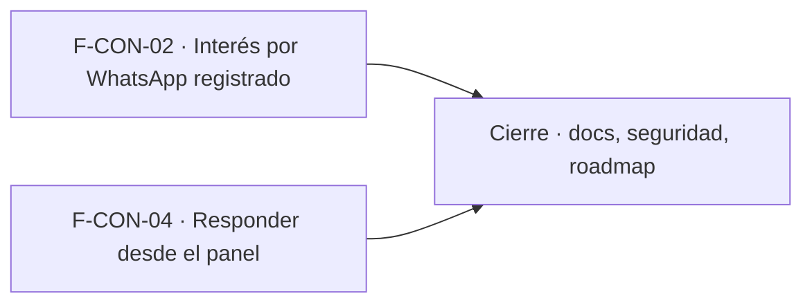

# Tasks: Consultas y ventas · Consultas seguimiento y whatsapp

**Input**: [spec.md](./spec.md) y [plan.md](./plan.md) · **Épica**: MSF-130
**Formato**: `- [ ] T### [P] [Historia][USx] descripción (FR/SC)`. `[P]` = paralelizable (archivos distintos, sin dependencia dentro del mismo grupo). Cada FR/SC tiene **una sola** tarea dueña. Las dependencias y el orden son **solo dentro de la misma historia**; entre historias rige la tabla *Plan de ejecución*. **Prerrequisito externo**: MSF-122 mergeada.
**Validación por historia**: `pnpm test:db`, `pnpm lint`, `pnpm build` y `pnpm test:web` verdes antes de cerrar la fase. Cada tabla nueva: esquema re-verificado (Principio VII). Cada migración lleva su reversión en el encabezado.

## Phase 1: F-CON-02 · Interés por WhatsApp registrado

**Goal**: tabla sin datos personales, RPC pública, vista de lectura y diálogo por producto en Consultas.

- [ ] T001 [F-CON-02][US1] Migración `supabase/migrations/20261024300000_intereses_whatsapp.sql`: `dominio.intereses_whatsapp` (`id`, `organizacion_id`, `empresa_id`, `producto_id`, `created_at`), FK compuestas, RLS por organización y empresa accesible con select `consultas`≥`lectura`, sin escritura, `anon` sin privilegios, reversión en el encabezado (FR-001) (verificación: pgTAP `supabase/tests/database/interes_whatsapp.test.sql`)
- [ ] T002 [F-CON-02][US1] Migración `supabase/migrations/20261024300100_registrar_interes_whatsapp.sql`: `publico.registrar_interes_whatsapp(host, producto_id)` (`security definer`, `search_path = ''`, empresa solo por dominio, `P0002` genérico antes de validar, `22023` producto inválido, `grant … to anon, authenticated`) (FR-002, FR-003) (verificación: pgTAP `supabase/tests/database/interes_whatsapp.test.sql`)
- [ ] T003 [P] [F-CON-02][US1] Migración `supabase/migrations/20261024300200_interes_whatsapp_por_producto.sql`: vista `public.interes_whatsapp_por_producto` `security_invoker` agrupada por empresa y producto, sin acceso para `anon` (FR-004) (verificación: pgTAP `supabase/tests/database/interes_whatsapp.test.sql`)
- [ ] T004 [F-CON-02][US1] pgTAP `supabase/tests/database/interes_whatsapp.test.sql`: alta, fila sin datos personales, errores genéricos, producto de otra organización, aislamiento entre dos organizaciones y empresas, permisos por nivel, escritura directa rechazada, `anon` solo ejecuta la RPC permitida (actualizar la lista), `rls_en_toda_tabla` verde (SC-001)
- [ ] T005 [P] [F-CON-02][US1] `apps/web/src/lib/interesWhatsapp.ts`: lectura de la vista filtrada por empresa activa y mapeo de errores a mensajes claros (soporte de FR-005 y FR-006) (verificación: Vitest `InteresWhatsappDialog.test.tsx` (`pnpm test:web`))
- [ ] T006 [F-CON-02][US1] `apps/web/src/pages/consultas/InteresWhatsappDialog.tsx` + botón `Interés por WhatsApp` en la pantalla (visible con `consultas`≥`lectura`): columnas `Producto`, `Tienda` (solo «Todas mis empresas»), `Veces`, `Último interés`; orden descendente; carga, vacío y error con `Reintentar`; 320/768/1440 px y teclado (FR-005) (verificación: Vitest `InteresWhatsappDialog.test.tsx` (`pnpm test:web`))
- [ ] T007 [F-CON-02][US1] Empresa activa en el diálogo: invalidar y recargar al cambiar de empresa, cerrar con aviso el diálogo abierto, sin datos de la empresa anterior (FR-006) (verificación: Vitest `InteresWhatsappDialog.test.tsx`, caso cambio de empresa (`pnpm test:web`))
- [ ] T008 [F-CON-02][US1] Vitest del diálogo `apps/web/src/pages/consultas/InteresWhatsappDialog.test.tsx`: orden, vacío, error con reintento, columna `Tienda`, cambio de empresa, sin permiso, teclado/lector (SC-002) (verificación: `pnpm test:web`)
- [ ] T009 [F-CON-02][US1] E2E de la RPC como la usa la tienda: llamar con host y producto suma un interés sin datos personales y el administrador lo ve en el diálogo (SC-002, parte E2E) (verificación: E2E Playwright `pnpm test:e2e`)

**Checkpoint F-CON-02**: `pnpm test:db`, `pnpm lint`, `pnpm build` y `pnpm test:web` verdes.

## Phase 2: F-CON-04 · Responder desde el panel

**Goal**: el botón `Responder por` abre WhatsApp o el correo con texto inicial y deja la consulta En curso con responsable.

- [ ] T010 [F-CON-04][US2] `apps/web/src/lib/responderConsulta.ts`: `enlaceRespuesta` (canal por formato del contacto, `wa.me` solo con dígitos, `mailto` con asunto y cuerpo, todo codificado) (FR-007, FR-008) (verificación: Vitest `responder.test.tsx` (`pnpm test:web`))
- [ ] T011 [P] [F-CON-04][US2] `apps/web/src/lib/textoInicialConsulta.ts`: `armarTextoInicial` con plantilla fija (nombre, tienda y producto opcional), único punto que reemplazará F-CON-06 (FR-009) (verificación: Vitest `responder.test.tsx` (`pnpm test:web`))
- [ ] T012 [F-CON-04][US2] `registrarRespuesta` en `apps/web/src/lib/responderConsulta.ts`: llamada a `public.actualizar_consulta` (nueva → `en_curso`, responsable = usuario actual solo si no había, nota y `updated_at` vigentes; no reabre `resuelta`) (FR-010) (verificación: Vitest `responder.test.tsx` y pgTAP `consultas_responder.test.sql`)
- [ ] T013 [F-CON-04][US2] Cablear `Responder por <correo|WhatsApp>` en el detalle de MSF-122: abrir el enlace en pestaña nueva en el mismo gesto y luego registrar; sin envío ni afirmación de «enviado» (FR-013) (verificación: Vitest `responder.test.tsx` (`pnpm test:web`))
- [ ] T014 [F-CON-04][US2] Permisos y fallos: botón deshabilitado con «Necesitás permiso de edición» con `lectura`; error de registro (`40001`, `42501`, red) con reintentar/recargar tras haber abierto la app externa (FR-011, FR-012) (verificación: Vitest `responder.test.tsx` (`pnpm test:web`))
- [ ] T015 [F-CON-04][US2] Vitest `apps/web/src/pages/consultas/responder.test.tsx`: enlaces por canal y codificación, texto con y sin producto, parámetros de `actualizar_consulta`, no pisa responsable ni reabre, error con reintento, solo lectura, cambio de empresa cierra el diálogo (SC-003) (verificación: `pnpm test:web`)
- [ ] T016 [P] [F-CON-04][US2] pgTAP `supabase/tests/database/consultas_responder.test.sql`: `actualizar_consulta` aplica `en_curso` y responsable, aislamiento entre dos organizaciones y permisos por rol (SC-004, parte base de datos) (verificación: `pnpm test:db`)
- [ ] T017 [F-CON-04][US2] E2E Playwright: responder una consulta de WhatsApp y una de correo abre el enlace correcto, la deja En curso con el responsable; el rol de solo lectura ve el botón deshabilitado (SC-004, parte E2E) (verificación: E2E Playwright `pnpm test:e2e`)

**Checkpoint F-CON-04**: `pnpm test:db`, `pnpm lint`, `pnpm build` y `pnpm test:web` verdes.

## Phase 3: Cierre (docs, seguridad, verificación de la épica)

**Goal**: lo que ninguna historia atiende. Las tareas `[CIERRE]` las ejecuta la Tarea de cierre y **nunca** son prerequisito de una historia.

- [ ] T018 [P] [CIERRE] `docs/consultas.md` (interés sin datos personales, RPC, vista, permisos, contrato para F-TDA-14 y F-REP-04, respuesta desde el panel, texto inicial, reversión), `docs/acceso-ingreso.md` (RPC permitida a `anon`) y fila de `docs/roadmap-template.md`; `pnpm docs:check` verde (FR-014) (verificación: `pnpm docs:check`)
- [ ] T019 [P] [CIERRE] Revisión de seguridad: RLS y grants de tabla, vista y RPC, `anon` solo con la RPC pública, ausencia de datos personales, enlaces codificados, y esquema de cada objeto contra el Principio VII (FR-015) (verificación: pgTAP de RLS/grants y `pnpm test:db`)
- [ ] T020 [CIERRE] `pnpm lint`, `pnpm build`, `pnpm infra:config`, `pnpm test`, `rls_en_toda_tabla`, `pnpm prototipo:check` y `pnpm matriz:check` verdes (SC-005) (verificación: `pnpm lint && pnpm build && pnpm infra:config && pnpm test`)

**Checkpoint Cierre**: ninguna tarea queda `[ ]` sin hacerse o cerrarse con `Desvío:` y seguimiento trazado.

## Dependencias

Dentro de F-CON-02: T001 → T002 → T004; T003 [P] tras T001; T005 [P] arranca solo; T006 tras T005 → T007 → T008; T009 al final.
Dentro de F-CON-04: T010 → T012; T011 [P] arranca solo; T013 tras T010, T011 y T012; T014 tras T013 → T015 → T017; T016 [P] arranca solo.
Cierre: T018 [P] y T019 [P] arrancan cuando todas las historias estén mergeadas; T020 al final.
Entre historias: ninguna dependencia; solo el prerrequisito externo MSF-122.

## Plan de ejecución (historias)

El **orden de toma** lo declara esta tabla: el orquestador la **consume**. F-CON-02 y F-CON-04 no comparten tabla, migración ni archivos (la pantalla se toca en una línea), por eso van en paralelo en el mismo grupo.

| Historia | Depende de | Grupo |
|----------|------------|-------|
| F-CON-02 | — | 1 |
| F-CON-04 | — | 1 |
| [Cierre] | F-CON-02, F-CON-04 | 2 |

