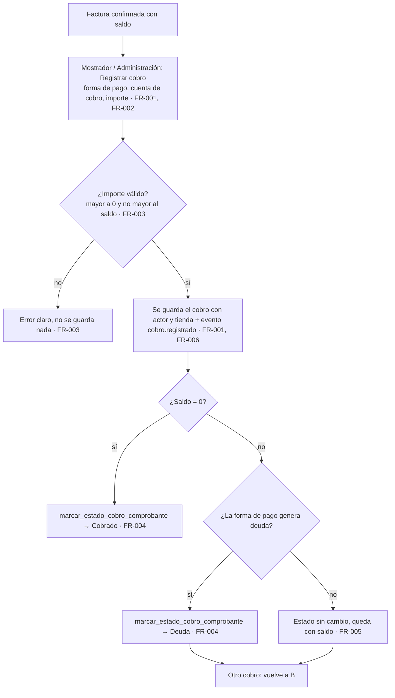
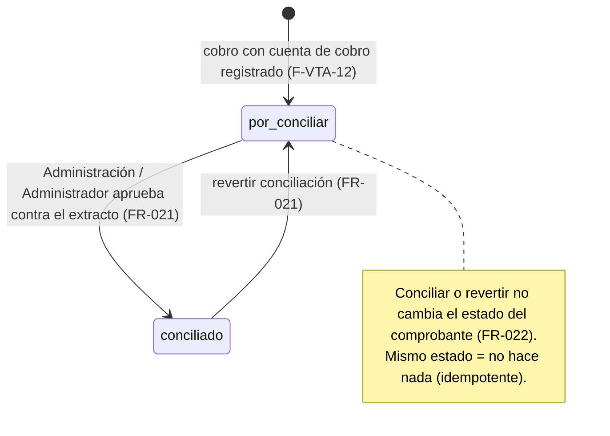
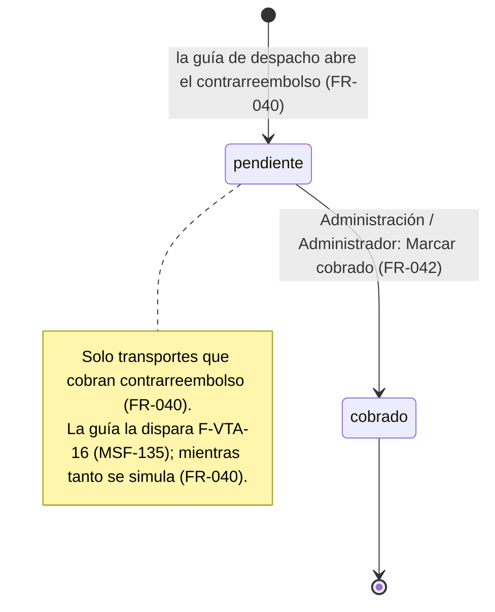
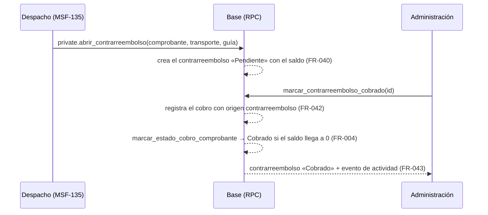

# Feature Specification: Ventas y despacho · Ventas cobros y conciliación

**Feature Branch**: `epic/MSF-195-ventas-y-despacho-ventas-cobros-y-concil`

**Jira Epic**: MSF-195 — Ventas y despacho · Ventas cobros y conciliación (spec `ventas-cobros-y-conciliacion`)

**Created**: 2026-10-24

**Status**: Spec Review — la especificación viene completa desde Jira; las decisiones abiertas llevan decisión provisoria y no bloquean. Falta el OK de Nicolás sobre el *Mapa de historias candidatas*.

**Delivery scope**: `refine` (apps/web) y `supabase` (migraciones + RPC + pgTAP). Sin `kestra`, `superset` ni `workers`.

**Prioridad / Hito**: P0 · Hito 4 (30 de noviembre al 11 de diciembre de 2026) · 24 h aprox. · alcance diciembre. Riesgo de fecha (documento del componente): con 184 h de Ventas la ventana no alcanza para las cuatro épicas del Hito 4; se propone correr el cierre al 18 de diciembre. Ante conflicto de horas con el *Roadmap a diciembre* manda el roadmap.

**Dependencias**:
- **Bloqueada por**: MSF-177 (listado, estados y anulación), cuya spec está aprobada (2026-10-24 12:49 UTC) y en implementación (PR #343). MSF-139 (cuentas de cobro y transportes) llega por cadena (MSF-139 → MSF-159 → MSF-177). **La implementación de esta épica arranca cuando MSF-177 esté mergeada en `dokploy`**: depende de `private.marcar_estado_cobro_comprobante` y de la matriz de estados.
- **Bloquea a**: MSF-193 (Ventas mejoras).
- **Relacionada, sin bloqueo**: F-VTA-14 se dispara con la guía de despacho de F-VTA-16 (MSF-135).

**Estado verificado** (contra `a2b439e7` = `origin/dokploy` al arrancar, y la rama `origin/epic/MSF-177-…` en `087da767`):
- En el repo hoy: `dominio.cuentas_cobro` y `cuentas_cobro_empresas` (`20261022120300…`), `dominio.transportes` y `transportes_empresas` (`20261022120700…`, con `cobra_contrarreembolso`, `comision_pct`, `plazo_rendicion_dias`), `dominio.formas_envio`, `dominio.comprobantes_venta` (`total_sin_iva`, `total_con_iva`, `estado`, `cliente_id`; más `empresa_id`, `forma_pago_id`, `envio_id`, `confirmado_en` de F-VTA-05), la pantalla `/ventas/transportes` (terminales) y `/ventas/cuentas-cobro`.
- En la rama de MSF-177 (a mergear antes de implementar): `dominio.transiciones_estado_comprobante`, `cambiar_estado_comprobante(p_id, p_estado, p_actualizado_en)` (**rechaza Cobrado y Deuda a personas**), `private.marcar_estado_cobro_comprobante(p_id, p_estado)` (punto de entrada de esta épica, FR-026 de MSF-177), `historial_comprobante`, y el bloqueo «una factura cobrada no se anula». Los roles `mostrador`, `deposito` y `administracion` existen (MSF-125).
- **Discrepancia con la épica**: la épica dice que «la columna `guia` ya existe en `comprobantes`». **No existe** en `dominio.comprobantes_venta` (ni en MSF-159 ni en MSF-177). Se resuelve en *Decisiones abiertas* 2: F-VTA-14 guarda la guía en su propia tabla.
- `dominio.formas_pago` (MSF-139) y su indicador «genera deuda» están en la rama de MSF-139; los nombres exactos se verifican antes de implementar.

**Input**: Epic MSF-195. Objetivo: «Al terminar, cada comprobante tiene sus cobros registrados (parciales o totales), el administrador concilia las transferencias por cuenta de cobro y los contrarreembolsos de transporte quedan controlados hasta cobrarse.»

**Regla de fuentes** (literal de la épica):
1. Comportamiento y datos: mandan los requisitos y escenarios de esta historia.
2. Qué se ve (disposición, textos, estados, popups, flujos): el prototipo validado es referencia visual, no hace falta que quede extremadamente idéntico; los flujos (si hay) aclaran estados y acciones.
3. Cómo se construye (componentes, estilos y patrones): mandan el template y el system design del producto (MSF-117, `docs/sistema-de-diseno.md`). No copiar el HTML ni el CSS del prototipo.
4. El prototipo muestra más que esta historia: se implementa solo lo que piden los requisitos; otras secciones, botones o diálogos son de otras historias.
5. Si algo no se puede igualar: lo más cercano, sin inventar, anotando la diferencia en el PR.
6. Si prototipo y requisitos se contradicen: requisitos para el comportamiento, prototipo para lo visual, y la contradicción queda anotada en el PR.

Prototipos (solo lectura): `design/pantallas/VentasPagos.dc.html` (F-VTA-13), `VentasTransportes.dc.html` (F-VTA-14), `CuentasCobro.dc.html` (contexto de F-VTA-13) y, para el campo de cuenta de cobro del detalle, `VentasComprobante.dc.html` (F-VTA-12). Inventarios en `design/pantallas/*.inventory.json` (corridos con `pnpm prototipo:inventario`; los tres de esta épica están al día).

## Modelo y supuestos

- **La conciliación es manual**: se compara contra el extracto del banco fuera del sistema; **no hay importación de extractos**.
- **Roles (a confirmar con el cliente)**: Mostrador y Administración **registran** el cobro; **Administración o el Administrador lo aprueban** (concilian). El template solo tiene administrador y miembro: los permisos por acción viven en `permisos_rol_accion` (datos, MSF-121/125).
- **Un comprobante puede tener varios cobros** (parciales); **saldo = total con IVA − suma de sus cobros**. Moneda ARS (las cuentas de cobro de MSF-139 declaran moneda; multimoneda no se pide).
- **Cobrado/Deuda los pone esta épica**, nunca una persona: usa `private.marcar_estado_cobro_comprobante` (MSF-177). Regla provisoria en *Decisiones abiertas* 3.
- **Conciliar ≠ cobrar**: el cobro se registra al recibir el dinero; la conciliación (aprobación) confirma contra el banco que el pago por transferencia o depósito llegó a la cuenta. Conciliar o revertir no cambia el estado del comprobante.
- **Contrarreembolso**: el transporte cobra al entregar y rinde después; queda controlado hasta que Administración lo marca cobrado, y recién ahí cuenta como cobro del comprobante.
- **Empresa/tienda**: todo cobro y contrarreembolso pertenece a la empresa del comprobante; las pantallas respetan la empresa activa de la barra superior (F-ROL-06, Principio VIII).

### Esquema de datos (Constitución, Principio VII)

| Objeto | Esquema | Justificación | RLS / acceso |
|--------|---------|---------------|--------------|
| `cobros_comprobante` (**nueva**, F-VTA-12) | **`dominio`** | Cobro de un documento de venta: entidad de negocio del producto, no transversal. Guarda también la aprobación (F-VTA-13) en columnas nulables `aprobado_por`/`aprobado_en`. | Por organización, empresa en `private.empresas_accesibles()` y sección `ventas` ≥ `lectura` para `select`; **sin escritura directa** (solo RPC `security definer`); sin `delete`; `anon` sin privilegios. |
| `contrarreembolsos` (**nueva**, F-VTA-14) | **`dominio`** | Control del cobro a la entrega por transporte: regla de negocio del despacho de ventas. | Ídem. |
| `comprobantes_venta` (**existente**) | **`dominio`** (sin cambio de esquema ni de estructura) | Solo se lee (total) y cambia de estado por la función `private` de MSF-177. | Vigente. |
| `cuentas_cobro`, `cuentas_cobro_empresas`, `transportes`, `formas_pago` (**existentes**, MSF-139) | **`dominio`** (sin cambio) | Catálogos; solo se leen. | Vigente. |
| `permisos_rol_accion` (**existente**; cada historia agrega **datos**: `registrar_cobro`, `conciliar_pago`, `cobrar_contrarreembolso` en `ventas`) | `public` (sin cambio) | Mecanismo de acceso transversal. | Vigente. |
| `public.registro_actividad` (**existente**) | `public` (sin cambio) | Auditoría transversal vía `private.registrar_actividad`. | Vigente. |

`rls_en_toda_tabla` (pgTAP, recorre `public` + `dominio`) debe seguir verde. Las migraciones son **aditivas** con reversión en su encabezado (soltar la tabla, las funciones y las filas sembradas de `permisos_rol_accion`; exportar antes los datos si ya hay cobros). **Cada historia trae su propia migración**; F-VTA-13 y F-VTA-14 usan lo ya mergeado de F-VTA-12 (tabla y función interna), no una tarea abierta.

## Flujos

### Flujo 1 · Del cobro al estado del comprobante (proceso)

(Mapa: registrar y validar → FR-001/002/003; estado → FR-004/005; auditoría → FR-006; visibilidad en el detalle → FR-007/008.)

### Flujo 2 · Conciliación de un pago (máquina de estados)

(Mapa: estados → FR-020/021/022; listado y KPIs → FR-023/024/025.)

### Flujo 3 · Contrarreembolso (máquina de estados)

### Flujo 4 · Contrarreembolso hasta el estado del comprobante (secuencia)

## User Scenarios & Testing *(mandatory)*

### User Story 1 - Cobros por comprobante (F-VTA-12, P0, talla M)

Como Mostrador o Administración, quiero registrar uno o varios cobros sobre una factura (parciales o totales) con su forma de pago y cuenta de cobro, para saber cuánto se cobró, cuánto falta y en qué estado de cobro está.

**Why this priority**: sin cobros registrados no hay saldo, ni conciliación, ni Cobrado/Deuda; es la base de las otras dos historias.

**Independent Test**: sobre una factura confirmada de 1.000, registrar un cobro de 400 por transferencia con cuenta → saldo 600 y estado sin cambio (o Deuda si la forma genera deuda); registrar 600 → saldo 0 y estado Cobrado; intentar 1 más se rechaza; Depósito no puede registrar; otra organización no ve nada.

**Acceptance Scenarios**:
1. **Given** una factura confirmada con saldo, **When** Mostrador registra un cobro parcial válido, **Then** el detalle lista el cobro, muestra cobrado y saldo, y queda el evento con quién y desde qué tienda.
2. **Given** un cobro que deja el saldo en 0, **Then** el comprobante pasa a Cobrado por la función `private` (no a mano).
3. **Given** una forma de pago que exige cuenta de cobro, **When** no se elige cuenta o es de otra empresa o inactiva, **Then** se rechaza con mensaje en el campo.
4. **Given** un rol sin la acción (p. ej. Depósito), **Then** el botón no aparece y la RPC rechaza.
5. **Given** un comprobante anulado, borrador, presupuesto o nota de crédito, **Then** no admite cobros.
6. **Given** dos cobros simultáneos que juntos exceden el saldo, **Then** solo el primero se guarda.

### User Story 2 - Conciliación de pagos por cuenta de cobro (F-VTA-13, P0, talla M)

Como Administración o Administrador, quiero ver los pagos por transferencia o depósito de cada cuenta de cobro y aprobarlos contra el extracto del banco, para saber qué está conciliado y qué falta, y cuánto deben los clientes.

**Why this priority**: es el control del dinero que entra a las cuentas bancarias.

**Independent Test**: con pagos en dos cuentas y dos tiendas, filtrar por tienda y por cuenta, activar «Solo con saldo», conciliar un pago (queda «Aprobado por» y los totales cambian) y revertirlo; un rol sin la acción solo mira; cambiar la empresa activa recarga todo.

**Acceptance Scenarios**:
1. **Given** pagos con cuenta de cobro, **When** se abre Pagos, **Then** se ven las tarjetas Por conciliar, Conciliado y Saldo pendiente de clientes, y la tabla con los pagos de la empresa activa.
2. **Given** un pago por conciliar, **When** el aprobador activa su interruptor, **Then** queda conciliado con «Aprobado por» y aviso «Pago conciliado · …»; al desactivarlo vuelve a por conciliar con «Conciliación revertida · …».
3. **Given** el filtro de cuenta de cobro o «Solo con saldo» sin resultados, **Then** aparece «Sin pagos para mostrar» con su ayuda.
4. **Given** un rol sin `conciliar_pago`, **Then** ve el listado pero el interruptor está deshabilitado y la RPC rechaza.
5. **Given** la tarjeta Cuentas de cobro, **When** se elige «Ver todas las cuentas de cobro» o «Nueva cuenta», **Then** se abre la pantalla de cuentas de cobro de MSF-139.
6. **Given** se cambia la empresa activa, **Then** se recargan consultas y paginación y no queda ninguna fila de la empresa anterior.

### User Story 3 - Contrarreembolsos por transporte (F-VTA-14, P0, talla M)

Como Administración, quiero controlar los cobros a la entrega que hacen los transportes hasta que los rindan, para no perder plata en tránsito.

**Why this priority**: es dinero que cobra un tercero y se ve recién al rendir.

**Independent Test**: simulando la guía de un envío con un transporte que cobra contrarreembolso, aparece «Pendiente» en Transportes y contrarreembolsos; «Marcar cobrado» lo pasa a Cobrado, suma al cobro del comprobante y mueve las tarjetas; un transporte que no cobra contrarreembolso no genera nada.

**Acceptance Scenarios**:
1. **Given** una guía con transporte que cobra contrarreembolso, **When** se abre el contrarreembolso, **Then** queda Pendiente con el saldo del comprobante, la guía y el transporte.
2. **Given** un contrarreembolso Pendiente, **When** Administración pulsa «Marcar cobrado», **Then** pasa a Cobrado, el comprobante recibe el cobro (y pasa a Cobrado si el saldo llega a 0) y el botón queda deshabilitado.
3. **Given** un rol sin `cobrar_contrarreembolso`, **Then** no ve «Marcar cobrado».
4. **Given** las tarjetas «Contrarreembolsos pendientes» y «Cobrados este mes», **Then** reflejan solo la empresa activa.
5. **Given** la misma guía abierta dos veces, **Then** no se duplica el contrarreembolso.

### Edge Cases

- Importe con más de dos decimales, cero, negativo o mayor al saldo → rechazo en el campo.
- Cobro registrado dos veces por doble clic → bloqueo optimista (`actualizado_en` del comprobante) y no duplica.
- Pago con forma que no exige cuenta (efectivo): se registra y suma al cobrado, pero **no aparece en Pagos** (no hay nada que conciliar contra un banco).
- Cuenta de cobro «No usar» (MSF-139): conserva el historial de pagos ya cargados y no se ofrece para cobros nuevos.
- Contrarreembolso de un comprobante que se anula antes de cobrar: la anulación ya exige no cobrada (MSF-177); el contrarreembolso pendiente de un comprobante anulado queda visible pero no cobrable (FR-044).
- Un cobro nunca se borra ni se edita; corregir un error de carga (reverso de cobro) **no está en esta épica** (ver *Mapa de historias candidatas*).

## Requirements *(mandatory)*

### Functional Requirements

**F-VTA-12 — Cobros por comprobante**
- **FR-001**: Tabla `dominio.cobros_comprobante` (organización, empresa, comprobante, importe > 0 con dos decimales, forma de pago, cuenta de cobro nulable, origen `manual`/`contrarreembolso`, registrado por/en, aprobado por/en nulables) con FK compuesta al comprobante, RLS por organización y empresa accesible, sin escritura directa ni `delete`, `anon` sin privilegios. **Verificación** (comando `pnpm test:db`): pgTAP `supabase/tests/database/cobros_comprobante.test.sql` (`rls_en_toda_tabla`, `check`s, sin escritura directa, aislamiento).
- **FR-002**: RPC `registrar_cobro(...)` (contrato en `contracts/ventas-cobros-y-conciliacion.md`): solo factura confirmada no anulada; exige la acción `registrar_cobro` de `ventas` en la empresa del comprobante (sembrada para Mostrador, Administración y Administrador); la cuenta de cobro es obligatoria si la forma de pago la exige y debe estar activa y habilitada para la empresa. **Verificación** (comando `pnpm test:db`): pgTAP `cobros_comprobante.test.sql` (permiso por rol, cuenta exigida/ajena/inactiva, tipos de documento rechazados).
- **FR-003**: El importe debe ser mayor a 0 y no exceder el saldo; con bloqueo de fila sobre el comprobante, dos cobros concurrentes no superan el saldo; el mensaje de error es en castellano y nombra el campo. **Verificación** (comando `pnpm test:db`): pgTAP `cobros_comprobante.test.sql` (tope, concurrencia, decimales).
- **FR-004**: Tras cada cobro, saldo 0 ⇒ `private.marcar_estado_cobro_comprobante(id, 'cobrado')`; saldo > 0 y forma de pago que genera deuda ⇒ `'deuda'`. Nunca por `cambiar_estado_comprobante`. **Verificación** (comando `pnpm test:db`): pgTAP `cobros_comprobante.test.sql` (Cobrado, Deuda, y que `authenticated` no ejecuta la función `private`).
- **FR-005**: Saldo > 0 sin forma que genere deuda deja el estado como está. `saldo_comprobante(p_id)` devuelve total, cobrado y saldo. **Verificación** (comando `pnpm test:db`): pgTAP `cobros_comprobante.test.sql` (saldo con cobros parciales).
- **FR-006**: Cada cobro registra el evento `comprobante.cobro_registrado` en `registro_actividad` (actor, tienda, importe, forma; sin datos bancarios completos) en la misma transacción. **Verificación** (comando `pnpm test:db`): pgTAP `cobros_comprobante.test.sql` (evento e `historial_comprobante` de MSF-177 lo muestra).
- **FR-007**: En el detalle del comprobante, tarjeta **Cobros**: botón «Registrar cobro» (oculto sin la acción), diálogo con Forma de pago, Cuenta de cobro (según la forma) e Importe (con el saldo como valor sugerido), lista de cobros (fecha, forma, cuenta, importe, quién) y los totales cobrado y saldo; estados de carga/vacío/error, errores asociados al campo. **Verificación** (comando `pnpm test:web`): Vitest `apps/web/src/pages/ventas/comprobante.cobros.test.tsx`.
- **FR-008**: El campo **Cuenta de cobro** del detalle (prototipo: «Banco · Titular», ayuda «Titular y CUIT se ven al elegir la cuenta. Se concilia en Pagos.») muestra la cuenta del último cobro con cuenta, el chip **Sin conciliar**/**Conciliado** según su aprobación y el enlace «Ir a Pagos →»; el texto «El transporte cobra al entregar. Queda en Transportes y contrarreembolsos hasta que lo rindan.» aparece cuando la forma de pago es Contrarreembolso. **Verificación** (comando `pnpm test:web`): Vitest `comprobante.cobros.test.tsx` (campo, chip, enlace y texto).
- **FR-009**: El detalle recarga cobros y saldo al cambiar la empresa activa y cierra con aviso el diálogo abierto (Principio VIII). **Verificación** (comando `pnpm test:web`): Vitest `comprobante.cobros.test.tsx` (cambio de empresa con diálogo abierto) y `pnpm ui:empresas:check`.
- **FR-010**: Lectura de cobros del comprobante: `cobros_de_comprobante(p_comprobante_id)` (`security invoker`, `ventas` ≥ `lectura`). **Verificación** (comando `pnpm test:db`): pgTAP `cobros_comprobante.test.sql` (lectura y aislamiento).

**F-VTA-13 — Conciliación de pagos por cuenta de cobro**
- **FR-020**: Acción `conciliar_pago` de `ventas` sembrada en `permisos_rol_accion` para Administración y Administrador; las RPC la verifican (no solo la UI). **Verificación** (comando `pnpm test:db`): pgTAP `supabase/tests/database/pagos_conciliacion.test.sql` (permiso por rol, incluido Mostrador y Depósito rechazados).
- **FR-021**: `conciliar_pago(p_id, p_actualizado_en)` y `revertir_conciliacion_pago(p_id, p_actualizado_en)`: aprueban/revierten un cobro **con cuenta de cobro**, guardan `aprobado_por`/`aprobado_en`, son idempotentes y usan bloqueo optimista; rechazan cobros sin cuenta. **Verificación** (comando `pnpm test:db`): pgTAP `pagos_conciliacion.test.sql` (conciliar, revertir, idempotencia, bloqueo optimista, sin cuenta).
- **FR-022**: Conciliar o revertir no cambia el estado del comprobante ni el saldo; deja el evento `pago.conciliado` / `pago.conciliacion_revertida`. **Verificación** (comando `pnpm test:db`): pgTAP `pagos_conciliacion.test.sql` (estado intacto y eventos).
- **FR-023**: `listar_pagos(...)` (contrato): pagos con cuenta de cobro de la empresa elegida o de todas las accesibles; filtros por cuenta y «Solo con saldo»; paginación y conteo en servidor; columnas Fecha, Tienda, Comprobante, Cliente, Cuenta de cobro, Importe, Aprobado por, Conciliado y Saldo del comprobante. **Verificación** (comando `pnpm test:db`): pgTAP `pagos_conciliacion.test.sql` (filtros, paginación, cuentas, saldo, aislamiento).
- **FR-024**: `resumen_pagos(p_empresa_id)` devuelve Por conciliar (importe y cantidad), Conciliado (importe y cantidad) y Saldo pendiente de clientes (suma de saldos de comprobantes con cobro parcial). `cuentas_cobro_mas_usadas(...)` alimenta la tarjeta Cuentas de cobro. **Verificación** (comando `pnpm test:db`): pgTAP `pagos_conciliacion.test.sql` (totales por empresa).
- **FR-025**: Pantalla **Pagos** (`/ventas/pagos`, entrada «Pagos» con icono en el grupo Ventas, «Acceso restringido» sin permiso de `ventas`): título «Pagos», subtítulo «Conciliación de cobros: cada pago por transferencia o depósito se aprueba contra la cuenta bancaria.», filtro Tienda con `FiltroEmpresa` y su texto, tarjetas Por conciliar («N pagos sin aprobar»), Conciliado («N pagos aprobados») y Saldo pendiente de clientes («Comprobantes con pago parcial»), filtro por cuenta (píldoras «Todas» + cuentas), interruptor «Solo con saldo», tabla y paginación «1–9 de N». **Verificación** (comando `pnpm test:web`): Vitest `apps/web/src/pages/ventas/pagos/list.test.tsx` (columnas, tarjetas, filtros, paginación, sin permiso, `pnpm prototipo:check`/`pnpm matriz:check`).
- **FR-026**: Interruptor «Cobrado» por fila (concilia/revierte; avisos «Pago conciliado · N» y «Conciliación revertida · N»), «Aprobado por» (— si no está aprobado), saldo en tono de advertencia o «—», enlace del comprobante al detalle y estado vacío «Sin pagos para mostrar / Cambiá de cuenta o desactivá el filtro de saldo.»; deshabilitado sin `conciliar_pago`; carga y error con «Reintentar». **Verificación** (comando `pnpm test:web`): Vitest `pagos/list.test.tsx` (conciliar, revertir, vacío, error, solo lectura).
- **FR-027**: Tarjeta **Cuentas de cobro** al pie: «N cargadas · se muestran las más usadas. Las marcadas como No usar no se ofrecen al cargar un comprobante, pero conservan su historial.», cada cuenta con su sub-texto y la marca «No usar», y los botones «Ver todas las cuentas de cobro» y «Nueva cuenta» que abren `/ventas/cuentas-cobro` (la pantalla y el diálogo son de MSF-139 y no cambian). **Verificación** (comando `pnpm test:web`): Vitest `pagos/list.test.tsx` (tarjeta y navegación).
- **FR-028**: La pantalla Pagos invalida y recarga todas sus consultas al cambiar la empresa activa, reencuadra la paginación y descarta filtros de cuenta que ya no existen (Principio VIII). **Verificación** (comando `pnpm test:web`): Vitest `pagos/list.test.tsx` (cambio de empresa) y `pnpm ui:empresas:check`.

**F-VTA-14 — Contrarreembolsos por transporte**
- **FR-040**: Tabla `dominio.contrarreembolsos` (organización, empresa, comprobante, transporte, guía, importe, estado `pendiente`/`cobrado`, cobrado por/en, cobro asociado) con RLS como FR-001, y `private.abrir_contrarreembolso(p_comprobante_id, p_transporte_id, p_guia)` (sin `grant` a `authenticated`): solo si el transporte tiene `cobra_contrarreembolso`, idempotente por (comprobante, guía), importe = saldo del comprobante, con evento `contrarreembolso.abierto` (actor, tienda, guía). Es el punto de entrada que usará la guía de despacho de F-VTA-16 (MSF-135); mientras no exista, se simula desde las pruebas y los datos de prueba. **Verificación** (comando `pnpm test:db`): pgTAP `supabase/tests/database/contrarreembolsos.test.sql` (RLS, transporte que no cobra, duplicado, importe, `authenticated` sin ejecución).
- **FR-041**: Acción `cobrar_contrarreembolso` de `ventas` sembrada para Administración y Administrador; la RPC la verifica. **Verificación** (comando `pnpm test:db`): pgTAP `contrarreembolsos.test.sql` (permiso por rol).
- **FR-042**: `marcar_contrarreembolso_cobrado(p_id, p_actualizado_en)`: pasa a Cobrado (idempotente, bloqueo optimista) y, en la misma transacción, registra el cobro del comprobante con origen `contrarreembolso` por `private.registrar_cobro_interno` (que aplica FR-004). **Verificación** (comando `pnpm test:db`): pgTAP `contrarreembolsos.test.sql` (cobrado, cobro creado, estado del comprobante, idempotencia).
- **FR-043**: Evento `contrarreembolso.cobrado` en `registro_actividad` (actor, tienda, guía) en la misma transacción. **Verificación** (comando `pnpm test:db`): pgTAP `contrarreembolsos.test.sql` (eventos).
- **FR-044**: Un contrarreembolso de un comprobante anulado no se puede cobrar (rechazo claro). **Verificación** (comando `pnpm test:db`): pgTAP `contrarreembolsos.test.sql` (comprobante anulado).
- **FR-045**: `listar_contrarreembolsos(...)` y `resumen_contrarreembolsos(...)` (contrato): por empresa, filtro de estado, paginación en servidor; tarjetas Contrarreembolsos pendientes («N envíos sin rendir») y Cobrados este mes («Rendidos por los transportes»). **Verificación** (comando `pnpm test:db`): pgTAP `contrarreembolsos.test.sql` (listado, totales por empresa, aislamiento).
- **FR-046**: Pantalla **Transportes y contrarreembolsos** (`/ventas/transportes`, ya existente de MSF-139): título «Transportes y contrarreembolsos», subtítulo «Cobros a la entrega por empresa de transporte, mensajería propia en moto y terminales de retiro.», filtro Tienda (`FiltroEmpresa`), sub-pestañas «Contrarreembolsos» y «Terminales de retiro» (esta última es la tabla y el diálogo de MSF-139, sin cambios), ayuda «El transporte cobra al entregar y rinde después.». **Verificación** (comando `pnpm test:web`): Vitest `apps/web/src/pages/ventas/transportes/contrarreembolsos.test.tsx` (pestañas, ayuda, que Terminales conserva el comportamiento de MSF-139).
- **FR-047**: Tabla de contrarreembolsos con columnas Fecha, Tienda, Comprobante, Cliente, Empresa de transporte, Guía, Importe, Estado (chip Pendiente/Cobrado) y botón «Marcar cobrado» (deshabilitado si ya está cobrado; oculto sin permiso), aviso «Contrarreembolso cobrado · transporte», vacío/carga/error. **Verificación** (comando `pnpm test:web`): Vitest `contrarreembolsos.test.tsx` (columnas, marcar cobrado, deshabilitado, sin permiso, estados).
- **FR-048**: La pantalla recarga todo al cambiar la empresa activa y descarta la paginación (Principio VIII). **Verificación** (comando `pnpm test:web`): Vitest `contrarreembolsos.test.tsx` (cambio de empresa) y `pnpm ui:empresas:check`.

**Cierre (Tarea de cierre, label `cierre`)**
- **FR-060**: Documentación (`docs/ventas-cobros-y-conciliacion.md`, `docs/permisos-por-rol.md`, `docs/roadmap-template.md`, `CLAUDE.md`/`AGENTS.md` si cambia una regla), datos de prueba de DEV y revisión de seguridad (RLS, `anon`, secretos) de lo que ninguna historia atiende. **Verificación**: `pnpm docs:check`, `pnpm test:db`.

### Key Entities

- **Cobro**: importe cobrado de un comprobante, con forma de pago, cuenta de cobro opcional, origen, quién lo registró y quién lo aprobó.
- **Pago por conciliar / conciliado**: cobro con cuenta de cobro, según tenga o no aprobación.
- **Contrarreembolso**: monto que un transporte cobra al entregar, con su guía y su estado hasta rendirse.

## Success Criteria *(mandatory)*

- **SC-001** *(F-VTA-12)*: pgTAP de cobros: parcial/total, tope por saldo, concurrencia, cuenta exigida, Cobrado/Deuda por la función `private`, permisos por rol, evento, aislamiento y `rls_en_toda_tabla` verde. **Verificación**: `pnpm test:db`.
- **SC-002** *(F-VTA-12)*: Vitest de la tarjeta Cobros y del campo Cuenta de cobro del detalle (diálogo, errores, solo lectura por rol, cambio de empresa). **Verificación**: `pnpm test:web`.
- **SC-003** *(F-VTA-13)*: pgTAP de conciliación: permisos, conciliar/revertir idempotentes, estado del comprobante intacto, filtros, totales y aislamiento. **Verificación**: `pnpm test:db`.
- **SC-004** *(F-VTA-13)*: Vitest de Pagos (tarjetas, filtros, interruptor, vacío, error, solo lectura, cambio de empresa, teclado y lector a 320/768/1440 px). **Verificación**: `pnpm test:web`, `pnpm prototipo:check`, `pnpm matriz:check`, `pnpm ui:empresas:check`.
- **SC-005** *(F-VTA-14)*: pgTAP de contrarreembolsos: apertura solo con transporte que cobra, idempotencia, cobro asociado, estado del comprobante, anulado, permisos y aislamiento. **Verificación**: `pnpm test:db`.
- **SC-006** *(F-VTA-14)*: Vitest de Transportes y contrarreembolsos (pestañas, tabla, «Marcar cobrado», solo lectura, cambio de empresa) y que Terminales no cambia. **Verificación**: `pnpm test:web`.
- **SC-007** *(cierre)*: `pnpm lint`, `pnpm build`, `pnpm infra:config`, `pnpm test`, `pnpm docs:check` verdes y documentación al día. **Verificación**: los comandos.

## Decisiones abiertas

1. **Roles que registran y aprueban (a confirmar con el cliente).** Provisorio: registran Mostrador, Administración y Administrador; concilian y marcan contrarreembolsos cobrados Administración y Administrador. Son datos en `permisos_rol_accion`: corregirlos es una migración de datos.
2. **La columna `guia` no existe** en `comprobantes_venta` (la épica dice que sí). Provisorio: la guía vive en `contrarreembolsos.guia` y F-VTA-16 llamará a `private.abrir_contrarreembolso`. Si MSF-135 agrega `guia` al comprobante, se lee de ahí sin cambiar esta épica.
3. **Cuándo es Cobrado y cuándo Deuda.** Provisorio: Cobrado = saldo 0; Deuda = saldo > 0 con forma de pago que «genera deuda» (MSF-139). Cobrado no depende de la conciliación. No hay reverso de cobro, por lo que `cobrado → deuda` de la matriz de MSF-177 no se dispara aquí.
4. **El prototipo no muestra el diálogo para registrar un cobro.** Provisorio: se arma con componentes del kit (Forma de pago, Cuenta de cobro, Importe) y se anota la diferencia en el PR (regla de fuentes 5).
5. **Qué pagos entran a Pagos.** Provisorio: solo los que tienen cuenta de cobro (transferencia/depósito); los cobros en efectivo no se concilian.
6. **Horas y fecha.** 24 h de la épica frente a las estimaciones separadas del roadmap: manda el roadmap; el riesgo de correr el cierre al 18 de diciembre queda anotado, no se resuelve aquí.

## Mapa de historias candidatas (gate de Nicolás)

| Tramo | Historia | Qué incluye |
|---|---|---|
| **Núcleo** | F-VTA-12 Cobros por comprobante | Registrar cobros parciales/totales, saldo, Cobrado/Deuda, tarjeta Cobros y campo Cuenta de cobro en el detalle. |
| **Núcleo** | F-VTA-13 Conciliación de pagos por cuenta de cobro | Pantalla Pagos: tarjetas, filtros, conciliar/revertir, tarjeta Cuentas de cobro. |
| **Núcleo** | F-VTA-14 Contrarreembolsos por transporte | Contrarreembolsos pendientes/cobrados y «Marcar cobrado» en Transportes. |
| Ampliación (no pedida) | Reverso o corrección de un cobro mal cargado | Hoy los cobros son inmutables. |
| Ampliación (no pedida) | Cobro sobre presupuesto («Presupuesto y cobro» del roadmap) | El prototipo y la épica hablan de comprobantes. |
| Ampliación (no pedida) | Exportar Pagos y Contrarreembolsos | El botón «Exportar» del prototipo. |
| Ampliación (no pedida) | Mensajería propia en moto (rendición) | Sub-pestaña «Motos» del prototipo. |
| Ampliación (no pedida) | Vencimiento por plazo de rendición y comisión del transporte | Datos de MSF-139 sin uso en esta épica. |
| Fuera de alcance | Importación de extractos bancarios | La conciliación es manual. |
| Fuera de alcance | Pestañas Faltantes y Devoluciones (RMA) | Otras épicas (MSF-178 y otras). |

## Matriz pantalla↔criterios

Inventarios corridos con `pnpm prototipo:inventario` sobre `VentasPagos`, `VentasTransportes` y `CuentasCobro` (más `VentasComprobante` para el campo de cuenta de cobro). Pestañas de navegación de Ventas: la barra del prototipo (Comprobantes, Presupuestos, Pagos, Faltantes, Devoluciones (RMA), Transportes y contrarreembolsos) se resuelve con las entradas del grupo Ventas del menú; aquí solo se agregan «Pagos» y «Transportes y contrarreembolsos».

### Ventas · Pagos (conciliación) — F-VTA-13

| Ítem del prototipo | Estado | Criterio |
|---|---|---|
| Título «Pagos» y subtítulo «Conciliación de cobros…» | En alcance | FR-025 |
| Botón «Exportar» | **FUERA DE ALCANCE** — la épica no pide exportar pagos (ampliación candidata) | — |
| Filtro «Tienda» (Todas las tiendas + una por empresa) y su texto | En alcance | FR-025, FR-028 |
| **Empresa activa** (barra superior, Principio VIII) | En alcance: la pantalla respeta el selector, recarga y reencuadra al cambiar | FR-028, SC-004 |
| Botones/pestañas «Comprobantes», «Presupuestos» | **FUERA DE ALCANCE** — son de MSF-159/MSF-177; se llega por el menú | — |
| Pestañas «Faltantes», «Devoluciones (RMA)» | **FUERA DE ALCANCE** — otras épicas | — |
| Pestaña «Pagos» y pestaña «Transportes y contrarreembolsos» (como entradas del menú Ventas) | En alcance | FR-025, FR-046 |
| Tarjetas Por conciliar, Conciliado, Saldo pendiente de clientes | En alcance | FR-024, FR-025 |
| Filtro de cuentas (píldoras «Todas» + cuentas) | En alcance | FR-023, FR-025 |
| Interruptor «Solo con saldo» | En alcance | FR-023, FR-025 |
| Columnas Fecha, Tienda, Comprobante, Cliente, Cuenta de cobro, Importe, Aprobado por, Cobrado, Saldo | En alcance | FR-023, FR-026 |
| Interruptor «Cobrado» por fila y avisos de conciliación | En alcance | FR-021, FR-026 |
| Estado vacío «Sin pagos para mostrar» | En alcance | FR-026 |
| Paginación «1–9 de 386» | En alcance | FR-023, FR-025 |
| Tarjeta «Cuentas de cobro» con «Ver todas las cuentas de cobro» y «Nueva cuenta» | En alcance (solo la tarjeta y los enlaces) | FR-027 |

### Ventas · Transportes y contrarreembolsos — F-VTA-14

| Ítem del prototipo | Estado | Criterio |
|---|---|---|
| Título, subtítulo, filtro «Tienda» y su texto | En alcance | FR-046, FR-048 |
| **Empresa activa** | En alcance | FR-048, SC-006 |
| Botón «Exportar» | **FUERA DE ALCANCE** — no pedido | — |
| Pestañas de navegación «Comprobantes», «Presupuestos», «Pagos», «Faltantes», «Devoluciones (RMA)» | **FUERA DE ALCANCE** — otras épicas / menú | — |
| Sub-pestaña «Contrarreembolsos», ayuda «El transporte cobra al entregar y rinde después.» | En alcance | FR-046 |
| Tarjetas «Contrarreembolsos pendientes» y «Cobrados este mes» | En alcance | FR-045, FR-046 |
| Tabla de contrarreembolsos (Fecha, Tienda, Comprobante, Cliente, Empresa de transporte, Guía, Importe, Estado) y botón «Marcar cobrado» | En alcance | FR-047 |
| Sub-pestaña «Motos», tabla (Mensajero, Costo de envío, Abona al recibir, Enviado, Rendido) y tarjeta «Motos sin rendir» | **FUERA DE ALCANCE** — la épica pide contrarreembolsos por transporte; la mensajería propia es otra historia | — |
| Sub-pestaña «Terminales de retiro» y tabla (Empresa de transporte, Terminal de retiro, Localidad, Teléfono, Contacto, Envíos del mes) | Ya entregado por MSF-139 (terminales); solo se conserva bajo la pestaña. La columna «Envíos del mes» y «8 de 30 empresas» siguen como en MSF-139 | FR-046 |
| Botón «Nueva empresa» y diálogo (Empresa de transporte, Tipo, CUIT, Terminal de retiro, Localidad, Teléfono, Correo, Persona de contacto, Dirección de la oficina, Cobra contrarreembolso, Comisión, Plazo de rendición, Orden, Activa, Empresas donde se usa, Cancelar, Guardar empresa) | Ya entregado por MSF-139 (alta de transportes); sin cambios | — |

### Ventas · Cuentas de cobro — contexto de F-VTA-13

| Ítem del prototipo | Estado | Criterio |
|---|---|---|
| Tabla (Cuenta, Titular, Banco, CBU, CUIT, Disponible en, Estado), botón «Nueva cuenta de cobro», filtro por tienda y diálogo «Cuenta de cobro» (12 campos, Cancelar, Guardar cuenta) | Ya entregado por MSF-139 (cuentas de cobro); esta épica solo enlaza (FR-027) y no los modifica | FR-027 |

### Ventas · Comprobante (detalle) — F-VTA-12

| Ítem del prototipo | Estado | Criterio |
|---|---|---|
| Campo «Cuenta de cobro», ayuda «Titular y CUIT se ven al elegir la cuenta. Se concilia en Pagos.», chip «Sin conciliar» y enlace «Ir a Pagos →» | En alcance | FR-008 |
| Texto «El transporte cobra al entregar. Queda en Transportes y contrarreembolsos hasta que lo rindan.» | En alcance | FR-008 |
| Tarjeta Cobros y diálogo «Registrar cobro» | **No está en el prototipo**: lo pide la épica; se arma con el kit y se anota en el PR | FR-007 |
| Campos Guía, Fecha de envío, Armó, Controló, Entregó y transporte del despacho | **FUERA DE ALCANCE** — despacho: MSF-135 | — |

## Trazabilidad Jira ↔ historia ↔ requisitos

| Jira | Historia | Requisitos |
|---|---|---|
| MSF-195 (épica) | F-VTA-12 Cobros por comprobante (US1) | FR-001…FR-010, SC-001, SC-002 |
| MSF-195 (épica) | F-VTA-13 Conciliación de pagos por cuenta de cobro (US2) | FR-020…FR-028, SC-003, SC-004 |
| MSF-195 (épica) | F-VTA-14 Contrarreembolsos por transporte (US3) | FR-040…FR-048, SC-005, SC-006 |
| Tarea de cierre (label `cierre`) | Documentación, datos de prueba, seguridad, roadmap | FR-060, SC-007 |
