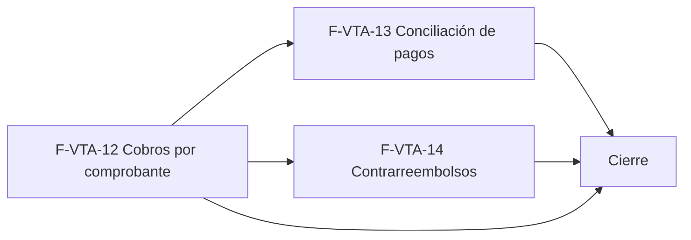

# Tasks: Ventas y despacho · Ventas cobros y conciliación

**Input**: [spec.md](./spec.md) y [plan.md](./plan.md) · **Épica**: MSF-195
**Formato**: `- [ ] T### [P] [Historia][USx] descripción (FR/SC)`. `[P]` = paralelizable (archivos distintos, sin dependencia dentro del mismo grupo). Cada FR/SC tiene **una sola** tarea dueña. Las dependencias y el orden son **solo dentro de la misma historia**; entre historias rige la tabla *Plan de ejecución* (objetos ya mergeados, nunca una tarea abierta de otra).
**Validación por historia**: `pnpm test:db`, `pnpm lint`, `pnpm build` y `pnpm test:web` verdes antes de cerrar la fase. Cada tabla nueva o alterada: esquema re-verificado (Principio VII, ambas en `dominio`). Cada migración lleva su reversión en el encabezado.
**Base**: los objetos de MSF-177 (`private.marcar_estado_cobro_comprobante`, `cambiar_estado_comprobante`, matriz de estados) y de MSF-139 (`cuentas_cobro`, `transportes`, `formas_pago`) ya están mergeados; sus nombres exactos se verifican (`graphify query`) antes de usarlos.

## Phase 1: F-VTA-12 · Cobros por comprobante

**Goal**: cobros parciales o totales por factura, saldo, paso a Cobrado/Deuda y su UI en el detalle.

- [ ] T001 [F-VTA-12][US1] Migración `supabase/migrations/20261209100000_cobros_comprobante.sql`: `dominio.cobros_comprobante` (importe > 0, forma, cuenta nulable, origen, registrado y aprobado por/en), FK compuesta al comprobante, RLS por organización y empresa accesible, sin escritura directa ni `delete`, `anon` sin privilegios, reversión en el encabezado (FR-001) — Verificación: pgTAP `supabase/tests/database/cobros_comprobante.test.sql` (`pnpm test:db`)
- [ ] T002 [F-VTA-12][US1] Migración `supabase/migrations/20261209100100_saldo_y_lectura_cobros.sql`: `private.saldo_comprobante`, `public.saldo_comprobante` y `public.cobros_de_comprobante` (`security invoker`), `revoke`/`grant` (FR-005, FR-010) — Verificación: pgTAP `supabase/tests/database/cobros_comprobante.test.sql` (`pnpm test:db`)
- [ ] T003 [F-VTA-12][US1] Migración `supabase/migrations/20261209100200_registrar_cobro_interno.sql`: `private.registrar_cobro_interno` (importe > 0 y ≤ saldo, bloqueo de fila, Cobrado si saldo 0, Deuda si la forma genera deuda, evento `comprobante.cobro_registrado`), sin `grant` a `authenticated` (FR-003, FR-004, FR-006) — Verificación: pgTAP `supabase/tests/database/cobros_comprobante.test.sql` (`pnpm test:db`)
- [ ] T004 [F-VTA-12][US1] Migración `supabase/migrations/20261209100300_registrar_cobro.sql`: acción `registrar_cobro` sembrada en `permisos_rol_accion`, `public.registrar_cobro` (`security definer`, solo factura confirmada, cuenta exigida/activa/habilitada), `revoke`/`grant` (FR-002) — Verificación: pgTAP `supabase/tests/database/cobros_comprobante.test.sql` (`pnpm test:db`)
- [ ] T005 [F-VTA-12][US1] pgTAP `supabase/tests/database/cobros_comprobante.test.sql`: parcial/total, tope y concurrencia, cuenta exigida/ajena/inactiva, tipos rechazados, Cobrado/Deuda solo por la función `private`, permisos por rol, evento, lectura, aislamiento entre organizaciones, `anon` sin ejecución; `rls_en_toda_tabla` (SC-001)
- [ ] T006 [P] [F-VTA-12][US1] `apps/web/src/lib/ventas/cobros.ts`: envoltorios de `registrar_cobro`, `cobros_de_comprobante` y `saldo_comprobante`, tipos y validación de importe del cliente (soporta FR-007) — Verificación: Vitest `apps/web/src/pages/ventas/comprobante.cobros.test.tsx` (`pnpm test:web`)
- [ ] T007 [F-VTA-12][US1] `apps/web/src/components/ventas/CobrosComprobante.tsx` + enchufe en `apps/web/src/pages/ventas/comprobante.tsx`: tarjeta Cobros (lista, cobrado, saldo), botón «Registrar cobro» según la acción y diálogo con Forma de pago, Cuenta de cobro e Importe, errores por campo, carga/vacío/error del kit (FR-007) — Verificación: Vitest `apps/web/src/pages/ventas/comprobante.cobros.test.tsx` (`pnpm test:web`)
- [ ] T008 [F-VTA-12][US1] `apps/web/src/pages/ventas/comprobante.tsx`: campo «Cuenta de cobro» con su ayuda, chip Sin conciliar/Conciliado, enlace «Ir a Pagos →» y texto de contrarreembolso (FR-008) — Verificación: Vitest `apps/web/src/pages/ventas/comprobante.cobros.test.tsx` (`pnpm test:web`)
- [ ] T009 [F-VTA-12][US1] `apps/web/src/pages/ventas/comprobante.tsx`: recarga de cobros y saldo al cambiar la empresa activa y cierre con aviso del diálogo abierto (FR-009) — Verificación: Vitest `apps/web/src/pages/ventas/comprobante.cobros.test.tsx` (`pnpm test:web`) y `pnpm ui:empresas:check`
- [ ] T010 [F-VTA-12][US1] Vitest `apps/web/src/pages/ventas/comprobante.cobros.test.tsx`: tarjeta, diálogo y errores, campo/chip/enlace, solo lectura por rol, cambio de empresa con diálogo abierto, teclado y lector (SC-002)

**Checkpoint F-VTA-12**: `pnpm test:db`, `pnpm lint`, `pnpm build` y `pnpm test:web` verdes.

## Phase 2: F-VTA-13 · Conciliación de pagos por cuenta de cobro

**Goal**: pantalla Pagos con tarjetas, filtros por tienda y cuenta, conciliar/revertir y tarjeta de cuentas de cobro.

- [ ] T011 [F-VTA-13][US2] Migración `supabase/migrations/20261209200000_conciliar_pago.sql`: acción `conciliar_pago` sembrada (Administración y Administrador), `public.conciliar_pago` y `public.revertir_conciliacion_pago` (idempotentes, bloqueo optimista, solo con cuenta, eventos, sin tocar el estado del comprobante), `revoke`/`grant` (FR-020, FR-021, FR-022) — Verificación: pgTAP `supabase/tests/database/pagos_conciliacion.test.sql` (`pnpm test:db`)
- [ ] T012 [P] [F-VTA-13][US2] Migración `supabase/migrations/20261209200100_listar_pagos.sql`: `public.listar_pagos` (`security invoker`, filtros de cuenta y «Solo con saldo», paginación y `filas`, empresas accesibles), `revoke`/`grant` (FR-023) — Verificación: pgTAP `supabase/tests/database/pagos_conciliacion.test.sql` (`pnpm test:db`)
- [ ] T013 [P] [F-VTA-13][US2] Migración `supabase/migrations/20261209200200_resumen_pagos.sql`: `public.resumen_pagos` y `public.cuentas_cobro_mas_usadas`, `revoke`/`grant` (FR-024) — Verificación: pgTAP `supabase/tests/database/pagos_conciliacion.test.sql` (`pnpm test:db`)
- [ ] T014 [F-VTA-13][US2] pgTAP `supabase/tests/database/pagos_conciliacion.test.sql`: permisos por rol, conciliar/revertir idempotentes, bloqueo optimista, estado intacto, filtros, paginación, totales, cuentas, aislamiento, `anon` sin ejecución (SC-003)
- [ ] T015 [P] [F-VTA-13][US2] `apps/web/src/lib/ventas/pagos.ts`: envoltorios de `listar_pagos`, `resumen_pagos`, `cuentas_cobro_mas_usadas`, `conciliar_pago` y `revertir_conciliacion_pago` (soporta FR-025…FR-027) — Verificación: Vitest `apps/web/src/pages/ventas/pagos/list.test.tsx` (`pnpm test:web`)
- [ ] T016 [F-VTA-13][US2] `apps/web/src/pages/ventas/pagos/list.tsx` + ruta `/ventas/pagos` + entrada «Pagos» con icono en `destinosPanel.ts`: título, subtítulo, filtro Tienda con `FiltroEmpresa`, tres tarjetas, filtro de cuentas, «Solo con saldo», paginación y «Acceso restringido» (FR-025) — Verificación: Vitest `apps/web/src/pages/ventas/pagos/list.test.tsx` (`pnpm test:web`), `pnpm prototipo:check` y `pnpm matriz:check`
- [ ] T017 [F-VTA-13][US2] `apps/web/src/pages/ventas/pagos/list.tsx`: tabla (columnas del prototipo), interruptor «Cobrado», avisos, «Aprobado por», saldo, enlace al comprobante, vacío y error con «Reintentar», deshabilitado sin la acción (FR-026) — Verificación: Vitest `apps/web/src/pages/ventas/pagos/list.test.tsx` (`pnpm test:web`)
- [ ] T018 [P] [F-VTA-13][US2] `apps/web/src/components/ventas/CuentasCobroResumen.tsx` + enchufe en Pagos: tarjeta Cuentas de cobro con texto, «No usar», «Ver todas las cuentas de cobro» y «Nueva cuenta» hacia `/ventas/cuentas-cobro` (FR-027) — Verificación: Vitest `apps/web/src/pages/ventas/pagos/list.test.tsx` (`pnpm test:web`)
- [ ] T019 [F-VTA-13][US2] `apps/web/src/pages/ventas/pagos/list.tsx`: invalidar y recargar todas las consultas al cambiar la empresa activa, reencuadrar la paginación y descartar el filtro de cuenta inexistente (FR-028) — Verificación: Vitest `apps/web/src/pages/ventas/pagos/list.test.tsx` (`pnpm test:web`) y `pnpm ui:empresas:check`
- [ ] T020 [F-VTA-13][US2] Vitest `apps/web/src/pages/ventas/pagos/list.test.tsx`: tarjetas, filtros, conciliar/revertir, vacío, error, solo lectura, tarjeta de cuentas, cambio de empresa, teclado y lector; corre `pnpm prototipo:check`, `pnpm matriz:check` y `pnpm ui:empresas:check` (SC-004)

**Checkpoint F-VTA-13**: `pnpm test:db`, `pnpm lint`, `pnpm build` y `pnpm test:web` verdes.

## Phase 3: F-VTA-14 · Contrarreembolsos por transporte

**Goal**: contrarreembolsos que se abren con la guía, se controlan como Pendiente y se marcan cobrados.

- [ ] T021 [F-VTA-14][US3] Migración `supabase/migrations/20261209300000_contrarreembolsos.sql`: `dominio.contrarreembolsos` (RLS, sin escritura directa ni `delete`, `anon` sin privilegios) y `private.abrir_contrarreembolso` (solo transportes que cobran, idempotente por comprobante y guía, importe = saldo, evento `contrarreembolso.abierto`), reversión en el encabezado (FR-040) — Verificación: pgTAP `supabase/tests/database/contrarreembolsos.test.sql` (`pnpm test:db`)
- [ ] T022 [F-VTA-14][US3] Migración `supabase/migrations/20261209300100_marcar_contrarreembolso_cobrado.sql`: acción `cobrar_contrarreembolso` sembrada, `public.marcar_contrarreembolso_cobrado` (idempotente, bloqueo optimista, cobro por `private.registrar_cobro_interno`, rechaza comprobante anulado, evento `contrarreembolso.cobrado`), `revoke`/`grant` (FR-041, FR-042, FR-043, FR-044) — Verificación: pgTAP `supabase/tests/database/contrarreembolsos.test.sql` (`pnpm test:db`)
- [ ] T023 [P] [F-VTA-14][US3] Migración `supabase/migrations/20261209300200_listar_contrarreembolsos.sql`: `public.listar_contrarreembolsos` y `public.resumen_contrarreembolsos` (`security invoker`, filtro de estado, paginación y `filas`), `revoke`/`grant` (FR-045) — Verificación: pgTAP `supabase/tests/database/contrarreembolsos.test.sql` (`pnpm test:db`)
- [ ] T024 [F-VTA-14][US3] pgTAP `supabase/tests/database/contrarreembolsos.test.sql`: apertura solo con transporte que cobra, duplicado, importe, cobro asociado y estado del comprobante, anulado, permisos por rol, eventos, listado y totales por empresa, aislamiento, `anon` y `authenticated` sin ejecutar la función `private`; `rls_en_toda_tabla` (SC-005)
- [ ] T025 [P] [F-VTA-14][US3] `apps/web/src/lib/ventas/contrarreembolsos.ts`: envoltorios de `listar_contrarreembolsos`, `resumen_contrarreembolsos` y `marcar_contrarreembolso_cobrado` (soporta FR-047) — Verificación: Vitest `apps/web/src/pages/ventas/transportes/contrarreembolsos.test.tsx` (`pnpm test:web`)
- [ ] T026 [F-VTA-14][US3] `apps/web/src/pages/ventas/transportes/list.tsx`: título y subtítulo del prototipo, filtro Tienda, sub-pestañas «Contrarreembolsos» y «Terminales de retiro» (la tabla de MSF-139 se conserva sin cambios) y ayuda (FR-046) — Verificación: Vitest `apps/web/src/pages/ventas/transportes/contrarreembolsos.test.tsx` (`pnpm test:web`)
- [ ] T027 [F-VTA-14][US3] `apps/web/src/components/ventas/ContrarreembolsosTabla.tsx` + tarjetas: columnas del prototipo, chip de Estado, «Marcar cobrado» (deshabilitado si cobrado, oculto sin permiso), aviso, vacío/carga/error (FR-047) — Verificación: Vitest `apps/web/src/pages/ventas/transportes/contrarreembolsos.test.tsx` (`pnpm test:web`)
- [ ] T028 [F-VTA-14][US3] `apps/web/src/pages/ventas/transportes/list.tsx`: recarga al cambiar la empresa activa y paginación reencuadrada (FR-048) — Verificación: Vitest `apps/web/src/pages/ventas/transportes/contrarreembolsos.test.tsx` (`pnpm test:web`) y `pnpm ui:empresas:check`
- [ ] T029 [F-VTA-14][US3] Vitest `apps/web/src/pages/ventas/transportes/contrarreembolsos.test.tsx`: pestañas, tarjetas, tabla, marcar cobrado, solo lectura, cambio de empresa, que Terminales conserva el comportamiento de MSF-139, teclado y lector (SC-006)

**Checkpoint F-VTA-14**: `pnpm test:db`, `pnpm lint`, `pnpm build` y `pnpm test:web` verdes.

## Phase 4: Cierre (Tarea de cierre, label `cierre`)

**Goal**: lo que ninguna historia atiende: documentación, datos de prueba, seguridad y roadmap.

- [ ] T030 [CIERRE] `docs/ventas-cobros-y-conciliacion.md` (modelo, estados, roles, simulación de la guía) y `docs/permisos-por-rol.md` con las tres acciones nuevas (FR-060) — Verificación: `pnpm docs:check`
- [ ] T031 [P] [CIERRE] Datos de prueba de DEV: cobros parciales y totales, pagos en dos cuentas y dos tiendas, y contrarreembolsos simulados con `private.abrir_contrarreembolso` (soporta FR-060) — Verificación: `pnpm test:db`
- [ ] T032 [P] [CIERRE] Revisión de seguridad: RLS de las dos tablas, `anon` sin ejecución, funciones `private` sin `grant`, sin datos bancarios completos en la actividad (skills `authz-security`, `supabase`) (soporta FR-060) — Verificación: `pnpm test:db` (`rls_en_toda_tabla`)
- [ ] T033 [P] [CIERRE] Fila de MSF-195 en `docs/roadmap-template.md` (estado, link a la spec, Backlog entregado) (soporta FR-060) — Verificación: `pnpm docs:check`
- [ ] T034 [CIERRE] Validación final: `pnpm lint`, `pnpm build`, `pnpm infra:config`, `pnpm test`, `pnpm docs:check`, `pnpm prototipo:check`, `pnpm matriz:check`, `pnpm ui:empresas:check` (SC-007)

## Verificación por requisito (FR → prueba o comando)

No reasigna dueños; cada FR conserva su tarea dueña de la matriz. Las SC se verifican con su propia tarea (T005, T010, T014, T020, T024, T029, T034).

| Requisito | Verificación |
|---|---|
| FR-001…FR-006, FR-010 | pgTAP `supabase/tests/database/cobros_comprobante.test.sql` (`pnpm test:db`) |
| FR-007, FR-008, FR-009 | Vitest `apps/web/src/pages/ventas/comprobante.cobros.test.tsx` |
| FR-020…FR-024 | pgTAP `supabase/tests/database/pagos_conciliacion.test.sql` |
| FR-025…FR-028 | Vitest `apps/web/src/pages/ventas/pagos/list.test.tsx`, `pnpm prototipo:check`, `pnpm matriz:check`, `pnpm ui:empresas:check` |
| FR-040…FR-045 | pgTAP `supabase/tests/database/contrarreembolsos.test.sql` |
| FR-046…FR-048 | Vitest `apps/web/src/pages/ventas/transportes/contrarreembolsos.test.tsx` y `pnpm ui:empresas:check` |
| FR-060 | `pnpm docs:check` |

## Matriz de trazabilidad (Jira ↔ US ↔ tareas)

| Historia | Requisito → tarea |
|----------|-------------------|
| F-VTA-12 (US1) | FR-001→T001 · FR-005/010→T002 · FR-003/004/006→T003 · FR-002→T004 · SC-001→T005 · FR-007→T007 · FR-008→T008 · FR-009→T009 · SC-002→T010 (T006 soporta FR-007) |
| F-VTA-13 (US2) | FR-020/021/022→T011 · FR-023→T012 · FR-024→T013 · SC-003→T014 · FR-025→T016 · FR-026→T017 · FR-027→T018 · FR-028→T019 · SC-004→T020 (T015 soporta FR-025…FR-027) |
| F-VTA-14 (US3) | FR-040→T021 · FR-041/042/043/044→T022 · FR-045→T023 · SC-005→T024 · FR-046→T026 · FR-047→T027 · FR-048→T028 · SC-006→T029 (T025 soporta FR-047) |
| Tarea de cierre (label `cierre`) | FR-060→T030 · SC-007→T034 (T031–T033 soportan FR-060) |

## Plan de ejecución (historias)

| Historia | Depende de | Grupo |
|---|---|---|
| F-VTA-12 | — | 1 |
| F-VTA-13 | F-VTA-12 | 2 |
| F-VTA-14 | F-VTA-12 | 2 |
| [Cierre] | F-VTA-12, F-VTA-13, F-VTA-14 | 3 |

F-VTA-13 y F-VTA-14 no comparten archivos, tablas ni migraciones: van en paralelo y solo esperan a F-VTA-12 porque usan su tabla `cobros_comprobante` y `private.registrar_cobro_interno`.

