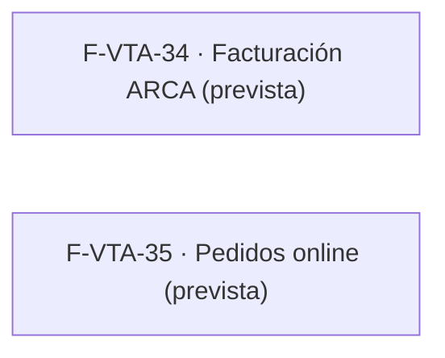

# Tasks: Ventas y despacho · Ventas backlog

**Input**: [spec.md](./spec.md) y [plan.md](./plan.md) · **Épica**: MSF-208

## Sin tareas

No hay historias implementables en esta entrega. F-VTA-34 y F-VTA-35 son **previstas** (condicionales, P3, sin requisitos, sin pantallas, sin horas y sin hito): sus requisitos se redactan cuando pasen a un hito, y sus tareas se generan en sus propias specs.

No hay tareas `[CIERRE]` porque no hay trabajo real de cierre: no se construyó nada, no hay docs/seguridad/roadmap que actualizar (el roadmap ya lista estas historias como backlog, fuera de diciembre) y no hay datos de prueba que preparar.

## Plan de ejecución (historias)

No hay historias en ejecución en esta épica. Las dos historias previstas quedan **fuera de esta entrega** y por eso no tienen `Grupo` ni dependencias dentro de esta spec:

| Historia | Depende de | Grupo |
|----------|------------|-------|
| F-VTA-34 (prevista, fuera de esta entrega) | — (se especifica al entrar a un hito) | — |
| F-VTA-35 (prevista, fuera de esta entrega) | F-TDA-26 cuando se priorice | — |

No hay fila `[Cierre]`: no hay trabajo real de cierre para esta épica (ver *Sin tareas*).

Ambos nodos quedan fuera del grafo de ejecución: no se entregan en esta épica.
