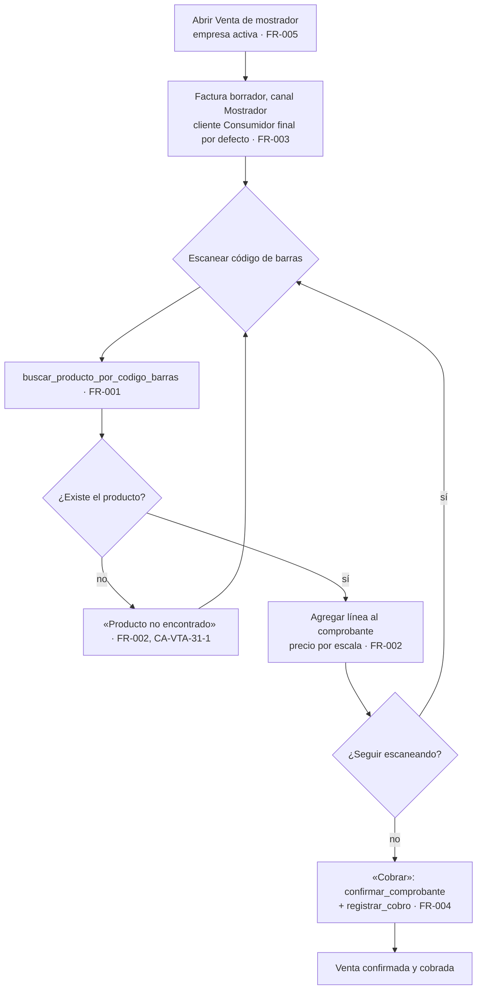
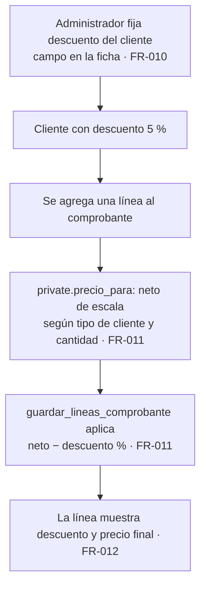
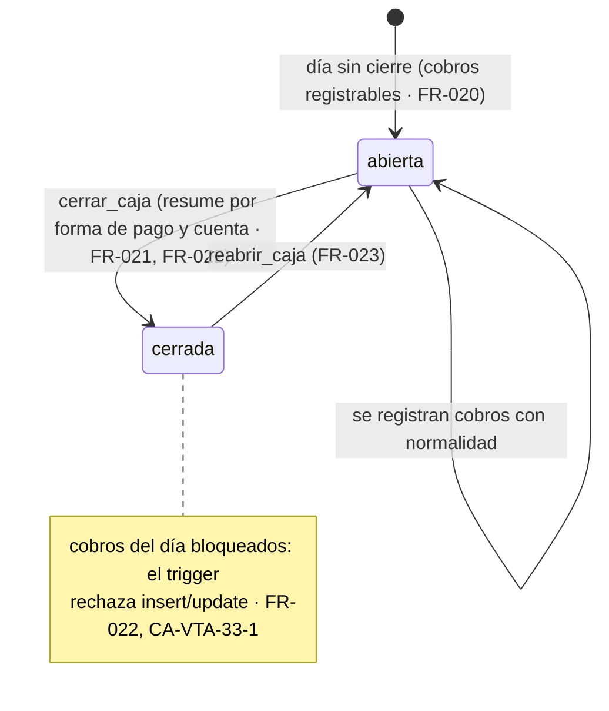

# Feature Specification: Ventas y despacho · Ventas mejoras

**Feature Branch**: `epic/MSF-193-ventas-mejoras`

**Jira Epic**: MSF-193 — Ventas y despacho · Ventas mejoras (spec `ventas-mejoras`)

**Created**: 2026-10-27

**Status**: Lista para implementar — la especificación viene de Nicolás (épica MSF-193 + sus tres historias F-VTA-31/32/33). Se traduce a Spec Kit sin inventar alcance; los puntos abiertos llevan decisión provisoria en *Decisiones abiertas*.

**Delivery scope**: `refine` (apps/web) y `supabase` (migraciones + RPC + pgTAP). Sin `kestra`, `superset` ni `workers`. La verificación de cada historia es un **E2E (Playwright)**, como declara la épica, más pgTAP de aislamiento (Constitución, Principio I/VII).

**Prioridad / Hito**: P2 · Etapa 3 (sin fecha) · 24 h (3 historias × M) · fuera de diciembre.

**Dependencias**:
- **Bloqueada por**: MSF-195 (Ventas y despacho · Ventas cobros y conciliación) — cobros por forma de pago y cuenta (F-VTA-33). MSF-195 incluye por cadena a MSF-177 (listado, estados y anulación) y MSF-159 (comprobante y líneas con escala, que usan F-VTA-31 y F-VTA-32); por eso MSF-159 no se vincula directo.
- **Base verificada en esta rama (base `main`)**: existen `dominio.productos.codigo_barras` (EAN-13, único por organización, `productos_org_codigo_barras_uidx`), `public.v_productos_listado` con `codigo_barras` (búsqueda por escaneo, F-CAT-14), `private.precio_para` + `private.escala_para_linea` + `public.guardar_lineas_comprobante` (MSF-159), `public.crear_comprobante` y `public.confirmar_comprobante` (MSF-159), `public.clientes` con `tipo` (`minorista`/`mayorista`) y `es_consumidor_final` (MSF-180), `dominio.formas_pago` y `dominio.cuentas_cobro` (MSF-139), y los roles `mostrador`/`deposito`/`administracion` (MSF-125).
- **NO existe en esta rama** (llega con MSF-195, aún sin mergear a `main`): `dominio.cobros_comprobante` y `public.registrar_cobro` (F-VTA-12), y las acciones `registrar_cobro`/`conciliar_pago` de `permisos_rol_accion`. Los **nombres y firmas exactos se verifican contra `main` al implementar** (no se inventan aquí); si MSF-195 no está mergeada, la historia que la usa espera.
- Bloquea a: ninguna épica.

**Input**: Epic MSF-193. Objetivo: «Al terminar, la venta de mostrador es más rápida, hay precios especiales por cliente y se cierra la caja diaria.»

**Regla de fuentes** (literal de la épica):
1. Comportamiento y datos: mandan los requisitos y escenarios de esta historia.
2. Qué se ve (disposición, textos, estados, popups, flujos): el prototipo validado es referencia visual, no hace falta que quede extremadamente idéntico; los flujos (si hay) aclaran estados y acciones.
3. Cómo se construye (componentes, estilos y patrones): mandan el template y el system design (MSF-117, `docs/sistema-de-diseno.md`). No se copia HTML ni CSS del prototipo.
4. El prototipo muestra más que esta historia: se implementa solo lo que piden los requisitos; otras secciones, botones o diálogos son de otras historias.
5. Si algo no se puede igualar: lo más cercano, sin inventar, anotando la diferencia en el PR. Si prototipo y requisitos se contradicen: requisitos para el comportamiento, prototipo para lo visual, y la contradicción queda anotada en el PR.
- **Prototipos (solo lectura)**: esta épica **no tiene pantallas dibujadas**. Las historias F-VTA-31 a F-VTA-35 se dibujan cuando entren a un hito; no hay archivos `.dc.html` para esta épica. Se implementa con los componentes del template y los tokens del sistema de diseño, **sin inventar diseño más allá de los requisitos**. No corresponde a esta épica la pantalla `VentasGastos.dc.html` (Gastos).

## Modelo y supuestos

- **Tres historias independientes** sobre lo ya construido de Ventas (comprobante, líneas con escala, cobros): no recrean el comprobante ni los cobros, los **reutilizan**.
- **Mostrador** (F-VTA-31): una venta de mostrador es una factura con canal Mostrador y cliente **Consumidor final por defecto**; el vendedor escanea códigos de barras (EAN-13) y cobra en el momento. El escaneo agrega una línea; un código inexistente muestra «Producto no encontrado».
- **Precio especial** (F-VTA-32): el cliente lleva un **descuento porcentual** propio que se aplica **sobre el precio de escala** de cada línea (antes del IVA). La historia menciona «descuento **o** lista propia»; el requisito y el escenario solo especifican el descuento porcentual → se implementa el descuento; «lista propia» queda FUERA DE ALCANCE (*Decisiones abiertas* 1).
- **Cierre de caja** (F-VTA-33): un cierre diario **por empresa** resume los cobros del día por **forma de pago** y **cuenta de cobro** y bloquea registrar/modificar cobros de ese día hasta reabrir. La conciliación sigue siendo manual (no se importan extractos).
- **Empresa/tienda** (Principio VIII): las tres pantallas operan sobre la **empresa activa** de la barra superior; un diálogo o venta en curso al cambiar de empresa se cierra con aviso o se reencuadra. El cierre de caja es por empresa.
- **Roles**: vendedor (`mostrador`) opera el mostrador; **Administrador** fija el descuento del cliente y cierra/reabre la caja (*Decisiones abiertas* 4).
- **Horas sin cambio**: 24 h = 3 × M; el template no aporta nada de este dominio (solo aislamiento por organización y kit de panel).

### Esquema de datos (Constitución, Principio VII)

| Objeto | Esquema | Historia | Justificación | RLS / acceso |
|--------|---------|----------|---------------|--------------|
| `public.buscar_producto_por_codigo_barras` (**nueva**, RPC) | `public` (RPC) | F-VTA-31 | Resuelve un producto por su EAN-13 para el mostrador; no crea tabla. | `security definer`, `set search_path = ''`; exige `ventas` en `edicion` en la empresa activa; `revoke … from public, anon` + `grant execute … to authenticated`. |
| `public.clientes` (**existente**; se **altera** aditiva: +`descuento`) | `public` (sin cambio de esquema) | F-VTA-32 | `clientes` vive en `public` desde la fundación (decisión histórica, MSF-180); solo se agrega una columna nulable. | RLS vigente. `descuento` editable solo por Administrador (vía RPC de clientes o `actualizar` acotado). |
| `public.guardar_lineas_comprobante` (**existente**; se **altera** para aplicar el descuento) | función en `public` | F-VTA-32 | El cálculo del precio vive en una sola función; se suma el descuento del cliente, sin cambiar la firma. | `security definer` vigente; el descuento **nunca** lo manda el cliente: se lee de `public.clientes` en el servidor. |
| `dominio.cierres_caja` (**nueva**) | **`dominio`** | F-VTA-33 | Cierre diario de caja: entidad de negocio de Ventas. | RLS por `organizacion_id` + empresa en `private.empresas_accesibles()`; **sin escritura directa** (solo RPC); `anon` sin privilegios. |
| `dominio.cierres_caja_detalle` (**nueva**) | **`dominio`** | F-VTA-33 | Resumen del cierre por forma de pago y cuenta de cobro. | Ídem; FK compuesta al cierre. |
| `dominio.cobros_comprobante` (**existente**, MSF-195; se le agrega un **trigger** de bloqueo) | `dominio` (sin cambio de estructura) | F-VTA-33 | Solo se agrega un disparador `before insert or update` que rechaza cobros de una fecha cerrada; no se alteran columnas ni políticas. | RLS vigente (MSF-195); el trigger actúa sobre toda escritura, venga de la RPC que venga. |
| `permisos_rol_accion` (**existente**) | `public` (sin cambio) | F-VTA-31/33 | Las acciones `registrar_cobro` (F-VTA-31 usa el cobro) y `ventas`/`edicion` ya existen; no se agregan acciones nuevas salvo que se confirme (*Decisiones abiertas* 4). | Vigente (MSF-121/125). |
| `public.registro_actividad` (**existente**) | `public` (sin cambio) | F-VTA-33 | Auditoría vía `private.registrar_actividad`. | Vigente. |

No se crean otras tablas. `rls_en_toda_tabla` (pgTAP, recorre `public` + `dominio`) debe seguir verde. Todas las migraciones son **aditivas** con reversión en su encabezado; **cada historia trae su propia migración** (timestamps propios, sin encadenarse a las de otra historia ni a las de MSF-195).

## Flujos

### Flujo 1 · Venta de mostrador con lector (proceso)

(Mapa: A→FR-005, B→FR-003, C/D→FR-001, E/F→FR-002, G→FR-002, I→FR-004.)

### Flujo 2 · Precio especial por cliente (proceso)

(Mapa: A→FR-010, D/E→FR-011, F→FR-012, CA-VTA-32-1.)

### Flujo 3 · Cierre de caja (máquina de estados)

## User Scenarios & Testing *(mandatory)*

### User Story 1 - Venta de mostrador con lector de código de barras (F-VTA-31, P2, talla M)

Como vendedor, quiero escanear productos y cobrar en el momento, para atender en el local sin cargar a mano.

**Why this priority**: es la mejora que agiliza el mostrador; reutiliza el comprobante, las líneas y el cobro ya construidos.

**Independent Test**: desde `/ventas/mostrador`, escanear un EAN-13 agrega la línea al comprobante en curso (cliente Consumidor final, canal Mostrador, empresa activa); escanear un código inexistente muestra «Producto no encontrado»; «Cobrar» confirma la factura y registra el cobro.

**Acceptance Scenarios**:
1. **Given** un producto con código de barras, **When** el vendedor escanea el código, **Then** se agrega una línea al comprobante de mostrador (cantidad 1; si ya estaba, se incrementa).
2. **Given** un código de barras inexistente, **When** el vendedor escanea, **Then** se muestra «Producto no encontrado» (CA-VTA-31-1).
3. **Given** la venta de mostrador, **Then** el comprobante nace como factura con canal Mostrador, cliente **Consumidor final por defecto** y la empresa activa preseleccionada.
4. **Given** líneas cargadas, **When** el vendedor pulsa «Cobrar», **Then** se confirma la factura (`confirmar_comprobante`) y se registra el cobro por el total (`registrar_cobro`).

### User Story 2 - Precios especiales por cliente (F-VTA-32, P2, talla M)

Como administrador, quiero fijar un descuento o una lista propia para un cliente, para no editar precios línea por línea.

**Why this priority**: centraliza el precio especial en el cliente, en vez de tocar cada línea.

**Independent Test**: fijar 5 % de descuento a un cliente y agregar una línea muestra el precio de escala menos 5 % (CA-VTA-32-1); un cliente sin descuento no cambia; el descuento no pisa un precio manual.

**Acceptance Scenarios**:
1. **Given** un cliente con 5 % de descuento, **When** agrego una línea, **Then** el precio refleja la escala menos 5 % (CA-VTA-32-1).
2. **Given** la ficha del cliente, **Then** hay un campo de descuento editable solo por Administrador.
3. **Given** una línea de un cliente con descuento, **Then** la línea del comprobante muestra el descuento aplicado y el precio resultante.

### User Story 3 - Cierre de caja diario (F-VTA-33, P2, talla M)

Como administrador, quiero cerrar el día con el total cobrado por forma de pago, para controlar el efectivo.

**Why this priority**: cierra el circuito diario del mostrador y evita cobros fuera de control.

**Independent Test**: un día con cobros, al «Cerrar caja» se resume por forma de pago y cuenta y queda bloqueado registrar/modificar cobros de ese día; «Reabrir» los habilita de nuevo (CA-VTA-33-1).

**Acceptance Scenarios**:
1. **Given** un día con cobros, **When** el administrador cierra la caja, **Then** se resumen los cobros por forma de pago y cuenta y no se pueden modificar sin reabrirla (CA-VTA-33-1).
2. **Given** la caja cerrada, **When** se intenta registrar o modificar un cobro de ese día, **Then** se rechaza (sin reabrir).
3. **Given** la caja cerrada, **When** el administrador la reabre, **Then** se habilita de nuevo el registro de cobros del día.

### Edge Cases

- Escanear el mismo código varias veces: incrementa la cantidad de la línea (no crea duplicados).
- Código de barras de otra organización: no se resuelve (RLS) y muestra «Producto no encontrado».
- Cambio de empresa activa con la venta de mostrador en curso: se descarta la venta con aviso o se reencuadra (Principio VIII), nunca se guarda bajo otra empresa.
- Cerrar la caja dos veces el mismo día: idempotente (un cierre por empresa y fecha); el segundo cierre se rechaza o devuelve el existente.
- Cobro con cuenta de cobro nula (forma de pago sin cuenta, p. ej. efectivo): el resumen del cierre lo agrupa bajo «efectivo»/sin cuenta, no se rompe.
- Descuento inválido (negativo o > 100): se rechaza con mensaje claro en el campo.

## Requirements *(mandatory)*

### Functional Requirements

**F-VTA-31 — Venta de mostrador con lector de código de barras**
- **FR-001**: RPC `buscar_producto_por_codigo_barras(p_codigo_barras text)` (`security definer`, `set search_path = ''`) valida EAN-13 (13 dígitos) y devuelve el producto activo de la organización por el índice único `productos_org_codigo_barras_uidx`; exige `ventas` en `edicion` en la empresa activa; sin coincidencia no devuelve filas (el cliente muestra «Producto no encontrado», CA-VTA-31-1). `revoke … from public, anon` + `grant execute … to authenticated`.
- **FR-002**: Pantalla **Venta de mostrador** (`/ventas/mostrador`) con campo de escaneo (lector/teclado): al escanear un código resuelve el producto (FR-001) y agrega una línea al comprobante en curso (cantidad 1, o incrementa si ya está); un código inexistente muestra «Producto no encontrado». El precio de la línea lo calcula `guardar_lineas_comprobante` (MSF-159), reutilizando la escala. (RF-VTA-31-1)
- **FR-003**: El comprobante de mostrador nace como factura `borrador` con canal Mostrador y cliente **Consumidor final por defecto**, empresa activa preseleccionada, reutilizando `crear_comprobante`. (RF-VTA-31-1)
- **FR-004**: «Cobrar» confirma la factura con `confirmar_comprobante` (MSF-159) y registra el cobro en el momento con `registrar_cobro` (MSF-195) por el total; no recrea ni el comprobante ni el cobro.
- **FR-005**: Acceso: sección `ventas` en `edicion` en la empresa activa; sin `ventas`, «Acceso restringido»; entrada de menú «Venta de mostrador» con icono y ruta canónica (Principio VI); la empresa activa se preselecciona y, al cambiarla, se reencuadra y descarta la venta en curso con aviso (Principio VIII).

**F-VTA-32 — Precios especiales por cliente**
- **FR-010**: Columna aditiva `public.clientes.descuento` (porcentaje, `numeric`, nulable, 2 decimales, `check 0..100`) con reversión en el encabezado; editar el descuento registra el evento `cliente.descuento_editado` (actor y cliente) con `private.registrar_actividad` en la misma transacción.
- **FR-011**: `guardar_lineas_comprobante` aplica el descuento del cliente **sobre el neto de escala** (`private.precio_para`), antes del IVA, al calcular el precio de cada línea; el descuento se lee de `public.clientes` en el servidor (nunca lo manda el cliente). El precio manual no se altera (el descuento aplica solo a la escala, *Decisiones abiertas* 2). (RF-VTA-32-1)
- **FR-012**: Campo «Descuento» (porcentaje) en la ficha del cliente, editable solo por Administrador, con validación 0–100.
- **FR-013**: La línea del comprobante muestra el descuento aplicado y el precio resultante (visualización en la tabla de líneas). (RF-VTA-32-1)

**F-VTA-33 — Cierre de caja diario**
- **FR-020**: Tablas `dominio.cierres_caja` (organización, empresa, `fecha` date, estado `abierta`/`cerrada`, `cerrado_por`, `cerrado_en`, `reabierto_por`, `reabierto_en`) y `dominio.cierres_caja_detalle` (`cierre_id`, `forma_pago_id`, `cuenta_cobro_id` nulable, `total`), con RLS por organización y empresa accesible, **sin escritura directa**, `anon` sin privilegios; índice único (organización, empresa, fecha) para un cierre por día.
- **FR-021**: RPC `cerrar_caja(p_empresa_id uuid, p_fecha date)` (Administrador): resume los cobros del día de `dominio.cobros_comprobante` (esa empresa y fecha, por `registrado_en`) **por forma de pago y cuenta de cobro**, guarda el cierre y el detalle y marca la caja `cerrada`; idempotente (un cierre por empresa y fecha). (RF-VTA-33-1)
- **FR-022**: `private.caja_cerrada(p_empresa_id uuid, p_fecha date)` + un disparador `before insert or update` sobre `dominio.cobros_comprobante` que rechaza registrar o modificar un cobro cuya fecha esté cerrada (errcode `55000`, mensaje en castellano). Bloquea toda escritura, venga de la RPC que venga. (RF-VTA-33-1, CA-VTA-33-1)
- **FR-023**: RPC `reabrir_caja(p_cierre_id uuid)` (Administrador): marca el cierre `reabierta`, habilita de nuevo los cobros del día y registra quién y cuándo. (CA-VTA-33-1)
- **FR-024**: Pantalla **Cierre de caja** (`/ventas/cierre-caja`): lista los cierres (empresa, fecha, estado, total) con el detalle por forma de pago y cuenta, y acciones «Cerrar caja» (del día de la empresa activa) y «Reabrir»; estados vacío/error/carga/éxito del kit de panel; empresa activa (Principio VIII). (RF-VTA-33-1)
- **FR-025**: Acceso: cerrar/reabrir exige Administrador; el resumen es de lectura para `ventas`; entrada de menú con icono y ruta canónica (Principio VI).
- **FR-026**: `cerrar_caja` y `reabrir_caja` registran eventos `caja.cerrada` / `caja.reabierta` (actor, empresa, fecha) con `private.registrar_actividad` en la misma transacción.

### Success Criteria

- **SC-001** *(F-VTA-31)*: pgTAP `ventas_mostrador.test.sql` (`pnpm test:db`): `buscar_producto_por_codigo_barras` resuelve solo productos de la organización, sin `ventas`/`edicion` no accede, `anon` sin acceso, código inexistente devuelve sin filas; `rls_en_toda_tabla` verde. E2E (Playwright) de CA-VTA-31-1: escaneo agrega línea, código inexistente muestra «Producto no encontrado».
- **SC-002** *(F-VTA-32)*: pgTAP `ventas_precios_especiales.test.sql` (`pnpm test:db`): cliente 5 % ⇒ precio = escala −5 %; cliente sin descuento no cambia; precio manual no se pisa; descuento fuera de rango rechazado. E2E (Playwright) de CA-VTA-32-1.
- **SC-003** *(F-VTA-33)*: pgTAP `ventas_cierre_caja.test.sql` (`pnpm test:db`): resumen por forma de pago y cuenta, cobro de fecha cerrada rechazado, reabrir habilita, cierre idempotente, aislamiento por organización y empresa, `anon` sin acceso. E2E (Playwright) de CA-VTA-33-1.
- **SC-004** *(Cierre)*: revisión de seguridad (RLS, `security definer`, trigger de bloqueo), `docs/ventas-mejoras.md` e índice, fila del roadmap, `pnpm lint`, `pnpm build`, `pnpm test`, `pnpm docs:check`, `pnpm prototipo:check` y `pnpm matriz:check` verdes.

## Decisiones abiertas (provisorias; no bloquean)

1. **Descuento vs. lista propia**: la historia dice «descuento **o** lista propia», pero el requisito y el escenario solo especifican descuento porcentual. Se implementa **descuento porcentual**; «lista propia» queda **FUERA DE ALCANCE** hasta que se especifique.
2. **Descuento y precio manual**: el descuento aplica **solo sobre el precio de escala**, no sobre un precio manual (el manual ya es una decisión explícita del operador). A confirmar si el descuento debe aplicar también al manual.
3. **Cierre por empresa**: la épica no lo explicita; se asume **por empresa** (los cobros pertenecen a la empresa del comprobante y el efectivo se controla por tienda), respetando la empresa activa.
4. **Rol que cierra**: la historia dice «administrador»; se gatea con Administrador. A confirmar si Administración también cierra (mirror de MSF-195 «a confirmar roles»).
5. **Nombres de MSF-195**: `dominio.cobros_comprobante` y `public.registrar_cobro` se toman de la spec de MSF-195 (aún sin mergear a `main`); se verifican contra `main` al implementar, no se inventan.
6. **F-VTA-34 / F-VTA-35**: el apartado «Pantallas» de la épica menciona «F-VTA-31 a F-VTA-35», pero la tabla de *Historias previstas* solo lista 31/32/33. **F-VTA-34 y F-VTA-35 no son de esta épica** (se dibujan cuando entren a un hito; son otras historias del componente).

## Matriz pantalla↔criterios

**Esta épica no tiene pantallas dibujadas** (no hay `.dc.html` ni inventario asociado): las historias F-VTA-31 a F-VTA-35 se dibujan cuando entren a un hito. Por eso no hay inventario del prototipo que mapear; se declara el alcance de UI **desde los requisitos** (FR), no desde un artboard. Lo que la épica no pide se declara FUERA DE ALCANCE (nota, no tarea).

| Ítem de UI (según los FR, no un prototipo) | Dueño |
|---|---|
| Pantalla «Venta de mostrador» `/ventas/mostrador` (campo de escaneo, lista de líneas, total, botón «Cobrar») | FR-002, FR-004 |
| Mensaje «Producto no encontrado» | FR-002 (CA-VTA-31-1) |
| Campo «Descuento» en la ficha del cliente | FR-010 |
| Descuento y precio resultante en la línea del comprobante | FR-012 |
| Pantalla «Cierre de caja» `/ventas/cierre-caja` (lista de cierres, detalle por forma de pago y cuenta, «Cerrar caja», «Reabrir») | FR-024 |
| Entradas de menú «Venta de mostrador» y «Cierre de caja» (icono, audiencia `ventas`) | FR-005, FR-025 |
| Empresa activa (preselección y reencuadre en mostrador y cierre) | FR-005, FR-024 (test SC-001/SC-003) |
| Pantalla `VentasGastos.dc.html` (Gastos) y resto de pantallas del prototipo | **FUERA DE ALCANCE** — no corresponden a esta épica ni a ninguna de sus historias |

## Matriz de trazabilidad Jira ↔ US ↔ FR ↔ tareas

| Jira | Historia | US | FR / SC | Tareas |
|------|----------|----|---------|--------|
| MSF-193 (épica) / MSF-329 | F-VTA-31 Venta de mostrador con lector de código de barras | US1 | FR-001…FR-005, SC-001 | T001–T007 |
| MSF-193 (épica) / MSF-340 | F-VTA-32 Precios especiales por cliente | US2 | FR-010…FR-013, SC-002 | T008–T013 |
| MSF-193 (épica) / MSF-349 | F-VTA-33 Cierre de caja diario | US3 | FR-020…FR-026, SC-003 | T014–T021 |
| Tarea de cierre (label `cierre`) | Seguridad, índice documental, roadmap | — | SC-004 | T022–T024 |
