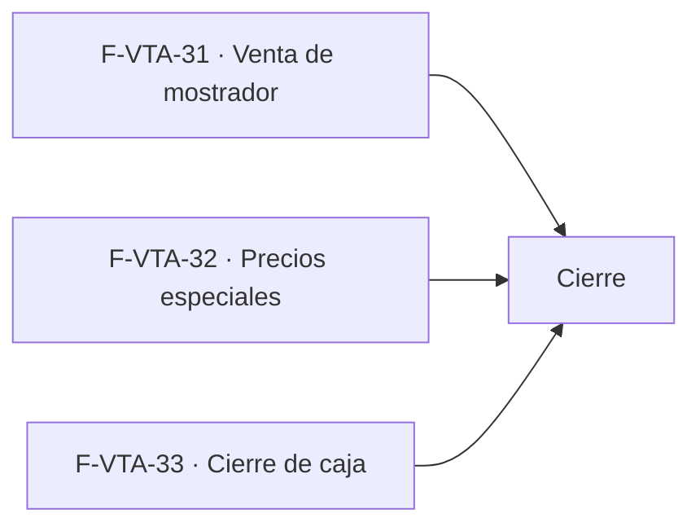

# Tasks: Ventas y despacho · Ventas mejoras

**Input**: [spec.md](./spec.md) y [plan.md](./plan.md) · **Contratos**: [contracts/ventas-mejoras.md](./contracts/ventas-mejoras.md) · **Épica**: MSF-193
**Formato**: `- [ ] T### [P] [Historia][USx] descripción (FR/SC)`. `[P]` = paralelizable (archivos distintos, sin dependencia dentro del mismo grupo). Cada FR/SC tiene **una sola** tarea dueña; «soporte de» marca una tarea que contribuye sin ser dueña. Las historias son autosuficientes: ninguna tarea depende de otra historia ni de una `[CIERRE]`; el orden entre historias lo da el *Plan de ejecución*.
**Validación por historia**: `pnpm test:db`, `pnpm lint`, `pnpm build`, `pnpm test:web` y el E2E de la historia verdes antes de cerrar la fase.
**Esquema (Principio VII, re-verificado)**: `cierres_caja` y `cierres_caja_detalle` → `dominio`; RPC `buscar_producto_por_codigo_barras` y columna `clientes.descuento` → `public` (decisión histórica de `clientes`); `cobros_comprobante` → `dominio` (solo trigger). Re-verificar en cada tarea de migración y en el PR.
**Antes de empezar F-VTA-31 y F-VTA-33**: verificar contra `main` las firmas de `dominio.cobros_comprobante` y `public.registrar_cobro` (MSF-195); si MSF-195 no está mergeada, la historia espera. Los nombres se toman de la spec de MSF-195, no se inventan.
**Fechas de migración**: los timestamps abajo son placeholder; el implementador los fija **posteriores a la última migración de `main`** y los hace aditivos con reversión en el encabezado.

## Phase 1: F-VTA-31 · Venta de mostrador con lector de código de barras

**Goal**: pantalla de mostrador que escanea EAN-13, agrega líneas, confirma con Consumidor final y cobra en el momento.

- [ ] T001 [P] [F-VTA-31][US1] Migración `supabase/migrations/20261213100100_mostrador_buscar_producto.sql`: RPC `public.buscar_producto_por_codigo_barras(p_codigo_barras text)` (`security definer`, `set search_path = ''`, exige `ventas` en `edicion` en la empresa activa, valida EAN-13, resuelve por `productos_org_codigo_barras_uidx`, solo activos y de la organización; sin filas si no existe), `revoke … from public, anon` + `grant execute … to authenticated`, reversión en el encabezado (FR-001)
- [ ] T002 [P] [F-VTA-31][US1] `apps/web/src/lib/ventasMostrador.ts`: tipos y llamadas a `buscar_producto_por_codigo_barras`, `crear_comprobante`, `guardar_lineas_comprobante`, `confirmar_comprobante` y `registrar_cobro` (MSF-195), con mapeo de errores a mensajes claros (soporte de FR-002, FR-004)
- [ ] T003 [P] [F-VTA-31][US1] `apps/web/src/components/ventas/LectorCodigoBarras.tsx`: campo de escaneo (lector/teclado) con foco automático, submit al Enter y limpieza tras cada lectura (soporte de FR-002)
- [ ] T004 [F-VTA-31][US1] `apps/web/src/pages/ventas/mostrador.tsx`: venta en curso (factura `borrador`, canal Mostrador, cliente Consumidor final por defecto, empresa activa preseleccionada vía `crear_comprobante`); escanear resuelve el producto y agrega la línea (cantidad 1, incrementa si ya está) con `guardar_lineas_comprobante`; código inexistente muestra «Producto no encontrado»; pie con total; botón «Cobrar» que llama `confirmar_comprobante` + `registrar_cobro`; estados vacío/error/carga/éxito, 320/768/1440 px (FR-002, FR-003, FR-004)
- [ ] T005 [F-VTA-31][US1] Ruta `/ventas/mostrador` y entrada de menú «Venta de mostrador» en `apps/web/src/components/navegacion/destinosPanel.ts` (icono, audiencia `ventas`, «Acceso restringido»); empresa activa: preselección, reencuadre y descarte de la venta en curso con aviso al cambiar de empresa (FR-005)
- [ ] T006 [F-VTA-31][US1] pgTAP `supabase/tests/database/ventas_mostrador.test.sql`: `buscar_producto_por_codigo_barras` resuelve solo productos de la organización, sin `ventas`/`edicion` no accede, `anon` sin acceso, código inexistente devuelve sin filas, formato no EAN-13 rechazado, `rls_en_toda_tabla` verde (SC-001)
- [ ] T007 [F-VTA-31][US1] E2E `apps/web/e2e/ventas-mostrador.e2e.ts` de CA-VTA-31-1: escanear un código agrega la línea; escanear un código inexistente muestra «Producto no encontrado» (SC-001)

**Checkpoint F-VTA-31**: `pnpm test:db`, `pnpm lint`, `pnpm build`, `pnpm test:web` y el E2E verdes.

## Phase 2: F-VTA-32 · Precios especiales por cliente

**Goal**: descuento porcentual por cliente aplicado sobre la escala en el cálculo de la línea, visible en el comprobante.

- [ ] T008 [P] [F-VTA-32][US2] Migración `supabase/migrations/20261213200100_clientes_descuento.sql`: columna aditiva `public.clientes.descuento` (numeric, nulable, 2 decimales, `check (descuento is null or (descuento >= 0 and descuento <= 100))`), `grant update` acotado, trigger que registra `cliente.descuento_editado` (actor y cliente) con `private.registrar_actividad` cuando cambia el descuento, reversión en el encabezado (FR-010)
- [ ] T009 [F-VTA-32][US2] Migración `supabase/migrations/20261213200200_lineas_descuento.sql`: `create or replace public.guardar_lineas_comprobante` para aplicar el descuento del cliente sobre el neto de escala (`private.precio_para`) antes del IVA; el descuento se lee de `public.clientes` en el servidor (nunca del payload) y no pisa el `precio_manual`; misma firma, sin `BREAKING`, reversión en el encabezado (FR-011)
- [ ] T010 [P] [F-VTA-32][US2] `apps/web/src/pages/clientes/edit.tsx` (y `show.tsx`): campo «Descuento» (porcentaje) editable solo por Administrador, con validación 0–100 y mensajes en el campo (FR-012)
- [ ] T011 [P] [F-VTA-32][US2] `apps/web/src/components/ventas/LineasComprobante.tsx`: mostrar el descuento aplicado y el precio resultante por línea (FR-013)
- [ ] T012 [F-VTA-32][US2] pgTAP `supabase/tests/database/ventas_precios_especiales.test.sql`: cliente 5 % ⇒ precio = escala −5 %; cliente sin descuento no cambia; precio manual no se pisa; descuento fuera de rango rechazado; aislamiento y `anon` (SC-002)
- [ ] T013 [F-VTA-32][US2] E2E `apps/web/e2e/ventas-precios-especiales.e2e.ts` de CA-VTA-32-1: cliente con 5 % agrega línea y el precio refleja la escala menos 5 % (SC-002)

**Checkpoint F-VTA-32**: `pnpm test:db`, `pnpm lint`, `pnpm build`, `pnpm test:web` y el E2E verdes.

## Phase 3: F-VTA-33 · Cierre de caja diario

**Goal**: cierre diario por empresa que resume cobros por forma de pago y cuenta y bloquea su edición.

- [ ] T014 [P] [F-VTA-33][US3] Migración `supabase/migrations/20261213300100_cierres_caja.sql`: `dominio.cierres_caja` (organización, empresa, `fecha` date, estado `abierta`/`cerrada`, `cerrado_por`, `cerrado_en`, `reabierto_por`, `reabierto_en`) y `dominio.cierres_caja_detalle` (`cierre_id`, `forma_pago_id`, `cuenta_cobro_id` nulable, `total`); RLS por organización y empresa accesible, sin escritura directa, `anon` sin privilegios, índice único (organización, empresa, fecha), reversión en el encabezado (FR-020)
- [ ] T015 [F-VTA-33][US3] Migración `supabase/migrations/20261213300200_cierres_caja_rpc.sql`: `public.cerrar_caja(p_empresa_id, p_fecha)` (Administrador; resume `dominio.cobros_comprobante` del día por forma de pago y cuenta, inserta cierre + detalle, idempotente), `public.reabrir_caja(p_cierre_id)` (Administrador), `public.listar_cierres_caja(...)` (lectura `ventas`), `private.caja_cerrada(p_empresa_id, p_fecha)`; eventos `caja.cerrada`/`caja.reabierta` con `private.registrar_actividad`; `revoke … from public, anon` + `grant … to authenticated`, reversión en el encabezado (FR-021, FR-023, FR-026)
- [ ] T016 [F-VTA-33][US3] Migración `supabase/migrations/20261213300300_bloqueo_cobros_cerrados.sql`: trigger `before insert or update` sobre `dominio.cobros_comprobante` que rechaza (errcode `55000`, mensaje en castellano) cuando `private.caja_cerrada(empresa_id, registrado_en::date)`; no altera columnas ni políticas de MSF-195; reversión en el encabezado (FR-022)
- [ ] T017 [P] [F-VTA-33][US3] `apps/web/src/lib/cierreCaja.ts`: tipos y llamadas a `listar_cierres_caja`, `cerrar_caja` y `reabrir_caja`, con mapeo de errores (soporte de FR-024)
- [ ] T018 [P] [F-VTA-33][US3] `apps/web/src/components/ventas/CerrarCajaDialog.tsx`: diálogo de confirmación de «Cerrar caja» y «Reabrir» (soporte de FR-024)
- [ ] T019 [F-VTA-33][US3] `apps/web/src/pages/ventas/cierre-caja.tsx`: lista de cierres (empresa, fecha, estado, total) con detalle por forma de pago y cuenta, acciones «Cerrar caja» (del día de la empresa activa) y «Reabrir»; ruta `/ventas/cierre-caja` y entrada de menú en `destinosPanel.ts` (icono, audiencia `ventas`, «Acceso restringido»); empresa activa: preselección y reencuadre; estados vacío/error/carga/éxito, 320/768/1440 px (FR-024, FR-025)
- [ ] T020 [F-VTA-33][US3] pgTAP `supabase/tests/database/ventas_cierre_caja.test.sql`: resumen por forma de pago y cuenta, cobro de fecha cerrada rechazado (incluso vía `registrar_cobro` de MSF-195), reabrir habilita, cierre idempotente, aislamiento por organización y empresa, `anon` sin acceso, `rls_en_toda_tabla` verde (SC-003)
- [ ] T021 [F-VTA-33][US3] E2E `apps/web/e2e/ventas-cierre-caja.e2e.ts` de CA-VTA-33-1: un día con cobros, cerrar la caja y verificar que no se pueden modificar sin reabrirla (SC-003)

**Checkpoint F-VTA-33**: `pnpm test:db`, `pnpm lint`, `pnpm build`, `pnpm test:web` y el E2E verdes.

## Phase 4: Cierre (historia de cierre, label `cierre`)

**Goal**: trabajo que ninguna historia atiende. Solo se ejecuta con todas las historias finalizadas.

- [ ] T022 [P] [CIERRE] Revisión de seguridad de las RPC, tablas y el trigger de la épica (`authz-security`): RLS, `security definer`, trigger de bloqueo sobre `cobros_comprobante`, descuento no manipulable desde el cliente, `anon` sin acceso (soporte de SC-004)
- [ ] T023 [P] [CIERRE] Documentación: `docs/ventas-mejoras.md` e índice (`docs/README.md`), y actualizar en `docs/roadmap-template.md` la fila de Ventas mejoras (estado, enlace a la spec) (soporte de SC-004)
- [ ] T024 [CIERRE] Validación final: `pnpm lint`, `pnpm build`, `pnpm test`, `pnpm docs:check`, `pnpm prototipo:check`, `pnpm matriz:check` (SC-004)

## Plan de ejecución (historias)

El **orden de toma** lo declara esta tabla: el orquestador la **consume**. Una historia arranca cuando sus dependencias están **Finalizadas (mergeadas)**; las del **mismo** `Grupo` van **en paralelo**. Las tres historias son **independientes** (migraciones, tablas, RPC y pantallas distintas; solo comparten la adición trivial de una entrada de menú en `destinosPanel.ts`, que no es una dependencia real) y comparten grupo. Todas dependen de MSF-195 (externa a la épica) para el cobro, no entre sí.

| Historia | Depende de | Grupo |
|----------|------------|-------|
| F-VTA-31 | — | 1 |
| F-VTA-32 | — | 1 |
| F-VTA-33 | — | 1 |
| [Cierre] | F-VTA-31, F-VTA-32, F-VTA-33 | 2 |

