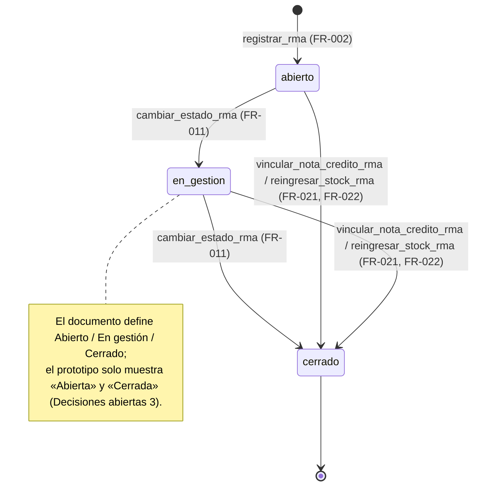
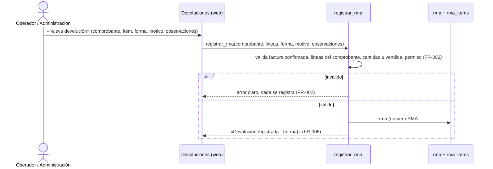

# Feature Specification: Ventas y despacho · Ventas RMA y devoluciones

**Feature Branch**: `epic/MSF-178-ventas-y-despacho-ventas-rma-devolucione`

**Jira Epic**: MSF-178 — Ventas y despacho · Ventas RMA y devoluciones (spec `ventas-rma-devoluciones`)

**Created**: 2026-10-27

**Status**: Ready for implementation — la especificación viene completa desde Jira (Nicolás). Los puntos de «A revisar» no bloquean: cada uno lleva decisión provisoria en *Decisiones abiertas*.

**Delivery scope**: `refine` (apps/web) y `supabase` (migraciones + RPC + pgTAP). Sin `kestra`, `superset` ni `workers` (la nota de crédito y el reingreso de stock son síncronos, no hay trabajo en segundo plano).

**Prioridad / Hito**: P1 · alcance diciembre (manda el roadmap; el documento del componente la ubicaba en Etapa 2) · 24 h (= 3 × talla M) · etiquetas `alcance-diciembre` y `revisar-roadmap`.

**Dependencias**:
- **Bloqueada por MSF-177** (Ventas listado, estados y anulación): comprobantes vendidos para validar cantidades (F-VTA-28) y nota de crédito `emitir_nota_credito` (F-VTA-11, usada por F-VTA-30). **Estado verificado (rama `epic/MSF-177-…`, mergeada en `main`**: merge #343):** existen `dominio.comprobantes_venta` (factura/nota de crédito, `empresa_id`, `estado`, `numero`, numeración `private.siguiente_numero_comprobante`) y `dominio.comprobantes_venta_lineas` (producto, cantidad, depósito de salida, orden), `emitir_nota_credito` con `private.devolver_stock_nota_credito` y `listar_comprobantes`. Los nombres exactos de columnas se verifican contra `main` al implementar (no se inventan aquí).
- **Bloqueada por MSF-136** (Stock movimientos): motor `public.registrar_movimiento_stock` para el reingreso (solo lo consume F-VTA-30). **Estado verificado:** `registrar_movimiento_stock(p_producto, p_tipo, p_cantidad, p_motivo, p_nota, p_fecha, p_deposito, p_lote)` existe (con depósito y lote, MSF-292/MSF-131) y el motivo de sistema «Devolución» de `motivos_movimiento`.
- **Bloquea a:** ninguna épica.

**Input**: Epic MSF-178. Objetivo: «Al terminar, cada devolución o reclamo se registra por ítem con su forma de resolución, motivo y seguimiento, y se vincula con la nota de crédito y el stock.»

**Regla de fuentes** (literal de la épica):
1. Comportamiento y datos: mandan los requisitos y escenarios de esta historia.
2. Qué se ve (disposición, textos, estados, popups, flujos): el prototipo validado es referencia visual, no hace falta que quede extremadamente idéntico; los flujos (si hay) aclaran estados y acciones.
3. Cómo se construye (componentes, estilos y patrones): mandan el template y el system design del producto (MSF-117, `docs/sistema-de-diseno.md`). No copiar el HTML ni el CSS del prototipo.
4. El prototipo muestra más que esta historia: se implementa solo lo que piden los requisitos; otras secciones, botones o diálogos son de otras historias.
5. Si algo no se puede igualar: lo más cercano, sin inventar, anotando la diferencia en el PR.
6. Si prototipo y requisitos se contradicen: requisitos para el comportamiento, prototipo para lo visual, y la contradicción queda anotada en el PR.

Prototipo (solo lectura): `design/pantallas/VentasDevoluciones.dc.html` (inventario en `design/pantallas/VentasDevoluciones.inventory.json`).

## Modelo y supuestos

- **RMA por ítem**: una devolución o reclamo se abre sobre un comprobante **factura confirmada** y sobre uno o más de sus **ítems** (líneas), con su forma de resolución, motivo y observaciones. Cada RMA apunta a un único comprobante; sus ítems referencian líneas de ese comprobante.
- **Formas de RMA (fijas, no son tabla)**: `cambio_directo`, `enviado_a_proveedor`, `faltante_envio`, `reclamo_faltante` y `devolucion_importe` (las cinco del prototipo). Viven como `check` en la base y catálogo único en el frontend; **no** son una tabla editable (las tablas nuevas son solo `rma` y `rma_items`).
- **Estados**: el documento define **Abierto, En gestión y Cerrado**; el prototipo solo muestra «Abierta» y «Cerrada». Manda el documento (comportamiento): tres estados `abierto` → `en_gestion` → `cerrado`, con la etiqueta visible del prototipo («Abierta»/«Cerrada» + «En gestión») (*Decisiones abiertas* 3).
- **Devolución económica y de stock en el lanzamiento**: queda cubierta por la nota de crédito (F-VTA-11) y las líneas negativas; lo que esta épica agrega es **vincular** el RMA a esa nota y al reingreso de stock (F-VTA-30).
- **Seguimiento con proveedor** (cambio directo, enviado a proveedor, reclamos): durante las primeras semanas se lleva en las **observaciones** del RMA (supuesto de la épica); no hay flujo de caso con proveedor en esta épica.
- **Empresa/tienda**: todo RMA pertenece a una sola empresa (la del comprobante); el listado respeta la empresa activa de la barra superior (F-ROL-06, Principio VIII).
- **Permisos**: lectura con la sección `ventas` ≥ `lectura`; el alta y los cambios de estado exigen `ventas` ≥ `edición` en la empresa del RMA (el alta valida el permiso en la RPC, no solo en la UI). No se agregan acciones nuevas a `permisos_rol_accion`.

### Esquema de datos (Constitución, Principio VII)

| Objeto | Esquema | Justificación | RLS / acceso |
|--------|---------|---------------|--------------|
| `rma` (**nueva**, F-VTA-28) | **`dominio`** | Devolución/reclamo de venta: entidad de negocio del producto. | RLS por organización y sección `ventas` (`select` ≥ `lectura`); **sin escritura directa** (solo RPC `security definer`); `anon` sin privilegios. |
| `rma_items` (**nueva**, F-VTA-28) | **`dominio`** | Detalle por ítem de la devolución (línea del comprobante y cantidad). | Igual que `rma`: RLS por organización, `select` con `ventas`, sin escritura directa, `anon` sin acceso. |
| `dominio.comprobantes_venta` / `comprobantes_venta_lineas` (**existentes**, MSF-159/177; sin cambio de estructura) | `dominio` (sin cambio) | Fuente del comprobante y de las líneas que el RMA referencia. | Vigente. `rma.nota_credito_id` (F-VTA-30) referencia la nota de crédito por su `id`; no se altera la tabla de comprobantes. |
| `dominio.movimientos_stock` / `existencias` (**existentes**, MSF-136/292; sin cambio de estructura) | `dominio` (sin cambio) | El reingreso (F-VTA-30) escribe movimientos de `entrada` vía `public.registrar_movimiento_stock`. | Vigente. |
| `public.registro_actividad` (**existente**) | `public` (sin cambio) | Auditoría transversal vía `private.registrar_actividad`; de ahí salen los eventos `rma.*`. | Vigente. |

No se crean otras tablas. `rls_en_toda_tabla` (pgTAP, recorre `public` + `dominio`) debe seguir verde. Todas las migraciones son **aditivas** con reversión en su encabezado; **cada historia trae su propia migración** (timestamps propios, sin encadenarse a las de otra historia).

## Flujos

### Flujo 1 · Ciclo de vida del RMA (máquina de estados)



(Mapa: `abierto`/`en_gestion`/`cerrado` → FR-011, FR-021, FR-022. La resolución que vincula nota o stock cierra el RMA.)

### Flujo 2 · Alta de un RMA (secuencia)



### Flujo 3 · Resolución con nota de crédito y reingreso de stock (proceso)

```mermaid
flowchart TD
  A[RMA abierto o en gestión] --> B{Forma de RMA}
  B -- Devolución de importe --> C[vincular_nota_credito_rma · FR-021]
  C --> D[emitir_nota_credito 'devolucion_importe' reutilizado · FR-021]
  D --> E[rma.nota_credito_id = nota · FR-020]
  B -- Cambio directo / Faltante / Enviado a proveedor / Reclamo --> F[reingresar_stock_rma · FR-022]
  F --> G[registrar_movimiento_stock 'entrada' motivo Devolución · FR-022]
  G --> H[movimientos con nota 'RMA {numero}' · FR-022]
  E --> I[RMA cerrado + evento rma.*]
  H --> I
  I --> J[El listado/detalle muestra el vínculo a la nota y al reingreso · FR-023]
```

(El mapeo forma → mecanismo es una **propuesta a confirmar con el cliente**; *Decisiones abiertas* 6.)

## User Scenarios & Testing *(mandatory)*

### User Story 1 - Alta de RMA por ítem (F-VTA-28, P1, talla M)

Como operador, quiero registrar una devolución o reclamo por ítem sobre un comprobante vendido, para que quede documentada con su forma, motivo y observaciones.

**Why this priority**: es el registro base; sin él no hay devoluciones que seguir ni vincular.

**Independent Test**: con un comprobante confirmado de dos líneas, registro un RMA sobre una de ellas (forma «Cambio directo», motivo y observaciones) y queda el RMA con su número y su ítem; intentar devolver más unidades de las vendidas se rechaza; otra organización no ve ni puede registrar nada.

**Acceptance Scenarios**:
1. **Given** una factura confirmada, **When** se abre «Nueva devolución» y se elige comprobante, ítem, forma, motivo y observaciones, **Then** se registra el RMA con número `RMA-####`, su ítem con la cantidad y el evento de actividad.
2. **Given** una cantidad mayor a la vendida (o a la aún no devuelta) en la línea, **When** se intenta registrar, **Then** se rechaza con mensaje claro y no se crea nada.
3. **Given** un comprobante presupuesto o no confirmado, **When** se intenta registrar un RMA, **Then** se rechaza.
4. **Given** un usuario sin `ventas` (o sin edición en la empresa), **Then** no ve «Nueva devolución» y una llamada directa a la RPC se rechaza.
5. **Given** dos organizaciones, **When** una registra un RMA, **Then** la otra no ve ni afecta esos datos.

### User Story 2 - Formas de resolución y seguimiento (F-VTA-29, P1, talla M)

Como operador, quiero ver las devoluciones con su forma de resolución y seguir su estado (abierto, en gestión, cerrado), para saber en qué punto está cada caso.

**Why this priority**: sin las formas y el estado no hay seguimiento; es la vista que hace operable el RMA.

**Independent Test**: con RMA de varias formas, el listado muestra cada una con su chip y permite filtrar por forma; un RMA pasa Abierto → En gestión → Cerrado con su evento; sin registros de una forma se muestra «Sin devoluciones» / «No hay registros con esa forma de RMA.».

**Acceptance Scenarios**:
1. **Given** RMA de varias formas, **When** se abre Devoluciones, **Then** se listan con las columnas RMA, Tienda, Comprobante, Cliente, Producto, Forma de RMA, Motivo/operador y Estado, cada forma con su chip y tono.
2. **Given** el filtro de forma, **When** se elige «Cambio directo», **Then** solo se ven esos RMA y el contador «N devoluciones» acompaña.
3. **Given** ningún RMA de la forma elegida, **When** se filtra, **Then** aparece «Sin devoluciones» con «No hay registros con esa forma de RMA.».
4. **Given** un RMA abierto, **When** se pasa a En gestión y luego a Cerrado, **Then** el estado cambia y se registra el evento con quién, cuándo y tienda.
5. **Given** un reintento al mismo estado, **Then** no duplica eventos y devuelve el estado actual.

### User Story 3 - RMA con nota de crédito y stock (F-VTA-30, P1, talla M)

Como administración, quiero vincular una devolución a su nota de crédito y al reingreso de stock, para que la devolución económica y de mercadería queden cerradas y trazadas.

**Why this priority**: cierra el ciclo: la devolución deja de ser solo un registro y pasa a tener efecto real sobre el dinero y el stock.

**Independent Test**: un RMA «Devolución de importe» se vincula a una nota de crédito emitida sobre la factura (que resta de lo facturado); un RMA de devolución física reingresa las unidades al depósito con el motivo «Devolución»; el RMA queda cerrado y el listado muestra el vínculo.

**Acceptance Scenarios**:
1. **Given** un RMA «Devolución de importe» sobre una factura, **When** se vincula la nota de crédito, **Then** se emite la nota (reutilizando `emitir_nota_credito`), `rma.nota_credito_id` apunta a la nota y el RMA pasa a Cerrado.
2. **Given** un RMA de devolución física, **When** se reingresa el stock, **Then** se crea una entrada por cada ítem al depósito de origen con el motivo «Devolución» y la nota `RMA {número}`, y el RMA pasa a Cerrado.
3. **Given** un RMA ya cerrado, **When** se intenta vincular o reingresar de nuevo, **Then** se rechaza o es idempotente (no duplica nota ni movimientos).
4. **Given** el listado o detalle, **Then** el RMA muestra el vínculo a la nota de crédito y al reingreso de stock.
5. **Given** un usuario sin permiso de emisión, **When** intenta vincular, **Then** la RPC rechaza (el permiso lo exige `emitir_nota_credito` / `registrar_movimiento_stock`, no solo la UI).

### Edge Cases

- Cambio de empresa activa con el listado o el diálogo abierto: se recarga todo; el diálogo se cierra con aviso o se reencuadra, nunca guarda datos bajo otra empresa (Principio VIII).
- Devolver más de lo vendido o de lo aún no devuelto en la línea → rechazo sin rastro.
- Comprobante presupuesto, borrador o anulado → no admite RMA.
- Dos usuarios registran o resuelven el mismo RMA a la vez → solo uno lo logra; el otro recibe el estado actual (bloqueo de fila).
- RMA con ítem cuyo producto se desactivó después: la referencia se conserva (el RMA no se borra ni se edita la línea de origen).

## Requirements *(mandatory)*

### Functional Requirements

**F-VTA-28 — Alta de RMA por ítem**
- **FR-001**: Tablas `dominio.rma` (id, organizacion_id, empresa_id, comprobante_id, numero, forma_rma, motivo, observaciones, estado, operador_id, creado_en, actualizado_en) y `dominio.rma_items` (id, organizacion_id, rma_id, comprobante_linea_id, producto_id, cantidad, creado_en), con `check` de `forma_rma` (`cambio_directo`, `enviado_a_proveedor`, `faltante_envio`, `reclamo_faltante`, `devolucion_importe`), `check` de `estado` (`abierto`, `en_gestion`, `cerrado`, por defecto `abierto`), FK compuestas a `comprobantes_venta`/`comprobantes_venta_lineas`/`productos`, RLS por organización y sección `ventas` (`select` ≥ `lectura`), **sin escritura directa** y `anon` sin privilegios. **Verificación**: pgTAP `supabase/tests/database/rma_alta.test.sql` (`rls_en_toda_tabla`, `check` de formas/estados, sin escritura directa).
- **FR-002**: `public.registrar_rma(p_comprobante_id uuid, p_lineas jsonb, p_forma_rma text, p_motivo text, p_observaciones text default null) returns dominio.rma` (`security definer`, `ventas` ≥ `edición` en la empresa del comprobante): valida que el comprobante sea **factura confirmada** no anulada, que cada línea pertenezca al comprobante, que la cantidad pedida no exceda lo vendido ni lo aún no devuelto en esa línea, asigna número correlativo `RMA-####` y crea el `rma` + sus `rma_items` + evento `rma.registrada` en una sola transacción; `revoke … from public, anon` y `grant execute … to authenticated`. **Verificación**: pgTAP `supabase/tests/database/rma_alta.test.sql` (cantidad excedida, comprobante inválido, permisos, numeración, aislamiento).
- **FR-003**: Catálogo único de formas y estados en el frontend (`apps/web/src/lib/formasRma.ts` y `estadoRma.ts`): las cinco formas con etiqueta, descripción y tono del prototipo (Cambio directo, Enviado a proveedor, Faltante en envío, Reclamo faltante, Devolución de importe) y los tres estados con etiqueta y tono («Abierta»/«En gestión»/«Cerrada»). **Verificación**: Vitest `apps/web/src/pages/ventas/devoluciones.test.tsx` (etiqueta y tono de cada forma y estado).
- **FR-004**: La pantalla **Devoluciones (RMA)** (`/ventas/devoluciones`) reproduce el prototipo: título «Devoluciones (RMA)», subtítulo «Devoluciones y reclamos por ítem: cambio, envío a proveedor, faltante en envío y devolución de importe.», botón «Nueva devolución», pestañas de Ventas, entrada de menú «Devoluciones» con icono en el grupo Ventas (sección `ventas`) y «Acceso restringido» sin `ventas`. **Verificación**: Vitest `apps/web/src/pages/ventas/devoluciones.test.tsx` y `pnpm prototipo:check` / `pnpm matriz:check`.
- **FR-005**: El diálogo **«Nueva devolución»** pide Comprobante, Ítem, Forma de RMA (cinco opciones con su descripción), Motivo y Observaciones, con **Cancelar** / **Registrar devolución** y el aviso de éxito «Devolución registrada · {forma}»; estados de carga/error con los patrones del kit; botón oculto sin permiso de edición. **Verificación**: Vitest `apps/web/src/pages/ventas/devoluciones.test.tsx` (diálogo, éxito, error, sin permiso).
- **FR-006**: `public.listar_rma(p_busqueda text default null, p_forma_rma text default null, p_estado text default null, p_empresa_id uuid default null, p_pagina integer default 1, p_tamano integer default 10) returns table (...)` (`security invoker`, `ventas` ≥ `lectura`, organización de la sesión, empresas accesibles): columnas id, numero, empresa_id, empresa, comprobante_numero, cliente, producto, cantidad, forma_rma, motivo, operador, estado y `filas` (conteo total); orden estable (fecha de creación descendente, luego número). **Verificación**: pgTAP `supabase/tests/database/rma_alta.test.sql` (columnas, filtros, paginación, aislamiento).
- **FR-007**: El listado muestra las columnas RMA (número + fecha) · Tienda (chip) · Comprobante (enlace al detalle) · Cliente · Producto (con ×cantidad) · Forma de RMA (chip con tono) · Motivo/operador · Estado (chip), paginación «1–8 de N», y el vacío «Sin devoluciones» con «No hay registros con esa forma de RMA.». **Verificación**: Vitest `apps/web/src/pages/ventas/devoluciones.test.tsx` (columnas, paginación, vacío).
- **FR-008**: El filtro **Tienda** usa `FiltroEmpresa` («Todas las tiendas» + una por empresa accesible) con su texto «Por defecto se ven todas; si elegís una empresa en la barra superior, se filtra por esa tienda.»; la empresa activa acota el listado y, al cambiar, se invalidan y recargan las consultas, se reencuadra la paginación y se descarta la selección (Principio VIII). **Verificación**: Vitest `apps/web/src/pages/ventas/devoluciones.test.tsx` (cambio de empresa) y `pnpm ui:empresas:check`.

**F-VTA-29 — Formas de resolución y seguimiento**
- **FR-010**: El filtro **Forma de RMA** (chips «Todas» + las cinco formas) con el contador «N devoluciones» filtra el listado por `forma_rma` (en servidor, vía `listar_rma`). **Verificación**: Vitest `apps/web/src/pages/ventas/devoluciones.test.tsx` (filtro por forma y contador) y pgTAP `rma_alta.test.sql` (filtro `p_forma_rma`).
- **FR-011**: `public.cambiar_estado_rma(p_id uuid, p_estado text, p_actualizado_en timestamptz) returns dominio.rma` (`security definer`, `ventas` ≥ `edición` en la empresa del RMA): valida la transición `abierto → en_gestion → cerrado` (sin saltos), usa bloqueo optimista, es idempotente (mismo estado = devuelve el actual) y registra `rma.estado_cambiado` (desde, hasta, actor, empresa) en la misma transacción. **Verificación**: pgTAP `supabase/tests/database/rma_seguimiento.test.sql` (transición válida/inválida, idempotencia, evento).
- **FR-012**: El listado muestra el chip de estado con su tono y permite avanzar el estado (Abierta → En gestión → Cerrada) a quien edita, con la acción y su error/éxito; el chip deshabilitado cuando la transición no corresponde al estado. **Verificación**: Vitest `apps/web/src/pages/ventas/devoluciones.test.tsx` (chip de estado y avance).

**F-VTA-30 — RMA con nota de crédito y stock**
- **FR-020**: Migración aditiva: `rma.nota_credito_id uuid` (nullable) con FK compuesta a `dominio.comprobantes_venta(id, organizacion_id)`; se agrega sin alterar la estructura existente. **Verificación**: pgTAP `supabase/tests/database/rma_nota_stock.test.sql` (FK y nulidad).
- **FR-021**: `public.vincular_nota_credito_rma(p_rma_id uuid, p_tipo text, p_lineas jsonb, p_concepto text default null) returns dominio.rma` (`security definer`, exige `emitir_nota_credito` de `ventas` en la empresa): emite la nota reutilizando `public.emitir_nota_credito` de F-VTA-11 (`devolucion_importe` / `devolucion_productos`), asigna `rma.nota_credito_id`, cierra el RMA (`cerrado`) y registra `rma.nota_credito_vinculada`; idempotente (no emite dos notas para el mismo RMA). **Verificación**: pgTAP `supabase/tests/database/rma_nota_stock.test.sql` (nota emitida y vinculada, idempotencia, permiso).
- **FR-022**: `public.reingresar_stock_rma(p_rma_id uuid, p_deposito_id uuid default null) returns dominio.rma` (`security definer`, `ventas` ≥ `edición`): crea una **entrada** por cada ítem del RMA al depósito de origen de su línea (o al indicado) reutilizando `public.registrar_movimiento_stock` de MSF-136 con el motivo de sistema «Devolución» y nota `RMA {número}`, cierra el RMA y registra `rma.stock_reingresado`; idempotente (no duplica movimientos). **Verificación**: pgTAP `supabase/tests/database/rma_nota_stock.test.sql` (entradas por depósito, motivo, idempotencia).
- **FR-023**: El listado y el detalle muestran el vínculo: la nota de crédito asociada (número) y el reingreso de stock realizado, para un RMA resuelto; sin duplicar la tarjeta de nota del comprobante (esa es de F-VTA-11). **Verificación**: Vitest `apps/web/src/pages/ventas/devoluciones.test.tsx` (vínculo visible).

### Success Criteria

- **SC-001** *(F-VTA-28)*: pgTAP de `registrar_rma`/`listar_rma`: cantidad excedida, comprobante inválido, numeración correlativa, filtros y paginación, aislamiento por organización/empresa/sección, `anon` sin ejecución; `rls_en_toda_tabla` verde. **Verificación**: `pnpm test:db`.
- **SC-002** *(F-VTA-28)*: Vitest de la pantalla: diálogo «Nueva devolución» (campos, éxito, error, sin permiso), listado con columnas/paginación/vacío, filtro de tienda con empresa activa y cambio de empresa que reencuadra, acceso restringido, teclado y anchos. **Verificación**: `pnpm test:web`.
- **SC-003** *(F-VTA-29)*: pgTAP de `cambiar_estado_rma`: transición válida/inválida, idempotencia, evento, aislamiento; filtro `p_forma_rma`. **Verificación**: `pnpm test:db`.
- **SC-004** *(F-VTA-29)*: Vitest del filtro por forma, contador «N devoluciones», chip y tono de cada forma y estado, y avance de estado. **Verificación**: `pnpm test:web`.
- **SC-005** *(F-VTA-30)*: pgTAP de `vincular_nota_credito_rma`: nota emitida con la firma de F-VTA-11 y vinculada, `nota_credito_id` seteado, idempotencia, permiso, aislamiento. **Verificación**: `pnpm test:db`.
- **SC-006** *(F-VTA-30)*: pgTAP de `reingresar_stock_rma`: entradas por depósito con motivo «Devolución» y nota `RMA {número}`, sin stock negativo, idempotencia. **Verificación**: `pnpm test:db`.
- **SC-007** *(Cierre)*: revisión de seguridad (RLS, `security definer`, permisos de RPC, concurrencia), `docs/ventas-rma-devoluciones.md` e índice, fila del roadmap, `pnpm lint`, `pnpm build`, `pnpm test`, `pnpm infra:config`, `pnpm docs:check`, `pnpm prototipo:check` y `pnpm matriz:check` verdes. **Verificación**: los comandos listados.

## Decisiones abiertas (provisorias; no bloquean)

1. **Hito / horas**: el roadmap ubica «Devoluciones RMA y faltantes con aviso» en diciembre (ola 3, P0, ~23 h) y el documento del componente en Etapa 2 (P1, 24 h). **Manda el roadmap** para el alcance (diciembre); se conservan 24 h (= 3 × M) y las etiquetas `alcance-diciembre` y `revisar-roadmap` hasta que el cliente confirme.
2. **Pantalla «a dibujar»**: el documento la marcaba pendiente, pero el prototipo ya trae `VentasDevoluciones.dc.html`; **manda el prototipo** como referencia visual.
3. **Estados**: el documento define **Abierto / En gestión / Cerrado** y el prototipo muestra «Abierta» / «Cerrada». Manda el documento (comportamiento): tres estados; en pantalla se muestran con las etiquetas del prototipo («Abierta», «En gestión», «Cerrada»). La contradicción se anota en el PR.
4. **Roles**: «Administración» y «Administrador» de los escenarios los extiende el componente Acceso (MSF-125); el template solo trae administrador y miembro. No se agregan roles en esta épica.
5. **Formas de RMA como datos fijos**: no son tabla editable (las tablas nuevas son solo `rma` y `rma_items`); viven como `check` + catálogo frontend. Si más adelante hay que gestionarlas, es una historia nueva.
6. **Mapeo forma → mecanismo de resolución (F-VTA-30)**: «Devolución de importe» → nota de crédito; las formas físicas (cambio directo, faltante en envío, enviado a proveedor, reclamo faltante) → reingreso de stock por el motor de MSF-136. Es una **propuesta a confirmar con el cliente**; cambiarla es ajustar la RPC, no la estructura.
7. **Seguimiento con proveedor**: durante las primeras semanas se lleva en las observaciones del RMA (supuesto de la épica); no hay flujo de caso con proveedor. La UI de resolución (vincular nota / reingresar) **no está en el prototipo** (el prototipo solo muestra el alta y el listado): se agrega como acción del listado/detalle y la diferencia se anota en el PR.
8. **Permisos sin acción nueva**: el alta y los cambios exigen `ventas` ≥ `edición`; la vinculación de nota exige `emitir_nota_credito` (F-VTA-11) y el reingreso pasa por `registrar_movimiento_stock` (MSF-136). No se siembran acciones nuevas en `permisos_rol_accion`.
9. **Nombres de MSF-159/177/136**: columnas de totales, numeración, motor de stock y `registrar_movimiento_stock` se verifican contra `main` al implementar; si difieren, se ajusta la tarea y se anota `Desvío:` con commit.

## Matriz pantalla↔criterios

Prototipo: `VentasDevoluciones.dc.html` (inventario en `design/pantallas/VentasDevoluciones.inventory.json`). Lo que la épica no pide se declara FUERA DE ALCANCE (nota, no tarea).

| Ítem del inventario / visible | Dueño |
|---|---|
| Tabla: RMA, Tienda, Comprobante, Cliente, Producto, Forma de RMA, Motivo / operador, Estado | FR-006, FR-007 |
| Columnas «Forma de RMA» (chip con tono) y «Estado» (chip con tono) | FR-003, FR-012 |
| Campos del diálogo «Nueva devolución»: Comprobante, Ítem, Forma de RMA, Motivo, Observaciones | FR-005 |
| Botón «Nueva devolución» | FR-004, FR-005 |
| Botones «Cancelar» / «Registrar devolución» | FR-005 |
| Pestañas Comprobantes / Presupuestos / Pagos / Faltantes / Devoluciones (RMA) / Transportes y contrarreembolsos | FR-004 (solo la pestaña «Devoluciones (RMA)» activa; el resto son enlaces ya entregados por MSF-159/177/139 o de otras épicas) |
| Pestañas «Pagos» / «Faltantes» / «Transportes y contrarreembolsos» | **FUERA DE ALCANCE** — son de otras épicas (MSF-195 cobros, MSF-135 faltantes/despacho, MSF-139 transportes) |
| Filtro Tienda (píldoras «Todas las tiendas» + empresas) y su texto «Por defecto se ven todas…» | FR-008 |
| Filtro Forma de RMA (chips «Todas» + cinco formas) y contador «N devoluciones» | FR-010 |
| Estado vacío «Sin devoluciones» / «No hay registros con esa forma de RMA.» | FR-007 |
| Paginación «1–8 de N» | FR-007 |
| Snack «Devolución registrada · {forma}» | FR-005 |
| Vínculo a la nota de crédito y al reingreso de stock (no dibujado en el prototipo) | FR-023 (requisito de la épica; se anota en el PR) |
| Acción de cambio de estado (no dibujada en el prototipo) | FR-011, FR-012 (requisito de la épica; se anota en el PR) |
| Empresa activa | FR-008 (test SC-002) |

## Matriz de trazabilidad Jira ↔ US ↔ FR ↔ tareas

| Jira | Historia | US | FR / SC | Tareas |
|------|----------|----|---------|--------|
| MSF-178 (épica) | F-VTA-28 Alta de RMA por ítem | US1 | FR-001…FR-008, SC-001, SC-002 | T001–T010 |
| MSF-178 (épica) | F-VTA-29 Formas de resolución y seguimiento | US2 | FR-010…FR-012, SC-003, SC-004 | T011–T015 |
| MSF-178 (épica) | F-VTA-30 RMA con nota de crédito y stock | US3 | FR-020…FR-023, SC-005, SC-006 | T016–T021 |
| Tarea de cierre (label `cierre`) | Seguridad, documentación, roadmap, validación final | — | SC-007 | T022–T024 |
