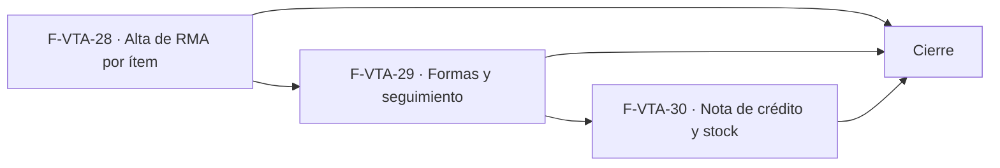

# Tasks: Ventas y despacho · Ventas RMA y devoluciones

**Input**: [spec.md](./spec.md) y [plan.md](./plan.md) · **Épica**: MSF-178
**Formato**: `- [ ] T### [P] [Historia][USx] descripción (FR/SC)`. `[P]` = paralelizable (archivos distintos, sin dependencia dentro del mismo grupo). Cada FR/SC tiene **una sola** tarea dueña. Las dependencias y el orden son **solo dentro de la misma historia**; entre historias rige la tabla *Plan de ejecución* (objetos ya mergeados, nunca una tarea abierta de otra).
**Validación por historia**: `pnpm test:db`, `pnpm lint`, `pnpm build` y `pnpm test:web` verdes antes de cerrar la fase. Cada tabla nueva o alterada: esquema re-verificado (Principio VII). Cada migración lleva su reversión en el encabezado.
**Base**: los objetos de MSF-177 (`comprobantes_venta`, `emitir_nota_credito`, `devolver_stock_nota_credito`) y de MSF-136/292/131 (`registrar_movimiento_stock` con `p_deposito`/`p_lote`, motivo «Devolución») ya están mergeados; sus nombres exactos se verifican antes de usarlos.

## Phase 1: F-VTA-28 · Alta de RMA por ítem

**Goal**: tablas `rma`/`rma_items`, alta por ítem sobre un comprobante vendido (validando cantidades), y la pantalla `/ventas/devoluciones` con su diálogo y listado.

- [ ] T001 [F-VTA-28][US1] Migración `supabase/migrations/20261213100000_rma_tablas.sql`: `dominio.rma` (organización, empresa, comprobante_id, numero, forma_rma, motivo, observaciones, estado, operador_id, timestamps) y `dominio.rma_items` (rma_id, comprobante_linea_id, producto_id, cantidad), `check` de `forma_rma` (cinco valores) y de `estado` (`abierto`/`en_gestion`/`cerrado`, default `abierto`), FK compuestas, RLS por organización y sección `ventas` (`select` ≥ `lectura`), **sin escritura directa**, `anon` sin privilegios, reversión en el encabezado (FR-001)
- [ ] T002 [F-VTA-28][US1] Migración `supabase/migrations/20261213100100_registrar_rma.sql`: `public.registrar_rma(p_comprobante_id, p_lineas, p_forma_rma, p_motivo, p_observaciones)` (`security definer`, `ventas` ≥ `edición` en la empresa, factura confirmada no anulada, líneas del comprobante, cantidad ≤ vendida y no devuelta con bloqueo de fila, número `RMA-####`, evento `rma.registrada`), `revoke … from public, anon` y `grant execute … to authenticated` (FR-002)
- [ ] T003 [P] [F-VTA-28][US1] Migración `supabase/migrations/20261213100200_listar_rma.sql`: `public.listar_rma(p_busqueda, p_forma_rma, p_estado, p_empresa_id, p_pagina, p_tamano)` (`security invoker`, `ventas` ≥ `lectura`, columnas id/numero/empresa/comprobante/cliente/producto/cantidad/forma_rma/motivo/operador/estado/`filas`, orden estable, empresas accesibles), `revoke`/`grant` (FR-006)
- [ ] T004 [P] [F-VTA-28][US1] `apps/web/src/lib/formasRma.ts` y `apps/web/src/lib/estadoRma.ts` (catálogo único de las cinco formas y los tres estados: etiqueta, descripción y tono del prototipo) y `apps/web/src/lib/rma.ts` (envoltorios de `registrar_rma`/`listar_rma` con errores en castellano) (FR-003)
- [ ] T005 [F-VTA-28][US1] pgTAP `supabase/tests/database/rma_alta.test.sql`: cantidad excedida, comprobante presupuesto/borrador/anulado rechazado, numeración correlativa, filtros y paginación, aislamiento por organización/empresa/sección, `anon` sin ejecución; `rls_en_toda_tabla` verde (SC-001)
- [ ] T006 [F-VTA-28][US1] Entrada de menú **Devoluciones** con icono en el grupo Ventas (`destinosPanel.ts`, sección `ventas`) y pantalla `apps/web/src/pages/ventas/devoluciones.tsx`: título «Devoluciones (RMA)», subtítulo, botón «Nueva devolución», pestañas de Ventas y «Acceso restringido» sin `ventas` (FR-004)
- [ ] T007 [F-VTA-28][US1] Diálogo **«Nueva devolución»** en `components/ventas/`: Comprobante, Ítem, Forma de RMA (cinco opciones con descripción), Motivo y Observaciones; botones Cancelar / Registrar devolución; éxito «Devolución registrada · {forma}»; oculto sin permiso (FR-005)
- [ ] T008 [F-VTA-28][US1] Listado en `devoluciones.tsx`: columnas RMA (número + fecha) · Tienda (chip) · Comprobante (enlace) · Cliente · Producto (×cantidad) · Forma de RMA (chip) · Motivo/operador · Estado (chip), paginación «1–8 de N», vacío «Sin devoluciones» / «No hay registros con esa forma de RMA.»; filtro Tienda con `FiltroEmpresa` y empresa activa (Principio VIII) (FR-007, FR-008)
- [ ] T009 [F-VTA-28][US1] Vitest `apps/web/src/pages/ventas/devoluciones.test.tsx`: diálogo (éxito, error, sin permiso), listado (columnas, paginación, vacío), tienda con empresa activa y cambio de empresa que reencuadra, acceso restringido, teclado y anchos (SC-002)

**Checkpoint F-VTA-28**: `pnpm test:db`, `pnpm lint`, `pnpm build` y `pnpm test:web` verdes.

## Phase 2: F-VTA-29 · Formas de resolución y seguimiento

**Goal**: filtro por forma de RMA y ciclo de estado Abierto → En gestión → Cerrado, con su evento y su UI.

- [ ] T010 [F-VTA-29][US2] Migración `supabase/migrations/20261213110000_cambiar_estado_rma.sql`: `public.cambiar_estado_rma(p_id, p_estado, p_actualizado_en)` (`security definer`, `ventas` ≥ `edición` en la empresa del RMA, transición lineal `abierto → en_gestion → cerrado` sin saltos, bloqueo optimista, idempotente, evento `rma.estado_cambiado`), `revoke`/`grant` (FR-011)
- [ ] T011 [F-VTA-29][US2] pgTAP `supabase/tests/database/rma_seguimiento.test.sql`: transición válida/inválida (sin saltos), idempotencia, evento, aislamiento por organización/empresa, `anon`; filtro `p_forma_rma` de `listar_rma`; `rls_en_toda_tabla` verde (SC-003)
- [ ] T012 [F-VTA-29][US2] Filtro **Forma de RMA** (chips «Todas» + cinco formas) y contador «N devoluciones» en `devoluciones.tsx`, con recarga en servidor (FR-010)
- [ ] T013 [F-VTA-29][US2] Chip de estado con tono y acción de avance (Abierta → En gestión → Cerrada) a quien edita, con éxito/error y deshabilitado cuando la transición no corresponde (FR-012)
- [ ] T014 [F-VTA-29][US2] Vitest `apps/web/src/pages/ventas/devoluciones.seguimiento.test.tsx`: filtro por forma y contador, chip y tono de cada forma y estado, avance de estado, teclado (SC-004)

**Checkpoint F-VTA-29**: `pnpm test:db`, `pnpm lint`, `pnpm build` y `pnpm test:web` verdes.

## Phase 3: F-VTA-30 · RMA con nota de crédito y stock

**Goal**: vincular el RMA a la nota de crédito (reutilizando `emitir_nota_credito`) y al reingreso de stock (reutilizando `registrar_movimiento_stock`), con su vínculo visible.

- [ ] T015 [F-VTA-30][US3] Migración `supabase/migrations/20261213120000_rma_nota_credito_id.sql`: `rma.nota_credito_id uuid` (nullable) con FK compuesta a `dominio.comprobantes_venta(id, organizacion_id)`; reversión en el encabezado (FR-020)
- [ ] T016 [F-VTA-30][US3] Migración `supabase/migrations/20261213120100_vincular_nota_credito_rma.sql`: `public.vincular_nota_credito_rma(p_rma_id, p_tipo, p_lineas, p_concepto)` (`security definer`, exige `emitir_nota_credito`, reutiliza `public.emitir_nota_credito`, asigna `nota_credito_id`, cierra el RMA, evento `rma.nota_credito_vinculada`, idempotente), `revoke`/`grant` (FR-021)
- [ ] T017 [P] [F-VTA-30][US3] Migración `supabase/migrations/20261213120200_reingresar_stock_rma.sql`: `public.reingresar_stock_rma(p_rma_id, p_deposito_id)` (`security definer`, `ventas` ≥ `edición`, reutiliza `public.registrar_movimiento_stock` con motivo «Devolución» y nota `RMA {número}`, cierra el RMA, evento `rma.stock_reingresado`, idempotente), `revoke`/`grant` (FR-022)
- [ ] T018 [F-VTA-30][US3] pgTAP `supabase/tests/database/rma_nota_stock.test.sql`: nota emitida y vinculada (`nota_credito_id`), reingreso por depósito con motivo «Devolución» y nota `RMA {n}`, sin stock negativo, idempotencia de ambos, permiso, aislamiento; `rls_en_toda_tabla` verde (SC-005, SC-006)
- [ ] T019 [F-VTA-30][US3] Vínculo visible en `devoluciones.tsx` (nota de crédito asociada y reingreso realizado) y acciones de resolución (vincular nota / reingresar) a quien corresponde (FR-023)
- [ ] T020 [F-VTA-30][US3] Vitest `apps/web/src/pages/ventas/devoluciones.nota.test.tsx`: vínculo visible para un RMA resuelto, acción de resolución con permiso y sin permiso, cambio de empresa (FR-023, soporte de SC-005/SC-006)

**Checkpoint F-VTA-30**: `pnpm test:db`, `pnpm lint`, `pnpm build` y `pnpm test:web` verdes.

## Phase 4: Cierre (integración, docs, seguridad, roadmap)

**Goal**: trabajo que ninguna historia atiende; lo ejecuta la Tarea de cierre.

- [ ] T021 [CIERRE] Revisión de seguridad del conjunto: `authz-security` sobre RLS y RPC (`security definer`, permisos por empresa, `anon` sin acceso, concurrencia de la nota y el stock), reutilización de `emitir_nota_credito` y `registrar_movimiento_stock` sin saltarse sus permisos; hallazgos resueltos o trazados (soporte de SC-007)
- [ ] T022 [CIERRE] `docs/ventas-rma-devoluciones.md` (alta por ítem, formas y estados, nota de crédito y reingreso, reversión), índice en `docs/README.md` y fila de Ventas RMA y devoluciones en `docs/roadmap-template.md`; `pnpm docs:check` (soporte de SC-007)
- [ ] T023 [CIERRE] Validación final: `pnpm lint`, `pnpm build`, `pnpm test`, `pnpm infra:config`, `pnpm docs:check`, `pnpm prototipo:check` y `pnpm matriz:check` (SC-007)

## Plan de ejecución (historias)

El **orden de toma** lo declara esta tabla: el orquestador la **consume**. Una historia arranca cuando sus dependencias están **Finalizadas (mergeadas)**; las del **mismo** `Grupo` van **en paralelo**. F-VTA-28 va primero porque crea las tablas y la pantalla que F-VTA-29 (filtro y estado) y F-VTA-30 (vínculo) reutilizan. F-VTA-30 va después de F-VTA-29 (comparte `devoluciones.tsx` y cierra el estado que F-VTA-29 define).

| Historia | Depende de | Grupo |
|----------|------------|-------|
| F-VTA-28 | — | 1 |
| F-VTA-29 | F-VTA-28 | 2 |
| F-VTA-30 | F-VTA-29 | 3 |
| [Cierre] | F-VTA-28, F-VTA-29, F-VTA-30 | 4 |

## Verificación por requisito (FR → prueba o comando)

No reasigna dueños: cada FR conserva su tarea dueña de la matriz anterior; esta tabla nombra con qué se verifica. Las SC se verifican con su propia tarea de pruebas (T005, T009, T011, T014, T018, T020, T023).

| Requisito | Verificación |
|---|---|
| FR-001 | pgTAP `supabase/tests/database/rma_alta.test.sql` (`rls_en_toda_tabla`, `check` de formas/estados, sin escritura directa) |
| FR-002 | pgTAP `supabase/tests/database/rma_alta.test.sql` (cantidad excedida, comprobante inválido, permisos, numeración, aislamiento) |
| FR-003 | Vitest `apps/web/src/pages/ventas/devoluciones.test.tsx` (etiqueta y tono de cada forma y estado) |
| FR-004 | Vitest `apps/web/src/pages/ventas/devoluciones.test.tsx` y `pnpm prototipo:check` / `pnpm matriz:check` |
| FR-005 | Vitest `apps/web/src/pages/ventas/devoluciones.test.tsx` (diálogo, éxito, error, sin permiso) |
| FR-006 | pgTAP `supabase/tests/database/rma_alta.test.sql` (columnas, filtros, paginación, aislamiento) |
| FR-007 | Vitest `apps/web/src/pages/ventas/devoluciones.test.tsx` (columnas, paginación, vacío) |
| FR-008 | Vitest `apps/web/src/pages/ventas/devoluciones.test.tsx` (cambio de empresa) y `pnpm ui:empresas:check` |
| FR-010 | Vitest `apps/web/src/pages/ventas/devoluciones.seguimiento.test.tsx` (filtro y contador) y pgTAP `rma_alta.test.sql` (`p_forma_rma`) |
| FR-011 | pgTAP `supabase/tests/database/rma_seguimiento.test.sql` (transición válida/inválida, idempotencia, evento) |
| FR-012 | Vitest `apps/web/src/pages/ventas/devoluciones.seguimiento.test.tsx` (chip de estado y avance) |
| FR-020 | pgTAP `supabase/tests/database/rma_nota_stock.test.sql` (FK y nulidad) |
| FR-021 | pgTAP `supabase/tests/database/rma_nota_stock.test.sql` (nota emitida y vinculada, idempotencia, permiso) |
| FR-022 | pgTAP `supabase/tests/database/rma_nota_stock.test.sql` (entradas por depósito, motivo, idempotencia) |
| FR-023 | Vitest `apps/web/src/pages/ventas/devoluciones.nota.test.tsx` (vínculo visible) |

## Matriz de trazabilidad (FR/SC → tarea dueña)

| Historia | Requisito → tarea |
|----------|-------------------|
| F-VTA-28 | FR-001→T001 · FR-002→T002 · FR-006→T003 · FR-003→T004 · SC-001→T005 · FR-004→T006 · FR-005→T007 · FR-007/008→T008 · SC-002→T009 |
| F-VTA-29 | FR-011→T010 · SC-003→T011 · FR-010→T012 · FR-012→T013 · SC-004→T014 |
| F-VTA-30 | FR-020→T015 · FR-021→T016 · FR-022→T017 · SC-005/006→T018 · FR-023→T019 · T020 (Vitest de FR-023) |
| Tarea de cierre (label `cierre`) | SC-007→T023 (T021 y T022 soportan SC-007) |
