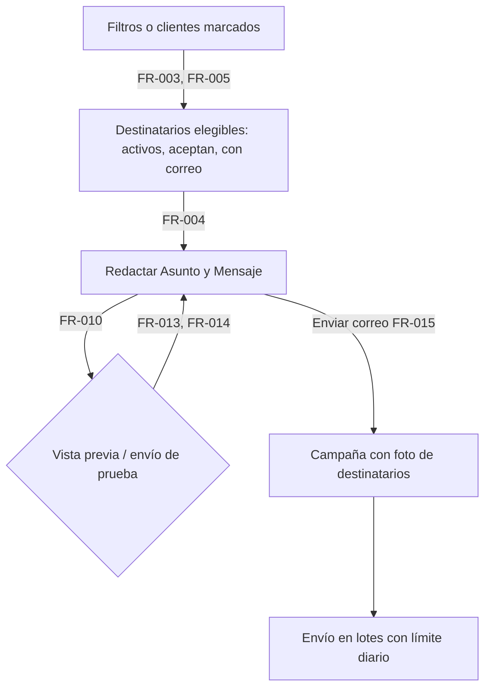
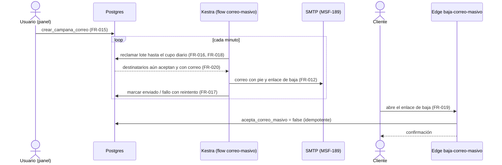
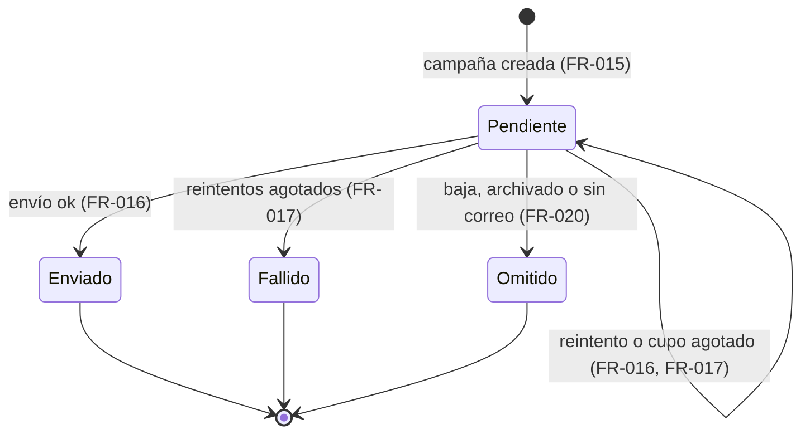
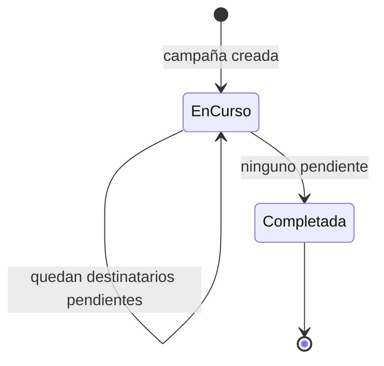

# Feature Specification: Clientes y proveedores · Correo masivo a clientes

**Épica**: MSF-155 · **Spec**: `correo-masivo-a-clientes` · **Hito**: Etapa 2 (desde enero de 2027) · **Prioridad**: P1 · **Horas aprox.**: 28 (tallas 28 h; antes 24) · **Alcance (épica)**: etapa2
**Alcance de entrega**: `refine`, `supabase` y `kestra` (sin `superset` ni `workers`: el envío es un flow de Kestra con el SMTP genérico, igual que `enviar-avisos` y `comprobantes-correo`; ver `plan.md`).
**Fuente**: especificación de Nicolás cargada en la épica (Jira) y el prototipo (`design/pantallas/Clientes.dc.html`, `ClienteFicha.dc.html`). Esta spec **traduce**; no agrega alcance. Lo que la épica deja abierto está en *Decisiones abiertas*, con el valor que se asume.

## Objetivo

Al terminar, el equipo envía un correo a un grupo de clientes elegido por filtros, con baja automática para quien no quiere recibirlo y un historial de lo enviado.

## Regla de fuentes (literal de la épica)

1. Comportamiento y datos: mandan los requisitos y escenarios de esta historia.
2. Qué se ve (disposición, textos, estados, popups, flujos): el prototipo validado es referencia visual, no hace falta que quede extremadamente idéntico; los flujos (si hay) aclaran estados y acciones.
3. Cómo se construye (componentes, estilos y patrones): mandan el template y el system design del producto (épica Plataforma · Sistema de diseño). No copiar el HTML ni el CSS del prototipo.
4. El prototipo muestra más que esta historia: implementar solo lo que piden los requisitos de esta historia.
5. Si algo no se puede igualar con el template / el sistema de diseño: usar lo más cercano, sin inventar, y anotar la diferencia en la descripción del PR.
6. Si el prototipo y los requisitos se contradicen: requisitos para el comportamiento, prototipo para lo visual, y dejar la contradicción anotada en el PR.

## Dependencias

- **Bloqueada por**: MSF-180 (Clientes alta y búsqueda: `public.clientes`, listado, formulario) y MSF-189 (Plataforma · Avisos y listas configurables, F-NOT-01: proveedor de correo). Ambas ya están en el repo (`specs/20261016-130000-clientes-alta-y-busqueda`, `specs/20261024-120000-avisos-y-listas-configurables`).
- **Bloquea a**: ninguna épica.
- **Relacionada (sin bloqueo)**: F-CLI-16 (Clientes inactivos, MSF-171) podrá enviar su lista a una campaña de F-CLI-11. **Esta épica no construye esa entrada** (ver *Fuera de alcance*).
- **Dentro de la épica**: F-CLI-11 bloquea a F-CLI-12 y F-CLI-12 bloquea a F-CLI-13.

## Modelo y supuestos (de la épica)

- El envío **reutiliza el proveedor de correo de los avisos de Plataforma** (MSF-189): Kestra + SMTP genérico (`KESTRA_SMTP_*`) y el patrón de outbox durable. El template solo trae correos de Supabase Auth; **no** hay correo transaccional de negocio ni campañas: se construye aquí.
- Se envía **en lotes con límite diario**.
- **Solo** se envía a clientes con `acepta_correo_masivo`.
- Es P1: el panel actual lo tiene, pero hay alternativas externas y no frena el lanzamiento.
- Ya existe en el repo (verificado en `graphify-out` y en `supabase/migrations`): `public.clientes` (sin columna de aceptación), `public.buscar_clientes`, `private.nivel_seccion`, `private.organizacion_id`, `private.puede_escribir`, `private.reclamar_despachos_capacidad` (outbox), el rol `kestra_orquestacion`, las Edge Functions de patrón público (`recuperar-clave-cliente`) y el flow `comprobantes-correo` (envío a clientes). **No existe todavía**: `acepta_correo_masivo`, ninguna tabla de campañas ni destinatarios, ninguna ruta de baja. Se proponen en las migraciones del plan; ninguna se asume.

### Esquema de datos (Constitución, Principio VII)

| Objeto | Esquema | Historia | Justificación | RLS / acceso |
|---|---|---|---|---|
| `clientes.acepta_correo_masivo` (**columna nueva**, `boolean not null default false`) | `public` | F-CLI-11 | `public.clientes` es preexistente y está en `public` por excepción documentada (`docs/clientes.md`); mover la tabla no es aditivo. Solo se agrega una columna. | RLS vigente de `clientes` (organización + sección `clientes`); sin política nueva |
| `campanas_correo` (**nueva**) | `dominio` | F-CLI-12 | Campaña de correo a clientes: entidad de negocio de Clientes (asunto, mensaje, filtros, estado, quién y cuándo). | `organizacion_id = (select private.organizacion_id())`; select con `private.nivel_seccion('clientes')` ≥ lectura; **sin** insert/update/delete para `authenticated` (solo RPC `security definer` y el rol de Kestra); `anon` sin privilegios |
| `campana_correo_destinatarios` (**nueva**) | `dominio` | F-CLI-12 | Foto de cada destinatario de una campaña: cliente, correo usado, estado, error útil, hash del token de baja. | Igual que `campanas_correo`; el hash del token no se expone por la API (columna sin `grant select`) |

Migraciones **aditivas**, cada historia trae la suya con su reversión en el encabezado. Se re-verifica el esquema de cada tabla en spec, plan, tareas, implementación y PR (Principio VII). El pgTAP de aislamiento recorre `public` + `dominio`.

## User Scenarios & Testing *(mandatory)*

### US1 — F-CLI-11 · Destinatarios del correo masivo (P1, talla M)

El equipo marca qué clientes aceptan el correo masivo y arma, por filtros, el grupo al que va a escribir.

**Independent Test**: marcar clientes con y sin la casilla, filtrar por tipo y empresa, y ver que la lista y el conteo solo incluyen a quienes aceptan y tienen correo.

**Acceptance Scenarios**:

1. **Given** el alta o la edición de un cliente, **When** se abre el formulario, **Then** aparece el interruptor «Incluir en el correo masivo» (encendido por defecto en el alta, como en el prototipo) y se guarda con el cliente; **And** la ficha lo muestra en el bloque «Comunicaciones».
2. **Given** la pantalla «Correo masivo», **When** se elige un tipo, una empresa, «con cuenta web» o un texto de búsqueda, **Then** la lista de destinatarios y su conteo se recalculan con esos filtros.
3. **Given** clientes sin correo, sin aceptación o archivados, **When** se arma la lista, **Then** no aparecen como destinatarios y el resumen dice cuántos quedaron afuera y por qué (sin correo / no aceptan).
4. **Given** el listado de Clientes con casillas marcadas, **When** se pulsa «Enviar correo a seleccionados (N)», **Then** se abre el diálogo del prototipo con esos N; **And** sin selección el botón avisa «Elegí al menos un cliente con las casillas».
5. **Given** un usuario con acceso de solo lectura a Clientes, **When** entra, **Then** no puede armar ni enviar; la base rechaza la escritura.
6. **Given** el usuario cambia la empresa de la barra superior, **When** la pantalla estaba armada, **Then** recarga destinatarios y conteo, descarta la selección que ya no existe y nunca muestra clientes de la empresa anterior.

### US2 — F-CLI-12 · Redactar y enviar el correo masivo con baja (P1, talla L)

Se redacta asunto y mensaje, se ve cómo queda, se prueba, y se envía en lotes; cada correo lleva un enlace para no recibir más.

**Independent Test**: enviar una campaña a un grupo con más destinatarios que el límite diario; el primer día salen los del límite, el siguiente el resto; uno se da de baja desde el correo y deja de recibir.

**Acceptance Scenarios**:

1. **Given** destinatarios armados, **When** se redactan Asunto y Mensaje (obligatorios), **Then** se habilita «Enviar correo»; vacíos se rechazan con mensaje claro.
2. **Given** un borrador, **When** se pide la vista previa, **Then** se ve el correo tal como sale, con pie y enlace de baja de ejemplo.
3. **Given** un borrador, **When** se pide el envío de prueba, **Then** llega un correo al usuario que redacta, con el mismo formato; no crea campaña ni toca a los clientes.
4. **Given** un grupo, **When** se confirma «Enviar correo», **Then** se crea **una** campaña con la foto de sus destinatarios, se confirma en pantalla («Correo enviado a N clientes» del prototipo, ajustado a «en curso» si hay lotes pendientes) y se manda a historial; un doble clic no crea dos campañas.
5. **Given** más destinatarios que el límite diario, **When** se agota el cupo del día, **Then** la campaña queda **en curso** y continúa al día siguiente sin perder ni repetir a nadie.
6. **Given** un fallo del servicio de correo, **When** se intenta enviar a un destinatario, **Then** se reintenta con espera creciente sin duplicar lo ya enviado; agotados los reintentos queda **fallido** con un motivo corto.
7. **Given** un correo recibido, **When** el cliente abre el enlace de baja, **Then** ve una confirmación y `acepta_correo_masivo` pasa a falso; repetirlo es inocuo; un enlace inválido muestra un mensaje genérico.
8. **Given** una campaña en curso, **When** un destinatario pendiente se da de baja (o pierde el correo), **Then** no se le envía y queda **omitido**.

### US3 — F-CLI-13 · Historial de campañas de correo (P1, talla S)

El equipo ve qué se envió, a cuántos y con qué resultado.

**Independent Test**: tras dos campañas, el historial las lista con sus totales; el detalle muestra el contenido y el estado de cada destinatario.

**Acceptance Scenarios**:

1. **Given** campañas enviadas, **When** se abre «Historial», **Then** se listan de la más reciente a la más antigua con fecha, asunto, quién la envió, estado y totales (destinatarios, enviados, fallidos, omitidos, bajas).
2. **Given** una campaña, **When** se abre su detalle, **Then** se ve el asunto y el mensaje enviados y cada destinatario (cliente, correo usado, estado, error corto).
3. **Given** una campaña en curso, **When** se mira el historial, **Then** muestra el progreso y se actualiza al recargar.
4. **Given** un usuario con acceso de solo lectura a Clientes, **When** entra al historial, **Then** lo ve pero no puede reenviar ni editar.
5. **Given** el cambio de empresa de la barra superior, **When** el historial está abierto, **Then** se reencuadra a la nueva empresa.

### Casos límite

- Cliente que cambia de correo después de armar la campaña: se usa el correo guardado en la foto; si ahora no tiene correo o dejó de aceptar al momento del envío, se omite.
- Dos personas envían la misma campaña casi a la vez: cada una crea la suya; la clave de idempotencia evita solo el doble clic de la misma.
- Cliente archivado después de armada la campaña: se omite.
- Kestra se reinicia a mitad de un lote: el reclamo vence y vuelve disponible; la marca de enviado es idempotente (entrega «al menos una vez», como `comprobantes-correo`; una repetición excepcional se documenta).
- Dos organizaciones: ninguna ve, envía ni da de baja a clientes de otra; el token de baja identifica un solo destinatario.
- Destinatarios duplicados (mismo correo en dos clientes): cada cliente es un destinatario; se recibe un correo por cliente.

## Requirements *(mandatory)*

### F-CLI-11 · Destinatarios del correo masivo

- **FR-001**: Se agrega `public.clientes.acepta_correo_masivo` (`boolean not null default false`): los clientes existentes quedan sin aceptación hasta que se los marque.
- **FR-002**: El formulario compartido de cliente (alta y edición) y el bloque «Comunicaciones» de la ficha ofrecen el interruptor «Incluir en el correo masivo»; en el alta nace encendido (prototipo).
- **FR-003**: La pantalla «Correo masivo» arma el grupo con los **mismos filtros del listado de Clientes** (búsqueda, tipo, empresa con `FiltroEmpresa`, «con cuenta web») y muestra la lista paginada de destinatarios con su conteo.
- **FR-004**: Son destinatarios elegibles solo los clientes **activos (no archivados), con `acepta_correo_masivo` y con correo válido**; el resumen informa cuántos quedan fuera por «sin correo» y por «no aceptan».
- **FR-005**: En el listado de Clientes, «Enviar correo a seleccionados (N)» abre el diálogo con los N marcados; sin selección avisa «Elegí al menos un cliente con las casillas». Quienes no sean elegibles se excluyen igual que en FR-004.
- **FR-006**: Armar destinatarios exige acceso de edición a la sección `clientes`; la lectura/listado respeta RLS por organización (la UI oculta, la base manda).
- **FR-007**: Empresa activa (Principio VIII): la pantalla y el diálogo respetan la empresa de la barra superior («Todas mis empresas» incluida), recargan todas sus consultas al cambiarla, descartan la selección que ya no existe y cierran o reabren acotado el diálogo abierto.

### F-CLI-12 · Redactar y enviar el correo masivo con baja

- **FR-010**: La redacción tiene Asunto y Mensaje, ambos obligatorios, con un largo máximo definido en `plan.md`; el mensaje es texto (sin HTML libre).
- **FR-011**: El diálogo del listado reproduce el prototipo: título «Enviar correo a seleccionados», texto «Se envía a los N clientes marcados en el listado. Solo reciben el correo quienes tienen un mail cargado» (ampliado con «y aceptan el correo masivo»), campos Asunto y Mensaje, botones «Cancelar» y «Enviar correo».
- **FR-012**: Cada correo lleva automáticamente un pie con un **enlace de baja único por destinatario**, que no se puede quitar ni editar.
- **FR-013**: La **vista previa** muestra el correo final con el pie y un enlace de baja de ejemplo.
- **FR-014**: El **envío de prueba** manda el correo al usuario que redacta; no crea campaña ni cuenta contra el límite diario.
- **FR-015**: «Enviar correo» crea **una** campaña con la foto de los destinatarios elegibles (cliente y correo usado); es idempotente ante el doble clic y se rechaza si no hay ningún destinatario elegible.
- **FR-016**: El envío es **en lotes con límite diario** por organización: al agotarse el cupo la campaña queda «en curso» y retoma el día siguiente sin repetir ni perder destinatarios.
- **FR-017**: Un fallo de envío se reintenta con espera creciente; agotados los reintentos el destinatario queda «fallido» con un motivo corto y sanitizado (nunca el detalle del SMTP).
- **FR-018**: Ningún destinatario recibe dos veces el correo de una misma campaña: el reclamo con vencimiento y la marca de enviado son idempotentes.
- **FR-019**: La **baja automática**: el enlace abre una página pública de confirmación que pone `acepta_correo_masivo = false`; es idempotente y no revela si el token existe (mensaje genérico ante token inválido). Se resuelve por una Edge Function; `anon` no ejecuta RPC nuevas.
- **FR-020**: Antes de enviar cada correo se re-verifica que el cliente siga activo, acepte el correo masivo y tenga correo; si no, queda «omitido».
- **FR-021**: El envío usa el SMTP de Kestra de MSF-189 (sin proveedor nuevo); la clave de servicio vive solo en Kestra/Edge Functions, nunca en el navegador.
- **FR-022**: Crear una campaña y cada baja registran actividad (`campana_correo.crear`, `campana_correo.baja`) sin cuerpo del mensaje ni correos en el detalle.

### F-CLI-13 · Historial de campañas de correo

- **FR-030**: «Historial» lista las campañas de la empresa activa, paginadas y de la más reciente a la más antigua, con fecha, asunto, autor, estado y totales (destinatarios, enviados, fallidos, omitidos, bajas).
- **FR-031**: El detalle de campaña muestra el asunto y el mensaje enviados y la lista de destinatarios con cliente, correo usado, estado y error corto.
- **FR-032**: El estado de la campaña (`en_curso`, `completada`) se deriva de sus destinatarios y se ve en el historial (ver *Flujos*).
- **FR-033**: Las bajas se atribuyen a la campaña cuyo enlace se usó y se cuentan en su detalle.
- **FR-034**: El historial es de solo lectura para quien tiene acceso `lectura` o más a `clientes`; no hay editar, borrar ni reenviar.
- **FR-035**: Patrones compartidos de carga, vacío («Todavía no se envió ninguna campaña»), error y éxito; teclado, lector de pantalla y 320/768/1440 px; sin identificadores técnicos como identidad visible.
- **FR-036**: Empresa activa (Principio VIII): el historial y el detalle se reencuadran al cambiar de empresa, sin mostrar filas ni totales de la anterior.

### Navegación (Principio VI)

«Correo masivo» es una entrada del menú **Clientes** (ícono de sobre) con las pestañas «Nueva campaña» y «Historial». Rutas: `/clientes/correo-masivo`, `/clientes/correo-masivo/historial`, `/clientes/correo-masivo/historial/:id`. La baja es una ruta **pública** fuera del panel: `/baja-correo/:token`. Audiencia: roles con acceso a `clientes` (edición para enviar, lectura para el historial). El contexto de empresa es el de la barra superior.

## Matriz pantalla↔criterios

Ítems tomados de `design/pantallas/Clientes.inventory.json` y `design/pantallas/ClienteFicha.inventory.json` (`pnpm prototipo:inventario`). **FUERA DE ALCANCE** = lo que la épica no pide: no es deuda ni divergencia (otras épicas lo cubren).

### Listado y formulario de cliente (`Clientes.dc.html`)

| Ítem | Dueño | Criterio / nota |
|---|---|---|
| Diálogo «Enviar correo a seleccionados» (título, texto «Se envía a los N clientes marcados…») | F-CLI-12 | FR-011 |
| Campos «Asunto» y «Mensaje» | F-CLI-12 | FR-010, FR-011 |
| Botones «Cancelar» y «Enviar correo» | F-CLI-12 | FR-011, FR-015 |
| Acción «Enviar correo a seleccionados (N)» y casillas de selección del listado | F-CLI-11 | FR-005 |
| Casilla «Incluir en el correo masivo» (formulario de alta y edición) | F-CLI-11 | FR-001, FR-002 |
| Empresa activa («Si elegís una empresa en la barra superior, se filtra por esa tienda») | F-CLI-11 | FR-007 (listado y diálogo); F-CLI-13 FR-036 (historial). Test que cambia de empresa en ambas |
| Pantalla «Correo masivo» (destinatarios, redacción, vista previa, envío de prueba), enlace de baja y página de baja | F-CLI-11 / F-CLI-12 | **No dibujadas en el prototipo** (lo dice la épica): FR-003, FR-004, FR-013, FR-014, FR-012, FR-019; se resuelven con componentes del sistema de diseño y se anota en el PR |
| Pantalla «Historial» de campañas | F-CLI-13 | **No dibujada**: FR-030…FR-036 |
| Columnas selección, Cliente, Tipo, Tiendas, Contacto, Localidad, Expreso preferido, acciones; botones «Ver ficha», «Nuevo cliente», «Guardar cliente» | **Fuera de alcance** | Listado/alta entregados (MSF-180/MSF-237); aquí solo se suma el interruptor (FR-002) |
| Columna «Cuenta web», campos «Habilitado en», «Cuenta web», casilla «Enviar invitación por correo al crear la cuenta» | **Fuera de alcance** | Cuenta web del cliente (MSF-237); el filtro «con cuenta web» se reutiliza (FR-003) |
| Campos Número, DNI / CUIT, Nombre o razón social, Tipo de cliente, Correo, Teléfono, Celular, Dirección, CP, Localidad, Provincia, Expreso preferido | **Fuera de alcance** | Datos del cliente (MSF-180) |
| Botones «Importar», «Descargar plantilla CSV», «Importar 54 clientes» y diálogo «Importar clientes» | **Fuera de alcance** | Importación (MSF-142) |
| Botones «Etiquetas», «Exportar», «Exportar a Excel» | **Fuera de alcance** | Otras historias de Clientes |
| Botón «Eliminar cliente» y su diálogo | **Fuera de alcance** | Ya existe |
| Tabla de ranking (#, Cliente, Tipo, Comprobantes, Facturado, Participación), «Desde», «Hasta», «Aplicar» | **Fuera de alcance** | Ranking de clientes (MSF-126) |
| «Configurar tipos de cliente →» | **Fuera de alcance** | Tipos de cliente (F-CLI-03) |
| Campo de búsqueda («Buscar por nombre, CUIT o número») | F-CLI-11 | FR-003 (mismo filtro de texto) |

### Ficha del cliente (`ClienteFicha.dc.html`)

| Ítem | Dueño | Criterio / nota |
|---|---|---|
| Bloque «Comunicaciones» → «Incluir en el correo masivo» | F-CLI-11 | FR-002 |
| Botones «Guardar cambios», «Clientes» | **Fuera de alcance** | Ya existen (MSF-180) |
| «Configurar tipos de cliente →», «Etiqueta», «Imprimir etiqueta de envío» | **Fuera de alcance** | Tipos / etiquetas: otras historias |
| «Nuevo comprobante» y comprobantes 0003-00001251, 0003-00001230, 0003-00001204, 0003-00001177 | **Fuera de alcance** | Ventas |
| Campos Número, DNI / CUIT, Nombre o razón social, Correo, Teléfono, Celular, Dirección, CP, Localidad, Provincia, Expreso preferido, Correo de acceso | **Fuera de alcance** | Datos del cliente y cuenta web (MSF-180, MSF-237) |

## Fuera de alcance

- **Newsletter por tienda** (`Newsletter.dc.html`: suscriptores y campañas por tienda): distinto, sin historia en esta épica.
- **Entrada desde Clientes inactivos** (F-CLI-16, MSF-171): esa historia podrá enviar su lista; aquí no se construye el enlace.
- Plantillas de correo, HTML libre, adjuntos, programación a una hora, segmentos guardados, reenvío de una campaña, estadísticas de apertura o clics.
- Proveedor de correo nuevo o cambio de remitente: se usa el de MSF-189.
- Cuenta web, ranking, importación, etiquetas y tipos de cliente (ver matriz).

## Decisiones abiertas (no bloquean; se implementa el valor indicado)

1. **Aceptación inicial**: los clientes existentes quedan en `false` (sin consentimiento previo); el alta nuevo nace encendido por el prototipo. *Valor asumido arriba.*
2. **Límite diario y tamaño de lote**: la épica no da números. Se asume **500 correos por organización por día** y **lotes de 50**, configurables por variable de Kestra, a confirmar con el cliente.
3. **Filtros del grupo**: la épica dice «por filtros» sin listarlos. Se reutilizan los del listado (FR-003); sumar otros es otra historia.
4. **Vista previa y envío de prueba**: no están dibujados, pero la épica los nombra entre lo que falta dibujar; se entregan con componentes del sistema de diseño (FR-013, FR-014).
5. **Selección manual del prototipo vs. filtros del documento**: se entregan ambas entradas sobre el mismo flujo (FR-005 y FR-003); si Nicolás solo quiere filtros, se descarta FR-005 y FR-011 queda como diálogo de la pantalla.
6. **Texto del diálogo**: el prototipo dice «Solo reciben el correo quienes tienen un mail cargado»; el requisito agrega «y aceptan el correo masivo». Manda el requisito (regla 6) y se anota en el PR.

## Flujos

La épica describe el proceso en prosa (elegir por filtros → redactar y enviar en lotes con límite diario → baja → historial); se transcribe sin agregar pasos. Los estados de destinatario y campaña se derivan solo de «lotes con límite diario», «baja» y «historial».

### Del grupo al envío (F-CLI-11 · F-CLI-12 · FR-003…FR-005, FR-010…FR-015)

### Envío por lotes y baja (F-CLI-12 · FR-016…FR-020)

### Estado de cada destinatario (F-CLI-12 · FR-016…FR-020)

### Estado de la campaña (F-CLI-13 · FR-032)

## Success Criteria *(mandatory)*

- **SC-001** (F-CLI-11): un grupo armado por filtros contiene solo clientes activos, con aceptación y con correo, y su conteo coincide con la lista.
- **SC-002** (F-CLI-11): al cambiar de empresa nunca se ven clientes ni totales de la anterior (test que cambia de empresa).
- **SC-003** (F-CLI-12): una campaña mayor al límite diario envía el cupo el primer día y el resto al siguiente, sin repetidos ni perdidos.
- **SC-004** (F-CLI-12): quien se da de baja desde el correo no recibe más campañas, incluso la que estaba en curso.
- **SC-005** (F-CLI-13): el historial refleja cada campaña con totales que suman sus destinatarios.
- **SC-006** (cierre): documentación, revisión de seguridad (RLS, token de baja, `anon`), roadmap y gates (`lint`, `build`, `infra:config`, `test`, `prototipo:check`, `matriz:check`, `docs:check`) verdes.

## Verificación por requisito

Cada requisito tiene su tarea dueña (`tasks.md`) y **su propia verificación nombrada**; los archivos de prueba los crea la tarea dueña. `pnpm test:kestra:correo-masivo` y `pnpm test:edge:baja-correo-masivo` son scripts nuevos de `package.json` (T013 y T014) y se agregan a `pnpm test` / `test:web`.

| Requisito | Tarea | Verificación (test o comando) |
|---|---|---|
| FR-001 | T001 | pgTAP `supabase/tests/database/correo_masivo_destinatarios.test.sql` (columna `boolean not null default false`, existentes en `false`) · `pnpm test:db` |
| FR-002 | T003 | Vitest `apps/web/src/components/clientes/FormularioCliente.correo-masivo.test.tsx` (nace encendido en el alta) y `apps/web/src/pages/clientes/show.test.tsx` (bloque «Comunicaciones») · `pnpm --filter @platform/web test` |
| FR-003 | T004 | Vitest `apps/web/src/pages/clientes/correo-masivo/nueva.test.tsx` (filtros búsqueda/tipo/empresa/cuenta web recalculan lista y conteo) · `pnpm --filter @platform/web test` |
| FR-004 | T001 | pgTAP `supabase/tests/database/correo_masivo_destinatarios.test.sql` (excluye archivados, sin correo, sin aceptación; resumen de excluidos) · `pnpm test:db` |
| FR-005 | T005 | Vitest `apps/web/src/pages/clientes/list.correo-masivo.test.tsx` (acción con N, aviso «Elegí al menos un cliente con las casillas», no elegibles excluidos) · `pnpm --filter @platform/web test` |
| FR-006 | T001 | pgTAP `supabase/tests/database/correo_masivo_destinatarios.test.sql` (solo lectura rechazada por la base, aislamiento por organización) · `pnpm test:db` |
| FR-007 | T006 | Vitest `apps/web/src/pages/clientes/correo-masivo/empresa-activa.test.tsx` (cambia de empresa en pantalla y diálogo: recarga, descarta selección, cierra/reabre acotado) · `pnpm --filter @platform/web test` |
| FR-010 | T015 | Vitest `apps/web/src/pages/clientes/correo-masivo/nueva.test.tsx` (Asunto y Mensaje obligatorios, máximos 200/10 000, sin HTML) · `pnpm --filter @platform/web test` |
| FR-011 | T017 | Vitest `apps/web/src/components/clientes/DialogoCorreoSeleccionados.test.tsx` (título, texto, campos y botones literales) · `pnpm --filter @platform/web test` |
| FR-012 | T013 | `pnpm test:kestra:correo-masivo` (`infra/kestra/flows/correo-masivo.test.mjs`: el cuerpo trae pie con enlace único por destinatario) |
| FR-013 | T016 | Vitest `apps/web/src/pages/clientes/correo-masivo/vista-previa.test.tsx` (correo final con pie y enlace de ejemplo) · `pnpm --filter @platform/web test` |
| FR-014 | T016 | Vitest `vista-previa.test.tsx` (envío de prueba al autor) + pgTAP `supabase/tests/database/correo_masivo_campanas.test.sql` (`solicitar_prueba_correo_masivo` no crea campaña ni cuenta contra el cupo) · `pnpm test:db` |
| FR-015 | T011 | pgTAP `supabase/tests/database/correo_masivo_campanas.test.sql` (`crear_campana_correo`: una campaña, idempotencia por clave, rechazo sin elegibles) · `pnpm test:db` |
| FR-016 | T012 | pgTAP `supabase/tests/database/correo_masivo_lote.test.sql` (cupo diario, retoma al día siguiente) · `pnpm test:db` |
| FR-017 | T013 | `pnpm test:kestra:correo-masivo` (reintentos con espera creciente, fallido con motivo sanitizado sin detalle SMTP) |
| FR-018 | T012 | pgTAP `supabase/tests/database/correo_masivo_lote.test.sql` (reclamo con vencimiento, marca idempotente, sin doble envío) · `pnpm test:db` |
| FR-019 | T014 | `pnpm test:edge:baja-correo-masivo` (`supabase/functions/baja-correo-masivo/handler.test.ts`: baja idempotente, token inválido con mensaje genérico) + Vitest `apps/web/src/pages/baja-correo.test.tsx` |
| FR-020 | T012 | pgTAP `supabase/tests/database/correo_masivo_lote.test.sql` (re-verificación: archivado/sin aceptación/sin correo → `omitido`) · `pnpm test:db` |
| FR-021 | T013 | `pnpm test:kestra:correo-masivo` (usa `KESTRA_SMTP_*`, sin proveedor nuevo) y `pnpm infra:config`; revisión `crypto-secrets` en T041 |
| FR-022 | T012 | pgTAP `supabase/tests/database/correo_masivo_lote.test.sql` (actividad `campana_correo.crear` / `.baja` sin cuerpo ni correos) · `pnpm test:db` |
| FR-030 | T022 | Vitest `apps/web/src/pages/clientes/correo-masivo/historial.test.tsx` (orden, paginación y columnas) · `pnpm --filter @platform/web test` |
| FR-031 | T023 | Vitest `apps/web/src/pages/clientes/correo-masivo/detalle.test.tsx` (asunto, mensaje y destinatarios con estado y error corto) · `pnpm --filter @platform/web test` |
| FR-032 | T020 | pgTAP `supabase/tests/database/correo_masivo_historial.test.sql` (estado derivado `en_curso`/`completada`) · `pnpm test:db` |
| FR-033 | T020 | pgTAP `supabase/tests/database/correo_masivo_historial.test.sql` (baja atribuida a la campaña del enlace) · `pnpm test:db` |
| FR-034 | T020 | pgTAP `supabase/tests/database/correo_masivo_historial.test.sql` (lectura con acceso `lectura`; sin escritura para `authenticated`) · `pnpm test:db` |
| FR-035 | T024 | Vitest `historial.test.tsx` (carga, vacío «Todavía no se envió ninguna campaña», error, éxito, roles ARIA/teclado) y revisión `accessibility-testing` a 320/768/1440 px · `pnpm --filter @platform/web test` |
| FR-036 | T025 | Vitest `apps/web/src/pages/clientes/correo-masivo/historial.empresa-activa.test.tsx` (cambia de empresa: sin filas ni totales de la anterior) · `pnpm --filter @platform/web test` |
| SC-001 | T002 | pgTAP `supabase/tests/database/correo_masivo_destinatarios.test.sql` (el conteo de `resumen_` coincide con `listar_`) · `pnpm test:db` |
| SC-002 | T006 | Vitest `empresa-activa.test.tsx` (mismo test de FR-007: nunca clientes ni totales de la empresa anterior) · `pnpm --filter @platform/web test` |
| SC-003 | T013 | `pnpm test:kestra:correo-masivo` (campaña > cupo: primer día el cupo, al siguiente el resto, sin repetidos) + pgTAP `correo_masivo_lote.test.sql` |
| SC-004 | T014 | `pnpm test:edge:baja-correo-masivo` + pgTAP `correo_masivo_lote.test.sql` (baja de un pendiente de campaña en curso → `omitido`) · `pnpm test:db` |
| SC-005 | T021 | pgTAP `supabase/tests/database/correo_masivo_historial.test.sql` (enviados+fallidos+omitidos+pendientes = destinatarios; aislamiento entre organizaciones) · `pnpm test:db` |
| SC-006 | T043 | `pnpm lint && pnpm build && pnpm infra:config && pnpm test && pnpm prototipo:check && pnpm matriz:check && pnpm docs:check` |
