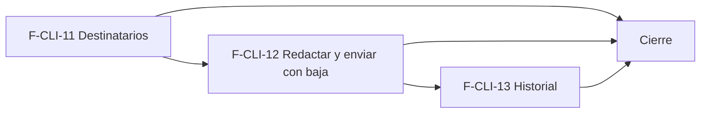

# Tasks: Clientes y proveedores · Correo masivo a clientes

**Input**: `specs/20261028-100000-correo-masivo-a-clientes/` (spec.md, plan.md, contracts/correo-masivo.md)

**Formato**: `- [ ] T### [P] [F-CLI-xx][USy] descripción`. **[P]** = paralelizable (archivos distintos, sin dependencia; las [P] del mismo grupo van en paralelo); sin [P] = secuencial. Las dependencias de cada tarea son solo dentro de su historia. Las tareas `[CIERRE]` van al final y nunca son prerequisito de una historia. Una tarea «soporta FRxx» colabora con la dueña de ese requisito pero **no** lo posee (dueño único).

**Delivery scope**: `refine`, `supabase`, `kestra`

## Matriz de trazabilidad Jira ↔ US ↔ tasks

| Jira | Historia | FR / SC (dueño único) | Tasks |
|------|----------|-----------------------|-------|
| F-CLI-11 (clave Jira: la asigna el orquestador) | US1 Destinatarios del correo masivo | FR-001…FR-007, SC-001, SC-002 | T001–T007 |
| F-CLI-12 | US2 Redactar y enviar el correo masivo con baja | FR-010…FR-022, SC-003, SC-004 | T010–T018 |
| F-CLI-13 | US3 Historial de campañas de correo | FR-030…FR-036, SC-005 | T020–T026 |
| Tarea de cierre (label cierre) | Documentación, seguridad, roadmap y gates | SC-006 | T040–T043 |

### Dueño único por requisito

| Requisito | Tarea dueña | | Requisito | Tarea dueña |
|---|---|---|---|---|
| FR-001, FR-004, FR-006 | T001 | | FR-017, FR-021, FR-012 | T013 |
| SC-001 | T002 | | FR-019, SC-004 | T014 |
| FR-002 | T003 | | FR-010 | T015 |
| FR-003 | T004 | | FR-013, FR-014 | T016 |
| FR-005 | T005 | | FR-011 | T017 |
| FR-007, SC-002 | T006 | | FR-032, FR-033, FR-034 | T020 |
| FR-015 | T011 | | SC-005 | T021 |
| FR-016, FR-018, FR-020, FR-022 | T012 | | FR-030 | T022 |
| SC-003 | T013 | | FR-031 | T023 |
| FR-035 | T024 | | FR-036 | T025 |
| SC-006 | T043 | | | |

---

## Fase 1 — F-CLI-11 · Destinatarios del correo masivo (US1)

- [ ] T001 [F-CLI-11][US1] Migración `20270114100000_clientes_acepta_correo_masivo.sql` (esquema `public`, aditiva, reversión en el encabezado): columna `clientes.acepta_correo_masivo boolean not null default false`; `listar_destinatarios_correo_masivo` y `resumen_destinatarios_correo_masivo` (`security invoker`, filtros del listado, solo activos con aceptación y correo, `revoke … anon` / `grant … authenticated`; escritura exige edición en `clientes`). **FR-001, FR-004, FR-006**.
- [ ] T002 [F-CLI-11][US1] pgTAP: columna y valor por defecto, elegibles (archivados, sin correo, sin aceptación), RLS por organización y sección, `anon` sin ejecución. **SC-001**.
- [ ] T003 [P] [F-CLI-11][US1] Interruptor «Incluir en el correo masivo» en `FormularioCliente` (nace encendido en el alta) y bloque «Comunicaciones» de la ficha (`show.tsx`) + Vitest. **FR-002**.
- [ ] T004 [P] [F-CLI-11][US1] Pantalla «Correo masivo → Nueva campaña» (`pages/clientes/correo-masivo/nueva.tsx`): filtros del listado con `FiltroEmpresa`, lista paginada, conteo y resumen «sin correo / no aceptan»; ruta, entrada de menú con ícono y patrones de carga/vacío/error + Vitest. **FR-003**.
- [ ] T005 [P] [F-CLI-11][US1] Listado de Clientes: acción «Enviar correo a seleccionados (N)» con aviso «Elegí al menos un cliente con las casillas» (el diálogo lo entrega T017) + Vitest. **FR-005**.
- [ ] T006 [F-CLI-11][US1] Empresa activa en la pantalla y en el acceso desde el listado: invalida y recarga consultas, reencuadra paginación y descarta la selección; test que cambia de empresa. **FR-007, SC-002**.
- [ ] T007 [F-CLI-11][US1] Crear `docs/correo-masivo.md` (aceptación, filtros, elegibles, esquema de datos) y la fila de Empresa activa en la matriz.

**Checkpoint**: se puede armar el grupo y ver quién lo recibiría.

---

## Fase 2 — F-CLI-12 · Redactar y enviar el correo masivo con baja (US2)

- [ ] T010 [F-CLI-12][US2] Migración `20270114110000_campanas_correo.sql` (esquema `dominio`): `campanas_correo` y `campana_correo_destinatarios` con RLS por organización y sección, sin escritura para `authenticated`, hash de token sin `grant select`, índices; reversión en el encabezado. Soporta FR-015, FR-018.
- [ ] T011 [F-CLI-12][US2] Migración `20270114110100_campanas_correo_crear.sql`: `crear_campana_correo` (`definer`, idempotente por clave, foto de elegibles, rechaza sin destinatarios) y `solicitar_prueba_correo_masivo`; pgTAP. **FR-015**.
- [ ] T012 [F-CLI-12][US2] Migración `20270114110200_campanas_correo_lote.sql`: `private.reclamar_lote_correo_masivo` (cupo diario, reclamo con vencimiento, re-verificación y `omitido`), `cerrar_envio_correo_masivo`, `dar_de_baja_correo_masivo`, actividad `campana_correo.*` sin datos sensibles, permisos de `kestra_orquestacion`; pgTAP. **FR-016, FR-018, FR-020, FR-022**.
- [ ] T013 [P] [F-CLI-12][US2] Flow `infra/kestra/flows/correo-masivo.yml` + `.test.mjs`: reclamo por lote, correo con pie y enlace de baja único, SMTP de MSF-189, reintentos con espera creciente y motivo sanitizado; variables `CORREO_MASIVO_LOTE` y `CORREO_MASIVO_LIMITE_DIARIO` en `infra/kestra/.env.example`. **FR-012, FR-017, FR-021, SC-003**.
- [ ] T014 [P] [F-CLI-12][US2] Edge Function `supabase/functions/baja-correo-masivo` (hash del token, respuesta uniforme) y página pública `/baja-correo/:token` + Deno test y Vitest. **FR-019, SC-004**.
- [ ] T015 [P] [F-CLI-12][US2] Redacción en «Nueva campaña»: Asunto y Mensaje obligatorios con límites, botón «Enviar correo» (clave de idempotencia, confirmación y paso al historial) + Vitest. **FR-010**.
- [ ] T016 [P] [F-CLI-12][US2] Vista previa y «Enviar prueba» (usa `solicitar_prueba_correo_masivo`) + Vitest. **FR-013, FR-014**. (Tras T015.)
- [ ] T017 [P] [F-CLI-12][US2] Diálogo «Enviar correo a seleccionados» (texto, Asunto, Mensaje, «Cancelar», «Enviar correo») conectado al listado + Vitest. **FR-011**. (Tras T015.)
- [ ] T018 [F-CLI-12][US2] Ampliar `docs/correo-masivo.md` (flow, límite diario, baja, variables, seguridad).

**Checkpoint**: una campaña sale en lotes y la baja funciona.

---

## Fase 3 — F-CLI-13 · Historial de campañas de correo (US3)

- [ ] T020 [F-CLI-13][US3] Migración `20270114120000_campanas_correo_historial.sql` (solo funciones de lectura sobre las tablas de F-CLI-12): `listar_campanas_correo` y `detalle_campana_correo` con estado derivado, bajas por campaña y acceso de lectura. **FR-032, FR-033, FR-034**.
- [ ] T021 [F-CLI-13][US3] pgTAP: totales que suman, aislamiento entre organizaciones y empresas, `anon` sin ejecución. **SC-005**.
- [ ] T022 [P] [F-CLI-13][US3] Pestaña «Historial» (`historial.tsx`): lista paginada con fecha, asunto, autor, estado y totales + Vitest. **FR-030**.
- [ ] T023 [P] [F-CLI-13][US3] Detalle de campaña (`detalle.tsx`): asunto, mensaje y destinatarios con estado y error corto + Vitest. **FR-031**.
- [ ] T024 [F-CLI-13][US3] Patrones de carga, vacío («Todavía no se envió ninguna campaña»), error y éxito; teclado, lector de pantalla y 320/768/1440 px. **FR-035**.
- [ ] T025 [F-CLI-13][US3] Empresa activa en historial y detalle; test que cambia de empresa. **FR-036**.
- [ ] T026 [F-CLI-13][US3] Ampliar `docs/correo-masivo.md` (historial y estados).

**Checkpoint**: lo enviado queda a la vista.

---

## Fase 4 — Cierre (documentación, seguridad, roadmap y gates)

- [ ] T040 [CIERRE] Enlazar `docs/correo-masivo.md` desde `docs/clientes.md` y `docs/avisos-por-correo.md`; actualizar `docs/permisos-por-rol.md` si corresponde.
- [ ] T041 [CIERRE] Revisión de seguridad: `authz-security` (RLS y RPC nuevas, aislamiento entre organizaciones, `anon`), `crypto-secrets` (token de baja, Edge Function, sin service-role en el navegador).
- [ ] T042 [CIERRE] Actualizar la fila de la épica en `docs/roadmap-template.md` (estado, link a la spec, horizonte) al mergear el PR; paso manual con criterio.
- [ ] T043 [CIERRE] Gates finales: `pnpm lint`, `pnpm build`, `pnpm infra:config`, `pnpm test`, `pnpm prototipo:check`, `pnpm matriz:check`, `pnpm docs:check` verdes y evidencia en el PR. **SC-006**.

---

## Plan de ejecución (historias)

| Historia | Depende de | Grupo |
|---|---|---|
| F-CLI-11 | — | 1 |
| F-CLI-12 | F-CLI-11 | 2 |
| F-CLI-13 | F-CLI-12 | 3 |
| [Cierre] | F-CLI-11, F-CLI-12, F-CLI-13 | 4 |

La cadena es real (la épica lo declara): F-CLI-12 usa la aceptación y los destinatarios de F-CLI-11, y F-CLI-13 lee las tablas que crea F-CLI-12; además comparten `docs/correo-masivo.md` y las pantallas de `pages/clientes/correo-masivo/`. No hay historias independientes que paralelizar.

