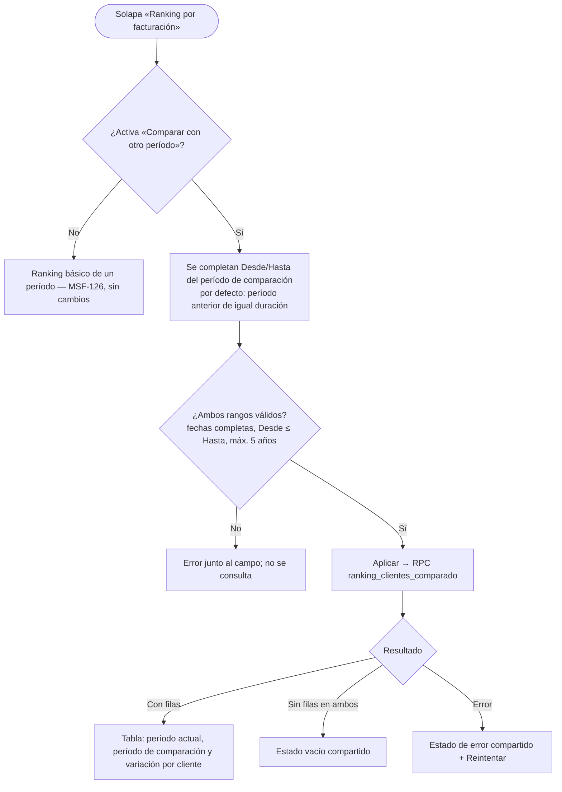
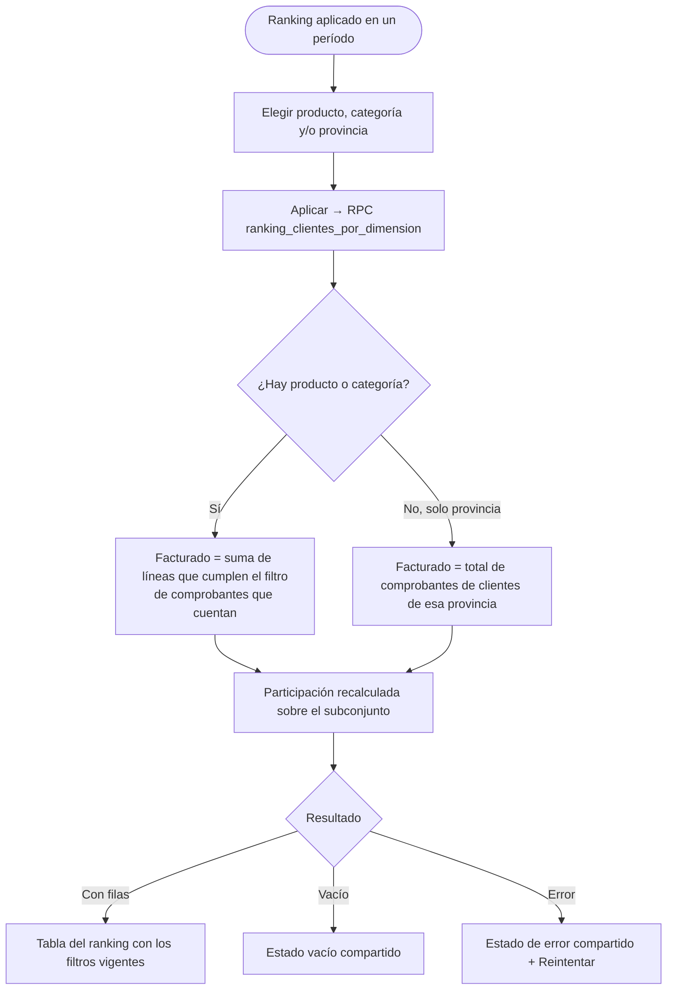
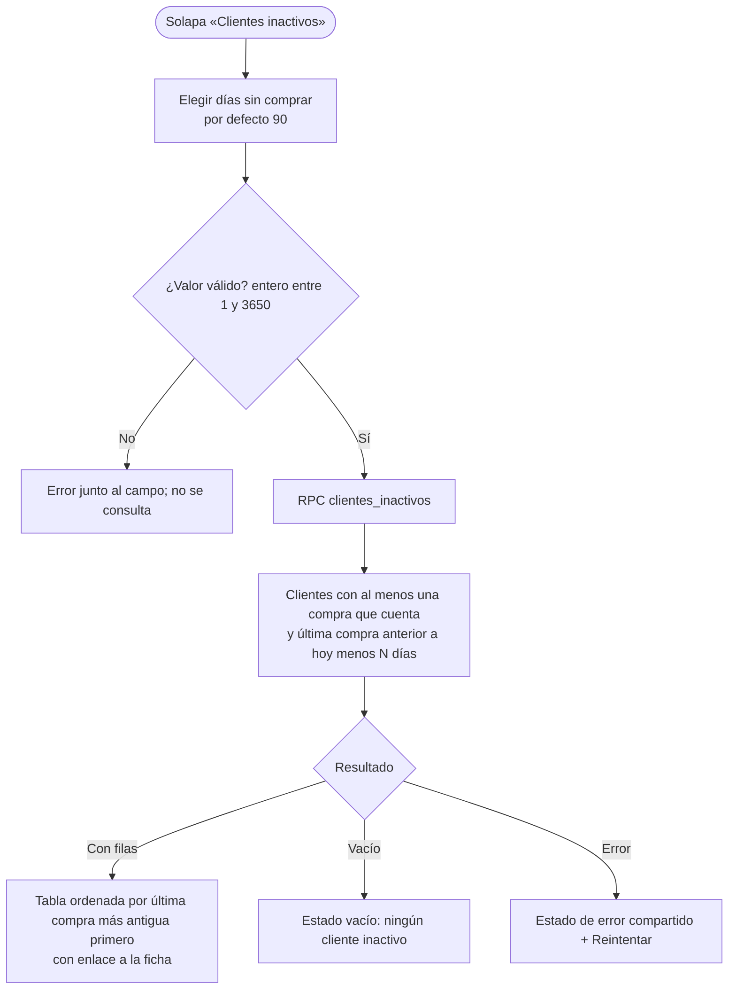

# Feature Specification: Clientes y proveedores · Ranking avanzado de clientes

**Feature Branch**: `epic/MSF-171-clientes-y-proveedores-ranking-avanzado-`

**Jira Epic**: MSF-171 — Clientes y proveedores · Ranking avanzado de clientes (spec `ranking-avanzado-de-clientes`)

**Created**: 2026-10-28

**Status**: Ready for implementation — la especificación viene completa desde Jira. Los puntos de «A revisar» no bloquean: cada uno lleva una decisión provisoria en *Decisiones abiertas*.

**Delivery scope**: `refine` (apps/web) y `supabase` (migraciones + RPC + pgTAP). Sin `kestra`, `superset` ni `workers` (ver *Decisiones abiertas* 1).

**Prioridad / Hito**: P1 · Etapa 2 (desde enero de 2027) · 20 h (tallas 20 h; antes 18) · alcance etapa2.

**Dependencias**:
- Bloqueada por: MSF-126 (Ranking de clientes) — ya en `main` (`public.ranking_clientes`, `RankingClientes.tsx`, `useRankingClientes.ts`, `periodosRanking.ts`, `exportarRanking.ts`, `dominio.comprobantes_venta`).
- Bloquea a: ninguna épica.
- Relacionada, sin bloqueo: rentabilidad (Superset, Etapa 2; la épica no nombra una concreta — ver *Decisiones abiertas* 2) y MSF-155 (correo masivo / campañas: F-CLI-16 puede enviar su lista a una campaña; **no** se construye aquí).
- Dentro de la épica: sin bloqueos funcionales entre las tres historias. F-CLI-14 y F-CLI-15 editan el mismo componente (`RankingClientes.tsx`), por eso el plan de ejecución las pone en grupos consecutivos (conflicto de archivo, no de requisitos).

**Input**: Epic MSF-171. Objetivo: «Al terminar, el administrador compara períodos, filtra el ranking por más dimensiones y detecta clientes que dejaron de comprar.»

**Regla de fuentes** (literal de la épica):
1. Comportamiento y datos: mandan los requisitos y escenarios de esta historia.
2. Qué se ve (disposición, textos, estados, popups, flujos): el prototipo validado es referencia visual, no hace falta que quede extremadamente idéntico; los flujos (si hay) aclaran estados y acciones.
3. Cómo se construye (componentes, estilos y patrones): mandan el template y el sistema de diseño (MSF-117, `docs/sistema-de-diseno.md`). No se copia HTML ni CSS: se reproduce con los componentes del template y los tokens.
4. El prototipo muestra más que esta historia: se implementa solo lo que piden los requisitos de F-CLI-14…16.
5. Si algo no se puede igualar con el template / sistema de diseño: lo más cercano, sin inventar, anotando la diferencia en el PR.
6. Si prototipo y requisitos se contradicen: requisitos para el comportamiento, prototipo para lo visual, y la contradicción queda anotada en el PR.

**Prototipo**: **no hay pantalla dibujada** para «Clientes · ranking avanzado» (comparación de períodos y clientes inactivos): la épica la deja para Etapa 2 y pide implementarla «con los componentes del template, tomando como base el ranking de ranking-de-clientes» (`design/pantallas/Clientes.dc.html`, solapa «Ranking por facturación»). Lo visible nuevo se declara en la matriz como «requisito, sin dibujo».

## Modelo y supuestos

- **Base de cálculo = la del ranking básico (MSF-126)**: mismo predicado `private.comprobante_cuenta_como_facturado(tipo, estado)`, mismo signo de notas de crédito (`private.signo_comprobante`), misma fecha de emisión (extremos inclusivos, zona `America/Argentina/Buenos_Aires`), misma base sin IVA por defecto con opción «Ver con IVA», mismos filtros Tipo de cliente / Consumidor final / tienda (empresa activa). Nada de esto se redefine aquí: las funciones nuevas lo **reutilizan**.
- **No se altera `public.ranking_clientes`** ni su firma (la usan la pantalla y el Excel de MSF-126). Las capacidades nuevas son **funciones nuevas** (ver `contracts/ranking-avanzado-de-clientes.md`); cada historia trae su propia migración aditiva.
- **Consultas propias, sin Superset** (supuesto de la épica: «Superset embebido o consultas propias, según el costo»): el ranking básico ya es una RPC y las tres historias son agregaciones sobre las mismas tablas; Superset añadiría un tablero embebido, un guest token y una vista de lectura por algo que la pantalla de Clientes ya resuelve. Decisión provisoria (*Decisiones abiertas* 1).
- **Esta épica solo lee** los documentos de venta, sus líneas y los clientes; no crea tablas ni columnas (**sin tablas nuevas**, no aplica el esquema de Principio VII salvo lo declarado abajo).
- **Ventas por línea** (F-CLI-15): para producto y categoría, lo facturado de un cliente es la suma de las **líneas** (`dominio.comprobantes_venta_lineas`) de los comprobantes que cuentan, con `subtotal_sin_iva` (o `subtotal_sin_iva + iva` con IVA) y el mismo signo de notas de crédito.

### Esquema de datos (Constitución, Principio VII)

| Objeto | Esquema | Justificación | RLS |
|--------|---------|---------------|-----|
| `public.ranking_clientes_comparado` (**función nueva**, F-CLI-14) | `public` (RPC de aplicación) | Lectura sobre `dominio.comprobantes_venta` y `public.clientes`; sin tablas nuevas. | `security definer`, organización de `private.organizacion_id()`, sección `clientes` en `lectura`/`edicion`. `revoke … from public, anon`, `grant execute … to authenticated`. |
| `public.ranking_clientes_por_dimension` (**función nueva**, F-CLI-15) | `public` (RPC) | Lectura sobre comprobantes, líneas (`dominio`), `dominio.productos`, `dominio.categorias` y `public.clientes`. | Ídem. |
| `public.clientes_inactivos` (**función nueva**, F-CLI-16) | `public` (RPC) | Lectura sobre comprobantes y `public.clientes`. | Ídem. |
| `dominio.comprobantes_venta`, `dominio.comprobantes_venta_lineas`, `dominio.productos`, `dominio.categorias` (existentes) | `dominio` | No se alteran. | Vigente (la RLS exige sección `ventas`; por eso las funciones son `security definer` y verifican `clientes` adentro, como `ranking_clientes`). |
| `public.clientes` (existente) | `public` (excepción ya documentada en MSF-180) | No se altera. | Vigente. |

Migraciones **aditivas** (solo `create function`); reversión de cada una en su encabezado: `drop function public.<nombre>(…)`. La prueba pgTAP `rls_en_toda_tabla` (recorre `public` + `dominio`) debe seguir verde y la que audita `anon` debe ver las tres funciones **sin** ejecución para `anon`.

## Flujos

### Flujo 1 — Comparar el ranking entre dos períodos (F-CLI-14)

### Flujo 2 — Filtrar el ranking por producto, categoría y provincia (F-CLI-15)

### Flujo 3 — Clientes inactivos (F-CLI-16)

> Los flujos no vienen en la épica como imagen ni `.mmd`: se transcriben de las historias previstas y de sus escenarios (sin estados ni pasos inventados). Cada paso tiene dueño en los FR de abajo; el envío de la lista a una campaña (MSF-155) **no** es un paso de esta épica.

## User Scenarios & Testing *(mandatory)*

### User Story 1 - Comparar el ranking entre dos períodos (F-CLI-14, P1, talla M)

Como administrador, quiero comparar el ranking de clientes entre dos períodos, para ver quién creció y quién cayó.

**Why this priority**: es el primer paso del ranking avanzado; usa la misma base que MSF-126.

**Independent Test**: con facturas de tres clientes en dos meses, comparar «Este mes» contra «Mes anterior» muestra, por cliente, lo facturado en cada período y la variación; un cliente que solo compró en uno de los períodos aparece con 0 en el otro.

**Acceptance Scenarios**:

1. **Given** la solapa «Ranking por facturación», **Then** hay una opción **Comparar con otro período**; apagada (por defecto) el ranking se ve y se comporta exactamente como en MSF-126.
2. **Given** la opción activada, **Then** aparecen los campos **Desde** y **Hasta** del período de comparación, precargados con el **período anterior de igual duración** al período aplicado, y la tabla suma, por cliente, las columnas del período de comparación y la **variación** (diferencia en pesos y porcentaje).
3. **Given** un cliente con comprobantes en uno solo de los períodos, **Then** aparece igual, con 0 en el otro; la variación contra una base 0 se muestra como «—» (sin porcentaje), nunca como infinito ni `NaN`.
4. **Given** el criterio de facturación, **Then** ambos períodos usan el mismo predicado, la misma base sin/con IVA, el mismo signo de notas de crédito y los mismos filtros (Tipo, Consumidor final, tienda) que el ranking básico; solo cambian las fechas.
5. **Given** la comparación, **Then** las filas se ordenan por lo facturado en el período aplicado, de mayor a menor (desempate por lo facturado en el período de comparación, luego nombre y número de cliente), con paginación en el servidor (25 por página) que conserva ambos períodos y filtros.
6. **Given** cualquiera de los dos rangos con fecha vacía o inválida, Hasta anterior a Desde o más de 5 años, **Then** se indica el error en el campo y no se consulta.
7. **Given** períodos superpuestos o idénticos, **Then** se permite (la variación es 0 si son idénticos); no es un error.
8. **Given** un rango sin facturación en ninguno de los dos períodos, **Then** estado vacío compartido; un error de consulta muestra el estado de error compartido con «Reintentar»; mientras consulta, el estado de carga compartido.
9. **Given** un cambio de la empresa activa (barra superior), **Then** la comparación se reencuadra a esa tienda (o a todas), recarga sus consultas, vuelve a la página 1 y no muestra filas de la empresa anterior.
10. **Given** una persona con sección Clientes en `ninguno`, **Then** no ve la solapa ni puede llamar a la función; con `lectura` o `edicion` la usa; otra organización no ve filas ajenas; `anon` no ejecuta.
11. **Given** 320, 768 y 1440 px, **Then** la comparación es utilizable (tarjetas en angosto), con teclado y lector de pantalla (errores asociados al campo), sin identificadores técnicos visibles.

---

### User Story 2 - Ranking por producto, categoría y provincia (F-CLI-15, P1, talla M)

Como administrador, quiero filtrar el ranking por producto, categoría y provincia, para saber quién compra qué y dónde.

**Independent Test**: con ventas de dos productos de categorías distintas a clientes de dos provincias, filtrar por un producto lista solo a quienes lo compraron, con lo facturado de ese producto (no el total del comprobante); filtrar por provincia lista solo a los clientes de esa provincia.

**Acceptance Scenarios**:

1. **Given** el ranking aplicado, **Then** hay tres filtros nuevos: **Producto**, **Categoría** y **Provincia**; todos opcionales y combinables entre sí y con Tipo de cliente, Consumidor final, Ver con IVA y tienda.
2. **Given** un filtro de **Producto**, **Then** el ranking solo incluye clientes con líneas de ese producto en comprobantes que cuentan, y **Facturado** es la suma de **esas líneas** (no del comprobante entero), con el mismo signo de notas de crédito y la misma base sin/con IVA.
3. **Given** un filtro de **Categoría**, **Then** cuenta lo facturado en líneas de productos de esa categoría; elegir una categoría **raíz** incluye sus subcategorías (el catálogo tiene máximo 2 niveles). Producto y Categoría combinados se intersecan (el producto debe pertenecer a la categoría; si no, el resultado es vacío).
4. **Given** un filtro de **Provincia**, **Then** el ranking solo incluye clientes cuya provincia coincide (sin distinguir mayúsculas ni tildes); sin producto ni categoría, **Facturado** es el total de sus comprobantes, como en el ranking básico.
5. **Given** cualquiera de los filtros, **Then** **Comprobantes** es la cantidad de facturas distintas que aportaron y **Participación** se calcula sobre el total del ranking filtrado completo (suma 100 %), no sobre la página.
6. **Given** las opciones de los selectores, **Then** Producto se elige con búsqueda sobre el catálogo de la organización, Categoría desde las categorías del catálogo y Provincia desde las provincias presentes en los clientes de la organización; ninguno muestra identificadores técnicos.
7. **Given** una combinación sin resultados, **Then** estado vacío compartido («Sin facturación en el período — Probá con otro rango de fechas o de filtros.»); un error muestra el estado de error compartido con «Reintentar»; mientras consulta, el de carga.
8. **Given** un producto o categoría de otra organización (id manipulado) o inexistente, **Then** la función devuelve vacío o error de validación, nunca filas ajenas.
9. **Given** un cambio de la empresa activa, **Then** los filtros de Producto, Categoría y Provincia se reencuadran (se descarta la selección que ya no existe), se recarga y se vuelve a la página 1.
10. **Given** sección Clientes en `ninguno`, otra organización o `anon`, **Then** mismo aislamiento que F-CLI-14 (también llamando directo a la base).
11. **Given** 320, 768 y 1440 px, **Then** los filtros son utilizables, con teclado y lector de pantalla.

---

### User Story 3 - Clientes inactivos (F-CLI-16, P1, talla S)

Como administrador, quiero ver los clientes que dejaron de comprar, para contactarlos o recuperarlos.

**Independent Test**: con tres clientes cuya última compra fue hace 20, 100 y 400 días, el umbral de 90 días lista a los de 100 y 400, del más antiguo al más reciente; un cliente sin compras nunca aparece.

**Acceptance Scenarios**:

1. **Given** la pantalla Clientes, **Then** hay una solapa **Clientes inactivos** junto a «Listado» y «Ranking por facturación», visible solo con sección Clientes en `lectura` o `edicion`.
2. **Given** la solapa, **Then** hay un campo **Días sin comprar** (por defecto 90) y un botón **Aplicar**; acepta enteros de 1 a 3650 y los atajos 30, 60, 90 y 180 días. Valor vacío o inválido: error junto al campo y no se consulta.
3. **Given** el umbral, **Then** un cliente es **inactivo** si tiene al menos una compra que cuenta (mismo predicado que el ranking) y su **última compra** es anterior a *hoy menos N días* (zona Buenos Aires); un cliente **sin compras** nunca aparece (no «dejó» de comprar) y un cliente **archivado** tampoco.
4. **Given** la tabla, **Then** muestra por cliente **Cliente**, **Tipo**, **Última compra** (fecha), **Días sin comprar**, **Comprobantes** y **Facturado histórico** (sin IVA, neto de notas de crédito), ordenada por última compra más antigua primero (desempate por nombre y número de cliente), paginada en el servidor (25 por página), con enlace a la ficha del cliente.
5. **Given** los filtros **Tipo de cliente**, interruptor **Consumidor final** (excluido por defecto, igual que el ranking) y la tienda de la empresa activa, **Then** acotan la lista como en el ranking básico.
6. **Given** que ninguno cumple, **Then** estado vacío compartido «Ningún cliente dejó de comprar en ese plazo.»; un error muestra el estado de error compartido con «Reintentar»; mientras consulta, el de carga.
7. **Given** un cambio de la empresa activa, **Then** la lista se reencuadra a esa tienda (o a todas), recarga y vuelve a la página 1.
8. **Given** sección Clientes en `ninguno`, otra organización o `anon`, **Then** mismo aislamiento que F-CLI-14 (también llamando directo a la base).
9. **Given** 320, 768 y 1440 px, **Then** la solapa es utilizable (tarjetas en angosto), con teclado y lector de pantalla (`role="tablist"`).

---

### Edge Cases

- **Cliente que compró solo una vez** hace más de N días: aparece como inactivo (tiene una compra que cuenta).
- **Última compra** se calcula sobre comprobantes que cuentan; una nota de crédito no cuenta como «compra» a efectos de la fecha (la nota resta importe, no es una compra) — coherente con que el ranking no cuenta las notas como «comprobantes».
- **Lo facturado histórico neto de notas puede ser ≤ 0**: se muestra tal cual (el neto es el criterio de MSF-177).
- **Comparación con totales netos negativos o 0 en la base**: variación porcentual «—» (sin división por cero).
- **Producto o categoría eliminado/archivado** con ventas históricas: sigue filtrando por su id mientras exista; si ya no existe, el selector no lo ofrece.
- **Doble clic en «Aplicar»**: el botón se deshabilita mientras consulta; las lecturas son idempotentes.
- **Contrato de ventas sin filas**: las tres vistas muestran el vacío y no fallan.
- **Provincia sin cargar** en el cliente: no coincide con ningún filtro de provincia (no se imputa a «otra»).

## Requirements *(mandatory)*

### Functional Requirements

**F-CLI-14 · Comparar entre dos períodos**

- **FR-001** (F-CLI-14): DEBE existir `public.ranking_clientes_comparado(p_desde date, p_hasta date, p_desde_comparacion date, p_hasta_comparacion date, p_tipo text default null, p_incluir_consumidor_final boolean default false, p_con_iva boolean default false, p_pagina integer default 1, p_tamano integer default 25, p_empresa_id uuid default null)` que devuelve, por cliente con facturación en **alguno** de los dos períodos: `posicion`, `cliente_id`, `numero`, `nombre`, `tipo`, `comprobantes`, `facturado`, `comprobantes_comparacion`, `facturado_comparacion`, `variacion` (`facturado − facturado_comparacion`), `variacion_porcentaje` (nulo si la base es 0 o negativa) y `total_filas`; orden y paginación del escenario US1-5, tope de tamaño 1.000. Reutiliza el predicado, el signo de notas y el filtro de tienda del ranking básico. **Verificación**: pgTAP `supabase/tests/database/ranking_clientes_comparado.test.sql` (columnas, universo de ambos períodos, variación, orden, paginación, tope 1.000) — `pnpm test:db` (T002).
- **FR-002** (F-CLI-14): La función DEBE ser `security definer` con `search_path = ''`, tomar la organización de `private.organizacion_id()`, exigir `private.nivel_seccion('clientes')` en `lectura`/`edicion` (error de permiso si no), validar ambos rangos (completos, Desde ≤ Hasta, máx. 5 años), tipo, página y tamaño con los mismos mensajes que `ranking_clientes`, y llevar `revoke … from public, anon` y `grant execute … to authenticated`. **Verificación**: pgTAP `ranking_clientes_comparado.test.sql` (niveles `ninguno`/`lectura`/`edicion`, otra organización, validaciones, `anon` sin ejecución) y auditoría de `anon` en `supabase/tests/database/` — `pnpm test:db` (T002, T021).
- **FR-003** (F-CLI-14): La solapa «Ranking por facturación» DEBE ofrecer la opción **Comparar con otro período** con los campos Desde/Hasta de comparación (precargados con el período anterior de igual duración), las columnas de comparación y variación (pesos y porcentaje, «—» sobre base 0), validación de ambos rangos junto al campo y paginación conservando ambos períodos y filtros; apagada, el ranking básico no cambia (US1-1…7). **Verificación**: Vitest `RankingClientes.test.tsx`, `periodosRanking.test.ts` y `useRankingComparado.test.ts` — `pnpm --filter @platform/web test` (T003, T004, T006).
- **FR-004** (F-CLI-14): La comparación DEBE usar los estados compartidos de vacío, error con «Reintentar» y carga; reencuadrarse al cambiar la empresa activa (invalidar y recargar todas sus consultas, página 1, sin datos de la empresa anterior — Principio VIII); y ser utilizable a 320/768/1440 px con teclado y lector de pantalla (US1-8…11). **Verificación**: Vitest de comparación en `RankingClientes.test.tsx` (vacío, error con «Reintentar», carga, cambio de empresa activa, teclado/roles, 320/768/1440 px) — `pnpm --filter @platform/web test` (T006).

**F-CLI-15 · Ranking por producto, categoría y provincia**

- **FR-005** (F-CLI-15): DEBE existir `public.ranking_clientes_por_dimension(p_desde date, p_hasta date, p_producto_id uuid default null, p_categoria_id uuid default null, p_provincia text default null, p_tipo text default null, p_incluir_consumidor_final boolean default false, p_con_iva boolean default false, p_pagina integer default 1, p_tamano integer default 25, p_empresa_id uuid default null)` con las mismas columnas de salida que `ranking_clientes` (`posicion`, `cliente_id`, `numero`, `nombre`, `tipo`, `comprobantes`, `facturado`, `participacion`, `total_filas`), mismo orden, desempate y paginación. **Verificación**: pgTAP `supabase/tests/database/ranking_clientes_por_dimension.test.sql` (columnas, orden, desempate, paginación) — `pnpm test:db` (T008).
- **FR-006** (F-CLI-15): Con producto o categoría, `facturado` DEBE ser la suma de las **líneas** (`dominio.comprobantes_venta_lineas`) que cumplen el filtro, de comprobantes que cuentan, con `subtotal_sin_iva` (o `subtotal_sin_iva + iva` con IVA) y el signo de notas; la categoría raíz incluye sus subcategorías; producto y categoría se intersecan; `comprobantes` cuenta facturas distintas; `participacion` se calcula en el servidor sobre el conjunto filtrado completo (US2-2…5). **Verificación**: pgTAP `ranking_clientes_por_dimension.test.sql` (suma de líneas, categoría raíz con subcategorías, intersección, participación 100 %) — `pnpm test:db` (T008).
- **FR-007** (F-CLI-15): El filtro de provincia DEBE comparar contra `public.clientes.provincia` sin distinguir mayúsculas ni tildes; sin producto ni categoría el importe es el del comprobante (igual que el ranking básico). Un producto o categoría que no es de la organización devuelve vacío, nunca filas ajenas (US2-4, US2-8). **Verificación**: pgTAP `ranking_clientes_por_dimension.test.sql` (provincia sin mayúsculas ni tildes, producto/categoría de otra organización → vacío) — `pnpm test:db` (T008).
- **FR-008** (F-CLI-15): La función DEBE cumplir la misma seguridad y validación que FR-002 (`security definer`, `search_path = ''`, sección `clientes`, `revoke`/`grant`) y validar que `p_provincia` no supere 100 caracteres. **Verificación**: pgTAP `ranking_clientes_por_dimension.test.sql` (niveles, `anon`, validación de `p_provincia` > 100 caracteres) — `pnpm test:db` (T008, T021).
- **FR-009** (F-CLI-15): La solapa «Ranking por facturación» DEBE ofrecer los filtros **Producto** (búsqueda sobre el catálogo), **Categoría** y **Provincia**, combinables con los existentes, sin identificadores técnicos; usar los estados compartidos de vacío/error/carga; reencuadrarse al cambiar la empresa activa descartando la selección inexistente; y ser utilizable a 320/768/1440 px con teclado y lector de pantalla (US2-1, US2-6, US2-7, US2-9, US2-11). Cuando ningún filtro nuevo está activo, la pantalla sigue llamando a `ranking_clientes` (sin cambios de comportamiento). **Verificación**: Vitest `FiltrosDimension.test.tsx`, `useRankingPorDimension.test.ts`, `useOpcionesDimension.test.ts` y `RankingClientes.test.tsx` — `pnpm --filter @platform/web test` (T009, T010, T012).

**F-CLI-16 · Clientes inactivos**

- **FR-010** (F-CLI-16): DEBE existir `public.clientes_inactivos(p_dias integer default 90, p_tipo text default null, p_incluir_consumidor_final boolean default false, p_pagina integer default 1, p_tamano integer default 25, p_empresa_id uuid default null)` que devuelve `cliente_id`, `numero`, `nombre`, `tipo`, `ultima_compra`, `dias_sin_comprar`, `comprobantes`, `facturado` y `total_filas`, ordenado por `ultima_compra` ascendente, nombre y número; `p_dias` entre 1 y 3650; tope de tamaño 1.000. **Verificación**: pgTAP `supabase/tests/database/clientes_inactivos.test.sql` (columnas, orden, rango de `p_dias`, tope 1.000) — `pnpm test:db` (T014).
- **FR-011** (F-CLI-16): Un cliente DEBE ser inactivo si tiene al menos una **factura** que cuenta (`private.comprobante_cuenta_como_facturado`) y su última factura que cuenta es anterior a *hoy − p_dias* en `America/Argentina/Buenos_Aires`; los clientes sin compras y los archivados NO aparecen; `facturado` es el neto histórico sin IVA (con signo de notas de crédito) (US3-3, US3-4). **Verificación**: pgTAP `clientes_inactivos.test.sql` (umbral 20/100/400 días, sin compras, archivados, nota de crédito, neto histórico) — `pnpm test:db` (T014).
- **FR-012** (F-CLI-16): La función DEBE cumplir la misma seguridad y validación que FR-002 (`security definer`, `search_path = ''`, sección `clientes`, `revoke`/`grant`). **Verificación**: pgTAP `clientes_inactivos.test.sql` (niveles, otra organización, `anon` sin ejecución) — `pnpm test:db` (T014, T021).
- **FR-013** (F-CLI-16): La pantalla Clientes DEBE tener la solapa **Clientes inactivos** (visible con sección `lectura`/`edicion`, carga diferida como la del ranking) con el campo **Días sin comprar** (30/60/90/180 + valor libre, por defecto 90), **Aplicar**, filtros Tipo y Consumidor final, la tabla de US3-4 con enlace a la ficha, estados compartidos de vacío/error/carga, reencuadre al cambiar la empresa activa y vista adaptable a 320/768/1440 px con teclado y lector de pantalla (US3-1…9). **Verificación**: Vitest `ClientesInactivos.test.tsx` y `useClientesInactivos.test.ts` — `pnpm --filter @platform/web test` (T015, T018).

**Cierre**

- **FR-014** (Tarea de cierre): La documentación DEBE reflejar las tres capacidades (`docs/clientes.md`, `docs/roadmap-template.md` al cerrar, `AGENTS.md`/`CLAUDE.md` si cambia una regla) y `pnpm docs:check` pasar. **Verificación**: `pnpm docs:check` y revisión de `docs/clientes.md` y `docs/roadmap-template.md` (T019–T021).

## Decisiones abiertas (no bloquean; llevan valor provisorio)

1. **Superset embebido vs. consultas propias** (A revisar de la épica) — provisoria: **consultas propias** (tres RPC; delivery scope `refine` + `supabase`). Motivo: costo menor y misma base que el ranking básico. Si Nicolás prefiere un tablero de Superset, se trazaría una épica aparte de analítica; las RPC no se desperdician (podrían alimentar una vista de lectura).
2. **«rentabilidad (Superset, Etapa 2)» sin épica concreta** (A revisar) — provisoria: no es dependencia ni bloqueo de esta épica y no se construye nada de rentabilidad aquí. En el repo existen specs de rentabilidad (`20261023-170000-rentabilidad-margen`, `20261024-130000-rentabilidad-comparativos-e-historia`); Nicolás confirma cuál es la épica relacionada.
3. **Definición de «inactivo»** — la épica no fija el plazo. Provisoria: umbral configurable en días, por defecto **90** (el mismo atajo «Últimos 90 días» del ranking básico), contra la **última factura que cuenta**.
4. **Orden y universo de la comparación** — provisoria: se listan clientes con facturación en **cualquiera** de los dos períodos, ordenados por el período aplicado. Si se quiere solo los del período aplicado, se filtra `facturado <> 0` en la función.
5. **Comparación + filtros por dimensión a la vez** — la épica los pide como historias separadas; provisoria: **no se combinan** (cuando la comparación está activa, los filtros Producto/Categoría/Provincia no se ofrecen y viceversa). Combinarlos sería una historia posterior.
6. **Sin pantalla dibujada** — provisoria: se construye con los componentes del ranking actual y los patrones del sistema de diseño; la diferencia con un futuro dibujo se anota en el PR (regla de fuentes 5).

## Matriz pantalla↔criterios

Inventario determinista con `pnpm prototipo:inventario` sobre `Clientes.dc.html` (`design/pantallas/Clientes.inventory.json`; la épica **no** tiene un `.dc.html` propio: «sin pantalla»). Cada ítem visible tiene dueño o está fuera de alcance con motivo.

### Clientes · Ranking avanzado — requisitos sin dibujo en el prototipo

| Elemento visible (no dibujado; lo piden los requisitos de la épica) | Destino | Criterio |
|---------------------|---------|----------|
| Opción «Comparar con otro período», campos Desde/Hasta de comparación, columnas del período de comparación y variación | En alcance (manda el requisito) | F-CLI-14 US1-1…7, FR-003 |
| Filtros Producto, Categoría y Provincia | En alcance (manda el requisito) | F-CLI-15 US2-1…6, FR-009 |
| Solapa «Clientes inactivos», campo «Días sin comprar», atajos 30/60/90/180, tabla (Cliente, Tipo, Última compra, Días sin comprar, Comprobantes, Facturado histórico) | En alcance (manda el requisito) | F-CLI-16 US3-1…4, FR-013 |
| Estados vacío / error con «Reintentar» / carga de cada vista | En alcance (patrones compartidos) | US1-8, US2-7, US3-6, FR-004, FR-009, FR-013 |
| Empresa activa | FR-004 (comparación), FR-009 (filtros), FR-013 (inactivos) — tests SC-004, SC-005, SC-006 |

### Clientes · Listado (`Clientes.dc.html`) — ítems existentes del inventario

| Ítem del inventario | Destino | Criterio |
|---------------------|---------|----------|
| Tabla del ranking: columnas `#`, `Cliente`, `Tipo`, `Comprobantes`, `Facturado`, `Participación` | Ya entregado por MSF-126; F-CLI-14/15 la **extienden** (columnas de comparación, filtros) sin quitar nada | FR-003, FR-009 |
| Campos `Desde` y `Hasta`, botón `Aplicar` | Ya entregados por MSF-126; se **reutilizan** para el período aplicado y se replican para el de comparación | FR-003 |
| Botón `Exportar a Excel` | Ya entregado por MSF-126 (ranking básico). Exportar la **comparación**, los filtros nuevos o la lista de inactivos: **FUERA DE ALCANCE** — la épica no lo pide; la lista de inactivos hacia una campaña es de MSF-155 | — |
| Tabla del listado de clientes (columnas ``, `Cliente`, `Tipo`, `Tiendas`, `Contacto`, `Localidad`, `Expreso preferido`, `Cuenta web`, ``) y campo `(buscar: Buscar por nombre, CUIT o número)` | FUERA DE ALCANCE: listado entregado por MSF-180 | — |
| Botones `Importar`, `Etiquetas`, `Exportar`, `Nuevo cliente`, `Ver ficha`, `Cancelar`, `Enviar correo`, `Configurar tipos de cliente →`, `Enviar invitación por correo al crear la cuenta`, `Incluir en el correo masivo`, `Guardar cliente`, `Eliminar cliente`, `Descargar plantilla CSV`, `Importar 54 clientes` | FUERA DE ALCANCE: alta/edición/importación/correo son de MSF-180, MSF-237, MSF-155 y MSF-142 | — |
| Diálogos «Enviar correo a seleccionados», alta/edición de cliente, «Eliminar cliente», «Importar clientes» y sus campos (`Asunto`, `Mensaje`, `Número`, `DNI / CUIT`, `Nombre o razón social`, `Tipo de cliente`, `Correo`, `Teléfono`, `Celular`, `Dirección`, `CP`, `Localidad`, `Provincia`, `Expreso preferido`, `Habilitado en`, `Cuenta web`) | FUERA DE ALCANCE: la épica no los pide (nota: `Provincia` como campo del cliente ya existe; aquí solo se **filtra** por ella, FR-007) | — |
| Pestañas del inventario (`tabs: []`; las solapas son estado `tab` del prototipo) | La solapa nueva «Clientes inactivos» se suma a las existentes | FR-013 |

## Success Criteria

- **SC-001**: `ranking_clientes_comparado` devuelve, con facturas de ejemplo en dos períodos, los clientes de cualquiera de ellos con lo facturado en cada uno y la variación correcta (base 0 → porcentaje nulo), mismo predicado/IVA/notas que el ranking básico, orden estable y paginación, y aísla por organización, sección `ninguno` y `anon` también llamando directo a la base (pgTAP + Vitest) (F-CLI-14). **Verificación**: `pnpm test:db` (`ranking_clientes_comparado.test.sql`) y `pnpm --filter @platform/web test` (`useRankingComparado.test.ts`)..
- **SC-002**: `ranking_clientes_por_dimension` filtra por producto, categoría (con subcategorías) y provincia, suma líneas y no comprobantes enteros, mantiene la participación en 100 % y aísla por organización, sección `ninguno` y `anon` también llamando directo a la base (pgTAP + Vitest) (F-CLI-15). **Verificación**: `pnpm test:db` (`ranking_clientes_por_dimension.test.sql`) y `pnpm --filter @platform/web test` (`useRankingPorDimension.test.ts`)..
- **SC-003**: `clientes_inactivos` lista solo clientes con compras cuya última factura que cuenta supera el umbral, excluye sin compras y archivados, ordena por última compra y aísla por organización, sección `ninguno` y `anon` también llamando directo a la base (pgTAP + Vitest) (F-CLI-16). **Verificación**: `pnpm test:db` (`clientes_inactivos.test.sql`) y `pnpm --filter @platform/web test` (`useClientesInactivos.test.ts`)..
- **SC-004**: la comparación se reencuadra al cambiar la empresa activa, valida ambos rangos y es utilizable en 320/768/1440 px con teclado (Vitest) (F-CLI-14). **Verificación**: `pnpm --filter @platform/web test` (`RankingClientes.test.tsx`)..
- **SC-005**: los filtros de producto/categoría/provincia se reencuadran al cambiar la empresa activa y no alteran el ranking básico cuando están apagados (Vitest) (F-CLI-15). **Verificación**: `pnpm --filter @platform/web test` (`RankingClientes.test.tsx`, `FiltrosDimension.test.tsx`)..
- **SC-006**: la solapa «Clientes inactivos» se oculta sin acceso a Clientes, valida el umbral, se reencuadra al cambiar la empresa activa y enlaza a la ficha (Vitest) (F-CLI-16). **Verificación**: `pnpm --filter @platform/web test` (`ClientesInactivos.test.tsx`)..
- **SC-007**: `pnpm lint && pnpm build && pnpm test && pnpm docs:check && pnpm matriz:check` sin errores (Tarea de cierre). **Verificación**: ese mismo comando.

## Matriz de trazabilidad Jira ↔ US ↔ FR ↔ tareas

| Jira | Historia | FR / SC | Tareas |
|------|----------|---------|--------|
| F-CLI-14 | US1 Comparar el ranking entre dos períodos | FR-001…004, SC-001, SC-004 | T001–T006 |
| F-CLI-15 | US2 Ranking por producto, categoría y provincia | FR-005…009, SC-002, SC-005 | T007–T012 |
| F-CLI-16 | US3 Clientes inactivos | FR-010…013, SC-003, SC-006 | T013–T018 |
| Tarea de cierre (label `cierre`) | Docs, verificación final y roadmap | FR-014, SC-007, Principio VIII | T019–T021 |
