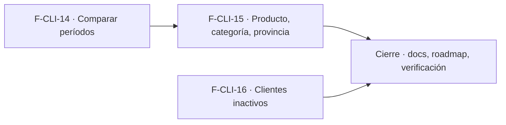

# Tasks: Clientes y proveedores · Ranking avanzado de clientes

**Input**: `specs/20261028-100000-ranking-avanzado-de-clientes/` (spec.md, plan.md, contracts/)

**Formato**: `- [ ] T### [P] [STORY-x][USy] descripción`. **[P]** = paralelizable (archivos distintos, sin dependencia; las [P] del mismo grupo van en paralelo); sin [P] = secuencial. Regla del proyecto: ninguna tarea queda `[ ]` al cierre — se hace con evidencia o se cierra con `[x]` + `Desvío:` y seguimiento trazado.

**Delivery scope**: `refine`, `supabase`

## Matriz de trazabilidad Jira ↔ US ↔ tasks

| Jira | Historia | FR / SC | Tasks |
|------|----------|---------|-------|
| F-CLI-14 | US1 Comparar el ranking entre dos períodos | FR-001…004, SC-001, SC-004 | T001–T006 |
| F-CLI-15 | US2 Ranking por producto, categoría y provincia | FR-005…009, SC-002, SC-005 | T007–T012 |
| F-CLI-16 | US3 Clientes inactivos | FR-010…013, SC-003, SC-006 | T013–T018 |
| Tarea de cierre (label `cierre`) | Docs, roadmap y verificación final | FR-014, SC-007, Principio VIII | T019–T021 |

## Phase 1: F-CLI-14 · Comparar el ranking entre dos períodos

**Goal**: función `ranking_clientes_comparado` y opción «Comparar con otro período» en la solapa de ranking.

- [ ] T001 [F-CLI-14][US1] Migración `supabase/migrations/20270114100000_ranking_clientes_comparado.sql`: `public.ranking_clientes_comparado` (`security definer`, `search_path = ''`, sección `clientes`, validación de ambos rangos, predicado y signo compartidos, filtro de tienda, `full join` de períodos, orden/desempate, `variacion_porcentaje` nulo sobre base ≤ 0, paginación con `total_filas`, `revoke`/`grant`), reversión en el encabezado; confirmar que no crea tablas (Principio VII) (FR-001, FR-002)
- [ ] T002 [P] [F-CLI-14][US1] pgTAP `supabase/tests/database/ranking_clientes_comparado.test.sql`: cliente en un solo período, variación y porcentaje nulo sobre base 0, extremos inclusivos, mismos filtros que el ranking básico (tipo, Consumidor final, IVA, tienda), notas de crédito, orden/desempate, paginación, validaciones, niveles `ninguno`/`lectura`/`edicion`, otra organización, `anon` sin ejecución (SC-001)
- [ ] T003 [P] [F-CLI-14][US1] `apps/web/src/lib/periodosRanking.ts`: «período anterior de igual duración» y validación de dos rangos, con Vitest en `periodosRanking.test.ts` (soporte de FR-003)
- [ ] T004 [P] [F-CLI-14][US1] `apps/web/src/hooks/useRankingComparado.ts` (RPC `ranking_clientes_comparado`, normalización de `numeric`/`bigint`, «última petición gana», paginación) con su test (soporte de FR-003)
- [ ] T005 [F-CLI-14][US1] `RankingClientes.tsx` (+ subcomponente de comparación): opción «Comparar con otro período», Desde/Hasta de comparación, columnas de comparación y variación (pesos y %, «—» sobre base 0), errores junto al campo, paginación conservando períodos y filtros; apagada, sin cambios de comportamiento (FR-003)
- [ ] T006 [F-CLI-14][US1] Vitest de la comparación: estados vacío/error con «Reintentar»/carga, cambio de empresa activa (reencuadre, página 1, sin datos de la anterior), teclado y roles, vista adaptable, solapa/ranking básico intacto con la opción apagada (FR-004, SC-004)

## Phase 2: F-CLI-15 · Ranking por producto, categoría y provincia

**Goal**: función `ranking_clientes_por_dimension` y filtros Producto/Categoría/Provincia en la solapa de ranking.

- [ ] T007 [F-CLI-15][US2] Migración `supabase/migrations/20270114110000_ranking_clientes_por_dimension.sql`: `public.ranking_clientes_por_dimension` (seguridad y validación como el ranking básico, suma por línea con producto/categoría incluyendo subcategorías, provincia sin mayúsculas ni tildes sin habilitar extensiones nuevas, participación sobre el conjunto filtrado, `revoke`/`grant`), reversión en el encabezado; sin tablas nuevas (FR-005, FR-006, FR-007, FR-008)
- [ ] T008 [P] [F-CLI-15][US2] pgTAP `supabase/tests/database/ranking_clientes_por_dimension.test.sql`: filtro por producto (suma de líneas, no del comprobante), categoría raíz con subcategorías, intersección producto∩categoría, provincia (mayúsculas/tildes), combinación con tipo/Consumidor final/IVA/tienda, participación 100 %, producto/categoría de otra organización, validaciones, niveles `ninguno`/`lectura`/`edicion`, `anon` sin ejecución (SC-002)
- [ ] T009 [P] [F-CLI-15][US2] `apps/web/src/hooks/useRankingPorDimension.ts` (RPC, normalización, estados) y `useOpcionesDimension.ts` (búsqueda de productos del catálogo, categorías vía `useCategorias`, provincias presentes en los clientes de la organización) con tests (soporte de FR-009)
- [ ] T010 [P] [F-CLI-15][US2] `apps/web/src/components/clientes/FiltrosDimension.tsx`: selectores Producto (búsqueda), Categoría y Provincia, sin identificadores técnicos, accesibles por teclado, con su test (soporte de FR-009)
- [ ] T011 [F-CLI-15][US2] Integrar en `RankingClientes.tsx`: filtros combinables con los existentes, llamada a `ranking_clientes_por_dimension` solo si hay algún filtro nuevo (si no, `ranking_clientes`), vacío con el texto de US2-7, descarte de la selección inexistente al cambiar la empresa activa (FR-009)
- [ ] T012 [F-CLI-15][US2] Vitest de los filtros: combinación, ranking básico intacto con filtros apagados, estados vacío/error/carga, cambio de empresa activa (reencuadre y página 1), vista adaptable y teclado (SC-005)

## Phase 3: F-CLI-16 · Clientes inactivos

**Goal**: función `clientes_inactivos` y solapa «Clientes inactivos» en Clientes.

- [ ] T013 [F-CLI-16][US3] Migración `supabase/migrations/20270114120000_clientes_inactivos.sql`: `public.clientes_inactivos` (seguridad como el ranking básico, `p_dias` 1…3650, última factura que cuenta < hoy − N en zona Buenos Aires, excluye sin compras y archivados, orden estable, `total_filas`, `revoke`/`grant`), reversión en el encabezado; sin tablas nuevas (FR-010, FR-011, FR-012)
- [ ] T014 [P] [F-CLI-16][US3] pgTAP `supabase/tests/database/clientes_inactivos.test.sql`: umbral (compras hace 20/100/400 días), cliente sin compras y archivado excluidos, una sola compra antigua, nota de crédito que no cuenta como compra, orden y desempate, tipo/Consumidor final/tienda, paginación, validaciones, niveles `ninguno`/`lectura`/`edicion`, otra organización, `anon` sin ejecución (SC-003)
- [ ] T015 [P] [F-CLI-16][US3] `apps/web/src/hooks/useClientesInactivos.ts` (RPC, normalización, paginación, estados) con su test (soporte de FR-013)
- [ ] T016 [F-CLI-16][US3] `apps/web/src/components/clientes/ClientesInactivos.tsx`: campo «Días sin comprar» (30/60/90/180 + valor libre, defecto 90), Aplicar, filtros Tipo y Consumidor final, tabla Cliente/Tipo/Última compra/Días sin comprar/Comprobantes/Facturado histórico con enlace a la ficha, vacío/error/carga, vista adaptable, reencuadre por empresa activa (FR-013)
- [ ] T017 [F-CLI-16][US3] Tercera solapa «Clientes inactivos» en `apps/web/src/pages/clientes/list.tsx` con carga diferida y visibilidad por sección Clientes (`lectura`/`edicion`) (FR-013)
- [ ] T018 [F-CLI-16][US3] Vitest de inactivos: solapa oculta sin acceso, validación del umbral, vacío/error/carga, cambio de empresa activa, enlace a la ficha, teclado/roles (SC-006)

## Phase 4: Cierre

**Goal**: documentación, roadmap y verificación final que ninguna historia atiende.

- [ ] T019 [CIERRE] Actualizar `docs/clientes.md` con las tres capacidades (comparación, dimensiones, inactivos), sus RPC y los límites declarados (sin Excel, sin combinar comparación y dimensiones, sin envío a campaña — MSF-155), y `AGENTS.md`/`CLAUDE.md` solo si cambia una regla (FR-014)
- [ ] T020 [CIERRE] Actualizar `docs/roadmap-template.md` al cerrar la spec (estado, link a la spec, mover a «Backlog entregado» si aplica) — paso manual con criterio, sin script (FR-014)
- [ ] T021 [CIERRE] Verificación final: `pnpm lint && pnpm build && pnpm test && pnpm docs:check && pnpm matriz:check` y revisión de esquema/RLS/grants de las tres funciones (pgTAP `rls_en_toda_tabla` y auditoría de `anon` verdes) (SC-007)

Cierre: T019 puede arrancar con las historias; T020 → T021 al final. Las tareas [CIERRE] nunca son prerequisito de una historia.
Entre historias: ninguna tarea depende de una tarea de otra historia; el orden entre F-CLI-14 y F-CLI-15 lo da solo el archivo compartido `RankingClientes.tsx` (tabla de abajo).

## Plan de ejecución (historias)

El **orden de toma** de las historias lo declara esta tabla: el orquestador la **consume** (no lo infiere del orden de las tareas). Una historia arranca cuando sus dependencias (`Depende de`) están **Finalizadas (mergeadas)**; las del **mismo** `Grupo` van **en paralelo** (F-CLI-14 y F-CLI-16 no comparten archivos ni migración; F-CLI-15 edita el mismo componente que F-CLI-14, por eso va después).

| Historia | Depende de | Grupo |
|----------|------------|-------|
| F-CLI-14 | — | 1 |
| F-CLI-16 | — | 1 |
| F-CLI-15 | F-CLI-14 | 2 |
| [Cierre] | F-CLI-14, F-CLI-15, F-CLI-16 | 3 |

