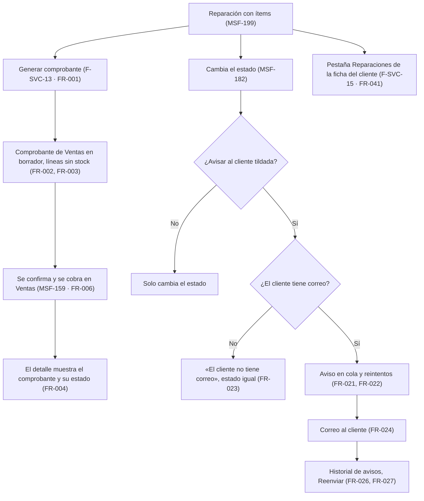
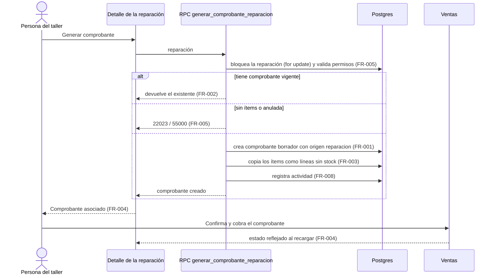
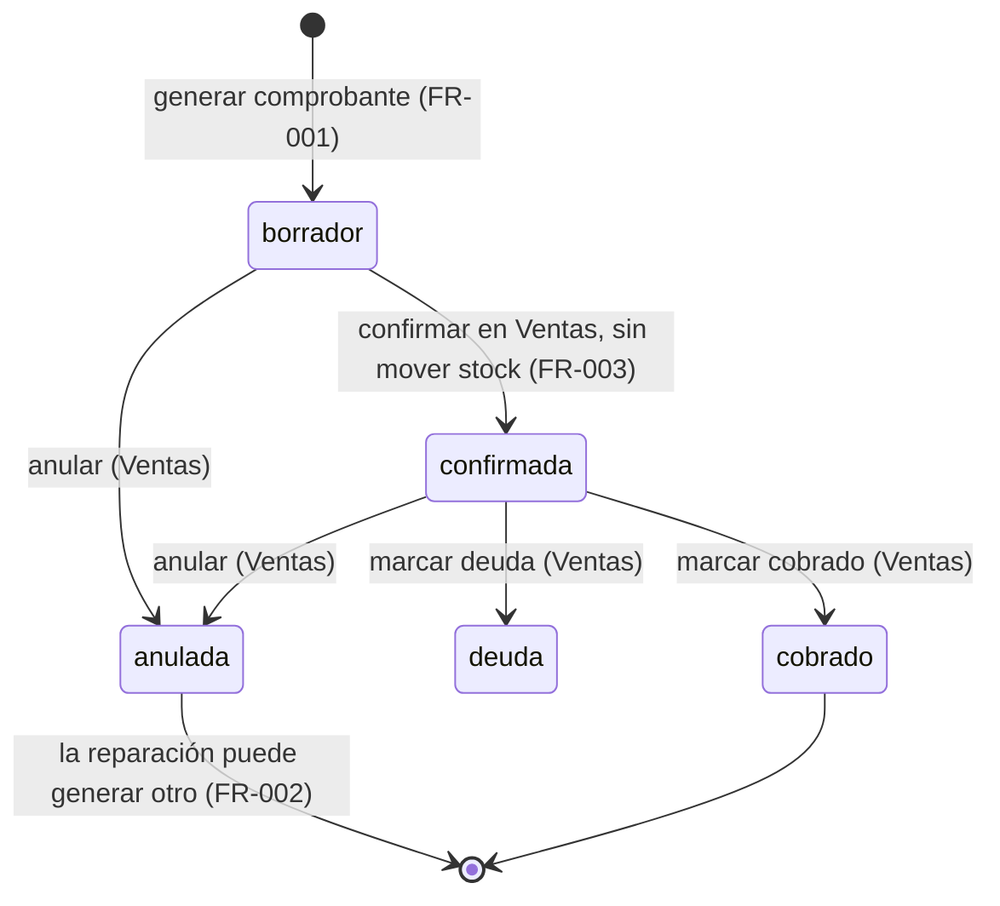
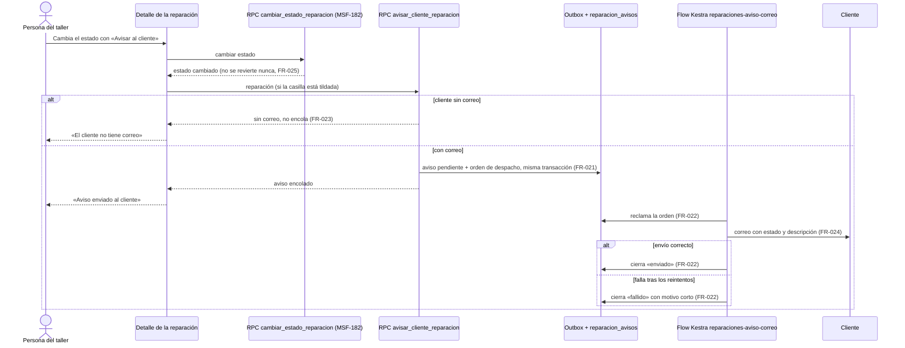
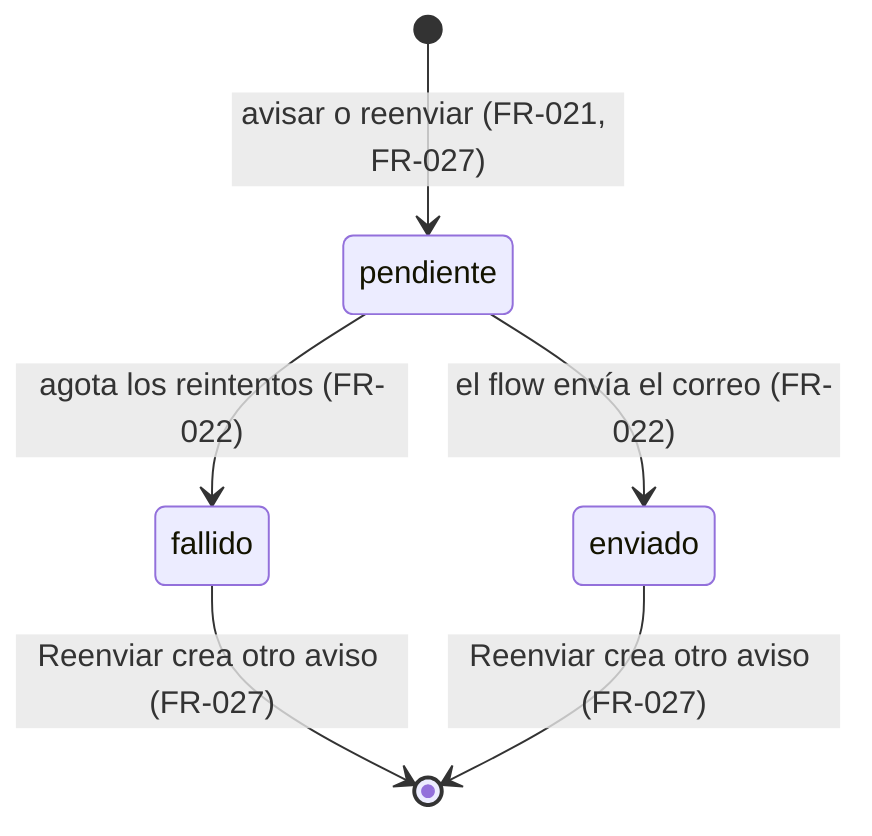
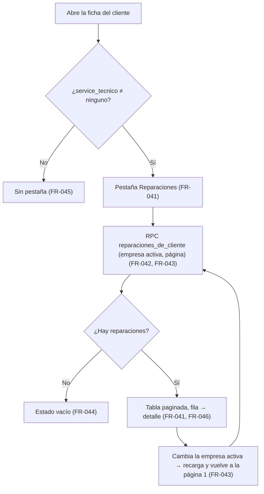

# Feature Specification: Service técnico · Service cobro y avisos

**Feature Branch**: `epic/MSF-232-service-tecnico-service-cobro-y-avisos`

**Jira Epic**: MSF-232 — Service técnico · Service cobro y avisos (spec `service-cobro-y-avisos`)

**Created**: 2026-10-28

**Status**: Ready for implementation — la especificación viene completa desde Jira. Los puntos de «A revisar» no bloquean: cada uno lleva una decisión provisoria en *Decisiones abiertas*.

**Delivery scope**: `refine` (apps/web), `supabase` (migraciones + RPC + pgTAP) y `kestra` (un flow de envío de correo). Sin `superset` ni `workers` (el correo sale por Kestra con el SMTP existente, como `comprobantes-correo`; no hay worker nuevo).

**Prioridad / Hito**: P1 · Etapa 2 (desde enero de 2027, después de rentabilidad) · 27 h (por tallas L + M + S; la épica anota 27 h y 28 h por tallas) · alcance etapa2.

**Dependencias**:
- Bloqueada por: MSF-199 (Service listado, ítems e impresión) y MSF-159 (Ventas · comprobantes). **Ambas ya están en `main`**: `dominio.reparacion_items`, `total_mano_obra`/`total_repuestos` y `obtener_reparacion` con ítems (`20261022100100`…`100500`); `dominio.comprobantes_venta` y sus líneas, `crear_comprobante`, `guardar_lineas_comprobante`, `confirmar_comprobante` y el estado de cobro (`20261203*`, `20261204140000`, `20261212100800`).
- Bloquea a: MSF-118 (Service ideas futuras): F-SVC-30 extiende el aviso de F-SVC-14.
- Relacionada, sin bloqueo: MSF-180 (Clientes · alta y búsqueda: ficha y correo del cliente, ya en `main`: `apps/web/src/pages/clientes/show.tsx`), la cola durable de ejecuciones del template (outbox) y el centro de notificaciones F-NOT (MSF-224, MSF-319).
- Ajustes a otros componentes: **Ventas** (columnas `origen_tipo`/`origen_id` en `comprobantes_venta` y un modo de línea que no toca stock) y **Clientes** (pestaña Reparaciones en la ficha).

**Input**: Epic MSF-232. Objetivo: «Al terminar, una reparación se cobra generando un comprobante de Ventas, el cliente recibe un correo cuando cambia el estado y la ficha del cliente muestra su historial de reparaciones.»

**Regla de fuentes** (literal de la épica):
- Comportamiento y datos: mandan los requisitos y escenarios de esta historia.
- Qué se ve (disposición, textos, estados, popups, flujos): el prototipo validado es referencia visual, no hace falta que quede extremadamente idéntico; los flujos (si hay) aclaran estados y acciones.
- Cómo se construye (componentes, estilos y patrones): mandan el template y el system design del producto (MSF-117, `docs/sistema-de-diseno.md`). No se copia HTML ni CSS: se reproduce con los componentes del template y los tokens.
- El prototipo muestra más que esta historia: se implementa solo lo que piden los requisitos de esta historia; otras secciones, botones o diálogos son de otras historias.
- Si algo no se puede igualar: lo más cercano, sin inventar, anotando la diferencia en el PR. Si prototipo y requisitos se contradicen: requisitos para el comportamiento, prototipo para lo visual, y la contradicción queda anotada en el PR.
- Prototipos (solo lectura, presentes en el árbol; la rama `design/prototipo` no existe): `design/pantallas/ServicioReparacion.dc.html` (detalle; trae el botón «Avisar al cliente» y el mensaje «Aviso enviado al cliente») y `design/pantallas/ClienteFicha.dc.html` (**sin pestaña Reparaciones**: la épica la pide y falta dibujarla). Inventarios en `design/pantallas/*.inventory.json` (generados con `pnpm prototipo:inventario`, al día). **Sin artboard**: el botón «Generar comprobante» y la vista del comprobante asociado, la casilla «Avisar al cliente» al cambiar el estado, el historial de avisos con «Reenviar», el aviso «El cliente no tiene correo», la pestaña Reparaciones con su estado vacío y el correo mismo.

## Modelo y supuestos

- **El cobro usa Ventas.** No hay comprobante propio de Service (decisión del doc del componente): la reparación **genera un comprobante de Ventas** con origen en ella; se confirma y se cobra en Ventas.
- **El aviso es por correo.** El WhatsApp queda en Backlog (fuera de alcance).
- **El cliente puede no tener correo.** Se avisa en pantalla y no se encola nada.
- **El aviso nunca bloquea el cambio de estado.** El estado cambia primero y el aviso se pide aparte; si el aviso falla, el estado queda cambiado.
- **Lo que la épica dice del template, verificado contra el árbol**: la épica supone que el template no trae correo transaccional de negocio. En el árbol **sí hay base reutilizable** (no se inventa un canal nuevo): la outbox de ejecuciones (`public.capacidades_ejecucion`, `ejecuciones_worker`, `despachos_ejecucion`, `private.reclamar_despachos_capacidad`), el flow `infra/kestra/flows/comprobantes-correo.yml` (envío por el SMTP `KESTRA_SMTP_*` con reintentos y cierre `enviado`/`fallido`) y su tabla `dominio.comprobante_envios_correo` (`20261212100200`, `100300`), y la cola de usuarios internos `public.avisos_pendientes` (no sirve: su destinatario es un usuario del panel, no un cliente). El aviso al cliente de esta épica **sigue el patrón de `comprobantes-correo`** con un flow y una tabla propios. Esto baja el riesgo de horas de F-SVC-14 que la épica anota.
- **Importes**: los ítems de Service son sin IVA (ARS). El comprobante de Ventas calcula su IVA con la alícuota (*Decisiones abiertas* 1).
- **Cliente**: `public.clientes` (con `correo`). La reparación ya apunta a él por `cliente_id`.

### Esquema de datos (Constitución, Principio VII)

| Objeto | Esquema | Justificación | RLS / acceso |
|--------|---------|---------------|--------------|
| `comprobantes_venta` (**existente**; F-SVC-13 agrega `origen_tipo`, `origen_id`) | **`dominio`** (sin cambio) | Documento de venta: entidad de negocio del producto. Las columnas son de origen del documento. | RLS vigente por organización y sección `ventas`. Columnas nulables, sin política de escritura directa: solo las escribe la RPC `security definer`. FK compuesta lógica `(origen_id, organizacion_id)` validada por la RPC contra `reparaciones`; índice único parcial: un solo comprobante **vigente** (no anulado) por reparación. |
| `comprobantes_venta_lineas` (**existente**; F-SVC-13 agrega `sin_stock`) | **`dominio`** (sin cambio) | Líneas del documento. | RLS vigente. Columna `sin_stock boolean not null default false`; `producto_id`, `deposito_id` y `escala` pasan a admitir `null` **solo** con `sin_stock` (check). Aditiva. |
| `reparacion_avisos` (**nueva**, F-SVC-14) | **`dominio`** | Historial de avisos al cliente de una reparación: entidad de negocio del taller, no plataforma. | **Sí**: `organizacion_id = (select private.organizacion_id())`, nivel `service_tecnico` (`lectura`/`edicion`) y tienda accesible de la reparación (mismo criterio que `20261020140000`); **sin `insert/update/delete` directos**: solo RPC `security definer` y funciones `private` del rol de Kestra. FK compuestas `(reparacion_id, organizacion_id)`. `anon` sin acceso. |
| `reparaciones`, `clientes`, `estados_reparacion` (**existentes**) | `dominio` / `public` / `dominio` (sin cambio) | Solo se leen. | RLS vigente. |
| `capacidades_ejecucion`, `ejecuciones_worker`, `despachos_ejecucion` (**existentes**) | `public` (plataforma) | Outbox del template; F-SVC-14 solo inserta filas por RPC, como `enviar_presupuesto_correo`. | RLS vigente. |

No se crean otras tablas. `rls_en_toda_tabla` (pgTAP, recorre `public` + `dominio`) debe seguir verde. Migraciones **aditivas** con reversión en el encabezado. Las RPC viven en `public`, con `revoke … from public, anon` y `grant execute … to authenticated`; las ayudas del flow viven en `private` y solo las ejecuta `kestra_orquestacion`. **Nombres y firmas exactos de lo existente se verifican contra `main` al implementar**; lo que no exista se declara en `contracts/service-cobro-y-avisos.md`.

## User Scenarios & Testing *(mandatory)*

### User Story 1 - Cobro de la reparación mediante un comprobante de Ventas (F-SVC-13, P1, talla L)

Como persona del taller con acceso a Ventas, quiero generar desde la reparación el comprobante de Ventas con sus ítems, para cobrarla sin volver a cargar nada.

**Why this priority**: hoy el cobro se carga a mano en Ventas copiando el total (riesgo de doble ingreso y de error); es el objetivo principal de la épica.

**Independent Test**: una reparación con dos ítems (un servicio y un repuesto) genera un comprobante `borrador` del cliente y la tienda de la reparación, con dos líneas que no descuentan stock; generarlo otra vez devuelve el mismo; al confirmarlo en Ventas el stock no se mueve; el detalle muestra el comprobante asociado con su estado, y al cobrarlo en Ventas el estado se refleja.

**Acceptance Scenarios**:
1. **Given** el detalle de una reparación con al menos un ítem y permisos, **When** pulsa «Generar comprobante», **Then** se crea un comprobante de Ventas en `borrador` con cliente y tienda de la reparación, origen `reparacion` + id, una línea por ítem (descripción, cantidad, precio sin IVA) y el detalle pasa a mostrar «Comprobante asociado».
2. **Given** una reparación que ya tiene un comprobante vigente, **When** vuelve a pulsar la acción (o dos personas a la vez), **Then** no se crea otro: se devuelve el existente y el botón ya no se ofrece.
3. **Given** un comprobante generado desde Service, **When** se confirma en Ventas, **Then** no se descuenta ni reserva stock por esas líneas (ni de repuestos del catálogo, porque el descuento de repuestos es de MSF-217).
4. **Given** un comprobante asociado, **When** se ve el detalle de la reparación, **Then** muestra número, tipo, estado (borrador / confirmada / cobrada / deuda / anulada), total y un enlace para abrirlo en Ventas (solo con acceso a `ventas`).
5. **Given** un comprobante anulado, **Then** la reparación vuelve a poder generar uno nuevo y el anulado queda como historial.
6. **Given** una reparación sin ítems o anulada, **Then** la acción no se ofrece y la base la rechaza.
7. **Given** una persona sin `service_tecnico` en `edicion` o sin `ventas` en `edicion` en la tienda de la reparación, **Then** no ve el botón y la base rechaza la operación.
8. **Given** un cliente de otra organización o una reparación de una tienda no accesible, **Then** la base rechaza la operación.
9. **Given** el comprobante generado, **Then** en Ventas se identifica su origen (reparación `R-000N`) y se edita, confirma, cobra y anula con las mismas reglas que cualquier otra factura.

### User Story 2 - Notificación al cliente por cambio de estado (F-SVC-14, P1, talla M)

Como persona del taller, quiero avisar al cliente por correo cuando cambia el estado de su reparación, para que se entere sin llamarlo.

**Why this priority**: evita llamadas y reduce equipos olvidados («Listo para entregar» ya dice «Se avisa al cliente para que retire»).

**Independent Test**: al cambiar el estado con «Avisar al cliente» tildada se encola un correo y el cliente lo recibe (correo de prueba) con tienda, número, equipo y el nuevo estado; el historial de avisos lo muestra «Enviado»; un fallo de SMTP se reintenta y, si persiste, queda «Fallido» con «Reenviar»; un cliente sin correo muestra «El cliente no tiene correo» y el estado cambia igual.

**Acceptance Scenarios**:
1. **Given** el selector de estado de una reparación abierta, **When** la persona elige un estado nuevo, **Then** ve la casilla «Avisar al cliente» (destildada por defecto, ver *Decisiones abiertas* 4) junto a la acción de cambiar el estado.
2. **Given** la casilla tildada y un cliente con correo, **When** confirma el cambio, **Then** el estado cambia y se encola un aviso `pendiente`; el panel muestra el mensaje de éxito «Aviso enviado al cliente» del prototipo (cuando queda encolado) y el historial lo lista.
3. **Given** el flow de envío, **When** corre, **Then** manda un correo al cliente con tienda, `R-000N`, equipo (modelo) y el nuevo estado con su descripción, lo marca «Enviado» con la fecha, o «Fallido» con un motivo corto tras agotar los reintentos.
4. **Given** el cliente sin correo, **When** abre el detalle o intenta avisar, **Then** ve «El cliente no tiene correo», la casilla y el botón no encolan nada, y el cambio de estado se guarda igual.
5. **Given** un fallo al encolar o al enviar, **Then** el estado ya cambiado no se revierte y el error se informa sin bloquear.
6. **Given** el historial de avisos, **Then** lista cada aviso con estado nuevo, destinatario, fecha, quién lo pidió y su resultado (Pendiente / Enviado / Fallido); en los Fallidos (y, a pedido, en los Enviados) ofrece «Reenviar».
7. **Given** «Reenviar», **When** lo pulsa, **Then** se crea un aviso nuevo con el correo actual del cliente; el doble clic es un solo envío.
8. **Given** el botón «Avisar al cliente» del encabezado (prototipo), **When** lo pulsa, **Then** encola un aviso del **estado actual** sin cambiar el estado.
9. **Given** un usuario con `service_tecnico` en `lectura`, **Then** ve el historial pero no la casilla, el botón ni «Reenviar».
10. **Given** una reparación anulada, **Then** no se ofrece avisar.

### User Story 3 - Vínculo con la ficha del cliente (F-SVC-15, P1, talla S)

Como persona que atiende al cliente, quiero ver sus reparaciones en su ficha, para conocer su historial sin salir de ella.

**Why this priority**: cierra el vínculo cliente↔reparación en la ficha que ya existe (MSF-180).

**Independent Test**: la ficha de un cliente con tres reparaciones en dos tiendas muestra la pestaña Reparaciones con sus filas (más recientes primero), cada una lleva al detalle; con una tienda elegida arriba se filtra por esa; un cliente sin reparaciones muestra el estado vacío; sin acceso a Service la pestaña no aparece.

**Acceptance Scenarios**:
1. **Given** la ficha de un cliente, **Then** se ve una pestaña «Reparaciones» (sin tocar el contenido actual de la ficha, que queda en la pestaña inicial).
2. **Given** un cliente con reparaciones, **When** abre la pestaña, **Then** ve una tabla con Reparación (`R-0238`), Tienda, Equipo (con el modelo), Estado (chip), Ingreso, Entrega y Total, ordenada de más reciente a más antigua, paginada en el servidor.
3. **Given** una fila, **When** la abre, **Then** va al detalle `/service-tecnico/reparaciones/:id`.
4. **Given** un cliente sin reparaciones, **Then** ve un estado vacío claro.
5. **Given** una empresa elegida en la barra superior, **Then** la pestaña muestra solo las reparaciones de esa tienda; con «Todas» muestra todas las accesibles; al cambiar de empresa recarga y reencuadra la paginación.
6. **Given** un usuario sin `service_tecnico` (nivel `ninguno`), **Then** la pestaña no aparece; con `lectura` aparece sin acciones de edición.
7. **Given** el Consumidor final, **Then** la pestaña muestra sus reparaciones como cualquier cliente.

### Edge Cases

- Reparación sin ítems: «Generar comprobante» no se ofrece (la base responde `22023`).
- Ítems que cambian después de generar el comprobante: el comprobante es una **foto** del momento (no se sincroniza); corregirlo se hace en Ventas mientras esté en `borrador`. Fuera de alcance: resincronizar.
- Dos personas generando a la vez: el índice único parcial y el `for update` de la reparación hacen que uno cree y el otro reciba el mismo comprobante.
- Producto de catálogo desactivado después de cargar el ítem: la línea del comprobante guarda la copia de la descripción; no se vuelve a validar el catálogo.
- Cliente que cambia de correo entre el pedido y el envío: el aviso guarda **el correo usado** (foto); «Reenviar» toma el actual.
- Correo inválido o con rebote: el flow lo cierra `fallido` con motivo fijo; nunca se guarda el mensaje del SMTP (hosts, credenciales).
- Dos cambios de estado seguidos con casilla tildada: dos avisos (uno por estado), cada uno con su estado nombrado; no se agrupan.
- Doble clic en «Reenviar» / «Avisar al cliente»: un solo aviso pendiente por reparación y estado (índice único parcial).
- Cambio de empresa con la pestaña de la ficha o un diálogo abierto: se reencuadra o se cierra con aviso (Principio VIII).
- Sin permiso (`ninguno`) en `service_tecnico`: «Acceso restringido» ya existente (MSF-182).
- Volumen: la pestaña de la ficha nunca baja todas las reparaciones; pagina en el servidor.

## Flujos

### Flujo 1 · Recorrido de la épica (de la reparación al cobro y al aviso)

Proceso de punta a punta que verifica la épica (E2E, SC-009). Los pasos de alta, ítems y estados ya existen (MSF-182, MSF-199).

### Flujo 2 · Comprobante de una reparación (secuencia)

### Flujo 3 · Estados de un comprobante generado desde Service

Usa los estados que ya define Ventas; no se agregan estados.

### Flujo 4 · Aviso de cambio de estado (secuencia)

### Flujo 5 · Estados de un aviso

### Flujo 6 · Pestaña Reparaciones de la ficha

## Requirements *(mandatory)*

### Functional Requirements

**F-SVC-13 · Cobro mediante un comprobante de Ventas**
- **FR-001**: DEBE existir `public.generar_comprobante_reparacion(p_reparacion uuid)` (`security definer`, `search_path = ''`) que crea un comprobante `borrador` de Ventas en la **tienda de la reparación** y con **su cliente**, con `origen_tipo = 'reparacion'` y `origen_id` = la reparación; la organización y el actor salen de la sesión. El tipo (factura o presupuesto) se resuelve según *Decisiones abiertas* 1. **Verificación**: pgTAP `supabase/tests/database/service_cobro.test.sql` (`pnpm test:db`): borrador con cliente, tienda y origen.
- **FR-002**: La operación DEBE ser **idempotente**: bloquea la reparación (`for update`), y si ya tiene un comprobante vigente (no anulado) lo devuelve sin crear otro; un índice único parcial `(organizacion_id, origen_tipo, origen_id) where estado <> 'anulada'` lo garantiza bajo concurrencia. Con el comprobante anulado, permite generar uno nuevo. **Verificación**: pgTAP `service_cobro.test.sql`: segunda llamada y dos generaciones concurrentes devuelven el mismo comprobante; regenerar tras anular.
- **FR-003**: Cada ítem de la reparación (mano de obra y repuestos) DEBE copiarse como una línea del comprobante con descripción, cantidad y precio unitario sin IVA, y con la marca **`sin_stock`**: `dominio.comprobantes_venta_lineas` admite `producto_id`, `deposito_id` y `escala` nulos solo con `sin_stock`; `confirmar_comprobante` DEBE saltear esas líneas (ni salida ni reserva) y la devolución de stock de notas de crédito/anulación también. La alícuota de IVA por línea se toma según *Decisiones abiertas* 1. Los totales del comprobante los calcula Ventas. **Verificación**: pgTAP `supabase/tests/database/service_cobro_stock.test.sql`: líneas con la marca, confirmar y anular sin movimientos ni reservas.
- **FR-004**: `public.comprobante_de_reparacion(p_reparacion uuid)` DEBE devolver el comprobante vigente (id, número, tipo, estado, total, empresa) o `null`; el detalle DEBE mostrar la tarjeta «Comprobante asociado» con esos datos y un enlace a `/ventas/comprobantes/:id` **solo** si la persona tiene `ventas` en la tienda. Con comprobante vigente el botón «Generar comprobante» no se ofrece. **Verificación**: Vitest `apps/web/src/pages/service-tecnico/reparacion.comprobante.test.tsx` (`pnpm test:web`) y pgTAP `service_cobro.test.sql` (`comprobante_de_reparacion`).
- **FR-005**: La RPC DEBE exigir `service_tecnico` en `edicion` y `ventas` en `edicion` en la tienda de la reparación (`42501`), reparación existente y accesible (`P0002`), con al menos un ítem y no anulada (`22023`/`55000`, mensaje en castellano). Lleva `revoke … from public, anon` y `grant execute … to authenticated`. **Verificación**: pgTAP `service_cobro.test.sql`: `42501`, `P0002`, `22023`/`55000`, ajeno, `anon` sin ejecución.
- **FR-006**: El comprobante generado DEBE tratarse en Ventas como cualquier otro (editar mientras es `borrador`, confirmar, cobrar, anular) sin cambios de comportamiento; la columna `origen_tipo`/`origen_id` es de solo lectura. La numeración y el cobro son los de MSF-159 (no se duplican). **Verificación**: pgTAP `service_cobro_stock.test.sql`: editar, confirmar, cobrar y anular como cualquier factura.
- **FR-007**: Ventas DEBE exponer el origen: `obtener_comprobante` devuelve `origen_tipo` y `origen_id` (aditivo, sin romper el contrato vigente) para que su pantalla muestre «Reparación R-000N» como texto de origen con enlace al detalle de Service **solo si** la persona tiene acceso a Service. **Verificación**: pgTAP `service_cobro.test.sql` (salida de `obtener_comprobante`) y Vitest `apps/web/src/pages/ventas/comprobante.origen.test.tsx`.
- **FR-008**: Generar el comprobante DEBE registrar la actividad `reparacion.comprobante_generado` por `private.registrar_actividad`, en la misma transacción. **Verificación**: pgTAP `service_cobro.test.sql`: fila de actividad `reparacion.comprobante_generado` en la misma transacción.
- **FR-009**: El botón «Generar comprobante» DEBE estar en la sección «Mano de obra y repuestos» del detalle, junto al «Total al cliente» (sin artboard: se ubica donde hoy el doc pide copiar el total), solo con permisos (FR-005), con reparación no anulada y con ítems, y con estados de carga/error/éxito del kit. **Verificación**: Vitest `reparacion.comprobante.test.tsx`: botón según permisos, ítems, anulada y comprobante vigente; estados de carga/error/éxito.
- **FR-010**: DEBE documentar el modelo, la RPC, la marca `sin_stock`, la decisión de alícuota y la reversión en `docs/service-cobro.md`. **Verificación**: `pnpm docs:check` (existencia y enlaces de `docs/service-cobro.md`).

**F-SVC-14 · Notificación al cliente por cambio de estado**
- **FR-020**: DEBE existir `dominio.reparacion_avisos` con `id`, `organizacion_id`, `reparacion_id`, `estado_id` y `estado_nombre` (copia del estado avisado), `destinatario` (correo usado al pedir el aviso), `estado_envio` (`pendiente` | `enviado` | `fallido`), `intentos`, `error` (≤ 500, motivo corto), `solicitado_por`, `solicitado_en`, `enviado_en`, `ejecucion_id`; con RLS, FK compuestas por organización, sin escritura directa y sin `delete`. **Verificación**: pgTAP `supabase/tests/database/service_avisos.test.sql`: columnas, RLS, sin escritura directa ni `delete`, `anon`; `rls_en_toda_tabla`.
- **FR-021**: `public.avisar_cliente_reparacion(p_reparacion uuid)` DEBE crear, **en una sola transacción**, el aviso `pendiente` del **estado actual** y su orden de despacho en la outbox (capacidad `enviar-aviso-reparacion-<aviso>`, como `enviar_presupuesto_correo`); exige `service_tecnico` en `edicion`, rechaza reparación anulada (`55000`) y cliente sin correo (devuelve un resultado `sin_correo` sin encolar); es **idempotente** (un solo aviso pendiente por reparación y estado, índice único parcial). `revoke … from public, anon` y `grant execute … to authenticated`. **Verificación**: pgTAP `service_avisos.test.sql`: aviso y orden de despacho atómicos, idempotencia, `sin_correo`, anulada `55000`, `anon`.
- **FR-022**: DEBE existir el flow `infra/kestra/flows/reparaciones-aviso-correo.yml` que reclama solo las capacidades `enviar-aviso-reparacion-*`, resuelve los datos con `private.datos_aviso_reparacion(aviso)`, envía el correo por el SMTP existente (`KESTRA_SMTP_*`), **reintenta 3 veces** y cierra el aviso con `private.cerrar_aviso_reparacion(aviso, motivo)` como `enviado` o `fallido` (motivo fijo, nunca el mensaje del SMTP). Las dos funciones son `private`, idempotentes y solo ejecutables por `kestra_orquestacion`. La entrega es «al menos una vez». **Verificación**: `pnpm test:kestra:reparaciones-aviso` (`infra/kestra/flows/reparaciones-aviso-correo.test.mjs`), `pnpm test:kestra:copias` y pgTAP `service_avisos.test.sql` (funciones `private` solo para `kestra_orquestacion`).
- **FR-023**: Un cliente sin correo (nulo o vacío) DEBE mostrar «El cliente no tiene correo» en el detalle; la casilla y el botón «Avisar al cliente» no encolan nada y el cambio de estado se guarda igual. **Verificación**: Vitest `apps/web/src/pages/service-tecnico/reparacion.avisos.test.tsx`: «El cliente no tiene correo» y el estado cambia; pgTAP `service_avisos.test.sql` (`sin_correo` sin encolar).
- **FR-024**: El correo DEBE llevar tienda (nombre de `dominio.empresas`), número `R-000N`, equipo (modelo) y el **estado nuevo con su descripción** (la de `estados_reparacion`, p. ej. «Se avisa al cliente para que retire.»); asunto y cuerpo fijos y provisorios (la plantilla se define aquí, no hay artboard; *Decisiones abiertas* 3). Los valores se escapan en el HTML. No incluye costos internos ni importes. **Verificación**: `pnpm test:kestra:reparaciones-aviso`: asunto, cuerpo con tienda, número, equipo, estado y descripción; HTML escapado; sin importes.
- **FR-025**: El aviso NUNCA DEBE bloquear ni revertir el cambio de estado: la pantalla llama primero a `cambiar_estado_reparacion` (sin modificar su firma) y recién después a `avisar_cliente_reparacion`; si esta falla, el estado queda cambiado y se informa el error del aviso. **Verificación**: Vitest `reparacion.avisos.test.tsx`: el estado queda cambiado aunque el aviso falle y el error se informa.
- **FR-026**: `public.avisos_de_reparacion(p_reparacion uuid)` DEBE devolver el historial (estado avisado, destinatario, resultado, fecha, quién lo pidió con nombre visible, nunca el correo del usuario); el detalle DEBE mostrar la sección «Avisos al cliente» con Pendiente / Enviado / Fallido, estados vacío/error/carga del kit y visible con `lectura`. **Verificación**: pgTAP `service_avisos.test.sql` (`avisos_de_reparacion`, sin correo del usuario) y Vitest `reparacion.avisos.test.tsx` (Pendiente/Enviado/Fallido, vacío, error, `lectura`).
- **FR-027**: «Reenviar» DEBE crear un aviso nuevo del estado indicado con el correo **actual** del cliente (mismo RPC/permiso que FR-021) y solo estar disponible con `edicion`; en avisos Fallidos siempre y en Enviados a pedido. **Verificación**: Vitest `reparacion.avisos.test.tsx` (Reenviar solo con `edicion`, doble clic) y pgTAP `service_avisos.test.sql` (aviso nuevo con el correo actual).
- **FR-028**: La casilla «Avisar al cliente» DEBE mostrarse junto al cambio de estado y el botón «Avisar al cliente» del encabezado (prototipo) DEBE encolar el aviso del estado actual sin cambiarlo (FR-021); tras encolar muestra «Aviso enviado al cliente». Ambos solo con `edicion`, reparación abierta y cliente con correo. **Verificación**: Vitest `reparacion.avisos.test.tsx`: casilla destildada, botón del encabezado y mensaje «Aviso enviado al cliente».
- **FR-029**: Encolar un aviso DEBE registrar la actividad `reparacion.aviso_solicitado` y el cierre `reparacion.aviso_enviado` / `reparacion.aviso_fallido` por `private.registrar_actividad`. **Verificación**: pgTAP `service_avisos.test.sql`: actividades `reparacion.aviso_solicitado`, `aviso_enviado` y `aviso_fallido`.
- **FR-030**: DEBE documentar el modelo, las RPC, el flow, las variables (`KESTRA_SMTP_*` ya existentes; ninguna nueva), la plantilla, los reintentos, la garantía de entrega y la reversión en `docs/service-avisos.md`, y los tipos de actividad en `docs/actividad.md`. **Verificación**: `pnpm docs:check` (`docs/service-avisos.md` y tipos en `docs/actividad.md`).

**F-SVC-15 · Vínculo con la ficha del cliente**
- **FR-040**: DEBE existir `public.reparaciones_de_cliente(p_cliente uuid, p_empresa uuid, p_pagina int, p_tamano int)` (paginada, `{ total_filas, filas }`; **`security definer`** con las mismas validaciones manuales que `listar_reparaciones`: organización, nivel `service_tecnico` y `empresas_accesibles()`; sin costos internos en la salida), con `revoke … from public, anon` y `grant execute … to authenticated`; apoyada en el índice `reparaciones_cliente_idx` existente. **Verificación**: pgTAP `supabase/tests/database/service_cliente_reparaciones.test.sql`: firma, filtro, paginación, sin costos, aislamiento, `anon`.
- **FR-041**: La ficha del cliente (`/clientes/:id`) DEBE tener una pestaña **«Reparaciones»** que muestra, por reparación, Reparación (`R-0238`), Tienda, Equipo (con el modelo debajo), Estado (chip), Ingreso, Entrega y Total («A presupuestar» si es cero, «—» si falta un dato), más el contador «N reparaciones»; el contenido actual de la ficha queda como pestaña inicial sin cambios de comportamiento (*Decisiones abiertas* 5). **Verificación**: Vitest `apps/web/src/pages/clientes/show.reparaciones.test.tsx`: columnas, contador, «A presupuestar» y «—», contenido previo intacto.
- **FR-042**: Orden de más reciente a más antigua (ingreso, luego número descendente) y paginación **en el servidor** (tamaño por defecto 25). **Verificación**: pgTAP `service_cliente_reparaciones.test.sql` (orden y paginación) y Vitest `show.reparaciones.test.tsx` (página y tamaño 25).
- **FR-043**: DEBE respetar la **empresa activa** de la barra superior (Principio VIII): una tienda concreta filtra por ella, «Todas» muestra las accesibles; al cambiarla invalida y recarga la consulta, vuelve a la página 1 y no muestra filas de la empresa anterior. **Verificación**: Vitest `show.reparaciones.test.tsx`: cambio de empresa activa recarga, vuelve a la página 1 y no muestra filas de la anterior.
- **FR-044**: Sin reparaciones DEBE mostrar un estado vacío claro («Este cliente todavía no tiene reparaciones»; texto provisional); con error, el patrón compartido con reintento; con carga, el de carga. **Verificación**: Vitest `show.reparaciones.test.tsx`: estado vacío, error con reintento y carga.
- **FR-045**: Con `service_tecnico` en `ninguno` la pestaña NO DEBE aparecer; con `lectura` aparece sin acciones de edición. `anon` sin acceso. **Verificación**: Vitest `show.reparaciones.test.tsx` (sin pestaña con `ninguno`, sin edición con `lectura`) y pgTAP `service_cliente_reparaciones.test.sql` (`anon`).
- **FR-046**: Cada fila DEBE llevar al detalle `/service-tecnico/reparaciones/:id`; tabla en escritorio y tarjetas en móvil (`ContenidoAdaptable`), usable con teclado y lector de pantalla a 320, 768 y 1440 px. **Verificación**: Vitest `show.reparaciones.test.tsx`: fila → `/service-tecnico/reparaciones/:id`, tarjetas móviles, teclado.
- **FR-047**: DEBE documentar la RPC, la pestaña y la reversión en `docs/service-cliente-reparaciones.md` y agregar el cruce a `docs/clientes.md`. **Verificación**: `pnpm docs:check` (`docs/service-cliente-reparaciones.md` y cruce en `docs/clientes.md`).

**Cierre**
- **FR-090**: Revisión de seguridad (RLS de `reparacion_avisos`, grants de las funciones del flow, escape del HTML del correo, ausencia de costos en el correo, idempotencia y concurrencia del comprobante, columnas nuevas de Ventas), re-verificación del esquema de cada objeto, índice en `docs/service-tecnico.md` y anotación en el PR de las diferencias con el prototipo y contradicciones prototipo↔requisitos. **Verificación**: pgTAP `service_avisos.test.sql` y `service_cobro.test.sql` (RLS, grants, concurrencia), `pnpm test:kestra:reparaciones-aviso` (escape y sin importes) y `pnpm docs:check` (índice `docs/service-tecnico.md`).
- **FR-091**: Al merge del PR, actualizar la fila de Service técnico en `docs/roadmap-template.md` (paso manual) y comprobar que ninguna tarea queda `[ ]`. **Verificación**: `grep -c '^- \[ \]' specs/20261028-100000-service-cobro-y-avisos/tasks.md` devuelve 0 y `pnpm docs:check`.

### Success Criteria

- **SC-001**: pgTAP del cobro: comprobante `borrador` con cliente, tienda, origen y líneas; idempotencia y concurrencia; reparación sin ítems o anulada rechazada; permisos `service_tecnico` + `ventas`; aislamiento entre organizaciones; `anon` sin ejecución. *(F-SVC-13)* **Verificación**: `pnpm test:db` (`service_cobro.test.sql`).
- **SC-002**: pgTAP de stock: confirmar y anular un comprobante con líneas `sin_stock` no genera movimientos ni reservas; las líneas con stock siguen igual (regresión de MSF-159). `rls_en_toda_tabla` verde. *(F-SVC-13)* **Verificación**: `pnpm test:db` (`service_cobro_stock.test.sql`, `rls_en_toda_tabla`).
- **SC-003**: Vitest del detalle: botón «Generar comprobante» según permisos/ítems/comprobante, tarjeta «Comprobante asociado» con estados y enlace, errores. *(F-SVC-13)* **Verificación**: `pnpm test:web` (`reparacion.comprobante.test.tsx`, `comprobante.origen.test.tsx`).
- **SC-004**: pgTAP de avisos: encolado atómico con su orden de despacho, idempotencia, cliente sin correo, reparación anulada, cierre `enviado`/`fallido` idempotente, funciones del flow solo para `kestra_orquestacion`, aislamiento, `anon`; `rls_en_toda_tabla` verde. *(F-SVC-14)* **Verificación**: `pnpm test:db` (`service_avisos.test.sql`, `rls_en_toda_tabla`).
- **SC-005**: Prueba del flow (`infra/kestra/flows/reparaciones-aviso-correo.test.mjs`, como `comprobantes-correo.test.mjs`): reclamo por prefijo, reintentos, cierre, escape del HTML y ausencia de importes. *(F-SVC-14)* **Verificación**: `pnpm test:kestra:reparaciones-aviso` y `pnpm test:kestra:copias`.
- **SC-006**: Vitest de avisos: casilla, botón del encabezado, «El cliente no tiene correo», el estado cambia aunque el aviso falle, historial con Reenviar, `lectura` sin acciones. *(F-SVC-14)* **Verificación**: `pnpm test:web` (`reparacion.avisos.test.tsx`).
- **SC-007**: pgTAP de `reparaciones_de_cliente`: filtro por cliente y tienda, paginación, orden, visibilidad por tienda, sin costos, aislamiento, `anon`. *(F-SVC-15)* **Verificación**: `pnpm test:db` (`service_cliente_reparaciones.test.sql`).
- **SC-008**: Vitest de la ficha: pestaña con filas, vacío, error, cambio de empresa activa, sin pestaña con `ninguno`, tarjetas móviles. *(F-SVC-15)* **Verificación**: `pnpm test:web` (`show.reparaciones.test.tsx`).
- **SC-009**: E2E de la épica: reparación de dos ítems → comprobante generado → cobrado en Ventas → aviso recibido en el correo de prueba → visible en la pestaña de la ficha. *(cierre)* **Verificación**: `pnpm test:e2e` (`apps/web/e2e/service-cobro-avisos.e2e.ts`).
- **SC-010**: `pnpm lint && pnpm build && pnpm test && pnpm docs:check && pnpm matriz:check && pnpm prototipo:check` y `rls_en_toda_tabla` verdes. *(cierre)* **Verificación**: el propio comando de este criterio.

## Verificación por requisito

Cada FR/SC tiene su verificación nombrada (archivo de prueba o comando) y exactamente una tarea dueña en `tasks.md`. Los archivos de prueba nuevos los crea la tarea indicada.

| Requisito | Verificación | Tarea dueña |
|---|---|---|
| FR-001 | pgTAP `supabase/tests/database/service_cobro.test.sql` (`pnpm test:db`): borrador con cliente, tienda y origen. | T003 |
| FR-002 | pgTAP `service_cobro.test.sql`: segunda llamada y dos generaciones concurrentes devuelven el mismo comprobante; regenerar tras anular. | T003 |
| FR-003 | pgTAP `supabase/tests/database/service_cobro_stock.test.sql`: líneas con la marca, confirmar y anular sin movimientos ni reservas. | T002 |
| FR-004 | Vitest `apps/web/src/pages/service-tecnico/reparacion.comprobante.test.tsx` (`pnpm test:web`) y pgTAP `service_cobro.test.sql` (`comprobante_de_reparacion`). | T009 |
| FR-005 | pgTAP `service_cobro.test.sql`: `42501`, `P0002`, `22023`/`55000`, ajeno, `anon` sin ejecución. | T003 |
| FR-006 | pgTAP `service_cobro_stock.test.sql`: editar, confirmar, cobrar y anular como cualquier factura. | T007 |
| FR-007 | pgTAP `service_cobro.test.sql` (salida de `obtener_comprobante`) y Vitest `apps/web/src/pages/ventas/comprobante.origen.test.tsx`. | T005 |
| FR-008 | pgTAP `service_cobro.test.sql`: fila de actividad `reparacion.comprobante_generado` en la misma transacción. | T003 |
| FR-009 | Vitest `reparacion.comprobante.test.tsx`: botón según permisos, ítems, anulada y comprobante vigente; estados de carga/error/éxito. | T010 |
| FR-010 | `pnpm docs:check` (existencia y enlaces de `docs/service-cobro.md`). | T012 |
| FR-020 | pgTAP `supabase/tests/database/service_avisos.test.sql`: columnas, RLS, sin escritura directa ni `delete`, `anon`; `rls_en_toda_tabla`. | T013 |
| FR-021 | pgTAP `service_avisos.test.sql`: aviso y orden de despacho atómicos, idempotencia, `sin_correo`, anulada `55000`, `anon`. | T014 |
| FR-022 | `pnpm test:kestra:reparaciones-aviso` (`infra/kestra/flows/reparaciones-aviso-correo.test.mjs`), `pnpm test:kestra:copias` y pgTAP `service_avisos.test.sql` (funciones `private` solo para `kestra_orquestacion`). | T017 |
| FR-023 | Vitest `apps/web/src/pages/service-tecnico/reparacion.avisos.test.tsx`: «El cliente no tiene correo» y el estado cambia; pgTAP `service_avisos.test.sql` (`sin_correo` sin encolar). | T021 |
| FR-024 | `pnpm test:kestra:reparaciones-aviso`: asunto, cuerpo con tienda, número, equipo, estado y descripción; HTML escapado; sin importes. | T017 |
| FR-025 | Vitest `reparacion.avisos.test.tsx`: el estado queda cambiado aunque el aviso falle y el error se informa. | T022 |
| FR-026 | pgTAP `service_avisos.test.sql` (`avisos_de_reparacion`, sin correo del usuario) y Vitest `reparacion.avisos.test.tsx` (Pendiente/Enviado/Fallido, vacío, error, `lectura`). | T021 |
| FR-027 | Vitest `reparacion.avisos.test.tsx` (Reenviar solo con `edicion`, doble clic) y pgTAP `service_avisos.test.sql` (aviso nuevo con el correo actual). | T021 |
| FR-028 | Vitest `reparacion.avisos.test.tsx`: casilla destildada, botón del encabezado y mensaje «Aviso enviado al cliente». | T022 |
| FR-029 | pgTAP `service_avisos.test.sql`: actividades `reparacion.aviso_solicitado`, `aviso_enviado` y `aviso_fallido`. | T016 |
| FR-030 | `pnpm docs:check` (`docs/service-avisos.md` y tipos en `docs/actividad.md`). | T024 |
| FR-040 | pgTAP `supabase/tests/database/service_cliente_reparaciones.test.sql`: firma, filtro, paginación, sin costos, aislamiento, `anon`. | T025 |
| FR-041 | Vitest `apps/web/src/pages/clientes/show.reparaciones.test.tsx`: columnas, contador, «A presupuestar» y «—», contenido previo intacto. | T028 |
| FR-042 | pgTAP `service_cliente_reparaciones.test.sql` (orden y paginación) y Vitest `show.reparaciones.test.tsx` (página y tamaño 25). | T025 |
| FR-043 | Vitest `show.reparaciones.test.tsx`: cambio de empresa activa recarga, vuelve a la página 1 y no muestra filas de la anterior. | T028 |
| FR-044 | Vitest `show.reparaciones.test.tsx`: estado vacío, error con reintento y carga. | T028 |
| FR-045 | Vitest `show.reparaciones.test.tsx` (sin pestaña con `ninguno`, sin edición con `lectura`) y pgTAP `service_cliente_reparaciones.test.sql` (`anon`). | T029 |
| FR-046 | Vitest `show.reparaciones.test.tsx`: fila → `/service-tecnico/reparaciones/:id`, tarjetas móviles, teclado. | T028 |
| FR-047 | `pnpm docs:check` (`docs/service-cliente-reparaciones.md` y cruce en `docs/clientes.md`). | T031 |
| FR-090 | pgTAP `service_avisos.test.sql` y `service_cobro.test.sql` (RLS, grants, concurrencia), `pnpm test:kestra:reparaciones-aviso` (escape y sin importes) y `pnpm docs:check` (índice `docs/service-tecnico.md`). | T033 |
| FR-091 | `grep -c '^- \[ \]' specs/20261028-100000-service-cobro-y-avisos/tasks.md` devuelve 0 y `pnpm docs:check`. | T035 |
| SC-001 | `pnpm test:db` (`service_cobro.test.sql`) | T006 |
| SC-002 | `pnpm test:db` (`service_cobro_stock.test.sql`, `rls_en_toda_tabla`) | T007 |
| SC-003 | `pnpm test:web` (`reparacion.comprobante.test.tsx`, `comprobante.origen.test.tsx`) | T011 |
| SC-004 | `pnpm test:db` (`service_avisos.test.sql`, `rls_en_toda_tabla`) | T019 |
| SC-005 | `pnpm test:kestra:reparaciones-aviso` y `pnpm test:kestra:copias` | T018 |
| SC-006 | `pnpm test:web` (`reparacion.avisos.test.tsx`) | T023 |
| SC-007 | `pnpm test:db` (`service_cliente_reparaciones.test.sql`) | T026 |
| SC-008 | `pnpm test:web` (`show.reparaciones.test.tsx`) | T030 |
| SC-009 | `pnpm test:e2e` (`apps/web/e2e/service-cobro-avisos.e2e.ts`) | T032 |
| SC-010 | el propio comando de este criterio | T034 |

## Decisiones abiertas

Ninguna bloquea; cada una lleva su decisión provisoria.

1. **Factura o presupuesto, y alícuota de IVA** (pregunta abierta del doc; define la alícuota de la mano de obra). *Provisoria*: se genera una **factura en `borrador`** (la reparación se cobra, no se cotiza); lo confirma y cobra una persona en Ventas. La alícuota de cada línea sale de **Precios e IVA**: la del producto del catálogo para repuestos vinculados y la **alícuota general vigente** del catálogo de alícuotas para mano de obra y repuestos libres; la función exacta se verifica contra `main` al implementar (no se inventa un porcentaje en el código). Si el cliente decide presupuesto o sin IVA, cambia solo la RPC. Queda a confirmar con el cliente.
2. **Vínculo `origen_tipo` / `origen_id` y líneas sin stock** (verificación previa del doc). Verificado en el árbol: **no existen** hoy; `comprobante_origen_id` (nota de crédito → factura) es otra cosa. Las dos columnas y `sin_stock` se agregan aquí, de forma aditiva. Queda a confirmar con quien lleve Ventas (MSF-159 ya está en `main`); si se prefiere otro nombre de columna, cambia solo la migración.
3. **Plantilla del correo.** No hay artboard. *Provisoria*: asunto «Tu reparación R-000N: <estado> · <tienda>» y cuerpo con saludo, equipo, estado y su descripción; en castellano rioplatense, sin importes. Se afina con el cliente.
4. **Casilla «Avisar al cliente» por defecto.** *Provisoria*: destildada (no se manda un correo sin querer); una constante la cambia.
5. **Estructura de la ficha.** La ficha de cliente hoy es una sola página sin pestañas y el prototipo no dibuja la nueva. *Provisoria*: se agregan dos pestañas, «Datos» (todo el contenido actual) y «Reparaciones»; el nombre «Datos» es propuesto y no tiene artboard.
6. **Reintentos y vencimiento.** *Provisoria*: 3 reintentos del flow (como `comprobantes-correo`); luego `fallido` y «Reenviar». No se crea una cola nueva con espera creciente.
7. **Quién puede generar el comprobante.** *Provisoria*: `service_tecnico` en `edicion` **y** `ventas` en `edicion` en la tienda (el comprobante nace en Ventas y se rige por su permiso). Si se quiere que el Técnico lo genere sin acceso a Ventas, se ajusta la RPC.
8. **Horas.** F-SVC-14 en talla M (8 h): al reutilizar la outbox y el patrón de `comprobantes-correo` el riesgo que la épica anota es menor; las tallas suman 28 h contra 27 h de la tabla y se conserva 27.
9. **Ítems después de generar.** *Provisoria*: el comprobante es una foto y los ítems de la reparación siguen editables; no se sincroniza ni se bloquea. Si se prefiere congelar los ítems, es una validación extra en F-SVC-06.

## Matriz pantalla↔criterios

Prototipos: `ServicioReparacion.dc.html` y `ClienteFicha.dc.html` (inventarios generados con `pnpm prototipo:inventario` en `design/pantallas/*.inventory.json`). «Ya entregado» = existe en `main` y esta épica no lo cambia (MSF-182 / MSF-199 / MSF-180). Lo que no tiene artboard lo pide la épica.

### Service técnico · Reparación (detalle) (`ServicioReparacion`)

| Ítem del inventario | Dueño |
|---|---|
| Campos Tienda, Cliente, Contacto, Consola o equipo, Modelo, N.º de serie, Accesorios recibidos, Falla informada | ya entregado (MSF-182, detalle de la reparación) |
| Campos Técnico, Ingreso, Entrega prevista, Entrega real; botones «Reparaciones» (breadcrumb) y «Guardar»; selector Estado e historial | ya entregado (MSF-182, estados e historial); la casilla se suma al selector: FR-028 |
| Campos Costo mano de obra, Costo repuestos (tarjeta «Costo interno») | ya entregado (MSF-182, costo interno) |
| Botón «Avisar al cliente» (encabezado) y mensaje «Aviso enviado al cliente» | FR-028 (encola el aviso del estado actual), FR-021, FR-023 |
| Botón «Imprimir orden» | ya entregado (MSF-199, impresión de la orden) |
| Botones «Agregar mano de obra» / «Agregar repuesto» y sus diálogos (Concepto, Precio (editable), Cantidad; Buscar producto del catálogo, Precio, Cantidad) | ya entregado (MSF-199, ítems de mano de obra y repuestos) |
| Campo «Concepto (catálogo Servicios de reparación)», «·Sugerido ·», «Editar el catálogo de servicios →», «Cancelar» del diálogo | ya entregado o fuera de alcance como en MSF-199 (el catálogo de servicios no lo pide esta épica) |
| Campo «Depósito de mercadería de donde se descuenta» y chips `·· · Principal · · Local ··` | **FUERA DE ALCANCE** — descuento de repuestos es de MSF-217; los ítems cobrados son `sin_stock` (FR-003) |
| Campo «(buscar: Nombre o SKU)» | ya entregado (MSF-199, búsqueda de producto) |
| Botón «Generar comprobante» y tarjeta «Comprobante asociado» | FR-001, FR-004, FR-009 (sin artboard; los pide la épica) |
| Casilla «Avisar al cliente» al cambiar el estado | FR-028 (sin artboard) |
| Sección «Avisos al cliente» con estados y botón «Reenviar» | FR-026, FR-027 (sin artboard) |
| Aviso «El cliente no tiene correo» | FR-023 (sin artboard) |
| Descripción del estado «Se avisa al cliente para que retire.» | FR-024 (se usa en el correo) |
| Empresa activa (Principio VIII) | La tienda de la reparación la fija el detalle ya entregado; las acciones de esta épica operan sobre la tienda de la reparación y la RPC valida su acceso (FR-005, FR-021). Un cambio de empresa recarga el detalle y cierra diálogos abiertos (comportamiento de MSF-182 que se conserva). Test: SC-003 y SC-006 cubren el cambio de empresa con el detalle abierto |

### Clientes · Ficha (`ClienteFicha`)

| Ítem del inventario | Dueño |
|---|---|
| Campos Número, DNI / CUIT, Nombre o razón social, Correo, Teléfono, Celular, Dirección, CP, Localidad, Provincia, Expreso preferido, Correo de acceso | ya entregado (MSF-180 / MSF-237); quedan en la pestaña inicial sin cambios (FR-041) |
| Botones «Clientes», «Etiqueta», «Guardar cambios», «Configurar tipos de cliente →», «Incluir en el correo masivo», «Imprimir etiqueta de envío» | ya entregado, sin cambios (FR-041) |
| «Nuevo comprobante» y los comprobantes `0003-0000…` | ya entregado (MSF-180 / MSF-159), sin cambios |
| Pestaña «Reparaciones» y su tabla (Reparación, Tienda, Equipo, Estado, Ingreso, Entrega, Total) | FR-041 (sin artboard: «falta dibujarla», A revisar de la épica) |
| Estado vacío de la pestaña | FR-044 (sin artboard) |
| Paginación y orden | FR-042 |
| Fila → detalle de la reparación | FR-046 |
| Pestaña oculta sin acceso a Service | FR-045 |
| Empresa activa (Principio VIII) | FR-043; test SC-008 cambia de empresa con la pestaña abierta |

### Correo al cliente (sin artboard)

| Elemento | Dueño |
|---|---|
| Asunto, saludo, tienda, `R-000N`, equipo, estado y descripción | FR-024, *Decisiones abiertas* 3 |
| Sin importes ni costos | FR-024, FR-090 |

### Fuera de alcance explícito

- WhatsApp y cualquier canal distinto del correo (Backlog de la épica; lo extiende F-SVC-30 de MSF-118).
- Centro de notificaciones F-NOT para el personal (relacionada, sin bloqueo).
- Resincronizar el comprobante si cambian los ítems; comprobante propio de Service; cobro/conciliación (de Ventas).
- Pestañas Comprobantes u otras de la ficha; KPIs del listado (MSF-124).

## Matriz de trazabilidad Jira ↔ US ↔ FR ↔ tareas

| Jira | Historia | US | FR / SC | Tareas |
|------|----------|----|---------|--------|
| MSF-232 (épica) | F-SVC-13 Cobro mediante un comprobante de Ventas | US1 | FR-001…FR-010, SC-001…SC-003 | T001–T012 |
| MSF-232 (épica) | F-SVC-14 Notificación al cliente por cambio de estado | US2 | FR-020…FR-030, SC-004…SC-006 | T013–T024 |
| MSF-232 (épica) | F-SVC-15 Vínculo con la ficha del cliente | US3 | FR-040…FR-047, SC-007, SC-008 | T025–T031 |
| Tarea de cierre (label `cierre`) | E2E, seguridad, índice documental, roadmap | — | FR-090, FR-091, SC-009, SC-010 | T032–T035 |

== GUÍA PARA NICOLÁS ==
- 🎯 Qué se va a construir: desde la reparación se genera la factura en borrador de Ventas con sus ítems (sin tocar stock), el cliente recibe un correo cuando cambia el estado (con historial y «Reenviar»), y la ficha del cliente gana una pestaña «Reparaciones».
- 👀 Mirá con atención: el cambio en Ventas (columnas de origen y líneas «sin stock»), el correo que sale por el SMTP existente y que el aviso nunca bloquea el cambio de estado. Ahora cada requisito tiene su prueba o comando nombrado.
- 🖐️ Decidí vos: factura en borrador con la alícuota de Precios e IVA; casilla «Avisar al cliente» destildada; `edicion` en Service y en Ventas para generar; nombre «Datos» de la primera pestaña; texto del correo (provisorio).
- 🚫 Qué queda afuera: WhatsApp (MSF-118), centro de notificaciones, resincronizar el comprobante con los ítems, otras pestañas de la ficha y el descuento de stock de repuestos (MSF-217). Son notas, sin tareas.
- ⚡ ¿100% de tu atención?: NO. Es riesgo medio porque reutiliza lo que ya existe; pedí ojo en el cambio de Ventas (F-SVC-13) y en las cinco decisiones de arriba.
