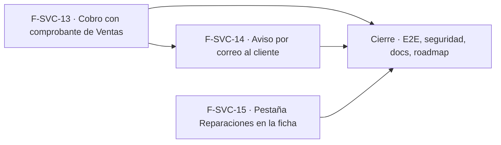

# Tasks: Service técnico · Service cobro y avisos

**Input**: [spec.md](./spec.md), [plan.md](./plan.md) y [contracts/service-cobro-y-avisos.md](./contracts/service-cobro-y-avisos.md) · **Épica**: MSF-232
**Formato**: `- [ ] T### [P] [Historia][USx] descripción (FR/SC)`. `[P]` = paralelizable (archivos distintos, sin dependencia dentro del mismo grupo). Cada FR/SC tiene **una sola** tarea dueña; «soporte de» marca una tarea que contribuye sin ser dueña. Las historias son autosuficientes: ninguna tarea depende de otra historia ni de una `[CIERRE]`; cada historia trae su propia migración con su propio timestamp.
**Verificación**: cada FR/SC tiene su verificación nombrada en la tabla «Verificación por requisito» de `spec.md`; la tarea de prueba de cada historia la ejecuta con el comando indicado.
**Validación por historia**: `pnpm test:db`, `pnpm lint`, `pnpm build` y `pnpm test:web` verdes antes de cerrar la fase.
**Esquema (Principio VII, re-verificado)**: `reparacion_avisos` → `dominio`; columnas nuevas de `comprobantes_venta` y `comprobantes_venta_lineas` → `dominio` (sin cambio); `reparaciones`, `clientes`, `estados_reparacion` solo lectura; outbox (`public`) solo se inserta por RPC.

## Phase 1: F-SVC-13 · Cobro mediante un comprobante de Ventas

**Goal**: `generar_comprobante_reparacion` crea el comprobante de Ventas con origen en la reparación y líneas que no tocan stock; el detalle muestra el comprobante asociado.

- [ ] T001 [F-SVC-13][US1] Migración `supabase/migrations/20270113100100_comprobantes_origen.sql`: columnas `origen_tipo` (`check in ('reparacion')`) y `origen_id` en `dominio.comprobantes_venta`, `check` de ambas juntas, índice único parcial `(organizacion_id, origen_tipo, origen_id) where estado <> 'anulada'`, reversión en el encabezado (soporte de FR-001, FR-002)
- [ ] T002 [P] [F-SVC-13][US1] Migración `supabase/migrations/20270113100200_lineas_sin_stock.sql`: `sin_stock boolean not null default false` en `comprobantes_venta_lineas`, `producto_id`/`deposito_id`/`escala` admiten `null` solo con `sin_stock` (check), `create or replace` de `confirmar_comprobante` y de la devolución de stock de notas de crédito/anulación para saltear esas líneas, reversión en el encabezado (FR-003)
- [ ] T003 [F-SVC-13][US1] Migración `supabase/migrations/20270113100300_generar_comprobante_reparacion.sql`: `public.generar_comprobante_reparacion` (`security definer`, `search_path = ''`, `for update`, permisos `service_tecnico`+`ventas` en `edicion`, cliente y tienda de la reparación, factura `borrador`, copia de ítems como líneas `sin_stock`, alícuota según *Decisiones abiertas* 1, idempotente), actividad `reparacion.comprobante_generado`, `revoke … from public, anon` y `grant execute … to authenticated` (FR-001, FR-002, FR-005, FR-008)
- [ ] T004 [P] [F-SVC-13][US1] Migración `supabase/migrations/20270113100400_comprobante_de_reparacion.sql`: `public.comprobante_de_reparacion` (id, número, tipo, estado, total, empresa; `null` sin comprobante; `service_tecnico` `lectura`+), mismos `revoke`/`grant` (soporte de FR-004)
- [ ] T005 [P] [F-SVC-13][US1] Migración `supabase/migrations/20270113100500_obtener_comprobante_origen.sql`: `create or replace public.obtener_comprobante` devolviendo además `origen_tipo` y `origen_id` y el número de la reparación, sin romper el contrato vigente (FR-007)
- [ ] T006 [F-SVC-13][US1] pgTAP `supabase/tests/database/service_cobro.test.sql` (verifica FR-001, FR-002, FR-005, FR-008 con `pnpm test:db`): comprobante con cliente, tienda, origen y líneas; idempotencia y dos generaciones concurrentes; regenerar tras anular; sin ítems y anulada rechazadas; permisos `service_tecnico`+`ventas`; cliente/tienda ajenos; aislamiento entre dos organizaciones; `anon` sin ejecución (SC-001)
- [ ] T007 [F-SVC-13][US1] pgTAP `supabase/tests/database/service_cobro_stock.test.sql` (verifica FR-003, FR-006 con `pnpm test:db`): confirmar y anular un comprobante con líneas `sin_stock` no genera movimientos ni reservas, las líneas con stock siguen igual (regresión de MSF-159), el comprobante de Service se edita/confirma/cobra/anula como cualquier factura; `rls_en_toda_tabla` verde (SC-002, FR-006)
- [ ] T008 [P] [F-SVC-13][US1] `apps/web/src/lib/reparacionComprobante.ts`: tipos, llamadas a `generar_comprobante_reparacion`/`comprobante_de_reparacion` y mapeo de `22023`/`55000`/`42501` a mensajes claros (soporte de FR-009)
- [ ] T009 [P] [F-SVC-13][US1] `apps/web/src/components/service/ComprobanteReparacion.tsx`: tarjeta «Comprobante asociado» (número, tipo, estado con chip, total, enlace a `/ventas/comprobantes/:id` solo con acceso a `ventas`), estados carga/error/éxito, adaptable 320/768/1440 px (FR-004)
- [ ] T010 [F-SVC-13][US1] Botón «Generar comprobante» junto al «Total al cliente» de `pages/service-tecnico/reparacion.tsx` (solo con permisos, ítems y reparación no anulada; recarga tras generar) y texto de origen «Reparación R-000N» con enlace en la pantalla del comprobante de Ventas solo con acceso a Service (FR-009; soporte de FR-007)
- [ ] T011 [F-SVC-13][US1] Vitest `apps/web/src/pages/service-tecnico/reparacion.comprobante.test.tsx` y `apps/web/src/pages/ventas/comprobante.origen.test.tsx` (verifica FR-004, FR-007, FR-009 con `pnpm test:web`): botón según permisos/ítems/comprobante, tarjeta con estados y enlace, errores, origen visible en Ventas (SC-003)
- [ ] T012 [F-SVC-13][US1] Documentación `docs/service-cobro.md` (modelo, RPC, marca `sin_stock`, alícuota provisoria, concurrencia, reversión) (FR-010; verifica con `pnpm docs:check`)

**Checkpoint F-SVC-13**: `pnpm test:db`, `pnpm lint`, `pnpm build` y `pnpm test:web` verdes.

## Phase 2: F-SVC-14 · Notificación al cliente por cambio de estado

**Goal**: aviso por correo al cliente con cola durable, reintentos, historial y «Reenviar», sin bloquear el cambio de estado. Requiere F-SVC-13 mergeada (comparte `reparacion.tsx`).

- [ ] T013 [F-SVC-14][US2] Migración `supabase/migrations/20270113110100_reparacion_avisos.sql`: `dominio.reparacion_avisos` (columnas de FR-020, FK compuestas por organización, índice único parcial de un aviso pendiente por reparación y estado), RLS por organización, nivel `service_tecnico` y tienda accesible, sin escritura directa, `anon` sin privilegios, reversión en el encabezado (FR-020)
- [ ] T014 [F-SVC-14][US2] Migración `supabase/migrations/20270113110200_avisar_cliente_reparacion.sql`: `public.avisar_cliente_reparacion(p_reparacion, p_estado_id default null)` (aviso `pendiente` + capacidad/ejecución/despacho de la outbox en una transacción, `sin_correo` sin encolar, anulada `55000`, idempotente, `edicion`), `revoke`/`grant` (FR-021)
- [ ] T015 [P] [F-SVC-14][US2] Migración `supabase/migrations/20270113110300_avisos_de_reparacion.sql`: `public.avisos_de_reparacion` (historial con nombre visible de quien pidió, nunca el correo del usuario; `lectura`+), `revoke`/`grant` (soporte de FR-026)
- [ ] T016 [P] [F-SVC-14][US2] Migración `supabase/migrations/20270113110400_avisos_reparacion_flow.sql`: `private.datos_aviso_reparacion` y `private.cerrar_aviso_reparacion` (idempotentes, solo `kestra_orquestacion`, motivo fijo), actividad `reparacion.aviso_solicitado`/`aviso_enviado`/`aviso_fallido` (FR-029)
- [ ] T017 [F-SVC-14][US2] Flow `infra/kestra/flows/reparaciones-aviso-correo.yml` (reclama `enviar-aviso-reparacion-*`, SMTP `KESTRA_SMTP_*`, 3 reintentos, cierre `enviado`/`fallido`, asunto y cuerpo de *Decisiones abiertas* 3, valores escapados, sin importes) registro en la copia de flows que verifica `pnpm test:kestra:copias` y script `test:kestra:reparaciones-aviso` en `package.json` (`node --test infra/kestra/flows/reparaciones-aviso-correo.test.mjs`) encadenado en `test` (FR-022, FR-024)
- [ ] T018 [F-SVC-14][US2] Prueba del flow `infra/kestra/flows/reparaciones-aviso-correo.test.mjs` (como `comprobantes-correo.test.mjs`): prefijo reclamado, reintentos, cierre, escape del HTML, ausencia de importes (SC-005)
- [ ] T019 [F-SVC-14][US2] pgTAP `supabase/tests/database/service_avisos.test.sql` (verifica FR-020, FR-021, FR-022 en `private`, FR-026, FR-029 con `pnpm test:db`): encolado atómico con su orden de despacho, idempotencia, cliente sin correo, reparación anulada, cierre `enviado`/`fallido` idempotente, funciones del flow solo para `kestra_orquestacion`, aislamiento entre dos organizaciones, `anon` sin ejecución; `rls_en_toda_tabla` verde (SC-004)
- [ ] T020 [P] [F-SVC-14][US2] `apps/web/src/lib/reparacionAvisos.ts`: tipos, llamadas a `avisar_cliente_reparacion`/`avisos_de_reparacion`, detección de cliente sin correo y mapeo de errores (soporte de FR-023)
- [ ] T021 [P] [F-SVC-14][US2] `apps/web/src/components/service/AvisosReparacion.tsx`: sección «Avisos al cliente» (Pendiente/Enviado/Fallido, destinatario, fecha, quién pidió), «Reenviar» con `edicion`, aviso «El cliente no tiene correo», estados vacío/error/carga (FR-023, FR-026, FR-027)
- [ ] T022 [F-SVC-14][US2] Integrar en `pages/service-tecnico/reparacion.tsx`: casilla «Avisar al cliente» junto al cambio de estado (destildada), botón «Avisar al cliente» del encabezado y mensaje «Aviso enviado al cliente»; primero cambia el estado y después pide el aviso, un fallo del aviso no revierte el estado (FR-025, FR-028)
- [ ] T023 [F-SVC-14][US2] Vitest `apps/web/src/pages/service-tecnico/reparacion.avisos.test.tsx` (verifica FR-023, FR-025, FR-027, FR-028 con `pnpm test:web`): casilla, botón del encabezado, «El cliente no tiene correo», el estado cambia aunque el aviso falle, historial con Reenviar, `lectura` sin acciones, cambio de empresa con el detalle abierto (SC-006)
- [ ] T024 [F-SVC-14][US2] Documentación `docs/service-avisos.md` (modelo, RPC, flow, plantilla, reintentos, garantía al-menos-una-vez, variables existentes, reversión) y tipos de actividad en `docs/actividad.md` (FR-030; verifica con `pnpm docs:check`)

**Checkpoint F-SVC-14**: `pnpm test:db`, `pnpm test:kestra:copias`, `pnpm lint`, `pnpm build` y `pnpm test:web` verdes.

## Phase 3: F-SVC-15 · Vínculo con la ficha del cliente

**Goal**: pestaña «Reparaciones» en la ficha del cliente con su estado vacío.

- [x] T025 [F-SVC-15][US3] Migración `supabase/migrations/20270113120100_reparaciones_de_cliente.sql`: `public.reparaciones_de_cliente(p_cliente, p_empresa, p_pagina, p_tamano)` (`security definer`, `search_path = ''`, organización + `service_tecnico` `lectura`+ + `empresas_accesibles()`, `{ total_filas, filas }`, orden por ingreso y número descendente, sin costos), `revoke`/`grant` (FR-040, FR-042) — ver commit 94d2069a. Desvío: la migración se entregó como `20270113120400_reparaciones_de_cliente.sql` (versión libre, ver commit 34cf78e4)
- [x] T026 [F-SVC-15][US3] pgTAP `supabase/tests/database/service_cliente_reparaciones.test.sql` (verifica FR-040, FR-042 con `pnpm test:db`): filtro por cliente y tienda, paginación, orden, visibilidad por tienda, sin costos, aislamiento entre dos organizaciones, `anon` sin ejecución (SC-007) — ver commit 73eada78
- [x] T027 [P] [F-SVC-15][US3] `apps/web/src/lib/reparacionesDeCliente.ts`: tipos y hook de la RPC con empresa activa y página, que invalida y vuelve a la página 1 al cambiar de empresa (soporte de FR-043) — ver commit c5fadd97
- [x] T028 [P] [F-SVC-15][US3] `apps/web/src/components/clientes/ReparacionesDeCliente.tsx`: tabla (Reparación, Tienda, Equipo con modelo, Estado chip, Ingreso, Entrega, Total «A presupuestar»/«—») con contador, paginación en el servidor, tarjetas en móvil (`ContenidoAdaptable`), fila → detalle, estados carga/error/vacío (FR-041, FR-043, FR-044, FR-046) — ver commit c5fadd97
- [x] T029 [F-SVC-15][US3] Pestañas «Datos» (contenido actual) y «Reparaciones» (carga diferida) en `pages/clientes/show.tsx`, la segunda oculta con `service_tecnico` en `ninguno` (FR-045) — ver commit c5fadd97
- [x] T030 [F-SVC-15][US3] Vitest `apps/web/src/pages/clientes/show.reparaciones.test.tsx` (verifica FR-041…FR-046 con `pnpm test:web`): pestaña con filas, vacío, error, cambio de empresa activa, sin pestaña con `ninguno`, tarjetas móviles, el contenido previo de la ficha intacto (SC-008) — ver commit c5fadd97 y test de carga de este rework
- [x] T031 [F-SVC-15][US3] Documentación `docs/service-cliente-reparaciones.md` (RPC, pestaña, reversión) y cruce en `docs/clientes.md` (FR-047; verifica con `pnpm docs:check`) — ver commit 0b66ea9b

**Checkpoint F-SVC-15**: `pnpm test:db`, `pnpm lint`, `pnpm build` y `pnpm test:web` verdes.

## Phase 4: Cierre, seguridad y recorrido completo

- [ ] T032 [CIERRE] E2E `apps/web/e2e/service-cobro-avisos.e2e.ts`: reparación de dos ítems, comprobante generado, cobrado en Ventas, aviso recibido en el correo de prueba y reparación visible en la pestaña de la ficha (se omite sin `SUPABASE_URL`/`SUPABASE_SERVICE_ROLE_KEY`; anotar en el PR cómo se corrió) (SC-009; corre con `pnpm test:e2e`)
- [ ] T033 [P] [CIERRE] Revisión de seguridad (`authz-security`, `database-reviewer`, `security-reviewer`) de la RLS de `reparacion_avisos`, los grants de las funciones del flow, el escape del HTML del correo, la ausencia de costos en el correo, la idempotencia y concurrencia del comprobante y las columnas nuevas de Ventas; re-verificar el esquema de cada objeto; agregar al índice `docs/service-tecnico.md` los enlaces a las tres guías nuevas y anotar en el PR las diferencias con el prototipo y las contradicciones prototipo↔requisitos (FR-090)
- [ ] T034 [CIERRE] Validación final: `pnpm lint && pnpm build && pnpm test && pnpm docs:check && pnpm matriz:check && pnpm prototipo:check` y `rls_en_toda_tabla` verdes (SC-010)
- [ ] T035 [CIERRE] Al merge del PR (merge commit `--no-ff`): actualizar la fila de Service técnico en `docs/roadmap-template.md` (paso manual) y comprobar que ninguna tarea queda `[ ]` (FR-091; verifica con `grep -c '^- \[ \]' specs/20261028-100000-service-cobro-y-avisos/tasks.md` = 0)

## Dependencias

Dentro de F-SVC-13: (T001, T002 [P]) → T003 → (T004 [P], T005 [P]) → T006 → T007; T008 [P] y T009 [P] → T010 (necesita T004 y T005) → T011 → T012.
Dentro de F-SVC-14: T013 → (T014, T015 [P], T016 [P]) → T017 (necesita T016) → T018; todos los de base de datos → T019; T020 [P] y T021 [P] → T022 → T023 → T024.
Dentro de F-SVC-15: T025 → T026; T027 [P] y T028 [P] → T029 (necesita T025) → T030 → T031.
Cierre: T033 [P] puede arrancar con las historias; T032 y T034 → T035 al final. Las tareas [CIERRE] nunca son prerequisito de una historia.
Entre historias: F-SVC-14 requiere F-SVC-13 **mergeada** solo porque ambas integran `pages/service-tecnico/reparacion.tsx` (no comparten tabla, migración ni documento). F-SVC-13 y F-SVC-15 son independientes (F-SVC-15 toca `clientes/show.tsx` y su propia RPC).

## Plan de ejecución (historias)

El **orden de toma** de las historias lo declara esta tabla: el orquestador la **consume** (no lo infiere del orden de las tareas). Una historia arranca cuando sus dependencias (`Depende de`) están **Finalizadas (mergeadas)**; las del **mismo** `Grupo` van **en paralelo** (F-SVC-13 y F-SVC-15 no comparten archivos, tabla ni migración).

| Historia | Depende de | Grupo |
|----------|------------|-------|
| F-SVC-13 | — | 1 |
| F-SVC-15 | — | 1 |
| F-SVC-14 | F-SVC-13 | 2 |
| [Cierre] | F-SVC-13, F-SVC-14, F-SVC-15 | 3 |

