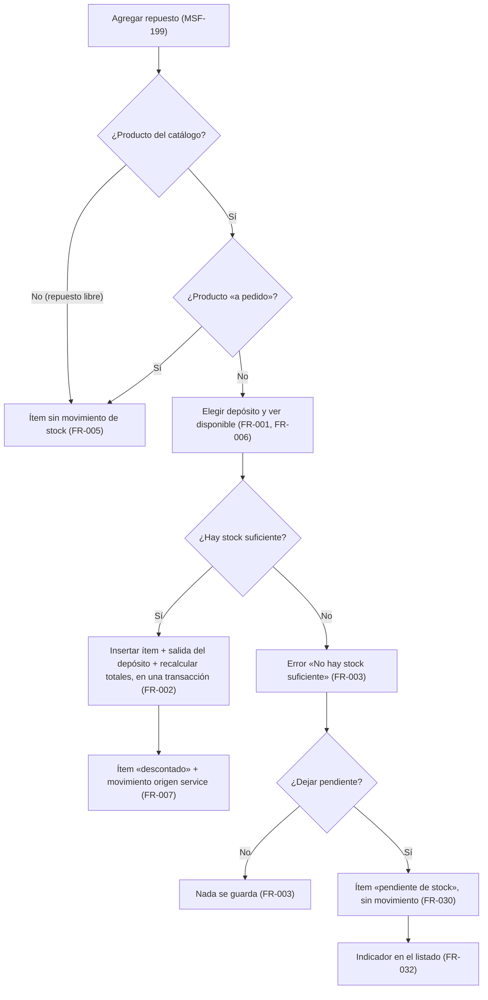
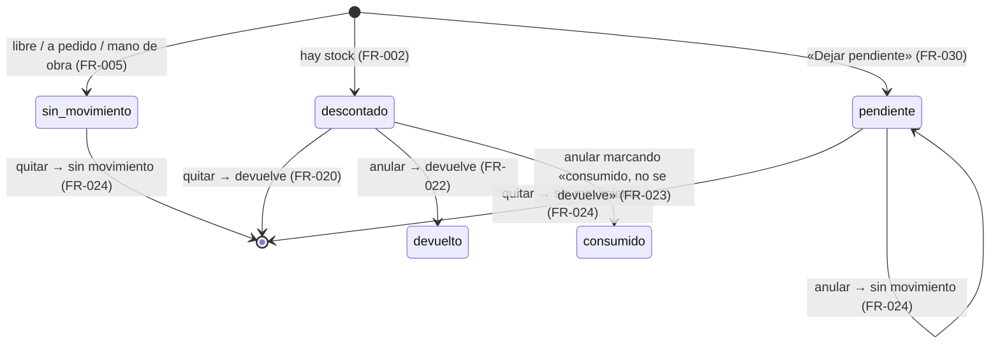
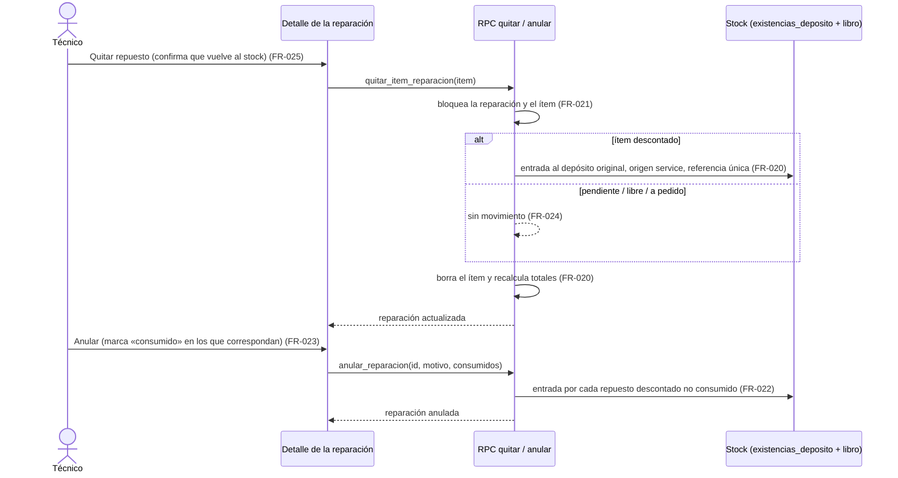
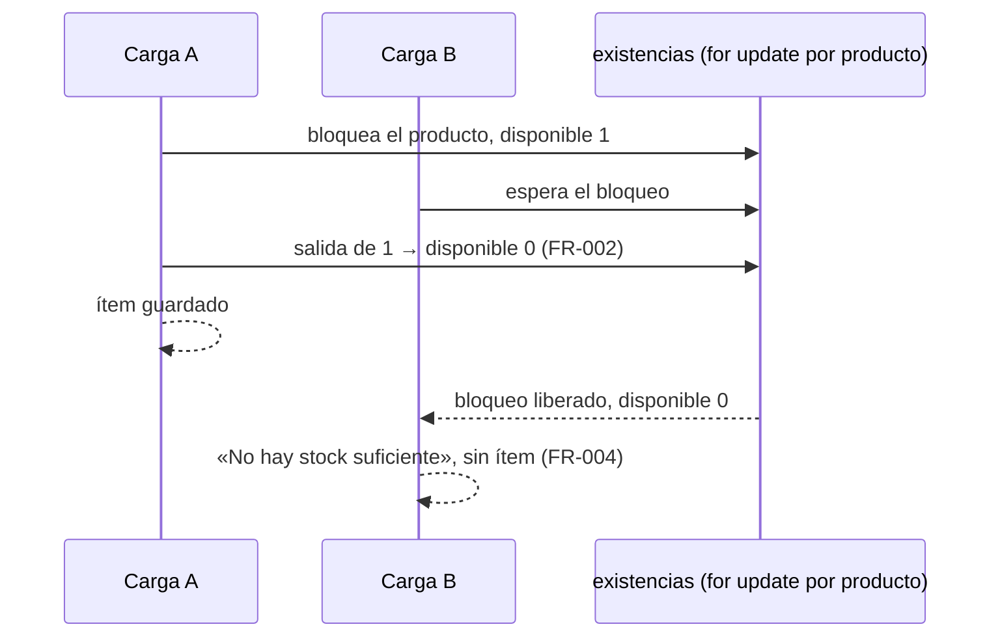

# Feature Specification: Service técnico · Service repuestos y stock

**Feature Branch**: `epic/MSF-217-service-tecnico-service-repuestos-y-stoc`

**Jira Epic**: MSF-217 — Service técnico · Service repuestos y stock (spec `service-repuestos-y-stock`)

**Created**: 2026-10-28

**Status**: Ready for implementation — la especificación viene completa desde Jira. Los puntos de «A revisar» no bloquean: cada uno lleva una decisión provisoria en *Decisiones abiertas*.

**Delivery scope**: `refine` (apps/web) y `supabase` (migraciones + RPC + pgTAP). Sin `kestra`, `superset` ni `workers`.

**Prioridad / Hito**: P1 · Etapa 2 (desde enero de 2027, después de rentabilidad) · 20 h en la tabla de la épica (por tallas L 16 + M 8 + S 4 = 28 h; ver *Decisiones abiertas* 6) · alcance etapa2.

**Dependencias**:
- Bloqueada por: MSF-199 (Service listado, ítems e impresión) y MSF-292 (Stock depósitos y reservas). **Ambas ya están en `main`**: `dominio.reparacion_items`, `agregar_item_reparacion`, `quitar_item_reparacion` y la grilla de ítems (`docs/service-items.md`); `dominio.depositos`, `dominio.existencias_deposito`, `private.aplicar_movimiento_deposito` y la vista `stock_por_deposito` (`docs/stock-depositos.md`). Por la cadena de MSF-292, también Stock movimientos (MSF-136).
- Bloquea a: ninguna épica.
- Relacionada, sin bloqueo: MSF-232 (Service cobro y avisos): su F-SVC-13 marca las líneas para no descontar stock de nuevo porque ya se descontó acá; se construye sin esperar. Catálogo (productos) llega por MSF-199.
- Ajuste a otro componente (Stock): `dominio.movimientos_stock` debe aceptar `origen = 'service'` y una referencia con `reparacion_id`. Se entrega **dentro de F-SVC-10** como migración aditiva (hoy el libro no tiene esas columnas).

**Input**: Epic MSF-217. Objetivo: «Al terminar, cada repuesto cargado en una reparación descuenta stock del depósito elegido, se devuelve si se quita o se anula, y el taller se entera cuando falta stock.»

**Regla de fuentes** (literal de la épica):
- Comportamiento y datos: mandan los requisitos y escenarios de esta historia.
- Qué se ve (disposición, textos, estados, popups, flujos): el prototipo validado es referencia visual, no hace falta que quede extremadamente idéntico; los flujos (si hay) aclaran estados y acciones.
- Cómo se construye (componentes, estilos y patrones): mandan el template y el system design del producto (MSF-117, `docs/sistema-de-diseno.md`). No se copia HTML ni CSS: se reproduce con los componentes del template y los tokens.
- El prototipo muestra más que esta historia: se implementa solo lo que piden los requisitos de esta historia; otras secciones, botones o diálogos son de otras historias.
- Si algo no se puede igualar: lo más cercano, sin inventar, anotando la diferencia en el PR. Si prototipo y requisitos se contradicen: requisitos para el comportamiento, prototipo para lo visual, y la contradicción queda anotada en el PR.
- Prototipos (solo lectura, presentes en el árbol): `design/pantallas/ServicioReparacion.dc.html` (mano de obra y repuestos) y `ServicioReparaciones.dc.html` (listado). Inventarios al día con `pnpm prototipo:inventario`.

## Modelo y supuestos

- **Descuento inmediato al agregar el ítem** (no reserva).
- **Hoy hay un solo depósito y el modelo admite varios**: el selector de depósito se muestra siempre; con un solo depósito activo queda elegido por defecto.
- **Los productos «a pedido» no descuentan** (`disponibilidad_manual = 'a_pedido'`).
- **El stock negativo sigue bloqueado**: «No hay stock suficiente».
- **Mano de obra y repuestos libres (sin producto del catálogo) no mueven stock**, como en P0.
- **Los ítems cargados antes de esta épica no se tocan**: quedan `sin_movimiento`; no se descuentan ni se devuelven retroactivamente.
- **Una sola base de stock**: la tabla es `dominio.existencias_deposito` y la vista de lectura `public.stock_por_deposito` (la épica pide confirmar el nombre: en el repo no existen dos modelos).
- **El Técnico no necesita permiso de Stock**: el descuento lo hace una función interna invocada por las RPC de Service (`service_tecnico` en `edicion`).
- Los importes siguen siendo ARS sin IVA; los totales no cambian por el stock.

### Esquema de datos (Constitución, Principio VII)

| Objeto | Esquema | Justificación | RLS / acceso |
|--------|---------|---------------|--------------|
| `reparacion_items` (**existente**, F-SVC-10 agrega `deposito_id` y `stock_estado`) | **`dominio`** (sin cambio) | Entidad del taller (qué se cobra y de dónde salió el repuesto). | RLS vigente de MSF-199; sin escritura directa, solo RPC. FK compuesta `(deposito_id, organizacion_id)` a `dominio.depositos`. |
| `movimientos_stock` (**existente**, F-SVC-10 agrega `origen`, `reparacion_id` y `referencia`) | **`dominio`** (sin cambio) | Libro de Stock. Ajuste pedido a otro componente por la épica. | RLS vigente (Stock `lectura`/`edicion`); solo lo escriben funciones `security definer`. FK compuesta `(reparacion_id, organizacion_id)`. Índice único parcial sobre `referencia` donde `origen = 'service'`. |
| `existencias_deposito`, `existencias`, `depositos`, `reservas_stock`, `productos`, `reparaciones` (**existentes**) | `dominio` (sin cambio) | Solo lectura/actualización por las funciones de stock existentes. | RLS vigente. |

No se crean tablas. `rls_en_toda_tabla` (pgTAP, `public` + `dominio`) debe seguir verde. Migraciones **aditivas** con reversión en el encabezado de cada una. Las RPC viven en `public` con `revoke … from public, anon` y `grant execute … to authenticated`; las ayudas en `private`. Contratos en `contracts/service-repuestos-stock.md`.

## User Scenarios & Testing *(mandatory)*

### User Story 1 - Repuestos que descuentan stock del depósito elegido (F-SVC-10, P1, talla L)

Como persona del taller, quiero que al cargar un repuesto del catálogo en una reparación se descuente del depósito que elijo, para que el stock refleje lo que realmente uso.

**Why this priority**: sin descuento, el stock miente y el taller repone a ciegas.

**Independent Test**: en una reparación abierta, agregar un repuesto con producto del catálogo y depósito elegido baja el disponible de ese depósito y deja un movimiento con origen `service` y la reparación; con stock insuficiente se muestra «No hay stock suficiente» y no queda ni ítem ni movimiento; dos cargas simultáneas del último artículo dejan una sola ganadora; un producto «a pedido» o un repuesto libre no mueve stock.

**Acceptance Scenarios**:
1. **Given** «Agregar repuesto» con un producto buscado por Nombre o SKU, **When** elige el depósito, **Then** ve «Disponible en <depósito>: N u.» y el selector muestra cada depósito activo.
2. **Given** stock suficiente, **When** pulsa «Agregar repuesto», **Then** el ítem aparece en la tabla con su depósito, el disponible de ese depósito baja en la cantidad y los totales de la reparación se recalculan en la misma operación.
3. **Given** stock insuficiente en el depósito elegido, **When** confirma, **Then** ve el error «No hay stock suficiente» con lo disponible, y no se crea ítem, movimiento ni cambio de totales.
4. **Given** dos personas cargando a la vez el último artículo, **Then** una lo carga y la otra recibe «No hay stock suficiente»; el stock nunca queda negativo.
5. **Given** un producto «a pedido», un repuesto libre o mano de obra, **Then** el ítem se carga sin movimiento de stock.
6. **Given** el libro de Stock, **Then** el movimiento figura como salida con origen `service`, la reparación, el depósito, el actor y la fecha.
7. **Given** la tabla de repuestos, **Then** muestra la columna DEPÓSITO DE MERCADERÍA con el depósito de cada repuesto descontado.
8. **Given** una reparación entregada o anulada, **Then** la base rechaza la carga (sin cambio respecto de MSF-199).

### User Story 2 - Devolución de repuestos al quitar ítems o anular (F-SVC-11, P1, talla M)

Como persona del taller, quiero que el repuesto vuelva al stock si lo quito o si anulo la reparación, para no perder mercadería en el papel.

**Why this priority**: sin devolución, un error de carga deja el stock desfasado para siempre.

**Independent Test**: quitar un repuesto descontado devuelve las unidades al mismo depósito en la misma transacción; repetir la operación no devuelve dos veces; anular la reparación devuelve los repuestos descontados salvo los marcados «consumido, no se devuelve»; quitar un repuesto pendiente o libre no mueve stock.

**Acceptance Scenarios**:
1. **Given** un repuesto descontado, **When** lo quita (con confirmación que avisa que vuelve al stock), **Then** las unidades vuelven al depósito original, el ítem desaparece y los totales se recalculan.
2. **Given** la misma operación repetida (doble clic o reintento), **Then** el stock se devuelve una sola vez.
3. **Given** una reparación abierta con repuestos descontados, **When** la anula, **Then** cada repuesto vuelve a su depósito original y queda marcado `devuelto`.
4. **Given** el diálogo de anulación, **When** marca un repuesto como «consumido, no se devuelve», **Then** ese repuesto no vuelve al stock y queda visible con esa marca.
5. **Given** un repuesto pendiente de stock, libre, «a pedido» o mano de obra, **When** se quita o se anula, **Then** no se mueve stock.
6. **Given** una devolución, **Then** el libro muestra una entrada con origen `service`, la reparación y el depósito original.
7. **Given** una reparación entregada, **Then** no se devuelve nada (ya no admite quitar ni anular).

### User Story 3 - Aviso de repuesto sin stock (F-SVC-12, P1, talla S)

Como persona del taller, quiero enterarme cuando falta un repuesto y poder dejarlo pendiente, para seguir con la reparación sin perder el aviso.

**Why this priority**: sin esto, «No hay stock suficiente» frena la carga del presupuesto.

**Independent Test**: con stock insuficiente, el diálogo ofrece «Dejar pendiente»; el ítem se carga sin descontar y queda marcado «pendiente de stock» en el detalle; el listado indica las reparaciones con repuestos pendientes.

**Acceptance Scenarios**:
1. **Given** el error «No hay stock suficiente», **Then** el diálogo ofrece «Dejar pendiente».
2. **Given** «Dejar pendiente», **When** confirma, **Then** el ítem se carga (suma al total al cliente), no descuenta stock y queda marcado «pendiente de stock».
3. **Given** el detalle, **Then** el repuesto pendiente muestra la marca en su fila.
4. **Given** el listado de reparaciones, **Then** las que tienen repuestos pendientes muestran un indicador de pendientes de stock; las demás no.
5. **Given** que se quita el repuesto pendiente, **Then** el indicador desaparece y no se mueve stock.
6. **Given** una reparación entregada o anulada, **Then** no se puede dejar nada pendiente.

### Edge Cases

- Producto desactivado o de otra organización: sin cambio (MSF-199): se rechaza.
- Depósito inactivo o de otra organización: no se ofrece y la base lo rechaza (`22023`).
- Cantidad mayor al disponible por reservas «a pedido» de otras ventas: el disponible ya descuenta lo reservado (F-STK-16); la barrera es el disponible, no la cantidad.
- Producto sin fila en `existencias_deposito` del depósito elegido: disponible 0.
- Reparación anulada con repuestos pendientes: el indicador deja de contar (la reparación anulada no cuenta como pendiente).
- Reintento de la misma carga con la red caída: la segunda llamada puede crear un ítem nuevo (la carga no es idempotente por diseño en MSF-199); lo que sí es idempotente es la **devolución**.
- Sin permiso (`ninguno`/`lectura`) en `service_tecnico`: sin botones; la base rechaza (`42501`).

## Flujos

### Flujo 1 · Agregar un repuesto (descuento inmediato)

Pasos de F-SVC-10 y F-SVC-12.

### Flujo 2 · Estado de stock de un repuesto

`stateDiagram-v2` sobre `stock_estado` del ítem (no cambia los estados de la reparación de MSF-182).

### Flujo 3 · Quitar un ítem o anular la reparación (devolución idempotente)

### Flujo 4 · Dos cargas del último artículo (concurrencia)

## Requirements *(mandatory)*

### Functional Requirements

**F-SVC-10 · Descuento por depósito (US1)**
- **FR-001**: `reparacion_items` gana `deposito_id` (FK compuesta a `dominio.depositos`) y `stock_estado` (`sin_movimiento` | `descontado` | `pendiente` | `consumido` | `devuelto`, por defecto `sin_movimiento`). `deposito_id` solo se completa en repuestos con producto del catálogo que mueven stock. Los ítems existentes quedan `sin_movimiento`.
- **FR-002**: `agregar_item_reparacion` acepta `p_deposito_id` (si es nulo, el depósito por defecto) y, para un repuesto con producto que no es «a pedido», inserta el ítem, aplica la salida del depósito, registra el movimiento y recalcula los totales **en la misma transacción**. El ítem queda `descontado`.
- **FR-003**: Si el disponible del depósito (cantidad − reservado) no alcanza, la operación falla con `23514` «No hay stock suficiente» (con el disponible en el detalle) y **no deja ítem, movimiento ni cambio de totales**.
- **FR-004**: Dos cargas simultáneas del mismo producto se serializan por el bloqueo de `existencias`; el stock de un depósito nunca queda negativo. Verificado con pgTAP de concurrencia (dos repuestos del último artículo).
- **FR-005**: Los productos «a pedido», los repuestos libres y la mano de obra no mueven stock (`sin_movimiento`).
- **FR-006**: `depositos_para_repuesto(p_producto_id)` devuelve los depósitos **activos** con cantidad, reservado y disponible, para un usuario de `service_tecnico` (sin exigir Stock). El diálogo «Agregar repuesto» muestra el selector «Depósito de mercadería de donde se descuenta» y la nota «Disponible en <depósito>: N u.», con el aviso de falta de stock del prototipo.
- **FR-007**: Cada descuento inserta en `dominio.movimientos_stock` una salida con `origen = 'service'`, `reparacion_id`, `deposito_id`, actor, fecha y `referencia` única (`reparacion:<id>:item:<item>:salida`). La migración agrega `origen`, `reparacion_id` y `referencia` al libro (ajuste de Stock, aditivo, sin tocar los movimientos existentes) y el saldo sigue siendo el total único.
- **FR-008**: La tabla de repuestos del detalle muestra la columna DEPÓSITO DE MERCADERÍA (el nombre del depósito o «—» si el ítem no mueve stock); `obtener_reparacion` devuelve por ítem `deposito_id`, `deposito_nombre` y `stock_estado`.
- **FR-009**: El texto de ayuda de la sección «Repuestos» dice que el descuento ocurre **al agregar** (la épica manda sobre el prototipo; ver *Decisiones abiertas* 2).
- **FR-010**: El descuento lo ejecuta `private.mover_stock_reparacion` (no la RPC pública de Stock, que exige permiso de Stock y motivo): reutiliza `private.aplicar_movimiento_deposito` y un motivo de sistema «Repuesto de reparación»; sin `grant` a `authenticated`.
- **FR-011**: Gate: solo `service_tecnico` en `edicion`; `anon` sin ejecución; organización siempre de la sesión.
- **FR-012**: Al cambiar la empresa activa, el diálogo «Agregar repuesto» se cierra con aviso y la disponibilidad se vuelve a consultar (Principio VIII).
- **FR-013**: Documentación `docs/service-repuestos-stock.md` y actualización de `docs/service-items.md` (los ítems ya no son «solo informativos»).

**F-SVC-11 · Devolución (US2)**
- **FR-020**: `quitar_item_reparacion` sobre un ítem `descontado` registra una **entrada** al depósito original (origen `service`, reparación, `referencia` única `…:devolucion`) y borra el ítem y recalcula totales en la misma transacción.
- **FR-021**: La devolución es **idempotente**: el ítem y la reparación se bloquean; el segundo intento encuentra el ítem inexistente (`P0002`) y el índice único de `referencia` impide cualquier doble entrada.
- **FR-022**: `anular_reparacion` (nuevo `p_consumidos uuid[]`) devuelve, por cada repuesto `descontado` no consumido, una entrada a su depósito original y lo marca `devuelto`, en la misma transacción que la anulación.
- **FR-023**: Los ítems cuyo id llega en `p_consumidos` quedan `consumido` y **no** vuelven al stock; deben ser repuestos `descontado` de esa reparación (si no, `22023`). El diálogo de anulación lista los repuestos descontados con la opción «Consumido, no se devuelve» (por defecto se devuelven todos) y la fila queda marcada.
- **FR-024**: Quitar o anular un ítem `pendiente`, `sin_movimiento` o de mano de obra no mueve stock.
- **FR-025**: La confirmación de quitar un repuesto descontado avisa que las unidades vuelven al depósito; tras la operación se recarga la reparación.
- **FR-026**: La devolución va al depósito original del ítem aunque hoy esté inactivo (la mercadería vuelve físicamente ahí).
- **FR-027**: Documentación `docs/service-repuestos-devolucion.md`.

**F-SVC-12 · Pendiente de stock (US3)**
- **FR-030**: `agregar_item_reparacion` acepta `p_dejar_pendiente`; si es verdadero **y** falta stock, carga el ítem `pendiente` (con el depósito elegido) sin movimiento; si hay stock, descuenta normalmente. El diálogo, ante «No hay stock suficiente», ofrece el botón «Dejar pendiente».
- **FR-031**: La fila del repuesto pendiente muestra la marca «Pendiente de stock» en el detalle.
- **FR-032**: `listar_reparaciones` suma `pendientes_stock` por fila (cantidad de repuestos `pendiente` de reparaciones no anuladas ni entregadas) y el listado muestra el indicador «Pendiente de stock» en las que tengan alguno.
- **FR-033**: Documentación `docs/service-repuestos-pendiente.md`.

**Cierre**
- **FR-090**: E2E de agregar, quitar y anular con stock por depósito.
- **FR-091**: Índice documental (`docs/service-tecnico.md`, `docs/stock.md`, `docs/actividad.md`) y fila de la épica en `docs/roadmap-template.md`.
- **FR-092**: Barrido de seguridad: `rls_en_toda_tabla`, `anon` sin ejecución sobre las RPC nuevas y las reemplazadas.

### Success Criteria

- **SC-001** (F-SVC-10): pgTAP — descuento por depósito, libro con origen `service`, «a pedido»/libre sin movimiento, rechazo sin rastro, aislamiento entre organizaciones, `anon` sin ejecución.
- **SC-002** (F-SVC-10): pgTAP de **concurrencia** — dos repuestos del último artículo a la vez: uno gana, el otro «No hay stock suficiente», saldo ≥ 0.
- **SC-003** (F-SVC-10): Vitest — selector de depósito con disponible, error de stock, columna DEPÓSITO, ayuda actualizada, cierre del diálogo al cambiar de empresa.
- **SC-004** (F-SVC-11): pgTAP — devolución al quitar, idempotencia, sin movimiento para pendientes/libres.
- **SC-005** (F-SVC-11): pgTAP — anulación con y sin consumidos, `22023` si el consumido no corresponde.
- **SC-006** (F-SVC-11): Vitest — confirmación de quitar, opción «Consumido, no se devuelve», marca en la fila.
- **SC-007** (F-SVC-12): pgTAP — pendiente sin movimiento, `pendientes_stock` del listado, anuladas no cuentan.
- **SC-008** (F-SVC-12): Vitest — botón «Dejar pendiente», marca en el detalle, indicador en el listado.
- **SC-009** (cierre): E2E de agregar, quitar y anular.
- **SC-010** (cierre): documentación e `pnpm docs:check`, `pnpm matriz:check`, `pnpm prototipo:check` verdes.

## Decisiones abiertas

1. **Nombre `existencias_deposito` vs `stock_por_deposito`** (A revisar): resuelto con el repo — tabla `dominio.existencias_deposito`, vista `public.stock_por_deposito`. No hay dos modelos.
2. **Descuento al cargar o reserva hasta la entrega** (A revisar): se implementa **descuento al agregar** (supuesto de la épica). El prototipo dice «al marcar la reparación como Entregado»: contradicción anotada; manda la épica en comportamiento, el prototipo en lo visual (se corrige el texto de ayuda, FR-009).
3. **Prioridad P1 con prototipo ya dibujado** y **no figura en el Roadmap a diciembre**: no cambia el alcance; se registra la fila en `docs/roadmap-template.md` al cerrar (FR-091).
4. **Devolución a un depósito hoy inactivo** (provisorio): vuelve al original igual (FR-026). Si el negocio prefiere otro destino, se cambia en `private.mover_stock_reparacion`.
5. **Cómo se resuelve un repuesto pendiente** (la épica no lo dice; provisorio): no hay descuento automático posterior; la persona lo quita y lo vuelve a cargar cuando llega la mercadería. El pendiente **no bloquea** la entrega ni el cobro. Si se quiere «resolver pendiente» como acción, es otra historia.
6. **Horas**: 20 h en la tabla, 28 h por tallas (L 16 + M 8 + S 4). Se conserva 20 h de la tabla y se deja la diferencia anotada; la estimación de F-SVC-10 se revisa al planificar la Etapa 2.
7. **«Consumido, no se devuelve»** (el doc lo pide al anular; provisorio): lo decide la persona por repuesto en el diálogo de anulación, por defecto se devuelve todo.
8. **Qué depósitos se ofrecen**: todos los activos de la organización; el «venden desde acá» por empresa (F-STK-14) no se aplica a Service porque la épica no lo pide.

## Matriz de verificación

Cada requisito tiene su verificación nombrada (archivo de test o comando) además de su tarea dueña. `test:db` exige `pnpm dev:supabase`.

| Requisito | Verificación nombrada |
|-----------|-----------------------|
| FR-001 | pgTAP `service_repuestos_stock` (columnas, `check`, ítems previos `sin_movimiento`) — T007 |
| FR-002 | pgTAP `service_repuestos_stock` (ítem + salida + totales en una transacción) — T007 |
| FR-003 | pgTAP `service_repuestos_stock` (`23514` sin ítem, movimiento ni cambio de totales) — T007 |
| FR-004 | pgTAP `service_repuestos_concurrencia` (dos repuestos del último artículo) — T008 |
| FR-005 | pgTAP `service_repuestos_stock` («a pedido», libre y mano de obra sin movimiento) — T007 |
| FR-006 | pgTAP `service_repuestos_stock` (`depositos_para_repuesto`) y Vitest `AgregarRepuestoDialog` (selector y nota) — T007, T013 |
| FR-007 | pgTAP `service_repuestos_stock` (libro con `origen = 'service'`, reparación, depósito, actor, `referencia` única) — T007 |
| FR-008 | pgTAP `service_repuestos_stock` (`obtener_reparacion`) y Vitest `ItemsReparacion` (columna) — T007, T013 |
| FR-009 | Vitest `ItemsReparacion` (texto de ayuda) — T013 |
| FR-010 | pgTAP `service_repuestos_stock` (`has_function_privilege` de `authenticated` = falso) — T007 |
| FR-011 | pgTAP `service_repuestos_stock` (`edicion` / `lectura` / `ninguno` / `anon`) — T007 |
| FR-012 | Vitest `AgregarRepuestoDialog` (cierre con aviso al cambiar de empresa) — T013 |
| FR-013 | `pnpm docs:check` — T014, T034 |
| FR-020 | pgTAP `service_repuestos_devolucion` — T017 |
| FR-021 | pgTAP `service_repuestos_devolucion` (segundo intento `P0002`, índice único) — T017 |
| FR-022 | pgTAP `service_repuestos_anulacion` — T018 |
| FR-023 | pgTAP `service_repuestos_anulacion` (`22023`) y Vitest `AnularDialog` — T018, T022 |
| FR-024 | pgTAP `service_repuestos_devolucion` — T017 |
| FR-025 | Vitest `ItemsReparacion` (confirmación y recarga) — T022 |
| FR-026 | pgTAP `service_repuestos_devolucion` (depósito inactivo) — T017 |
| FR-027 | `pnpm docs:check` — T023, T034 |
| FR-030 | pgTAP `service_repuestos_pendiente` y Vitest `AvisoSinStock` — T026, T031 |
| FR-031 | Vitest `MarcaStockItem` — T031 |
| FR-032 | pgTAP `service_repuestos_pendiente` (`pendientes_stock`) y Vitest del listado — T026, T031 |
| FR-033 | `pnpm docs:check` — T032, T034 |
| FR-090 | E2E `service-repuestos-stock.e2e.ts` — T033 |
| FR-091 | `pnpm docs:check`, `pnpm matriz:check` y `git grep -n "MSF-217" docs/roadmap-template.md` — T034 |
| FR-092 | pgTAP `rls_en_toda_tabla` y `service_repuestos_stock` (`anon`) — T035 |
| SC-001 … SC-009 | Son los tests nombrados en su propio criterio (T007, T008, T013, T017, T018, T022, T026, T031, T033) |
| SC-010 | `pnpm docs:check && pnpm matriz:check && pnpm prototipo:check` — T034 |

## Matriz pantalla↔criterios

Inventario generado con `pnpm prototipo:inventario` sobre `design/pantallas/ServicioReparacion.dc.html` y `ServicioReparaciones.dc.html`. La épica pide un **subconjunto** (lo de stock); lo ya entregado por MSF-182/MSF-199 mantiene su dueño.

### Service técnico · Reparación (detalle) (`ServicioReparacion`)

| Ítem del inventario | Dueño |
|---|---|
| Tabla de repuestos, columna **DEPÓSITO DE MERCADERÍA** | FR-008 |
| Diálogo «Agregar repuesto»: campo «Depósito de mercadería de donde se descuenta» (selector) y nota «Disponible en <depósito>: N u.» (con aviso de falta de stock) | FR-006 |
| Diálogo «Agregar repuesto»: campos «Buscar producto del catálogo» (Nombre o SKU), «Precio», «Cantidad», «Subtotal:», botón «Cancelar» | ya entregado (MSF-199, requisitos 25 y 28); se extiende con FR-006 |
| Botón «Agregar repuesto» (envío del diálogo) | FR-002 |
| Texto de ayuda «Productos del catálogo. Se descuentan del depósito … » | FR-009 |
| Mensaje de éxito «Repuesto agregado · se descuenta de <depósito>» | FR-002 |
| Error «No hay stock suficiente» | FR-003 |
| Botón «Dejar pendiente» y marca «Pendiente de stock» (**no están en el prototipo; los pide la épica**) | FR-030, FR-031 |
| Acción de quitar por fila (con confirmación que avisa de la devolución) | FR-020, FR-025 |
| Opción «Consumido, no se devuelve» en el diálogo de anulación y marca en la fila (**no están en el prototipo; los pide la épica**) | FR-023 |
| Existencias por depósito en la lista de productos (chips «Principal N · Local N») | FR-006 (como «Disponible» de cada depósito del selector) |
| Tabla de mano de obra, diálogo «Agregar mano de obra» (campos Concepto, Precio, Cantidad), «Agregar mano de obra», «Imprimir orden», «Guardar», «Reparaciones», «Costo mano de obra», «Costo repuestos», campos de Cliente y equipo, Técnico y fechas, Estado e historial | ya entregado (MSF-182 / MSF-199); sin cambio |
| Botón «Avisar al cliente» | **FUERA DE ALCANCE** — avisos son de MSF-232 |
| «·Sugerido ·», «Editar el catálogo de servicios →» y nota «el costo interno sale del catálogo» | **FUERA DE ALCANCE** — catálogo de servicios, sin historia (MSF-199 *Decisiones abiertas* 4) |

### Service técnico · Reparaciones (listado) (`ServicioReparaciones`)

| Ítem del inventario | Dueño |
|---|---|
| Indicador «Pendiente de stock» por reparación (**no está en el prototipo; lo pide la épica**) | FR-032 |
| Columnas Reparación, Tienda, Cliente, Equipo, N.º de serie, Estado, Técnico, Entrega, Total; botones «Nueva reparación», «Reparaciones», «Modelos», «Estados de reparación»; pestañas | ya entregado (MSF-182 / MSF-199); sin cambio |

### Empresa activa (Principio VIII)

| Elemento | Dueño |
|---|---|
| Detalle: la reparación ya pertenece a una tienda; no hay selector propio | no aplica — alcance declarado |
| Diálogo «Agregar repuesto» al cambiar la empresa activa | FR-012 |
| Indicador del listado respeta el filtro de empresa | hereda MSF-199 FR-005; FR-032 |

## Matriz de trazabilidad Jira ↔ US ↔ FR ↔ tareas

| Jira | Historia | US | FR / SC | Tareas |
|------|----------|----|---------|--------|
| MSF-217 (épica) | F-SVC-10 Repuestos que descuentan stock del depósito elegido | US1 | FR-001…FR-013, SC-001…SC-003 | T001–T014 |
| MSF-217 (épica) | F-SVC-11 Devolución de repuestos al quitar ítems o anular | US2 | FR-020…FR-027, SC-004…SC-006 | T015–T023 |
| MSF-217 (épica) | F-SVC-12 Aviso de repuesto sin stock | US3 | FR-030…FR-033, SC-007, SC-008 | T024–T032 |
| Tarea de cierre (label `cierre`) | E2E, índice documental, roadmap, barrido de seguridad | — | FR-090…FR-092, SC-009, SC-010 | T033–T035 |
