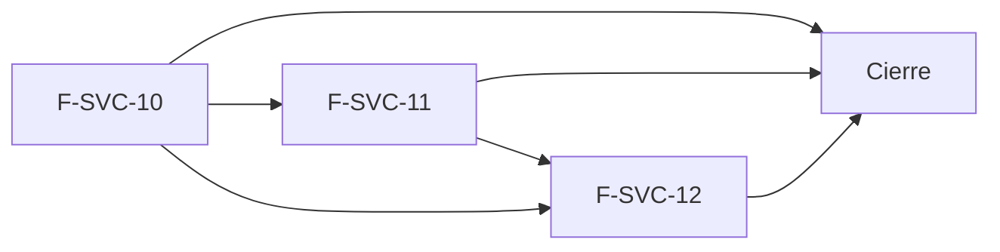

# Tasks: Service técnico · Service repuestos y stock

**Input**: [spec.md](./spec.md), [plan.md](./plan.md) y [contracts/service-repuestos-stock.md](./contracts/service-repuestos-stock.md) · **Épica**: MSF-217
**Formato**: `- [ ] T### [P] [Historia][USx] descripción (FR/SC)`. `[P]` = paralelizable (archivos distintos, sin dependencia dentro del mismo grupo). Cada FR/SC tiene **una sola** tarea dueña; «soporte de» marca una tarea que contribuye sin ser dueña. El orden y las dependencias de las tareas son **solo dentro de su historia**; el orden entre historias lo fija la tabla del final. Ninguna tarea depende de una `[CIERRE]`.
**Validación por historia**: `pnpm test:db` (requiere `pnpm dev:supabase`), `pnpm lint`, `pnpm build` y `pnpm test:web` verdes antes de cerrar la fase.
**Esquema (Principio VII, re-verificado)**: `reparacion_items` (columnas nuevas) → `dominio`; `movimientos_stock` (columnas nuevas) → `dominio`; `existencias_deposito`, `existencias`, `depositos`, `reparaciones` → `dominio` sin cambio; ninguna tabla nueva en `public`.
**Regla absoluta**: ninguna tarea queda `[ ]` al cierre: se hace con evidencia o se cierra con `[x]` + `Desvío: <motivo>` y, si la deuda es real, una Historia `[Deuda MSF-217]`.

## Phase 1: F-SVC-10 · Repuestos que descuentan stock del depósito elegido

**Goal**: ítem de repuesto + salida del depósito en una transacción, con barrera, concurrencia segura y selector de depósito.

- [ ] T001 [P] [F-SVC-10][US1] Migración `supabase/migrations/20270113100100_stock_movimientos_origen_service.sql`: `dominio.movimientos_stock` gana `origen` (`check (origen in ('service'))`, nulo en los movimientos existentes), `reparacion_id` (FK compuesta `(reparacion_id, organizacion_id)` a `dominio.reparaciones`), `referencia` text, índice único parcial `(organizacion_id, referencia) where origen = 'service'`, reversión en el encabezado (soporte de FR-007)
- [ ] T002 [P] [F-SVC-10][US1] Migración `supabase/migrations/20270113100200_reparacion_items_deposito.sql`: `reparacion_items` gana `deposito_id` (FK compuesta a `dominio.depositos`) y `stock_estado` (`sin_movimiento` por defecto, `check` con los cinco valores), índice por `deposito_id` no nulo, ítems existentes quedan `sin_movimiento`, sin grants nuevos de escritura, reversión en el encabezado (FR-001)
- [ ] T003 [F-SVC-10][US1] Migración `supabase/migrations/20270113100300_service_mover_stock.sql`: motivo de sistema «Repuesto de reparación» y `private.mover_stock_reparacion(org, reparacion, item, producto, deposito, cantidad, sentido)` que usa `private.aplicar_movimiento_deposito` e inserta el movimiento con `origen = 'service'`, `reparacion_id`, actor, fecha y `referencia` única; `revoke` a `public, anon, authenticated` (FR-007, FR-010)
- [ ] T004 [F-SVC-10][US1] Migración `supabase/migrations/20270113100400_reparacion_item_agregar_stock.sql`: reemplaza `public.agregar_item_reparacion` con `p_deposito_id` (nulo = depósito por defecto; depósito activo y de la organización, `22023`), inserta el ítem, descuenta con `private.mover_stock_reparacion` y recalcula en una transacción, `23514` «No hay stock suficiente» sin rastro, «a pedido»/libre/mano de obra `sin_movimiento`, gate `edicion`, `drop` de la firma de 6 parámetros, `revoke`/`grant` (FR-002, FR-003, FR-004, FR-005, FR-011)
- [ ] T005 [P] [F-SVC-10][US1] Migración `supabase/migrations/20270113100500_depositos_para_repuesto.sql`: `public.depositos_para_repuesto(p_producto_id)` con depósitos activos, cantidad, reservado y disponible, gate `service_tecnico` `lectura`/`edicion` (sin exigir Stock), `revoke`/`grant` (FR-006)
- [ ] T006 [P] [F-SVC-10][US1] Migración `supabase/migrations/20270113100600_reparaciones_leer_stock.sql`: `obtener_reparacion` y el JSON de ítems devuelven `deposito_id`, `deposito_nombre` y `stock_estado` sin romper las claves vigentes (soporte de FR-008)
- [ ] T007 [F-SVC-10][US1] pgTAP `supabase/tests/database/service_repuestos_stock.test.sql`: descuento por depósito y libro con origen `service`, «a pedido»/libre/mano de obra sin movimiento, rechazo sin ítem ni movimiento, depósito inactivo o ajeno, `depositos_para_repuesto`, aislamiento entre dos organizaciones, `anon` sin ejecución, `rls_en_toda_tabla` verde (SC-001) **Verifica** FR-001 (columnas, `check`, ítems previos `sin_movimiento`), FR-002, FR-003, FR-005, FR-006, FR-007, FR-008 (`obtener_reparacion` con `deposito_nombre`/`stock_estado`), FR-010 (`has_function_privilege` de `authenticated` sobre `private.mover_stock_reparacion` = falso) y FR-011 (`edicion` sí; `lectura`/`ninguno` `42501`; `anon` sin ejecución). Comando: `pnpm test:db -- service_repuestos_stock`.
- [ ] T008 [F-SVC-10][US1] pgTAP de concurrencia `supabase/tests/database/service_repuestos_concurrencia.test.sql`: dos repuestos del último artículo a la vez (patrón de `stock_lotes_concurrencia.test.sql`): uno gana, el otro «No hay stock suficiente», saldo ≥ 0 (SC-002) **Verifica** FR-004. Comando: `pnpm test:db -- service_repuestos_concurrencia`.
- [ ] T009 [P] [F-SVC-10][US1] `apps/web/src/lib/reparacionItems.ts`: `agregarItem` con `deposito_id`, `listarDepositosParaRepuesto`, tipos con `deposito_nombre`/`stock_estado` y mensaje de `23514` (soporte de FR-006)
- [ ] T010 [P] [F-SVC-10][US1] `apps/web/src/components/service/SelectorDepositoRepuesto.tsx`: botones segmentados de depósitos activos, nota «Disponible en <depósito>: N u.» con el aviso de falta de stock del prototipo, depósito por defecto preseleccionado (FR-006)
- [ ] T011 [F-SVC-10][US1] `components/service/ItemsReparacion.tsx`: columna DEPÓSITO DE MERCADERÍA en la tabla de repuestos («—» si no mueve stock) y texto de ayuda de «Repuestos» con el descuento al agregar (FR-008, FR-009)
- [ ] T012 [F-SVC-10][US1] `components/service/AgregarRepuestoDialog.tsx`: integra el selector, envía `deposito_id`, muestra «No hay stock suficiente» y el éxito «Repuesto agregado · se descuenta de <depósito>»; se cierra con aviso y vuelve a consultar la disponibilidad al cambiar la empresa activa (FR-012)
- [ ] T013 [F-SVC-10][US1] Vitest del diálogo y la tabla: selector con disponible, error de stock, columna DEPÓSITO, ayuda, cambio de empresa activa (SC-003) **Verifica** FR-006 (selector y nota «Disponible en»), FR-008 (columna), FR-009 (ayuda) y FR-012 (cierre con aviso al cambiar de empresa). Comando: `pnpm test:web -- AgregarRepuestoDialog ItemsReparacion`.
- [ ] T014 [F-SVC-10][US1] Documentación `docs/service-repuestos-stock.md` (modelo, `stock_estado`, función interna, libro, barrera, concurrencia, reversión) y ajuste de `docs/service-items.md` (FR-013) Verificación: `pnpm docs:check`.

**Checkpoint F-SVC-10**: `pnpm test:db`, `pnpm lint`, `pnpm build` y `pnpm test:web` verdes.

## Phase 2: F-SVC-11 · Devolución de repuestos al quitar ítems o anular

**Goal**: lo descontado vuelve al depósito original, una sola vez, al quitar o anular; lo consumido se marca y no vuelve.

- [ ] T015 [F-SVC-11][US2] Migración `supabase/migrations/20270113110100_reparacion_item_quitar_devolucion.sql`: `private.devolver_stock_item_reparacion` (entrada al depósito original aunque esté inactivo, `referencia` única) y `public.quitar_item_reparacion` que, bajo `for update`, devuelve si el ítem estaba `descontado`, borra y recalcula en una transacción; pendientes/libres/mano de obra sin movimiento; mismas firma, `revoke` y `grant` (FR-020, FR-021, FR-024, FR-026)
- [ ] T016 [F-SVC-11][US2] Migración `supabase/migrations/20270113110200_reparaciones_anular_devolucion.sql`: reemplaza `public.anular_reparacion(p_id, p_motivo, p_consumidos uuid[] default '{}')`; devuelve cada repuesto `descontado` no consumido (`devuelto`), marca los consumidos (`consumido`, `22023` si no corresponden) en la misma transacción; `drop` de la firma `(uuid, text)`, `revoke`/`grant` (FR-022; soporte de FR-023)
- [ ] T017 [P] [F-SVC-11][US2] pgTAP `supabase/tests/database/service_repuestos_devolucion.test.sql`: devolución al quitar, idempotencia (segundo intento y `referencia` única), sin movimiento para pendientes/libres, libro con entrada `service`, aislamiento, `anon` sin ejecución (SC-004) **Verifica** FR-020, FR-021, FR-024 y FR-026 (devolución a un depósito inactivo). Comando: `pnpm test:db -- service_repuestos_devolucion`.
- [ ] T018 [P] [F-SVC-11][US2] pgTAP `supabase/tests/database/service_repuestos_anulacion.test.sql`: anulación con y sin consumidos, `22023` con un consumido ajeno o no descontado, anulada no se re-anula, entregada rechazada (SC-005) **Verifica** FR-022 y FR-023 (lado base de datos). Comando: `pnpm test:db -- service_repuestos_anulacion`.
- [ ] T019 [P] [F-SVC-11][US2] `apps/web/src/lib/reparaciones.ts`: `anularReparacion(id, motivo, consumidos)` y mensajes de error (soporte de FR-023)
- [ ] T020 [P] [F-SVC-11][US2] `components/service/AnularDialog.tsx`: lista de repuestos descontados con la opción «Consumido, no se devuelve» (por defecto se devuelven todos) y aviso de que el resto vuelve al stock (FR-023)
- [ ] T021 [P] [F-SVC-11][US2] `components/service/ItemsReparacion.tsx` y `lib/reparacionItems.ts`: confirmación de quitar que avisa que las unidades vuelven al depósito, marca «Consumido» / «Devuelto» en las filas de una reparación anulada, recarga tras la operación (FR-025)
- [ ] T022 [F-SVC-11][US2] Vitest: confirmación de quitar, opción «Consumido, no se devuelve», marcas en las filas (SC-006) **Verifica** FR-023 (diálogo y marca en la fila) y FR-025. Comando: `pnpm test:web -- AnularDialog ItemsReparacion`.
- [ ] T023 [F-SVC-11][US2] Documentación `docs/service-repuestos-devolucion.md` (reglas, idempotencia, consumidos, reversión) (FR-027) Verificación: `pnpm docs:check`.

**Checkpoint F-SVC-11**: `pnpm test:db`, `pnpm lint`, `pnpm build` y `pnpm test:web` verdes.

## Phase 3: F-SVC-12 · Aviso de repuesto sin stock

**Goal**: «Dejar pendiente» ante la falta de stock, marca en el detalle e indicador en el listado.

- [ ] T024 [F-SVC-12][US3] Migración `supabase/migrations/20270113120100_reparacion_item_agregar_pendiente.sql`: reemplaza `public.agregar_item_reparacion` con `p_dejar_pendiente` (si falta stock y es verdadero, ítem `pendiente` sin movimiento; si hay stock, descuenta), `drop` de la firma de 7 parámetros, `revoke`/`grant` (FR-030)
- [ ] T025 [P] [F-SVC-12][US3] Migración `supabase/migrations/20270113120200_reparaciones_listar_pendientes.sql`: `listar_reparaciones` suma `pendientes_stock` por fila (repuestos `pendiente` de reparaciones no anuladas ni entregadas) sin cambiar su firma (soporte de FR-032)
- [ ] T026 [F-SVC-12][US3] pgTAP `supabase/tests/database/service_repuestos_pendiente.test.sql`: pendiente sin movimiento, total al cliente incluido, `pendientes_stock` del listado, anuladas y entregadas no cuentan, quitar pendiente sin stock, aislamiento, `anon` sin ejecución (SC-007) **Verifica** FR-030 (lado base de datos) y FR-032 (`pendientes_stock`). Comando: `pnpm test:db -- service_repuestos_pendiente`.
- [ ] T027 [P] [F-SVC-12][US3] `lib/reparacionItems.ts` y `lib/reparacionesListado.ts`: parámetro `dejarPendiente` y campo `pendientes_stock` (soporte de FR-030, FR-032)
- [ ] T028 [P] [F-SVC-12][US3] `components/service/AvisoSinStock.tsx` e integración en `AgregarRepuestoDialog.tsx`: ante «No hay stock suficiente» muestra el disponible y el botón «Dejar pendiente» (soporte de FR-030)
- [ ] T029 [P] [F-SVC-12][US3] `components/service/MarcaStockItem.tsx` e integración en `ItemsReparacion.tsx`: marca «Pendiente de stock» en la fila (FR-031)
- [ ] T030 [F-SVC-12][US3] `pages/service-tecnico/reparaciones.tsx`: indicador «Pendiente de stock» en la fila y la tarjeta móvil de las reparaciones con `pendientes_stock > 0` (FR-032)
- [ ] T031 [F-SVC-12][US3] Vitest: botón «Dejar pendiente», marca en el detalle, indicador en el listado (SC-008) **Verifica** FR-030 (botón «Dejar pendiente»), FR-031 y FR-032 (indicador del listado). Comando: `pnpm test:web -- AvisoSinStock MarcaStockItem reparaciones`.
- [ ] T032 [F-SVC-12][US3] Documentación `docs/service-repuestos-pendiente.md` (qué es pendiente, cómo se resuelve, indicador, reversión) (FR-033) Verificación: `pnpm docs:check`.

**Checkpoint F-SVC-12**: `pnpm test:db`, `pnpm lint`, `pnpm build` y `pnpm test:web` verdes.

## Phase 4: Cierre

- [ ] T033 [CIERRE] E2E `apps/web/e2e/service-repuestos-stock.e2e.ts`: agregar, quitar y anular con stock por depósito (se omite sin `SUPABASE_URL`/`SUPABASE_SERVICE_ROLE_KEY`; anotar en el PR cómo se corrió) (FR-090, SC-009) **Verifica** FR-090. Comando: `pnpm --filter @platform/web test:e2e -- service-repuestos-stock`.
- [ ] T034 [CIERRE] Índice documental (`docs/service-tecnico.md`, `docs/stock.md`, `docs/actividad.md`) y fila de la épica en `docs/roadmap-template.md`; `pnpm docs:check`, `pnpm matriz:check` y `pnpm prototipo:check` verdes (FR-091, SC-010) **Verifica** FR-013, FR-027, FR-033 (guías presentes y enlazadas) y FR-091. Comando: `pnpm docs:check && pnpm matriz:check && pnpm prototipo:check`; la fila de la épica en `docs/roadmap-template.md` se confirma con `git grep -n "MSF-217" docs/roadmap-template.md`.
- [ ] T035 [CIERRE] Barrido de seguridad: `rls_en_toda_tabla`, `anon` sin ejecución en las RPC nuevas y reemplazadas, sin service-role en el navegador, revisión de `authz-security` sobre las RPC (FR-092) **Verifica** FR-092 con el pgTAP `rls_en_toda_tabla` y el test `anon` de `service_repuestos_stock`: `pnpm test:db -- rls_en_toda_tabla service_repuestos_stock`; sin service-role en el navegador: `git grep -n "SERVICE_ROLE" apps/web/src` sin resultados.

## Plan de ejecución (historias)

| Historia | Depende de | Grupo |
|----------|------------|-------|
| F-SVC-10 | — | 1 |
| F-SVC-11 | F-SVC-10 | 2 |
| F-SVC-12 | F-SVC-11 | 3 |
| [Cierre] | F-SVC-10, F-SVC-11, F-SVC-12 | 4 |

F-SVC-11 depende de F-SVC-10 (necesita `stock_estado`, el depósito y el libro con origen `service`). F-SVC-12 depende de F-SVC-10 (reemplaza `agregar_item_reparacion`) y se serializa tras F-SVC-11 porque comparten `ItemsReparacion.tsx` y `lib/reparacionItems.ts`.

