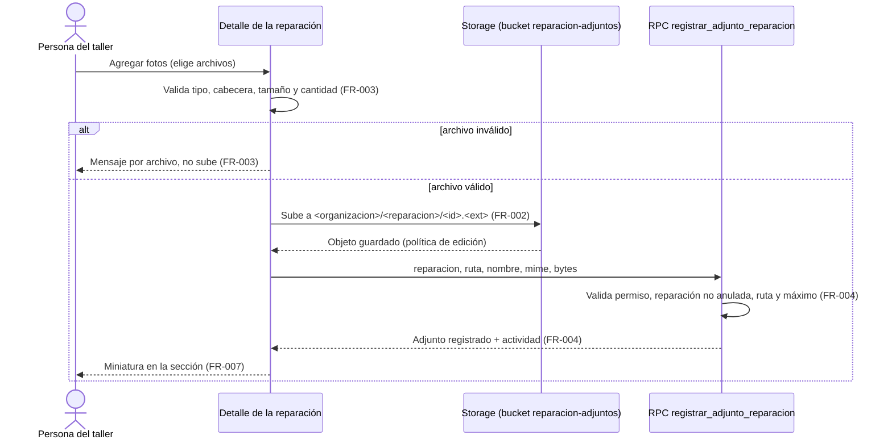
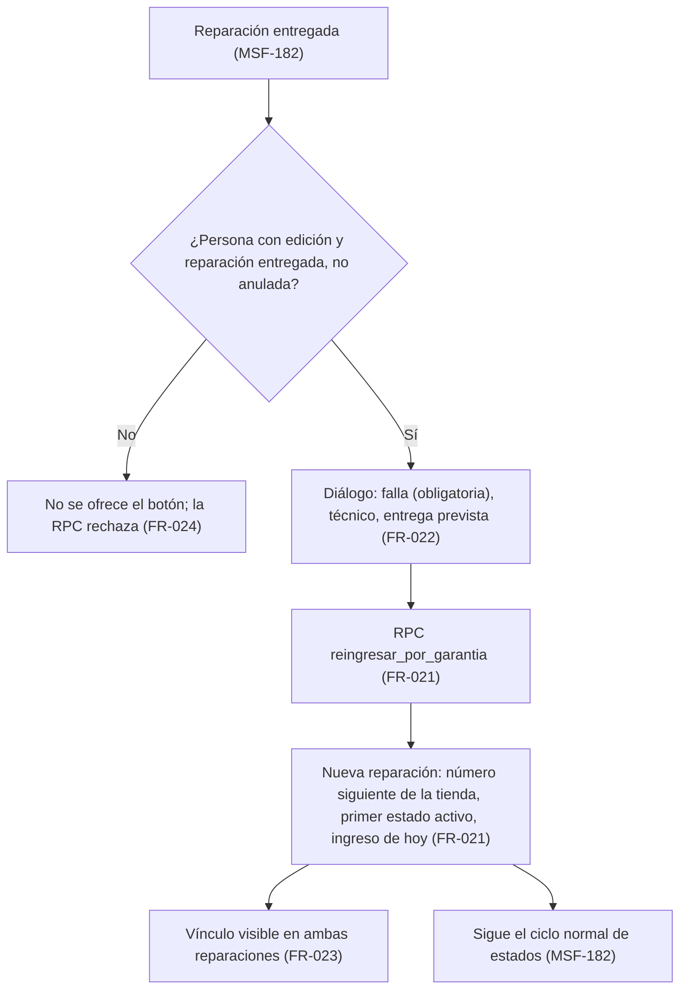
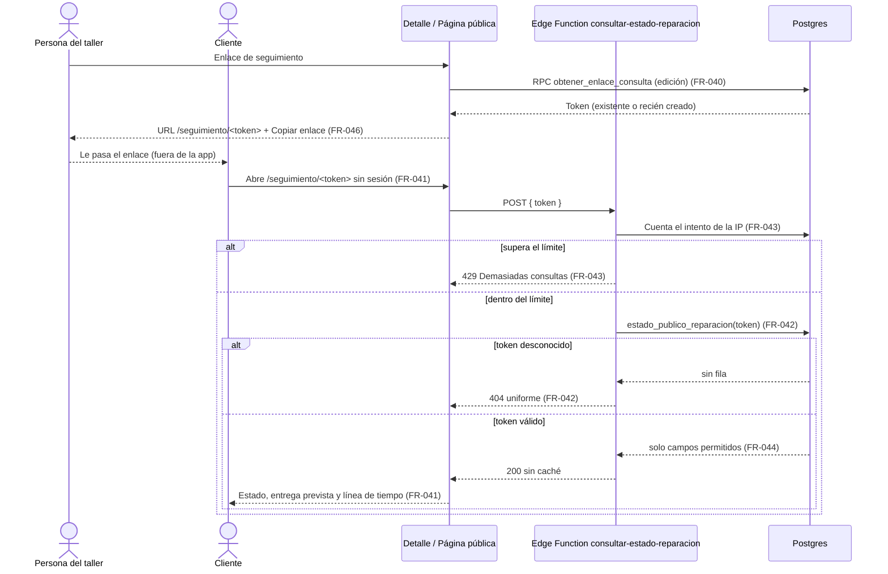
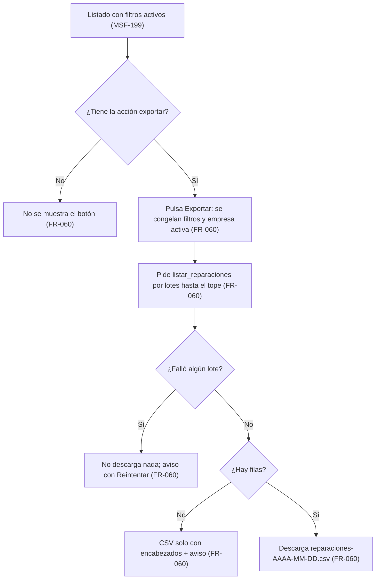
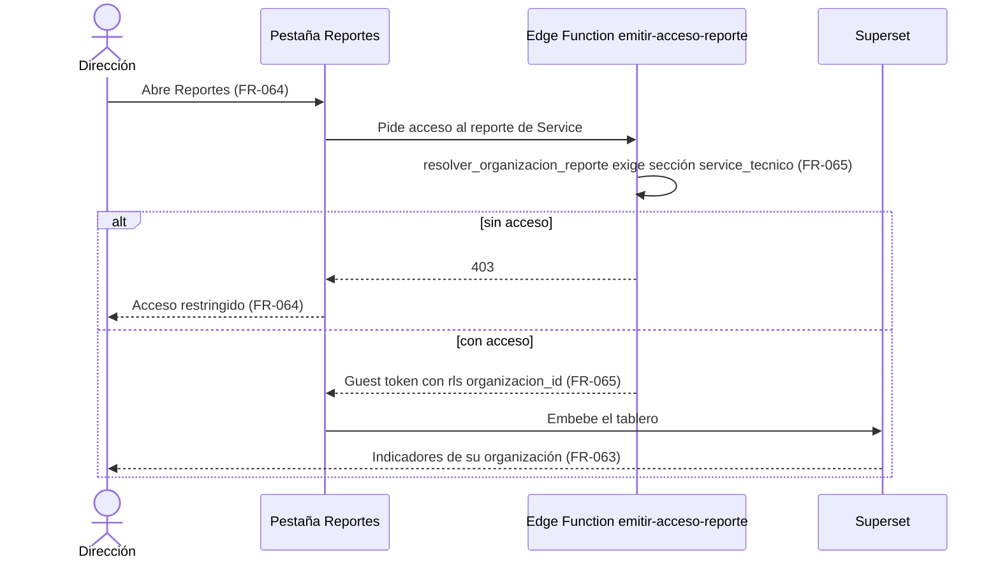

# Feature Specification: Service técnico · Service seguimiento y reportes

**Feature Branch**: `epic/MSF-124-service-tecnico-service-seguimiento-y-re`

**Jira Epic**: MSF-124 — Service técnico · Service seguimiento y reportes (spec `service-seguimiento-y-reportes`)

**Created**: 2026-10-28

**Status**: Ready for implementation — la especificación viene completa desde Jira. Los puntos de «A revisar» no bloquean: cada uno lleva una decisión provisoria en *Decisiones abiertas*.

**Delivery scope**: `refine` (apps/web), `supabase` (migraciones + RPC + Edge Function + pgTAP) y `superset` (vistas `analitica.*` + tablero YAML versionado). Sin `kestra` ni `workers`.

**Prioridad / Hito**: P2 · Etapa 3 (sin fecha) · 26 h en la tabla (por tallas M 8 + S 4 + M 8 + M 8 = 28 h; diferencia menor, se conserva el 26) · **fuera de diciembre** (el roadmap a diciembre solo incluye Service técnico P0).

**Dependencias**:
- Bloqueada por: MSF-199 (Service listado, ítems e impresión). **Ya está en `main`**: `dominio.reparacion_items`, `listar_reparaciones`, `obtener_reparacion` con totales, orden de ingreso y remito (`docs/service-listado.md`, `docs/service-items.md`, `docs/service-impresion.md`). Por su cadena trae MSF-182 (`dominio.reparaciones`, `reparacion_historial`, estados, entrega, anulación, rol Técnico, `docs/service-tecnico.md`).
- Bloquea a: ninguna épica.
- Relacionada, sin bloqueo: MSF-217 (Service repuestos y stock) y MSF-232 (Service cobro y avisos). Fotos, garantía, enlace de consulta y reportes **no** necesitan el descuento de stock ni el cobro.

**Input**: Epic MSF-124. Objetivo: «Al terminar, el taller adjunta fotos del equipo, reingresa equipos por garantía, el cliente consulta el estado con un enlace y la dirección tiene reportes de service.»

**Regla de fuentes** (literal de la épica):
- Comportamiento y datos: mandan los requisitos y escenarios de esta historia.
- Qué se ve (disposición, textos, estados, popups, flujos): el prototipo validado es referencia visual, no hace falta que quede extremadamente idéntico; los flujos (si hay) aclaran estados y acciones.
- Cómo se construye (componentes, estilos y patrones): mandan el template y el system design del producto (MSF-117, `docs/sistema-de-diseno.md`). No se copia HTML ni CSS: se reproduce con los componentes del template y los tokens.
- El prototipo muestra más que esta historia: se implementa solo lo que piden los requisitos de esta historia; otras secciones, botones o diálogos son de otras historias.
- Si algo no se puede igualar: lo más cercano, sin inventar, anotando la diferencia en el PR. Si prototipo y requisitos se contradicen: requisitos para el comportamiento, prototipo para lo visual, y la contradicción queda anotada en el PR.
- Prototipos (solo lectura, en el árbol): `design/pantallas/ServicioReparaciones.dc.html` (listado) y `ServicioReparacion.dc.html` (detalle). **Ninguna de las pantallas de esta épica está dibujada**: ni la sección de adjuntos del detalle, ni el botón de exportación del listado, ni el diálogo del enlace, ni la página pública, ni el tablero. Se construyen con los componentes del template y el sistema de diseño, y la diferencia queda anotada en el PR (*Decisiones abiertas* 1 y 7).

## Modelo y supuestos

- **Los archivos usan el almacenamiento del template**: Storage de Supabase self-hosted con bucket privado y políticas por organización (patrón de `fotos-perfil`, `historial-importaciones` y `productos-imagenes`).
- **El enlace de consulta no requiere cuenta del cliente.** Es una capacidad (token aleatorio) y no un usuario.
- **Los reportes salen de Superset, por organización**: vistas de solo lectura en `analitica`, tablero versionado en YAML y token de invitado con cláusula por `organizacion_id` (spec 007, `emitir-acceso-reporte`, `ReporteEmbebido`, como Rentabilidad).
- **La exportación reutiliza la del repo** (CSV UTF-8 con BOM que Excel abre; `useExportarCsv`, `neutralizarFormula`, `docs/stock-exportacion.md`). No hay exportación `.xlsx` en el template (*Decisiones abiertas* 5).
- **El template NO trae** y esta épica construye: carga de imágenes con validación, página pública sin cuenta, **límite de tasa por IP** (no hay endpoint público con rate limiting; `intentos_acceso` es por correo y para el login), exportación del listado y dashboards versionados de Service.
- **Costos internos**: nada de lo nuevo expone `costo_mano_obra`, `costo_repuestos` ni la ganancia. Los reportes y la exportación usan solo los totales de cara al cliente (`total_mano_obra`, `total_repuestos`).
- **Reingreso por garantía = una reparación nueva** vinculada a la original; no reabre ni modifica la reparación entregada.
- Ningún aviso al cliente se envía en esta épica (el enlace se copia a mano; los avisos son de MSF-232).

### Esquema de datos (Constitución, Principio VII)

Verificado con graphify y con el árbol: existen `dominio.reparaciones` (`20261020110100`), `dominio.reparacion_historial`, `dominio.reparacion_items` (`20261022100100`), `public.reportes`/`reportes_organizaciones`/`resolver_organizacion_reporte` (`20260909140000`, `20261130100400`), el rol `superset_analitica` (`20261130100300`) y el esquema `analitica` (solo vistas). **Lo marcado «nueva» no existe: se crea con su migración.**

| Objeto | Esquema | Justificación | RLS / acceso |
|--------|---------|---------------|--------------|
| `reparacion_adjuntos` (**nueva**, F-SVC-20) | **`dominio`** | Entidad de negocio del taller (qué fotos tiene una reparación), no plataforma. | **Sí**: `organizacion_id = (select private.organizacion_id())`, nivel de `service_tecnico` (`select` con `lectura`/`edicion`) y tienda accesible de la reparación (mismo criterio que `20261020140000`). **Sin `insert/update/delete` directos**: solo RPC `security definer`. FK compuesta `(reparacion_id, organizacion_id)`. `anon` sin acceso. |
| Bucket `reparacion-adjuntos` en `storage.objects` (**nuevo**, F-SVC-20) | infraestructura de Storage (no es tabla propia) | Archivos del taller; patrón `historial-importaciones`. | Bucket **privado**; políticas por prefijo `<organizacion_id>/<reparacion_id>/`: `select` con `lectura`, `insert`/`delete` con `edicion`; sin `update`; sin acceso `anon`. |
| `reparaciones` (**existente**, F-SVC-21 agrega `reparacion_origen_id`) | **`dominio`** (sin cambio) | Entidad central ya declarada en MSF-182; la columna es el vínculo de garantía. | RLS vigente. Columna nullable, FK compuesta `(reparacion_origen_id, organizacion_id)` a `reparaciones(id, organizacion_id)`; `grant select` por columna y **sin** grant de escritura (la fija solo la RPC). |
| `reparacion_enlaces_consulta` (**nueva**, F-SVC-22) | **`dominio`** | Dato de negocio del taller (el enlace de seguimiento de una reparación). | **Sí**: RLS habilitada por organización y **sin grants ni políticas** para `authenticated`/`anon` (el token es un secreto): solo lo tocan RPC `security definer` (staff, `edicion`) y la función interna que usa la Edge Function con la service-role del servidor. Unique `(reparacion_id)` y unique `(token)`. FK compuesta `(reparacion_id, organizacion_id)`. |
| `consultas_publicas_intentos` (**nueva**, F-SVC-22) | **`public`** | Plataforma/transversal: contador de límite de tasa de un endpoint público; no es una entidad del taller. | RLS habilitada **sin políticas** y sin grants: solo la Edge Function (service-role del servidor). Guarda un hash de la IP (con sal de servidor), nunca la IP. Sin `organizacion_id` (la IP precede a saber de qué organización es el token). |
| `analitica.service_reparaciones`, `analitica.service_reparacion_items` (**nuevas vistas**, F-SVC-23) | `analitica` (solo vistas) | Contrato de lectura para Superset, como `analitica.margen_producto_canal`. | Solo `select` para `superset_analitica`; exponen `organizacion_id` (columna del filtro `rls` del guest token); sin costos internos. |
| `reportes` (**existente**) | `public` (sin cambio) | Catálogo de reportes de plataforma (spec 007). | Se agrega **una fila** (dato, no estructura) con `seccion = 'service_tecnico'`. |
| `empresas`, `productos`, `clientes` (**existentes**) | `public`/`dominio` (sin cambio) | Solo lectura. | RLS vigente. |

`rls_en_toda_tabla` (pgTAP, recorre `public` + `dominio`) debe seguir verde con las tres tablas nuevas. Todas las migraciones son **aditivas** y llevan su reversión en el encabezado. Las RPC viven en `public` (contrato de la app) con `revoke … from public, anon` y `grant execute … to authenticated` explícitos; las ayudas internas en `private`. `anon` no ejecuta ninguna función nueva (regla del repo: solo las RPC de acceso). El único acceso público nuevo es la **Edge Function** `consultar-estado-reparacion`, que usa la service-role en el servidor y nunca en el navegador.

## User Scenarios & Testing *(mandatory)*

### User Story 1 - Fotos y adjuntos del equipo (F-SVC-20, P2, talla M)

Como persona del taller, quiero adjuntar fotos del equipo a la reparación y verlas después, para dejar constancia del estado en que llegó y en que se entregó.

**Why this priority**: sin fotos, el taller no puede demostrar el estado de ingreso del equipo ante un reclamo.

**Independent Test**: en el detalle de una reparación, agregar varias fotos las muestra como miniaturas; un archivo no permitido o demasiado grande se rechaza con su mensaje; otra organización (o una persona sin acceso a la tienda) no ve ni descarga nada.

**Acceptance Scenarios**:
1. **Given** el detalle de una reparación no anulada y una persona con `edicion` en `service_tecnico`, **When** pulsa «Agregar fotos» y elige una o varias imágenes válidas, **Then** cada una se sube, se registra y aparece como miniatura en la sección «Fotos y adjuntos».
2. **Given** un archivo que no es JPG, PNG ni WebP, o que pesa más de 5 MB, **Then** se rechaza antes de subir, con un mensaje por archivo, y no se guarda nada.
3. **Given** que la reparación ya tiene 20 adjuntos, **Then** no se pueden agregar más y el mensaje lo dice.
4. **Given** una miniatura, **When** la abre, **Then** se ve ampliada en un diálogo, con su nombre, fecha y quién la subió (nombre visible, nunca el correo).
5. **Given** un adjunto cargado por error, **When** lo quita y confirma, **Then** desaparece de la sección y deja de ser accesible.
6. **Given** una reparación **anulada**, **Then** la sección es de solo lectura (sin «Agregar fotos» ni quitar) y la base rechaza la carga.
7. **Given** un usuario con `service_tecnico` en `lectura`, **Then** ve las fotos pero no «Agregar fotos» ni quitar.
8. **Given** una persona de otra organización o sin acceso a la tienda de la reparación, **Then** no puede listar, ver ni descargar los adjuntos (ni conociendo la ruta).
9. **Given** una reparación sin adjuntos, **Then** la sección muestra un estado vacío con la invitación a agregar fotos (si tiene `edicion`).

### User Story 2 - Reingreso por garantía (F-SVC-21, P2, talla S)

Como persona del taller, quiero reingresar por garantía un equipo ya entregado, para atenderlo sin cargar todo de nuevo y dejar trazado que viene de una reparación anterior.

**Why this priority**: sin vínculo, una garantía es una reparación más y no se sabe de cuál viene.

**Independent Test**: desde una reparación entregada, «Reingresar por garantía» crea una reparación nueva con los datos del equipo y el cliente copiados, la falla nueva y el vínculo visible en ambas; una reparación no entregada o anulada no lo permite.

**Acceptance Scenarios**:
1. **Given** una reparación **entregada** y una persona con `edicion`, **When** pulsa «Reingresar por garantía», completa la falla del reingreso (obligatoria), el técnico y la entrega prevista (opcionales) y confirma, **Then** se crea una reparación nueva con el siguiente número de la tienda, el primer estado activo, la fecha de ingreso de hoy y los datos de tienda, cliente, contacto, modelo, N.º de serie y accesorios de la original; y se navega a su detalle.
2. **Given** la reparación nueva, **Then** su detalle muestra «Reingreso por garantía de R-0123» con enlace a la original, y en el historial figura el alta con esa nota.
3. **Given** la reparación original, **Then** su detalle lista los reingresos por garantía que tiene (código, estado e ingreso) con enlace a cada uno.
4. **Given** una reparación que no está entregada, o que está anulada, **Then** no se ofrece «Reingresar por garantía» y la base rechaza el intento.
5. **Given** una falla vacía, **Then** el diálogo muestra el error en el campo y no guarda.
6. **Given** dos reingresos simultáneos de la misma tienda, **Then** ambas reparaciones quedan con números distintos y consecutivos, sin repetidos.
7. **Given** un usuario con `service_tecnico` en `lectura`, **Then** ve el vínculo pero no el botón.
8. **Given** la reparación nueva, **Then** nace sin ítems ni costos: el reingreso no copia importes (*Decisiones abiertas* 3).

### User Story 3 - Consulta de estado por el cliente con enlace (F-SVC-22, P2, talla M)

Como cliente del taller, quiero consultar el estado de mi equipo con un enlace, sin crear una cuenta, para no tener que llamar a preguntar.

**Why this priority**: es la forma de que el cliente se informe solo; hoy depende de una llamada.

**Independent Test**: la persona del taller copia el enlace desde el detalle; abrirlo sin sesión muestra solo el estado de esa reparación; un token inventado devuelve «no encontramos» sin pistas; muchas consultas desde una IP se frenan; el contenido nunca incluye datos de otro cliente ni internos.

**Acceptance Scenarios**:
1. **Given** el detalle de una reparación y una persona con `edicion`, **When** pulsa «Enlace de seguimiento», **Then** se abre un diálogo con la URL pública y el botón «Copiar enlace»; pulsarlo de nuevo muestra el mismo enlace (no genera uno distinto cada vez).
2. **Given** el enlace, **When** el cliente lo abre sin iniciar sesión, **Then** ve el código de la reparación, la tienda, el equipo (modelo), el estado actual con su explicación («Qué significa»), la entrega prevista y la línea de tiempo de estados con sus fechas.
3. **Given** la página pública, **Then** **no** muestra el nombre ni el contacto del cliente, el N.º de serie, la falla, los accesorios, el técnico, las notas del historial, los ítems, importes ni costos, los adjuntos ni identificadores internos.
4. **Given** un token inexistente o mal formado, **Then** la página dice «No encontramos esa reparación» con la misma respuesta (sin distinguir «no existe» de «mal formado») y sin datos.
5. **Given** más consultas por IP que el límite de la ventana (válidas o no), **Then** la función responde «Demasiadas consultas, probá en unos minutos» (429) sin tocar la base de reparaciones.
6. **Given** que el estado de la reparación cambia, **Then** la próxima carga del enlace muestra el estado nuevo (sin caché).
7. **Given** dos organizaciones con reparaciones de distintos clientes, **Then** el token de una nunca devuelve datos de la otra.
8. **Given** un usuario con `service_tecnico` en `lectura`, **Then** no ve «Enlace de seguimiento» (generar el enlace exige `edicion`).
9. **Given** la página pública abierta en 320, 768 y 1440 px, **Then** se lee sin scroll horizontal y no es indexable por buscadores.

### User Story 4 - Reportes de service y exportación (F-SVC-23, P2, talla M)

Como dirección del taller, quiero ver reportes de Service y exportar el listado filtrado, para saber cómo viene el taller y llevarme la lista a una planilla.

**Why this priority**: sin reportes no hay visión del conjunto; sin exportación el listado no sale de la pantalla.

**Independent Test**: con datos de prueba, el tablero «Service técnico» muestra sus indicadores por organización; el botón «Exportar» baja un CSV con todas las filas del filtro vigente; un rol sin permiso no ve ni el tablero ni el botón.

**Acceptance Scenarios**:
1. **Given** el listado `/service-tecnico/reparaciones` con filtros (período, N.º de serie, técnico y/o empresa activa), **When** una persona con la acción `exportar` en `service_tecnico` pulsa «Exportar», **Then** descarga un CSV con **todas** las filas del filtro (no solo la página) y las mismas nueve columnas del listado.
2. **Given** un filtro sin resultados, **When** exporta, **Then** el CSV trae solo los encabezados y aparece el aviso «No hay filas para exportar».
3. **Given** un fallo durante la exportación, **Then** no se descarga nada y aparece un aviso «No pudimos exportar…» con «Reintentar».
4. **Given** un usuario sin la acción `exportar` (p. ej. el rol Técnico), **Then** no ve el botón «Exportar».
5. **Given** una persona con `lectura` o más en `service_tecnico`, **When** abre la pestaña «Reportes» del módulo, **Then** ve el tablero «Service técnico» embebido con los indicadores de su organización.
6. **Given** el tablero, **Then** muestra: reparaciones por estado, reparaciones por técnico, reparaciones ingresadas por mes y tienda, e importe al cliente por mes y tienda (mano de obra y repuestos) — *Decisiones abiertas* 6.
7. **Given** una persona sin acceso a `service_tecnico` o un 403 al pedir el token, **Then** ve «Acceso restringido» y no se emite ningún token.
8. **Given** dos organizaciones, **Then** el token de una solo ve datos de la suya.
9. **Given** el tablero o el CSV, **Then** ninguno contiene costos internos ni ganancia.

### Edge Cases

- Adjunto subido a Storage pero cuyo registro falló: queda un objeto huérfano inofensivo (sin fila, inaccesible desde la app); la limpieza masiva de huérfanos queda fuera de alcance. Quitar un adjunto: se borra la fila y luego el objeto; si el borrado del objeto falla, queda huérfano igual.
- Dos personas suben fotos a la vez y se supera el máximo de 20: la RPC cuenta bajo bloqueo de la reparación; la que excede recibe el error.
- Nombre de archivo con caracteres raros o muy largo: el nombre original se guarda recortado y saneado como texto; la ruta de Storage usa un identificador generado (nunca el nombre del usuario).
- Archivo con extensión `.jpg` pero contenido que no es imagen: el cliente valida la cabecera del archivo y el bucket restringe el MIME; se rechaza.
- Reingreso por garantía de una reparación que ya tiene reingresos: se permite (cada uno es una reparación nueva vinculada a la original).
- Reingresar desde un reingreso entregado: el origen es ese reingreso (la cadena se ve de a un salto).
- Cliente archivado o modelo desactivado desde la entrega original: el reingreso copia los ids tal cual (es la misma persona y el mismo equipo); no se revalida que el modelo siga activo.
- Enlace de una reparación anulada o entregada: sigue respondiendo con su estado actual.
- Enlace pedido dos veces en simultáneo: un solo token por reparación (`unique`), la segunda llamada devuelve el existente.
- Detrás del proxy, la IP del cliente sale de la cabecera de reenvío de confianza; si falta, se usa un valor fijo «desconocida» (todas comparten el mismo contador, lo cual es más estricto, no más laxo).
- Exportación de más de 100.000 filas: se exportan las primeras 100.000 y se avisa que afinen los filtros.
- Reportes sin datos: los gráficos muestran su vacío propio de Superset; el embebido muestra un error con «Reintentar» si el token falla.
- Volumen: el listado exportado se pide por lotes; el navegador nunca baja la lista completa de una vez.

## Flujos

La épica no trae diagramas: los flujos se transcriben de sus historias (sin inventar estados ni pasos). Los estados de la reparación son los que ya define MSF-182; esta épica no agrega estados.

### Flujo 1 · Adjuntar una foto (F-SVC-20)

### Flujo 2 · Reingreso por garantía (F-SVC-21)

### Flujo 3 · Consulta de estado con enlace (F-SVC-22)

### Flujo 4 · Exportar el listado filtrado (F-SVC-23)

### Flujo 5 · Reportes embebidos (F-SVC-23)

## Requirements *(mandatory)*

### Functional Requirements

**F-SVC-20 · Fotos y adjuntos del equipo**
- **FR-001**: El sistema DEBE crear `dominio.reparacion_adjuntos` (`id`, `organizacion_id`, `reparacion_id`, `ruta`, `nombre_original`, `mime`, `bytes`, `creado_por`, `creado_en`) con FK compuesta `(reparacion_id, organizacion_id)`, RLS por organización, nivel de `service_tecnico` y tienda accesible de la reparación, **sin** `insert/update/delete` directos y sin privilegios de `anon`; `ruta` única; migración aditiva con reversión en el encabezado. **Verificación:** `service_adjuntos.test.sql` (columnas, FK compuesta, RLS, `ruta` única) · `rls_en_toda_tabla`.
- **FR-002**: DEBE crear el bucket **privado** `reparacion-adjuntos` (límite 5 MB, MIME `image/jpeg`, `image/png`, `image/webp`) con políticas sobre `storage.objects` por prefijo `<organizacion_id>/<reparacion_id>/<uuid>.<ext>`: `select` con `lectura`/`edicion` y tienda accesible; `insert` y `delete` con `edicion`; sin `update`; sin acceso `anon`. La ruta nunca contiene el nombre del archivo del usuario. **Verificación:** `service_adjuntos.test.sql` (bucket privado, límites y políticas de `storage.objects`).
- **FR-003**: La interfaz DEBE validar antes de subir tipo (extensión y cabecera real del archivo), tamaño (≤ 5 MB) y cantidad (≤ 20 por reparación), con un mensaje por archivo rechazado; la base DEBE rechazar lo mismo (bucket + RPC) por si se la llama sin la interfaz. **Verificación:** `AdjuntosReparacion.test.tsx` (tipo, cabecera, tamaño y tope por archivo) · `service_adjuntos.test.sql` (rechazo en base).
- **FR-004**: DEBE ofrecer `public.registrar_adjunto_reparacion(reparacion, ruta, nombre, mime, bytes)` (`security definer`, `search_path = ''`): exige `edicion` en `service_tecnico`, reparación de una tienda accesible y **no anulada** (`55000`), ruta con el prefijo de la organización y la reparación y objeto existente en Storage, `mime`/`bytes` permitidos y máximo de 20 bajo `for update` de la reparación (`22023` con `hint`); registra la actividad `reparacion.adjunto_agregado` en la misma transacción. **Verificación:** `service_adjuntos.test.sql` (permiso, anulada `55000`, ruta ajena, máximo 20 concurrente, actividad).
- **FR-005**: DEBE ofrecer `public.quitar_adjunto_reparacion(adjunto)` con las mismas reglas de permiso y situación, que borra la fila, devuelve la `ruta` para que el cliente borre el objeto y registra `reparacion.adjunto_quitado`. **Verificación:** `service_adjuntos.test.sql` (baja con permiso y situación, ruta devuelta, actividad).
- **FR-006**: DEBE ofrecer `public.listar_adjuntos_reparacion(reparacion)` (acepta `lectura`; solo tiendas accesibles) con `id`, `ruta`, `nombre_original`, `mime`, `bytes`, `creado_en` y el nombre visible de quien lo subió (nunca el correo). Las miniaturas y la vista ampliada usan URLs firmadas de vida corta generadas por el cliente con su sesión. **Verificación:** `service_adjuntos.test.sql` (`lectura`, tiendas accesibles, sin correo).
- **FR-007**: El detalle de la reparación DEBE mostrar la sección «Fotos y adjuntos» con: botón «Agregar fotos» (selección múltiple), grilla de miniaturas, diálogo de vista ampliada (nombre, fecha, quién), acción de quitar con confirmación, progreso por archivo, y estados de carga, vacío y error con «Reintentar». Agregar y quitar solo con `edicion`. **Verificación:** `AdjuntosReparacion.test.tsx` (agregar, miniaturas, vista ampliada, quitar) · `service-adjuntos.e2e.ts`.
- **FR-008**: Una reparación **anulada** DEBE dejar la sección en solo lectura (interfaz y base). Las **entregadas** siguen admitiendo fotos (*Decisiones abiertas* 2). **Verificación:** `AdjuntosReparacion.test.tsx` (solo lectura en anulada) · `service_adjuntos.test.sql` (rechazo en base, entregada permitida).
- **FR-009**: Los adjuntos NO DEBEN aparecer en los documentos imprimibles ni en la página pública de F-SVC-22. **Verificación:** `impresion.test.tsx` (orden de ingreso y remito sin adjuntos) · `seguimiento.test.tsx` (página pública sin adjuntos).
- **FR-010**: La sección DEBE funcionar con teclado y lector de pantalla (miniaturas con texto alternativo = nombre original) y en 320, 768 y 1440 px; en celular el selector de archivos DEBE permitir elegir de la galería o de la cámara. **Verificación:** `AdjuntosReparacion.test.tsx` (teclado, texto alternativo, `capture`/galería) · revisión a 320/768/1440 px con `pnpm --filter @platform/web pantallas:capturar`.
- **FR-011**: DEBE existir `docs/service-adjuntos.md` (modelo, bucket, políticas, límites, huérfanos, reversión) y la actividad `reparacion.adjunto_*` documentada en `docs/actividad.md`. **Verificación:** `pnpm docs:check` (existencia de `docs/service-adjuntos.md` y actividad en `docs/actividad.md`).
**F-SVC-21 · Reingreso por garantía**
- **FR-020**: El sistema DEBE agregar a `dominio.reparaciones` la columna `reparacion_origen_id` (nullable) con FK compuesta `(reparacion_origen_id, organizacion_id)` a `reparaciones(id, organizacion_id)`, `check (reparacion_origen_id <> id)`, índice parcial, `grant select` por columna y sin escritura directa; migración aditiva con reversión en el encabezado. **Verificación:** `service_garantia.test.sql` (columna, FK compuesta, `check`, sin escritura directa).
- **FR-021**: DEBE ofrecer `public.reingresar_por_garantia(reparacion_origen, falla, tecnico, entrega_prevista) → jsonb` (`security definer`, `search_path = ''`): exige `edicion`, origen de una tienda accesible, **entregada** y no anulada (`55000`), falla no vacía (`22023`, `hint = falla`), técnico elegible y entrega prevista ≥ ingreso si vienen; copia tienda, cliente, contacto, modelo, N.º de serie y accesorios; asigna el siguiente número de la tienda bajo el bloqueo de numeración vigente, el primer estado activo por `orden` y el ingreso de hoy (zona Argentina); escribe el evento `alta` del historial con la nota «Reingreso por garantía de R-xxxx» y la actividad `reparacion.reingreso_garantia`; devuelve la reparación con su `codigo`. No copia ítems, costos ni adjuntos. **Verificación:** `service_garantia.test.sql` (copia de datos, número siguiente, primer estado activo, historial, actividad).
- **FR-022**: El detalle de una reparación entregada DEBE ofrecer, con `edicion`, el botón «Reingresar por garantía» que abre un diálogo con el resumen del equipo (solo lectura), «Falla del reingreso» (obligatoria), «Técnico» y «Entrega prevista» (opcionales) y «Cancelar»/«Reingresar»; al guardar navega al detalle de la nueva; los errores de la base se muestran en el campo. **Verificación:** `ReingresoGarantiaDialog.test.tsx` (falla obligatoria, resumen, navegación, cierre al cambiar de empresa).
- **FR-023**: DEBE ofrecer `public.obtener_vinculos_garantia(reparacion)` (acepta `lectura`; solo tiendas accesibles) → `{ origen: {id, codigo} | null, reingresos: [{id, codigo, estado, ingreso}] }`, y el detalle DEBE mostrar «Reingreso por garantía de R-xxxx» (con enlace) en la nueva y la lista de reingresos (con enlace a cada uno) en la original. Se resuelve con una RPC aparte para **no** reemplazar `obtener_reparacion`. **Verificación:** `VinculosGarantia.test.tsx` · `service_garantia.test.sql` (origen y reingresos, aislamiento).
- **FR-024**: El botón y la RPC DEBEN rechazar reparaciones no entregadas o anuladas; se permiten varios reingresos de la misma original y reingresar desde un reingreso entregado (*Decisiones abiertas* 3). **Verificación:** `service_garantia.test.sql` (no entregada/anulada rechazada, varios reingresos) · `ReingresoGarantiaDialog.test.tsx` (botón oculto).
- **FR-025**: La numeración bajo reingresos simultáneos DEBE ser sin repetidos ni saltos (misma garantía que MSF-182). **Verificación:** `service_garantia.test.sql` (dos reingresos concurrentes sin repetidos ni saltos).
- **FR-026**: DEBE existir `docs/service-garantia.md` (regla, RPC, vínculo, reversión) y la actividad `reparacion.reingreso_garantia` en `docs/actividad.md`. **Verificación:** `pnpm docs:check` (`docs/service-garantia.md` y actividad en `docs/actividad.md`).
**F-SVC-22 · Consulta de estado por el cliente con enlace**
- **FR-040**: El sistema DEBE crear `dominio.reparacion_enlaces_consulta` (`id`, `organizacion_id`, `reparacion_id` único, `token` único, `creado_por`, `creado_en`) sin grants ni políticas para roles de API, y ofrecer `public.obtener_enlace_consulta(reparacion) → jsonb {token}` (`security definer`, `search_path = ''`): exige `edicion`, reparación de una tienda accesible, es idempotente (devuelve el existente; crea uno bajo `on conflict` si no hay) y registra `reparacion.enlace_generado` solo cuando crea. El token tiene al menos 128 bits de entropía generados en la base (`extensions.gen_random_bytes`), en base64url. **Verificación:** `service_enlace_consulta.test.sql` (token idempotente y único, ≥ 128 bits, tabla sin acceso, permiso).
- **FR-041**: La aplicación DEBE servir `/seguimiento/:token` **fuera del panel** (sin sesión, sin menú ni barra superior), que consulta la Edge Function y muestra el resultado con los componentes y tokens del sistema de diseño. **Verificación:** `seguimiento.test.tsx` (página sin sesión ni menú) · `service-seguimiento.e2e.ts`.
- **FR-042**: DEBE existir la Edge Function `consultar-estado-reparacion` (acceso sin sesión, `POST { token }`) que, con la service-role **solo en el servidor**, llama a la función interna `private.estado_publico_reparacion(token)`. Token desconocido o mal formado → **404 uniforme**; éxito → 200. Todas las respuestas llevan `Cache-Control: no-store`, `Referrer-Policy: no-referrer` y `X-Robots-Tag: noindex`. **Verificación:** `handler.test.ts` (404 uniforme, cabeceras, service-role solo en servidor) · `service_enlace_consulta.test.sql`.
- **FR-043**: La Edge Function DEBE limitar por IP (*Decisiones abiertas* 4: 30 consultas por ventana de 10 minutos) contando **toda** consulta, válida o no, con un `upsert` atómico en `public.consultas_publicas_intentos` (hash de la IP con una sal de servidor; la IP no se guarda); al excederse responde **429** con `Retry-After` sin consultar reparaciones; las filas vencidas se purgan de forma acotada. Si falta la IP, se usa un valor fijo (contador compartido). **Verificación:** `handler.test.ts` (429 con `Retry-After`, IP hasheada, cuenta toda consulta) · `service_enlace_consulta.test.sql` (`registrar_consulta_publica` atómico).
- **FR-044**: La respuesta pública DEBE incluir **solo**: código `R-xxxx`, nombre de la tienda, equipo y modelo, estado actual (nombre y «Qué significa»), entrega prevista, y la línea de tiempo de estados (nombre del estado y fecha). NO DEBE incluir cliente, contacto, N.º de serie, falla, accesorios, técnico, notas o usuarios del historial, ítems, importes, costos, adjuntos, ni ids internos. Se arma desde una lista blanca de campos (nunca `select *`). **Verificación:** `service_enlace_consulta.test.sql` (claves exactas de la lista blanca) · `handler.test.ts` (sin campos fuera de lista) · `service-seguimiento.e2e.ts`.
- **FR-045**: La página pública DEBE tener estados de carga, «No encontramos esa reparación», «Demasiadas consultas, probá en unos minutos» y error con «Reintentar»; textos en castellano, legible en 320, 768 y 1440 px, con `noindex`. **Verificación:** `seguimiento.test.tsx` (carga, 404, 429, error con «Reintentar»).
- **FR-046**: El detalle DEBE ofrecer, con `edicion`, el botón «Enlace de seguimiento» que abre un diálogo con la URL completa (`<origen>/seguimiento/<token>`), «Copiar enlace» con confirmación y «Cerrar». No envía ningún mensaje al cliente. **Verificación:** `EnlaceSeguimientoDialog.test.tsx` (URL, copiar, `lectura` sin botón, error con reintento).
- **FR-047**: La variable de sal del hash (`SEGUIMIENTO_IP_SALT`) DEBE declararse solo en `supabase/functions/.env.example`, y la guía `docs/service-seguimiento.md` DEBE documentar tokens, límite, campos públicos, riesgos conocidos (sin revocación ni vencimiento: *Decisiones abiertas* 4) y reversión. **Verificación:** `pnpm docs:check` · `grep SEGUIMIENTO_IP_SALT supabase/functions/.env.example` (solo ahí, sin valor).
**F-SVC-23 · Reportes de service y exportación**
- **FR-060**: La pantalla `/service-tecnico/reparaciones` DEBE ofrecer el botón «Exportar», visible con la acción `exportar` en `service_tecnico`, que descarga `reparaciones-AAAA-MM-DD.csv` (UTF-8 con BOM, `;`, CRLF, `neutralizarFormula`) con las **nueve columnas del listado** y **todas** las filas del filtro vigente (período, N.º de serie, técnico, empresa activa), pedidas por lotes a `listar_reparaciones` hasta un tope de 100.000 filas (con aviso si se alcanza). Congela filtros y empresa al pulsar, deshabilita el botón mientras corre («Exportando…») y, si algo falla, no descarga nada y avisa con «Reintentar»; sin filas, descarga solo encabezados con el aviso «No hay filas para exportar». **Verificación:** `exportarReparaciones.test.ts` y `reparaciones.test.tsx` (nueve columnas, filtros y empresa congelados, todas las filas, vacío, error, tope, botón oculto sin `exportar`).
- **FR-061**: La exportación NO DEBE exponer costos internos ni ganancia y NO crea RPC nueva (usa `listar_reparaciones` con su RLS). **Verificación:** `exportarReparaciones.test.ts` (sin columnas de costo ni ganancia) · revisión del diff (sin migración nueva de RPC).
- **FR-062**: DEBE crear las vistas `analitica.service_reparaciones` (una fila por reparación: `organizacion_id`, tienda, código, ingreso, entrega prevista, entrega real, estado, si cierra, técnico con nombre visible, equipo y modelo, anulada, `total_mano_obra`, `total_repuestos`, total al cliente) y `analitica.service_reparacion_items` (una fila por ítem: `organizacion_id`, tienda, tipo, cantidad, subtotal, fecha de ingreso de la reparación), solo `select` para `superset_analitica`, sin tablas ni costos internos; migración aditiva con reversión. **Verificación:** `service_analitica.test.sql` (columnas, sin costos, `organizacion_id`, solo `superset_analitica`).
- **FR-063**: DEBE existir el tablero «Service técnico» en YAML versionado en `infra/superset/dashboards/service/` (importable con `importar-dashboards.mjs`) con los indicadores del escenario 6, y la fila correspondiente en `public.reportes` con `seccion = 'service_tecnico'`, asignada a las organizaciones como hace Rentabilidad. El tablero nunca queda solo en la UI de Superset. **Verificación:** `pnpm infra:config` · tests de importación de dashboards vigentes · revisión T055 con los datos de prueba.
- **FR-064**: DEBE existir la pestaña «Reportes» en Service técnico (`/service-tecnico/reportes`, carga diferida) con `ReporteEmbebido`; con una persona sin `lectura` en `service_tecnico` o ante un 403 muestra «Acceso restringido» y no pide token; estado de carga y error con «Reintentar». **Verificación:** `reportes.test.tsx` (acceso restringido, 403 sin pedir token, carga, error con «Reintentar»).
- **FR-065**: El token de invitado DEBE emitirse solo si la persona tiene `lectura` o `edicion` en la sección declarada por el reporte (`resolver_organizacion_reporte` vigente, sin cambios) y su cláusula `rls` DEBE ser `organizacion_id = '<org>'`. El tablero no se filtra por la empresa activa (compara todas las tiendas; *Decisiones abiertas* 6). **Verificación:** `service_reportes_acceso.test.sql` (`resolver_organizacion_reporte`) · `emitir-acceso-reporte` test (cláusula `rls` por `organizacion_id`).
- **FR-066**: DEBE existir un juego de **datos de prueba reproducible** para desarrollo local (fuera de las migraciones) que permita revisar el tablero con reparaciones de varias tiendas, estados, técnicos e ítems, y la guía `docs/service-reportes.md` (vistas, tablero, permisos, exportación, reversión). **Verificación:** `psql -f supabase/verificacion/service_datos_prueba.sql` dos veces contra `pnpm dev:supabase` (idempotente) y conteos por tienda/estado/técnico/ítems en la revisión T055.
**Cierre**
- **FR-090**: DEBE actualizarse `docs/service-tecnico.md` con el índice de esta épica y su revisión de seguridad (RLS de las tres tablas, bucket privado, Edge Function pública, límite de tasa, vistas sin costos), y `docs/roadmap-template.md` con el estado de la épica. **Verificación:** `pnpm docs:check` · revisión con `authz-security` e `infra-security` registrada en `docs/service-tecnico.md`.
- **FR-091**: Los gates `pnpm lint`, `pnpm build`, `pnpm test`, `pnpm docs:check`, `pnpm matriz:check`, `pnpm prototipo:check` y `rls_en_toda_tabla` DEBEN estar verdes. **Verificación:** `pnpm lint && pnpm build && pnpm test && pnpm docs:check && pnpm matriz:check && pnpm prototipo:check` · `rls_en_toda_tabla`.
### Success Criteria

- **SC-001**: pgTAP de adjuntos: alta/baja, máximo de 20 con concurrencia, tipo y tamaño, anulada rechazada, aislamiento entre dos organizaciones y por tienda, políticas de `storage.objects`, `anon` sin ejecución; `rls_en_toda_tabla` verde. *(F-SVC-20)* **Verificación:** `pnpm test:db` (`service_adjuntos.test.sql`).
- **SC-002**: Vitest de la sección de adjuntos: validación por archivo, miniaturas, vista ampliada, quitar, solo lectura (anulada y `lectura`), vacío/error/carga. *(F-SVC-20)* **Verificación:** `pnpm test:web -- AdjuntosReparacion`.
- **SC-003**: E2E de adjuntos: subir una foto, verla, quitarla; otra organización no puede leer el objeto. *(F-SVC-20)* **Verificación:** `pnpm --filter @platform/web test:e2e service-adjuntos`.
- **SC-004**: pgTAP de garantía: solo entregada y no anulada, copia correcta de datos, numeración concurrente sin repetidos, falla obligatoria, vínculos, aislamiento y `anon`. *(F-SVC-21)* **Verificación:** `pnpm test:db` (`service_garantia.test.sql`).
- **SC-005**: Vitest del diálogo de reingreso y de los vínculos (botón oculto con `lectura` o sin entrega). *(F-SVC-21)* **Verificación:** `pnpm test:web -- ReingresoGarantia VinculosGarantia`.
- **SC-006**: pgTAP del enlace: token idempotente y único, función pública que devuelve solo la lista blanca, aislamiento entre dos organizaciones, tabla sin acceso para `authenticated` y `anon`, límite de tasa atómico. *(F-SVC-22)* **Verificación:** `pnpm test:db` (`service_enlace_consulta.test.sql`).
- **SC-007**: Test de la Edge Function (404 uniforme, 429, cabeceras, sin campos fuera de la lista blanca) y Vitest de la página pública. *(F-SVC-22)* **Verificación:** `pnpm test:web -- seguimiento` y los tests de `consultar-estado-reparacion/handler.test.ts`.
- **SC-008**: E2E del enlace público sin sesión: ve el estado de su reparación y **nunca** datos de otro cliente ni internos. *(F-SVC-22)* **Verificación:** `pnpm --filter @platform/web test:e2e service-seguimiento`.
- **SC-009**: Vitest de la exportación (filtros congelados, todas las filas, vacío, error, sin acción) y de la pestaña «Reportes» (acceso restringido, error con reintento). *(F-SVC-23)* **Verificación:** `pnpm test:web -- exportarReparaciones reparaciones reportes`.
- **SC-010**: pgTAP de las vistas `analitica.service_*` (columnas, sin costos, aislamiento por `organizacion_id`, solo `superset_analitica`) y revisión del tablero con los datos de prueba. *(F-SVC-23)* **Verificación:** `pnpm test:db` (`service_analitica.test.sql`) y revisión T055.
- **SC-011**: `pnpm lint && pnpm build && pnpm test && pnpm docs:check && pnpm matriz:check && pnpm prototipo:check` y `rls_en_toda_tabla` verdes. *(cierre)* **Verificación:** comando listado, ejecutado en CI.
## Decisiones abiertas

Ninguna bloquea; cada una lleva su decisión provisoria (a confirmar con el cliente).

1. **Cómo se ven las pantallas nuevas** (A revisar de la épica: el tablero y la página pública no tienen pantalla). *Provisoria*: se arman con los componentes del template y el sistema de diseño, lo más simple posible (sección de miniaturas en el detalle, diálogo de enlace, página pública de una tarjeta con línea de tiempo, pestaña «Reportes»). La diferencia queda anotada en el PR; cuando el cliente dibuje las pantallas, se ajustan.
2. **Qué es un «adjunto» y sus límites.** La épica dice «fotos y adjuntos» y el supuesto habla de «carga de imágenes con validación». *Provisoria*: solo **imágenes** JPG/PNG/WebP, 5 MB por archivo, 20 por reparación; **sin PDF** ni otros formatos. Se permite adjuntar en reparaciones **entregadas** (la foto de entrega es útil) y solo se bloquean las **anuladas**. Confirmar si hacen falta otros formatos o topes distintos.
3. **Reglas del reingreso por garantía** (la épica no las detalla). *Provisoria*: crea una **reparación nueva** vinculada; no controla plazo de garantía ni cobertura; permite varios reingresos de la misma original; la nueva nace **sin ítems ni costos** y sin regla de «sin cargo» (cómo se cobra una garantía queda para MSF-232); no copia adjuntos. Confirmar si la garantía debe ir sin cargo o con plazo.
4. **Enlace público.** *Provisoria*: un token por reparación, sin vencimiento ni revocación (un enlace filtrado sigue válido; es un riesgo asumido que se documenta); datos mostrados = la lista blanca de FR-044 (confirmar si el cliente quiere ver también ítems o importes); límite de 30 consultas por IP cada 10 minutos (umbral provisorio); el enlace se copia a mano (el envío por WhatsApp/correo es de MSF-232). Confirmar si hace falta «Regenerar enlace».
5. **Exportación a Excel.** El doc dice «exportación»; el template no trae `.xlsx`. *Provisoria*: CSV UTF-8 con BOM, que Excel abre bien con acentos, igual que Stock, Clientes y Ventas. Si se exige `.xlsx` real, se agrega una dependencia con su revisión de cadena de suministro como seguimiento.
6. **Contenido, ubicación y alcance del tablero.** La épica no lista indicadores. *Provisoria*: cuatro (reparaciones por estado, por técnico, ingresadas por mes y tienda, importe al cliente por mes y tienda); ubicados en una pestaña «Reportes» del módulo; acceso con `lectura` en `service_tecnico` (como Rentabilidad). **Riesgo conocido heredado de Rentabilidad**: el token filtra por organización, no por las tiendas accesibles de la persona; una persona con `lectura` restringida a algunas tiendas vería cifras agregadas de todas. Confirmar si los reportes se limitan a quien accede a todas las tiendas (p. ej. solo dirección). Los KPIs del listado del prototipo («En reparación», «Listas para entregar», «Esperando repuesto») **no** se piden (*Matriz*).
7. **Horas y etapa.** 26 h en la tabla y 28 h por tallas; Etapa 3 sin fecha, fuera de diciembre. Informativo, no cambia el alcance.
8. **IP del cliente detrás del proxy.** *Provisoria*: se toma de la cabecera de reenvío del proxy del VPS; la configuración exacta se verifica en el plan (T-F-SVC-22).

## Matriz pantalla↔criterios

Prototipos: `ServicioReparaciones.dc.html` y `ServicioReparacion.dc.html` (inventarios generados con `pnpm prototipo:inventario` en `design/pantallas/*.inventory.json`, al día). «Ya entregado (MSF-182/MSF-199)» = existe en `main` y esta épica no lo cambia. **Los elementos nuevos de esta épica no tienen artboard** (los lista la épica como «a dibujar»); se construyen con el template y se anota en el PR.

### Service técnico · Reparaciones (listado) (`ServicioReparaciones`)

| Ítem del inventario | Dueño |
|---|---|
| Tabla: Reparación, Tienda, Cliente, Equipo, N.º de serie, Estado, Técnico, Entrega, Total | ya entregado (requisitos de columnas del listado de MSF-199); sus nueve columnas son las de la exportación: FR-060 |
| Botón «Nueva reparación» | ya entregado (requisito del botón de MSF-182 y permiso de MSF-199) |
| Tabs / botones Reparaciones, Modelos, Estados de reparación | ya entregado (requisito de pestañas de MSF-182); la pestaña «Reportes» se suma: FR-064 |
| Chips de período Hoy / Semana / Mes, subtítulo, contador, vacío, «A presupuestar», buscador por serie, filtro por técnico | ya entregado (requisitos del listado de MSF-199) |
| Botón «Exportar» (no está en el prototipo; lo pide la épica) | FR-060, FR-061 |
| KPIs «En reparación», «Listas para entregar», «Esperando repuesto» | **FUERA DE ALCANCE** — la épica pide reportes en Superset y exportación, no KPIs en el listado (*Decisiones abiertas* 6) |
| Chips de tienda dentro de la pantalla | **FUERA DE ALCANCE** — ya resuelto por la empresa activa de la barra superior (requisito de empresa activa de MSF-199) |
| Mensaje de éxito (snack) | **FUERA DE ALCANCE** — el listado no ejecuta acciones (el aviso de la exportación es de FR-060) |
| Empresa activa | FR-060 (la exportación respeta la empresa activa y la congela; test SC-009) |

### Service técnico · Reparación (detalle) (`ServicioReparacion`)

| Ítem del inventario | Dueño |
|---|---|
| Campos Tienda, Cliente, Contacto, Consola o equipo, Modelo, N.º de serie, Accesorios recibidos, Falla informada, Técnico, Ingreso, Entrega prevista, Entrega real; botones «Reparaciones» y «Guardar»; selector de Estado e historial; Costo mano de obra y Costo repuestos | ya entregado (requisitos de campos, historial y costos de MSF-182) |
| Sección de ítems, «Agregar mano de obra», «Agregar repuesto» y sus diálogos, «Imprimir orden», «Imprimir remito» | ya entregado (requisitos de ítems e impresión de MSF-199) |
| Sección «Fotos y adjuntos», «Agregar fotos», miniaturas, vista ampliada, quitar (no están en el prototipo) | FR-007 (datos y reglas: FR-001…FR-006, FR-008, FR-010) |
| Botón «Reingresar por garantía» y su diálogo (no están en el prototipo) | FR-022 (RPC: FR-021) |
| Texto «Reingreso por garantía de R-xxxx» y lista de reingresos (no están en el prototipo) | FR-023 |
| Botón «Enlace de seguimiento» y su diálogo con «Copiar enlace» (no están en el prototipo) | FR-046 (token: FR-040) |
| Botón «Avisar al cliente» | **FUERA DE ALCANCE** — avisos al cliente: MSF-232; el enlace de F-SVC-22 se copia a mano |
| Campo «Depósito…», columna DEPÓSITO, existencias por depósito, «·Sugerido ·», «Editar el catálogo de servicios →», chips `·· · Principal · · Local ··`, texto de descuento de stock | **FUERA DE ALCANCE** — stock y catálogo de servicios: MSF-217 / sin historia (ya declarado en MSF-199) |
| Empresa activa | **No aplica**: el detalle es de **una** reparación con su propia tienda; no lee ni escribe por empresa activa. El diálogo de reingreso hereda la tienda de la original y nunca la cambia; si la persona cambia de empresa con el diálogo abierto, el diálogo se cierra con aviso (Principio VIII) |

### Página pública de seguimiento (`/seguimiento/:token`, sin artboard)

| Elemento | Dueño |
|---|---|
| Código, tienda, equipo y modelo, estado actual con «Qué significa», entrega prevista, línea de tiempo de estados | FR-041, FR-044 |
| Estados «No encontramos esa reparación», «Demasiadas consultas…», carga y error con «Reintentar» | FR-042, FR-043, FR-045 |
| Datos del cliente, N.º de serie, falla, técnico, notas, ítems, importes, costos, adjuntos | **FUERA DE ALCANCE** a propósito — nunca se muestran (FR-044) |
| Botones de aviso, chat o pago | **FUERA DE ALCANCE** — avisos y cobro: MSF-232 |
| Empresa activa | **No aplica**: página pública sin sesión ni barra superior; la tienda sale de la reparación del token |

### Reportes (`/service-tecnico/reportes`, sin artboard)

| Elemento | Dueño |
|---|---|
| Pestaña «Reportes» | FR-064 |
| Tablero «Service técnico» con sus cuatro indicadores | FR-062, FR-063 (contenido provisorio: *Decisiones abiertas* 6) |
| Acceso restringido, carga y error con «Reintentar» | FR-064, FR-065 |
| Filtros nativos de Superset (período, tienda) | FR-063 (los que traiga el tablero; no se agregan filtros propios de Refine) |
| Empresa activa | **No aplica**: el tablero compara todas las tiendas de la organización, como Rentabilidad; no depende de la empresa activa (FR-065). Test: cambiar de empresa no recarga ni filtra el tablero (SC-009) |

## Matriz de trazabilidad Jira ↔ US ↔ FR ↔ tareas

| Jira | Historia | US | FR / SC | Tareas |
|------|----------|----|---------|--------|
| MSF-124 (épica) | F-SVC-20 Fotos y adjuntos del equipo | US1 | FR-001…FR-011, SC-001…SC-003 | T001–T014 |
| MSF-124 (épica) | F-SVC-21 Reingreso por garantía | US2 | FR-020…FR-026, SC-004, SC-005 | T015–T024 |
| MSF-124 (épica) | F-SVC-22 Consulta de estado por el cliente con enlace | US3 | FR-040…FR-047, SC-006…SC-008 | T025–T041 |
| MSF-124 (épica) | F-SVC-23 Reportes de service y exportación | US4 | FR-060…FR-066, SC-009, SC-010 | T042–T055 |
| Tarea de cierre (label `cierre`) | Índice documental, revisión de seguridad, roadmap, gates | — | FR-090, FR-091, SC-011 | T056–T058 |
