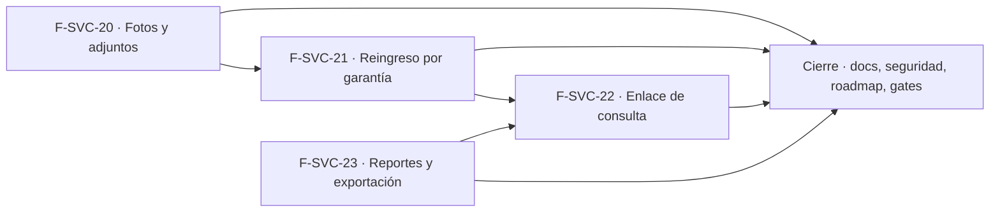

# Tasks: Service técnico · Service seguimiento y reportes

**Input**: [spec.md](./spec.md), [plan.md](./plan.md) y [contracts/service-seguimiento.md](./contracts/service-seguimiento.md) · **Épica**: MSF-124
**Formato**: `- [ ] T### [P] [Historia][USx] descripción (FR/SC)`. `[P]` = paralelizable (archivos distintos, sin dependencia dentro del mismo grupo). Cada FR/SC tiene **una sola** tarea dueña; «soporte de» marca una tarea que contribuye sin ser dueña. Las historias son autosuficientes: ninguna tarea depende de otra historia ni de una `[CIERRE]`; cada historia trae su **propia migración aditiva** con su timestamp.
**Validación por historia**: `pnpm test:db`, `pnpm lint`, `pnpm build` y `pnpm test:web` verdes antes de cerrar la fase (`pnpm dev:supabase` corriendo).
**Esquema (Principio VII, re-verificado)**: `reparacion_adjuntos` → `dominio`; `reparacion_enlaces_consulta` → `dominio`; columna `reparacion_origen_id` de `reparaciones` → `dominio`; `consultas_publicas_intentos` → `public` (plataforma: límite de tasa); vistas `analitica.service_*` → `analitica` (solo vistas); fila de `reportes` → `public` (dato); bucket → Storage; actividad → `public` (solo datos).

## Phase 1: F-SVC-20 · Fotos y adjuntos del equipo

**Goal**: tabla `dominio.reparacion_adjuntos`, bucket privado con políticas, RPC de alta/baja/lectura y la sección «Fotos y adjuntos» del detalle.

- [ ] T001 [F-SVC-20][US1] Migración `supabase/migrations/20261028100100_reparacion_adjuntos.sql`: `dominio.reparacion_adjuntos` (columnas de FR-001, FK compuesta `(reparacion_id, organizacion_id)`, `ruta` única, `check` de `mime`/`bytes`), RLS por organización + nivel `service_tecnico` + tienda accesible, sin `insert/update/delete` directos, `anon` sin privilegios, índice por reparación, reversión en el encabezado (FR-001)
- [ ] T002 [P] [F-SVC-20][US1] Migración `supabase/migrations/20261028100200_reparacion_adjuntos_bucket.sql`: bucket privado `reparacion-adjuntos` (5 MB; `image/jpeg`, `image/png`, `image/webp`) y políticas `select`/`insert`/`delete` sobre `storage.objects` por prefijo `<organizacion_id>/<reparacion_id>/`, con nivel y tienda; sin `update`; reversión en el encabezado (FR-002)
- [ ] T003 [F-SVC-20][US1] Migración `supabase/migrations/20261028100300_reparacion_adjunto_registrar.sql`: `public.registrar_adjunto_reparacion` (`security definer`, `search_path = ''`, `for update` de la reparación, `edicion`, tienda accesible, `55000` si anulada, prefijo de ruta y objeto existente en `storage.objects`, mime/bytes, máximo 20 con `22023` y `hint`) + actividad `reparacion.adjunto_agregado` vía `private.registrar_actividad`; `revoke … from public, anon` y `grant execute … to authenticated` (FR-004)
- [ ] T004 [P] [F-SVC-20][US1] Migración `supabase/migrations/20261028100400_reparacion_adjunto_quitar.sql`: `public.quitar_adjunto_reparacion` (mismas reglas de permiso y situación; borra la fila y devuelve la `ruta`) + actividad `reparacion.adjunto_quitado`; mismos `revoke`/`grant` (FR-005)
- [ ] T005 [P] [F-SVC-20][US1] Migración `supabase/migrations/20261028100500_reparacion_adjuntos_listar.sql`: `public.listar_adjuntos_reparacion` (acepta `lectura`, tiendas accesibles, nombre visible de quien subió, nunca el correo); mismos `revoke`/`grant` (FR-006)
- [ ] T006 [F-SVC-20][US1] pgTAP `supabase/tests/database/service_adjuntos.test.sql`: alta/baja, máximo 20 con dos cargas concurrentes, tipo y tamaño, anulada rechazada, entregada permitida, ruta ajena rechazada, políticas de `storage.objects` (otra organización y tienda inaccesible no leen), aislamiento entre dos organizaciones, `anon` sin ejecución; `rls_en_toda_tabla` verde (SC-001)
- [ ] T007 [P] [F-SVC-20][US1] `apps/web/src/lib/reparacionAdjuntos.ts`: validación por archivo (extensión, cabecera real PNG/JPEG/WebP, ≤ 5 MB, tope de 20), subida a la ruta generada con `crypto.randomUUID()`, registro por RPC, quitado (RPC y luego borrado del objeto), URLs firmadas de vida corta y mapeo de `22023`/`55000`/`42501` a mensajes claros (FR-003)
- [ ] T008 [P] [F-SVC-20][US1] `apps/web/src/components/service/AdjuntosReparacion.tsx`: sección «Fotos y adjuntos» con «Agregar fotos» (selección múltiple, galería o cámara en celular), grilla de miniaturas con texto alternativo, progreso y error por archivo, estados carga/vacío/error con «Reintentar», teclado y 320/768/1440 px (FR-007, FR-010)
- [ ] T009 [P] [F-SVC-20][US1] `components/service/VisorAdjuntoDialog.tsx`: vista ampliada con nombre, fecha y quién lo subió, y quitar con confirmación (soporte de FR-007)
- [ ] T010 [F-SVC-20][US1] Integrar la sección en `pages/service-tecnico/reparacion.tsx` (carga diferida, agregar/quitar solo con `edicion`, solo lectura en anuladas, recarga tras cada operación) (FR-008)
- [ ] T011 [F-SVC-20][US1] Vitest `AdjuntosReparacion.test.tsx`: validación por archivo, miniaturas, vista ampliada, quitar, solo lectura (anulada y `lectura`), vacío/error/carga (SC-002)
- [ ] T012 [F-SVC-20][US1] E2E `apps/web/e2e/service-adjuntos.e2e.ts`: subir una foto, verla, quitarla; otra organización no lee el objeto (se omite sin `SUPABASE_URL`/`SUPABASE_SERVICE_ROLE_KEY`, ver `docs/e2e-app.md`) (SC-003)
- [ ] T013 [F-SVC-20][US1] Documentación: `docs/service-adjuntos.md` (modelo, bucket, políticas, límites, huérfanos, reversión) y `docs/actividad.md` (tipos `reparacion.adjunto_*`) (FR-011)
- [ ] T014 [F-SVC-20][US1] Vitest en `impresion.test.tsx`: la orden de ingreso y el remito no renderizan adjuntos (FR-009)

**Checkpoint F-SVC-20**: `pnpm test:db`, `pnpm lint`, `pnpm build` y `pnpm test:web` verdes.

## Phase 2: F-SVC-21 · Reingreso por garantía

**Goal**: vínculo `reparacion_origen_id`, RPC `reingresar_por_garantia` y `obtener_vinculos_garantia`, diálogo y vínculos visibles en el detalle.

- [ ] T015 [F-SVC-21][US2] Migración `supabase/migrations/20261028110100_reparaciones_origen_garantia.sql`: columna `reparacion_origen_id` en `dominio.reparaciones` con FK compuesta `(reparacion_origen_id, organizacion_id)`, `check (reparacion_origen_id <> id)`, índice parcial, `grant select` por columna y sin escritura directa, reversión en el encabezado (FR-020)
- [ ] T016 [F-SVC-21][US2] Migración `supabase/migrations/20261028110200_reparacion_reingresar_garantia.sql`: `public.reingresar_por_garantia` (`security definer`, `search_path = ''`, `edicion`, origen entregado y no anulado con `55000`, falla obligatoria `22023`, técnico y entrega prevista válidos, copia de datos del equipo, número siguiente bajo `private.siguiente_numero_reparacion`, primer estado activo, ingreso de hoy, historial `alta` con nota, actividad `reparacion.reingreso_garantia`); `revoke … from public, anon` y `grant execute … to authenticated`. No reemplaza `crear_reparacion` ni `obtener_reparacion` (FR-021, FR-024, FR-025)
- [ ] T017 [P] [F-SVC-21][US2] Migración `supabase/migrations/20261028110300_reparacion_vinculos_garantia.sql`: `public.obtener_vinculos_garantia` (acepta `lectura`, tiendas accesibles; origen y reingresos), mismos `revoke`/`grant` (soporte de FR-023)
- [ ] T018 [F-SVC-21][US2] pgTAP `supabase/tests/database/service_garantia.test.sql`: solo entregada y no anulada, copia correcta, falla obligatoria, numeración concurrente sin repetidos, reingreso de un reingreso, vínculos, aislamiento entre dos organizaciones y por tienda, `anon` sin ejecución; `rls_en_toda_tabla` verde (SC-004)
- [ ] T019 [P] [F-SVC-21][US2] `apps/web/src/lib/reparacionGarantia.ts`: llamadas a `reingresar_por_garantia` y `obtener_vinculos_garantia`, tipos y mapeo de `22023`/`55000`/`42501` (soporte de FR-022)
- [ ] T020 [P] [F-SVC-21][US2] `apps/web/src/components/service/VinculosGarantia.tsx`: «Reingreso por garantía de R-xxxx» con enlace en la nueva y lista de reingresos (código, estado, ingreso) en la original (FR-023)
- [ ] T021 [F-SVC-21][US2] `components/service/ReingresoGarantiaDialog.tsx`: resumen del equipo en solo lectura, «Falla del reingreso» obligatoria, técnico (`tecnicos_de_service`), entrega prevista, «Cancelar»/«Reingresar», error en el campo, navegación al detalle de la nueva, cierre con aviso si cambia la empresa activa (FR-022)
- [ ] T022 [F-SVC-21][US2] Integrar botón «Reingresar por garantía» (solo `edicion` y entregada) y los vínculos en `pages/service-tecnico/reparacion.tsx` con carga diferida del diálogo (soporte de FR-022, FR-023)
- [ ] T023 [F-SVC-21][US2] Vitest `ReingresoGarantiaDialog.test.tsx` y `VinculosGarantia.test.tsx`: falla obligatoria, botón oculto con `lectura` y sin entrega, vínculos en ambas reparaciones, cierre al cambiar de empresa (SC-005)
- [ ] T024 [F-SVC-21][US2] Documentación: `docs/service-garantia.md` (regla, RPC, vínculo, reversión) y `docs/actividad.md` (tipo `reparacion.reingreso_garantia`) (FR-026)

**Checkpoint F-SVC-21**: `pnpm test:db`, `pnpm lint`, `pnpm build` y `pnpm test:web` verdes.

## Phase 3: F-SVC-22 · Consulta de estado por el cliente con enlace

**Goal**: token por reparación, Edge Function pública con límite de tasa por IP, página `/seguimiento/:token` y el diálogo para copiar el enlace.

- [ ] T025 [F-SVC-22][US3] Migración `supabase/migrations/20261028120100_reparacion_enlaces_consulta.sql`: `dominio.reparacion_enlaces_consulta` (columnas de FR-040, unique `reparacion_id` y `token`, FK compuesta), RLS habilitada **sin políticas ni grants** para roles de API, reversión en el encabezado (soporte de FR-040)
- [ ] T026 [P] [F-SVC-22][US3] Migración `supabase/migrations/20261028120200_enlace_consulta_obtener.sql`: `public.obtener_enlace_consulta` (`security definer`, `search_path = ''`, `edicion`, tienda accesible, idempotente con `on conflict`, token de ≥ 128 bits con `extensions.gen_random_bytes`, actividad `reparacion.enlace_generado` solo al crear); `revoke … from public, anon` y `grant execute … to authenticated` (FR-040)
- [ ] T027 [P] [F-SVC-22][US3] Migración `supabase/migrations/20261028120300_consultas_publicas_limite.sql`: `public.consultas_publicas_intentos` (`ip_hash`, `ventana`, `cuenta`; RLS sin políticas ni grants), función `public.registrar_consulta_publica(ip_hash, ventana_seg, limite)` con `upsert` atómico y purga acotada, ejecutable **solo** por `service_role` (`revoke … from public, anon, authenticated`), reversión en el encabezado (soporte de FR-043)
- [ ] T028 [P] [F-SVC-22][US3] Migración `supabase/migrations/20261028120400_estado_publico_reparacion.sql`: `private.estado_publico_reparacion(token)` y su envoltorio ejecutable solo por `service_role`, con lista blanca explícita de campos (código, tienda, equipo y modelo, estado y «Qué significa», entrega prevista, línea de tiempo de estados) y sin `select *` (FR-044)
- [ ] T029 [F-SVC-22][US3] pgTAP `supabase/tests/database/service_enlace_consulta.test.sql`: token idempotente y único, `authenticated`/`anon` sin acceso a la tabla ni a las funciones internas, respuesta con exactamente las claves permitidas, token ajeno/mal formado sin fila, aislamiento entre dos organizaciones, `registrar_consulta_publica` atómico y con ventana; `rls_en_toda_tabla` verde (SC-006)
- [ ] T030 [F-SVC-22][US3] `supabase/functions/consultar-estado-reparacion/handler.ts`: lógica pura con dependencias inyectadas (como `solicitar-acceso`): valida el token (formato), hashea la IP con la sal, aplica el límite (429 + `Retry-After`), consulta, 404 uniforme y cabeceras `Cache-Control: no-store`, `Referrer-Policy: no-referrer`, `X-Robots-Tag: noindex` (FR-042, FR-043)
- [ ] T031 [F-SVC-22][US3] `supabase/functions/consultar-estado-reparacion/index.ts` (adaptador con la service-role solo en el servidor), configuración de acceso sin sesión de la función y `SEGUIMIENTO_IP_SALT` en `supabase/functions/.env.example`; verificar en el compose self-hosted de qué cabecera sale la IP (soporte de FR-042, FR-047)
- [ ] T032 [F-SVC-22][US3] `handler.test.ts`: 404 uniforme (inexistente y mal formado), 429 al exceder, cabeceras, respuesta sin campos fuera de la lista blanca, la IP nunca se loguea ni se guarda en claro (SC-007)
- [ ] T033 [P] [F-SVC-22][US3] `apps/web/src/lib/seguimientoPublico.ts`: llamada a la Edge Function sin sesión, tipos de la respuesta y mapeo de 404/429/red a estados de la página (soporte de FR-041)
- [ ] T034 [F-SVC-22][US3] `apps/web/src/pages/seguimiento/index.tsx`: tarjeta con código, tienda, equipo, estado actual con «Qué significa», entrega prevista y línea de tiempo; estados carga, «No encontramos esa reparación», «Demasiadas consultas, probá en unos minutos» y error con «Reintentar»; `noindex`; 320/768/1440 px (FR-041, FR-045)
- [ ] T035 [F-SVC-22][US3] Ruta `/seguimiento/:token` en `apps/web/src/App.tsx`, fuera del panel (sin sesión, menú ni barra superior), con carga diferida (soporte de FR-041)
- [ ] T036 [P] [F-SVC-22][US3] `apps/web/src/lib/enlaceConsulta.ts`: llamada a `obtener_enlace_consulta`, armado de la URL con el origen del panel y mapeo de errores (soporte de FR-046)
- [ ] T037 [F-SVC-22][US3] `components/service/EnlaceSeguimientoDialog.tsx`: URL, «Copiar enlace» con confirmación, «Cerrar», error con «Reintentar», sin envío de mensajes (FR-046)
- [ ] T038 [F-SVC-22][US3] Integrar el botón «Enlace de seguimiento» (solo `edicion`) en `pages/service-tecnico/reparacion.tsx` con carga diferida del diálogo (soporte de FR-046)
- [ ] T039 [F-SVC-22][US3] Vitest `seguimiento.test.tsx` de la página pública (estados, ausencia de campos internos, `noindex`) y `EnlaceSeguimientoDialog.test.tsx` del diálogo (copiar, `lectura` sin botón, error con reintento) (soporte de SC-007)
- [ ] T040 [F-SVC-22][US3] E2E `apps/web/e2e/service-seguimiento.e2e.ts`: copiar el enlace desde el detalle, abrirlo sin sesión y ver el estado; con dos reparaciones de distintos clientes y organizaciones, nunca se ven datos ajenos ni internos; token inventado → «No encontramos» (SC-008)
- [ ] T041 [F-SVC-22][US3] Documentación: `docs/service-seguimiento.md` (token, función, límite, lista blanca, variables, riesgos conocidos sin revocación ni vencimiento, reversión) y `docs/actividad.md` (tipo `reparacion.enlace_generado`) (FR-047)

**Checkpoint F-SVC-22**: `pnpm test:db`, `pnpm lint`, `pnpm build`, `pnpm test:web` y los tests de la función verdes.

## Phase 4: F-SVC-23 · Reportes de service y exportación

**Goal**: botón «Exportar» del listado, vistas `analitica.service_*`, tablero Superset versionado y pestaña «Reportes».

- [ ] T042 [F-SVC-23][US4] Migración `supabase/migrations/20261028130100_analitica_service_reparaciones.sql`: vista `analitica.service_reparaciones` (columnas de FR-062, `organizacion_id`, técnico con nombre visible, sin costos internos), `select` solo para `superset_analitica`, reversión en el encabezado (FR-062)
- [ ] T043 [P] [F-SVC-23][US4] Migración `supabase/migrations/20261028130200_analitica_service_reparacion_items.sql`: vista `analitica.service_reparacion_items` con las mismas garantías (soporte de FR-062)
- [ ] T044 [P] [F-SVC-23][US4] Migración `supabase/migrations/20261028130300_reportes_service.sql`: fila en `public.reportes` con `seccion = 'service_tecnico'` y asignación a las organizaciones como hace Rentabilidad (`20261130100400`), idempotente, reversión en el encabezado (soporte de FR-063)
- [ ] T045 [F-SVC-23][US4] pgTAP `supabase/tests/database/service_analitica.test.sql`: columnas esperadas, ausencia de costos, solo `superset_analitica` lee, `organizacion_id` aislante entre dos organizaciones, `anon`/`authenticated` sin acceso (SC-010)
- [ ] T046 [F-SVC-23][US4] Tablero «Service técnico» en `infra/superset/dashboards/service/` (datasets, charts y dashboard en YAML con los cuatro indicadores de la spec, entrada en el manifiesto de reportes) importable con `importar-dashboards.mjs`; tests de empaquetado/importación vigentes verdes (FR-063)
- [ ] T047 [P] [F-SVC-23][US4] Datos de prueba reproducibles en `supabase/verificacion/service_datos_prueba.sql` (idempotente, fuera de migraciones): reparaciones en varias tiendas, estados, técnicos e ítems con importes (FR-066)
- [ ] T048 [P] [F-SVC-23][US4] `apps/web/src/lib/exportarReparaciones.ts`: arreglo único `COLUMNAS` de las nueve columnas, valores como se ven, pedido por lotes a `listar_reparaciones` con el contexto congelado y tope de 100.000, reutilizando `useExportarCsv` y `neutralizarFormula` (soporte de FR-060)
- [ ] T049 [F-SVC-23][US4] Botón «Exportar» en `pages/service-tecnico/reparaciones.tsx` (visible con `usePuedeAccion('service_tecnico', 'exportar')`, «Exportando…», avisos de vacío/error/tope, nombre `reparaciones-AAAA-MM-DD.csv`), sin costos y sin RPC nueva (FR-060, FR-061)
- [ ] T050 [P] [F-SVC-23][US4] `apps/web/src/pages/service-tecnico/reportes.tsx`: `ReporteEmbebido` del reporte de Service, «Acceso restringido» sin `lectura` o ante 403 (sin pedir token), carga y error con «Reintentar» (FR-064)
- [ ] T051 [F-SVC-23][US4] Pestaña «Reportes» en la barra de pestañas del módulo, ruta `/service-tecnico/reportes` con carga diferida en `App.tsx` y mapeo a `service_tecnico` en `lib/permisos.ts` (soporte de FR-064)
- [ ] T052 [F-SVC-23][US4] Prueba del acceso: `resolver_organizacion_reporte` devuelve `null` sin `lectura` en `service_tecnico` y la organización con ella; `emitir-acceso-reporte` arma la cláusula `rls` por `organizacion_id` (pgTAP `supabase/tests/database/service_reportes_acceso.test.sql` + test de `emitir-acceso-reporte`) (FR-065)
- [ ] T053 [F-SVC-23][US4] Vitest `exportarReparaciones.test.ts`, `reparaciones.test.tsx` y `reportes.test.tsx`: exportación (filtros congelados, todas las filas, vacío, error, tope, botón oculto sin `exportar`) y pestaña «Reportes» (acceso restringido, 403 sin pedir token, error con reintento, cambiar de empresa no recarga el tablero) (SC-009; dueño además de la verificación de FR-060, FR-061 y FR-064)
- [ ] T054 [F-SVC-23][US4] Documentación: `docs/service-reportes.md` (vistas, tablero, permisos, riesgo de tiendas heredado de Rentabilidad, exportación, datos de prueba, reversión) (soporte de FR-066)
- [ ] T055 [F-SVC-23][US4] Revisión del tablero con los datos de prueba: importarlo en el Superset local, verificar los cuatro indicadores contra la base y dejar la evidencia (capturas o conteos) en la descripción del PR (soporte de SC-010)

**Checkpoint F-SVC-23**: `pnpm test:db`, `pnpm lint`, `pnpm build`, `pnpm test:web` y `pnpm infra:config` verdes.

## Phase 5: Cierre (Tarea de cierre, label `cierre`)

**Goal**: lo que ninguna historia atiende — índice documental, revisión de seguridad transversal, roadmap y gates finales.

- [ ] T056 [CIERRE] Índice y revisión de seguridad en `docs/service-tecnico.md`: RLS de las tres tablas nuevas, bucket privado, Edge Function pública sin sesión, límite de tasa, lista blanca, vistas sin costos, `anon` sin ejecución; revisión con las skills `authz-security` e `infra-security` (FR-090)
- [ ] T057 [CIERRE] Actualizar la fila/sección de la épica en `docs/roadmap-template.md` (estado, link a la spec, mover a «Backlog entregado» si aplica) como paso manual de cierre (soporte de FR-090)
- [ ] T058 [CIERRE] Gates finales: `pnpm lint && pnpm build && pnpm test && pnpm docs:check && pnpm matriz:check && pnpm prototipo:check` y `rls_en_toda_tabla` verdes (FR-091, SC-011)

## Matriz de trazabilidad Jira ↔ US ↔ FR ↔ tareas (dueño único)

| Jira | Historia | US | FR / SC (dueño) | Tareas |
|------|----------|----|-----------------|--------|
| MSF-124 | F-SVC-20 | US1 | FR-001 T001 · FR-002 T002 · FR-003 T007 · FR-004 T003 · FR-005 T004 · FR-006 T005 · FR-007 T008 · FR-008 T010 · FR-009 T014 · FR-010 T008 · FR-011 T013 · SC-001 T006 · SC-002 T011 · SC-003 T012 | T001–T014 |
| MSF-124 | F-SVC-21 | US2 | FR-020 T015 · FR-021 T016 · FR-022 T021 · FR-023 T020 · FR-024 T016 · FR-025 T016 · FR-026 T024 · SC-004 T018 · SC-005 T023 | T015–T024 |
| MSF-124 | F-SVC-22 | US3 | FR-040 T026 · FR-041 T034 · FR-042 T030 · FR-043 T030 · FR-044 T028 · FR-045 T034 · FR-046 T037 · FR-047 T041 · SC-006 T029 · SC-007 T032 · SC-008 T040 | T025–T041 |
| MSF-124 | F-SVC-23 | US4 | FR-060 T049 · FR-061 T049 · FR-062 T042 · FR-063 T046 · FR-064 T050 · FR-065 T052 · FR-066 T047 · SC-009 T053 · SC-010 T045 | T042–T055 |
| Tarea de cierre (label `cierre`) | Índice documental, seguridad, roadmap, gates | — | FR-090 T056 · FR-091 T058 · SC-011 T058 | T056–T058 |

Dependencias **dentro** de cada historia:
- F-SVC-20: T001 → (T003, T004, T005); T002 [P] en paralelo con T001; (T001…T005) → T006; T007 [P], T008 [P], T009 [P] → T010 → T011 → T012; T013 y T014 al final.
- F-SVC-21: T015 → T016; T017 [P] tras T015; (T016, T017) → T018; T019 [P], T020 [P] → T021 (necesita T019) → T022 (necesita T020 y T021) → T023 → T024.
- F-SVC-22: T025 → (T026, T028); T027 [P] independiente; (T025…T028) → T029; T030 → T031 → T032; T033 [P] → T034 → T035; T036 [P] → T037 → T038; T039 tras T034 y T037; T040 al final; T041 último.
- F-SVC-23: T042 → T043 [P]/T044 [P] → T045; (T042, T043) → T046; T047 [P]; T048 [P] → T049; T050 [P] → T051; T052 tras T044; T053 tras T049 y T051; T054 y T055 al final.
- Cierre: T056 [P] y T057 [P] → T058. Las tareas `[CIERRE]` nunca son prerequisito de una historia.

Entre historias **no hay dependencia de datos**: cada una trae su migración propia y ninguna lee lo que crea otra. El orden de la tabla siguiente es solo para evitar **conflictos de archivos compartidos** (`reparacion.tsx`, `App.tsx`, `docs/actividad.md`).

## Plan de ejecución (historias)

El **orden de toma** de las historias lo declara esta tabla: el orquestador la **consume** (no lo infiere del orden de las tareas). Una historia arranca cuando sus dependencias (`Depende de`) están **Finalizadas (mergeadas)**; las del **mismo** `Grupo` van **en paralelo**. F-SVC-20 y F-SVC-23 son independientes (la primera toca el detalle y la segunda el listado, las vistas y el tablero); F-SVC-21 espera a F-SVC-20 porque ambas editan `reparacion.tsx` y `docs/actividad.md`; F-SVC-22 espera a F-SVC-21 (mismo `reparacion.tsx` y `actividad.md`) y a F-SVC-23 (ambas registran rutas en `App.tsx`).

| Historia | Depende de | Grupo |
|----------|------------|-------|
| F-SVC-20 | — | 1 |
| F-SVC-23 | — | 1 |
| F-SVC-21 | F-SVC-20 | 2 |
| F-SVC-22 | F-SVC-21, F-SVC-23 | 3 |
| [Cierre] | F-SVC-20, F-SVC-21, F-SVC-22, F-SVC-23 | 4 |

