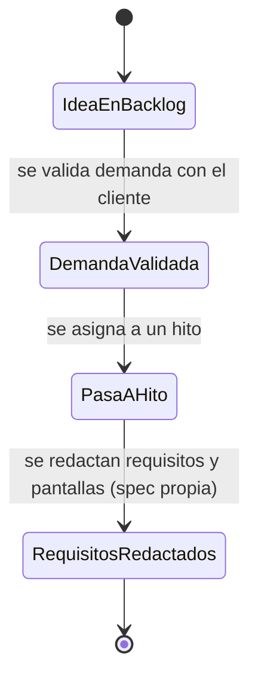

# Feature Specification: Clientes y proveedores · Cuentas y compras a proveedores

**Feature Branch**: `epic/MSF-450-clientes-y-proveedores-cuentas-y-compras`

**Componente**: Clientes y proveedores

**Jira Epic**: MSF-450 — Clientes y proveedores · Cuentas y compras a proveedores (spec `cuentas-y-compras-a-proveedores`)

**Historias previstas**: F-CLI-19 (L), F-CLI-20 (L), F-CLI-21 (L), F-PRV-09 (L), todas P3.

**Created**: 2026-10-29

**Status**: Draft parcial — **NEEDS_INFO**. La épica es un conjunto de ideas condicionadas a validar demanda y declara que «los requisitos se redactan cuando pasen a un hito». No hay requisitos de comportamiento que traducir; esta spec los registra sin inventarlos.

**Delivery scope**: ninguno por ahora. Cuando una historia pase a un hito, su alcance (`refine`, `supabase`, `workers`…) se declara en su propia spec. Esta rama solo entrega documentación (`specs/`, `docs/`).

**Prioridad / Hito**: P3 · Backlog · horas a definir · fuera de diciembre.

**Input**: Epic MSF-450. Objetivo: «Ideas condicionadas a validar demanda: cuenta corriente de clientes y compras a proveedores.»

## Regla de fuentes (literal de la épica)

1. Comportamiento y datos: mandan los requisitos y escenarios de esta historia.
2. Qué se ve (disposición, textos, estados, popups, flujos): el prototipo validado es referencia visual, no hace falta que quede extremadamente idéntico; los flujos (si hay) aclaran estados y acciones.
3. Cómo se construye (componentes, estilos y patrones): mandan el template y el system design del producto (épica Plataforma · Sistema de diseño). No copiar el HTML ni el CSS del prototipo: reproducir lo que muestra con los componentes del template y los tokens del sistema de diseño.
4. El prototipo muestra más que esta historia: implementar solo lo que piden los requisitos de esta historia; otras secciones, botones o diálogos son de otras historias.
5. Si algo no se puede igualar con el template / el sistema de diseño: usar lo más cercano, sin inventar, y anotar la diferencia en la descripción del PR.
6. Si el prototipo y los requisitos se contradicen: requisitos para el comportamiento, prototipo para lo visual, y dejar la contradicción anotada en el PR.

## Historias previstas y dependencias (de la épica)

| ID | Nombre | Prioridad | Talla | Dependencia citada por la épica |
|---|---|---|---|---|
| F-CLI-19 | Cuenta corriente y saldo del cliente | P3 | L | Depende de cómo Ventas maneje cobros y el estado Deuda. |
| F-CLI-20 | Historial y favoritos en la cuenta web | P3 | L | Se apoya en la cuenta web (`cuenta-web-del-cliente`, MSF-237). |
| F-CLI-21 | Listas de precios por cliente | P3 | L | Se relaciona con F-PRE-14 de Precios. |
| F-PRV-09 | Órdenes de compra a proveedores | P3 | L | Se apoya en el listado de reposición de Stock. |

**Bloqueada por**: a definir con el cliente. **Bloquea a**: ninguna épica.

**Estado de las dependencias en esta rama** (verificado en `specs/` y `docs/`; no es alcance nuevo):

| Dependencia | Estado en el repo |
|---|---|
| Cuenta web del cliente (`specs/20261024-051500-cuenta-web-del-cliente`) | Spec presente; declara F-CLI-20 **fuera de su alcance** (historial de compras, favoritos y datos personales editables). |
| Ventas · cobros y conciliación (`specs/20261024-150000-ventas-cobros-y-conciliacion`, `docs/ventas-cobros-y-conciliacion.md`) | Presente; es la referencia de cómo Ventas maneja cobros (insumo de F-CLI-19). |
| Stock · avisos de reposición (`docs/stock-avisos-reposicion.md`) | Presente; es la referencia del «listado de reposición» (insumo de F-PRV-09). |
| Proveedores y productos / ingreso de mercadería (`docs/proveedores.md`) | Presente; no contiene órdenes de compra. |
| F-PRE-14 (listas de precios mayoristas, Precios, P3) | No presente en el repo; sin spec. |

## Supuestos (de la épica)

- Son ideas condicionadas a validar demanda: los requisitos se redactan cuando pasen a un hito.
- F-CLI-20 acota a historial y favoritos lo que los documentos generales llamaban F-CON-07 y F-TDA-27 (cuentas de clientes, P3).
- Horas: a definir.

## A revisar (de la épica; decisiones abiertas, no se resuelven acá)

1. **F-CLI-21 vs. F-PRE-14.** Las listas de precios mayoristas (F-PRE-14, P3) chocan con que el tipo de cliente defina la escala en P0. El documento lo deja como pregunta abierta 1: si el tipo de cliente fija la escala de precios o si la escala depende de la cantidad.
2. **F-CLI-20 = F-CON-07 = F-TDA-27.** Tiendas online deja las cuentas en P3 (F-TDA-27); el roadmap manda hasta que se defina.
3. **Sin pantallas ni horas.** El documento exige pantalla antes de cargar a Jira; se cargaron igual por pedido, con aviso en cada historia.

## Requisitos funcionales

Solo se registra lo que la épica da. Ningún requisito de comportamiento de negocio (cálculo de saldo, estados de la orden de compra, estructura de listas) se inventa: queda para la spec de cada historia cuando pase a un hito.

- **FR-001** (F-CLI-19): La idea «Cuenta corriente y saldo del cliente» queda registrada como P3/Backlog, con su dependencia de cobros y estado Deuda de Ventas. Sin requisitos de comportamiento hasta que pase a un hito.
- **FR-002** (F-CLI-20): La idea «Historial y favoritos en la cuenta web» queda registrada como P3/Backlog, acotada a historial y favoritos, apoyada en `cuenta-web-del-cliente`. Sin requisitos de comportamiento hasta que pase a un hito.
- **FR-003** (F-CLI-21): La idea «Listas de precios por cliente» queda registrada como P3/Backlog, con la pregunta abierta 1 sin resolver (ver *A revisar*). Sin requisitos de comportamiento hasta que pase a un hito.
- **FR-004** (F-PRV-09): La idea «Órdenes de compra a proveedores» queda registrada como P3/Backlog, apoyada en el listado de reposición de Stock. Sin requisitos de comportamiento hasta que pase a un hito.
- **FR-005** (Cierre): La documentación del repo refleja el estado de estas cuatro ideas (backlog, dependencias, preguntas abiertas) y el roadmap exploratorio queda actualizado al cerrar.

## Criterios de éxito

- **SC-001**: Esta spec no agrega migraciones, tablas, RPC, rutas, pantallas ni workers: el merge no cambia comportamiento del producto (`pnpm lint`, `pnpm build`, `pnpm test` sin diferencias de comportamiento).
- **SC-002**: Cada una de las cuatro historias figura con prioridad, talla y dependencia exactas de la épica, sin requisitos añadidos (revisión contra la tabla de arriba).
- **SC-003**: `pnpm docs:check`, `pnpm matriz:check` y `pnpm prototipo:check` pasan.

## Esquemas de datos (Principio VII)

Esta spec **no crea ni altera tablas**. No hay esquema que declarar; no se consultó el grafo por tablas porque no se propone ninguna. Cuando una historia pase a un hito, su spec declarará `public` o `dominio` por la naturaleza de cada tabla (cuenta corriente, órdenes de compra y listas de precios son dominio del producto → `dominio` salvo que se justifique otra cosa), con RLS por organización y migración aditiva.

## Matriz pantalla↔criterios

La épica declara «Esta épica no tiene pantallas… se dibujan cuando pasen a un hito». Las dos pantallas relacionadas ya existen en `design/pantallas/` y pertenecen a otras épicas; el subconjunto que pide esta épica es **vacío**, así que lo que muestran no es deuda ni divergencia. Inventarios generados por `pnpm prototipo:inventario` (`ClienteFicha.inventory.json`, `ProveedorFicha.inventory.json`).

### Clientes · Ficha (`ClienteFicha.dc.html`)

| Ítem del inventario | Destino | Motivo |
|---|---|---|
| Campos: Número, DNI / CUIT, Nombre o razón social, Correo, Teléfono, Celular, Dirección, CP, Localidad, Provincia, Expreso preferido, Correo de acceso | Fuera de alcance | Datos del cliente ya entregados por Clientes (alta y búsqueda) y cuenta web; esta épica no los modifica. |
| Botones «Clientes», «Etiqueta», «Guardar cambios», «Configurar tipos de cliente →», «Incluir en el correo masivo», «Imprimir etiqueta de envío» | Fuera de alcance | Ficha existente de otras épicas. |
| Botón «Nuevo comprobante» y lista de comprobantes (`0003-00001251`, `0003-00001230`, `0003-00001204`, `0003-00001177`) | Fuera de alcance | Pertenecen a Ventas. Si F-CLI-19 muestra saldo en la ficha, su spec lo dibuja y mapea. |
| Tablas / pestañas / diálogos | Sin ítems | El inventario está vacío. |

### Proveedores · Ficha (`ProveedorFicha.dc.html`)

| Ítem del inventario | Destino | Motivo |
|---|---|---|
| Tabla Producto / Código del proveedor / Costo / Último ingreso / acciones | Fuera de alcance | Entregada por Proveedores y productos; F-PRV-09 podrá apoyarse en ella cuando pase a un hito. |
| Campos de la ficha y del diálogo «Editar proveedor» (Razón social, CUIT, Persona de contacto, Teléfono, Correo, Dirección, Condición de pago, Moneda, Plazo de entrega, Compra mínima, Observaciones) | Fuera de alcance | Ficha existente; la épica no pide cambios. |
| Diálogo «Enviar correo a proveedor» (Para, Asunto, Mensaje) y diálogo «Eliminar proveedor» | Fuera de alcance | Entregados por otras épicas. |
| Botones «Proveedores», «Enviar correo», «Editar», «Eliminar», «Ingresar mercadería», «Ver producto», «Cancelar», «Guardar proveedor», «Eliminar proveedor» | Fuera de alcance | Ídem; «Ingresar mercadería» es de Stock/Proveedores. |

### Empresa activa (Principio VIII)

| Ítem | Destino | Motivo |
|---|---|---|
| Empresa activa (selector de la barra superior) | **No aplica** | Esta spec no agrega ni cambia pantallas, pop-ups ni diálogos que lean o escriban datos de una empresa. Cada historia declarará su comportamiento ante el selector cuando se dibuje su pantalla. |

## Flujos

La épica **no trae flujos** (no hay estados, secuencias ni procesos descritos) y no se inventan. Lo único que describe es el ciclo de vida de la propia idea, transcrito de «los requisitos se redactan cuando pasen a un hito»:

| Estado / transición | Dueño |
|---|---|
| IdeaEnBacklog | FR-001…FR-004 |
| Validación de demanda, paso a hito, redacción de requisitos | Fuera de alcance de esta spec (decisión de Nicolás; ver *Preguntas*). |

## Fuera de alcance (explícito)

- Todo comportamiento de negocio de las cuatro historias (saldo, historial, favoritos, listas de precios, órdenes de compra): sin requisitos hasta pasar a un hito.
- Resolver la pregunta abierta 1 (tipo de cliente vs. cantidad) y el conflicto con F-PRE-14 / F-TDA-27.
- Dibujar pantallas nuevas.
- Migraciones, RPC, workers, Kestra y Superset.

## Preguntas para Nicolás (NEEDS_INFO)

1. ¿Alguna de F-CLI-19, F-CLI-20, F-CLI-21 o F-PRV-09 pasa a un hito ahora? Si sí, ¿cuál y con qué requisitos y pantalla? Si no, ¿esta épica debe cerrarse solo como registro documental?
2. F-CLI-21: ¿el tipo de cliente fija la escala de precios o la escala depende de la cantidad (pregunta abierta 1)?
3. F-CLI-19: ¿cómo debe tratar Ventas los cobros y el estado Deuda para que la cuenta corriente tenga una fuente de saldo?
4. F-PRV-09: ¿la orden de compra nace del listado de reposición de Stock tal cual, o necesita otro origen?
5. F-CLI-20: ¿se mantiene la prioridad P3 de Tiendas online (F-TDA-27) o rige otra?
