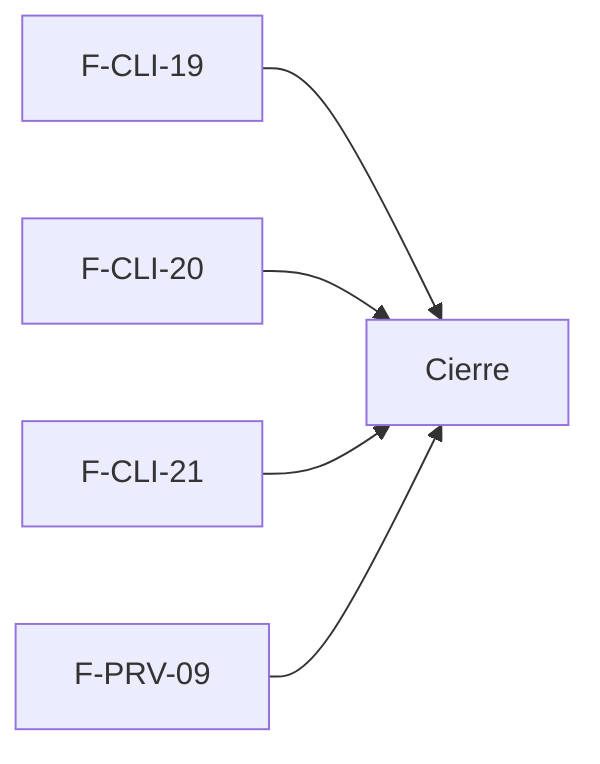

# Tasks: Clientes y proveedores · Cuentas y compras a proveedores

**Input**: `specs/20261029-100000-cuentas-y-compras-a-proveedores/` (spec.md, plan.md). Sin `contracts/` (no hay RPC ni endpoints).

**Formato**: `- [ ] T### [P] [F-xxx-nn][USy] descripción`. **[P]** = paralelizable; sin [P] = secuencial.

**Delivery scope**: ninguno (solo documentación).

> **NEEDS_INFO**: las tareas T001–T004 solo se pueden ejecutar cuando Nicolás responda las *Preguntas* de la spec y la historia pase a un hito. No hay requisitos de comportamiento que implementar hoy.

## Matriz de trazabilidad Jira ↔ US ↔ tasks

| Jira | Historia | FR / SC (dueño único) | Tasks |
|------|----------|-----------------------|-------|
| F-CLI-19 | US1 Cuenta corriente y saldo del cliente | FR-001 | T001 |
| F-CLI-20 | US2 Historial y favoritos en la cuenta web | FR-002 | T002 |
| F-CLI-21 | US3 Listas de precios por cliente | FR-003 | T003 |
| F-PRV-09 | US4 Órdenes de compra a proveedores | FR-004 | T004 |
| Tarea de cierre (label `cierre`) | Documentación y roadmap | FR-005, SC-001, SC-002, SC-003 | T010–T012 |

## Fase 1 — Historias (cada una autosuficiente)

- [ ] T001 [P] [F-CLI-19][US1] Cuando pase a un hito: redactar requisitos, pantalla (saldo en la ficha de `ClienteFicha`) y matriz de la cuenta corriente, a partir de cómo Ventas maneje cobros y estado Deuda. **FR-001**.
- [ ] T002 [P] [F-CLI-20][US2] Cuando pase a un hito: redactar requisitos de historial y favoritos sobre la cuenta web (`cuenta-web-del-cliente`), acotados a eso. **FR-002**.
- [ ] T003 [P] [F-CLI-21][US3] Cuando pase a un hito: resolver la pregunta abierta 1 y redactar requisitos de listas de precios por cliente, coordinando con F-PRE-14. **FR-003**.
- [ ] T004 [P] [F-PRV-09][US4] Cuando pase a un hito: redactar requisitos de órdenes de compra a proveedores sobre el listado de reposición de Stock. **FR-004**.

**Checkpoint**: sin respuestas de Nicolás, estas cuatro quedan abiertas a propósito y no se implementa código.

## Fase 2 — Cierre (documentación y roadmap)

- [ ] T010 [CIERRE] Crear `docs/cuentas-y-compras-a-proveedores.md` con las cuatro ideas, prioridad, dependencias y preguntas abiertas (sin requisitos nuevos). **FR-005**.
- [ ] T011 [CIERRE] Actualizar la fila de MSF-450 en `docs/roadmap-template.md` (estado Backlog, link a la spec) al mergear el PR; paso manual con criterio. **FR-005**.
- [ ] T012 [CIERRE] Gates: `pnpm lint`, `pnpm build`, `pnpm infra:config`, `pnpm test`, `pnpm prototipo:check`, `pnpm matriz:check`, `pnpm docs:check` verdes; confirmar que no hay cambios de comportamiento. **SC-001, SC-002, SC-003**.

---

## Plan de ejecución (historias)

| Historia | Depende de | Grupo |
|---|---|---|
| F-CLI-19 | — | 1 |
| F-CLI-20 | — | 1 |
| F-CLI-21 | — | 1 |
| F-PRV-09 | — | 1 |
| [Cierre] | F-CLI-19, F-CLI-20, F-CLI-21, F-PRV-09 | 2 |

Las cuatro historias son independientes entre sí (no comparten archivos, tabla ni migración) y van en paralelo; la épica no declara bloqueos entre ellas. Las dependencias externas (Ventas, cuenta web, Precios, Stock) se citan en la spec y no son historias de esta épica.

