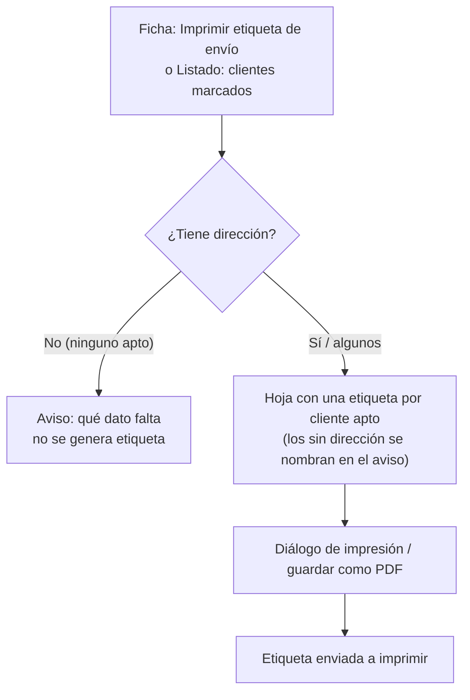
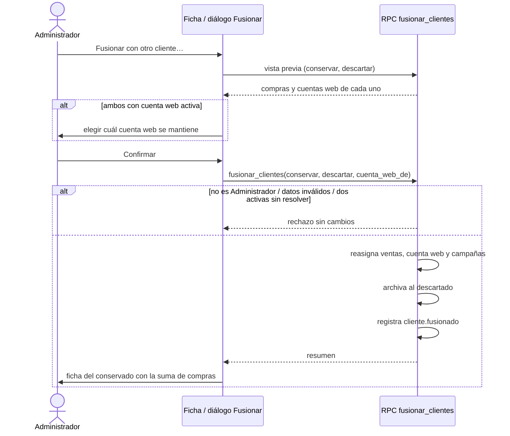
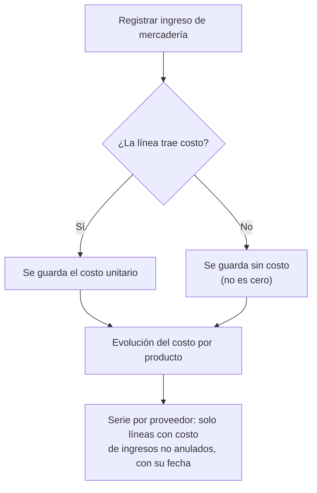
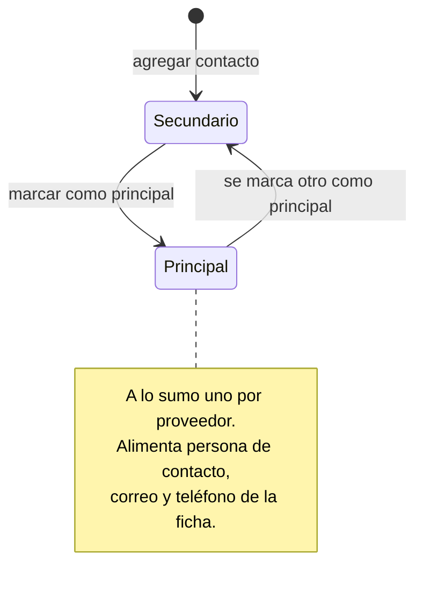

# Feature Specification: Clientes y proveedores · Mejoras de clientes y proveedores

**Feature Branch**: `epic/MSF-445-clientes-y-proveedores-mejoras-de-client`

**Jira Epic**: MSF-445 — Clientes y proveedores · Mejoras de clientes y proveedores (spec `mejoras-de-clientes-y-proveedores`)

**Created**: 2026-10-29

**Status**: Ready for implementation — la especificación viene completa desde Jira. Los puntos de *Decisiones abiertas* no bloquean: cada uno lleva una decisión provisoria.

**Delivery scope**: `refine` (apps/web) y `supabase` (migraciones + RPC + pgTAP). Sin `kestra`, `superset` ni `workers`.

**Prioridad / Hito**: P2 · Etapa 3 (fuera de diciembre) · 24 h aprox. (tallas; antes 22).

**Dependencias**:
- Bloqueada por: MSF-180 (Clientes alta y búsqueda: ficha y listado) y MSF-219 (Ingreso de mercadería por proveedor). MSF-205 (Proveedores y productos) llega a través de MSF-219. Las tres están en la base de la rama.
- Bloquea a: ninguna épica.
- Relacionada, sin bloqueo: MSF-237 (Cuenta web del cliente) y MSF-155 (Correo masivo a clientes): F-CLI-18 reasigna lo que cuelga del cliente (documentos de venta, cuenta web y campañas); no bloquean, solo se tocan al fusionar.

**Objetivo** (literal de la épica): «Al terminar, hay etiquetas impresas para los envíos, se pueden fusionar clientes duplicados, y cada proveedor tiene varios contactos e historial de costos.»

**Historias** (Jira):

| Jira | ID | Nombre | Prioridad | Talla |
|------|----|--------|-----------|-------|
| MSF-446 | F-CLI-17 | Etiqueta impresa del cliente | P2 | S |
| MSF-447 | F-CLI-18 | Fusionar clientes duplicados | P2 | M |
| MSF-448 | F-PRV-07 | Historial de costos por proveedor | P2 | M |
| MSF-449 | F-PRV-08 | Varios contactos por proveedor | P2 | S |

**Regla de fuentes** (literal de la épica):
1. Comportamiento y datos: mandan los requisitos y escenarios de cada historia.
2. Qué se ve (disposición, textos, estados, popups, flujos): el prototipo validado es referencia visual, no hace falta que quede extremadamente idéntico; los flujos (si hay) aclaran estados y acciones.
3. Cómo se construye (componentes, estilos y patrones): mandan el template y el system design (MSF-117, `docs/sistema-de-diseno.md`). No se copia HTML ni CSS: se reproduce con los componentes del template y los tokens.
4. El prototipo muestra más que esta épica: se implementa solo lo que piden los requisitos de F-CLI-17, F-CLI-18, F-PRV-07 y F-PRV-08.
5. Si algo no se puede igualar: lo más cercano, sin inventar, anotando la diferencia en el PR.
6. Si prototipo y requisitos se contradicen: requisitos para el comportamiento, prototipo para lo visual, y la contradicción queda anotada en el PR.

**Prototipos** (solo lectura, `design/pantallas/`): `Clientes.dc.html`, `ClienteFicha.dc.html`, `Proveedores.dc.html`, `ProveedorFicha.dc.html`, `IngresoMercaderia.dc.html`. **La épica no tiene pantallas dibujadas** («a dibujar cuando entre en la etapa»): cada historia se resuelve con los componentes del template; las pantallas citadas son base visual de otras épicas. Inventarios al día (`pnpm prototipo:check`: OK).

## Modelo y supuestos

- Clientes y proveedores son **de la organización** y se comparten entre sus empresas (supuesto de la épica, *a confirmar con el cliente*). Un cliente se **archiva**, no se borra; un proveedor se **desactiva**, no se borra.
- Estado real del repo (verificado en migraciones y docs):
  - `public.clientes` ya trae dirección, CP, localidad, provincia, teléfono, celular, `expreso_preferido` (texto) y `archivado_en`. La épica los llama «transporte preferido (`transporte_preferido_id`)» y `archivado_at`: **el repo manda los nombres** (ver *Contradicciones*).
  - `dominio.proveedores` guarda `persona_contacto`, `correo`, `telefono` (la épica los llama `contacto_nombre`, `correo`, `telefono`).
  - `dominio.ingresos_mercaderia_lineas.costo_unitario_usd` ya existe y hoy es **obligatorio** (F-PRV-04, MSF-219); también existen `dominio.producto_costos` y su historial `dominio.producto_costos_historial`.
  - No existe tabla de **campañas** (MSF-155 no se entregó): la reasignación de campañas de F-CLI-18 se limita a lo que exista al implementar (ver *Decisiones abiertas* 3).

### Esquema de datos (Constitución, Principio VII)

| Objeto | Esquema | Justificación | Cambio |
|--------|---------|---------------|--------|
| `dominio.proveedores_contactos` (nueva) | **`dominio`** | Dato de negocio del producto (contactos de un proveedor, hermana de `dominio.proveedores`); no es plataforma. | Tabla nueva + RLS por organización y `nivel_seccion('proveedores')`, FK compuesta `(proveedor_id, organizacion_id)`, índice único parcial «un solo principal». Migración aditiva. |
| `dominio.ingresos_mercaderia_lineas` | `dominio` (existente) | Detalle del ingreso. | `costo_unitario_usd` pasa a admitir `NULL` (relajar `not null`; aditivo). Reversión documentada en el plan. |
| `public.clientes` | `public` (existente; excepción ya documentada en la spec de MSF-180) | Sin tablas ni columnas nuevas. | Solo se archiva el cliente descartado (`archivado_en`). |
| `public.cuentas_cliente` | `public` (existente) | Cuenta web (MSF-237). | Reasignación de `cliente_id` por la fusión; sin cambios de esquema. |
| `dominio.comprobantes_venta` | `dominio` (existente) | Documentos de venta. | Reasignación de `cliente_id` por la fusión; sin cambios de esquema. |

F-CLI-17 no escribe ni crea tablas. Todas las RPC nuevas viven en `public`, con `revoke … from public, anon` y `grant execute … to authenticated` explícitos (`docs/acceso-ingreso.md`). Toda tabla expuesta con RLS; la prueba pgTAP de aislamiento recorre `public` + `dominio`.

## User Scenarios & Testing *(mandatory)*

### User Story 1 - Etiqueta impresa del cliente (F-CLI-17, MSF-446, P2, talla S)

Como **operador** quiero imprimir la etiqueta con el domicilio del cliente para pegarla en el paquete. Individual desde la ficha, o por selección desde el listado.

**Acceptance Scenarios**:
1. **Given** un cliente con dirección, **When** se pulsa «Imprimir etiqueta de envío» en su ficha, **Then** se arma una hoja imprimible con nombre o razón social, dirección, código postal, localidad, provincia, teléfono y transporte preferido, y se abre el diálogo de impresión (se puede guardar como PDF).
2. **Given** `CA-CLI-17-1`: un cliente sin dirección, **When** se imprime la etiqueta, **Then** se avisa qué dato falta y no se genera una etiqueta vacía.
3. **Given** varios clientes marcados en el listado, **When** se elige imprimir etiquetas, **Then** sale una etiqueta por cliente apto; los que no tienen dirección se omiten y el aviso los nombra con el dato faltante. Si ninguno es apto, no se genera hoja.
4. **Given** una selección hecha y se cambia la empresa activa de la barra superior, **Then** la selección se descarta y el listado se recarga (Principio VIII).
5. **Given** pantallas de 320, 768 y 1440 px y el diálogo de impresión, **Then** el botón y el aviso son utilizables con teclado y lector de pantalla, y al imprimir solo sale la etiqueta (sin menú ni barra superior).

### User Story 2 - Fusionar clientes duplicados (F-CLI-18, MSF-447, P2, talla M)

Como **administrador** quiero unir dos fichas del mismo cliente para tener un solo historial.

**Acceptance Scenarios**:
1. **Given** `CA-CLI-18-1`: dos fichas con 3 y 5 compras, **When** se fusionan, **Then** la ficha que se conserva muestra 8 compras (los documentos de venta del descartado pasan al conservado).
2. **Given** `CA-CLI-18-2`: un usuario Operador, **When** intenta fusionar, **Then** se rechaza: solo el Administrador tiene el permiso (lo impone la base; la UI además oculta la acción).
3. **Given** `RF-CLI-18-2` / caso borde: ambos clientes con cuenta web activa, **When** se fusiona sin indicar cuál cuenta se mantiene, **Then** se rechaza y no se toca nada; al indicarlo, la fusión sigue.
4. **Given** una fusión correcta, **Then** el cliente descartado queda archivado (no se borra), su cuenta web y sus campañas pasan al conservado, y se registra `cliente.fusionado` con ambos clientes.
5. **Given** la misma fusión repetida o con un cliente ya archivado, un cliente consigo mismo o de otra organización, **Then** se rechaza con un mensaje claro y sin cambios parciales (todo o nada).

### User Story 3 - Historial de costos por proveedor (F-PRV-07, MSF-448, P2, talla M)

Como **administrador** quiero ver a qué costo me vendió cada proveedor un producto a lo largo del tiempo para comparar y negociar.

**Acceptance Scenarios**:
1. **Given** `CA-PRV-07-1`: dos ingresos del mismo producto a distinto costo, **When** se ve la evolución, **Then** aparecen ambos con su fecha (y su proveedor).
2. **Given** `CA-PRV-07-2`: un ingreso sin costo, **When** se ve la evolución, **Then** no se cuenta como cero (no aparece como punto de costo).
3. **Given** un ingreso que se registra sin cargar el costo de una línea, **Then** el ingreso se registra igual (el costo es opcional por línea).
4. **Given** un ingreso anulado, **Then** no figura en la evolución.
5. **Given** un usuario sin Rentabilidad en lectura/edición o sin Proveedores en lectura/edición, **Then** no ve la evolución ni los importes.

### User Story 4 - Varios contactos por proveedor (F-PRV-08, MSF-449, P2, talla S)

Como **administrador** quiero guardar varias personas de contacto de un proveedor para saber a quién llamar según el tema.

**Acceptance Scenarios**:
1. **Given** un proveedor, **When** se agrega un contacto con nombre, rol, correo y teléfono, **Then** aparece en la lista de contactos de la ficha.
2. **Given** `CA-PRV-08-1`: un proveedor con dos contactos, **When** se marca otro como principal, **Then** el anterior deja de serlo (nunca hay dos principales).
3. **Given** un contacto marcado principal, **Then** los campos de contacto de la ficha (persona de contacto, correo y teléfono) toman sus valores.
4. **Given** dos altas simultáneas marcadas como principal, **Then** gana una y la otra deja de serlo; nunca quedan dos.

### Edge Cases

- Etiqueta: solo la **dirección** impide generar la etiqueta (CA-CLI-17-1); un dato opcional vacío (CP, localidad, provincia, teléfono, transporte) no bloquea y se omite de la hoja. Sin escritura: nada que revertir.
- Fusión: dos cuentas web en la misma tienda (`unique (cliente_id, empresa_id)`): prevalece la cuenta elegida; la otra se da de baja (Decisiones 2). Dos activas sin elegir: no se fusiona (RF-CLI-18-2).
- Fusión: no se deshace ni se detectan duplicados automáticamente (fuera de alcance, el doc no lo pide).
- Historial de costos: producto sin ingresos con costo → estado vacío; costo `0` cargado a propósito **sí** cuenta como cero (distinto de «sin costo»).
- Contactos: proveedor desactivado conserva sus contactos (solo lectura). Contacto sin correo ni teléfono: se permite (solo el nombre es obligatorio).
- Todas las pantallas: estados de carga, vacío, error y éxito de los patrones compartidos.

## Requirements *(mandatory)*

### Functional Requirements

**F-CLI-17 · Etiqueta impresa del cliente (RF-CLI-17-1)**
- **FR-001**: El sistema DEBE generar una etiqueta imprimible (hoja con `@page` y estilos de impresión, guardable como PDF desde el diálogo de impresión) con nombre o razón social, dirección, código postal, localidad, provincia, teléfono y transporte preferido (`expreso_preferido`), una por cliente, individual o por selección. **Verificación**: `pnpm --filter @platform/web test -- apps/web/src/components/clientes/HojaEtiquetas.test.tsx`: la hoja trae nombre, dirección, CP, localidad, provincia, teléfono y transporte; una etiqueta por cliente; y `pnpm --filter @platform/web test:e2e -- clientes-etiqueta.e2e.ts` (hoja con `@page`).
- **FR-002**: Si a un cliente le falta la dirección, el sistema DEBE avisar qué dato falta y NO generar una etiqueta vacía; en selección omite los no aptos, los nombra en el aviso y, si ninguno es apto, no genera la hoja (CA-CLI-17-1). **Verificación**: `pnpm --filter @platform/web test -- apps/web/src/lib/etiquetasCliente.test.ts`: `faltantes` y `armarEtiqueta` (sin dirección bloquea; selección separa aptos y omitidos) y `clientes-etiqueta.e2e.ts` (CA-CLI-17-1).
- **FR-003**: La ficha del cliente DEBE ofrecer las acciones «Etiqueta» (encabezado) e «Imprimir etiqueta de envío» (bloque de la ficha), con el aviso de éxito «Etiqueta enviada a imprimir», como en `ClienteFicha.dc.html`. **Verificación**: `pnpm --filter @platform/web test -- apps/web/src/pages/clientes/show.etiqueta.test.tsx`: «Etiqueta», «Imprimir etiqueta de envío» y aviso «Etiqueta enviada a imprimir».
- **FR-004**: El listado DEBE permitir imprimir las etiquetas de los clientes marcados (casillas de fila y «Seleccionar todos» ya dibujadas), acotado a la empresa activa: al cambiar de empresa se invalidan las consultas, se reencuadra la paginación y se descarta la selección (Principio VIII). **Verificación**: `pnpm --filter @platform/web test -- apps/web/src/pages/clientes/list.etiquetas.test.tsx`: imprimir selección y cambio de empresa activa (invalida, reencuadra y descarta la selección).
- **FR-005**: La función NO DEBE escribir datos; la ruta de impresión (lazy) DEBE exigir la sección `clientes` en lectura o edición, no mostrar menú ni barra superior al imprimir y funcionar con teclado y lector de pantalla a 320, 768 y 1440 px. **Verificación**: `pnpm --filter @platform/web test -- apps/web/src/components/clientes/HojaEtiquetas.test.tsx`: sin escrituras, ruta bajo `RequiereAccesoSeccion`, estilos `@media print`; y `clientes-etiqueta.e2e.ts` a 320/768/1440 px con teclado.

**F-CLI-18 · Fusionar clientes duplicados (RF-CLI-18-1, RF-CLI-18-2)**
- **FR-006**: El sistema DEBE reasignar los documentos de venta, la cuenta web (`cuentas_cliente`) y las campañas del cliente descartado al que se conserva, en **una sola transacción** (todo o nada). **Verificación**: `supabase test db --local supabase/tests/database/fusion_clientes.test.sql`: 3 + 5 compras = 8, cuenta web reasignada, todo o nada.
- **FR-007**: El sistema DEBE archivar al descartado (`clientes.archivado_en`; no se borra) y conservar intactos sus datos de ficha. **Verificación**: `supabase test db --local supabase/tests/database/fusion_clientes.test.sql`: descartado con `archivado_en` y datos de ficha intactos.
- **FR-008**: El sistema DEBE registrar el evento de actividad `cliente.fusionado` con ambos clientes (nombre y N.º; sin DNI/CUIT en el detalle), en la misma transacción. **Verificación**: `supabase test db --local supabase/tests/database/fusion_clientes.test.sql`: evento `cliente.fusionado` sin DNI/CUIT, en la misma transacción.
- **FR-009**: El sistema NO DEBE fusionar si ambos clientes tienen cuenta web activa y no se indicó cuál se mantiene (RF-CLI-18-2); al indicarlo, la cuenta no elegida se da de baja. **Verificación**: `supabase test db --local supabase/tests/database/fusion_clientes.test.sql`: dos cuentas activas sin resolver → rechazo; resuelto → baja de la no elegida.
- **FR-010**: Solo el Administrador DEBE poder fusionar; la RPC lo verifica en la base (CA-CLI-18-2) y rechaza al resto con error de permiso. **Verificación**: `supabase test db --local supabase/tests/database/fusion_clientes.test.sql`: Operador rechazado, Administrador permitido, `anon` sin ejecución.
- **FR-011**: La RPC DEBE rechazar con mensaje claro: mismo cliente en ambos lados, cliente inexistente o de otra organización, cliente ya archivado, y repetir una fusión; DEBE bloquear ambas filas (orden por id) para ser segura bajo concurrencia. **Verificación**: `supabase test db --local supabase/tests/database/fusion_clientes.test.sql`: mismo cliente, inexistente, otra organización, archivado y repetida rechazados con mensaje; bloqueo ordenado por id.
- **FR-012**: Una RPC de **vista previa** DEBE devolver, para cada cliente, cantidad de documentos de venta y cuentas web (activas/total) sin escribir, para que el diálogo muestre «3 y 5 compras» y si hay que resolver la cuenta web. **Verificación**: `supabase test db --local supabase/tests/database/fusion_clientes.test.sql`: `vista_previa_fusion_clientes` devuelve compras y cuentas web sin escribir.
- **FR-013**: La UI DEBE ofrecer un diálogo «Fusionar clientes» (buscar el otro cliente, elegir cuál ficha se conserva, vista previa, resolver cuenta web si hace falta, confirmar), con foco al abrir/cerrar, errores claros y sin identificadores técnicos visibles. **Verificación**: `pnpm --filter @platform/web test -- apps/web/src/components/clientes/DialogoFusionarClientes.test.tsx`: búsqueda, ficha a conservar, vista previa, cuenta web, confirmar, foco y errores.
- **FR-014**: La acción «Fusionar con otro cliente…» DEBE aparecer en la ficha solo para el Administrador; tras fusionar, la ficha del conservado se recarga y muestra la suma de compras (CA-CLI-18-1). **Verificación**: `pnpm --filter @platform/web test -- apps/web/src/pages/clientes/show.fusion.test.tsx`: acción visible solo al Administrador y ficha recargada con la suma de compras.

**F-PRV-07 · Historial de costos por proveedor (RF-PRV-07-1)**
- **FR-015**: El costo unitario de cada línea de ingreso DEBE ser **opcional**: `ingresos_mercaderia_lineas.costo_unitario_usd` admite `NULL` y `registrar_ingreso_mercaderia` acepta líneas sin costo (con `p_actualizar_costo`, una línea sin costo no actualiza el costo del producto). **Verificación**: `supabase test db --local supabase/tests/database/historial_costos_producto.test.sql`: línea sin costo se guarda y no actualiza el costo del producto.
- **FR-016**: Una RPC DEBE devolver, por producto (y opcionalmente por proveedor), la evolución del costo: una fila por línea de ingreso **registrado** (no anulado) **con costo**, con fecha, proveedor, comprobante y costo; una línea sin costo NO se cuenta como cero (CA-PRV-07-2). **Verificación**: `supabase test db --local supabase/tests/database/historial_costos_producto.test.sql`: dos ingresos a distinto costo con fecha; sin costo ≠ 0; anulado excluido.
- **FR-017**: La RPC y la vista DEBEN exigir Rentabilidad y Proveedores en lectura o edición, filtrar por organización (la organización sale de la sesión) y respetar las empresas accesibles del usuario. **Verificación**: `supabase test db --local supabase/tests/database/historial_costos_producto.test.sql`: exige Rentabilidad y Proveedores, organización de la sesión y empresas accesibles.
- **FR-018**: El formulario de «Ingreso de mercadería» DEBE aceptar el costo unitario vacío (campo opcional) sin cambiar el resto de su diseño (`IngresoMercaderia.dc.html`). **Verificación**: `pnpm --filter @platform/web test -- apps/web/src/components/stock/IngresoMercaderiaForm.test.tsx`: costo vacío permitido, resto del formulario igual.
- **FR-019**: La UI DEBE ofrecer la vista «Evolución del costo» por producto con una serie por proveedor, accesible desde cada producto de la ficha del proveedor, con estados de carga, vacío y error; los importes en USD y la fecha de cada ingreso. **Verificación**: `pnpm --filter @platform/web test -- apps/web/src/components/proveedores/DialogoEvolucionCosto.test.tsx`: serie por proveedor, USD y fecha; carga, vacío, error y sin permiso.

**F-PRV-08 · Varios contactos por proveedor (RF-PRV-08-1)**
- **FR-020**: DEBE existir `dominio.proveedores_contactos` (nombre obligatorio, rol, correo, teléfono, principal) con RLS por organización y `nivel_seccion('proveedores')`; lectura con lectura/edición, escritura solo por RPC con edición; sin `DELETE` directo; `anon` sin acceso. **Verificación**: `supabase test db --local supabase/tests/database/proveedores_contactos.test.sql`: RLS por organización y nivel, sin `DELETE` directo, `anon` sin acceso.
- **FR-021**: DEBE haber **a lo sumo un contacto principal** por proveedor, garantizado por la base (índice único parcial), no solo por la pantalla. **Verificación**: `supabase test db --local supabase/tests/database/proveedores_contactos.test.sql`: segundo principal por el mismo proveedor viola el índice único parcial.
- **FR-022**: El sistema DEBE permitir agregar contactos (nombre, rol, correo, teléfono) y listarlos por proveedor. **Verificación**: `supabase test db --local supabase/tests/database/proveedores_contactos.test.sql`: `agregar_contacto_proveedor` y `listar_contactos_proveedor`.
- **FR-023**: Marcar un contacto como principal DEBE quitar el estado al anterior y copiar su nombre, correo y teléfono a `persona_contacto`, `correo` y `telefono` del proveedor, en la misma transacción. **Verificación**: `supabase test db --local supabase/tests/database/proveedores_contactos.test.sql`: `marcar_contacto_principal` desmarca al anterior y copia a la ficha (CA-PRV-08-1).
- **FR-024**: Agregar un contacto y cambiar el principal DEBEN registrar actividad (`proveedor.contacto_agregado`, `proveedor.contacto_principal_cambiado`) con la razón social y el nombre del contacto (sin correo ni teléfono en el detalle). **Verificación**: `supabase test db --local supabase/tests/database/proveedores_contactos.test.sql`: eventos `proveedor.contacto_agregado` y `proveedor.contacto_principal_cambiado` sin correo ni teléfono.
- **FR-025**: La ficha del proveedor DEBE mostrar la lista de contactos (nombre, rol, correo, teléfono, marca de principal), la acción «Agregar contacto» y «Marcar como principal», ocultas sin permiso de edición. **Verificación**: `pnpm --filter @platform/web test -- apps/web/src/components/proveedores/ListaContactos.test.tsx`: lista, «Agregar contacto», «Marcar como principal», ocultas sin edición.
- **FR-026**: Mientras el proveedor tenga contacto principal, «Persona de contacto», «Correo» y «Teléfono» del diálogo «Editar proveedor» DEBEN mostrarse de solo lectura con la leyenda «Se toma del contacto principal»; sin principal, se editan como hoy. **Verificación**: `pnpm --filter @platform/web test -- apps/web/src/components/proveedores/ProveedorFormDialog.test.tsx`: campos de solo lectura con la leyenda «Se toma del contacto principal».

**Transversal (cierre)**
- **FR-027**: La documentación DEBE actualizarse en el mismo cambio (`docs/clientes.md`, `docs/proveedores.md`, `docs/ingreso-de-mercaderia.md`, `docs/actividad.md`, `docs/permisos-por-rol.md`, `docs/roadmap-template.md`) y `pnpm docs:check` pasar. **Verificación**: `pnpm docs:check` y revisión de los seis documentos listados.

### Success Criteria

- **SC-001**: Prueba de `CA-CLI-17-1` (E2E o Vitest de integración): cliente sin dirección → aviso con el dato faltante y sin hoja. **Verificación**: se ejecuta con `pnpm --filter @platform/web test:e2e -- clientes-etiqueta.e2e.ts` y `pnpm --filter @platform/web test -- apps/web/src/lib/etiquetasCliente.test.ts`. *(F-CLI-17)*
- **SC-002**: Vitest: etiqueta individual y por selección (aptos/omitidos), y cambio de empresa activa que descarta la selección y recarga. **Verificación**: se ejecuta con `pnpm --filter @platform/web test -- apps/web/src/components/clientes/HojaEtiquetas.test.tsx apps/web/src/pages/clientes/list.etiquetas.test.tsx`. *(F-CLI-17)*
- **SC-003**: pgTAP `CA-CLI-18-1`: 3 + 5 compras → 8 en el conservado; el descartado queda archivado y con evento `cliente.fusionado`. **Verificación**: se ejecuta con `supabase test db --local supabase/tests/database/fusion_clientes.test.sql`. *(F-CLI-18)*
- **SC-004**: pgTAP `CA-CLI-18-2`: Operador (y cualquier no Administrador) rechazado; `anon` sin ejecución. **Verificación**: se ejecuta con `supabase test db --local supabase/tests/database/fusion_clientes.test.sql`. *(F-CLI-18)*
- **SC-005**: pgTAP: ambas cuentas web activas sin resolver → rechazo sin cambios; resuelto → fusiona; validaciones de FR-011 y atomicidad. **Verificación**: se ejecuta con `supabase test db --local supabase/tests/database/fusion_clientes.test.sql`. *(F-CLI-18)*
- **SC-006**: Vitest del diálogo: vista previa, resolución de cuenta web, acción oculta a no Administradores, teclado y lector. **Verificación**: se ejecuta con `pnpm --filter @platform/web test -- apps/web/src/components/clientes/DialogoFusionarClientes.test.tsx apps/web/src/pages/clientes/show.fusion.test.tsx`. *(F-CLI-18)*
- **SC-007**: pgTAP `CA-PRV-07-1`: dos ingresos a distinto costo → ambos con su fecha. **Verificación**: se ejecuta con `supabase test db --local supabase/tests/database/historial_costos_producto.test.sql`. *(F-PRV-07)*
- **SC-008**: pgTAP `CA-PRV-07-2`: ingreso sin costo no cuenta como cero; anulado no figura; permisos y organización. **Verificación**: se ejecuta con `supabase test db --local supabase/tests/database/historial_costos_producto.test.sql`. *(F-PRV-07)*
- **SC-009**: Vitest: formulario de ingreso con costo vacío y vista «Evolución del costo» (carga, vacío, error, sin permiso). **Verificación**: se ejecuta con `pnpm --filter @platform/web test -- apps/web/src/components/stock/IngresoMercaderiaForm.test.tsx apps/web/src/components/proveedores/DialogoEvolucionCosto.test.tsx`. *(F-PRV-07)*
- **SC-010**: pgTAP `CA-PRV-08-1`: marcar otro principal deja al anterior sin marca; concurrencia; sincroniza la ficha. **Verificación**: se ejecuta con `supabase test db --local supabase/tests/database/proveedores_contactos.test.sql`. *(F-PRV-08)*
- **SC-011**: pgTAP de `dominio.proveedores_contactos`: RLS por organización y nivel, grants, `anon` sin acceso. **Verificación**: se ejecuta con `supabase test db --local supabase/tests/database/proveedores_contactos.test.sql`. *(F-PRV-08)*
- **SC-012**: Vitest de la lista de contactos y del diálogo «Editar proveedor» con principal (solo lectura). **Verificación**: se ejecuta con `pnpm --filter @platform/web test -- apps/web/src/components/proveedores/ListaContactos.test.tsx apps/web/src/components/proveedores/ProveedorFormDialog.test.tsx`. *(F-PRV-08)*
- **SC-013**: `pnpm lint`, `pnpm build`, `pnpm infra:config`, `pnpm test` (con `pnpm dev:supabase`), `pnpm docs:check`, `pnpm prototipo:check` y `pnpm matriz:check` en verde; la prueba pgTAP de aislamiento recorre `public` + `dominio`. **Verificación**: se ejecuta con `pnpm lint && pnpm build && pnpm infra:config && pnpm test && pnpm docs:check && pnpm prototipo:check && pnpm matriz:check`. *(Cierre)*

## Flujos

La épica no trae diagramas; se transcriben sus requisitos y escenarios (sin estados ni pasos nuevos).

### Flujo 1 · Etiqueta impresa (RF-CLI-17-1, CA-CLI-17-1)

Dueños: A → FR-003, FR-004; B/C → FR-002; D/E → FR-001, FR-005; F → FR-003.

### Flujo 2 · Fusión de clientes (RF-CLI-18-1, RF-CLI-18-2)

Dueños: vista previa → FR-012; elegir cuenta web / rechazo de dos activas → FR-009; permiso → FR-010; validaciones → FR-011; reasigna → FR-006; archiva → FR-007; evento → FR-008; diálogo y ficha → FR-013, FR-014.

### Flujo 3 · Costo por línea de ingreso y evolución (RF-PRV-07-1)

Dueños: A/B/C/D → FR-015, FR-018; E/F → FR-016, FR-017, FR-019.

### Flujo 4 · Contacto principal del proveedor (RF-PRV-08-1)

Dueños: agregar → FR-022; marcar principal y copia a la ficha → FR-023; un solo principal → FR-021; ficha de solo lectura → FR-026.

## Decisiones abiertas

1. **Costo opcional vs. costo obligatorio ya entregado (contradicción con la épica).** La épica dice que el ingreso «no guarda costo hoy» y que F-PRV-07 lo agrega como columna opcional; el repo ya lo guarda y es **obligatorio** (MSF-219, D1). *Decisión provisoria:* no se agrega columna nueva; se **relaja** la existente a `NULL` y el formulario deja de exigirlo (FR-015, FR-018) para cumplir `CA-PRV-07-2`. Camino de retorno: volver a exigirlo en el formulario y la RPC (la columna sigue admitiendo `NULL`; nada se destruye). **Necesita el OK de Nicolás.**
2. **Cuenta web no elegida al fusionar.** La épica pide resolver cuál se mantiene pero no qué pasa con la otra. *Provisoria:* se da de baja (se elimina la fila de `cuentas_cliente`; el usuario de Auth queda sin uso, como ya documenta esa tabla) y se deja constancia en el evento. Alternativa: suspenderla (no sirve si ambas son de la misma tienda por la restricción única).
3. **Campañas.** Hoy no hay tabla de campañas (MSF-155). *Provisoria:* la fusión reasigna lo que exista al implementar; cuando MSF-155 cree su tabla, esa épica suma la reasignación a `fusionar_clientes` (queda anotado en `docs/clientes.md`). Si MSF-155 se entrega antes, se incluye en T006.
4. **Otros datos que cuelgan del cliente** (reparaciones de Service, avisos de faltantes, tiendas habilitadas, identificadores externos): la épica pide solo ventas, cuenta web y campañas. *Provisoria:* no se tocan; quedan asociados al cliente archivado (no se pierde nada). Si Nicolás los quiere en la fusión, se amplía la RPC.
5. **Etiqueta como hoja imprimible.** La épica dice «PDF». *Provisoria:* hoja con estilos de impresión y `window.print()` (guardable como PDF), igual que Service (`docs/service-impresion.md`), sin worker ni Kestra; el formato y tamaño de la etiqueta (A4 con una por hoja o grilla) se fija en el plan sin inventar campos. Teléfono = `telefono` (no `celular`).
6. **Qué bloquea la etiqueta.** Solo la dirección (CA-CLI-17-1); lo demás se omite si falta.
7. **Alcance de contactos.** La épica pide agregar y marcar principal; editar o quitar un contacto **no entran** salvo OK. El primer contacto no se vuelve principal solo.
8. **Quién ve la evolución de costos.** La épica dice «administrador»; se usan las secciones existentes (Rentabilidad + Proveedores), coherente con la columna Costo de la ficha.

## Contradicciones con la épica (anotadas para el PR)

- Nombres de columnas: `transporte_preferido_id` → `clientes.expreso_preferido` (texto); `clientes.archivado_at` → `archivado_en`; `proveedores.contacto_nombre` → `persona_contacto`. Se usan los del repo.
- «El ingreso no guarda costo hoy» → ya lo guarda (obligatorio); ver Decisiones 1.
- La ficha de cliente del prototipo ya dibuja los botones de etiqueta; la épica dice «sin pantalla»: se toma el prototipo para lo visual y la épica para el comportamiento.

## Fuera de alcance

- Cuenta web, correo masivo, importar y etiquetas de clasificación del cliente (MSF-237, MSF-155, MSF-142, ranking MSF-126); cuenta corriente; etiquetas de despacho de Ventas.
- Deshacer una fusión y detectar duplicados automáticamente (el doc no lo pide).
- Órdenes de compra (F-PRV-09), regla de costo del producto (Catálogo y Precios), historial de ingresos y anulación (F-PRV-05/06), alta y edición con CUIT (F-PRV-01) y relación con productos (F-PRV-03).
- Editar o quitar contactos (Decisiones 7).

## Matriz pantalla↔criterios

Inventario determinista con `pnpm prototipo:inventario` sobre `Clientes.dc.html`, `ClienteFicha.dc.html`, `Proveedores.dc.html`, `ProveedorFicha.dc.html` e `IngresoMercaderia.dc.html` (`design/pantallas/*.inventory.json`; `pnpm prototipo:check` confirma que están al día). La épica pide un **subconjunto**: lo que no pide no es deuda; se declara fuera de alcance con motivo. Las acciones nuevas de esta épica (fusión, evolución de costos, contactos) no están dibujadas: se construyen con los componentes del template y se anota la diferencia en el PR.

### Empresa activa (Principio VIII)

| Ítem | Destino | Criterio |
|------|---------|----------|
| Empresa activa — Clientes · Listado (selección para etiquetas) | En alcance | FR-004, SC-002 (test que cambia de empresa) |
| Empresa activa — Clientes · Ficha, diálogo Fusionar | No aplica: clientes y proveedores son de la organización (supuesto de la épica); la ficha y la fusión no leen ni escriben por empresa | — |
| Empresa activa — Proveedores · Ficha, Evolución del costo, Contactos | No aplica: proveedores y contactos son de la organización; la evolución muestra todos los ingresos de las empresas accesibles del usuario (FR-017) | FR-017 |
| Empresa activa — Ingreso de mercadería | No aplica a esta épica: «Compra a nombre de» ya lo resuelve MSF-219; aquí solo cambia el costo opcional | FR-018 |

### Clientes · Ficha (`ClienteFicha.dc.html`)

| Ítem del inventario | Destino | Criterio |
|---------------------|---------|----------|
| Botón `Etiqueta` | En alcance | FR-003 |
| Botón `Imprimir etiqueta de envío` | En alcance | FR-003, FR-001 |
| Botón `Clientes` (volver) | Fuera de alcance: ya entregado (MSF-180) | — |
| Botón `Guardar cambios` | Fuera de alcance: edición de la ficha es MSF-180 | — |
| Botón `Configurar tipos de cliente →` | Fuera de alcance: tipos de cliente (otra épica) | — |
| Botón `Incluir en el correo masivo` | Fuera de alcance: MSF-155 | — |
| Botón `Nuevo comprobante` y comprobantes `0003-00001251`, `0003-00001230`, `0003-00001204`, `0003-00001177` | Fuera de alcance: historial de compras es MSF-126 (F-CLI-10); solo se verifica que tras fusionar sumen (CA-CLI-18-1) | FR-014 |
| Campos `Número`, `DNI / CUIT`, `Nombre o razón social`, `Correo`, `Teléfono`, `Celular`, `Dirección`, `CP`, `Localidad`, `Provincia` | Fuera de alcance como edición (MSF-180); **solo lectura** para la etiqueta: nombre, dirección, CP, localidad, provincia y teléfono se imprimen. `Celular`, `Correo`, `DNI / CUIT` y `Número` no se imprimen | FR-001 |
| Campo `Expreso preferido` | En alcance como dato de la etiqueta (transporte preferido) | FR-001 |
| Campo `Correo de acceso` | Fuera de alcance: cuenta web (MSF-237) | — |

### Clientes · Listado (`Clientes.dc.html`)

| Ítem del inventario | Destino | Criterio |
|---------------------|---------|----------|
| Columna de casillas de selección (`Seleccionar todos`, `Seleccionar`) | En alcance (selección para etiquetas) | FR-004 |
| Columna `Cliente`, `Tipo`, `Tiendas`, `Contacto`, `Localidad`, `Expreso preferido`, `Cuenta web`, columna de acciones; botón `Ver ficha` | Fuera de alcance: entregado por MSF-180/MSF-237 | — |
| Botón `Etiquetas` | Fuera de alcance: etiquetas de **clasificación** (otra épica); la etiqueta impresa se agrega como acción de selección propia, no sobre ese botón | FR-004 |
| Botones `Importar`, `Exportar`, `Exportar a Excel`, `Nuevo cliente`, `Aplicar`, `Cancelar`, `Guardar cliente`, `Eliminar cliente`, `Descargar plantilla CSV`, `Importar 54 clientes` | Fuera de alcance: MSF-180 / MSF-142 | — |
| Botones `Enviar correo`, `Incluir en el correo masivo`, `Enviar invitación por correo al crear la cuenta`, `Configurar tipos de cliente →`; diálogo `Enviar correo a seleccionados` y campos `Desde`, `Hasta`, `Asunto`, `Mensaje` | Fuera de alcance: MSF-155 / MSF-237 | — |
| Diálogos `Eliminar cliente`, `Importar clientes`; campos `Número`, `DNI / CUIT`, `Nombre o razón social`, `Tipo de cliente`, `Correo`, `Teléfono`, `Celular`, `Dirección`, `CP`, `Localidad`, `Provincia`, `Expreso preferido`, `Habilitado en`, `Cuenta web`, búsqueda `Buscar por nombre, CUIT o número` | Fuera de alcance: MSF-180 / MSF-237 / MSF-142 | — |
| Tabla de ranking (`#`, `Cliente`, `Tipo`, `Comprobantes`, `Facturado`, `Participación`) | Fuera de alcance: MSF-126 | — |

### Proveedores · Ficha (`ProveedorFicha.dc.html`)

| Ítem del inventario | Destino | Criterio |
|---------------------|---------|----------|
| Campos `Persona de contacto`, `Correo`, `Teléfono` (ficha y diálogo `Editar proveedor`) | En alcance: se alimentan del contacto principal; de solo lectura con principal | FR-023, FR-026 |
| Tabla de productos: columna `Costo` | En alcance como punto de entrada: acción de la fila hacia «Evolución del costo» | FR-019 |
| Tabla de productos: columnas `Producto`, `Código del proveedor`, `Último ingreso` y columna de acciones; botón `Ver producto` | Fuera de alcance: F-PRV-03 / MSF-528 | — |
| Botón `Editar` y diálogo `Editar proveedor` (campos `Razón social`, `CUIT`, `Dirección`, `Condición de pago`, `Moneda`, `Plazo de entrega`, `Compra mínima`, `Observaciones`), botones `Cancelar`, `Guardar proveedor` | Fuera de alcance: F-PRV-01 (solo cambia el comportamiento de contacto, FR-026) | FR-026 |
| Botón `Eliminar` / `Eliminar proveedor` y diálogo `Eliminar proveedor` | Fuera de alcance: F-PRV-01 («Desactivar» reemplaza a «Eliminar») | — |
| Botones `Enviar correo`, diálogo `Enviar correo a proveedor` y campos `Para`, `Asunto`, `Mensaje` | Fuera de alcance: seguimiento MSF-525 | — |
| Botones `Proveedores`, `Ingresar mercadería` | Fuera de alcance: navegación y MSF-219 | — |
| Lista de contactos, «Agregar contacto», «Marcar como principal» | En alcance, **no dibujados**: componentes del template | FR-022, FR-025 |

### Proveedores · Listado (`Proveedores.dc.html`)

| Ítem del inventario | Destino | Criterio |
|---------------------|---------|----------|
| Columnas `N.º`, `Razón social`, `CUIT`, `Compra para`, `Correo`, `Teléfono`, `Último ingreso`, acciones; botón `Ver ficha`, `Ingresar mercadería` | Fuera de alcance: F-PRV-02; `Correo` y `Teléfono` reflejan el contacto principal sin cambio de pantalla | FR-023 |
| Botones `Importar`, `Exportar`, `Nuevo proveedor`, `Cancelar`, `Guardar proveedor`, `Eliminar proveedor`, `Descargar plantilla CSV`, `Importar 14 proveedores`, `Enviar correo`; diálogos y campos del alta (`Razón social` … `Observaciones`, `Compra para`, `Para`, `Asunto`, `Mensaje`), búsqueda | Fuera de alcance: F-PRV-01/02, MSF-523…526 | — |

### Stock · Ingreso de mercadería (`IngresoMercaderia.dc.html`)

| Ítem del inventario | Destino | Criterio |
|---------------------|---------|----------|
| Botón `Actualizar el costo del producto con este ingreso` y costo unitario por línea | En alcance: el costo por línea pasa a ser opcional; una línea sin costo no actualiza el costo del producto | FR-015, FR-018 |
| Campos `Compra a nombre de`, `Proveedor`, `Fecha`, `Remito o factura de compra`, `Depósito de mercadería de destino`; botones `Agregar producto`, `Limpiar`, `Registrar ingreso` | Fuera de alcance: F-PRV-04 (sin cambios) | — |
| Pestañas `Stock actual`, `Movimientos`, `Ingreso de mercadería`, `Depósitos de mercadería`, `Faltantes`, `Actualizar por Excel`; botones homónimos | Fuera de alcance: Stock | — |
| Tabla `Fecha`, `Producto`, `Cantidad`, `Destino`, `Tienda`, `Proveedor`, `Operador` | Fuera de alcance: historial de ingresos (F-PRV-05) | — |

## Verificación por requisito

Cada FR/SC tiene su verificación nombrada (archivo de prueba y comando) y su tarea dueña en `tasks.md`. Las rutas son las que crean las tareas de prueba (T005, T010, T013, T016, T019, T023, T025, T026, T027).

| Requisito | Verificación |
|---|---|
| FR-001 | `pnpm --filter @platform/web test -- apps/web/src/components/clientes/HojaEtiquetas.test.tsx`: la hoja trae nombre, dirección, CP, localidad, provincia, teléfono y transporte; una etiqueta por cliente; y `pnpm --filter @platform/web test:e2e -- clientes-etiqueta.e2e.ts` (hoja con `@page`) |
| FR-002 | `pnpm --filter @platform/web test -- apps/web/src/lib/etiquetasCliente.test.ts`: `faltantes` y `armarEtiqueta` (sin dirección bloquea; selección separa aptos y omitidos) y `clientes-etiqueta.e2e.ts` (CA-CLI-17-1) |
| FR-003 | `pnpm --filter @platform/web test -- apps/web/src/pages/clientes/show.etiqueta.test.tsx`: «Etiqueta», «Imprimir etiqueta de envío» y aviso «Etiqueta enviada a imprimir» |
| FR-004 | `pnpm --filter @platform/web test -- apps/web/src/pages/clientes/list.etiquetas.test.tsx`: imprimir selección y cambio de empresa activa (invalida, reencuadra y descarta la selección) |
| FR-005 | `pnpm --filter @platform/web test -- apps/web/src/components/clientes/HojaEtiquetas.test.tsx`: sin escrituras, ruta bajo `RequiereAccesoSeccion`, estilos `@media print`; y `clientes-etiqueta.e2e.ts` a 320/768/1440 px con teclado |
| FR-006 | `supabase test db --local supabase/tests/database/fusion_clientes.test.sql`: 3 + 5 compras = 8, cuenta web reasignada, todo o nada |
| FR-007 | `supabase test db --local supabase/tests/database/fusion_clientes.test.sql`: descartado con `archivado_en` y datos de ficha intactos |
| FR-008 | `supabase test db --local supabase/tests/database/fusion_clientes.test.sql`: evento `cliente.fusionado` sin DNI/CUIT, en la misma transacción |
| FR-009 | `supabase test db --local supabase/tests/database/fusion_clientes.test.sql`: dos cuentas activas sin resolver → rechazo; resuelto → baja de la no elegida |
| FR-010 | `supabase test db --local supabase/tests/database/fusion_clientes.test.sql`: Operador rechazado, Administrador permitido, `anon` sin ejecución |
| FR-011 | `supabase test db --local supabase/tests/database/fusion_clientes.test.sql`: mismo cliente, inexistente, otra organización, archivado y repetida rechazados con mensaje; bloqueo ordenado por id |
| FR-012 | `supabase test db --local supabase/tests/database/fusion_clientes.test.sql`: `vista_previa_fusion_clientes` devuelve compras y cuentas web sin escribir |
| FR-013 | `pnpm --filter @platform/web test -- apps/web/src/components/clientes/DialogoFusionarClientes.test.tsx`: búsqueda, ficha a conservar, vista previa, cuenta web, confirmar, foco y errores |
| FR-014 | `pnpm --filter @platform/web test -- apps/web/src/pages/clientes/show.fusion.test.tsx`: acción visible solo al Administrador y ficha recargada con la suma de compras |
| FR-015 | `supabase test db --local supabase/tests/database/historial_costos_producto.test.sql`: línea sin costo se guarda y no actualiza el costo del producto |
| FR-016 | `supabase test db --local supabase/tests/database/historial_costos_producto.test.sql`: dos ingresos a distinto costo con fecha; sin costo ≠ 0; anulado excluido |
| FR-017 | `supabase test db --local supabase/tests/database/historial_costos_producto.test.sql`: exige Rentabilidad y Proveedores, organización de la sesión y empresas accesibles |
| FR-018 | `pnpm --filter @platform/web test -- apps/web/src/components/stock/IngresoMercaderiaForm.test.tsx`: costo vacío permitido, resto del formulario igual |
| FR-019 | `pnpm --filter @platform/web test -- apps/web/src/components/proveedores/DialogoEvolucionCosto.test.tsx`: serie por proveedor, USD y fecha; carga, vacío, error y sin permiso |
| FR-020 | `supabase test db --local supabase/tests/database/proveedores_contactos.test.sql`: RLS por organización y nivel, sin `DELETE` directo, `anon` sin acceso |
| FR-021 | `supabase test db --local supabase/tests/database/proveedores_contactos.test.sql`: segundo principal por el mismo proveedor viola el índice único parcial |
| FR-022 | `supabase test db --local supabase/tests/database/proveedores_contactos.test.sql`: `agregar_contacto_proveedor` y `listar_contactos_proveedor` |
| FR-023 | `supabase test db --local supabase/tests/database/proveedores_contactos.test.sql`: `marcar_contacto_principal` desmarca al anterior y copia a la ficha (CA-PRV-08-1) |
| FR-024 | `supabase test db --local supabase/tests/database/proveedores_contactos.test.sql`: eventos `proveedor.contacto_agregado` y `proveedor.contacto_principal_cambiado` sin correo ni teléfono |
| FR-025 | `pnpm --filter @platform/web test -- apps/web/src/components/proveedores/ListaContactos.test.tsx`: lista, «Agregar contacto», «Marcar como principal», ocultas sin edición |
| FR-026 | `pnpm --filter @platform/web test -- apps/web/src/components/proveedores/ProveedorFormDialog.test.tsx`: campos de solo lectura con la leyenda «Se toma del contacto principal» |
| FR-027 | `pnpm docs:check` y revisión de los seis documentos listados |
| SC-001 | se ejecuta con `pnpm --filter @platform/web test:e2e -- clientes-etiqueta.e2e.ts` y `pnpm --filter @platform/web test -- apps/web/src/lib/etiquetasCliente.test.ts` |
| SC-002 | se ejecuta con `pnpm --filter @platform/web test -- apps/web/src/components/clientes/HojaEtiquetas.test.tsx apps/web/src/pages/clientes/list.etiquetas.test.tsx` |
| SC-003 | se ejecuta con `supabase test db --local supabase/tests/database/fusion_clientes.test.sql` |
| SC-004 | se ejecuta con `supabase test db --local supabase/tests/database/fusion_clientes.test.sql` |
| SC-005 | se ejecuta con `supabase test db --local supabase/tests/database/fusion_clientes.test.sql` |
| SC-006 | se ejecuta con `pnpm --filter @platform/web test -- apps/web/src/components/clientes/DialogoFusionarClientes.test.tsx apps/web/src/pages/clientes/show.fusion.test.tsx` |
| SC-007 | se ejecuta con `supabase test db --local supabase/tests/database/historial_costos_producto.test.sql` |
| SC-008 | se ejecuta con `supabase test db --local supabase/tests/database/historial_costos_producto.test.sql` |
| SC-009 | se ejecuta con `pnpm --filter @platform/web test -- apps/web/src/components/stock/IngresoMercaderiaForm.test.tsx apps/web/src/components/proveedores/DialogoEvolucionCosto.test.tsx` |
| SC-010 | se ejecuta con `supabase test db --local supabase/tests/database/proveedores_contactos.test.sql` |
| SC-011 | se ejecuta con `supabase test db --local supabase/tests/database/proveedores_contactos.test.sql` |
| SC-012 | se ejecuta con `pnpm --filter @platform/web test -- apps/web/src/components/proveedores/ListaContactos.test.tsx apps/web/src/components/proveedores/ProveedorFormDialog.test.tsx` |
| SC-013 | se ejecuta con `pnpm lint && pnpm build && pnpm infra:config && pnpm test && pnpm docs:check && pnpm prototipo:check && pnpm matriz:check` |

## Matriz de trazabilidad Jira ↔ US ↔ FR ↔ tareas

| Jira | Historia | FR / SC | Tareas |
|------|----------|---------|--------|
| MSF-446 | F-CLI-17 (US1) | FR-001…005, SC-001, SC-002 | T001–T005 |
| MSF-447 | F-CLI-18 (US2) | FR-006…014, SC-003…006 | T006–T013 |
| MSF-448 | F-PRV-07 (US3) | FR-015…019, SC-007…009 | T014–T019 |
| MSF-449 | F-PRV-08 (US4) | FR-020…026, SC-010…012 | T020–T025 |
| Tarea de cierre (label cierre) | Docs, seguridad y roadmap | FR-027, SC-013 | T026–T028 |
