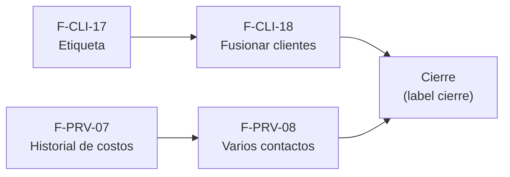

# Tasks: Clientes y proveedores · Mejoras de clientes y proveedores

**Input**: `specs/20261029-100000-mejoras-de-clientes-y-proveedores/` (spec.md, plan.md, contracts/)

**Formato**: `- [ ] T### [P] [F-XXX-NN][USy] descripción`. **[P]** = paralelizable (archivos distintos, sin dependencia); sin [P] = secuencial. Las dependencias de cada tarea son solo dentro de su historia. Regla del proyecto: ninguna tarea queda `[ ]` al cierre — se hace con evidencia o se cierra con `[x]` + `Desvío:` y seguimiento trazado.

**Delivery scope**: `refine`, `supabase`

## Matriz de trazabilidad Jira ↔ US ↔ tasks

| Jira | Historia | FR / SC | Tasks |
|------|----------|---------|-------|
| MSF-446 · F-CLI-17 | US1 Etiqueta impresa del cliente | FR-001…005, SC-001, SC-002 | T001–T005 |
| MSF-447 · F-CLI-18 | US2 Fusionar clientes duplicados | FR-006…014, SC-003…006 | T006–T013 |
| MSF-448 · F-PRV-07 | US3 Historial de costos por proveedor | FR-015…019, SC-007…009 | T014–T019 |
| MSF-449 · F-PRV-08 | US4 Varios contactos por proveedor | FR-020…026, SC-010…012 | T020–T025 |
| Tarea de cierre (label cierre) | Docs, seguridad y roadmap | FR-027, SC-013 | T026–T028 |

### Dueño único por requisito

| Requisito | Tarea dueña | | Requisito | Tarea dueña |
|---|---|---|---|---|
| FR-001, FR-005 | T002 | | FR-015 | T014 |
| FR-002 | T001 | | FR-016, FR-017 | T015 |
| FR-003 | T003 | | FR-018 | T017 |
| FR-004 | T004 | | FR-019 | T018 |
| FR-006, FR-007, FR-010, FR-011 | T006 | | FR-020, FR-021 | T020 |
| FR-009 | T007 | | FR-022, FR-023 | T021 |
| FR-008 | T008 | | FR-024 | T022 |
| FR-012 | T009 | | FR-025, FR-026 | T024 |
| FR-013 | T011 | | FR-027 | T026 |
| FR-014 | T012 | | | |

SC-001, SC-002 → T005 · SC-003, SC-004, SC-005 → T010 · SC-006 → T013 · SC-007, SC-008 → T016 · SC-009 → T019 · SC-010, SC-011 → T023 · SC-012 → T025 · SC-013 → T027. Las citas «(FR-…)» dentro de cada tarea indican lo que verifica o toca, no la propiedad.

## Phase 1: F-CLI-17 · Etiqueta impresa (MSF-446, US1)

**Purpose**: etiqueta individual y por selección, solo frontend.

- [ ] T001 [F-CLI-17][US1] Verificar que `authenticated` lee las columnas de `public.clientes` necesarias (incl. `expreso_preferido`; si falta un grant, migración aditiva `20270115090000_*` en esta historia) y crear `apps/web/src/lib/etiquetasCliente.ts` con `armarEtiqueta` y `faltantes` (solo la dirección bloquea; vacíos se omiten; en selección separa aptos y omitidos) + Vitest (FR-002).
- [ ] T002 [F-CLI-17][US1] Crear `components/clientes/HojaEtiquetas.tsx` (basada en `DocumentoA4`: `@page`, `@media print` sin menú ni barra) y la ruta lazy `/clientes/etiquetas` dentro de `RequiereAccesoSeccion` (clientes lectura), con carga/vacío/error y aviso de dato faltante (FR-001, FR-005).
- [ ] T003 [P] [F-CLI-17][US1] En `pages/clientes/show.tsx` agregar «Etiqueta» (encabezado) e «Imprimir etiqueta de envío» (bloque), aviso «Etiqueta enviada a imprimir» y aviso del dato faltante (FR-003).
- [ ] T004 [P] [F-CLI-17][US1] En `pages/clientes/list.tsx` agregar «Imprimir etiquetas» a la selección de filas, acotada a la empresa activa (invalida consultas, reencuadra paginación y descarta la selección al cambiar de empresa) (FR-004).
- [ ] T005 [F-CLI-17][US1] Pruebas: E2E/Vitest de `CA-CLI-17-1` (sin dirección → aviso y sin hoja), etiqueta individual y por selección con omitidos, y cambio de empresa activa (SC-001, SC-002).

**Checkpoint**: etiquetas operativas sin tocar la base de datos de negocio.

## Phase 2: F-CLI-18 · Fusionar clientes duplicados (MSF-447, US2)

**Purpose**: fusión atómica solo para el Administrador.

- [ ] T006 [F-CLI-18][US2] Migración `20270115100000_fusion_clientes.sql`: `public.fusionar_clientes(...)` (`security definer`, `search_path = ''`, permisos `revoke`/`grant`) con verificación de Administrador, bloqueo de ambas filas, validaciones, reasignación de documentos de venta y cuenta web (colisión por tienda), campañas si existe la tabla, y archivo del descartado (FR-006, FR-007, FR-010, FR-011). Reversión documentada en la cabecera.
- [ ] T007 [F-CLI-18][US2] Migración `20270115100100_fusion_clientes_cuenta_web.sql`: parámetro `p_cuenta_web_de`; rechazo si ambos tienen cuenta web activa sin resolver y baja de la cuenta no elegida (FR-009).
- [ ] T008 [F-CLI-18][US2] Migración `20270115100200_fusion_clientes_actividad.sql`: evento `cliente.fusionado` con ambos clientes (nombre y N.º, sin DNI/CUIT), en la misma transacción (FR-008).
- [ ] T009 [F-CLI-18][US2] Migración `20270115100300_vista_previa_fusion_clientes.sql`: `public.vista_previa_fusion_clientes` de solo lectura (FR-012).
- [ ] T010 [F-CLI-18][US2] pgTAP `supabase/tests/fusion_clientes.test.sql`: 3 + 5 = 8 compras, descartado archivado y evento (SC-003); Operador rechazado y `anon` sin ejecución (SC-004); dos cuentas activas sin resolver, validaciones y atomicidad (SC-005).
- [ ] T011 [F-CLI-18][US2] `components/clientes/DialogoFusionarClientes.tsx` + `lib/clientes.ts`: buscar otro cliente, elegir ficha a conservar, vista previa, resolver cuenta web, confirmar; foco, errores claros (FR-013).
- [ ] T012 [F-CLI-18][US2] Acción «Fusionar con otro cliente…» en `pages/clientes/show.tsx` solo para el Administrador; al terminar recarga la ficha del conservado con la suma de compras (FR-014).
- [ ] T013 [F-CLI-18][US2] Vitest del diálogo y de la visibilidad de la acción por rol, teclado y lector (SC-006).

**Checkpoint**: `CA-CLI-18-1` y `CA-CLI-18-2` verdes.

## Phase 3: F-PRV-07 · Historial de costos por proveedor (MSF-448, US3)

**Purpose**: costo de línea opcional y evolución por producto y proveedor.

- [ ] T014 [F-PRV-07][US3] Migración `20270115110000_costo_ingreso_opcional.sql`: `costo_unitario_usd` admite `NULL`; `registrar_ingreso_mercaderia` (misma firma) acepta líneas sin costo y no las usa para actualizar el costo del producto; reversión documentada (FR-015).
- [ ] T015 [F-PRV-07][US3] Migración `20270115110100_historial_costos_producto.sql`: `public.historial_costos_producto` (ingresos registrados, líneas con costo, permisos Rentabilidad + Proveedores, organización de la sesión) (FR-016, FR-017).
- [ ] T016 [F-PRV-07][US3] pgTAP `supabase/tests/historial_costos_producto.test.sql`: dos ingresos a distinto costo con fecha (SC-007); sin costo ≠ 0, anulado excluido, permisos y organización (SC-008).
- [ ] T017 [F-PRV-07][US3] Formulario de «Ingreso de mercadería»: costo unitario opcional, sin cambiar el resto del diseño (FR-018).
- [ ] T018 [F-PRV-07][US3] `components/proveedores/DialogoEvolucionCosto.tsx` y acción por producto en la ficha del proveedor, con permisos y estados de carga/vacío/error (FR-019).
- [ ] T019 [F-PRV-07][US3] Vitest del formulario con costo vacío y de la vista de evolución (SC-009).

**Checkpoint**: `CA-PRV-07-1` y `CA-PRV-07-2` verdes.

## Phase 4: F-PRV-08 · Varios contactos por proveedor (MSF-449, US4)

**Purpose**: contactos con un solo principal que alimenta la ficha.

- [ ] T020 [F-PRV-08][US4] Migración `20270115120000_proveedores_contactos.sql`: tabla `dominio.proveedores_contactos` (esquema `dominio`, re-verificado), RLS, índice único parcial de principal, sin grants de escritura directos (FR-020, FR-021).
- [ ] T021 [F-PRV-08][US4] Migración `20270115120100_proveedores_contactos_rpc.sql`: `listar_contactos_proveedor`, `agregar_contacto_proveedor`, `marcar_contacto_principal` (desmarca el anterior y copia a la ficha, con lock) (FR-022, FR-023).
- [ ] T022 [F-PRV-08][US4] Migración `20270115120200_proveedores_contactos_actividad.sql`: eventos `proveedor.contacto_agregado` y `proveedor.contacto_principal_cambiado` (FR-024).
- [ ] T023 [F-PRV-08][US4] pgTAP `supabase/tests/proveedores_contactos.test.sql`: `CA-PRV-08-1` y concurrencia (SC-010); RLS por organización y nivel, grants y `anon` (SC-011).
- [ ] T024 [F-PRV-08][US4] `components/proveedores/ListaContactos.tsx` en la ficha (lista, «Agregar contacto», «Marcar como principal», ocultas sin edición) y campos de contacto de solo lectura en «Editar proveedor» con principal (FR-025, FR-026).
- [ ] T025 [F-PRV-08][US4] Vitest de la lista y del diálogo de edición con principal (SC-012).

**Checkpoint**: `CA-PRV-08-1` verde.

## Phase 5: Cierre (docs, seguridad, roadmap)

- [ ] T026 [CIERRE] Actualizar `docs/clientes.md`, `docs/proveedores.md`, `docs/ingreso-de-mercaderia.md`, `docs/actividad.md`, `docs/permisos-por-rol.md` y registrar los contratos (FR-027); `pnpm docs:check`.
- [ ] T027 [CIERRE] Revisión de seguridad y de esquemas (`authz-security`; Principio VII re-verificado por tabla) y corrida de `pnpm lint`, `pnpm build`, `pnpm infra:config`, `pnpm test`, `pnpm prototipo:check`, `pnpm matriz:check` (SC-013).
- [ ] T028 [CIERRE] Al merge del PR (merge commit `--no-ff`): actualizar la fila de `docs/roadmap-template.md`, comprobar que ninguna tarea quedó `[ ]` y que la rama no se borra hasta confirmar el cierre estable.

## Dependencias

Dentro de cada historia:

- F-CLI-17: T001 → T002 → T003 [P] y T004 [P] → T005.
- F-CLI-18: T006 → T007 → T008 → T009 → T010; T011 → T012 → T013 (la UI usa las RPC de contratos; se prueba con la base ya migrada).
- F-PRV-07: T014 → T015 → T016; T017 y T018 → T019.
- F-PRV-08: T020 → T021 → T022 → T023; T024 → T025.
- Cierre: T026 → T027 → T028.

## Plan de ejecución (historias)

El **orden de toma** de las historias lo declara esta tabla: el orquestador la **consume**. Una historia arranca cuando sus dependencias (`Depende de`) están **Finalizadas (mergeadas)**; las del **mismo** `Grupo` van **en paralelo**. Las cuatro historias son independientes en datos y migraciones; solo se serializan las que editan el mismo archivo de ficha (`pages/clientes/show.tsx` y `pages/proveedores/show.tsx`). La **tabla es la AUTORIDAD**.

| Historia | Depende de | Grupo |
|----------|------------|-------|
| F-CLI-17 (MSF-446) | — | 1 |
| F-PRV-07 (MSF-448) | — | 1 |
| F-CLI-18 (MSF-447) | F-CLI-17 | 2 |
| F-PRV-08 (MSF-449) | F-PRV-07 | 2 |
| [Cierre] | F-CLI-17, F-CLI-18, F-PRV-07, F-PRV-08 | 3 |

